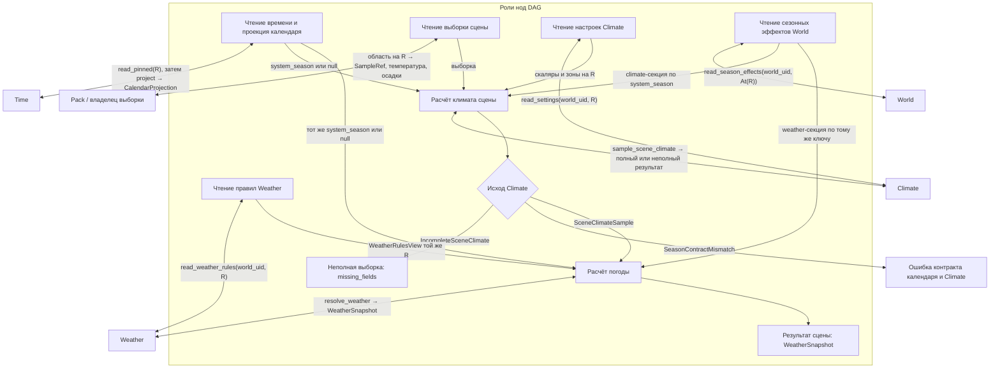

# Climate C1 · D1 к согласованию

## 1. Целевая архитектура

### 1.1. Карта пакетов, классов и вызовов

Пути ниже отсчитываются от `backend/app/`. **Есть** означает существующий символ; **цель** — предлагаемое размещение при реализации. Группировка покрывает 13 публичных методов C1. Карта различает модели данных и вызываемые нодами application-классы.

| Владелец | Файл | Классы и ответственность |
|---|---|---|
| World / календарь (есть) | `dataModel/world/calendar/catalogs/seasons.py`, `dataModel/world/calendar/projection/result.py` | `CalendarSeasonRegistry` содержит `SeasonEntry`; `CalendarProjection.season` несёт ключ из этого реестра. |
| World / настройки (цель) | `dataModel/world/settings/seasonEffects.py` | `WorldSeasonEffects` связывает ключи CalendarSeasonRegistry с `SeasonEffects`. Каждая запись содержит ClimateSeasonEffects и WeatherSeasonEffects. World владеет привязкой и её версией; типы секций определяют соответствующие домены. |
| World / reader эффектов (цель) | `application/worldData/seasonEffects/reader.py`, `dataModel/world/settings/seasonEffects.py` | IWorldSeasonEffectsReader.read_season_effects(world_uid, At(R)) → WorldSeasonEffectsView(world_uid, R, effects: WorldSeasonEffects). WorldNotFound / PublicationUnavailable / InvalidStoredSettings. Нода получает таблицу у World, связывает её с CalendarProjection.season на той же базе и передаёт секции владельцам. null-сезон даёт пустые секции; для заданного ключа отсутствие записи — SeasonContractMismatch. Подмена исторической базы текущей запрещена. |
| Time (есть) | `application/time/reads/reader.py`, `application/time/calendar/projection.py` | `TimeReader.read_pinned` выдаёт TimeCapture; `CalendarProjector.project` выдаёт CalendarProjection. Обе операции вызывают ноды. |
| Climate / авторские типы | `dataModel/climate/worldClimateScalars.py`, `dataModel/climate/climateZone/worldClimateZoneRegistry.py` (есть); `dataModel/climate/settings/seasonEffects.py` (цель) | `WorldClimateScalars`, `WorldClimateZoneRegistry` остаются моделями Climate. `ClimateSeasonEffects` задаёт типы климатических модификаторов; при миграции получает температурную поправку из прежнего SeasonTempOffsets. |
| Climate / настройки (цель) | `application/worldData/climate/settings/reader.py`, `application/worldData/climate/settings/prepareOpenPipeline.py`, `application/worldData/climate/settings/zoneChanges.py` | `ClimateSettingsReader.read_settings`; `ClimateSettingsPrepareOpenPipeline.prepare_change` реализует `IClimateSettingsPrepareOpenPipeline`; `ClimateZoneChanges` предоставляет prepare_upsert_zone, prepare_remove_zone и prepare_replace_zones. Каждый метод получает сведения о зависимостях от DAG и возвращает свой результат. |
| Climate / выборка сцены (цель) | `application/worldData/climate/scene.py`, `dataModel/climate/sampling/scene.py` | `ClimateSceneSampler.sample_scene_climate` принимает ключ сезона, входные измерения и ClimateSeasonEffects. Возвращает `SceneClimateSample` или `IncompleteSceneClimate` из модуля sampling/scene.py; несогласованность ключей даёт ошибку контракта. |
| Climate / материализация (цель) | `application/worldData/climate/materialization/fieldPreparation.py`, `dataModel/climate/materialization/fieldResult.py` | `ClimateFieldPreparation.prepare_materialization` и `.prepare_recalculation` — независимые точки входа DAG. `PreparedClimateField` содержит покрытие, базу и refs подготовленных частей. Численные алгоритмы остаются за этими входами в `application/worldData/generators/climate/`. |
| Weather / модели (перенос и цель) | `dataModel/climate/weatherType/{weatherTypeEntry,worldWeatherTypeRegistry}.py` → `dataModel/weather/rules/{weatherTypeEntry,worldWeatherTypeRegistry}.py`; `dataModel/weather/rules/seasonEffects.py`; `dataModel/weather/scene.py` | Переносятся `WeatherTypeEntry` и `WorldWeatherTypeRegistry`. `WeatherSeasonEffects` описывает сезонные изменения правил. `WeatherSnapshot` переносится из climateRuntimeAssembler и становится результатом Weather. Проверить старые импорты и экспорт при cutover. |
| Weather / публичные операции (цель) | `application/worldData/weather/rules/reader.py`, `application/worldData/weather/rules/changes.py`, `application/worldData/weather/resolveWeatherOpenPipeline.py` | `WeatherRulesReader.read_weather_rules`; `WeatherRuleChanges` предоставляет prepare_upsert_weather_type, prepare_remove_weather_type, prepare_replace_weather_rules. `WeatherResolveOpenPipeline.resolve_weather` реализует `IWeatherResolveOpenPipeline`: получает через DAG полный sample и правила одной базы, возвращает WeatherSnapshot. |

**Связи классов.** WorldSeasonEffects использует декларации двух владельцев. ClimateSceneSampler и WeatherResolveOpenPipeline не импортируют application-сервисы друг друга. Нода передаёт результат первого во вход второго; только DAG выбирает дальнейшую операцию. Инфраструктурные объекты собираются в существующем composition root `core/container/worldData.py`. Связь HTTP с принятым графом остаётся в `api/routes/`. Размещение будущих concrete-нод определяется при отдельной приёмке графа.

**Граница карты.** Для runtime C1 пути выше задают целевое размещение. Для расширения C1-EXT с произвольными пространственно-временными воздействиями владельцы схем и классы ещё проходят отдельное исследование; размещать все внешние факторы в Climate преждевременно.

### C1-EXT. Архитектура количественных показателей Environment

**Граница хранения.** World версионирует декларации видов N+1, их показателей и настроечных диапазонов. Авторитетный владелец пространственного факта хранит исходное измерение или обеспечивает его воспроизводимое чтение по R. Если тот же факт уже представлен environmental cell state или данными Spatial, reader проецирует этот источник. Пересчёт единиц, вывод в редакторе и передача двум потребителям сохраняют идентичность факта. Радиус относится к размещению экземпляра; nature_kind и направление source_kind → target_kind относятся к декларации вида.

**Карта целевых классов и портов (предложение; пути от backend/app/).**

| Слой и файл | Тип / операция | Ответственность и критерий отказа |
|---|---|---|
| World Environment · dataModel/worldEnvironment/indicators/definition.py | EnvironmentIndicatorDefinition, IndicatorRange, PercentBasisSpec | Декларация связывает номинальные ключи вида и показателя с версией утверждённой схемы величины, единицей/шкалой, min/max мира и, для процентов, определением 100 %. Опора — типизированная константа с единицей или ссылка на измеряемую ёмкость. Версионирование World фиксирует изменения единицы, опоры и диапазона. FAIL: интерпретация max как 100 % без такой декларации. |
| Контракт данных · dataModel/worldEnvironment/indicators/observation.py | IndicatorReadRequest, IndicatorObservation, IndicatorReadResult | Запрос задаёт ключи, world_uid, публикацию, XY/XYZ-область и момент/интервал. Observation несёт точную ссылку на факт и схему, значение в объявленной форме, покрытие, способ получения и provenance. Результаты чтения: измерение (включая 0), подтверждённое отсутствие, недостаточное покрытие, типизированная ошибка. FAIL: неизвестная схема декодируется как произвольный payload или неизвестное покрытие превращается в ноль. |
| Application · application/worldData/environment/indicators/ports.py | IIndicatorReader[T].read_indicator(request: BoundIndicatorRead[T]) → IndicatorReadResult[T] | Только общий Protocol. Реализации находятся у владельцев фактов. Каждой вызывающей ноде внедряется конкретный owner-port в composition root. FAIL: общий исполняемый reader с таблицей delegates, callback или поиском сервиса по строке. |
| Application · application/worldData/environment/indicators/conversion.py | IndicatorUnitProjection.project(definition, observation, requested_representation, resolved_basis) → проекция значения либо типизированный отказ | Чистый расчёт над переданными данными. Нода DAG заранее получает динамическую опору через reader её владельца. Для абсолютного x и положительной опоры b в совместимых единицах p = 100 × x / b; обратно x = p × b / 100. Обе формы ссылаются на исходный факт. Отсутствующая, нулевая или чужая по области/версии опора и несовместимые размерности исключают пересчёт; исходное значение остаётся читаемым. FAIL: запрос latest, побочная запись или запуск другого публичного метода внутри project. |

**Путь через DAG.** Ноды читают у World декларацию, у владельца — факт, при запросе пересчёта — опору на той же базе. Нода передаёт значения в чистую проекцию. Затем ноды передают одну идентичность наблюдения в независимые публичные операции gameplay и растительности. Порог и закон действия инкапсулированы у каждого потребителя. Reader выдаёт данные, ветвлением между вызовами владеет DAG. Изменение мира по результату потребителя проходит через применимый lifecycle Pack/Snapshot; чтение и показ процентов завершаются без commit.

**Приёмка.** На одинаковых T/R и области опора 200 000 даёт 2 % для 4 000 единиц даже при max=250 000. Значение 120 мкЗв/ч остаётся мощностью дозы; при явно заданной опоре 200 мкЗв/ч проекция даёт 60 %. Запрос одного факта в двух формах не удваивает его воздействие. Смена LOD и повторное чтение не применяют эффекты. Скрытый междоменный вызов, изменение порядка стадий публичного pipeline или запуск потребителя из reader — отдельные основания для отказа. [Примеры и граничные случаи](#примеры-приёмки-количественных-показателей-environment).

**Статус.** Зафиксированы целевые границы и критерии; имена классов и файлов предложены для review. До реализации требуются привязка к реальным владельцам и Spatial/Time refs, формат регистрации типизированных схем и единиц, точность/округление и wire-версии. Этот раздел уточняет карту C1-EXT после первоначальной сверки с 14f70134.

#### C1-EXT: регистрация схемы и прямой вызов reader владельца

**Предложение до freeze.** Две регистрации имеют разный жизненный цикл. Домен-производитель предоставляет декларацию поддерживаемой возможности чтения: закрытый идентификатор owner-port, идентификатор схемы, точная версия, конкретный строгий POJO значения T и спецификация величины/допустимых единиц. Composition root связывает owner-port с его реализацией при сборке. Декларации для проверки World содержат данные о возможностях без ссылок на исполняемые readers. Перед включением возможности требуется единственная привязка для пары (owner-port, schema@version), доступный typed codec и принятая ветвь DAG. Регистрировать новый ключ мира в рамках уже поддержанной возможности можно без изменения графа.

| Операция | Вход и результат | Инвариант / отказ |
|---|---|---|
| World: подготовить декларацию | Ключ вида и ключ показателя своих реестров, ссылка на поддержанную возможность, единица, диапазон и опора процентов → проверенная EnvironmentIndicatorDefinition | World проверяет принадлежность ключей и единственность определения показателя внутри вида. Мастер выбирает объявленную возможность; авторитетный владелец и схема следуют из неё. World сохраняет привязку с ревизией декларации. Неизвестная схема, недопустимая единица или неоднозначный владелец отклоняют запись до commit. Из названия показателя и nature_kind владелец не выводится. |
| World.read_indicator_definition | (world_uid, At(R), вид, показатель) → вариант привязки владельца со схемой, единицей и ссылкой на версию определения | Тип RegistryKey задаёт пространство имён; наличие записи проверяется в реестре конкретного мира на R. Вариант является данными для DAG. Одинаковое текстовое имя в другом реестре или мире не даёт валидную привязку. [RegistryKey](../../backend/app/dataModel/registryKey.py) |
| DAG → публичная read-нода владельца | Нода получает вариант привязки; граф явно выбирает соответствующую ветвь. Нода ветви сужает тип до поддержанной схемы и вызывает свой порт IIndicatorReader[T] с запросом, содержащим привязку, R, область и время. | Конкретную реализацию поставляет DI выбранной ноды. Environment не получает коллекцию readers и не выбирает следующий вызов. Отсутствующий binding даёт отказ; поиск работающего reader последовательными пробами запрещён. |
| Владелец: прочитать наблюдение | Проверить world/R, ключи, owner-port, schema id/version и единицу в сохранённом заголовке; затем строго декодировать payload соответствующим T, проверить диапазоны схемы и provenance → IndicatorObservation[T] либо типизированный исход чтения | Чужой источник, неподдерживаемая версия, несовместимая единица и ошибочное тело различимы от подтверждённого отсутствия и недостаточного покрытия. Настроечные min/max мира не обрезают наблюдение. По умолчанию версия и хранимая единица совпадают точно. Миграция версии требует явного совместимого codec; перевод совместимых единиц остаётся отдельной проекцией. Для At(R) используется привязка из R, включая прежнего владельца/codec при последующей смене декларации. |

**Приёмка маршрута.** На двух поддержанных вариантах A и B один ключ, связанный с A, вызывает reader A один раз и reader B ноль раз. Для ключа B — обратный результат. Неподдержанная ветвь завершает запрос до вызова readers. Если в хранилище A обнаружено значение с чужой схемой/единицей, reader A возвращает ошибку, B не вызывается. Добавление ещё одного имени мира с той же привязкой A сохраняет граф. Это проверяет как номинальную типизацию, так и отсутствие скрытого междоменного диспетчера. [Граница общего Spatial reader](./spatial-distribution-domain.md#L115) · [Три запрета DAG](../rules/dag-generator-interface.mdc#обязательная-приёмка-плана-любого-домена).

**OPEN для C1-EXT:** инвентарь фактических владельцев и переиспользуемых схем; закрытые варианты binding и точные POJO, enum ошибок, единицы, codec/version и файлы у каждого владельца; долговременная доступность исторических схем и данных; совместная приёмка соответствующих DAG bindings. Этот проект протокола не подтверждает готовность реализации.

### 1.2. Ответственность и поток данных

#### Что публично и где заканчивается абстракция

**Целевая карта импортов.** Нода получает экземпляр по публичному порту через DI. Сигнатура порта содержит только типизированный запрос, результат и ошибки операции. Порт задаёт поведение; реализация из §1.1 удовлетворяет порту напрямую. Фабрика в composition root связывает реализации с зависимостями. Постановка в очередь, SQL, путь к blob, правила сопоставления полей и конкретный assembler в контракт ноды не входят. Для малой операции достаточно метода; две согласованные линейные последовательности имеют точку входа OpenPipeline. Предлагаемые файлы портов ниже отделены от модулей реализации в §1.1. Корень путей — backend/app/application/worldData/.

| Публичный порт и его файл (TARGET) | Реализация | Ответственность и проверяемый отказ в приёмке |
|---|---|---|
| IClimateSettingsReader, climate/ports/readers.py | ClimateSettingsReader | Возвращает скаляры и зоны указанной базы; FAIL при repair, чтении latest вместо R или получении погоды внутри метода. |
| IClimateSettingsPrepareOpenPipeline, climate/ports/settingsPrepareOpenPipeline.py | ClimateSettingsPrepareOpenPipeline | Один prepare: presence → merge → проверки → кандидат. Алгоритмы merge и проверок принадлежат внутреннему resolver и чистым функциям Climate. FAIL при вызове Materials, выборе preview/save, commit или реализации доменного алгоритма в управляющей последовательности. |
| IClimateZoneChanges, climate/ports/changes.py | ClimateZoneChanges | Три явно вызываемых метода готовят изменения записей зоны. FAIL при скрытом выборе CRUD-операции, молчаливом удалении используемой зоны или записи в repository. |
| IClimateSceneSampler, climate/ports/readers.py | ClimateSceneSampler | Вычисляет климат по переданным фактам. FAIL при запросе Time/Pack, потере измеренного нуля или запуске Weather. |
| IClimateFieldPreparation, climate/ports/changes.py | ClimateFieldPreparation | Два отдельных метода готовят полное покрытие либо delta. Математика — в генераторах Climate, кодирование и staging — за внутренним портом. FAIL при выборе другого публичного метода по флагу, активации manifest, запуске overlay или возврате пути/SQL-строки вместо typed refs. |
| IWeatherRulesReader, weather/ports/readers.py | WeatherRulesReader | Выдаёт WorldWeatherTypeRegistry на точной публикации R. Сезонную секцию поставляет World. FAIL при подстановке иной публикации, изменении registry или расчёте сцены на read. |
| IWeatherRuleChanges, weather/ports/changes.py | WeatherRuleChanges | Готовит upsert/remove/replace правила над переданным состоянием. FAIL при самостоятельном чтении чужих ссылок, сохранении либо потере версии проверенных зависимостей. |
| IWeatherResolveOpenPipeline, weather/ports/resolveWeatherOpenPipeline.py | WeatherResolveOpenPipeline | Фиксированный порядок вызовов: проверить согласованность входа → вычислить погодный результат → собрать WeatherSnapshot. Расчёт порогов, приоритета и fallback находится в закрытой реализации Weather (целевой модуль weather/rules/evaluate.py). FAIL при копировании условий выбора в ноду или управляющий класс, вызове Climate/Time, записи состояния либо запуске отдельной операции из fallback. |

**Критерии для моделей и существующих участников.**

**Приёмка IWeatherResolveOpenPipeline по трассе вызовов.** Для совпавшего правила, fallback clear, отсутствующего сезона и пустой секции сезонных эффектов успешная трасса одинакова: проверка входа → вычисление погодного результата → сборка WeatherSnapshot. Каждая стадия вызывается ровно один раз в указанном порядке. Пороги, приоритет, сезонные значения и fallback вычисляются внутри второй стадии. При ошибке допустимо завершение на текущей стадии с возвратом типизированного отказа в DAG; выполненная трасса остаётся префиксом той же последовательности. При ревью реализации проверить вложенные вызовы и сравнить трассы на этих входах. Если данные, конфигурация, callback или обработчик ошибки выбирают следующую стадию, пропускают, добавляют, повторяют либо переставляют стадию — **FAIL**, даже при правильном итоговом типе погоды. Альтернативный маршрут может выбрать только DAG после получения результата.

| Класс | Наблюдаемый результат; основание для отказа |
|---|---|
| CalendarSeasonRegistry / SeasonEntry | Registry проверяет уникальность; entry задаёт идентичность и подпись. FAIL при использовании подписи как ключа или вычислении погоды из названия. |
| CalendarProjection / CalendarProjector / TimeReader | Projection переносит календарный результат; projector вычисляет его по входному моменту и версии; reader читает время на указанной публикации. FAIL при потере версии, подмене ошибки чтения сезоном null или применении поправок Climate внутри Time. |
| WorldSeasonEffects / SeasonEffects | Первый связывает ключ календаря с записью, второй объединяет две типизированные секции. FAIL при свободном JSON, скрытой формуле погоды в World либо смешении пустого payload и отсутствующего ключа. |
| WorldClimateScalars / WorldClimateZoneRegistry / ClimateSeasonEffects | Скаляры задают значения и defaults, реестр содержит записи зон, секция объявляет климатические эффекты. FAIL при дублировании схемы в API, чтении БД моделью или интерпретации погодной секции в Climate. |
| SceneClimateSample / IncompleteSceneClimate | Первый содержит полные измерения и provenance, второй — фактически имеющиеся значения и отсутствующие поля. FAIL, если неполный результат допустим на входе Weather или нулевые осадки становятся missing. |
| PreparedClimateField | Адресованные части поля, покрытие, база и refs. FAIL, если результат подготовки объявляется принятой публикацией или теряет базу заменяемой части. |
| WeatherTypeEntry / WorldWeatherTypeRegistry / WeatherSeasonEffects | Запись задаёт условия одного правила, реестр хранит упорядоченный набор, секция содержит эффекты погоды. FAIL при дублировании Climate-эффектов или зависимости POJO от executor/repository. |
| WeatherSnapshot | Итог для сцены с привязкой к использованной выборке. FAIL при хранении в результате исполняемого callback, storage handle или изменении исходного реестра через результат. |

**Проверка заменяемости.** Для каждого из 13 методов проверить импорты и аннотации ноды, создание экземпляра в composition root и вложенные вызовы реализации, включая worker, fallback и debug. Подставить вторую реализацию порта с тем же I/O/Error: caller, граф и transport DTO должны оставаться пригодными без правки. Прямой импорт нодой реализации, assembler, SQLite-репозитория или pack writer, второй публичный pipeline внутри первого, выбор следующей стадии вне DAG либо прямой вызов соседнего домена — каждый отдельно даёт FAIL. Тот же критерий действует, если утечка скрыта за factory, callback или DI. Общий staging port разрешён для подготовки артефактов; право публикации проверяется отдельно. [Три запрета DAG](../rules/dag-generator-interface.mdc#обязательная-приёмка-плана-любого-домена) · [Критерий ответственности управляющего класса](../rules/class-size-limit.mdc#инвариант-хорошего-plannerorchestratorа).

**Статус проверки.** Карта и критерии проверяют целевой дизайн C1. Общая приёмка остаётся OPEN до freeze POJO/Error и внешних read-контрактов, решения C1-EXT, проверки реальных imports/callers при cutover и совместного согласования bindings. Наличие интерфейса и суффикса OpenPipeline само по себе не доказывает изоляцию.

**World хранит версионированные авторские настройки; Time определяет текущий сезон; Climate рассчитывает климат сцены; Weather определяет погоду. Оркестрация принадлежит DAG.**

| Владелец | Вход → результат | Граница ответственности |
|---|---|---|
| World | Календарь и настройки выбранного мира → согласованная авторская версия или чтение по публикации R | Идентичность сезона задаёт system_season. Эффекты адресуются этим ключом. При сохранении проверяются итоговый календарь, покрытие эффектами и ожидаемые версии. До старта игры редактор сохраняет в первую рабочую ревизию. |
| Time | Момент и версия календаря → календарный ключ сезона либо null | Возвращает результат ноде DAG. Число и названия сезонов задаются данными мира. |
| Climate | Выборка поверхности, сезон и типизированная секция Climate → климатические величины сцены либо диагностика | Определяет схему, единицы, валидацию и расчёт своих эффектов. С материализацией работает по закреплённой планировке. |
| Weather | Полный результат Climate, тот же сезон, правила и типизированная секция Weather → WeatherSnapshot | Определяет схему своих эффектов и правила выбора погоды. |
| DAG | Типизированные результаты публичных операций → входы следующих операций | Ноды напрямую вызывают владельцев. DAG выбирает ветви preview/save, полного/частичного расчёта и реакцию на неполную выборку. До gameplay ведёт результат материализации к активации Pack; после старта собирает PatchSet для Snapshot.apply. |

**Чтение сцены.** Ноды получают сезон у Time, выборку у владельца поверхности, настройки и правила у Climate и Weather, таблицу сезонных эффектов у World.read_season_effects(world_uid, At(R)). Все входы привязаны к одной публикации. Нода передаёт сезон и климатическую секцию в Climate. При полном результате другая нода передаёт его, тот же сезон и погодную секцию в Weather. Каждый pipeline возвращает результат DAG. [Граф вызовов](#пример-оркестрации-погоды-сцены-через-dag).

**Редактирование.** API передаёт намерение в DAG. Ноды запрашивают версии и сведения по ссылкам у владельцев, затем вызывают публичную подготовку изменения. Для preview DAG возвращает кандидат; для сохранения передаёт его владельцу commit. Чтение и сохранение настроек отделены от явного запроса материализации.

**Расширение.** Один ключ сезона связывает календарь с типизированным payload. Новый сезон добавляется данными; новый эффект описывается в секции его домена вместе с типом, единицами, семантикой отсутствия и потребителем. Пустой payload явно задаёт сезон без изменений. Отсутствие записи для используемого сезона даёт ошибку контракта. Ни количество сезонов, ни перечень эффектов не определяют топологию графа. Примеры полей ниже иллюстрируют этот контракт. [Сезонный payload](#типизированные-сезонные-эффекты).

**Статус.** Здесь зафиксирована целевая архитектура. Точные wire-схемы, миграция и bindings проходят свои этапы согласования. Критерии приёмки маршрутов — [три запрета DAG](#приёмка-маршрутов-по-трём-запретам).

### Публичные контракты Climate и Weather для DAG

Регистрация кандидатов и статус freeze — [реестр публичных методов генератора](./generator_public_method.md#climate-и-weather--публичные-операции-для-dag). Зависимость материализации от актуального surface plan рассматривает [GEN-SURFACE-PLAN](./generator-public-surface-planning.md); порядок потребляющих нод проходит [GEN-NODE-JOINT-REVIEW](./gen-dag-1-post-geo-ws.md).

**Целевая граница (уточнение мастера).** Climate владеет климатическими полями и расчётом сезонной температуры. Weather — отдельный домен, владеющий правилами выбора погоды и результатом для сцены. World по-прежнему хранит настройки выбранного мира. В описанном ниже составном чтении C1 поле weather означает правила из WorldWeatherTypeRegistry, поставляемые Weather для той же публикации. Опубликованный просмотр использует R; редактируемая форма получает тот же состав полей из авторской базы open_climate_draft. Физическое расположение текущих классов в dataModel/climate описывает существующую реализацию.

**Действующие вызовы.** [generate_climate](../../backend/app/application/engine/nodes/pojo/python/climate/generateClimateNode.py) читает мир, локации и готовые клетки поверхности, вызывает apply_climate_pass и сохраняет поля; пустая карта даёт generate_climate_empty_map. [recalculate_climate](../../backend/app/application/engine/nodes/pojo/python/climate/recalculateClimateNode.py) создаёт ClimateRecalcRequest() и сохраняет изменённые клетки. Обе ноды возвращают cells/count. [resolve_weather](../../backend/app/application/engine/nodes/pojo/python/climate/resolveWeatherNode.py) зависит от terrain_context, усредняет доступные temperature_base и rainfall отдельно, при отсутствии значений использует 12 и 0, всегда передаёт season=None. [ClimateRuntimeAssembler](../../backend/app/application/worldData/generators/assemblers/climateAssembler/climateRuntimeAssembler.py) вычисляет effective_temperature, но возвращает system_weather=None и intensity=0. Выбор по реестру описан в [ТЗ Climate](../../docs/tz_climate.md#L970).

**Контракт вызовов (предложение; имена новых типов рабочие).** DAG выбирает источник и передаёт результаты между операциями. Для runtime общий ключ SampleRef содержит world_uid, точную принятую публикацию R и ссылку на выборку сцены в контексте вызова. Результаты разных миров или публикаций нельзя объединить. При bake исходная база — закреплённый набор авторских версий. Публичные доменные операции не получают engine state, HTTP request или общий словарь context.

| Владелец и операция | Input | Output | Отказы и эффекты |
|---|---|---|---|
| Climate · подготовить материализацию / пересчёт | Закреплённый план, область, варианты LOD и входы запроса; для пересчёта — область и назначение пересчёта из события. Имена generate_climate/recalculate_climate обозначают сценарии legacy | Подготовленный результат Climate с областью, provenance и ссылками на staged artifacts; пустое изменение — явный успешный исход | Домен проверяет пригодность входов, вычисляет результат и при необходимости передаёт его в staging. DAG ведёт материализацию вплоть до передачи результата владельцу публикации. Форматы результата и патча требуют freeze. |
| Climate · sample_scene_climate | SampleRef, temperature_base:int или null и rainfall:int или null после независимой агрегации по доступным значениям, season:Key[CalendarSeasonRegistry] или null от Time через DAG, ClimateSeasonEffects той же базы | SceneClimateSample(ref, season, temperature_base:int, effective_temperature:int, rainfall:int). При заданном сезоне effective = base + соответствующий offset, при null — base | Сезон без поправки — ошибка контракта SeasonContractMismatch; несовместимый источник — SourceMismatch; отсутствующая публикация — PublicationUnavailable. При отсутствии хотя бы одного поля возвращается неполная выборка по контракту ниже. Чистый расчёт. |
| Weather · read_weather_rules | world_uid, At(R) | WeatherRulesView(world_uid, R, registry:WorldWeatherTypeRegistry). DAG разрешает Current один раз у World; для сцены использует At(sample.ref.R) | WorldNotFound, PublicationUnavailable, InvalidStoredSettings. Чтение без записи или repair. |
| Weather · resolve_weather | полный SceneClimateSample, тот же календарный ключ, WeatherRulesView и WeatherSeasonEffects того же мира и R | WeatherSnapshot со ссылкой на sample, сезоном, базовой и эффективной температурой, rainfall, выбранным system_weather. Для совместимости существующего выхода intensity=0 до отдельной формулы | SourceMismatch при несовместимых входах. При отсутствии совпадения применяется fallback из ТЗ. Результат передаётся потребителю сцены без записи в map_cells. |

**Выбор погоды.** Weather перебирает правила по возрастанию priority, проверяя включительные temp_min/temp_max и rainfall_min. Пустой порог пропускается. Первое совпадение даёт system_weather; при отсутствии совпадений действует запись clear, затем литерал clear с диагностикой по ТЗ. Weather получает уже вычисленную effective_temperature. Источник сезона — календарь/время через DAG. Процесс сохранения текущей погоды локации на последующие тики выходит за рамки чистого resolve.

### Поверхность доменов и ответственность DAG

**Два основания чтения:** Current/At(R) выбирают принятую публикацию. Открытие редактируемой формы запрашивает у World последний согласованный авторский снимок; EditBase из ответа используется при preview/save. Совпадение набора отображаемых полей не делает эти источники взаимозаменяемыми.

**DAG владеет материализацией как сценарием.** Публичные методы чтения, подготовки записи/удаления и настроек находятся в application своего домена, объявления request/result/error — в dataModel того же домена. HTTP передаёт запрос engine. DAG вызывает принятые операции, решает, какие нужны результаты, проверяет совместимость источников при композиции и выбирает следующую самостоятельную операцию. Чтение целого объекта, его части и минимального значения сохраняет одну опубликованную базу. [Принятая архитектура readers](./generator_public_method.md#принятая-архитектура-readers) · [Инвентарь CRUD](./generator-domain-crud-inventory.md) · [Правило DAG](../rules/dag-generator-interface.mdc).

| Что требуется потребителю | Доменный вызов — целевой контракт | Ответственность DAG / граница эффекта |
|---|---|---|
| Опубликованный просмотр выбранного мира | Climate.read_settings(world_uid, At(R)) → скаляры и зоны; Weather.read_weather_rules(world_uid, At(R)) → типы погоды. Каждый reader возвращает свою базу, различает отсутствующую публикацию и невалидные сохранённые данные | DAG разрешает Current один раз, вызывает оба reader по одной R и собирает опубликованное представление. Для исторического запроса используется точная At(R). Вызов Weather из Climate не нужен. |
| Открытие и повторное открытие редактора | World.open_climate_draft(world_uid, actor) → ClimateDraftView(state, base: EditBase) из одного авторского снимка. WorldNotFound / Forbidden / GameplayStarted / DraftUnavailable / InvalidStoredSettings | Вход допускает мир до первого bake. После сохранения 40 форма возвращает 40 с новой базой, даже если At(R7) возвращает 45. При недоступном черновике возвращается ошибка без fallback к R. |
| Чтение готового поля | Pack предоставляет опубликованный coarse/tile ref для мира, R и покрытия; Climate читает/семплирует требуемые значения из предоставленного поля. Отсутствие покрытия и ошибка формата различимы. [Существующие методы и разрыв](./generator-domain-crud-inventory.md#5-read-reuse-целая-сущность--часть--минимум) | DAG решает, достаточно ли чтения или нужна отдельная материализация. Reader не запускает bake при промахе. |
| Запись настроек | Climate.prepare_change(base, PatchClimateScalars, MaterialRegistryView) → validated candidate, версии проверенных зависимостей, consequences либо ошибка поля/ссылки. Будущие upsert/replace записей зоны принадлежат Climate, типа погоды — Weather | Для preview DAG возвращает результат подготовки. Для save он передаёт результат владельцу acceptance: черновик — World; runtime — Snapshot с доменным handler. Квитанция выдаётся после commit. |
| Удаление авторской записи | Climate.prepare_remove_zone(base, system_climate, usage_views); Weather.prepare_remove_weather_type(base, system_weather, usage_views) → подготовленное удаление либо EntryNotFound / InvalidReference с затронутой ссылкой. Кандидаты из C1; первый scalar patch их не открывает | DAG передаёт проверенный результат в тот же lifecycle записи. Удаление всего мира принадлежит World; очистка/удержание файлов принадлежит lifecycle Pack. Для вычисленного WeatherSnapshot сцены самостоятельное хранимое тело и delete в данном срезе отсутствуют. |
| Материализация | Climate получает уже подготовленную планировку, версию входов и область запроса; вычисляет климат своей области и подготавливает ref результата. Кандидаты для reuse: [SurfacePlanBundle](../../backend/app/application/worldData/planning/contracts/surfacePlanBundle.py), [ArtifactRef](../../backend/app/dataModel/artifacts/references.py). Сам по себе ArtifactRef не подтверждает включение в публикацию | DAG запрашивает актуальный план по GEN-SURFACE-PLAN, связывает требуемые генераторные операции, собирает результаты. До gameplay DAG ведёт staging → активация Pack; после старта собирает PatchSet → Snapshot.apply. L0/L2 сохраняют общую базу планировки. |
| Линейный расчёт сцены | Climate.sample_scene_climate(sample, season, offsets) → SceneClimateSample либо IncompleteSceneClimate; только полный sample поступает в Weather.resolve_weather(sample, season, rules, weather_effects) → WeatherSnapshot. Пример самостоятельного OpenPipeline — Weather: проверить согласованность входа → вычислить погодный результат → собрать WeatherSnapshot | DAG предоставляет сезон, sample и правила из соответствующих owners. Между сравнением порогов и выбором fallback DAG не вызывается. Owner получает один вход и возвращает один исход; прямое чтение реестра или вызов соседнего домена внутри resolve исключены. |

Пути файлов и владельцы публичных классов определены в [карте пакетов и классов](#11-карта-пакетов-классов-и-вызовов). Существующие модели и legacy-вызовы перечислены отдельно от предлагаемых классов.

**Критерий границы.** Один запрос редактора на чтение не активирует Pack; preview не пишет. Один запрос на материализацию оставляет решение о публикации у DAG и lifecycle owner. Один расчёт Weather использует переданные значения и правила, не читает latest и не пишет карту. Схема layout revision / invalidation → подготовленный ref → конкретный Pack/Snapshot handler для Climate остаётся до реализации предметом совместного freeze.

**Сквозная приёмка.** Для выборки с base=2, зимним offset=−5 и rainfall=4 Climate возвращает effective=−3. Если у Weather на той же R первым совпадает правило snow с temp_max=0 и rainfall_min=3, результат сцены — snow. Смена только правил Weather при тех же климатических значениях может изменить тип погоды без повторного расчёта полей поверхности. Соединение старой выборки и новых правил из другой R даёт SourceMismatch. Этого пути пока нет в исполнении.

**Согласовано для неполной сцены.** Если в выборке ни одна клетка не содержит значения поля, Climate возвращает IncompleteSceneClimate(ref, temperature_base:int|null, rainfall:int|null, missing_fields). Множество missing_fields содержит ровно имена отсутствующих полей из {temperature_base, rainfall}. При пустой сцене отсутствуют оба поля. DAG получает этот исход без подстановки; Weather принимает только полный SceneClimateSample. Пример проверки: (−3, null) сообщает missing_fields={rainfall}, тогда как (−3, 0) даёт полный sample для расчёта погоды. На выходе Climate исход SourceMismatch остаётся отдельным от отсутствия данных.

При равном priority сохраняется порядок записей в реестре согласно WorldWeatherTypeRegistry.sorted_by_priority. По ТЗ входной check_order служит alias для priority; при наличии обоих побеждает priority. В текущей модели WeatherTypeEntry alias ещё отсутствует.

#### Контракт календарного сезона и Climate

| Граница | Тип, владелец и источник |
|---|---|
| World → Time | World объявляет ключ в [SeasonEntry.system_season](../../backend/app/dataModel/world/calendar/catalogs/seasons.py#L24). Для выбранной публикации [TimeReader.read_pinned](../../backend/app/application/time/reads/reader.py#L12) возвращает TimeCapture либо TimeStateUnavailable. [CalendarProjector.project](../../backend/app/application/time/calendar/projection.py#L84) помещает сезон календарного интервала в [CalendarProjection.season](../../backend/app/dataModel/world/calendar/projection/result.py#L19) типа `Key[CalendarSeasonRegistry] \| None`. |
| Time → нода DAG → Climate (цель) | Нода передаёт полученное значение как аргумент season в [контракт sample_scene_climate](./generator_public_method.md#climate-и-weather--публичные-операции-для-dag). При season=None: effective_temperature = temperature_base. При заданном ключе: effective_temperature = temperature_base + offset этого ключа, включая offset=0. Отказ Time остаётся отказом чтения. |
| Climate → нода DAG (цель) | Для каждого сезона, который может вернуть календарь, должна однозначно разрешаться поправка той же базы. При создании, импорте и изменении одной из сторон проверяется итоговая пара; read-set включает обе версии. Несовместимый кандидат отклоняется целиком с указанием ключа. Несовместимая сохранённая база при расчёте даёт ошибку контракта (предлагаемое имя SeasonContractMismatch); DAG завершает ветвь до Weather. |

**Разрыв с реализацией.** [SeasonTempOffsets](../../backend/app/dataModel/climate/worldClimateScalars.py#L44) объявляет четыре поля. Текущий [resolve_effective_temperature](../../backend/app/application/worldData/generators/assemblers/climateAssembler/climateRuntimeAssembler.py#L25) принимает строку и при неизвестном ключе фактически прибавляет 0. Целевая ошибка, формат хранения произвольных сезонных ключей и миграция четырёх полей пока не реализованы.

#### Типизированные сезонные эффекты

**Согласовано:** World хранит связь по `SeasonEntry.system_season` выбранного календаря в виде типизированных данных. Один календарный сезон может менять несколько параметров Climate и Weather. Количество сезонов задаёт календарь. Ниже предложены wire-форма и поля для согласования; они уточняют прежнюю модель одного температурного offset.

**Предложение.** `season_effects: map[Key[CalendarSeasonRegistry], SeasonEffects]`. Значение — POJO с секциями `climate: ClimateSeasonEffects` и `weather: WeatherSeasonEffects`. Пропущенная секция получает пустой POJO, пропущенный эффект сохраняет исходное значение. Явная запись `"steady": {}` означает сезон без изменений; отсутствующая запись для используемого сезона даёт SeasonContractMismatch. Неизвестное поле, неверный тип или null вместо числового эффекта дают диагностику по пути поля. UI формирует описание для мастера из этих данных.

| Владелец | Пример поля payload | Семантика |
|---|---|---|
| Climate | temperature_offset_c: int | Прибавить к базовой температуре; 0 сохраняет температуру. |
| Climate | rainfall_percent: int ≥ 0 | Доля исходных осадков в процентах: 100 сохраняет значение, 0 обнуляет измеренные осадки. Для неотрицательных целых предлагается округление вниз. Отсутствующий замер остаётся отсутствующим. |
| Weather | rules_by_type: map[ключ WeatherTypeEntry.system_weather, SeasonalWeatherRule] | Пример типизированного изменения существующего правила: rainfall_min: int заменяет его порог перед выбором погоды. Ссылка разрешается в WeatherRulesView той же R. Порог влияет на выбор погоды; исходное количество осадков остаётся выходом Climate. |

Пример для календаря с двумя ключами:

```json
{"season_effects":{"steady":{},"monsoon":{"climate":{"rainfall_percent":150},"weather":{"rules_by_type":{"rain":{"rainfall_min":50}}}}}}
```

В monsoon при исходных осадках 40 Climate передаёт 60. Weather проверяет правило rain с порогом 50 в обычном порядке priority. Каждый домен применяет свою секцию один раз. Новые параметры (например, ветер) требуют объявленного поля, единиц и потребителя Weather. Физическое размещение payload, миграция прежнего season_temp_offsets и набор полей первого выпуска остаются предметом freeze. Для старых четырёх ключей температурное значение переносится без изменения в temperature_offset_c; семантику старого missing восстанавливает прежний resolver до преобразования.

**Открыто для привязки DAG.** Точный reader выборки сцены, источник сохранённого WeatherRulesView по R и реализация alias check_order. Регистрация нод, перенос классов и переключение consumers требуют отдельной реализации.

### C1-EXT — конкретные климатические условия и строго типизированные N+1 воздействия (требование мастера, 2026-11-09)

#### Инвентаризация закрытых механизмов

**Environment: природа вида и направление воздействия.** Ключ N+1 идентифицирует авторский вид. Его природу описывает nature_kind (газ, частицы, метафизика). Направление записывается парой закрытых полей: source_kind задаёт среду источника, target_kind — среду, на которую действует явление. Для обеих позиций предложен один словарь: земля, воздух, any. В конкретном размещении источник имеет координаты и область. Значение any допускает любую из поддерживаемых сред в соответствующей позиции; геометрические условия перехода проверяются отдельно.

| Вид или сценарий | nature_kind | source_kind | target_kind |
|---|---|---|---|
| Проклятие участка земли | метафизика | земля | земля |
| Газ, выпущенный в воздух | газ | воздух | воздух |
| Подземный газ действует под землёй | газ | земля | земля |
| Подземный газ выходит через трещину | газ | земля | воздух |

**Контракт условия C1-EXT.** Потребитель получает через DAG климатический факт с типом, пространственным охватом, временем и версией источника. Climate отвечает за значение и полноту факта. Порог пригодности, совместное применение условий и создание результата принадлежат домену потребителя. Чтение условия само по себе не изменяет состояние мира.

**Количественный контракт показателя (обязателен).** Для измеримого свойства схема вида N+1 задаёт именованную величину, числовой тип, единицу или определённую шкалу, допустимый диапазон и смысл нуля. Для относительной шкалы фиксируются опорные значения и правило интерпретации. Факт несёт значение этой величины, область и момент/интервал, версию источника, покрытие и способ получения (например, точечный отсчёт или среднее по области). Единица может быть закреплена типом поля. Один вид может иметь несколько величин с разными размерностями. nature_kind и source_kind → target_kind классифицируют действие; радиус измеряет его охват. Ни одно из этих полей не заменяет силу, концентрацию или количество перенесённого вещества.

**Диапазон задаёт мир.** Для каждого количественного показателя конкретного N+1 вида мир объявляет min и max в единице этого показателя. Владелец схемы проверяет конечность, min ≤ max и совместимость с физическими ограничениями величины (например, объёмная доля от 0 до 1). Редактор показывает диапазон данного мира. Границы описывают настройку; наблюдение хранит своё фактическое значение. Возможное превышение настроечного диапазона при чтении не даёт права молча обрезать измерение.

**Единица и база процентов.** Количество может быть выражено в единицах мира (например, 4 000 единиц магии), в физической единице (например, мощность дозы 120 мкЗв/ч) или в процентах от явно указанной базы (например, 2 % магической ёмкости области). Это свойство схемы показателя N+1. Процентный факт однозначно определяет, чему соответствуют 100 %; если ёмкость меняется, для пересчёта нужна её величина на той же версии. min/max сами по себе не определяют базу процентов. Для ёмкости 200 000 единиц ровно 2 % соответствуют 4 000 единицам. Редактор может показать обе формы одного измерения. При отсутствии базы пересчёт недоступен.

**Несколько потребителей одного факта.** DAG передаёт одно измерение на одной версии соответствующим доменам. Например, при 4 000 единицах магии правила gameplay могут определить эффект для персонажа, а правила природы — изменение растительности. Каждый потребитель задаёт собственные пороги и закон влияния, сравнивает величины в согласованных единицах и возвращает результат в DAG. Само измерение не запускает эти операции.

#### Примеры приёмки количественных показателей Environment

Значения ниже задаёт мастер тестового мира. Каждый факт относится к конкретной области, моменту T и версии R. Единицу определяет типизированная схема показателя, на которую ссылается N+1 запись мира.

| Сценарий | Настройка мира | Входной факт | Ожидаемый результат |
|---|---|---|---|
| Магия в единицах мира | Запас магии: min=0, max=250 000 ед.; ёмкость именно этой области на R равна 200 000 ед. | Запас = 4 000 ед. | В абсолютной форме — 4 000 ед.; при запросе доли ёмкости — 100 × 4 000 / 200 000 = 2 %. Максимум диапазона 250 000 не участвует в пересчёте. |
| Магия в процентах | Заполненность: min=0, max=100 %; 100 % соответствует ёмкости области. | Заполненность = 2 %; ёмкость на R = 200 000 ед. | 2 / 100 × 200 000 = 4 000 ед. На экране обе формы относятся к одному факту; потребитель применяет эффект один раз. |
| Радиация в физической единице | Показатель — мощность дозы; диапазон мира 0–1 000 мкЗв/ч. Для относительного отображения мастер отдельно задал 100 % = 200 мкЗв/ч. | Мощность дозы = 120 мкЗв/ч. | Основное значение — 120 мкЗв/ч; доля заданного ориентира — 60 %. Для накопленной дозы нужен интервал воздействия. |
| База недоступна | Схема связывает 100 % с ёмкостью области, но значение ёмкости для T и R отсутствует. | Заполненность = 2 %. | Reader сохраняет известные 2 %. Запрос абсолютного количества возвращает исход «база пересчёта недоступна». Подстановка max, нуля или ёмкости другой версии проваливает приёмку. |

**Сквозная проверка потребителей.** Для запаса 4 000 ед. зададим в этом примере два независимых условия: игровой эффект доступен при запасе ≥ 3 000 ед., усиленный рост растительности — при запасе ≥ 5 000 ед. Ноды DAG передают обоим владельцам один факт на T и R. Игровой домен возвращает «условие выполнено», домен растительности — «обычный рост». Оба результата возвращаются в DAG. Пороги принадлежат правилам соответствующих потребителей; reader Environment только выдаёт измерение. При известном нуле оба порога не достигнуты; при неизвестном покрытии оба потребителя получают исход «нет достаточных данных для проверки».

**Масштаб охвата (предложение reuse).** Для воздействия с радиальной областью использовать тот же принцип, что у локального климата: базовый радиус равен доле, заданной миром, умноженной на диагональ опорной области в согласованной системе координат. [Существующий расчёт](../../backend/app/application/worldData/generators/climate/tierResolve.py#L51) использует bbox поля полюсов, а при его отсутствии — размах климатических модификаторов. Для нескольких якорей эффективный радиус дополнительно ограничивается половиной расстояния от точки выборки до ближайшего из остальных якорей. Эта конкуренция и сглаживание края относятся к климатическим якорям. Для Environment предлагается переиспользовать базовый масштаб; точный bbox и долю фиксировать вместе с версией входов. Если миру нужна именно климатическая доля, нода DAG передаёт значение из Climate.read_settings. Частный resolver Climate остаётся внутренним. Физический радиус одной области сохраняется при переходе между coarse и fine.

| Сценарий | Количественный вход через DAG | Приёмка у владельца результата |
|---|---|---|
| Автоподбор леса (существующий пример) | Regions получает средний показатель осадков профилей по области. В текущем контракте шкала rainfall мира 0–100. | При полном покрытии 44 не проходит обязательную границу канонического forest, 45 проходит именно эту проверку. Остальные условия и выбор покрытия остаются у Regions/Landcover. |
| Газ из земли в воздух (пример целевого контракта) | Концентрация конкретного газа в области источника, например объёмная доля 0,02 (2 %), с указанием среды и времени. Связность прохода — отдельный вход от Terrain/Relief. | Концентрация и наличие прохода сами по себе не определяют массу выброса. Владелец переноса задаёт необходимые параметры и единицы результата, например массу за интервал или массовый расход. Climate не вычисляет этот результат. |
| Метафизическое воздействие (пример целевого контракта) | Источник возвращает отдельно радиус в координатных единицах мира и интенсивность по шкале конкретного вида. | Замена радиуса у двух экземпляров с одинаковой интенсивностью меняет охват. Для сравнения интенсивностей потребитель должен иметь совместимые шкалы. |

**FAIL приёмки измерения:** через границу домена передаётся только признак наличия там, где потребитель запрашивает количество; у числа неопределённая единица/шкала; неизвестное покрытие превращается в измеренный ноль; среднее по части области выдаётся за среднее по всей области. Образец существующего различения значений — [ClimateFacts](../../backend/app/application/worldData/regions/regionFacts.py#L7) и [агрегация профилей](../../backend/app/application/worldData/regions/factConsumers/climate.py#L16).

**Обязательный критерий приёмки C1-EXT.** Нода DAG вызывает публичный метод Climate и получает типизированное значение или отказ. Нода-потребитель получает значение через контракт DAG и вызывает публичную операцию своего домена. Для леса это путь Climate → результат в DAG → Regions/Landcover. Для газа ноды отдельно получают факт источника, связность Terrain/Relief и требуемое климатическое условие, затем передают их операции переноса. Climate запрещено вызывать readers, pipelines и repositories соседних доменов; потребителям запрещено самостоятельно вызывать Climate. Ветвление между операциями принадлежит DAG. При ревью плана проверить каждый маршрут, при ревью реализации — реальные callers и вложенные вызовы, включая debug, DI, фасад, callback, событие и worker. Одного нарушения любого из трёх запретов достаточно для **FAIL**. [Общее правило приёмки](../rules/dag-generator-interface.mdc#обязательная-приёмка-плана-любого-домена).

**Действующий пример — автоподбор леса.** Адаптер Regions [contribute](../../backend/app/application/worldData/regions/factConsumers/climate.py#L16) получает осадки и температуру из климатических профилей области. В [канонической записи forest](../../backend/app/dataModel/terrain/worldTerrainRegistry.py#L127) обязательное условие — climate.rainfall ≥ 45. [CoverageResolver](../../backend/app/application/worldData/regions/coverageResolver.py#L45) оценивает кандидатов, [Landcover.resolve_seeds](../../backend/app/application/worldData/generators/terrain/landcover/autoresolve/claim.py#L21) использует выбранное покрытие. Достаточные осадки допускают лес в кандидаты. Это пример распределения ответственности в существующем коде; точная привязка будущих публичных методов к DAG согласуется отдельно.

**Отдельный контракт реализации — выход газа через трещину (OPEN).** Для source_kind=ground → target_kind=air входы потребителя — факт источника газа, сведения Terrain/Relief о соединении его области с воздухом и, только если механизм этого требует, климатические условия. Ноды DAG передают эти входы на одной базе владельцу операции переноса газа. Открытый проход допускает расчёт, закрытый исключает выход по этому пути, неполное покрытие сохраняет неопределённость. Reader связности, исполнитель переноса, количество вышедшего газа и его фиксация требуют отдельной детализации и возможной доработки Terrain/Relief и газового домена. В приёмке Climate здесь проверяется только предоставление его собственного условия. [Граница spatial-владельцев](./spatial-distribution-domain.md#L67).

Обе оси принадлежат контракту Environment. Геометрия и радиус экземпляра, единицы измерения и правило влияния на Climate/Weather требуют своих контрактов. Существующий AtmosphereMode (vacuum/mixture) описывает состав начальной атмосферы и сохраняет отдельное назначение.

**Образец записи N+1 из кода.** [ResourceTypeEntry](../../backend/app/dataModel/resources/resourceTypeEntry.py) содержит открытый для мира system_resource и закрытый resource_kind: StrictEnumOnWire[ResourceKind]. В [канонических данных](../../backend/app/dataModel/resources/worldResourceTypeRegistry.py) iron_ore и copper_ore — две записи одного ResourceKind.ORE. По той же схеме устроены [CropsTypeEntry](../../backend/app/dataModel/flora/cropsTypeEntry.py) и [LivestockTypeEntry](../../backend/app/dataModel/livestock/livestockTypeEntry.py). [District planner](../../backend/app/application/worldData/generators/assemblers/districtAssembler/planner/subjects.py#L62) отбирает записи по закрытому kind и использует конкретный ключ мира.

**Пример абстракции из самого Climate.** В [ClimatePolePoint](../../backend/app/dataModel/climate/planning/climatePoints.py) поле system_climate_zone — ссылка на расширяемую запись мира (RegistryKey[WorldClimateZoneRegistry]), а pole_kind — закрытый [PoleKind](../../backend/app/dataModel/climate/enums/poleKind.py): cold, hot, neutral. Эти поля выполняют разные задачи. У типа есть проверяемый потребитель: [derived_pole_temperature](../../backend/app/dataModel/climate/climatePoleTemperature.py) выбирает формулу по pole_kind. Координаты gx/gy принадлежат конкретной точке. У ClimatePolePoint нет radius. Для контракта, в котором нужен радиус, отдельный образец — закрытый RegionShapeKind.ANCHOR_RADIUS и его [AnchorRadiusShape](../../backend/app/dataModel/spatial/regionShape.py#L179) с anchor_uid и положительным radius. Для C1-EXT аналогично предстоит указать ключ вида мира, поддерживаемую механику с исполнителем и форму конкретного размещения. Имя авторской записи не определяет ни механику, ни геометрию.

| Проверенный контракт | Что реально выполняет движок | Применимость к C1-EXT |
|---|---|---|
| ClimateZoneEntry → профиль зоны | [profile_for](../../backend/app/application/worldData/generators/climate/registry.py) читает запись по ключу мира. [ClimateGeneratorService](../../backend/app/application/worldData/generators/climate/climateGeneratorService.py#L162) применяет к температуре высоту и lapse, затем вычисляет осадки. | Пример N+1 профилей с общей схемой и известной формулой. Новая зона использует эти же поля; один новый ключ не добавляет измеряемую величину. |
| ClimatePoleMode: manual/autoresolve; ClimatePolePreset: ice/desert/binary | [ClimatePlanProvider](../../backend/app/application/worldData/generators/climate/planning/climatePlanProvider.py) обрабатывает режим; [ClimatePolePreset](../../backend/app/dataModel/climate/enums/climatePolePreset.py) задаёт набор характеристик полюсов. | Закрытые режимы построения климатического поля. Эти значения не классифицируют радиацию или загрязнение. |
| CellStateCategory: interactive/environmental | [Enum](../../backend/app/dataModel/terrain/enums/cellStateCategory.py) классифицирует состояние. ТЗ относит радиацию и магическое проклятие к environmental. В проверенных usages backend/app у enum обнаружены экспорты; потребитель, вычисляющий интенсивность по этому тегу, не выявлен. | Можно установить категорию состояния клетки. Чтобы получить численное поле, нужны схема величины, область и reader факта. |
| EligibilityOp: gte/lte/in_range/flag | [CoverageResolver._evaluate](../../backend/app/application/worldData/regions/coverageResolver.py) проверяет уже прочитанный факт и вычисляет оценку пригодности для выбора покрытия. | Рабочий пример закрытых операций над входными фактами. Сравнение величины с порогом и изменение этой величины — разные контракты. |
| WeatherTypeEntry → правила погоды | [Модель](../../backend/app/dataModel/climate/weatherType/weatherTypeEntry.py) хранит пороги температуры, осадков и приоритет. ТЗ задаёт выбор первого совпадения; [текущий resolve_weather](../../backend/app/application/worldData/generators/assemblers/climateAssembler/climateRuntimeAssembler.py#L39) возвращает system_weather=None. | Пример расширяемых записей с фиксированной схемой. Выбор погоды пока нельзя использовать как подтверждение готового исполнителя произвольных воздействий. |

**Вывод первого разбора.** Для авторского ключа, например radiation, следует отдельно описывать (1) схему читаемого факта, (2) операцию конкретного потребителя над этим фактом, если такая операция предусмотрена. Для чтения значения в области достаточно первого контракта. Операция сравнения, изменение температуры, распространение поля и изменение состояния персонажа имеют разные входы и последствия. Общий engine enum для всех этих задач в проверенных Climate/Weather/terrain contracts не обнаружен. Перечень будущих операций этим разбором не утверждён.

**Первый вопрос архитектуры C1-EXT: какие закрытые механизмы движок умеет исполнять для расширяемых записей мира?** N+1 здесь означает добавление мастером записи с новым system-ключом в реестр мира. Запись использует поддерживаемый типизированный контракт. Проверенный пример такого разделения — расширяемый resource_type_registry и закрытый resource_kind (ore, stone, timber, liquid). У состояний клетки существующая закрытая категория CellStateCategory имеет значения interactive и environmental. Она классифицирует состояние; из environmental нельзя вывести схему интенсивности, формулу распространения или влияние на погоду. В C1-EXT закрытый перечень механизмов климатических воздействий пока не определён. До распределения новых классов по владельцам сопоставить требуемые операции с уже существующими механизмами и их POJO. Авторские названия «радиация» и «магическое влияние» сами по себе не задают новых значений engine enum. [Паттерн N+1](../rules/data-storage-pattern.mdc) · [Пример resource_kind](../../docs/project_data_storage_tz.md#L2481) · [CellStateCategory](../../backend/app/dataModel/terrain/enums/cellStateCategory.py).

**Сверка целевой архитектуры с коммитом 14f70134. Вердикт: частичное покрытие, приёмка C1-EXT открыта.** Ниже проверена карта классов §1.1 и её публичные порты. Записанный ниже сценарий приёмки считается обеспеченным только после привязки к конкретному producer, типу и consumer.

| Требование коммита | Что покрывает C1 и чего не хватает |
|---|---|
| Мастер объявляет новый тип с проверяемой схемой | Предложен [протокол регистрации и прямого вызова владельца](#c1-ext-регистрация-схемы-и-прямой-вызов-reader-владельца). Для приёмки нужны конкретные схемы, версии и bindings двух реальных владельцев. У существующего ClimateZoneEntry.system_climate тип ещё StrictOnWire[str]. |
| Разделены декларация, принятый факт и проекция по месту/времени | У ClimateSceneSampler есть выборка с базой и исходом неполноты для температуры/осадков. Для авторского фактора нет сквозного запроса с типом, XY/XYZ, интервалом Time и версией, результата с provenance/coverage и различимыми исходами «отсутствует / ноль / покрытие неизвестно / ошибка схемы». |
| Владелец факта и явное правило его действия | Владение маршрутом у DAG совместимо. Для каждого нового вида предстоит связать авторитетный reader, вход/выход алгоритма и потребителя. ТЗ уже относит радиацию и проклятие к допустимым environmental cell_states; Spatial описывает общий тип пространственной выборки и отдельных владельцев фактов. Сначала установить источник, чтобы один факт не сохранялся в двух доменах. [Locations](../../docs/tz_locations.md#L997) · [Spatial](./spatial-distribution-domain.md#L60). |
| Совместимость двух воздействий, выборочная инвалидация и LOD | Существующий путь coarse/fine хранит базу результата Climate. Он не доказывает сохранение identity и версии каждого внешнего факта на FAR/MEDIUM/NEAR, чтение старых публикаций и однократность применения. Нужны сравнение источников при смене LOD, правило композиции или типизированный отказ и проверка независимой инвалидации по объявленным зависимостям. |

Следующий документальный шаг — провести два разных фактора через существующие реестры и readers: регистрация схемы → сохранённый факт → запрос на той же публикации → типизированная проекция → передача через DAG → результат с правилом владельца или явным отсутствием такого правила. По этому разбору заполнить карту классов и отказов C1-EXT. Имена новых классов и домены-владельцы этим аудитом не утверждены.

**Требование принято на уровне возможностей; архитектурный контракт OPEN, код не разрешён.** Климат мира должен описывать не только базовые поля температуры/осадков и климатические зоны, но и конкретные условия в заданных областях и моментах времени. Мастер мира должен иметь возможность объявлять N+1 дополнительные **типы** условий/воздействий — например, магическое влияние, радиационный фон, загрязнение и иные свойства своего сеттинга. Примеры не образуют закрытый enum и не означают, что каждый фактор автоматически меняет температуру или погоду.

**Проверенный reuse проекта.** Применяется вариант N+1 через реестры мира из [data-storage-pattern](../rules/data-storage-pattern.mdc), **не** расширение экземпляра произвольными полями `system_*_1`/`display_*_1`. Образец строго типизированной identity — [`RegistryKey[R]`](../../backend/app/dataModel/registryKey.py) и [`TerrainRegistryEntry.system_terrain`](../../backend/app/dataModel/terrain/terrainRegistryEntry.py). Для закрытых engine-механизмов применяются существующие `StrEnum`/`Literal`, для настраиваемых мастером ключей — `RegistryKey[OwningRegistry]` и проверка членства при разрешении ссылки. [`WorldClimateZoneRegistry`](../../backend/app/dataModel/climate/climateZone/worldClimateZoneRegistry.py) уже показывает N+1 климатические записи, но [`ClimateZoneEntry.system_climate`](../../backend/app/dataModel/climate/climateZone/climateZoneEntry.py) пока объявлен как `StrictOnWire[str]`: перед freeze выполнить ревью существующих Climate POJO, типизированных ключей и миграции, не тиражировать raw-`str`.

**Строгая типизация обязательна для любого N+1 типа, а не только для встроенных примеров.**

- Собственный ключ записи и все ссылки на неё имеют номинальный тип `RegistryKey[<соответствующий реестр>]` / утверждённый `*Key`-alias. Текстовая JSON-форма ключа не превращает поле доменного контракта в `str`. Ключ неизвестного реестра или отсутствующая запись не принимаются за другое значение и не подменяются fallback.
- Каждый вид данных имеет утверждённый типизированный POJO/контракт схемы: точные поля и типы, единицы (если измерим), диапазоны, обязательность, `null`/omitted/zero, правила совместимости и версию сериализации. N+1 не разрешает `dict[str, Any]`, свободный JSON payload, неописанные поля и неконтролируемое приведение типов на публичном входе. Для динамически добавленного типа обязательна регистрация и проверка его конкретной схемы **до** чтения или записи данных данного типа; неподдерживаемая схема даёт типизированный отказ.
- Наличие типа в реестре не создаёт численный закон. Для влияния на Climate/Weather/Physics/Perception или другой домен отдельно объявляются владелец алгоритма, typed Input/Output/Error, допустимые преобразования и потребители. Если новый тип требует нового физического/магического поведения, одной записи реестра недостаточно: необходим принятый контракт и реализация соответствующего владельца. Никакой универсальной арифметики «сложить все воздействия» без предметного правила.
- Для каждого факта/воздействия различать авторскую декларацию, наблюдаемое/принятое состояние и производную проекцию. Передаются source revision либо публикация, пространственный scope (XY/XYZ по смыслу), применимый интервал Time, provenance, полнота покрытия и schema/version. Отсутствие факта, известный ноль, неизвестное покрытие и ошибка декодирования — разные результаты; ошибки проходят через общий механизм typed diagnostics/`FieldPathError`.

**Граница ответственности.** Climate владеет своими климатическими фактами, формулами и результатами. Магия, радиация, загрязнение и другие источники не становятся автоматически внутренними поддоменами Climate или частью его authoritative storage. Конкретный domain owner публикует факты через принятый World Pack/Snapshot lifecycle; DAG на одной базе вызывает публичные readers и передаёт типизированные значения в Climate либо другому потребителю. Weather применяет лишь явно объявленные погодные правила. Сверить применимость [World Environment / Spatial](./spatial-distribution-domain.md) и существующих N+1 `environmental` [cell states](../../docs/tz_locations.md), не создавать второй источник истины для того же состояния.

**LOD и сохранность.** Coarse/fine и FAR/MEDIUM/NEAR могут иметь различную подробность проекции одного принятого воздействия, но не разные факты мира. Смена детализации не создаёт, не удаляет и не повторно применяет магию/радиацию/загрязнение. Переходы активных процессов используют отдельно принятый handoff их владельца по [LOD-SIM-1](./lod-simulation-handoff.md); простой запрос климатического условия остаётся read-only.

**Приёмочные сценарии для будущего C1-EXT.**

1. Мир без дополнительных видов сохраняет прежний результат Climate/Weather. Мир с двумя авторскими N+1 типами (например, магическим фоном и радиацией) читает оба по своим typed keys/схемам на одной публикации; один не превращается в другой и не изменяет погоду без объявленного правила.
2. Значение интенсивности `0` отличается от отсутствующего значения; `null` и неизвестное покрытие обрабатываются по конкретной схеме. Чужой registry key, неизвестный schema/version и неверное поле дают определённые типизированные ошибки, без silent default.
3. Изменение одного источника инвалидирует только объявленных зависимых consumers; уже принятые прошлые публикации и другие N+1 факторы остаются читаемыми по своим привязкам. Materialization/LOD-read не создают PatchSet и не меняют авторские данные.
4. Два независимых воздействия в одной области проходят отдельно определённые owner-specific проверки композиции; если она не поддерживается, возвращается отказ, а не неявный приоритет или смешивание.

**Гейт до реализации:** inventory действующих реестров, схем и `environmental` состояний → выбор owner/state/read/write boundary → exact POJO/enum/key/schema/file/import map и версии → договорённости с Time, Spatial, LOD, Weather и нужными владельцами → совместная приёмка DAG public operations → обновление `docs/tz_climate.md` и зависимостей World Plan Graph. Конкретные имена новых классов, реестров, типов эффектов, формулы и набор видов первого выпуска остаются **OPEN**; агент не утверждает их самостоятельно.

### Пример оркестрации погоды сцены через DAG

Вход сценария — выбранный мир, публикация R и область сцены. Ноды вызывают публичные методы доменов и передают результаты по контрактам DAG. Схема показывает роли нод. Их имена и количество остаются предметом совместной приёмки.



Пять исходных чтений могут исполняться независимо после выбора R. В ветке полной выборки Climate применяет сезонную поправку один раз, а Weather выбирает тип погоды по переданным значениям. Измеренный ноль осадков допускает расчёт; отсутствие измерения возвращает missing_fields. При несовместимости календаря и настроек Climate DAG возвращает диагностику с ключом сезона.

### Проверка плана и legacy inventory

#### Приёмка маршрутов по трём запретам

**Повторная проверка схемы C1 (2026-11-09).** Для всех 13 методов ниже указан прямой вызов из DAG; DAG выбирает все самостоятельные операции и передаёт результаты между владельцами. Три расхождения исходной редакции исправлены. Это результат проверки плана по [трём запретам](../rules/dag-generator-interface.mdc#обязательная-приёмка-плана-любого-домена); фактический cutover и совместное утверждение графа остаются отдельными этапами.

| Публичные операции (13 методов) | Прямой вызов, владелец решения и путь данных |
|---|---|
| Climate.read_settings, Weather.read_weather_rules | DAG получает R у World → DAG отдельно вызывает каждый reader → результаты возвращаются DAG → DAG собирает ответ по одной R. |
| Climate.prepare_change | DAG получает базу от World и сведения о материале от Materials; DAG непосредственно вызывает ClimateSettingsPrepareOpenPipeline.prepare_change → кандидат или ошибка возвращаются DAG. DAG выбирает preview либо передачу владельцу записи. Общий resolver — внутренняя чистая функция. |
| Climate.prepare_upsert_zone, prepare_remove_zone, prepare_replace_zones; Weather.prepare_upsert_weather_type, prepare_remove_weather_type, prepare_replace_weather_rules | DAG выбирает одну операцию по intent. Данные ссылок и их версии от владельцев → DAG → выбранный домен → DAG (кандидат / ошибка) → World либо Snapshot по lifecycle. Данные использования ключей приходят через DAG из read_registry_referrers, описанного ниже. Проверку правила внутри владельца можно выполнять над переданными данными. |
| Climate.sample_scene_climate, Weather.resolve_weather | Pack/владелец выборки и Time возвращают входы DAG. DAG → Climate.sample_scene_climate → DAG; при полном sample DAG → Weather.resolve_weather(sample, season, rules, weather_effects) → DAG. Выбор строки реестра при сравнении порогов вычисляет значение; все исходы возвращаются одному caller. Отдельную операцию или callback fallback не запускает. |
| Climate.prepare_materialization, Climate.prepare_recalculation | Planning и Pack → DAG (план, покрытие, parent/base) → выбранная DAG операция Climate → DAG (результат) → Pack activation либо Snapshot.apply. Выбор полного/частичного расчёта, запуск по coarse/fine scope, реакция на отсутствие parent и необходимость самостоятельного overlay принадлежат DAG. Разрешён staging через доменный staging port в рамках одной подготовки, как прямо оговорено правилом. |

**Исправленные контракты маршрутов (TARGET).**

1. **Маршрут пересчёта выбирает DAG.** Целевой ClimateFieldRecalcInput содержит закреплённую базу поля, подготовленные climate inputs, адреса изменённого покрытия и lease. Фиксированный путь для каждого адреса: вычислить поле → сравнить с базой → вернуть delta со staged refs изменившихся тел. Пустая delta — нормальный результат. Флагов запуска passes нет. Для полной подготовки DAG вызывает prepare_materialization; при необходимости отдельного liquid overlay DAG передаёт полученные поля и входы Materials владельцу отдельной операции. Overlay не входит в результат prepare_recalculation. При отсутствии обязательного parent DAG обрабатывает отсутствие до запуска. Выбор стадии в [старом пересчёте](../../backend/app/application/worldData/generators/assemblers/climateAssembler/climateSurfaceAssembler.py#L196) и [fine bake](../../backend/app/application/worldData/pack/climate/climatePackBakeOrchestrator.py#L284) остаётся AS-IS.
2. **Прямой вход.** API, debug и редактор → engine DAG → непосредственно публичный метод соответствующего владельца → DAG. Фабрика только предоставляет экземпляр; результат подготовки не запускает следующую операцию через callback, событие или worker. После принятия графа старые вложенные вызовы отключаются в том же cutover. Численные циклы внутри одной операции остаются локальными.
3. **Входы проверки ссылок.** Целевой внешний метод Materials.read_material_registry(world_uid, base) → MaterialRegistryView(world_uid, base, registry:WorldMaterialRegistry, versions:EditBase.dependencies). DAG передаёт один снимок в Climate.prepare_change: Climate проверяет итоговый precipitation_liquid, в том числе новый ключ после patch, и категорию liquid. Для удаления/замены DAG вызывает у каждого затронутого владельца read_registry_referrers(world_uid, base, target_keys) → RegistryUsageView(owner, world_uid, base, covered_keys, refs, dependency_versions). refs содержит пары ключ цели / адрес поля потребителя; подтверждённое пустое покрытие допустимо. DAG собирает снимки одной базы и передаёт в Climate либо Weather; неполное покрытие или несовместимая база завершает подготовку ошибкой. Аналогично данные Need/Glossary для правки погодных правил поступают через DAG. Это запрошенные контракты producers; их реализация и полный перечень потребителей требуют freeze. Владельцу commit передаются версии всех прочитанных зависимостей.

**Проверка трёх запретов на уровне плана:** выбор самостоятельной стадии закреплён за DAG; вход каждого публичного pipeline прямой; каждый внешний результат возвращается через DAG. При реализации повторить проверку на реальных callers, включая debug и background jobs.

#### Результат материализации и пересчёта Climate

**AS-IS.** ClimatePackBakeOrchestrator.bake_coarse и bake_fine_tile возвращают (PersistResult, число samples). WorldPackWriter.write_climate_coarse/write_climate_tile кодируют ClimateFieldWire, пишут файл и возвращают hash; tile writer также обновляет запись тайла в рабочем manifest. Этот путь уже выполняет запись до возврата результата. Простая замена имени метода на prepare сохранила бы этот эффект. [Оркестратор](../../backend/app/application/worldData/pack/climate/climatePackBakeOrchestrator.py#L178) · [Writer](../../backend/app/application/worldData/pack/io/worldPackWriter.py#L339).

**Предложение для поля coarse/fine.** Оба метода получают закреплённые входы Climate, запрошенное покрытие и capability текущей операции OperationLeaseRef. Для пересчёта DAG дополнительно передаёт проверенную базу частей поля и ClimateFieldRecalcInput без флагов запуска стадий. База содержит ожидаемые refs существующих частей в запрошенном покрытии. Результат адресуется парой (world_uid, operation_id) и несёт view_revision планировки, ссылки на использованные версии источников и tuple подготовленных частей. View revision и publication_id имеют разные назначения. SurfacePlanBundle в коде помечен GEO-LEGACY-37; общий контракт не фиксирует эту реализацию вместо принятого planning output.

| Часть результата | Контракт для review |
|---|---|
| Адрес | Закрытое различение coarse для поля мира либо fine(tile_gx:int, tile_gy:int) для тайла этого мира. Каждый адрес встречается в результате один раз. |
| Покрытие | origin_x, origin_y, width, height, sample_step_fine из ClimateFieldWire. Coarse использует macro grid и шаг 1; fine — fine-координаты и stride клетки. Размер и число samples согласованы; nullable temperature_base/rainfall передаются через wire без подстановки. |
| Тело | Существующий ArtifactRef с kind=BLOB, format_key, format_version, content_hash и nbytes. На выходе тело запечатано в staging и удерживается текущей операцией. Одна ссылка не удостоверяет включение в World publication. |
| Полный результат / изменение | prepare_materialization покрывает всю запрошенную область. prepare_recalculation возвращает изменённые части с ожидаемым ref заменяемого тела; неизменённая часть сохраняет прежний ref. Пустой tuple для пересчёта означает успешную проверку без изменений. |
| Неуспех | Для review: SourceMismatch — чужой мир или несовместимая планировка; BaseUnavailable — отсутствует требуемая база пересчёта; InvalidCoverage — адреса, размеры или покрытие расходятся с запросом. Ошибка staging передаётся вызывающему отдельно. Частичный набор не выдаётся за готовый результат. |

**Граница вызова.** Climate кодирует и передаёт части в предоставленный staging, возвращает запечатанные refs. Завершение preparation всей операции и передача holders выполняются на уровне общего lifecycle после сбора результатов доменов. До активации Pack или применения Snapshot читатели продолжают видеть прежнюю публикацию. Проверка: при сбое на втором из двух тайлов первый уже может находиться в staging; DAG не получает успешный результат на оба тайла и не публикует частичный набор. [Staging port](../../backend/app/application/artifacts/contracts/stagingPort.py) · [ArtifactRef](../../backend/app/dataModel/artifacts/references.py) · [ClimateFieldWire](../../backend/app/dataModel/worldPack/wire/climateFieldWire.py).

**Остаток до freeze.** Привязать зарегистрированные format_key/version и encoder к фактическому climate blob, выбрать точный тип provenance из принятого планировочного контракта и проверить Pack/Snapshot consumer, включая перенос refs неизменённых частей. Этот результат описывает climate field. При необходимости liquid overlay DAG связывает самостоятельную операцию с результатом Climate; её контракт фиксирует владелец до подключения этой ветви.

**2026-11-08. Статус: design proposal; исполнение BLOCKED до contract freeze.** Проверены [требования к планам](../rules/code-gates.mdc), [legacy inventory](../rules/legacy-folder.mdc), [создание контрактов](../rules/contract-creation.mdc), [граница DAG и генератора](../rules/dag-generator-interface.mdc) и [проверка ответственности оркестраторов](../rules/class-size-limit.mdc). Статический поиск определений, вызовов и импортов в backend/app по ClimateOrchestratorService, ClimateRuntimeAssembler, apply_climate_pass и resolve_weather. Регистрация декоратором установлена по исходникам; выполнение конкретного production-графа этой проверкой не подтверждено.

| AS-IS определение | Caller / регистрация | Целевой владелец и условие переключения |
|---|---|---|
| [ClimateOrchestratorService.apply_climate_pass / recalculate](../../backend/app/application/worldData/generators/assemblers/climateAssembler/climateOrchestratorService.py) делегируют вычисления [ClimateSurfaceAssembler](../../backend/app/application/worldData/generators/assemblers/climateAssembler/climateSurfaceAssembler.py) | [GenerateClimateNode.execute](../../backend/app/application/engine/nodes/pojo/python/climate/generateClimateNode.py) и [RecalculateClimateNode.execute](../../backend/app/application/engine/nodes/pojo/python/climate/recalculateClimateNode.py), оба @register_python; после вызова сами записывают map_cells | TARGET/OPEN: линейные операции Climate, планировка/стадийная подготовка по принятой базе. Судьбу каждой записи определить по lifecycle Pack/Snapshot. Отключать старые вызовы только на принятом cutover после проверки также bake/debug и остальных методов сервиса. |
| [ClimateRuntimeAssembler.resolve_effective_temperature / resolve_weather и WeatherSnapshot](../../backend/app/application/worldData/generators/assemblers/climateAssembler/climateRuntimeAssembler.py), экспорт через [climateAssembler](../../backend/app/application/worldData/generators/assemblers/climateAssembler/__init__.py) | [ResolveWeatherNode.execute](../../backend/app/application/engine/nodes/pojo/python/climate/resolveWeatherNode.py), @register_python; усреднение клеток, вызов assembler, запись weather в контекст | TARGET/OPEN: сезонная температура в Climate, выбор правила и snapshot в Weather. После согласования producer/consumer и совместимости выхода переключить caller, проверить re-export/usages, убрать старую runtime-связку на общем cutover. |

| Требование | Результат для C1 |
|---|---|
| Владельцы, поток данных, эффекты | Описаны Climate sample и Weather rules по одной публикации, затем чистый Weather resolve. Эти зависимости данных не задают NodeId или порядок исполнения независимых reads. Для materialization ещё требуется замкнуть revision планировки, invalidation, L0/L2 consumers и staged artifact refs; текущий cells/count — legacy wire. |
| Точные контракты, классы и файлы | OPEN: точные типы и файлы SampleRef, SceneClimateSample, WeatherRulesView, errors, factories, сезон, nullable/default и wire-совместимость WeatherSnapshot; перенос существующих registry/entry и enum требует карты импортов. Для принятых public pipelines интерфейс, класс и модуль получают суффикс OpenPipeline. До freeze названия методов в реестре — кандидаты. |
| Legacy и композиция | Проверенные три node entrypoint приведены выше. Полный граф Pack/debug, динамические регистрации, внешние readers, отсутствие двойного writer и production cutover ещё не проверены. WARN по текущей структуре: backend/app/api/routes — 16 непосредственных файлов, backend/app/application/worldData/generators/assemblers/climateAssembler/passes — 6. Повторить подсчёт и проверку группировки после выбора целевых файлов. |
| Атомарность и приёмка | По одному reviewable шагу: (1) freeze POJO/enum с путями и producers/consumers; (2) отдельно контракт Climate sample с числовым примером; (3) отдельно Weather rules read с exact-R проверкой; (4) Weather resolve с приоритетом и fallback; (5) отдельная приёмка materialization/disposition; (6) совместный обзор графа, затем отдельно принятый cutover с повторным поиском обходов. Конец каждого шага — проверка его DoD и приёмка. Конкретные ноды определяет мастер. |

До выбора точных файлов и закрытия перечисленных OPEN требования исполнимого плана не выполнены. Первым документальным шагом остаётся freeze одного контракта; для него подтвердить class/owner/layer/file, сигнатуру, поля, ошибки и совместимость с фактическим caller.

Предлагается читать настройки выбранного мира одним снимком и менять его климатические скаляры одной командой с обязательной ожидаемой ревизией. Это вертикальный срез [карточки C1](./api-1-transport-boundary.md#api-1-c1). Изменение реестров, initial и reset остаются следующими операциями карточки.

## Что исполняется сейчас

| Вход | Wire → application → storage |
|---|---|
| GET /api/worlds/{world_uid} | [get_world](../../backend/app/api/routes/worlds.py#L68) → container.world_service().get_by_id → SqliteWorldRepository.get_by_id → fetch_one по world_uid → dataclass World → asdict(world). Ответ содержит весь мир. Токен ревизии настроек не выдаётся. |
| PUT /api/worlds/{world_uid} | [update_world](../../backend/app/api/routes/worlds.py#L80) принимает dict[str, Any] → WorldService.update/_update отделяет force, нормализует partial, читает World, выбирает изменяемые ключи, вызывает merge_world_patch, normalize_world и prepare_import. После проверки invalidated_world_tables возвращает requires_force либо вызывает _save → repo.update → BaseRepository.save. Handler может очистить map_cells и возвращает asdict(result.world). Проверки expected_revision здесь нет. |
| Внутреннее чтение | [worldRow](../../backend/app/application/jsonValidation/worldRow.py) использует resolve_multi_column_world для climate_scalars и resolve_registry_list_world для climate_zones/weather_types по [WORLD_SLICES](../../backend/app/application/jsonValidation/worldSlices.py). climateRuntimeAssembler получает проекцию для исполнения. Фасад реестров применяет canonical_registry_wire, для зон также wire_adapter. Для редактирования требуется захват authored списка до runtime дополнений. |

## Источник каждого значения

Во всех строках таблицы источник сегодня — одноимённая колонка текущей строки worlds выбранного world_uid. У отдельных колонок и у этого чтения нет settings revision. В D1 каждое значение, включая дочерние поля JSON, фиксирует одна публикация World с токеном R. Read возвращает POJO-проекцию этой публикации. При восстановлении публикации нужны также соответствующие ей правила декодирования. [Модель и defaults](../../backend/app/dataModel/climate/worldClimateScalars.py) · [проектор SQL и authored mapping](../../backend/app/dataModel/worldScalarWire.py).

| Колонка / ключ wire | Тип и источник значения при отсутствии |
|---|---|
| default_climate_zone | str, temperate |
| climate_temperature_peak_min | int или null, default null. Runtime resolve_peak_bounds подставляет −40 |
| climate_temperature_peak_max | int или null, default null. Runtime подставляет 45 |
| climate_pole_mode | str, autoresolve |
| climate_pole_preset | str, binary |
| climate_local_influence_fraction | float в [0,1], 0.1 |
| precipitation_liquid | str, water. Проверяется по material registry того же capture |
| climate_parallel_workers | int или null, default null. Решение runtime о числе workers в read не входит |
| season_temp_offsets | JSON → SeasonTempOffsets. winter, spring, summer, autumn читаются по своему ключу, каждый missing при создании даёт 0. Canonical fixture задаёт −12/0/8/−4 |
| climate_zone_registry | отдельная JSON-колонка → WorldClimateZoneRegistry, список ClimateZoneEntry. system_climate и значения температуры, высоты, осадков и вариаций берутся из соответствующей записи. Runtime profile_for может дополнить значения |
| weather_type_registry | отдельная JSON-колонка → WorldWeatherTypeRegistry, список WeatherTypeEntry. Из каждой записи читаются обязательный system_weather, nullable display_weather, temp_max, temp_min, rainfall_min, glossary_ref (missing → null), priority (99), travel_modifier (1.0), need_modifiers (пустой словарь). Обоим спискам соответствует тот же R |

SQL-проектор скаляров пропускает None у атрибутов строки, а в словаре сохраняет присутствующий ключ с None. Read показывает нормализованные значения и не восстанавливает историю авторского omission. Некорректную публикацию нельзя молча чинить или заменять fixture. Девять строк до реестров исчерпывают WorldClimateScalars. Десятым станет elevation_lapse_rate только после переноса колонки-проекции, default/resolver и callers из WorldTerrainScalars. Сегодня climateGeneratorService получает его через terrain_scalars, fallback 0.65 °C/100 м. До переноса запрос изменить lapse получает UnsupportedField.

## Публичные операции D1

Имена и типы ниже предлагаются к принятию. R — непрозрачный идентификатор принятой публикации, привязанный к миру и его инкарнации. Capture включает версии входов проверки ссылок. Actor поступает из доверенного контекста вызова. API переводит path/body/header в запрос и ошибки в HTTP. Решения о defaults, ссылках и допустимости candidate принимает Climate, авторизацию и приёмку публикации обеспечивает World.

| Операция | Input | Output | Error |
|---|---|---|---|
| read_climate_settings | world_uid: EntityUid, actor: ActorContext, source: Current или At(R) | View(world_uid, revision: R, scalars: WorldClimateScalars, zones: WorldClimateZoneRegistry, weather: WorldWeatherTypeRegistry). Current разрешается один раз. At читает ровно R | WorldNotFound, Forbidden, PublicationUnavailable, InvalidStoredSettings(issues) |
| update_climate_settings | world_uid, actor, expected_revision: R, operation_id: идентификатор команды, patch: непустой PatchClimateScalars, validate_only: bool = false | При true — Preview(base_revision, candidate: ViewState, consequences). При false — Receipt(operation_id, previous_revision, view: View, consequences). ViewState содержит те же три POJO. Для no-op предлагается сохранить R. Повтор принятой идентичной команды возвращает сохранённую квитанцию | Ошибки read плюс RevisionConflict(expected,current), InvalidPatch(issues), UnsupportedField(path), InvalidReference(issues), InvalidSettings(issues), OperationIdConflict, UnsupportedLifecycle |

issues — tuple[FieldPathError,...]. consequences — ClimateConsequences из C1. Ошибка I/O передаётся как infrastructure failure. При потере ответа после commit вызывающий повторяет тот же operation_id. API может отобразить Forbidden в 403, отсутствие мира в 404, конфликт в 409, ошибки входа в 422. Production URL и HTTP DTO для этой пары ещё не выбраны.

Patch имеет девять именованных optional-by-presence полей с типами из таблицы. season_temp_offsets принимает непустой patch по четырём сезонам. Общий preparation pipeline сохраняет множество переданных ключей, применяет existing resolver и проверяет полный detached candidate. Примеры для исходных peak_min = −35 и winter = −12:

| Фрагмент команды | Результат |
|---|---|
| patch = {"season_temp_offsets":{"spring":2}} | peak_min остаётся −35, winter остаётся −12 |
| patch = {"climate_temperature_peak_min":null} | authored peak_min становится null, read возвращает null, при расчёте применяется runtime fallback |
| patch = {"climate_temperature_peak_min":0} | read возвращает 0 при допустимой итоговой паре границ |
| patch = {"climate_local_influence_fraction":null} | InvalidPatch с путём поля. Значение 0 на том же месте допустимо |
| validate_only = false | обычная guarded acceptance. true даёт preview без записи. Среди девяти скаляров bool отсутствует, false в числовом поле отклоняется до coercion |

## Writers и проверка на гонку

| Путь к worlds | Требование к World при реализации |
|---|---|
| WorldService.create → create/insert, PUT и edit_region → _update/_save, import_from_json → upsert/replace. WorldSectionHandler.import_section обслуживает bundle, включая worldCopyImport с новым UID | Начальная публикация при создании/копировании, guarded replacement при импорте в существующий мир. Region patch также достигает full-row save. Delete завершает инкарнацию |
| WorldService.repair_defaults → ensure_world_climate_defaults → repo.update | Repair может менять Climate и Materials. Выделить явную guarded операцию. Read и preview не вызывают repair |
| raceService и worldPerkService, привязка и отвязка записей → _worlds.update; templateLibrary/packs/write/writeExecutor → apply_prepared_world_columns → _worlds.update | Ограничить SQL UPDATE колонками конкретной операции. После конкурентной публикации Climate чужой writer сможет сохранить свои изменения без перезаписи климатических значений |
| pack/bake/finalize/packBakeFinalize → require_world → deepcopy → save_manifest → world_repository.update(updated) | Финализатор пишет grid и pack metadata через целую строку. Исключить stale overwrite. terrain_pack_hash описывает manifest и не служит R |
| SqliteWorldRepository.increment_tick | SQL меняет только current_tick. Изолировать от full-row overwrite, тик не выдавать как settings revision |

World acceptance повторно проверяет authority, expected_revision и версии прочитанных зависимостей в точке записи. Сначала проверяется квитанция идентичного retry. Для нового operation_id при чтении R7 и принятой конкурентом R8 возвращается RevisionConflict(R7,R8), даже если patch затрагивает другое поле. Между сверкой и установкой новой публикации другой writer не может вклиниться. Сохранение защищённых колонок, новой ревизии, записи о consequences и квитанции имеет один commit. При конфликте остаётся целиком R8, без частичной записи, выделения публикации, очистки map_cells или запуска задач. Preview проверяет свежесть на момент capture, прав на будущий commit не даёт. SourcePublicationGuard для SurfacePlanningView не покрывает весь этот read-set.

## Решение к согласованию и первый срез

**D1.** Принять пару read_climate_settings / update_climate_settings в указанном объёме. До закрытия World acceptance доступна реализация только чтения и чистого prepare. Persistent update требует согласованного DAG/publication path из C1.

**Объём D1 согласован пользователем.** Read включает девять скаляров и два реестра, update меняет скаляры. Lapse выносится в отдельный перенос.

### Что означает R по текущей реализации

- У World уже существует append-only цепочка. Для D1 предлагается передавать R как publication_id в контексте world_uid. Current читает последнюю строку по publication_seq, At(R) разрешает точную пару (world_uid, publication_id). Чтение отсутствующей публикации не инициализирует её. Внутренний expected для CAS — полный WorldPublicationRef с pack_hash, snapshot_head, active_timeline_id и gameplay_started. compare_append под общим CommitScope сравнивает его с текущим ref и при расхождении возвращает WorldCasMismatch до вставки. [WorldPublicationStore](../../backend/app/db/repositories/sqlite/snapshotCore/publications/worldPublicationStore.py)
- После bootstrap цепочка поддерживает PACK_ACTIVATION до старта, GAMEPLAY_START и SNAPSHOT_APPLY во время игры. Каждая новая публикация делает прежний expected устаревшим для записи, в том числе при прежних климатических значениях. Обычный WorldService.update сохраняет worlds без compare_append. Изменение material_registry этим путём может оставить publication_id прежним. Успешное сравнение ref сегодня не доказывает свежесть входов Climate. [Проверка переходов](../../backend/app/db/repositories/sqlite/snapshotCore/publications/worldPublicationValidation.py) · [WorldService](../../backend/app/application/worldData/registries/worldService.py)
- read_exact восстанавливает метаданные публикации. AcceptedStateReader умеет разрешить ссылку на сохранённую секцию snapshot. Для Time реализовано чтение immutable payload по publication_id с проверкой полного ref. Эквивалентной привязки Climate и material refs в исследованном пути нет. Поэтому один исторический ref не позволяет получить прежние девять значений и реестры. [AcceptedStateReader](../../backend/app/application/worldSnapshot/service/acceptedStateReader.py) · [пример Time](../../backend/app/db/repositories/sqlite/timeStateReader.py)
- **Решение по R согласовано пользователем.** R обозначает publication_id выбранного world_uid. Каждая поддержанная публикация фиксирует неизменяемое состояние Climate и версию использованных данных Materials. При записи World атомарно проверяет ожидаемую публикацию и свежесть этих зависимостей. Если для исторической публикации состояние Climate не сохранено, At(R) возвращает PublicationUnavailable.

**Решение по writers согласовано пользователем.** Ограничение применяется в SQL: race, perk, library и bake сохраняют только колонки своей операции. Полная замена существующего мира при импорте проходит guarded acceptance. В runtime Snapshot service открывает транзакцию, Climate получает доменное хранилище через IDomainCommitBinding.bind(scope). В одном CommitScope сверяются версия использованных данных Materials и полный ожидаемый WorldPublicationRef; конфликт откатывает доменные записи. До cutover требуется проверить обе гонки: изменение Materials между prepare и commit при прежнем R и сохранение старой копии World финализатором bake после успешного Climate commit. [Контракт владельца транзакции](../../docs/tz_world_snapshot.md#L583).

### Согласовано: сохранение авторских настроек до bake

**Уточнение мастера о первой ревизии.** Пока мир редактируется и gameplay ещё не запущен, редактор может многократно сохранять авторские настройки в первую рабочую ревизию мира. Это относится также к обновлению существующего мира. Read редактора возвращает последнее успешное сохранение. Сохранения внутри первой ревизии различимы для проверки конкурентных правок. Далее «авторская ревизия» объекта означает версию его содержимого внутри редактирования; отдельная пользовательская ревизия мира на каждое нажатие «Сохранить» не создаётся. Уже закреплённые для bake тела и уже принятая публикация R сохраняют свои значения. Старт gameplay завершает редактирование через этот pregame-путь.

До старта игры мастер может сохранить настройки, закрыть редактор и вновь открыть последнюю сохранённую авторскую ревизию. Это применимо и до первого pack. Проверка с validate_only выдаёт диагностику без записи. При сохранении World атомарно сверяет ожидаемую авторскую ревизию и версии использованных входов Materials, затем добавляет авторскую ревизию. Конфликт сохраняет целиком результат предыдущего успешного сохранения. Эта операция требует отдельного контракта World за пределами пары D1. R в D1 по-прежнему обозначает publication_id.

Мастер отдельно запускает bake. Генератор читает закреплённый набор ревизий. При изменении зависимости во время сборки результат сохраняет привязку к своему входу, а перед активацией проверяется свежесть. До старта игры принятый pack активируется через PACK_ACTIVATION. Опубликованные настройки читаются через Current или At(R); редактор читает авторскую ревизию. [Фазы и история источников](./world-source-versioning.md) · [Жизненный цикл pack](../../docs/tz_world_snapshot.md).

**Граница авторской ревизии согласована пользователем.** Девять скаляров WorldClimateScalars образуют один авторский объект с общей ревизией. При сохранении World атомарно сверяет её и ревизии зависимостей, прочитанных для операции: климатических реестров и использованных данных Materials, включая состав прочитанных коллекций. Эту проверку выполняют и до первой публикации pack.

**Критерии приёмки.**

- Два редактора открыли одну авторскую ревизию с peak_max = 45 при активной публикации R7. Первый сохраняет 40 и после повторного открытия видит 40. Второй меняет даже другой скаляр на основе исходной ревизии и получает конфликт. Чтение At(R7) по-прежнему даёт 45. После успешного bake и активации сборки с 40 новая публикация возвращает 40.
- При изменении прочитанного климатического реестра или зависимости Materials сохранение возвращает конфликт. Кандидат целиком остаётся неприменённым.
- Если параллельно изменили только независимую расу, сохранение Climate проходит и сохраняет результат обеих правок.

**Открытые решения.** Для черновика World предстоит определить, как хранить append-only историю авторских ревизий и атомарно продвигать её при сохранении. Для опубликованного мира World и Climate должны согласовать хранение исторической привязки и версий входов, интеграцию с квитанциями и trusted authority. Для схемы Climate требуется сверить отсутствующий authored registry и проверки ссылок. Сверка температур и workers приведена ниже. Climate/Pack/Snapshot должны определить применимые последствия публикации. Для lapse отдельно требуется принять миграцию reader/writer и правила finite/null.

**Сверка двух числовых настроек для C1-schema.**

- Температуры. В черновике общего валидатора редактора и импорта CL-5 проверяется итоговая авторская пара после merge, если оба значения заданы: min ≤ max. Пример: при сохранённом max = 35 patch с min = 40 должен вернуть InvalidSettings по этому правилу; min = max = 35 допустимо. При min = 50 и max = null эта проверка не применяется. Сегодня owning POJO принимает оба nullable int, а runtime resolve_peak_bounds подставляет −40/45 и упорядочивает границы; пример 50/null даёт расчётные 45/50. Проверка effective bounds после подстановки, упомянутая в исходной карточке C1, строже CL-5. Для редактора предлагается следовать записанному условию CL-5. [ТЗ Climate](../../docs/tz_climate.md#L379) · [Owning POJO и resolver](../../backend/app/dataModel/climate/worldClimateScalars.py#L96).
- Workers. В owning POJO тип int или null без нижней границы. ParallelPolicy применяет ограничение мира только при cap ≥ 1, дополнительно учитывая free_cores и override вызова. При восьми свободных ядрах и отсутствии override значения null, 0 и −1 дают восемь workers; 1 даёт один, 3 дают три. Значения на чтении остаются различимыми. Требование положительного числа при сохранении, рассмотренное в исходной C1, было бы новым ограничением. Для первого среза предлагается сохранить текущий тип; effective count остаётся результатом вызова. [Политика исполнения](../../backend/app/application/worldData/materialize/shared/parallelPolicy.py#L10) · [Назначение world cap](../../docs/tz_terrain_generation.md#L982).

**Первый срез после согласования.** Реализовать типы View/Patch и чистый prepare поверх выбранного capture и существующих resolver, затем read через owner interface на том же capture. Приёмка среза — совпадение девяти ключей с model_fields, вложенный patch сезона, отдельные случаи null/0/false, отсутствие repair и записи в preview, привязка результата к R. Следующий storage gate проверяет гонку двух команд и stale bake/race writer в интеграции. Подключение endpoint требует отдельного решения.

### Исследование контракта World для истории черновика

**Граница совместимости.** Сохранение до bake, один объект из девяти скаляров и проверка прочитанных зависимостей уже приняты в C1. Ниже предложение по реализации этого поведения. Общие планы и схема хранения требуют отдельного согласования.

| Узел контракта | Сверка с World / Snapshot / реализацией |
|---|---|
| Начало истории | В [World Source Versioning](./world-source-versioning.md#L54) обязательный учёт начинается с первого capture. В [World Domain Patches](./world-domain-patches-snapshots.md#L568) phase 0 явно обходится без revision accounting. C1 требует различать конкурентные сохранения уже в phase 0. Предлагается начать учёт для объектов в зависимости редактора с первой редактируемой версии. Первый bake закрепляет уже существующие версии. Это уточнение общих контрактов, а не готовое свойство текущего хранилища. |
| Адрес объекта | Проект SourceObjectId перечисляет RegistryMemberId, LibraryMemberId и EntityObjectId. Для WorldClimateScalars отсутствует определённый ключ группы внутри мира; один world_uid не различает группы. Нужен типизированный ключ мирового scalar slice с существующей schema identity. Для зависимостей от состава прочитанных реестров также нужен адрес и версия состава либо эквивалентный проверяемый stamp. [Черновые типы](./world-source-versioning.md#L478) |
| Смысл версии | SourceRevision = (seq, content_hash) на объект. Сравнение пары обнаружит A → B → A между открытием и сохранением. Семантически значимое присутствие полей должно пережить сериализацию и повторное чтение, точные правила задаёт POJO. Использовать существующий state_fingerprint над каноническим представлением. Planning fingerprint описывает входы алгоритма и решает другую задачу. [Семантика версии](./world-source-versioning.md#L136) |
| История и текущая строка | Согласованное владение колонками ограничивает write-set, но само по себе не даёт истории. Сегодня BaseRepository.save обновляет строку, upsert делает INSERT OR REPLACE. Предложение: источником авторской истории сделать immutable записи версий. Если worlds нужна прежним читателям как проекция, обновлять только разрешённые колонки в том же commit и закрыть запись в обход границы мутации. Историческое чтение берёт тело по точной версии. [SQL репозитория](../../backend/app/db/repositories/sqlite/base.py#L28) · [Требование к истории](../../docs/tz_world_snapshot.md#L819) |
| Кто открывает транзакцию | Драйвер SQLite уже умеет BEGIN IMMEDIATE, commit и подтверждённый rollback. Общий publication port и ledger имеют другой предмет: operation kind и SQL CHECK ограничены snapshot_apply, pack_activation, gameplay_start; terminal outcomes типизированы этим же набором. Для сохранения черновика требуется владелец World source mutation и результат сохранения. Переиспользовать низкоуровневую транзакционную механику можно после проверки scope; открывать вложенную publication transaction при bundle import нельзя. [Драйвер](../../backend/app/db/repositories/sqlite/shared/transactions/transactionDriver.py) · [Ledger port](../../backend/app/application/publication/contracts/operationStore.py) · [SQL](../../backend/app/db/migrations/0001_initial.sql#L1502) |

**Предлагаемый commit одного сохранения.** Конкретные таблицы и имена типов остаются предметом World design.

1. При открытии формы World читает девять скаляров, необходимые записи реестров и состав фактически прочитанных коллекций из одного согласованного снимка. Возвращает данные и ожидаемый набор версий. Для существующих миров нужен явный bootstrap исходных тел, в том числе зависимостей. Открытие формы и validate_only остаются чистым чтением. Если исходное тело нельзя восстановить из SQL, историческое авторское присутствие нельзя объявлять известным.
2. Climate сохраняет presence patch, строит detached candidate и проверяет его. Для новой ссылки Climate использует снимок Materials, переданный DAG; результат содержит использованную версию и основание выбора. Ошибка ссылки завершает операцию до сохранения. World принимает operation_id, identity мира и объекта, ожидаемые версии и исходный intent.
3. В короткой write-транзакции World проверяет прежнюю квитанцию по operation_id и fingerprint исходного запроса, затем актуальность редактируемой версии и всех зависимостей. Совпавший retry возвращает прежнюю квитанцию даже после продвижения истории. Другой intent или база под тем же ID дают конфликт идентичности. Перед вставкой проверяются итоговые ссылки и допустимость сохранения в текущем lifecycle. Проверка должна сериализоваться также с writers зависимостей, capture-finalize и prune.
4. При семантическом изменении добавить запись с identity объекта, предыдущей версией, следующим seq, hash и восстанавливаемым телом либо ссылкой на удерживаемое тело. Уникальность (object_id, seq) и один successor одного предшественника защищают линейность. Последняя принятая запись определяет latest. Квитанция, изменение требуемой проекции и добавление версии входят в один commit. Для semantic no-op предлагается квитанция с прежней версией после тех же проверок. Конфликт либо сбой до commit оставляет исходное состояние. При неясном исходе commit сначала разрешить operation_id через durable квитанцию.
5. Bake получает закреплённые тела и версии состава коллекций. Удержание согласуется с World retention: latest, capture, artifact, snapshot и принятые наборы защищают свои тела. Срок хранения неиспользуемой более ранней редакторской версии остаётся предметом отдельного решения. Публикация готового мира использует существующий R и свой lifecycle.

**Чем проверить протокол.** Два соединения одновременно сохраняют правки одной базы — ровно один successor. Смена A → B → A, удаление выбранного материала или изменение прочитанного состава даёт конфликт; изменение независимой расы допускает оба сохранения. Сбой между добавлением версии и квитанцией откатывает обе записи; потеря ответа после commit и повтор запроса возвращают ту же версию. После перезапуска открывается последний черновик, а удержанный bake продолжает разрешать прежнее тело. Если gameplay стартовал после открытия формы, pregame save не применяется по устаревшему признаку lifecycle.

**Решение на согласование.** Ввести общий для World append-only журнал версий объектов с атомарной проверкой набора зависимостей; для C1 начать с группы Climate и её зависимостей до первого capture. До реализации согласовать поправку phase 0, identity scalar slice и состава коллекций, bootstrap legacy, owner/UOW для обычного save и импорта, хранение квитанций и retention черновиков. Самостоятельный журнал Climate, новая публикация R на каждое авторское сохранение и общий CAS всей строки мира для этого предложения не требуются.

**Общий процесс World для первой рабочей ревизии (предложение).** Создание, обновление из редактора и импорт передают явное намерение и подготовленный кандидат одной границе записи World. Новый UID открывает первую рабочую ревизию при создании или импорте-копии. Update требует существующего UID, применяет только присутствующие поля и сохраняет остальные. Полный импорт в существующий UID использует семантику полного входа и проверяет базу заменяемых объектов; история продолжается в том же мире. При коллизии create или отсутствии цели update операция возвращает ошибку. В bundle используется транзакция всего импорта. Сейчас create, update и import_from_json уже сходятся в WorldService._save, но этот метод делегирует create/update/upsert без проверки ожидаемой версии. [WorldService](../../backend/app/application/worldData/registries/worldService.py#L52).

Для существующих данных инициализацию исходных тел предлагается выполнять инфраструктурой World при переходе на новый контракт, без команды «подготовить мир» для пользователя. Приёмка: создать мир, дважды сохранить настройки, закрыть и снова открыть редактор — видны последние значения, номер рабочей ревизии остаётся первым. Обновление из второй вкладки со старой базой выявляет конфликт. Если мастер меняет настройки во время bake, текущая сборка продолжает читать закреплённое состояние первой ревизии. После старта игры тот же запрос редактора не может записать pregame-изменения.

### Редактор мастера: фактические пути и контракт первой рабочей ревизии

| Действие сегодня | Проверенный путь и наблюдаемое поведение |
|---|---|
| Открыть «Настройки мира» | [AppRouter](../../frontend/src/app/router/AppRouter.tsx) регистрирует settings/world без world_uid в path. [WorldSettingsPage](../../frontend/src/pages/settings/ui/WorldSettingsPage.tsx) выводит «В разработке». Выбора мира, загрузки Climate, формы и кнопки записи на странице нет. [GameApi](../../frontend/src/shared/api/contracts.ts) предоставляет listWorlds/importWorld, но не операцию сохранения формы Climate. |
| Выбрать файл мира в интерфейсе создания сессии | [WorldSelectPage](../../frontend/src/pages/session/ui/WorldSelectPage.tsx) → pickAndImportWorld → адаптер → [legacy importWorld](../../frontend/src/shared/api/legacy/worldApi.ts) → POST /api/worlds/import. Helper поддерживает validateOnly; выбор файла запускает обычный импорт. [WorldBundleService](../../backend/app/application/worldBundle/worldBundleService.py#L104) при validate_only возвращает диагностику до записи. Apply передаёт управление [WorldCopyImport](../../backend/app/application/worldBundle/worldCopyImport.py#L29), который remap-ит UID, выбирает номер копии по имени и проверяет, что целевой UID свободен. Внутренний repo.upsert вызывается уже для remapped мира. Номер копии и preview_token переговоров об импорте не являются версиями открытой формы. |
| Изменить выбранный мир через HTTP | [routes/worlds.py](../../backend/app/api/routes/worlds.py#L68): GET по UID возвращает asdict(World); POST /worlds создаёт; PUT по UID принимает словарь. [WorldService](../../backend/app/application/worldData/registries/worldService.py#L105) объединяет присутствующие поля с загруженной строкой, проверяет итог, для изменения масштаба сетки может вернуть requires_force; после успешной записи handler при необходимости очищает map_cells. У PUT отсутствуют expected source versions, квитанция operation_id и проверка gameplay_started. force подтверждает последствие для сетки. |
| Другие формы изменения | POST /worlds/{world_uid}/regions уже передаёт typed DeclaredRegionEdit и validate_only в WorldService.edit_region. Область этой операции — объявленные регионы. [settingsApi](../../frontend/src/shared/api/legacy/settingsApi.ts) работает с настройками чата. Ни один из этих путей не предоставляет редактирование Climate выбранного мира. |

**Целевые типы для C1 (проект контракта, имена предложены).** WorkingRef = (world_uid: EntityUid, working_revision: Literal[1]). SourceVersion = (seq: positive int, content_hash: RevisionHex) на один SourceObjectId. EditBase = (working: WorkingRef, scalars: SourceVersion, dependencies: immutable map[SourceObjectId, SourceVersion]); зависимости включают проверенные записи и состав фактически прочитанных коллекций. ClimateDraftView = (base: EditBase, state: ClimateSettingsState). World проверяет жизненный цикл выбранного мира. Общий контекст вызова описан в API-1. Для существующего мира отсутствие инициализированного состояния даёт DraftUnavailable; открытие формы не выполняет миграцию.

| Операция доменного интерфейса | Input | Output | Закрытые исходы отказа |
|---|---|---|---|
| open_climate_draft | world_uid: EntityUid, actor: ActorContext | ClimateDraftView из одного чтения; working_revision = 1 | WorldNotFound, Forbidden, GameplayStarted, DraftUnavailable, InvalidStoredSettings |
| preview_climate_edit | actor, base: EditBase, patch: PatchClimateScalars | DraftPreview(base, candidate: ClimateSettingsState, checked_dependencies, consequences). Одинаковый с save resolver. При выборе иной ссылки проверяет также новый объект и возвращает его версию среди checked_dependencies | Отказы open, DraftConflict(changed_objects), InvalidPatch(issues), UnsupportedField(path), InvalidReference(issues), InvalidSettings(issues) |
| save_climate_edit | actor, operation_id: EntityUid, base: EditBase, patch: PatchClimateScalars; после preview клиент передаёт также полученные checked_dependencies | DraftReceipt(operation_id, prior_base, saved_view: ClimateDraftView, changed: bool). Успех возвращает тот же world_uid и working_revision = 1; при semantic no-op changed = false и версия скаляров прежняя | Отказы preview, OperationIdConflict. При неизвестном результате commit — инфраструктурный UnknownCommitOutcome с повтором по тому же operation_id |

**Обязательства save.** Патч содержит только присутствующие ключи девяти скаляров; пример допустимого вложенного изменения — season_temp_offsets.spring = 0. API сохраняет presence. Climate применяет patch и проверяет полный кандидат. При сохранении без preview DAG получает актуальные снимки внешних зависимостей по тем же read-контрактам и передаёт их в prepare; владелец commit сверяет версии. В транзакции World проверяет authority, открытость pregame и весь expected read-set, добавляет изменившееся тело и квитанцию. Повтор идентичной уже принятой команды после проверки доступа возвращает прежнюю квитанцию. При конфликте возвращаются идентификаторы изменившихся объектов с ожидаемой и наблюдаемой версиями либо признаком удаления. Форма сохраняет ввод мастера и предлагает перечитать базу; автоматическая повторная запись поверх новой базы запрещена. Сохранение не запускает bake и не вызывает compare_append публикации R.

| Начальное состояние | Событие | Наблюдаемый результат |
|---|---|---|
| UID свободен | Создание мира или обычный импорт-копия | World записывает новый UID и начальные тела первой рабочей ревизии в UOW создания/импорта. Если транзакция bundle откатилась, черновик не появляется |
| Мир редактируется, gameplay не стартовал | Обновление выбранного UID; сохранение формы | Общая граница World принимает patch владельца, фиксирует изменения по объектам, возвращает working_revision = 1. Повторное open показывает сохранённое. Независимая правка расы не меняет Climate base |
| Мир редактируется, pack уже собран или bake выполняется | Сохранение формы | Те же правила; закреплённые входы текущей сборки и исторические публикации доступны по своим версиям |
| Между open и save стартовал gameplay | Новое сохранение из открытой формы | GameplayStarted; транзакция не изменяет авторских данных. Для изменения запущенного мира действует runtime-контракт Snapshot |

Общий процесс здесь означает общую границу авторской записи и проверки ссылок для create, update и import. Семантика входов сохраняется: текущий пользовательский импорт создаёт копию, редактор обновляет выбранный UID. Упомянутый выше полный импорт **в существующий UID** — возможная отдельная операция с явным целевым UID и ожидаемыми версиями всех заменяемых объектов. В текущем POST /worlds/import и первом срезе редактора такого действия нет. Выбор конкретных HTTP DTO и подключение UI следуют после согласования доменного контракта.


**Что означает владение в существующих библиотеках.** Пак библиотеки имеет pack_uid; каждый member имеет template_uid и принадлежит одному pack_uid. owner_world_uid указывает на worlds.world_uid с ON DELETE CASCADE; NULL обозначает каталог движка. Удаление мира удаляет принадлежащие ему паки. source_pack_uid и source_template_uid фиксируют происхождение копии и допускают удаление источника. Поле version у пака — редактируемые метаданные. [Схема каталога](../../backend/app/db/migrations/0001_initial.sql#L687) · [Операции каталога](../../backend/app/application/templateLibrary/packs/packService.py#L135).

Объявленные default-паки движка доступны мирам и защищены от обычного редактирования. Пользовательский пак движка становится доступен миру через явное instantiate. Мир получает собственную копию. Обновление этой копии из источника и publish из мира обратно в каталог движка — явные операции. Импорт bundle восстанавливает локальные библиотеки в целевом мире. Обычный список паков мира показывает owned-паки; разрешение доступных шаблонов учитывает также defaults. [Правила instantiate/publish](../../backend/app/application/templateLibrary/packs/write/writeFacade.py#L54) · [ТЗ импорта](../../docs/tz_template_library_packs.md#L639).

**Применимость к C1.** require_owner_scope отвергает модификацию пака мира A через контекст мира B. Он сравнивает UID целевого мира и владельца данных; личность вызывающего в сравнение не входит. У Climate девять скаляров, climate_zone_registry, weather_type_registry и используемый material_registry принадлежат непосредственно выбранному World. Сохранение C1 адресует этот world_uid; оно не создаёт библиотечный инстанс, не публикует библиотеку и не использует версию пака как версию формы. [Scope guard](../../backend/app/application/templateLibrary/packs/packScope.py#L91) · [Колонки World](../../backend/app/db/models/world.py#L72).
