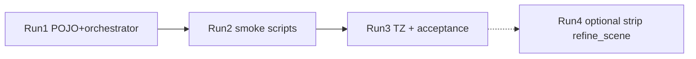

# План: bake Job boundaries (несколько прогонов агента) ✅ DONE

**Цель:** `light_bake` / `full_bake` = только L0; L2 = `detailed_bake` | отдельная entry-джоба.  
**ТЗ SoT:** [`docs/tz_world_pack_storage.md`](../../docs/tz_world_pack_storage.md) § Job boundaries (2026-07-20).  
**Не делать в этом треке:** climate coarse skip на full, session auto-entry, DAG, schema.

Каждый **Run** = один прогон агента: узкий diff, своя приёмка, можно остановиться и ревьюить.



---

## Run 1 — ядро: выключить L2 внутри bake

**Status:** ✅ done (2026-07-20)

**Scope:** только defaults + orchestrator fallback. Без smoke/TZ (кроме если тест упадёт на default).

### Сделать

1. [`backend/app/dataModel/worldPack/packBakeDefaults.py`](../../backend/app/dataModel/worldPack/packBakeDefaults.py)
   - `refine_scene_on_light: bool = False`
   - docstring: L0-only; entry — не часть light
2. [`backend/app/application/worldData/pack/bake/packMaterializationOrchestrator.py`](../../backend/app/application/worldData/pack/bake/packMaterializationOrchestrator.py)
   - `_materialize_l0_pack(..., refine_scene: bool = False)` (сейчас `True`)
   - ветка `if refine_scene and tiles:` **оставить** (explicit override для tests)
3. **Не** добавлять `refine_scene` query в `POST …/pack/bake`

### Приёмка Run 1

- grep: `refine_scene_on_light` default = `False`
- `_materialize_l0_pack` default `refine_scene=False`
- light/full path через defaults не вызывает entry (без явного `refine_scene=True`)

### Stop

После Run 1 — ревью диффа. Дальше только по команде.

---

## Run 2 — smoke / callers

**Status:** ✅ done (2026-07-20)

**Scope:** скрипты и HTTP helpers. Зависит от Run 1.

### Сделать

1. [`backend/scripts/debug_api_helpers.py`](../../backend/scripts/debug_api_helpers.py)  
   - `api_refine_from_entry(...)` → `POST …/map/refine-from-entry`
2. [`backend/scripts/initialize_world.py`](../../backend/scripts/initialize_world.py)
   - docstring: L0-only bake
   - флаг `--entry`: после bake отдельно вызвать `api_refine_from_entry` (не внутри bake)
3. [`backend/scripts/light_and_full_bake.py`](../../backend/scripts/light_and_full_bake.py)
   - docstring: цепочка L0 light→full; L2 не часть скрипта
   - **не** авто-entry (этот скрипт про L0 scope)
4. [`backend/scripts/smoke_world_pack.py`](../../backend/scripts/smoke_world_pack.py) + README  
   - комментарии: bake = L0; refine-from-entry = отдельный шаг (уже есть — сверить/подписать)

### Приёмка Run 2

- `initialize_world` без `--entry` не дергает refine
- с `--entry` — два HTTP: bake, потом refine-from-entry
- `light_and_full_bake` без вызова refine

### Stop

Ревью скриптов.

---

## Run 3 — ТЗ sync + живой smoke

**Status:** ✅ done (2026-07-20)

**Smoke metrics (`world-test-002`):**

| | before (with entry in light) | after (L0-only) |
|---|---|---|
| light | ~27 s | **1.4 s** |
| full | ~9 s | **9.0 s** |
| light tiles | 1 | 1 |
| full tiles | 25 | 25 |
| L2 after bake | yes (embedded) | **0** (Job boundaries OK) |

**Scope:** документация + прогон (backend уже поднят пользователем).

### Сделать

1. [`docs/tz_world_pack_storage.md`](../../docs/tz_world_pack_storage.md)
   - WP-PERF-50 → ✅
   - убрать/закрыть «Impl debt: refine_scene_on_light=True»
   - changelog 2026-07-20/21
2. Прогон (агент **не** стартует backend):
   ```text
   python backend/scripts/light_and_full_bake.py --fixture fixtures/world_test_gen.json
   ```
3. Зафиксировать в ответе метрики: light vs full wall-clock; tiles 1 → 25; L2 от bake = 0

### Приёмка Run 3

| Check | Ожидание |
|---|---|
| light tiles | 1 (`Gx0_Gy0` на fixture) |
| full tiles | 25 |
| light time | заметно меньше прежних ~27 s (ориентир: порядок L0, без refine) |
| L2 после light без `--entry` | нет нового location_terrain от bake |
| optional | `initialize_world … --mode light --entry` → L2 появляется отдельным шагом |

### Stop

Трек **закрыт** для product boundary. Follow-up ниже — только по явной просьбе.

---

## Run 4 (optional follow-up) — вычистить leftover API

**Status:** ✅ done (2026-07-20)

### Сделано

1. Убран параметр `refine_scene` из `_materialize_l0_pack` / light / full / surface facade  
2. Убраны `refine_scene_on_light` / `refine_scene_on_full` из `PackBakeDefaults`  
3. Убраны `heading_*` из L0 bake HTTP / facade (остались на `refine-from-entry`)  
4. Entry **только** через `EntryRefineOrchestrator` + HTTP refine-from-entry  

### Приёмка Run 4

- grep `refine_scene` в pack bake orchestrator = 0 (кроме `refine_scene_volume` на fine/entry)  
- bake path физически не умеет звать entry  

## Вне всех Run

- Climate coarse skip / cache на повторном full
- Auto-entry при session create
- Schema, DAG nodes
- WP-DELETE-1

## Правило для агента

- Один Run за прогон; не начинать следующий без «делай Run N» / «продолжай».
- Не стартовать backend.
- Не коммитить без просьбы.
- Код — только в рамках текущего Run.
