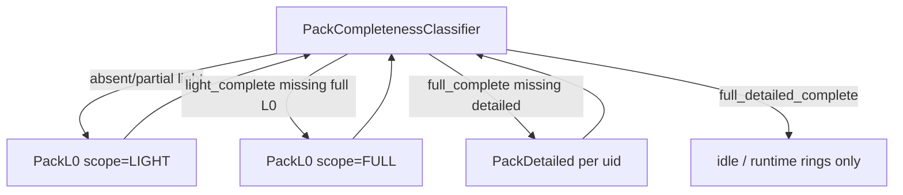

# Plan: light_bake / full_bake / detailed_bake + pack completeness ✅ DONE

> **Статус имплементации (2026-07-15):** Phase A–F ✅ в коде — `PackTilePlanner`, shared L0 body, `mode=full|detailed`, classifier в `loading-progress`. Wilderness offline — out of scope.  
> **Smell fixes (2026-07-16):** F1 packTileCollect · F2 require_parent_light preflight · F3 role=`location` · F4 `light_cap` · F5 `bake_pack` + thin routes · F6 `PackBakeResult`.

---

## 0. Целевое состояние (архитектура)

```
HTTP pack/bake
  └─ PackBakeFacade (тонкий, mode switch)
       ├─ mode=light|full → PackL0BakeOrchestrator.run(PlanRequest)
       │     ├─ PackTilePlanner.plan(scope)     ← единственный SoT набора тайлов
       │     ├─ ClimatePackBakeOrchestrator.bake_coarse
       │     ├─ build_locations_index
       │     ├─ WorldMapBakeOrchestrator.bake_tiles(..., bake_mode)
       │     └─ finalize_pack_on_world
       │     (+ light only, optional: EntryRefineOrchestrator session_start)
       │
       └─ mode=detailed → PackDetailedBakeOrchestrator.run(location_uid)
             ├─ require parent light (MissingParentLightError → resume L0 tile)
             ├─ territory → chunk rects
             ├─ FineChunkRunner.refine_rects  ← тот же L2 path
             └─ optional climate fine for territory

PackCompletenessClassifier.classify(world)
  ← expected sets from PackTilePlanner + locations_index
  ← baked from manifest
  → PackCompletenessSnapshot (dataModel)
```

### Антипаттерны (запрещены)

| Антипаттерн | Почему |
|---|---|
| Копия `_materialize_light_pack_body` под full | drift climate/index/finalize |
| «Uncapped bootstrap» = full_bake | bootstrap включает coarse hydro flood; full = **все location tiles** |
| detailed через полный `refine_from_entry` session | session = scene+path, не «вся локация» |
| Хардкод `bake_mode="light"` в `bake_tiles` | full должен писать `"full"` |
| Второй `max_tiles` SoT в routes/scripts | только `PackBakeDefaults` + единый normalize |

### Слои ответственности

| Компонент | Делает | Не делает |
|---|---|---|
| `PackTilePlanner` | expected tile sets (light/full) | generate, persist, climate |
| `PackL0BakeOrchestrator` | L0 compose pipeline | L2 territory, HTTP |
| `PackDetailedBakeOrchestrator` | one-location L2 | L0 compose body |
| `FineChunkRunner` | generate+persist chunks / location_terrain | plan tile sets |
| `PackCompletenessClassifier` | compare expected vs baked | bake |
| `api/routes/map.py` | validate → facade → DTO | planner logic |
| Generators | pure materialize | bake mode, LLM |

---

## 1. dataModel contracts (сначала)

Расширить / добавить POJO в `backend/app/dataModel/worldPack/` — **единственный SoT** defaults и wire.

### 1.1 `PackBakeMode` (wire)

```python
# worldPackManifest.py / packBakeMode.py
PackBakeMode = Literal["light", "full"]  # manifest.last completed L0 mode
# API query (отдельно):
PackBakeApiMode = Literal["light", "full", "detailed"]
# detailed НЕ пишется в manifest.bake_mode
```

- Убрать / deprecated API `tile` (старый wilderness-complete).
- `WorldPackManifest.bake_mode`: после successful L0 run = `"light"` | `"full"`.

### 1.2 `PackBakeDefaults` — расширения

| Поле | Default | Смысл |
|---|---|---|
| `max_tiles_light` | 16 (есть) | cap light_bake |
| `refine_scene_on_light` | `True` | entry refine после light |
| `refine_scene_on_full` | `False` | full offline обычно без L2 |
| (optional) `detailed_include_climate_fine` | `True` | после territory |

**Не** добавлять параллельный `max_tiles_full` как cap локаций — full = no location cap.

### 1.3 `PackTilePlanScope` + `PackTilePlan`

```python
class PackTilePlanScope(str, Enum):
    LIGHT = "light"   # bootstrap priority + cap
    FULL = "full"     # all named_location macro-tiles (+ hydro-in-scope per TZ)

class PackTilePlan(BaseModel):
    scope: PackTilePlanScope
    tiles: list[tuple[int, int]]  # or TileRef gx,gy
    capped: bool
    cap_applied: int | None
```

### 1.4 Cap normalize (один helper, читает POJO)

```python
def resolve_tile_cap(max_tiles: int | None, *, defaults: PackBakeDefaults) -> int | None:
    """None → defaults.max_tiles_light; <=0 → None (no cap); >0 → that cap."""
```

HTTP: **не** мапить `0 → None` до вызова helper (сегодняшний баг). Query `0` = uncapped для preview; для `mode=light` uncapped всё ещё light-priority set, не full.

### 1.5 Completeness snapshot

```python
PackCompleteness = Literal[
    "absent",
    "partial",
    "light_complete",
    "full_complete",
    "full_detailed_complete",
]

class PackCompletenessSnapshot(BaseModel):
    completeness: PackCompleteness
    expected_l0_light: int
    expected_l0_full: int
    l0_baked: int
    locations_expected: int
    locations_detailed: int
    missing_l0_full: list[tuple[int, int]]  # capped in API DTO if huge
    missing_detailed: list[str]             # location_uids
```

Вшить в `LoadingProgressSnapshot` (или рядом) — `loading-progress` + bake response.

---

## 2. Class contracts

### 2.1 `PackTilePlanner` (new, pure)

```python
class PackTilePlanner:
    def plan(
        self,
        world: World,
        locations: list[NamedLocation],
        surface_ctx: SurfaceTerrainContext,
        *,
        scope: PackTilePlanScope,
        max_tiles: int | None = None,  # only meaningful for LIGHT
    ) -> PackTilePlan: ...
```

| Scope | Алгоритм |
|---|---|
| `LIGHT` | существующий `bootstrap_macro_tiles` (+ cap via `resolve_tile_cap`) |
| `FULL` | macro_tile_of каждого `static_map_anchors(locations)` ∪ hydro tiles **tier ≤1** (declared), **без** cap и **без** coarse flood tier-3 как обязательного fill всего мира |

`TerrainBatchOrchestrator.plan_bootstrap_tiles` → тонкий shim → `PackTilePlanner.plan(LIGHT)`.

### 2.2 `PackL0BakeOrchestrator` (extract/rename from light body)

```python
@dataclass(frozen=True)
class PackL0BakeRequest:
    world: World
    locations: list[NamedLocation]
    writer: WorldPackWriter
    mat_ctx: MaterializationContext
    scope: PackTilePlanScope
    max_tiles: int | None = None
    refine_scene: bool | None = None  # None → PackBakeDefaults by scope
    # nodes, edges, hydro, anchor/heading only if refine_scene

class PackL0BakeOrchestrator:
    async def run(self, req: PackL0BakeRequest) -> MaterializationJobReport: ...
```

Внутри **один** body:

1. `require_surface_terrain_context` (один раз)
2. `planner.plan(scope, max_tiles)`
3. drain jobs (policy)
4. climate coarse
5. locations_index
6. `world_map.bake_tiles(..., bake_mode="light"|"full")`
7. if refine_scene: entry session_start
8. finalize

`materialize_light_pack` → `run(scope=LIGHT)`.  
`materialize_full_pack` → `run(scope=FULL, refine_scene=False default)`.

### 2.3 `WorldMapBakeOrchestrator.bake_tiles`

Добавить параметр `bake_mode: PackBakeMode` — **убрать** хардкод `"light"`.

### 2.4 `PackDetailedBakeOrchestrator` (new)

```python
@dataclass(frozen=True)
class PackDetailedBakeRequest:
    world: World
    location_uid: str
    locations: list[NamedLocation]
    writer: WorldPackWriter
    mat_ctx: MaterializationContext
    surface_ctx: SurfaceTerrainContext

class PackDetailedBakeOrchestrator:
    def __init__(self, runner: FineChunkRunner, climate: ClimatePackBakeOrchestrator | None = None): ...
    async def run(self, req: PackDetailedBakeRequest) -> PersistResult: ...
```

Алгоритм:

1. Resolve `NamedLocation` + `TerritoryVolume` (существующий policy/helpers).
2. Parent tile(s) from volume → `require_parent_light` per tile; если нет — `MissingParentLightError` (caller resume L0 для этих tiles, не silent empty).
3. Partition volume → `ColumnRect` list (reuse fine refine helpers / chunk grid).
4. `FineChunkRunner.refine_rects(..., refine_role="scene"|location, volumes=[(uid, vol)])`.
5. Optional climate fine drain for location bbox.
6. **Не** менять `manifest.bake_mode`.

**Не** вызывать целиком `EntryRefineOrchestrator.refine_from_entry` (другой контракт).

### 2.5 `PackCompletenessClassifier` (new)

```python
class PackCompletenessClassifier:
    def __init__(self, planner: PackTilePlanner): ...
    def classify(
        self,
        world: World,
        locations: list[NamedLocation],
        *,
        surface_ctx: SurfaceTerrainContext | None,
        manifest: WorldPackManifest,
        locations_index: LocationsIndexWire | None,
    ) -> PackCompletenessSnapshot: ...
```

Правила:

| Condition | Result |
|---|---|
| no pack / no L0 | `absent` |
| L0 ⊇ expected_light и L0 ⊊ expected_full | `light_complete` (или `partial` если даже light не закрыт) |
| L0 ⊇ expected_full, detailed < expected | `full_complete` |
| L0 ⊇ expected_full и detailed == expected | `full_detailed_complete` |
| иначе | `partial` |

`PackLoadingProgressFacade` делегирует classify; `tiles_pct` можно оставить relative, но UI/API должен смотреть `completeness`.

### 2.6 HTTP / facade

```
POST /map/pack/bake?mode=light|full|detailed
  detailed → requires location_uid
  light|full → PackL0BakeOrchestrator
  detailed → PackDetailedBakeOrchestrator

GET /map/loading-progress → + pack_completeness snapshot
GET /map/bootstrap-tiles?scope=light|full  (optional; default light)
```

`WorldSurfaceMaterializationOrchestrator`: методы `materialize_pack_light` / `materialize_pack_full` / `materialize_pack_detailed` — тонкие wrappers.

### 2.7 Cap bugfix (обязательный early step)

Сегодня: `Query max_tiles=0` → route `cap=None` → снова 16.  
Target: route передаёт raw `max_tiles` в `resolve_tile_cap`; не превращать 0 в None до helper.

---

## 3. Пошаговая имплементация

Порядок = **слои архитектуры**, не «сначала только HTTP».

### Phase A — dataModel + cap SoT

1. `PackBakeApiMode`, expand `BakeMode` docs; keep manifest `light|full`.
2. Extend `PackBakeDefaults` (`refine_scene_on_*`).
3. Add `PackTilePlan` / `PackTilePlanScope`, `PackCompletenessSnapshot`.
4. `resolve_tile_cap` single helper; fix route + `plan_bootstrap` + pack body to use it.
5. Unit tests: None→16, 0→uncap, 32→32.

**DoD:** cap bug gone; POJO SoT; no behavior change for default light bake.

### Phase B — PackTilePlanner

1. Extract planner module; LIGHT = current bootstrap.
2. FULL = all location macro-tiles ∪ declared hydro (no tier-3 flood, no cap).
3. Shim `plan_bootstrap_tiles` → planner LIGHT.
4. Tests: fixture with N locations → FULL tile count ≥ LIGHT; LIGHT capped at 16.

**DoD:** preview `bootstrap-tiles` can show both scopes (API optional).

### Phase C — PackL0BakeOrchestrator (shared body)

1. Extract `_materialize_light_pack_body` → `PackL0BakeOrchestrator.run`.
2. `bake_tiles(..., bake_mode=)`.
3. `materialize_light_pack` / `materialize_full_pack`.
4. Wire HTTP `mode=full`; remove/422 legacy `tile` with clear message.
5. full: `refine_scene=False` by default; incremental skip already-baked tiles (idempotent write).
6. Tests: full writes `bake_mode=full`; mosaic denser than light on terrain fixture.

**DoD:** `mode=full` smoke on `world_terrain_test` closes location L0 holes (case 2).

### Phase D — PackCompletenessClassifier

1. Implement classify using planner expected sets + manifest.
2. Attach to `loading-progress` + bake response.
3. Tests: after light → `light_complete` (or partial if cap < all locs); after full → `full_complete`.

**DoD:** больше нет ложного «tiles 100% = мир готов».

### Phase E — PackDetailedBakeOrchestrator

1. Territory → rects helper (reuse existing volume/chunk math).
2. Orchestrator + `require_parent_light`.
3. HTTP `mode=detailed&location_uid=`.
4. Tests: one location gets `location_terrain` blob; missing L0 → 409.
5. Classifier: all pins detailed → `full_detailed_complete` (needs full L0 first).

**DoD:** offline case 3 reachable via scripted loop detailed over pins.

### Phase F — scripts / docs sync

1. `initialize_world.py`: `--mode light|full`; optional `--detailed-all`.
2. `debug_api_helpers.api_pack_bake` modes.
3. TZ already updated; fix any leftover `tile|full` wilderness wording in scripts comments.

### Phase G — (optional, later) wilderness offline

Отдельный mode/CLI — **не** в этом плане. Не смешивать с `full_bake`.

---

## 4. Data flow (resume)



Gameplay без master resume: WP-13 entry + rings остаются; detailed offline — ускорение, не замена.

---

## 5. Test matrix

| ID | Case | Expect |
|---|---|---|
| BM-1 | light default | ≤16 tiles; bake_mode=light; completeness light_complete or partial |
| BM-2 | full | all location tiles; bake_mode=full; mosaic without location holes |
| BM-3 | detailed w/o L0 | 409 MissingParentLight |
| BM-4 | detailed after L0 | location_terrain entry + file |
| BM-5 | cap 0 on light | uncapped **light priority set**, not full |
| BM-6 | classifier after light then full | light_complete → full_complete |
| BM-7 | all detailed | full_detailed_complete |

---

## 6. Out of scope / gates

- DAG node wiring (`check_terrain` / bake nodes) — gate с мастером.
- Wilderness tile-complete offline.
- Changing L0 compose algorithms ([`tz_map_light_bake.md`](../../docs/tz_map_light_bake.md)).
- Frontend progress UI (API field enough).

---

## 7. Suggested PR slices

1. **PR1:** Phase A+B (POJO, cap fix, planner) — no user-visible full yet.  
2. **PR2:** Phase C (full_bake HTTP + shared L0 orch).  
3. **PR3:** Phase D (classifier).  
4. **PR4:** Phase E+F (detailed + scripts).
