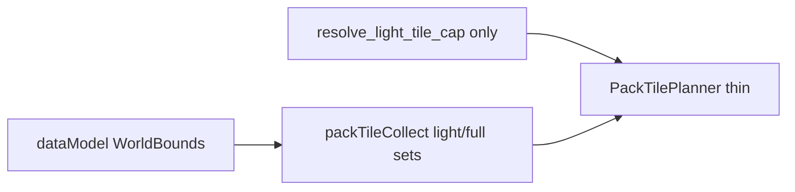

# Plan: bake planner smell fixes ✅ DONE

**Цель:** cleanup после bake-contract (god-object / SRP / дубли / dataModel).  
**Не в scope:** refactor `map.py`, `PackMaterializationOrchestrator`, MLB-12 mosaic, rename `wilderness_*`.

## Target



## Утверждённые решения

| Тема | Решение |
|---|---|
| Light set | location anchors **∪ declared hydro** (зафиксировать в ТЗ одной строкой) |
| Cap | только `resolve_light_tile_cap`; удалить `_debug_tile_cap` |
| `world_bounds` | Pydantic POJO; SQL JSON blob без migration |
| `surface_ctx` в `plan` | optional `None`; не обязателен для L0 tile set |

---

## 1. POJO `WorldBounds`

- Файл: [`backend/app/dataModel/worldPack/worldBounds.py`](backend/app/dataModel/worldPack/worldBounds.py)
- Fields: `x_min, x_max, y_min, y_max: int`; validate `x_min <= x_max`, `y_min <= y_max`
- Helpers: `from_world_raw(raw) -> WorldBounds | None`, `to_grid_bbox() -> GridBBox` (или application тонкий adapter)
- [`bbox.py`](backend/app/application/worldData/generators/terrain/passes/bbox.py): убрать `_bounds_dict` + string keys `"x_min"`…
- Export в `dataModel/worldPack/__init__.py`
- `World.world_bounds: dict | None` — без изменения `0001_initial.sql`
- Unit: valid/invalid parse; declared bounds win over anchors

## 2. Один cap API

- Удалить `_debug_tile_cap` из [`packTilePlanner.py`](backend/app/application/worldData/pack/bake/packTilePlanner.py)
- Light: `cap = resolve_light_tile_cap(max_tiles, defaults=self._defaults)` → `_defaults` снова используется
- Docs на `PackBakeDefaults.max_tiles_light`: debug override; product default `0` = uncapped

## 3. Rename + ТЗ

- `full_location_l0_tiles` → **`light_l0_tiles`** (полная замена imports, без долгого alias)
- Одна строка в [`docs/tz_world_pack_storage.md`](docs/tz_world_pack_storage.md) § Bake modes: light = named_location tiles **∪ declared hydro**
- `world_bounds_l0_tiles` — без rename
- Private `_sorted_tiles` в `packTileCollect` — один sort `(y, x)`

## 4. Сигнатура planner

```python
def plan(
    self, world, locations, surface_ctx: SurfaceTerrainContext | None = None, *,
    scope, max_tiles=None,
) -> PackTilePlan:
```

- Classifier / callers могут передавать `None` для plan; gate `prepare_surface_terrain_context` в classifier оставить только если нужен «мир готов», не ради plan
- Orchestrator может продолжать передавать ctx (совместимость)

## 5. Тесты

- [`tests/test_pack_bake_modes.py`](backend/tests/test_pack_bake_modes.py): rename patch target, cap via resolve, WorldBounds cases
- Grep: `full_location_l0_tiles` → 0; `_debug_tile_cap` → 0; `_bounds_dict` → 0

## Порядок имплементации

1. `WorldBounds` + `bbox.py`
2. Rename `light_l0_tiles` + `_sorted_tiles` + TZ one-liner
3. Planner: unify cap + optional `surface_ctx`
4. Classifier tweaks + unit tests

## Todos

- [x] POJO WorldBounds + bbox typed read
- [x] Planner: только resolve_light_tile_cap
- [x] Rename light_l0_tiles + TZ hydro
- [x] surface_ctx optional
- [x] Unit tests + grep
