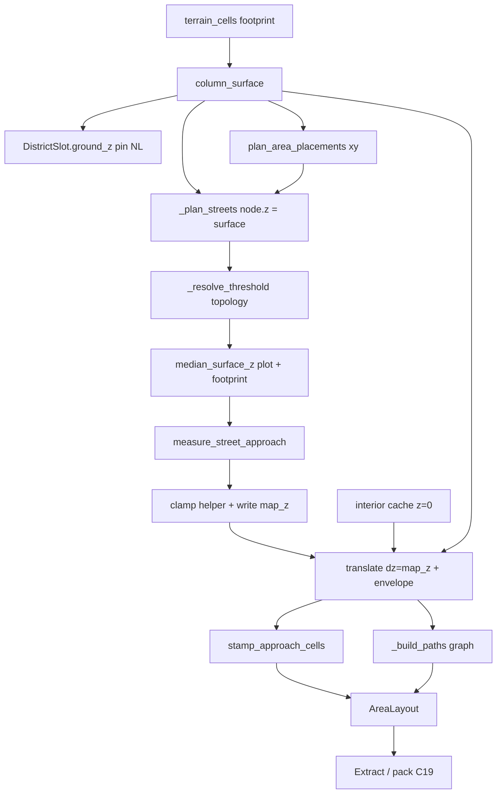

# План: C21 / P13 — `ground_z` застройки на участке ✅ DONE

> **Бриф для нового чата:** [c21-plot-ground-z-handoff-done.md](./c21-plot-ground-z-handoff-done.md) — скопировать блок «Промпт».  
> **Статус:** к согласованию · **Код** — агент с чистым окном по handoff (мастер вставляет промпт = «делай»).  
> **Поставка:** целевая архитектура **целиком**. Порядок = слои (§4), не слайс «сначала door / всегда здание / bbox=участок».  
> **SoT:** [`docs/tz_settlement_outdoor.md`](../../docs/tz_settlement_outdoor.md) **C21**, **P13 High**; connections **§5.1.1**  
> **Смежные:** assembler §6.2 / §7.1, city §9.6, building §3.6 `access_type`  
> **Не трогать:** DAG-ноды, HTTP/orchestrator persist, mill discover, pack land (C1), occupancy-flood (S2 / P3)

Schema: не меняем. `0001` / модели не нужны. C20 `front` — только если на участке есть здание.

---

## 0. Что в этом плане

Единственный **High** в ТЗ склейки — **P13**. В тот же pass входят симптомы, без которых C21 на карте не виден.

| ID | Pri | В план | Почему |
|---|---|---|---|
| **P13 / C21** | High | **да** | район копирует одну z на все здания |
| Cache `ground_z=0` + `translate` только xy | High (тот же баг) | **да** | даже правильный `AreaSlot.ground_z` не попадает в клетки/levels |
| `derive_structure_context` игнорирует `terrain_cells` | leftover S1 | **да** | иначе FoundationBuilder не видит склон под участком |
| Подъезд участок↔улица | часть C21 | **да** | §5.1.1–§5.1.2; `door` / `gate` / `parcel_edge` |
| Узлы улицы на колонке | часть того же Δz | **да** | `node.z = column_surface`; не пин |
| **NC-2** parcel cells | связан с `gate` | **да** | участок = footprint ∪ двор ∪ забор, не bbox дома |
| Полотно ребра в RAM (`street_xy`) | стоп луча | **да** | узлы — перекрёстки (`block_size`); peek не по узлу |
| Участок без здания | контракт AreaLayout | **да** | extract: C20 только если дом есть |
| S2 / P3 occupancy flood в `assemble()` | High (smell) | **нет** | C7 persist уже закрыт |
| Default `foundation_type` slab → full | — | **нет** | стиль шаблона, не C21 |
| Switchback / lerp-пандус двора | — | **нет** | не цель |
| `service` луч | C20 | **нет** | второй вход, не C21 |

---

## 1. Целевое состояние

Район **нарезает** участки (xy, facing, шаблон). Участок **считает** пол застройки. Pack-земля не террасируется.

```
terrain_cells (footprint, facade; земля, не CITY_STRUCTURE)
  → column_surface[(x,y)] = max z колонки          # один helper

DistrictSlot.ground_z = PIN                          # coarse sample; улицы
  ≠ пол зданий, ≠ значение для AreaSlot

plan_area_placements:
  collision + AreaSlot.cells = один parcel rect
  (footprint + padding; NC-2; не bbox дома)

street_xy = rasterize рёбер в RAM (width_cells + sidewalk edges)
  не SQL (C10); не множество узлов-перекрёстков

DistrictAssembler:
  packing xy
  _plan_streets: node.z = column_surface[(x,y)]
  для каждого участка — StructureAreaAssembler:
    _resolve_threshold (door | gate | parcel_edge)
    AreaSlot.ground_z = опорная плоскость участка (assembler)
    building.map_z если дом есть (может ≠ slot.ground_z)
    _build_paths: улица → порог; опц. порог → дверь
    place / envelope если есть здание

building cache (один шаблон / поселение):
  interior box @ (0,0), ground_z=0
  БЕЗ фундамента и крыши
  occupied_footprint — только xy

StructureAreaAssembler.assemble (после улиц района, вход street_xy):
  _resolve_threshold → AreaThreshold          # топология
  slot.ground_z = median_surface_z(двор)
  _place_building → NamedLocation | None
  measure_street_approach(...)                # skip луча если z равны
  если θ > 45°: map_z или threshold.z = clamp; measure ещё раз
  если дом: translate dz=map_z + envelope
  stamp_approach_cells
  _build_paths                                # только граф
  забор на slot.ground_z
```

| Компонент | Делает | Не делает |
|---|---|---|
| `column_surface` | `(x,y) → max z` из `MapCell` | выбор клеток порога/двора; persist |
| `median_surface_z` | median z **переданных** клеток | решать, какие клетки; max AABB района |
| `walk_grid_ray` | шаг по `Facing` + `stop` | стоп «улица»; θ; grade; mill occupancy |
| `classify_approach` | `h, L → θ, form` | луч; запись `map_z`; клетки |
| `clamp_near_z_to_45` | новый int z | xy; кого мутировать (дом vs порог) |
| `peek_abutting_street_z` | z полотна перед порогом (1 шаг / `street_xy`) | `walk_grid_ray`; профиль |
| `measure_street_approach` | skip если z равны, иначе луч + classify → `StreetApproach` | граф; stamp клеток; `NamedLocation` |
| `stamp_approach_cells` | CITY_STRUCTURE grade/лестница; зовёт `partition_height` | SQL-граф; mill Instance |
| `approach_material` | таблица §5.1.2 | рельеф-конверт |
| `AreaThreshold` | DTO: kind + cells + z | методы луча/clamp |
| `StreetApproach` | DTO: ray, L, z, θ, form | методы stamp/граф |
| `_resolve_threshold` | топология: kind + клетки; z = `median_surface_z` | `street_xy`; луч; clamp |
| `rasterize_street_xy` | клетки полотна из nodes+edges+`width_cells` (RAM) | persist `connection_edge_cells`; стоп mill |
| `parcel_cells` | footprint + padding → `AreaSlot.cells` и collision | порог; z |
| `_place_building` | `NamedLocation \| None` | clamp; envelope; граф |
| Extract | area graph + wire; C20 `front` **только если дом** | считать z / луч; требовать дверь у двора |
| `_build_paths` | nodes/edges area (стык или вдоль луча) | grade-клетки; θ; `partition_height` |
| `_build_barrier` | забор на `slot.ground_z` | порог; улица |
| `plan_area_placements` | xy packing | финальный `ground_z` / порог |
| `generate_grid` / streets | `node.z = column_surface[(x,y)]` | z застройки |
| `build_layout_cache` | interior @ z=0 | foundation/roof |
| `translate_layout` | dx, dy, dz | generate |
| `BuildingAssembler.attach_envelope` | фундамент + крыша на стоящем layout | interior generate; луч |
| `StructureAreaAssembler.assemble` | **порядок** вызовов helper/planner | формулы θ/h/L; mill |

**Инварианты**

- Generators pure. Terrain на вход — как сейчас (`get_footprint_terrain`).
- C1: `location_terrain` / wilderness не переписывать.
- Один `ground_z` на **участок** (двор). Здание v1 — одна плоскость пола = `building.map_z` (после clamp может ≠ `slot.ground_z`). Соседние участки на склоне — разные z.
- Cache живёт в локали шаблона (0,0,0); мир появляется только на place.
- Не второй generate interior при place (assembler §7.7).
- Участок может быть без здания (двор/забор). C20 `front` только у дома.
- `street_xy` — полотно ребра в RAM, не узлы `block_size`.

---

## 2. Контракты

### 2.0 Кто что считает (не смешивать)

`assemble()` — оркестратор: вызывает helper/planner, пишет поля слота/дома. **Не** содержит atan, median, шаг по сетке, нарезку SLOPE.

DTO (`AreaSlot`, `AreaThreshold`, `StreetApproach`, `AreaLayout`) — данные, без методов «построить луч / поднять дом».

Новая логика → **helper**, если его ещё нет. Не второй метод на assembler «заодно». Не второй `column_surface` в `buildingAssembler`.

| Слой | Файлы | Знает | Не знает |
|---|---|---|---|
| coordinates | `gridRay.py`, `columnSurface.py`, `approachZ.py` | сетка, Facing, колонка, `h/L/θ`, clamp | улица, порог, здание, SQL |
| area DTO | `areaThreshold.py`, `streetApproach.py`, `areaSlot.py`, `areaLayout.py` | поля | алгоритмы |
| area planner | `resolveThreshold.py`, `measureApproach.py`, `stampApproach.py`, `areaPaths.py`, `areaBarriers.py` | порог, `street_xy`, материал входа, граф участка | районный пин; mill discover |
| assembler | `structureAreaAssembler.py` | порядок, кому записать z | формулы |
| district | packing `parcel_cells`, `_plan_streets`, `rasterize_street_xy` | нарезка xy, полотно ребра | порог, `map_z` дома |
| mill | `terrainDescent.py` | свой `stop` на `walk_grid_ray` | участок |

Два hop (улица↔порог и дверь↔ворота) — **один** `measure_street_approach`, разные `origin` / `z_near` / `z_far`. Не копипаст луча в `_build_paths`.

### 2.1 Поверхность колонок

Один helper (сейчас дубль `_build_terrain_surface` в `buildingAssembler.py`):

```python
def column_surface(terrain_cells: list[MapCell] | None) -> dict[tuple[int, int], int]:
    # (x, y) → max z в колонке. Пустой список / None → {}.
```

Алгоритмическая константа, не POJO. Импорт в planner участка и в StructureAssembler.

### 2.2 Z участка и порог

Участок ≠ здание. Порог — слой участка (`resolveThreshold` + assembler), не район и не packing.

Helper **не** выбирает клетки сам:

```python
def median_surface_z(
    cells:    list[tuple[int, int]],
    surface:  dict[tuple[int, int], int],
    fallback: int,
) -> int:
    zs = sorted(surface[xy] for xy in cells if xy in surface)
    if not zs:
        return fallback
    return zs[len(zs) // 2]
```

`_resolve_threshold` — только топология (`kind` + `cells`). **Не** принимает `street_xy`. z порога = `median_surface_z(threshold.cells, …)` в assembler после resolve.

`AreaSlot.ground_z` = `median_surface_z` по двору / `slot.cells` (assembler выбирает клетки).

`building.map_z` черновой = `median_surface_z` по footprint; clamp — **после** measure, не внутри `_place_building`.

Нет отдельного `resolve_area_ground_z`: это и есть `median_surface_z`.

Запрещено: районный max AABB; копия z улицы на весь слот; «порог = всегда facing-ребро bbox здания»; `building.map_z = slot.ground_z` после place; `AreaSlot.cells` = только `occupied_footprint` (NC-2).

Fallback без terrain: pin района → `settlement.map_z` → `0`.

### 2.2b Полотно улицы и parcel

Узлы графа — перекрёстки с шагом `block_size` (алгоритм сетки, connections §9). Перед дверью в середине квартала узла нет.

```python
def rasterize_street_xy(nodes, edges) -> set[tuple[int, int]]:
    # клетки вдоль ребра × width_cells; плюс sidewalk-рёбра если есть
    # RAM only; не collect_edge_cells / не SQL (C10)
```

`peek_abutting_street_z` / stop луча читают этот set. Не `{(n.x, n.y) for n in nodes}`.

```python
def parcel_cells(fp, bx, by, yard_padding) -> list[tuple[int, int]]:
    # footprint + двор. yard_padding — константа packing (areaSlots), не POJO barrier
```

Packing collision и `AreaSlot.cells` — **один** rect из `parcel_cells`. `PARCEL_GAP_M` — зазор **между** участками, не глубина двора.

**Забор не расширяет участок.** Кольцо = периметр уже готовых `slot.cells`. `DEFAULT_PARCEL_MARGIN_M = 1` в `dataModel/settlement/area/perimeterBarrier.py` — не поле `PerimeterBarrier`, workaround NC-2; **удалить** вместе с `expand_bbox` в `areaBarriers`. `PerimeterBarrier` остаётся `template` + `probability` ([tz_locations.md](../../docs/tz_locations.md)). Двор без забора (`parcel_edge`) валиден.

Глубина двора как ручка мастера (ферма vs таунхаус) — **отдельное** поле шаблона участка/здания (`yard_depth_m`), не на `PerimeterBarrier`. В этом pass не вводить: packing-константа.

Порог `gate` — facing-ребро **участка**, не bbox дома.

SoT долга: [tz_generator_technical_debt.md](../../docs/tz_generator_technical_debt.md) **NC-2**.

### 2.2c Подъезд — helpers, не методы ассемблера

См. connections §5.1.1. Mill `_rim_shots` / Q1 не импортировать.

**Уже есть, переиспользовать:** `GRID_OUTWARD_DELTA`; при form=grade — `partition_height` / `geom_resolve` (нарезка z на **готовом** луче, не поиск луча).

**Новые (coordinates) — без онтологии участка:**

```python
def walk_grid_ray(origin, facing, *, max_k, stop=None) -> tuple[tuple[int, int], ...]
    # k=1,2,…; origin не в trace

def classify_approach(h: int, length: int) -> tuple[float, ApproachForm]
    # θ = atan(h/L); NONE / GRADE / STAIRS / круче 45° (сигнал clamp, не stamp)
    # StreetApproach.form после assemble — не круче STAIRS

def clamp_near_z_to_45(z_near: int, z_far: int, length: int) -> int
```

Mill `measure_terrain_descent` — обёртка: свой `stop` на `walk_grid_ray`. Слой mill, не area assembler. Делается в том же helper-слое, что и `walk_grid_ray` (не leftover «потом»).

**Новые (area planner) — знают улицу/порог:**

```python
def peek_abutting_street_z(origin, facing, street_xy, surface) -> int | None
    # один шаг facing; не луч

def measure_street_approach(
    origin, facing, z_near, street_xy, surface, *, max_k
) -> StreetApproach:
    z_far = peek_abutting_street_z(...)
    if z_far is None or z_near == z_far:
        return StreetApproach(..., form=NONE)   # без walk_grid_ray
    ray = walk_grid_ray(..., stop=lambda c, k: c in street_xy)
    z_end = surface[ray[-1]]          # не путать peek (skip) и z на конце луча
    return StreetApproach(..., *classify_approach(abs(z_near - z_end), len(ray)))

def approach_material(kind, template, ...) -> str   # таблица §5.1.2

def stamp_approach_cells(approach, material, ...) -> list[MapCell]
    # GRADE → partition_height; STAIRS → h=L; NONE → []
```

`_build_paths` **только граф** (стык при NONE; `yard_path` по `approach.ray` иначе). Клетки входа — `stamp_approach_cells`, не paths.

После measure, если form потребовал бы θ>45°: assembler пишет `clamp_near_z_to_45` в `building.map_z` или `threshold.z`, затем **ещё раз** `measure_street_approach` (или только `classify` на том же L) — не clamp внутри measure.

`front` v1; `service` — не этот pass.

### 2.3 Пин района (не пол зданий)

`resolve_ground_z` сегодня = `max(z)` AABB района — плохой даже как пин (весь район «живёт» на вершине холма; улицы туда же).

Целевое (city §9.6 `terrain_z_at`):

```python
def resolve_district_pin_z(
    settlement:    NamedLocation,
    origin_x: int, origin_y: int,
    surface: dict[tuple[int, int], int],
) -> int:
    fallback = settlement.map_z if settlement.map_z is not None else 0
    return surface.get((origin_x, origin_y), fallback)
```

Переименовать/сузить старый `resolve_ground_z`, чтобы имя не обещало «землю застройки».

### 2.4 Translate

```python
def translate_layout(layout, dx, dy, dz: int = 0) -> StructureLayout
```

Сдвигать: `MapCell.x/y/z`, `rooms.map_x/y/map_z`, `passages` xy, `levels.z`, `occupied_footprint` xy.  
No-op если все дельты 0. `OccupiedFootprint` без z — не трогать width/depth.

Cache: probe `map_z=0`. Place: `dz = building.map_z` **после clamp**, не `slot.ground_z`.

### 2.5 Cache vs envelope

```python
# cache
layout = StructureGeneratorService().generate_from_template(
    world, probe, template, ground_z=0, foundation_depth=0,
)
# occupied_footprint от плоскости z=0

# place (после translate)
layout = BuildingAssembler.attach_envelope(
    world, building, layout, context, terrain_cells,
)
# FoundationBuilder + RoofBuilder; interior cells не пересобирать
```

`derive_structure_context` кладёт `ground_z=building.map_z` **после clamp**, не `slot.ground_z`. `terrain_cells` **не** игнорировать: envelope их читает. Забор остаётся на `slot.ground_z`.

Default `foundation_type` шаблона не менять. `full`/`hull` начнут видеть склон, потому что surface придёт на place, а не на probe (0,0). `slab` — плита `fd` под плоскостью участка (внутри участка downhill всё ещё зазор — это тип фундамента, не C21).

### 2.6 Кто не считает этаж

| Слой | z |
|---|---|
| `plan_area_placements` | только xy |
| `_plan_streets` | `node.z = column_surface[(x,y)]` |
| `_resolve_threshold` | нет z (только клетки); assembler: `median_surface_z` |
| `_place_building` | черновой `map_z` = median footprint |
| `measure_street_approach` | читает z, не пишет |
| `clamp_near_z_to_45` | считает int; assembler записывает в дом или порог |
| `derive_structure_context` | `ground_z = building.map_z` после clamp |
| `_build_paths` | граф; z узлов с approach / порога |
| `stamp_approach_cells` | z клеток входа с профиля |
| Extract | как лежит в layout |

---

## 3. Data flow



Всё serial внутри одного `generate_layout`. Parallel не нужен.

Зависимости: `column_surface` один раз на district. Улицы до `_resolve_threshold` / `_build_paths`.

---

## 4. Порядок имплементации (слои, не слайс «сначала одно здание»)

1. **coordinates helpers** — `walk_grid_ray`, `column_surface`, `median_surface_z`, `classify_approach`, `clamp_near_z_to_45`. Дубль `_build_terrain_surface` → `column_surface`. Pin: `resolve_district_pin_z`. Mill: `measure_terrain_descent` = stop на `walk_grid_ray`.
2. **Translate** — `dz`; levels + `room.map_z`.
3. **Cache** — interior @ z=0; без settlement terrain на probe.
4. **Envelope** — `attach_envelope`.
5. **Улицы** — `node.z = column_surface`; `rasterize_street_xy` (RAM).
6. **Packing** — `parcel_cells`; collision = тот же rect (NC-2).
7. **DistrictAssembler** — packing → streets → `street_xy` вниз. Не порог, не clamp.
8. **Area planner** — `resolve_threshold` (три kind); `measure_street_approach`; `stamp_approach_cells`; `_build_paths` только граф.
9. **assemble() + extract** — дом опционален; C20 только если дом; area graph.
10. **Тесты** — parcel ≠ bbox; mid-block peek; skip луча при равных z; `gate` → waypoint; двор без `front`; pin ≠ max AABB; clamp ↑↓.
11. **ТЗ** — P13 / NC-2 closed после кода.

Маршруты, orchestrator, pack I/O, extract uid — не в этом списке (extract: area graph + optional building).

---

## 5. Файлы (ожидаемые)

| Файл | Изменение |
|---|---|
| `generators/coordinates/gridRay.py` | **новый:** только `walk_grid_ray` |
| `generators/coordinates/columnSurface.py` | **новый:** `column_surface`, `median_surface_z` |
| `generators/coordinates/approachZ.py` | **новый:** `classify_approach`, `clamp_near_z_to_45` |
| `generators/terrain/relief/geom/terrainDescent.py` | mill-stop на `walk_grid_ray` |
| `generators/road/streetCells.py` | **новый:** `rasterize_street_xy` |
| `districtAssembler/planner/areaSlots.py` | `parcel_cells`; packing без z района; yard padding здесь, не в barrier POJO |
| `areaAssembler/planner/areaBarriers.py` | кольцо по `slot.cells`; без `expand_bbox` + `DEFAULT_PARCEL_MARGIN_M` |
| `dataModel/settlement/area/perimeterBarrier.py` | удалить `DEFAULT_PARCEL_MARGIN_M` (не поле модели) |
| `areaAssembler/areaThreshold.py` | **новый DTO:** `AreaThreshold` + kind |
| `areaAssembler/streetApproach.py` | **новый DTO:** `StreetApproach` + `ApproachForm` |
| `areaAssembler/planner/resolveThreshold.py` | топология порога (без улицы, без луча) |
| `areaAssembler/planner/measureApproach.py` | `peek_abutting_street_z`, `measure_street_approach` |
| `areaAssembler/planner/stampApproach.py` | `approach_material`, `stamp_approach_cells` |
| `areaAssembler/planner/areaPaths.py` | только SQL-граф участка |
| `areaAssembler/areaLayout.py` | optional building; threshold; approach; graph |
| `settlementAssembler/planner/terrain.py` | pin, не max AABB |
| `districtAssembler/districtAssembler.py` | streets → `rasterize_street_xy` → area assemble |
| `generators/road/layouts/gridLayout.py` (+ peers) | `node.z` с surface |
| `generators/structure/layoutTranslate.py` | `dz` |
| `settlementAssembler/buildingCache.py` | interior-only, z=0 |
| `areaAssembler/structureAreaAssembler.py` | оркестрация; без формул |
| `structureAssembler/buildingAssembler.py` | `attach_envelope`; `column_surface` вместо дубля |
| `settlementOutdoor/settlementOutdoorExtract.py` | area graph; C20 только если дом |
| `tests/` | C21 + NC-2 + mid-block peek + clamp |

DAG / `lazy_settlement` / `SettlementPersistService` — не трогать.

---

## 6. Приёмка

- Два участка: разные пороги/z; не оба max AABB.
- `AreaSlot.cells` шире footprint (двор/забор); `gate` на ребре участка. Забор не делает второй expand.
- `DEFAULT_PARCEL_MARGIN_M` нет; `PerimeterBarrier` без поля отступа.
- Середина квартала: peek находит полотно ребра, не требует узел-перекрёсток.
- Равные z участок↔улица: луча нет, `form=NONE`.
- Участок с забором: конец первого path — ворота (`waypoint`), не обязательный `building_entrance`.
- Участок без здания: extract без ошибки C20.
- Узлы улицы: z = колонка, не пин сетки.
- Pack land не меняется (C1).
- Pack `location_terrain` не меняется (C1).
- Этаж `z_offset=0` / `location_levels.z` = `building.map_z` после clamp (может ≠ `AreaSlot.ground_z`).
- `DistrictSlot.ground_z` = pin origin, не max холма.
- θ > 45°, дом ниже улицы: `map_z` **поднимается** до `h = L`; xy без изменений.
- θ > 45°, дом выше улицы: `map_z` **опускается** до `h = L`.

Smoke HTTP — мастер поднимает backend; агент не стартует сервер.

---

## 7. Вне плана (не забывать, не смешивать)

| Тема | Куда |
|---|---|
| Occupancy flood в `assemble()` (S2) | отдельный план; HTTP уже не persist (C7) |
| Switchback / lerp-пандус двора | не цель |
| `access_type` cells (крыльцо) | building TZ; здесь gap на пороге, не полный porch builder |
| `foundation_type=full` по умолчанию | building template / style |
| `service` луч | C20 второй вход, не C21 |
