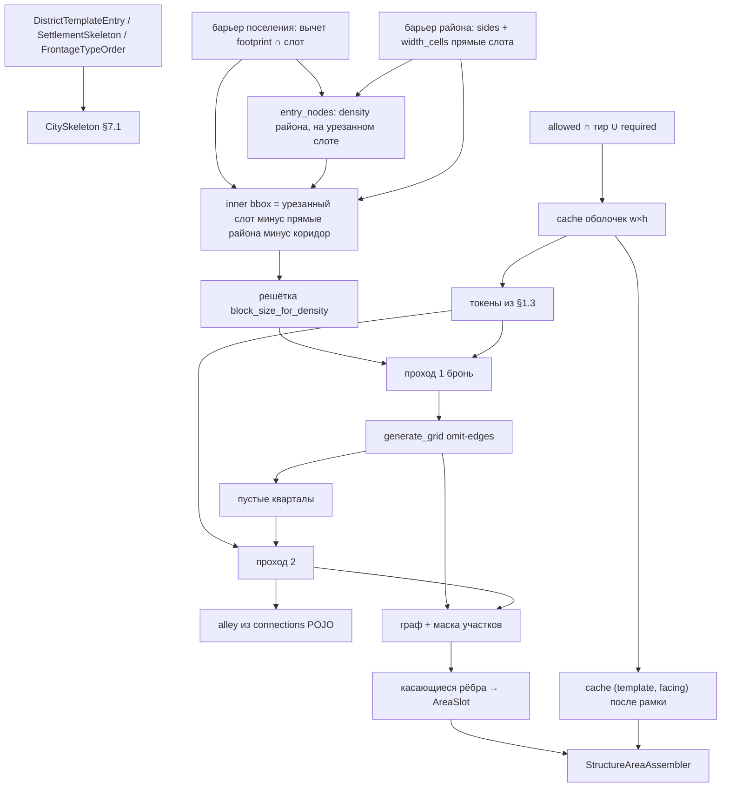

# План: C22 — packing + сетка `grid` (v1 → целевой пайплайн) ✅ DONE

> **Статус:** к согласованию · **Код в этой сессии — нет** (мастер отдельно: «делай»).  
> **Порядок документа:** **сначала** контракты `dataModel` + runtime §7.1 → **потом** пайплайн, файлы, слои кода. Не наоборот.  
> **Поставка:** архитектура **целиком**. Не слайс «сначала только рамка / только дома».  
> **SoT (алгоритм не дублировать):** [`tz_structure_connections.md`](../../docs/tz_structure_connections.md) §5.1.3–§5.1.4, §8; [`tz_city_generation.md`](../../docs/tz_city_generation.md) §3, §6.3, §9.2/§9.4–§9.5, §10; [`tz_assembler_hierarchy.md`](../../docs/tz_assembler_hierarchy.md) **§7.1**, DistrictAssembler, §7.7; склейка [`tz_settlement_outdoor.md`](../../docs/tz_settlement_outdoor.md) C22; sinks [`tz_logging.md`](../../docs/tz_logging.md).  
> Дырка §7.1 (поля C22 на `CitySkeleton`) **закрыта** в ТЗ. Резолв N/очереди/фасада — connections §5.1.3, не копировать таблицы в иерархию.

Смежные impl-планы: [c21-plot-ground-z-done.md](./c21-plot-ground-z-done.md) (z/порог **не отменять**); [settlement-assembler-done.md](./settlement-assembler-done.md).

Schema: generate **не** блокер колонок. `0002_*.sql` не создавать. DAG-ноды не менять. Backend не стартовать.

---

## 0. Scope

City §6.3 — цель пайплайна. Код сейчас: AABB packing → overlay полной сетки. Этот план — переход **поверх контрактов ниже**.

| В план | Не в план |
|---|---|
| Поля C22 в POJO + зеркало `CitySkeleton` §7.1 | **CONN-PACK-1/2/3** (⬜ §8) |
| Пайплайн: cache → проход 1 → рамка `grid` → проход 2 → граф → assembler | `radial` / `organic` / `cul_de_sac` / `courtyard` (`NotImplementedError`) |
| Рамка: существующий `generate_grid`, **когда** звать и **какие рёбра не ставить** | Parish & Müller; city-сетка §6.2 |
| FRONT-4, `plaza`, касающиеся рёбра, debug packing | Интерьер комнат, rotate layout, LLM, DAG, persist pack. **Generate клеток** барьера района — TODO. **v1 packing вычитает** прямые района (`sides`; `[]` = 4 грани слота) из слота, уже урезанного поселением. Якоря — город, не этот packing-модуль кроме чтения слота |

**C21 не отменяется:** `node.z = column_surface`; `ground_z` / порог — `StructureAreaAssembler` (§7.1). Этот план — xy посадки и момент графа улиц.

---

## 1. Контракты — `dataModel` (wire)

**Правило:** значения, defaults, wire-ключи живут в POJO. Генератор / DAG / `db` **не** дублируют `Field(default=…)`, `canonical_defaults()`, имена ключей. Resolve (район → город → дефолт) — тонкий слой **над** моделью.

### 1.1 Уже есть — packing **читает**, не копирует литералами

| POJO | Путь | Что брать |
|---|---|---|
| `DistrictDensity` + `block_size_for_density` | `dataModel/settlement/enums/districtDensity.py` | шаг решётки dense/medium/sparse (50/80/120). Имя поля `block_size_fine`; на сетке generate 1 cell = 1 m (`OccupiedFootprint`). **Не** литералы 50/80/120 в planner. **Не** конвертер метров↔клеток в этом плане |
| `StreetLayout` | `dataModel/roads/enums/streetLayout.py` | enum полный. Generate в этом плане — только `grid`; прочие fn остаются заглушками (CONN-PACK-1 / как сейчас). Не дырка модели |
| `DistrictConnection` + `primary_or_default` | `dataModel/settlement/district/districtConnection.py` | тип главной улицы, `sidewalk`, `lanes_per_side`; аллея — строка `connections[]` с `connection_type` из реестра (ширина — connections §3.4 / `connectionWidthDefaults`, не хардкод 2) |
| `RequiredStructure` | `…/requiredStructure.py` | `building_template`, `count` (default 1), `position` (`any` / `center`) |
| `SizePct` на `DistrictTemplateEntry.size_pct` | city §9.6 | размер `DistrictSlot`; packing **не** растит слот |
| `PerimeterBarrier` | `dataModel/settlement/area/perimeterBarrier.py` | **Один класс**, три инстанса (не синглтон): поселение (прямые footprint), район (`DistrictSlot`), участок. Зоны не пересекаются. На районе: `None` (omit). **v1 packing района** вычитает прямые **района** из слота, уже урезанного поселением. Generate клеток района — не этот план. Барьер поселения — `SettlementAssembler` (клетки + вычет `footprint ∩ слот`), не packing района |
| `BarrierTemplateEntry` | `dataModel/structure/barrier/barrierTemplateEntry.py` | Толщина: **`width_cells`**, дефолт **1** (ТЗ; в POJO поля ещё нет — слой A). Не литерал 1 в packing |
| `Facing` | `dataModel/spatial/facing.py` | cardinal для `AreaSlot.facing` и ключа cache |

`WorldDistrictTemplateRegistry.canonical_defaults()` — builtin районы; после расширения `DistrictTemplateEntry` канон **сам** получит новые optional-поля (defaults POJO), без параллельного dict в генераторе.

### 1.2 ТЗ vs POJO (не код)

Только `dataModel` против SoT этого объекта. `CitySkeleton` — runtime §2.  
Не писать сюда «generate не читает» / заглушки layout — это код vs ТЗ, не эта таблица.

**Отсутствует** = в ТЗ объекта поле (или весь POJO) есть, в модели нет. `extra="ignore"` тогда **отбрасывает** тот же ключ на wire.  
**Игнорируется** = поле **объявлено** на этом POJO, а ТЗ **этого** объекта велит его не использовать. Не путать с «генератор пока не вызвал».

| POJO | ТЗ объекта | Отсутствуют | Игнорируются (поле есть, ТЗ объекта не использует) |
|---|---|---|---|
| `SettlementSkeleton` | city §3 / assembler §7.1 | `frontage_type_order`, `structure_counts`, `structure_priority`, **`perimeter_barrier`** (инстанс **поселения**) | — (`dominant_material` на POJO есть; post-assemble — не дырка модели) |
| `DistrictTemplateEntry` | city §9.2 | `frontage_type_order`, `structure_counts`, `structure_priority`, **`perimeter_barrier: PerimeterBarrier \| None`** (omit ≠ пустой объект здания). Generate прямых района — **TODO**, не «игнорируется» | — |
| `BarrierTemplateEntry` | `tz_locations` реестр барьеров | **`width_cells`** (дефолт 1) | — |
| `FrontageTypeOrder` | connections §5.1.3 `canonical_defaults()` | **POJO нет** | — |
| `RequiredStructure` | city §9.4 | — | — |
| `DistrictConnection` | city §9.5.1 | — | — |
| `PerimeterBarrier` | `tz_locations` (один класс, три инстанса) + city §3 / §9.2 | **`sides`** (нет ключа / `null` / `[]` = четыре прямые **bbox этого** хоста) | — (roll `probability` — только участок; политика владельца в locations, не «поле мёртвое») |
| `DistrictDensity` | connections шаг сетки | — | — |
| `StreetLayout` | city §9.5 | — | — |
| `Facing` | assembler §7.1 / §6.1 | — | — |
| `SizePct` | city §9.6 | — | — |

`display_location_mood` / `state_uid`: city §3; в §7.1 на dataclass **не** входят — не дырка этих POJO.

SQL `named_locations`: не блокер generate. `0002_*.sql` нет.

### 1.3 Резолв — тонкий API над POJO, не вторая таблица

Сигнатуры живут рядом с моделями или тонким `resolve*` **без** литералов, совпадающих с Field default.

| Вопрос | Источник (порядок SoT) |
|---|---|
| N копий `system_name` | `required_structures[].count` → `DistrictTemplateEntry.structure_counts[key]` → `CitySkeleton`/`SettlementSkeleton.structure_counts[key]` → **1**. Явный `0` = ноль. Нет ключа ≠ ноль |
| `structure_priority` | район по ключу → город по ключу → **0** (проход 2). `>0` — проход 1 после required |
| Парадный тип | `district_template.frontage_type_order` → `CitySkeleton.frontage_type_order` → `FrontageTypeOrder.canonical_defaults()`. Пустой после skip unknown — наследовать уровень выше |

Таблицы N/очереди/фасада **не** копировать в этот план — connections §5.1.3.

---

## 2. Контракты — runtime иерархии (assembler §7.1)

Не POJO wire. Течёт сверху вниз. **Не мутировать** `CitySkeleton` в районе.

### 2.1 `CitySkeleton`

Поля — сниппет §7.1 (включая C22). Собирает `SettlementAssembler._build_skeleton` из `SettlementSkeleton` / `getattr` на NL (как `settlement_density`). Файл: `assemblers/citySkeleton.py` — **зеркало** POJO §1.2, не третий набор имён.

### 2.2 `AreaSlot`

```text
cells, ground_z, facing
```

| Поле | Кто пишет | Кто не пишет |
|---|---|---|
| `cells` | packing / `DistrictAssembler` (участок на модуле) | `generate_grid`, area assembler |
| `facing` | район: после рамки — сторона **к улице** (§7.1, C22). До рамки / нет полосы — дефолт `Facing.SOUTH`. Слот с этим `facing` **передаётся** в `StructureAreaAssembler.assemble` | порог (дверь/ворота/край) — assembler участка; не выкидывать facing |
| `ground_z` | финал — `StructureAreaAssembler` (C21). Packing может оставить пин района как fallback | финальный пол, порог, `AreaThreshold` |

`AreaThreshold` **не** поле `AreaSlot`. Packing топологию стыка не знает.

`StructureAreaAssembler` получает уже заполненный `AreaSlot` (включая `facing`). Дальше по ТЗ: `_resolve_threshold` / луч вдоль `facing`, `_derive_context` копирует `slot.facing` в `StructureContext` (`None` на контексте — только изолированная структура без улицы, не городской пайплайн). FRONT-4 / парадный: район отдаёт касающиеся рёбра; assembler участка может **вывести** `slot.facing` из выбранного парадного (connections §5.1.3) — это не отмена передачи facing на вход `assemble`.

### 2.3 `DistrictSlot`

Уже есть: bbox (`origin_*`, `width_m`, `depth_m`), `district_template` (`DistrictTemplateEntry`), `entry_nodes`, `required_structures`. Размер задаёт город (`size_pct`). Packing **не** увеличивает bbox.

### 2.4 Кто какой размер знает (§5.1.4 / §7.7)

| | Контракт |
|---|---|
| Оболочка `occupied_footprint` | `StructureAssembler` / generate; packing читает `w,h` |
| Ящик cache | `SettlementAssembler` создаёт, передаёт вниз |
| Посадка `AreaSlot` | **`DistrictAssembler`** |
| Рёбра главной сетки | `generate_grid` (инструмент района); слоты не ставит |
| Один стоящий слот | `StructureAreaAssembler`; чужих участков и сырого графа района не знает |

---

## 3. Целевое состояние generate (после контрактов)

### 3.1 Слои и writer

Один serial `DistrictAssembler.assemble`. Stub только на границе caller (`street_layout != grid` → существующий `NotImplementedError`, не ветка внутри packing).

```
SettlementAssembler
  cache-ящик; DistrictSlot.size_pct
  барьер поселения: клетки footprint; вычет прямых footprint ∩ слот из площади района (до якорей)
  entry_nodes: density **этого** района; при барьере района — внутренняя грань прямых района (урезанный слот)
  не сажает участки, не чертит районную сетку

DistrictAssembler                    ← оркестратор района
  внутренний bbox → cache оболочек → токены (N, priority из §1.3)
  → проход 1 → generate_grid (рамка) → проход 2
  → аллеи из DistrictConnection → граф → фильтр рёбер → StructureAreaAssembler

packing (planner района)
  токены, бронь, FFD, 90° AABB, leftover warning
  не растит DistrictSlot; не чертит рёбра; не порог C21

lattice + generate_grid
  линии step = block_size_for_density; omit рёбер сквозь бронь/коридор
  не stretch W/(n−1); не AreaSlot; не аллеи модуля

DistrictRoadGenerator                ← dispatch StreetLayout
  этот план: только GRID

StructureAreaAssembler
  C21 z/порог; street_xy = касающиеся отрезки; cache (template, facing)
```

**Инварианты (опираются на §1–§2):**

- Модуль посадки = `(block_size × block_size)` внутреннего bbox, не ячейка города §6.2, не AABB слота.
- Коридор `through_road` — запрет участков. Валидный барьер **района**: v1 packing вычитает прямые района из **уже урезанного** слота. Барьер **поселения** — другой инстанс: `SettlementAssembler` вычитает `footprint ∩ слот` **до** packing; packing района этот инстанс не читает как вторые прямые слота.
- `entry_nodes`: пишет `SettlementAssembler` — `density` **этого** района, на урезанном слоте. Packing не двигает якоря.
- Проход 1 **до** рамки. Главная улица не режет бронь и не режет коридор (суперблок = одна земля).
- Узлы `grid` совпадают с `entry_nodes` без stretch.
- 90° только оболочка; интерьер не rotate.
- Failed проход 1 → leftover; **не** в проход 2. Второй `center` — CONN-PACK-2 ⬜.
- Warning, не exception (§7.7).
- Проход 2 в дырке: FFD + 90° по SoT; не MaxRects/shelf как отдельный движок.

### 3.2 Data flow



CONN-PACK-3: проход 1 берёт AABB **уже закэшированной** оболочки (код: SOUTH). Не «max по 4 facing» внутри packer.

---

## 4. Таблица v1 → C22 (код)

| Тема | Код сейчас | Цель (после §1–§2) |
|---|---|---|
| Порядок `assemble` | packing AABB → `_plan_streets` на весь bbox → весь `street_xy` каждому слоту | вычет поселения из площади района → якоря / прямые района → cache → проход 1 → рамка → проход 2 → граф → касающиеся рёбра → assembler |
| Сетка | stretch `step = W/(n−1)`; все H+V; through **поверх** | `step = block_size_for_density`; omit через бронь/коридор; through = коридор+нитка, не дубль |
| Packing контейнер | AABB `DistrictSlot` | внутренний bbox |
| `block_size` | только улицы | packing и рамка — одна решётка, чтение enum |
| Копии / priority | 1 с cache; shuffle | §1.3 |
| 90° / facing | в `assemble` facing **уже передаётся** (сейчас почти всегда дефолт `SOUTH`) | 90° оболочки; после рамки `AreaSlot.facing` = сторона к улице; слот по-прежнему на вход `StructureAreaAssembler` (§2.2) |
| Cache | `dict[str, …]` SOUTH | packing: `w,h`; assembler: `(template, facing)` после рамки |
| Барьер вокруг района | `barrier_cells` пустые | слот уже без xy поселения; валидный инстанс района → **v1 вычет прямых слота** (`sides`; нет ключа / `null` / `[]` = 4); клетки generate TODO. Нет поля / `template` null → skip |
| Аллея | `PARCEL_GAP_M` | только `connections` с alley; иначе щель без нитки |
| Логи | `getLogger` → `core/runtime` | sink `settlement` / `settlementAssembler` |
| Non-grid | `NotImplementedError` | без изменения |

`YARD_PADDING_M` / `PARCEL_GAP_M` — C21 двор/зазор, не аллея. Pad=0 «участок=дом» — не этот план.

---

## 5. Контракты шагов пайплайна (runtime packing, не wire)

Типы у packing/района. Имена можно сдвинуть при коде.

### 5.0 Решётка / внутренний bbox

```text
inner_bbox не растёт
step = block_size_for_density(template.density or skeleton.settlement_density)
lattice: origin = inner origin, шаг = step, не stretch
```

`inner origin` после вычета прямых **района** и до коридора — тот же, на который город ставит `entry_nodes` (слот уже урезан поселением).

Коридор якорей: полоса пары `through_road` (ширина из реестра/§3.4). Модули на коридоре недоступны проходу 1. Нет `entry_nodes` → skip + лог. Внутренность ≤ 0 → `warning`.

Барьер района: нет поля / `template` null — скип. Иначе **v1 packing вычитает** прямые `width_cells` внутрь (нет `sides` / `null` / `[]` → все 4 грани **слота**). Коридор якорей — отдельно. Inner bbox = урезанный слот минус прямые района минус коридор. Generate клеток — TODO, прямые уже не для участков. `entry_nodes` уже на внутренней грани прямых района (город). Не участок, не поселение.

### 5.1 Токен

Не кодировать `w`/`h` в uid. Поля: `uid` (`system_name`+индекс), `w`,`h` из cache, `priority` из §1.3, `required`, `position` только у required. Нет cache → нет токенов + warning.

### 5.2 Проход 1 — бронь

**Вход:** inner bbox, lattice, токены required (порядок массива) затем `priority>0` (ключ SoT), AABB cache, маска коридора.  
**Выход:** `span`, `modules`, `rect_xy`, `rotated_90`.  
`center` — модуль центра **внутреннего** bbox. Не влез / нет дырки — leftover, не проход 2. AABB до рамки = текущий cache. После рамки facing бронь **не** двигает.

### 5.3 Рамка (`generate_grid`)

**Когда:** после прохода 1, до прохода 2.

**Вход сверх сегодняшнего:** inner bbox; `step` из enum; blocked броней + коридор.

**Не ставить ребро**, если полоса (линия × `width_cells`) режет `rect_xy` брони или коридор как нарезку суперблока. Периметр суперблока — рамка **обходит**. Пустой модуль — дырка прохода 2, не улица сквозь него.

**Выход:** nodes/edges рамки. Ещё не аллеи, ещё не `street_xy` assembler. `entry_point` без пары — к узлу рамки на грани (слой рамки).

### 5.4 Проход 2

Остальные токены; дырки рамки; FFD + 90°. Leftover → warning. Аллея: `DistrictConnection` alley и ≥2 участка в модуле и влезает ширина; иначе не выдумывать нитку.

### 5.5 Граф → assembler

Рамка + аллеи; маска клеток участков; rasterize; слоту касание 4-сосед. Нитка FRONT-4 из §1.3; `plaza` — улицы равны. `AreaSlot.facing` — §2.2. Cache `ensure(template, facing)` после рамки; miss → generate этой пары. Footprint facing не влез в бронь → warning, бронь стоит.

---

## 6. Порядок имплементации

Скелет **контрактов §1–§2 до** наполнения прохода. Не мержить «рамка без packing».

### Слой A — только контракты

1. `FrontageTypeOrder` + `canonical_defaults()`.
2. Поля на `DistrictTemplateEntry` (C22 + **`perimeter_barrier: PerimeterBarrier | None`**), `SettlementSkeleton`, **`PerimeterBarrier.sides`**, **`BarrierTemplateEntry.width_cells`** (дефолт 1). Реэкспорт. Generate **клеток** барьера — не этот слой; **вычет прямых района packing — слой B**. Вычет поселения из площади района — `SettlementAssembler`, не слой A.
3. `CitySkeleton` = §7.1; `_build_skeleton` читает POJO/`getattr`.
4. Тонкие resolve N / priority / frontage (§1.3).
5. Runtime-типы токена/брони/lattice (не wire).
6. Cache API: оболочка для packing; `ensure(template, facing)` после рамки.
7. Лог-хелпер + `loggingConfig` PREFIX/`SERVER_SINKS` (`settlement` / `settlementAssembler`).

Пока слой A не закрыт — **не** переписывать `generate_grid` «на глаз».

### Слой B — бронь + решётка

Внутренний bbox = слот (уже без xy поселения) минус прямые барьера района (`sides`) минус коридор; lattice из enum района; проход 1; `assemble` зовёт packing **до** `_plan_streets`.

### Слой C — рамка `grid`

Контракт omit-edges; убрать stretch; through как маска; только `GRID`.

### Слой D — проход 2

FFD; не класть failed pass1.

### Слой E — граф / фасад / assembler / debug

Аллеи из POJO; маска; касающиеся рёбра; FRONT-4; facing + cache; C21 assembler без смены порога; debug `step=*`. Тесты C21 / `debug_settlement` — только если сломался API.

---

## 7. Файлы

**Сначала (слой A):**  
`dataModel/settlement/district/districtTemplateEntry.py`, `settlement/settlementSkeleton.py`, `settlement/area/perimeterBarrier.py` (`sides`), `structure/barrier/barrierTemplateEntry.py` (`width_cells`), новый `FrontageTypeOrder`, `__init__.py`, `citySkeleton.py`, `_build_skeleton`.

**Потом generate:**  
`districtAssembler.py`, `planner/areaSlots.py` (+ token/lattice), `gridLayout.py`, `districtRoadGenerator.py`, `buildingCache.py`, `loggingConfig.py`, хелпер логов, **`settlementAssembler`** (вычет `footprint ∩ слот`; `planner/streets.py`: `entry_nodes` — density района + внутренняя грань прямых района на урезанном слоте).

**Не трогать:** DAG-ноды; persist pack; radial/organic/cul_de_sac/courtyard; нарезка комнат в `structureGeneratorService`; C21 `resolveThreshold`; `0002_*.sql`. City-wide overlay stretch в `streets.py` **не** чинить этим планом (районный stretch — `generate_grid`). `entry_nodes` и вычет поселения из площади района — **трогать** (слой B).

---

## 8. City §6.3 TODO → разделы плана

| Пункт TODO | Куда |
|---|---|
| Рамка после брони; не overlay после packing | §5.2–§5.3, слои B+C |
| Пайплайн, два прохода, N, 90°, аллея из `connections` | §1.3, §5, слои A/D/E |
| Аллея только если влезает | §5.4 |
| Граф после посадки; касающиеся рёбра | §5.5 |
| Якоря / барьер района | слой A: POJO `sides` / `width_cells` / nullable barrier. Слой B: вычет прямых района + `streets.py` якоря по `density` на урезанном слоте. Вычет поселения (`footprint ∩ слот`) — `SettlementAssembler`, не packing района. Generate клеток района — TODO, не B–E |
| FRONT-4; `plaza` | §1.3, слой E |
| Debug + sink | слой A + эмит B–E |
| Интерьер, DAG, `0002` | вне скоупа |
| `DistrictSlot` не растит | §2.3 |

---

## 9. CONN-PACK ⬜

| ID | До закрытия SoT |
|---|---|
| **CONN-PACK-1** | non-grid fn остаются `NotImplementedError` |
| **CONN-PACK-2** | первый `center` — центр inner bbox; остальные leftover, без смещения |
| **CONN-PACK-3** | AABB текущего cache на проходе 1; facing после рамки |

`cul_de_sac` / `courtyard` в §9.5 есть, в CONN-PACK-1 нет — не специфицировать.

---

## 10. Дырки SoT

| Дырка | Статус |
|---|---|
| §7.1 без C22-полей `CitySkeleton` | **закрыта** |
| Владелец инстанса `PerimeterBarrier` на районе | **закрыта.** v1 packing **вычитает** прямые слота (`sides`; `[]` = все четыре). `width_cells` дефолт 1. Якоря — город по шаблону района, на слоте после вычета поселения. Writer клеток района — `DistrictAssembler` (TODO) |
| Зоны трёх инстансов (нет общей xy) | **закрыта.** Поселение вычитает `footprint ∩ слот` из площади района до packing |

Дальше — долг **POJO**: C22-поля и **`perimeter_barrier` поселения** на `SettlementSkeleton`; **`perimeter_barrier` района** на `DistrictTemplateEntry`; `FrontageTypeOrder`; `PerimeterBarrier.sides`; `BarrierTemplateEntry.width_cells`.

---

## 11. Приёмка (когда мастер попросит код)

Не стартовать backend из агента.

- POJO: район/город counts/priority/frontage читаются с модели, не из литерала planner.
- `grid`: required/усадьба до нарезки мелких; рамка обходит суперблок.
- `DistrictSlot` того же `size_pct`.
- Коридор без домов; pass2 не подбирает failed pass1.
- Слоту не весь `street_xy`; `AreaSlot.facing` = сторона к улице, порог — assembler.
- Логи: `logs/settlement/settlementAssembler.log`, `fit` не INFO.
- `street_layout=radial` — NotImplemented.
- C21 z/порог без регрессии.

---

## 12. Правила

- **dataModel-no-hardcode / architecture-first:** §1–§2 закрыты до слоёв B–E.
- **layer-boundaries:** packing = данные; не LLM; persist не в генераторе.
- **assembler-hierarchy:** скелет вниз без изменений; слот §7.1.
- **no-code-until-asked:** этот файл — план.
- **schema:** `0001` только если отдельно persist скелета; generate через `CitySkeleton`.
