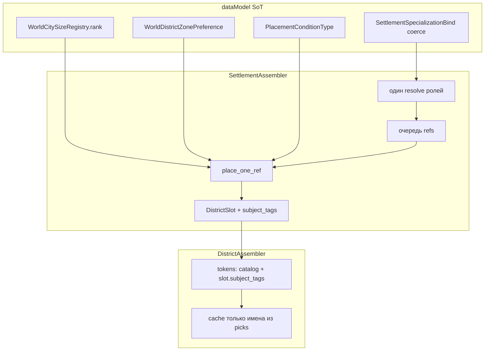

# План: CITY-T-4 — планировщик после 2d (смешение + хардкоды) ✅ DONE

**Статус:** имплементировано 2026-09-05 (`/impl-city-t-4`). **SoT долга:** [`docs/tz_generator_technical_debt.md`](../../docs/tz_generator_technical_debt.md) **CITY-T-4** (`resolved`). Продукт не менять: [`docs/tz_city_generation.md`](../../docs/tz_city_generation.md) §1.1–§1.2.  
**Команда:** [`/.cursor/commands/impl-city-t-4.md`](../commands/impl-city-t-4.md) → `/impl-city-t-4`.  
**Уже сделано (не повторять):** [settlement-specialization-districts](./settlement-specialization-districts.md) — роли, subjects, три прохода, `district_subtype`. [city-three-axes-transition](./city-three-axes-transition-done.md) A–F.  
**Не в этом плане:** CITY-T-2b (SQL `building_templates` uid); CITY-T-1b / 1e / DAG; CITY-T-3; полные интерьеры шахты/театра (не заменять `_TOWN_HALL_LEVELS` выдуманными планами); reopen рецепта §1.2.

Цель: generate после 2d читает **POJO**, не литералы assembler; один список имён зданий для cache и packing; subjects живут на слоте.

---

## 1. Целевое состояние



### Слои и ответственность

| Слой | Делает | Не делает |
|---|---|---|
| **dataModel** | rank размера; zone→types; enum `PlacementCondition.type`; `CellZone`; ClassVar `system_type` settlement; `subject_tags` контракт на слоте (поле runtime, не wire) | packing, SQL |
| **jsonValidation / 0001** | slice zone preference; колонка мира; coerce только на Bind | выбор клетки |
| **planner districts** | очередь refs → place-one-ref → materialize; один resolve bind→districts∪types; barrier/streets вызываются, не смешаны в циклы проходов | pick здания |
| **planner placement** | pin/recipe/legacy; `max_per` по type+subtype; constraint key без слова specialization | walk ролей |
| **tokens** | один pick на тип + `prefer_subjects(slot.subject_tags)`; rng §9.6 `BUILDINGS` | `settlement_specializations(world)` |
| **buildingCache** | греть **только** имена из того же pick-списка; нет assembler → skip/warning | silent `"building"` |

Инварианты:

- Рецепт §1.2 и subjects N+1 **не ломать**. Три прохода остаются.
- Генераторы pure sync. Реестры — `worldRow`, не второй словарь в assembler.
- `allowed` omit/`null` = весь каталог типов (**2a** контракт). Civic flood закрывать **allow-list на civic_center**, не откатом 2a.
- Неизвестный `district_type` в zone preference: после перечисленных (index = len), не `(1, 99)`.
- `max_per_city` считает чертежи с той же парой type+subtype, что у кандидата (civic_center не блокирует cultural_quarter).
- Subjects на тип здания только если тип ∈ `resolved_structure_types(bind)` (religion не тегирует theater).
- Seed зданий: `settlement_cell_rng(..., BUILDINGS)`. Не `Random(0)`.
- `village` size ≠ subtype. Не `0002_*.sql`. Не DAG.

---

## 2. Контракты

### 2.1 Ранг размера — CITY-T-4e

`WorldCitySizeRegistry.rank(system_size) -> int`: индекс в **resolved** `root` (канон⊕мир). Пустой/неизвестный → 0.

Удалить `CITY_SIZE_ORDER` из `planner/defaults.py`. `min_city_size` сравнивает rank(world), не литеральный список.

Новое поле `CitySizeEntry.rank` **не** обязательно, если порядок registry — SoT (как сейчас canonical hamlet…megalopolis).

### 2.2 Zone → типы районов — CITY-T-4e

Перенести `CellZone` в `dataModel/settlement/district/cellZone.py` (`center|edge|inner`).

POJO `WorldDistrictZonePreference` (RootModel list):

```text
{ "zone": "center"|"edge"|"inner", "district_types": ["civic", ...] }
```

`RUNTIME_MERGE_ID_FIELD = "zone"`. Canonical = текущая таблица `DISTRICT_TYPE_PREFERENCE` (включая `agricultural` на EDGE/INNER).

Метод `types_for(zone) -> tuple[str, ...]`. Placement читает `district_zone_preference(world)`, не `defaults.py`.

Тип не из списка: score `(1, len(preferred), cell_y, cell_x)` — клетка всё ещё заполняется.

**0001:** `worlds.district_zone_preference` TEXT/JSON (как другие registry_list). Recreate DB — в чеклисте мастера.

### 2.3 Типы placement_conditions — CITY-T-4e

`PlacementConditionType` (StrEnum) со значениями из city TZ §9.3 + уже существующий `cell_zone`. Поле `PlacementCondition.type` — этот enum (wire строки те же). Dispatch в placement по enum, не по сырым `"min_city_size"`.

Неизвестный type на импорте: Pydantic extra/ignore уже есть; generate — skip condition / False как сейчас для `else`.

`plan_district_slots`: `subtype_for(WorldLocationTypeRegistry.SYSTEM_TYPE_SETTLEMENT, subtype)` (ClassVar = `"settlement"` рядом с SCHEMA_ID). Не размазывать литерал по assembler.

### 2.4 DistrictSlot.subject_tags — CITY-T-4c/4d/4f

```text
DistrictSlot.subject_tags: dict[str, tuple[str, ...]]
# structure_type → subjects этого поселения, релевантные типу
```

Заполняет settlement pass из того же resolve, что union required. Tokens/cache **не** зовут `settlement_specializations`.

### 2.5 Один список имён зданий — CITY-T-4c

Единая функция (рядом с tokens или shared planner helper):

`pick_layout_names(slot, world, skeleton, catalog, rng) -> list[str]`

- `build_tokens` строит токены из этого списка.
- `collect_building_template_names` / `build_layout_cache` греют **только эти имена**, не все layout затронутых типов.

`candidate_template_names`: убрать мёртвый аргумент `cache` или реально использовать envelope.

Canonical `civic_center.allowed_structure_types`: явный список civic (`town_hall` ± `plaza` только если есть layout). Не omit.

### 2.6 Coerce и skeleton — CITY-T-4d

`"extract"` → bind: **только** `SettlementSpecializationBind._coerce_string_or_mapping`. Снять дубли из `SettlementSkeleton` и `BundleNamedLocation`.

`city_skeleton_from_settlement`: поля скелета из `SettlementSkeleton.model_dump()`, не ручной список каждого ключа. `economic_tier` по-прежнему с `TierResolver`.

### 2.7 Assembler и max_per — CITY-T-4f

Нет ключа в `ASSEMBLER_REGISTRY` → не подменять `"building"`; warning + skip probe (packing `NO_CACHE`).

`placed_types` / `max_per_city`: ключ `(district_type, district_subtype or "")`, не голый `district_type`.

### 2.8 Каталог и rng — CITY-T-4g

- Убрать из canonical `allowed` типы без layout (`warehouse`; `plaza` — только если нет stub). Не добавлять фейковые interiors (это 2b).
- Tokens: `rng` с клетки слота, роль `BUILDINGS`. Не `Random(0)`.
- Default `street_layout`: Field default на `DistrictTemplateEntry` = grid; select не пишет `StreetLayout.GRID.value` в обход POJO.

Переименовать `template_specialization_key` → `template_constraint_key`. Удалить мёртвые `typical_district_refs` / `_select_by_refs` (проходы 1–2 уже `pick_template_for_ref`).

---

## 3. Data flow

```
skeleton binds
  → resolve_specialization(world)  # once
      typical_districts refs + unknown roles
      required structure types (resolved subjects)
      subject_tags by structure_type
  → pass 1 city refs / pass 2 spec refs: place_one_ref
  → pass 3 morphology unspecialized
  → each DistrictSlot carries template + required + subject_tags
  → pick_layout_names(slot) → cache.ensure those names → build_tokens
```

Serial. Barrier shrink + `plan_settlement_entries` после всех слотов (как сейчас), не внутри `_try_place`.

---

## 4. Порядок слоёв

Не слайс «сначала только civic allowed». Скелет контрактов (A) до правок packing.

| Слой | Sub-ID | Что | Готово когда |
|---|---|---|---|
| **A** | 4e | CellZone + zone preference POJO; `city_sizes.rank`; PlacementConditionType; SYSTEM_TYPE_SETTLEMENT | Unit POJO; assembler ещё может читать старый defaults до B/C |
| **B** | 4e | WorldSlice + `district_zone_preference(world)` + `0001` + `World` dataclass | Import/runtime merge; validate_schema |
| **C** | 4a | Split `plan_district_slots`: resolve once, `place_one_ref`, materialize; проходы 1=2 по коду | Те же слоты, что сейчас, на unit specialization |
| **D** | 4b + часть 4f | Dead `_select_by_refs`; rename constraint key; max_per type+subtype; preference/rank из POJO | culture+civic_center оба могут стоять; unknown district_type не score 99 |
| **E** | 4c 4d | `subject_tags` на слоте; один pick-list; cache только его; coerce Bind-only; skeleton dump | tokens без worldRow specializations; civic без leftover mine/farm |
| **F** | 4f 4g | Нет silent building assembler; allowed без дыр; BUILDINGS rng; street default POJO | Probe unknown type = skip |
| **G** | — | Тесты + статус CITY-T-4* в tech debt / «код сейчас» city TZ | Чеклист path 2 мастеру (recreate DB после B) |

Пока слой не стоит — generate не пустеет (fallback: старый defaults до подключения worldRow в C/D).

---

## 5. Тесты (узкие)

Существующий `tests/test_city_three_axes.py` не ломать. Добавить:

- rank: порядок registry, unknown size → 0; мир overlay size в середине списка.
- zone preference: world overlay меняет EDGE list; тип вне списка всё ещё выбирается.
- civic_center + extract: центр без `mine` leftover (allow-list).
- culture + civic_center: оба слота, `max_per` civic_center не ест cultural_quarter.
- religion: temple tagged, theater не получает subject `religion`.
- Bind coerce: список строк на Skeleton/Bundle без локального validator.
- unknown `structure_type` layout: cache skip, не ратуша.
- tokens rng: две сборки той же клетки → тот же `system_name` (BUILDINGS seed).

Не раздувать `debug_settlement.py`.

---

## 6. Чеклист мастера (агент сервер не поднимает)

1. Recreate локальной БД после слоя B (`0001`).
2. Path 3 unit (агент).
3. Path 2: мир с ролью extract+subjects, generate дважды → те же чертежи на клетке.
4. Civic город без роли: в центре нет шахты/фермы из stub-каталога.
