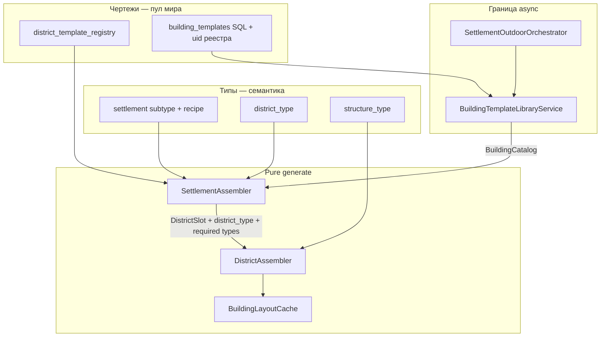
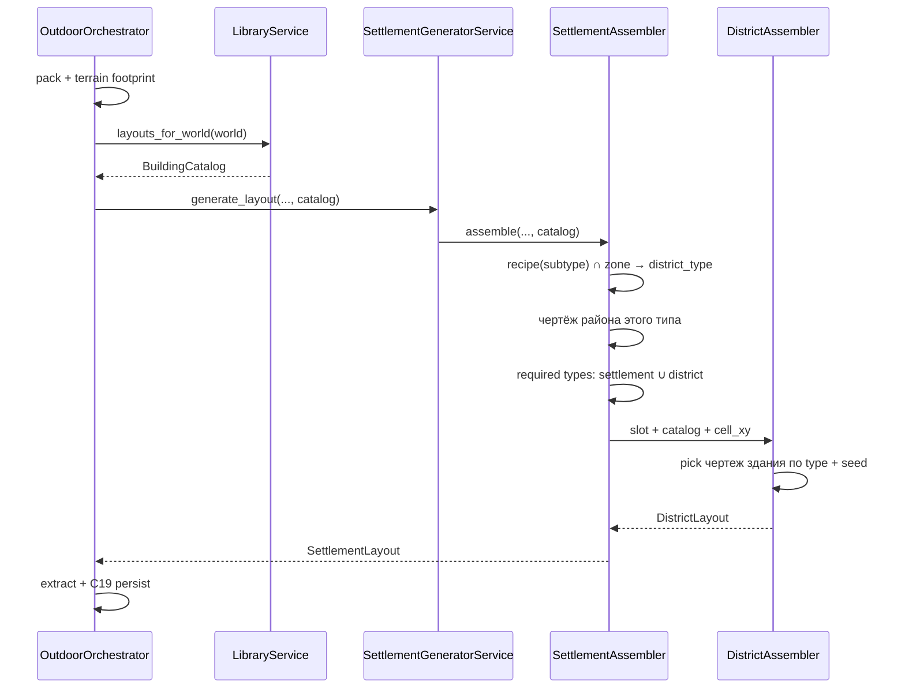

# План: переход generate города на три оси ✅ DONE

**Статус:** контракт перехода (не код). **SoT продукта:** [`docs/tz_city_generation.md`](../../docs/tz_city_generation.md) §1.1 / §9.6. Долг: **CITY-T-2a…2d**.  
**Команда новому агенту:** `/.cursor/commands/impl-city-three-axes.md` → в чате `/impl-city-three-axes`.  
**Не в этом плане:** Gate: DAG / правка нод; CITY-T-1b (игрок vs harness persist); CITY-T-3 parallel; organic footprint G; Outline→Layout compile (**POJO-D-16**).

Цель: один каркас слоёв, затем наполнение. Не «сначала только tavern rng». Пока слой не стоит — generate с fallback, без пустого города.

---

## 1. Целевое состояние

Тип ≠ чертёж. Размер (`system_city_size`) ≠ тип поселения.



### Слои и ответственность

| Слой | Делает | Не делает |
|---|---|---|
| **dataModel** | Рецепт на subtype поселения; `structure_type` vs `system_name`; seed-строка; семантика `allowed` null/`[]` | SQL, packing, HTTP |
| **jsonValidation / worldRow** | Import/runtime merge реестров; рецепт с engine subtypes | Выбор rng, cache оболочек |
| **BuildingTemplateLibraryService** | uid мира → SQL `data` → `BuildingLayoutTemplate`; skip Outline-only + warning | Вызов из assembler |
| **SettlementOutdoorOrchestrator** (и любой path-2 caller) | Bake pack, гидратация каталога, `generate_layout(catalog)`, persist C19 | Алгоритм района |
| **SettlementGeneratorService** | Тонкий sync facade: catalog in → assembler | `await` repo |
| **SettlementAssembler** | Footprint; тип района = рецепт ∩ зона клетки; чертёж района того же `district_type`; merge required **типов** с района; seed клетки; передать catalog вниз | SQL; pick `tavern_1` по имени с города |
| **DistrictAssembler** | Packing C22; required → чертёж типа из catalog (seed); fill по `allowed` **типам**; N из counts | Рецепт поселения; макротайл pack |
| **StructureAreaAssembler** | Участок из уже выбранного чертежа | Выбор из библиотеки |
| **API routes** | HTTP → orchestrator | Generate |

Инварианты:

- Генераторы pure sync, без SQL.
- Один writer persist (C19 serial).
- Повтор: тот же `world_uid` + `location_uid` + `(cell_x,cell_y)` footprint + тот же пул типа → тот же чертёж здания. Не pack `(gx,gy)`, не `city_size` в seed.
- `village` size и `village` subtype — разные ключи.

---

## 2. Контракты

### 2.1 Рецепт типа поселения (CITY-T-2d)

Wire: поля на **subtype** в `location_type_registry` (тип `settlement`), не отдельная таблица SQL и не поля на каждом городе. Geographic subtypes поля игнорируют (`extra=ignore`).

Расширить `LocationTypeSubtypeEntry` (только имеют смысл у settlement):

```text
typical_district_types: list[str]        # civic, residential, …
required_structure_types: list[str]      # structure_type библиотеки, не tavern_1
```

Канон в `WorldLocationTypeRegistry.canonical_engine()` (пример, мастер N+1):

| subtype | typical_district_types | required_structure_types |
|---|---|---|
| `city` | civic, commercial, residential, industrial, port | town_hall |
| `village` | civic, residential | — |
| `underground_city` | civic, residential | — |
| `dungeon` | — (outdoor city generate может skip) | — |

Resolve: `location_types(world).subtype_for("settlement", loc.system_location_subtype)`. Нет subtype / пустой рецепт → **fallback текущего кода** (все district templates + `placement_conditions` + зона), пока канон не заполнен.

### 2.2 `BuildingCatalog` (CITY-T-2b)

Sync snapshot на одну сборку, не live SQL.

```text
BuildingCatalog
  layouts: tuple[BuildingLayoutTemplate, ...]   # builtins ∪ library мира
  by_system_name(name) -> layout | None
  of_structure_type(type) -> tuple[layout, ...]  # стабильный порядок system_name
```

Сборка каталога (async, только caller):

1. `canonical_defaults()` layout (`town_hall`, `inn_small`).
2. Layout-строки в `world.building_template_registry` (interim).
3. uid → `building_templates.data` через `try_building_layout`; Outline-only — warning, не в пул.

Сигнатура:

```text
SettlementGeneratorService.generate_layout(world, settlement, terrain_cells, catalog=None)
# catalog=None → только builtins + layout-строки мира (path 3 / старые smoke)
```

### 2.3 Required: тип, не обязательно имя чертежа

`RequiredStructure`: оставить `building_template` (wire сегодня). Добавить optional `structure_type`.

Резолв (один helper в dataModel/planner):

1. Есть `structure_type` → пул catalog этого типа.
2. Иначе `building_template` совпал с `structure_type` какого-то layout → как тип.
3. Иначе `building_template` = `system_name` чертежа (совместимость civic `town_hall`).

Посадка: `rng.choice` среди eligible чертежей типа; seed §9.6. N / position — как сейчас (connections §5.1.3).

### 2.4 `allowed_structure_types` (CITY-T-2a)

| Wire | Смысл |
|---|---|
| omit / `null` | все `structure_type` из catalog ∩ тир (ТЗ §9.2) |
| `[]` | только required |
| список | фильтр типов, не имён чертежей |

На типе района отдельный реестр **не** вводить в этом переходе: allowed остаётся на чертеже района; пустой чертёж наследует семантику null выше.

### 2.5 Seed (CITY-T-2c)

Helper (coordinates/planner, не копипаст строк):

```text
settlement_cell_rng(world_uid, location_uid, cell_x, cell_y, role: "buildings" | "districts")
```

`role` — константный суффикс, не третий uid. Frontage/size_pct — та же пара + origin слота.

Планирование слотов — serial (CITY-T-3 не трогать).

---

## 3. Data flow (serial)



Path 3 (in-process без SQL library): `catalog=None` → builtins. Не подменяет path 2 для приёмки fill из библиотеки.

---

## 4. Сейчас vs цель (разрыв)

| Место | Сейчас | Цель |
|---|---|---|
| Рецепт поселения | нет; `min_city_size` + required на районе | subtype + `typical_district_types` / `required_structure_types` |
| Выбор района | все templates, зона как preference | сначала `district_type`, потом чертёж типа |
| Required | `building_template` = имя чертежа | тип → чертёж из catalog |
| Fill | `if not allowed: skip` | null = все типы catalog |
| Library | packing не читает uid | hydrate на orchestrator |
| Seed | `location_uid` + `city_size` | мир + город + клетка footprint |
| Catalog в assembler | `worldRow` + builtins | явный `BuildingCatalog` |

---

## 5. Порядок имплементации (слои, не слайсы фич)

Каждый слой **целиком** вливается с fallback. Не мержить «только 2a» без каталога: иначе inn_small поедет во все районы без рецепта.

### Слой A — типы и helpers (dataModel)

- Поля рецепта на `LocationTypeSubtypeEntry`.
- Канон-рецепты на engine settlement subtypes.
- `BuildingCatalog`, `try_building_layout` как единственный вход в пул generate.
- `settlement_cell_rng`.
- Резолв required (тип / имя).
- Семантика allowed null/`[]` — функция, ещё не подключена к cache.

**Готово:** unit на POJO + rng стабильность; generate **не** менять.

### Слой B — jsonValidation

- Runtime merge уже по `location_type_registry`: мировые subtype перекрывают канон по ключу.
- Import: лишние ключи на geographic subtype не 422 (`extra=ignore`).
- `worldRow.location_types` — единственное чтение рецепта.

Без колонок `0001`, если рецепт живёт в JSON реестра.

### Слой C — гидратация library (application, не generator)

- `BuildingTemplateLibraryService.layouts_for_world(world) -> list[layout]`.
- Orchestrator: catalog = builtins ⊕ layouts_for_world ⊕ layout-строки мира.
- `generate_layout(..., catalog=)`.
- In-process smoke без SQL: catalog=None.

**Готово:** path 2 может увидеть uid-библиотеку, даже если packing ещё фильтрует allowed.

### Слой D — SettlementAssembler

- Читать рецепт с NL subtype.
- Клетка footprint: `district_type` из typical ∩ зона; нет типа в рецепте — не сажать (warning), не брать military «с пола».
- Нет рецепта (пусто/unknown subtype) → **legacy** `select_district_template` как сейчас.
- `DistrictSlot`: сохранить `cell_x, cell_y` для seed; required types с поселения прокинуть в слот (union с районом).
- Передать catalog в `build_layout_cache` / DistrictAssembler.

### Слой E — DistrictAssembler + cache

- Подключить allowed null/`[]` (2a) **только вместе с** фильтром по typical/allowed **типам** и catalog (иначе взрыв builtins на все клетки).
- Токены: для каждого allowed/required **типа** — N копий; чертёж = `catalog.of_structure_type` + cell rng, не «каждый system_name по 1», если не задан counts по имени.
- Cache оболочек: имена после pick, или cache всех чертежей затронутых типов (дешевле второй: freeze до packing).

Уточнение N vs rng: counts по `system_name` остаются; без ключа — N=1 **на выбранный** чертёж типа, не N=1 на каждый чертёж типа в библиотеке. Иначе 40 tavern_* → 40 токенов. Это согласует «рандом из пула типа» с §5.1.3 (N про копии выбранного чертежа). Явный `structure_counts["tavern_1"]=3` — три копии этого чертежа.

### Слой F — приёмка path 2

- Мир с uid-библиотекой + поселение без authored-детей.
- Кейс без рецепта в JSON: канон subtype.
- Кейс с рецептом на subtype в `location_type_registry`.
- Повтор generate → те же чертежи на тех же клетках.
- Не считать закрытым контур до этого прогона.

### Слой G — leftover, не блокирует A–F

- Wire `RequiredStructure.structure_type` на import; deprecate имя-как-тип.
- DAG: тот же catalog hydrate (мастер, Gate).
- `assembler-hierarchy.mdc` / шапка city TZ синхрон (CITY-T-1d).

---

## 6. Совместимость на время перехода

| Вход | Поведение |
|---|---|
| Нет полей рецепта на subtype | legacy выбор района; required как имена чертежей |
| Рецепт есть, library пуста | builtins + warning, если required type неизвестен |
| uid в реестре, Outline в SQL | warning, тип без чертежа |
| Авторские дети на Ironhold | C14 skip / mix — для приёмки отдельное голое поселение |

Ломать v1 packing (pass1 → рамка → pass2) нельзя. Меняется только **кто** попадает в токены.

---

## 7. Вне скоупа (не размазывать)

- Нода `lazy_settlement` (CITY-T-1b).
- Parallel районов (CITY-T-3).
- Отдельный `district_type_registry` SQL.
- Рецепт на `city_size`.
- Список чертежей на `NamedLocation` города.

---

## 8. Готово когда

Мир: library зданий + (канон или JSON) рецепт subtype. Поселение: size/тир, без списка `tavern_1`. Generate: типы районов с рецепта, чертежи зданий из пула типа, seed клетки footprint воспроизводим. Orchestrator гидратит catalog. Assembler без SQL.
