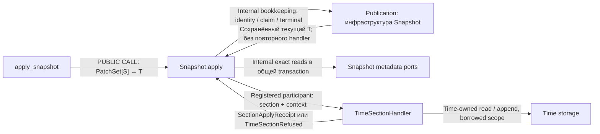
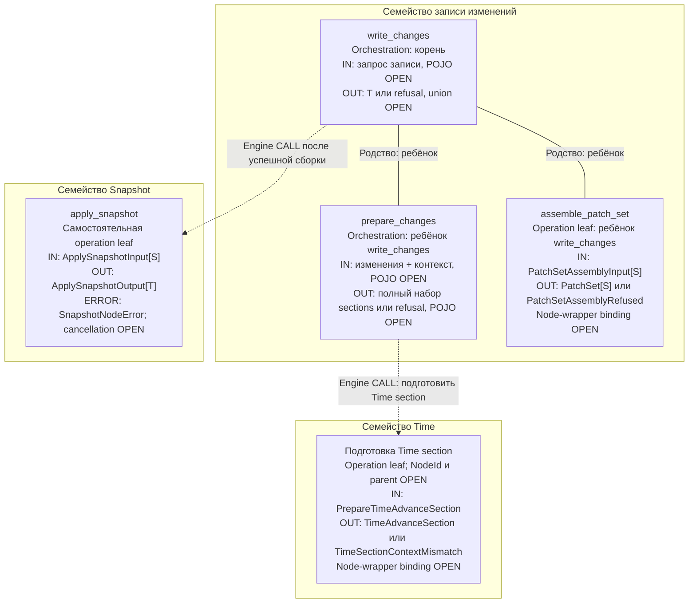

# DAG: общая карта междоменных процессов и контрактов

**Актуальная редакция схем — 2026-11-21, по поручению пользователя.** Три диаграммы ниже заменяют старые схемы: внутренняя граница Snapshot.apply, семейства нод и последовательность публичных вызовов. Карточки контрактов этого раздела приоритетнее исторических таблиц K и статусов первого круга ниже. Схемы конкретизируют Time/IC-1; другие домены подключаются через собственные согласованные bindings по необходимости. Source/Pack/Artifacts/Cache/Lifecycle не объявляются обязательными стадиями и не исключаются из каталога семейств. Отдельные read_world, initial-read и подготовка Pack вне текущего write flow.

S — закрытый набор concrete sections, для локального IC-1 TimeAdvanceSection. T — одна текущая concrete модель TimeSnapshotApplyResult для новой записи и её replay. Legacy union/readers не вводятся. OPEN означает отсутствие завершённого контракта, PROPOSED — предложение, не утверждённый NodeId/binding. Фиксация схем не закрывает эти gaps и не разрешает код.

## Карточки POJO и публичных целей — 2026-11-21

| Нода | Тип / отношение | IN → OUT | Связи и публичная цель |
|---|---|---|---|
| write_changes | Orchestration, корень семейства записи | Готовые типизированные изменения и контекст → owning отказ подготовки/сборки либо T; именованные Input/Output union OPEN | Engine CALL prepare_changes, assemble_patch_set, затем межсемейный CALL apply_snapshot; прямых domain calls нет |
| prepare_changes | Orchestration, ребёнок write_changes | Готовые доменные изменения + контекст → полный обязательный набор native sections либо owning отказ; aggregate POJO OPEN | Engine CALL доменных нод; Time leaf ниже. Не вычисляет изменения, не собирает PatchSet |
| Time preparation leaf (NodeId OPEN) | Operation leaf семейства Time; immediate parent OPEN | PrepareTimeAdvanceSection → TimeAdvanceSection либо TimeSectionContextMismatch; собственный node-wrapper/error binding OPEN | Один PUBLIC CALL ITimeAdvancePipelineOpenPipeline.prepare_section; реализация TimeAdvancePipelineOpenPipeline |
| assemble_patch_set | Operation leaf, ребёнок write_changes | PatchSetAssemblyInput[S] → PatchSet[S] либо PatchSetAssemblyRefused; node-wrapper/error binding OPEN | Один PUBLIC CALL IPatchSetAssembly[S].assemble; реализация PatchSetAssembler; без sorting/conversion/fingerprint в DAG |
| apply_snapshot | Самостоятельная operation leaf семейства Snapshot, не ребёнок write_changes | ApplySnapshotInput[S] → ApplySnapshotOutput[T]; SnapshotNodeError, cancellation transport OPEN | Один PUBLIC CALL await IWorldSnapshotApply[S,T].apply(input.patch_set); concrete owner WorldSnapshotService |

Owning вход Time:

```python
PrepareTimeAdvanceSection:
    proposal: TimeAdvanceProposal
    operation_id: EntityUid
    expected_world: WorldPublicationRef

TimeAdvanceSection:
    header: SectionHeader
    patches: tuple[TimeAdvancePatch]  # ровно один

TimeAdvancePatch:
    header: PatchHeader
    proposal: TimeAdvanceProposal

TimeSectionContextMismatch:
    issues: tuple[TimeSectionFieldIssue, ...]
```

Это схема полей, не новый код. Native key=time_clock, ordinal=0, общий operation_id; отдельные patch/section versions=1. Пустые depends_on/artifacts сохраняются по принятому Time-контракту. prepare_section проверяет operation/publication mismatch; native admission отдельно. Готовую section повторно не готовить, prepare_advance не обязательная стадия записи.

Owning вход assembler и поля успешного PatchSet:

```python
PatchSetAssemblyInput[S]:
    format_version: FormatVersion
    operation_id: EntityUid
    preparation_fingerprint: RevisionHex
    world_uid: EntityUid
    timeline_id: EntityUid
    turn_id: StrictInt  # >= 1
    expected_world: WorldPublicationRef
    expected_players: tuple[PlayerHeadExpectation, ...]
    sections: tuple[S, ...]

PatchSetAssemblyRefused:
    diagnostics: tuple[PatchSetAssemblyRelationIssue, ...]  # непустой
```

PatchSet[S] сохраняет те же поля и порядок sections/patches после owning проверок. Неверный concrete request class/структура не превращаются в business refusal; точный node error transport ещё OPEN.

Проектные node-контракты Snapshot (dataModel/engine/nodes/snapshot/contracts.py):

```python
ApplySnapshotInput[S]:
    patch_set: PatchSet[S]

ApplySnapshotOutput[T]:
    value: T

SnapshotNodeError:
    error: SnapshotPublicFault
```

PUBLIC mapping: input.patch_set → await IWorldSnapshotApply[S,T].apply → output.value без изменения результата. SnapshotPublicError(fault) → PythonNodeError(SnapshotNodeError(error=fault)); exact public fault proposal и сохранённая cancellation boundary ещё не закрыты. Обычная cancellation сохраняет runtime mapping; SnapshotOperationCancelledError(OperationCancelled) нельзя подменять отказом.

PROPOSED именованные IC-1 специализации в composition/snapshotTime/contracts.py: TimeApplySnapshotInput(ApplySnapshotInput[TimeAdvanceSection]) и TimeApplySnapshotOutput(ApplySnapshotOutput[TimeSnapshotApplyResult]), без новых полей/NodeId. Generic shapes самостоятельно не регистрируются. Для node POJO сохраняются strict/frozen/extra-forbid/revalidate-always; scope/services/callbacks не передаются.

Целевой current T = TimeSnapshotApplyResult:

```python
category: SnapshotApplyOutcomeKind  # COMMITTED / CONFLICT / REJECTED
operation_id: EntityUid
request_fingerprint: RevisionHex
committed: SnapshotCommitRefs | None
diagnostics: tuple[SnapshotApplyRelationIssue | TimeCommitRelationIssue, ...]

SnapshotCommitRefs:
    world_snapshot: WorldSnapshotRef
    player_snapshots: tuple[PlayerSnapshotRef, ...]
    publication: WorldPublicationRef
```

COMMITTED требует committed refs и пустые diagnostics; refusal — diagnostics и committed=None. SectionApplyReceipt(states,history,changed) — внутренний результат до commit, не T и не выход отдельной DAG-ноды. Metadata/terminal читаются внутри apply; Time handler подключён registry/composition, а не output предыдущей ноды. Прямые foreign public calls этой схемой не разрешаются.

Источники: [Snapshot node contracts](gen-dag-snapshot-node-contracts.md), [Time](time-domain.md), [H2](interdomain-refusal-transport-h2.md), [верхний процесс TODO](multidomain-write-input-preparation-todo.md). Главный остаток node-карты: именованные aggregate POJO write_changes/prepare_changes, Time leaf identity/parent/wrappers и assemble node wrappers; public error/cancellation mapping и final composition также OPEN.

**Положение Publication — зафиксировано пользователем 2026-11-21.** Publication является общей инфраструктурной частью ядра Snapshot, а не самостоятельным предметным доменом. Оно обслуживает operation identity/immutable request binding, lifecycle выполнения, транзакционную фиксацию, terminal persistence и exact replay для Snapshot apply, Pack activation и gameplay start. Выражение «владелец Publication» означает владельца этой инфраструктурной части; отдельные чат и каталог application/publication не задают отдельный домен. Snapshot владеет применением готовых изменений и моделью apply result; предметные домены — семантикой своих данных/diagnostics; Artifacts — хранением artifacts и их защитой; DAG — оркестрацией. Зависимость Snapshot → внутренний Publication operation store классифицируется как инфраструктурная связь внутри ядра, но exact capability, nested calls и H2 contracts ещё проверяются. Эта классификация не разрешает произвольные foreign public pipeline calls, не передаёт Publication доменную семантику и не закрывает H2.

Единый [реестр восьми открытых контрактных направлений](interdomain-contract-register.md) содержит владельцев, общие зависимости без дублей, конкретные предложения и критерии закрытия. Общая карта ниже показывает процессы; реестр — состояние контрактной работы.

Дата: 2026-11-18. Статус: СХЕМА СЕМЕЙСТВ И РОЛЕЙ ЗАФИКСИРОВАНА пользователем вместо прежней черновой схемы. Корень — write_changes; его дети — prepare_changes и assemble_patch_set; apply_snapshot остаётся в семействе Snapshot и вызывается через engine CALL. Точные POJO, bindings, внутренние доменные последовательности и полная архитектурная приёмка остаются OPEN. Фиксация схемы не является разрешением реализации.

## Общая карта контрактов — 2026-11-19

### Владельцы и внутренние чтения записи — фиксация пользователя 2026-11-20

Текущий скоуп — flow записи в мир. Самостоятельный read_world/read flow проектируется после контрактов записи, здесь новая нода чтения не вводится. Необходимые проверки состояния и replay выполняются внутри публичной операции Snapshot.apply, вызываемой apply_snapshot; это не разрешение DAG читать storage или выполнять доменные алгоритмы.

| Объект | Владелец | Путь получения | Статус |
|---|---|---|---|
| Metadata публикаций/snapshot | Snapshot | Snapshot.apply → собственные resolver/history ports → exact metadata в общей transaction | Локальный дизайн H3 и порядок чтения приняты; реализация/evidence отдельно |
| Terminal операции | Publication — persistence/replay; Snapshot — apply result model; домены — concrete diagnostics | Snapshot.apply → общий operation store/claim → существующий terminal либо право новой попытки | Направление определено; H2 OPEN по carriers, codec, compatibility и проверке допустимой инфраструктурной границы |
| Time handler | Time; исполняемый transaction participant, не данные | Snapshot dispatch через registry → Time handler(section, context) → Time-owned storage | Section приходит через PatchSet; H3 принят локально, H2 отказов OPEN; handler подключается composition, не выходом DAG-ноды |

Согласованный путь входных изменений: Time.prepare_section → готовая native Time section → assemble_patch_set → PatchSet → apply_snapshot. Metadata и terminal не являются outputs предыдущих нод в этой схеме. Handler передаётся через зарегистрированную composition, не через data-flow как payload.

Publication operation store рассматривается как общая инфраструктурная зависимость атомарной операции, но окончательная проверка допустимого internal port, сигнатур и nested calls остаётся в H2. Эта запись не утверждает прямой вызов чужого public pipeline и не создаёт общего исключения из запрета междоменных вызовов. Владельцы определены; нельзя объявлять terminal-путь полностью согласованным по одной диаграмме. Полная схема вызовов не является доказательством реализации.

**Граница текущего скоупа (решение пользователя 2026-11-19):** Pack import/export вынесен в [последующий отдельный план](pack-import-export-after-current-scope.md). Он не блокирует текущую карту и основные публичные контракты, но остаётся зависимостью затрагивающего импорт удаления полей и полного cutover.

Основной предмет работы — общая картина процессов и междоменные контракты. Карта ниже показывает публичные границы, не внутренние алгоритмы доменов. Схема семейств и детализация записи ниже сохраняются как отдельные представления. Имена процессных блоков чтения/Pack не назначают NodeId. Все переходы между доменами организует DAG; стрелки не разрешают прямые междоменные вызовы.



Легенда этой диаграммы: только apply_snapshot — DAG-нода; остальные блоки являются публичной целью или внутренними компонентами атомарной операции. Подписи отличают PUBLIC CALL, infrastructure bookkeeping, metadata reads и registered transaction participation. Это не родство нод и не разрешение domain public orchestration. Отказ подготовки/сборки исключает dependent apply; полный Error/retry/cancel contract схема не заменяет.

**Смежные процессы вынесены отдельно 2026-11-21:** [exact initial-read и самостоятельная подготовка Pack](interdomain-adjacent-processes.md). Там сохранены схемы, назначение, владельцы и OPEN IC-5/IC-6. Они не являются обязательными этапами текущей записи; строки связей ниже служат указателем на эти контракты, а не расширением скоупа. Import/export остаётся отдельно отложенным.

| Граница | Передаваемый контракт / гарантия | Статус и оставшаяся работа |
|---|---|---|
| Доменные producers → подготовка → PatchSet | Готовые native sections и полный контекст, без conversion в DAG | Exact producers, production union, coherent base и общая identity — отдельные OPEN; готовую section повторно не готовить |
| PatchSet → DAG → Snapshot | Успешный assemble гарантирует check_core + prepared-order; Snapshot повторно использует общий pure checker в admission | Граница принята; прямой validate → checker, без wrapper и нового NodeId. Exact diagnostics/transport и recovery callers OPEN; см. SN-Q1.1 |
| Snapshot initial binding → Artifacts → Time | Сохраняется Q → binding → exact ArtifactRef → verified bytes → TimeCapture | Вариант 2 принят: decode внутри одной Time-операции. Authority/lifetime, exact IO/Error и format binding OPEN. None не равно corruption; missing outcome верхнего процесса уточняется |
| Pack bytes → Artifacts → Pack | Pack владеет семантикой/bytes; Artifacts descriptor и staging; Pack проверяет соответствие результата | Достаточность prepare_stage/stage для BLOB согласована; exact Pack public split и полный маршрут PA-2 OPEN |
| Source evidence / inherited members → protection / READY → candidate | Source владеет proof semantics; Publication/Artifacts — согласованной protection/completion; Pack — candidate semantics | Public lifecycle entry, допустимые internal bindings, полный closure, root lifetime и durable exact replay OPEN. Source evidence само по себе не authority |
| Cache ↔ owning consumer через DAG | Cache хранит значение; owning consumer проверяет его пригодность | Cache hit не заменяет authority/admission и не является publication/hold. Подключение только по конкретному producer/consumer |

Exact initial-read не является автоматически current-time read или coherent capture для записи. Самостоятельная Pack-подготовка не обязательна перед Snapshot.apply; Pack state/candidate не native section. Activation, gameplay start и генераторы сюда не добавлены. Accepted местной границы не означает принятия полного маршрута или разрешения реализации. Источники детализации: [Snapshot SN-Q1.1](world-domain-patches-snapshots.md), [PatchSet](patch-set-domain-architecture.md), [Time](time-domain.md), [Artifacts](artifacts-public-staging-dag.md), [Pack PA-1/PA-2](pack-artifacts-boundary-trace.md).

## Область обсуждения

Базовая оркестрация записи данных между Source, Entity Lifecycle, Time, Pack и Snapshot через DAG. Artifacts учитывается как участник подготовки и хранения, Cache — как участник конкретных ветвей чтения и сохранения кэшируемых результатов. Ни один из них не является обязательной стадией каждой записи. Entity Lifecycle означает существование и преемственность сущностей, а не lifecycle операций Publication/Artifacts.

Уточнение пользователя: текущий engine outdated; архитектуру вызовов проектируем по согласованным планам, не выводим из его текущей реализации. Реализованный пример нод — Cache; остальные рассматриваем как проектные. По плану Cache реализованы четыре leaf-операции, укрупнённые read_cache/write_cache ещё требуют конкретизации.

Gameplay, его запуск, сценарии хода и генераторы сейчас не проектируются. Указание пользователя «сразу все домены писать за ход» фиксирует требование общей многодоменной публикации, а не добавляет игровой сценарий в scope.

## Зафиксированное направление

- Вызывающая сторона не должна знать внутреннюю композицию Source, Artifacts, Pack и остальных участников записи. Она передаёт подготовленные типизированные данные через контракт процесса DAG.
- Домены возвращают результаты DAG. Домен не вызывает DAG, чужие домены или NodeId самостоятельно. Вызывающая нода передаёт подготовленные результаты процессу через engine CALL.
- Одна операция публикации может включать создание, изменение и удаление данных нескольких доменов. Поэтому прежнее предложение разделить верхний процесс на create_data/update_data/delete_data не используется как основа текущего черновика.
- Единица общей публикации — согласованный набор доменных изменений, представленный PatchSet. Участие всех доменов допускается, но не требуется для каждого запроса.
- «Результат операции DAG» — данные, возвращаемые вызывающей стороне, не отдельный домен, хранилище или дополнительная запись.

## Правила нод

1. Ноды образуют семейства.
2. Ноды нижнего уровня имеют одну ответственность.
3. Укрупнённые ноды содержат логику оркестрации и вызывают своих детей или ноды других семейств через engine CALL.

Для каждой ноды обязательна [проверка контракта и логики](../rules/dag-generator-interface.mdc#обязательная-проверка-контрактов-и-логики-нод-пользователь-2026-11-18): DAG отвечает за контракты и оркестрацию, любая доменная логика внутри ноды запрещена. Оркестрация распределяется по уровням, а не сосредоточивается в write_changes или prepare_changes. Публичные методы и OpenPipeline — допустимые цели операционных нод. Примеры границ — Cache и GEN-DAG-1; точные критерии и порядок проверки принадлежат указанному правилу.

## Зафиксированная схема семейств и вызовов

`write_changes` — корневая нода семейства записи изменений. Её ответственность — оркестрация полного процесса записи. `prepare_changes` организует необходимую доменную подготовку, `assemble_patch_set` отдельно собирает общий PatchSet. Затем write_changes вызывает apply_snapshot другого семейства. Отдельная publish_changes не вводится: прежняя схема с этим именем заменена текущей.



Сплошные связи показывают родство, пунктирные — межсемейные engine CALL. Вызов не переносит ноду в семейство caller-а. Time leaf обозначена ролью без назначения NodeId/parent. Остальные семейства остаются в каталоге ниже; их обязательная очередь не назначается. OPEN/PROPOSED bindings не становятся принятыми из-за фиксации рисунка.

Поток данных под управлением write_changes: запрос → prepare_changes → подготовленные доменные изменения → assemble_patch_set → PatchSet → apply_snapshot → результат операции DAG. Вызовы выполняются через engine, результаты возвращаются caller-у. Отказ подготовки или сборки исключает запуск следующего зависимого шага. Точные deps, регистрация, внутренний порядок подготовки, ошибки и отмена ещё требуют контрактов.

| Нода | Вход | Выход | Граница ответственности |
|---|---|---|---|
| `write_changes` | Типизированный запрос общей публикации | Отказ подготовки/сборки либо результат Snapshot; точный union OPEN | Укрупнённая нода: управление процессом и возврат результата caller-у |
| `prepare_changes` | Доменные изменения и контекст операции | Подготовленные типизированные доменные изменения либо owning отказ | Необходимая подготовка через доменные ноды; без сборки общего PatchSet |
| `assemble_patch_set` | Подготовленные доменные изменения и контекст публикации | `PatchSet` либо типизированный отказ сборки | Объединение по принятому контракту секций и зависимостей; без вычисления доменных изменений, staging и публикации |
| `apply_snapshot` | `ApplySnapshotInput.patch_set` | `ApplySnapshotOutput.value: SnapshotApplyResult` | Один публичный вызов Snapshot apply |

Входы/выходы новых нод в таблице описаны по смыслу, не объявляют готовые POJO. Точные типы, ошибки сборки, закрытый набор секций и специализация PatchSet ещё OPEN. Существующий PatchSet требует timeline_id, turn_id и expected publication с Pack; создание этого контекста не добавляется в процесс автоматически, gameplay-start не проектируется.

## Последовательность вызова write_changes

Текущий вариант записан по поручению пользователя 2026-11-18. Внутренний процесс prepare_changes разрабатывается отдельно; эта последовательность не назначает порядок Source → Lifecycle → Time → Artifacts → Pack.

```mermaid
sequenceDiagram
    participant Caller as Вызывающая сторона
    participant W as write_changes
    participant P as prepare_changes
    participant TN as Time operation node: NodeId OPEN
    participant Time as Time public pipeline
    participant A as assemble_patch_set
    participant PS as PatchSet public API
    participant AN as apply_snapshot
    participant SN as Snapshot public API
    Caller->>W: Запрос записи — POJO OPEN
    W->>P: Engine CALL: подготовить полный набор sections
    P->>TN: Engine CALL: PrepareTimeAdvanceSection
    TN->>Time: prepare_section(request)
    Time-->>TN: TimeAdvanceSection или TimeSectionContextMismatch
    TN-->>P: Owning результат без изменения семантики
    P-->>W: Native sections или owning отказ
    W->>A: Engine CALL: PatchSetAssemblyInput[S]
    A->>PS: IPatchSetAssembly[S].assemble(request)
    PS-->>A: PatchSet[S] или PatchSetAssemblyRefused
    A-->>W: Owning результат сборки
    W->>AN: Engine CALL: ApplySnapshotInput[S](patch_set)
    AN->>SN: await IWorldSnapshotApply[S,T].apply(patch_set)
    SN-->>AN: T — текущее выполнение или replay
    AN-->>W: ApplySnapshotOutput[T](value=result)
    W-->>Caller: Результат записи — wrapper OPEN
    Note over W,SN: Отказ подготовки исключает сборку; отказ сборки исключает apply.<br/>Успех ноды не равен COMMITTED.
```

Уточнение пользователя 2026-11-19: общий маршрут дополнен вложенной Snapshot admission-цепочкой по [SN-Q1-I1](world-domain-patches-snapshots.md#sn-q1-i1-методы-и-проверка-ответственности-после-реализации). Snapshot/Validator/Checker на sequence-диаграмме — доменные классы и вызовы, не новые DAG-ноды и не изменение семейств. `validate` прямо вызывает `PatchSetInvariants.check_prepared_order`; отдельный `_check_prepared_order` не требуется. Constructor/decode сохраняет только check_core; повторного assemble внутри Snapshot нет. Место проверки принято, реализация TARGET; exact diagnostics/transport и полный dependency coverage остаются OPEN. При отказе admission дальнейшие зависимые этапы не запускаются; отказ не объявляется автоматически durable REJECTED. Prepared fingerprints и mutable-state проверки не переносятся в общий helper.

Диаграмма показывает успешный admission с ветвями terminal replay и новой попытки. Это не автоматическое разрешение новых retry-callers. Правила каждого шага:

1. write_changes принимает конкретные типизированные изменения и контекст. Caller не задаёт технический список вызовов Source/Pack/Artifacts. Идентичность операции и expected publication должны быть определены до apply; точный поставщик этих значений и форма входа OPEN.
2. prepare_changes организует необходимые чтения и операции подготовки по подтверждённым зависимостям. Полный успешный результат означает готовность всего обязательного набора к сборке; частичный набор не выдаётся за общий успех. Обязательный отказ исключает сборку и apply.
3. assemble_patch_set получает готовые native sections и полный контекст, напрямую вызывает публичную `PatchSetAssembler.assemble` через `IPatchSetAssembly` и возвращает её PatchSet либо типизированный отказ. Алгоритм проверки общих отношений, ключей и порядка зависимостей принадлежит домену PatchSet, не ноде. Нода не создаёт секции из произвольных prepared results, не вычисляет fingerprints, не сортирует и не сливает изменения. Нормативная граница — [ТЗ Patch System, уточнение 2026-11-18](../../docs/tz_patch_system.md#граница-dag-и-домена-patchset--уточнение-2026-11-18); классы/POJO и ошибки — [архитектура ядра](patch-set-domain-architecture.md). Staging и публикация сюда не переносятся.
4. apply_snapshot вызывается только после успешной сборки. Snapshot отвечает за атомарное применение. Подготовка и сборка сами по себе не означают успешную запись.
5. write_changes возвращает owning результат применения либо соответствующий исход предшествующего этапа. Конфликт, отказ, отмена и неопределённый исход не превращаются в успех или автоматический повтор; неизвестный результат применения не объявляется откатом. Конкретные error/cancellation/cleanup bindings остаются OPEN.

Внутри подготовки уже видна зависимость данных Artifacts: готовый content → prepare_artifact → PreparedArtifact; PreparedArtifact вместе с действующим lease → stage_artifact → ArtifactRef. Это не полный процесс: producer content, источник lease, удержание результата и его consumer ещё требуют owning контрактов. Конкретное включение этих вызовов в prepare_changes не назначает их обязательными для любой записи.

Следующее проектирование: определить входные варианты prepare_changes, точную границу предварительно подготовленных данных, зависимости доменных операций и критерий полноты результата для assemble_patch_set. Порядок не выводится из списка названий доменов; необходимы подтверждённые связи output → input.

## Ответственность и гарантии

1. Домены владеют своими данными, семантикой, подготовкой изменений и ошибками. Они не формируют чужие изменения и не публикуют общее состояние самостоятельно.
2. `write_changes` и `prepare_changes` — укрупнённые DAG-ноды с ответственностью оркестрации, не новые доменные orchestration services или отдельные executors. Они используют существующий engine CALL и контракты нод. Внутренние алгоритмы доменов сюда не переносятся.
3. `assemble_patch_set` — отдельная нода нижнего уровня с единственной ответственностью сборки общего PatchSet. `write_changes` передаёт ей результат подготовки, а затем передаёт собранный PatchSet в `apply_snapshot`. Сборка не переносится в подготовку, orchestration-код write_changes или apply leaf. prepare_artifact, stage_artifact и apply_snapshot также сохраняют по одной операции нижнего уровня.
4. Snapshot отвечает за атомарное применение общей операции. Частичная публикация обязательных изменений не считается общим успехом. Успех подготовки и staging не равен успешной публикации; staging не объявляется частью одной SQL-транзакции автоматически.
5. Результат сохраняет owning исходы. Конфликт, отказ, отмена и неопределённый исход не превращаются в успех или неявный retry. Exact error/cancellation mapping ещё OPEN.
6. Один PatchSet.operation_id может объединять несколько Lifecycle change_uid и изменения других доменов. Эти идентичности не приравниваются. Повтор одного lifecycle-перехода не означает успех всей публикации.
7. Параллельность подготовки не утверждена. Её допустимость и порядок определяются после проверки зависимостей и совместного согласования.

## Граница prepare_changes — уточнение пользователя

На вход процесса записи поступают готовые типизированные патчи/доменные изменения, сформированные и проверенные доменами-исполнителями. Предметная подготовка не выполняется повторно в prepare_changes. Точный внешний POJO и привязка к существующим секциям ещё OPEN; это решение о границе ответственности, не приёмка новой универсальной модели.

Проверки конкретных пакетных операций, патчей, допустимости чтения/записи, версий, ссылок и зависимостей принадлежат соответствующим доменным публичным операциям. prepare_changes организует их вызовы, передаёт типизированные данные и использует owning результаты, но не дублирует алгоритмы admission/validation. Проверки транспортного контракта ноды и корреляции CALL не заменяют доменные проверки. Подготовленный и ранее проверенный патч не освобождает владельца apply от проверки актуальных предусловий при применении.

Основания сверки: [Pack batch contract](pack-wilderness-chunk-batch-contract.md) размещает admission state/entries, duplicate addresses, metadata transitions и общую diagnostics boundary внутри Pack. [Snapshot apply trace](snapshot-public-apply-atomic-trace.md) относит revalidation PatchSet, registry/model/version/dependencies, expected heads и section validation к Snapshot; trace рассматривается как проект owning границы, не заявление о runtime readiness или приёмка исторических proposed deltas. DAG не переносит эти проверки в свою ноду подготовки или сборки.

Подтверждены два исправления прежнего предложения:

- Lifecycle и Time не обязаны вызываться внутри записи для расчёта предметных изменений: их готовые патчи могут уже входить в запрос. Дополнительные вызовы выполняются только по конкретному контракту зависимости чтения/хранения.
- Отдельная prepare_domain_change для каждого будущего домена не требуется по умолчанию. Новые домены подключаются своими типизированными патчами и контрактами хранения/применения. Общая оркестрация изменяется при новом инфраструктурном требовании, а не автоматически с каждым доменом.

Наши семейства нод составляют базу будущих контрактов чтения/записи других доменов. assemble_patch_set сохраняет единственную ответственность сборки; она не становится новым валидатором предметных патчей или вторым Snapshot admission. Ранее описанная «доменная подготовка» внутри prepare_changes означает только необходимые операции подготовки записи по owning контрактам, а не повторное предметное вычисление переходов/значений. Состав таких операций и их порядок ещё предстоит конкретизировать.

## Cache и граница масштабирования подготовки

Cache включён в карту по поручению пользователя. Наличие стрелок не утверждает конкретный ключ, payload, момент записи или универсальную последовательность cache → domain → cache. Эти bindings принимаются по конкретному процессу.

Ветвление hit/miss принадлежит DAG: Cache не запускает producer. Hit не заменяет owning admission, publication pin, hold или подтверждение актуальности. Miss не равен ошибке Cache. После получения подходящего owning результата DAG может вызвать write_cache по согласованному контракту; запись в Cache не является общей публикацией и не означает commit. Особенно нельзя выдать staged данные за опубликованные только из-за наличия cache entry.

Выбранная абстракция семейств сохраняется: типизированная команда → укрупнённая нода семейства → отдельная операционная нода → публичный метод домена. Предлагавшиеся prepare_domain_change и отдельное семейство подготовки на каждый предметный домен НЕ зафиксированы как архитектура. Необходимость вспомогательных поднод определяется после уточнения общей формы входных изменений и конкретных зависимостей; новый универсальный диспетчер или второй executor не вводится.

## Уже спроектированные ноды — опора, не новая приёмка

- [Source/Pack families](gen-dag-cache-pack-source-families.md): выбрана двухуровневая организация укрупнённых read/write-нод и отдельных операций. Exact bindings остаются открыты. `write_source` не имеет подтверждённой публичной write-цели; proof read/admission не назначаются операциями записи.
- [Cache](gen-dag-cache-pack-source-families.md): read_cache/write_cache над read_cache_entry/create_cache_entry/update_cache_entry/evict_cache_entry. Реализованные leaf-ноды служат примером одной ответственности; конкретное включение Cache в процесс подготовки ещё требует контрактов.
- [Snapshot nodes](gen-dag-snapshot-node-contracts.md): согласован состав `read_snapshot`, `read_snapshot_metadata`, `read_snapshot_publication`, отдельно `apply_snapshot`; `write_snapshot` не вводится. Полная реализация/public lifecycle не объявлены готовыми.
- [Artifacts nodes](gen-dag-artifacts-node-contracts.md): согласованы `prepare_artifact`, `stage_artifact`; их consumers, специализации и включение в этот процесс требуют отдельного binding.
- [Lifecycle](../../docs/tz_entity_lifecycle.md): read и Create/Replacement/End/Reactivate prepare-контракты проектируются; точные ноды и physical publication/read bindings открыты.
- Time-ноды и их участие в этом процессе ещё предстоит определить по owning операциям. Gameplay-start dependency не переносится сюда.

Новое семейство записи не меняет родство существующих доменных семейств. CALL и parent/child — разные отношения. Pack prepare/activate/release не соединяются автоматически в последовательность, а Pack не назначается универсальным хранилищем всех доменов. Вызов Pack activation перед Snapshot apply этой схемой не предусматривается.

## Карта нод и контрактов, привязанная к диаграмме

Последовательные ответы чатов-владельцев и выявленные gaps фиксируются в [журнале уточнений](dag-write-owner-contract-clarifications.md). Ответ владельца не означает автоматическую приёмку всей интеграции.

Первичная карта для уточнения у владельцев, 2026-11-18. ID K обозначают строки карты, не новые NodeId. Карта сохраняет схему семейств выше и не назначает очередь доменных вызовов. Проектный контракт, реализованная leaf и принятая связь процесса — разные статусы. Доменная логика не переносится в DAG при отсутствии публичного контракта.

### Контракты процесса записи

| ID / связь диаграммы | Вход | Выход / ошибка | Исполнитель и точный остаток |
|---|---|---|---|
| K1: caller → write_changes | Готовые типизированные патчи/изменения + контекст общей операции | Общий исход; точный Input/Output/Error OPEN | DAG orchestration; определить форму запроса, identity/expected versions и сохранение owning исходов без универсального dict |
| K2: write_changes → prepare_changes (ребёнок) | Данные K1, необходимые для подготовки записи | Полный набор результатов для сборки либо owning отказ; POJO OPEN | DAG orchestration; определить требуемые CALL и output→input связи K5–K10; не повторять предметную подготовку |
| K3: write_changes → assemble_patch_set (ребёнок) | Результаты K2 + контекст публикации | PatchSet с закрытым набором секций; error OPEN | Отдельная ответственность сборки; определить границу простой композиции и публичной owning операции, если сборка требует доменной логики. Такая логика в ноде запрещена |
| K4: write_changes → apply_snapshot (межсемейный CALL) | ApplySnapshotInput.patch_set | ApplySnapshotOutput.value: SnapshotApplyResult; проект SnapshotNodeError(SnapshotPublicFault), отдельная cancellation boundary | Один публичный Snapshot apply. Порт IWorldSnapshotApply.apply существует; concrete public lifecycle, named specialization PatchSet и error/cancellation binding не завершены |

Источник K4: [Snapshot node contracts](gen-dag-snapshot-node-contracts.md). SnapshotApplyResult сохраняет COMMITTED/CONFLICT/REJECTED; успех исполнения ноды не означает commit. PatchSet не конструируется заново в apply_snapshot.

### Семейства, вызываемые prepare_changes

| ID / связь диаграммы | Контракт верхней ноды / owning данные | Операционные ноды → публичная цель | Что уточнить для включения в процесс |
|---|---|---|---|
| K5: prepare_changes → read_cache/write_cache | Read: конкретный CacheKey[T] или согласованный состав; output CacheLookup[T]/агрегат. Write: CacheEntry[T] для create/update либо CacheKey[T] для evict; соответствующий owning result. CacheNodeError содержит CacheError | read_cache_entry → CacheService.get; create_cache_entry → create; update_cache_entry → update; evict_cache_entry → evict | Что кэшируется, точный T/key/binding, caller ветки hit/miss и момент cache write; leaf реализованы, upper exact contracts OPEN |
| K6: prepare_changes → read_source | SourceReadInput/Output — проектные оболочки над пятью owning операциями; SourceNodeError содержит SourceFailure | admit(SourceProofInput), read(SourceProofReadInput), select(SourceProofSelectInput) → SourceProofResult; admit_groups(SourceProofGroupsInput), verify_groups(SourceProofGroupsVerifyInput) → SourceProofGroupsResult; отдельные leaf NodeId OPEN | Какие входные изменения требуют Source; кто формирует usage; куда поступает proof/closure. Exact public owner layout уточнить по source-core-public-boundaries; read-only proof не создаёт captures/holds. write_source не добавляется без owning write-контракта |
| K7: prepare_changes → write_pack | WritePackInput(command) → WritePackOutput(result); закрытая команда owning операции | Соответствующая leaf → публичный PackPreparationService method; результат PackPreparationState. Отдельные prepare_pack → PreparedPackCandidate, activate_pack/release_pack имеют собственные outcomes | Какие команды нужны именно этому PatchSet-процессу, producer входного state, consumer результата и errors. State/candidate не объявляются PatchSet-секцией. Наличие activate/release в каталоге не включает их в маршрут |
| K8: prepare_changes → prepare_artifact | PrepareArtifactInput[C](request: ArtifactPrepareStageInput[C](content)) | prepare_artifact → IArtifactPrepareStageOpenPipeline.prepare_stage; PrepareArtifactOutput[C](value: PreparedArtifact[C]); PrepareArtifactError(ArtifactInputError) | Кто возвращает готовый content, конкретный C и format binding, сохранение требований admitted content при передаче. Нода и её роль согласованы, concrete bindings OPEN |
| K9: prepare_changes → stage_artifact | StageArtifactInput[C](request: ArtifactStageInput[C](lease, prepared)) | stage_artifact → IArtifactStageOpenPipeline.stage; StageArtifactOutput(value: ArtifactRef); StageArtifactError(ArtifactInputError или ArtifactLeaseFailure) | Поставщик действующего lease, связь с K8, удержание результата и owning consumer ArtifactRef. Никакого назначения lease нодой по предположению |
| K10: prepare_changes → Time/Lifecycle (групповой placeholder диаграммы) | Ноды и точные контракты участия OPEN | Lifecycle имеет проект read_current/read_history и отдельных prepare_create/replacement/end/reactivate; Time имеет собственные read/prepare операции, но это ещё не конкретные CALL этого процесса | Определить, нужны ли дополнительные вызовы для уже готовых входных патчей. Не назначать обязательный перерасчёт clock или lifecycle-переходов; не создавать универсальную leaf для двух доменов |

Источники: [Cache/Pack/Source, §6.1–6.5](gen-dag-cache-pack-source-families.md), [Source public boundaries](source-core-public-boundaries.md), [Artifacts exact node/public mapping](gen-dag-artifacts-node-contracts.md), [Time](time-domain.md), [Lifecycle](../../docs/tz_entity_lifecycle.md). Таблица навигационная: exact signatures/поля/errors брать у владельца, не трактовать сокращённые записи как новые declarations.

### Статусы после уточнения у владельцев

Первый последовательный круг завершён: [полный журнал ответов](dag-write-owner-contract-clarifications.md). Это уточнение карты, не новая приёмка.

| Участок | Подтверждение владельца / оставшаяся граница |
|---|---|
| K1–K3 | Apply принимает native sections. Общий вход patches → sections пока не замкнут; публичный assembler не найден. DAG не выполняет conversion/fingerprints/доменные проверки |
| K4 | Сигнатура apply/result подтверждены; concrete public lifecycle, закрытый набор секций и fault/cancellation binding OPEN |
| K5 Cache | Четыре leaf реализованы. Upper contracts и необходимость Cache для нашего набора OPEN; не mandatory stage, не protection/cleanup |
| K6 Source | Proof операции read-only; необходимость определяется consumer provenance. Public layout/IO и mapping общей записи OPEN; proof не hold |
| K7 Pack | Для готовых sections вызов не требуется без отдельной Pack-зависимости. State/candidate не sections; activation перед apply не включается |
| K8/K9 Artifacts | Prepare/stage target API уточнены; exact bindings/error transport OPEN. Stage не гарантирует protection до apply |
| K10 Lifecycle/Time | Готовую native section не надо переподготавливать. Публичные producers section из proposed prepared results не завершены |
| Внешняя потребность Publication | Producer lease/общего preparation binding, completion/protection/recovery/cleanup OPEN. Existing internal ports не готовые публичные ноды. Не добавлять выдуманный entry; малая запись без artifacts не требует обязательного staging lifecycle |

### Незакрытые связи данных

1. Входные патчи K1 → конкретные запросы K5–K10: определить требования публичных контрактов, не извлекать их собственной предметной логикой DAG.
2. Content → K8 → PreparedArtifact; PreparedArtifact + lease → K9 → ArtifactRef: назначить producer и consumer. Эта зависимость не доказывает готовность всей цепочки хранения.
3. Source proof, Cache lookup и Pack state/candidate → следующий owning input: эти результаты не становятся патчами только потому, что получены DAG.
4. Результаты подготовки → K3: определить точный набор готовых типизированных элементов; если нужна owning операция формирования секции/патча, подтвердить её публичный контракт, а не дописывать conversion в родителе.
5. K3 → K4: конкретный набор секций, общий publication context и передача PatchSet без повторной доменной подготовки. Все проверки пакета/patches/CAS выполняет owning публичная операция.

Отдельные read_pack/read_snapshot есть в каталогах семейств, но конкретная связь из prepare_changes нашей схемой пока не назначена. При выявлении потребности сначала уточнить вход/выход и caller; не добавлять автоматическое чтение latest. Источник lease также пока не назначает новую ноду.

Для каждого владельца требуется ответ по соответствующей строке: конкретный public class/method/OpenPipeline; полный Input/Output/Error; scope/effects; owning validation; prerequisites и guarantees результата; подтверждённое соответствие соседнему контракту; статус accepted/project/runtime. До этих ответов последовательность внутри prepare_changes остаётся OPEN. Карта не является полной приёмкой по обязательным критериям правила DAG.

## Открытые решения до приёмки

- Точные контракты write_changes, prepare_changes и assemble_patch_set: состав входов, результаты, concrete Input/Output/Error и их владельцы.
- Где проходит граница подготовки до входа в процесс и подготовки внутри него; источники operation identity и expected publication.
- Закрытый набор поддерживаемых доменных секций и специализация PatchSet без Any, универсального BaseModel или копий owning POJO.
- Точное соответствие результатов Source, Lifecycle, Time, Pack и Artifacts входам потребителей. Не каждый участник обязательно входит в конкретный маршрут.
- Кто и каким допустимым способом сохраняет lifecycle state/history в общей publication boundary. Snapshot → Lifecycle handler → storage не считается разрешённым только из-за наличия handler/DI.
- Владельцы artifacts, полный retention closure, подготовленные refs, release/cleanup при отказах, отмене и восстановлении.
- Правила корреляции результатов CALL, retry/replay, конфликтов версий и неизвестного исхода публикации.
- Карточки нод, ответственность каждого задействованного класса, фактические вложенные вызовы и совместно принятый порядок.

До реализации применяются все [обязательные критерии приёмки](../rules/dag-generator-interface.mdc), включая три запрета DAG, CRUD, POJO/errors, границы публичного контракта и реализации и неизменность утверждённого порядка. Любой обязательный OPEN означает отсутствие полной приёмки. Данный файл фиксирует направление обсуждения, не закрывает существующие domain gates и не изменяет ТЗ.
