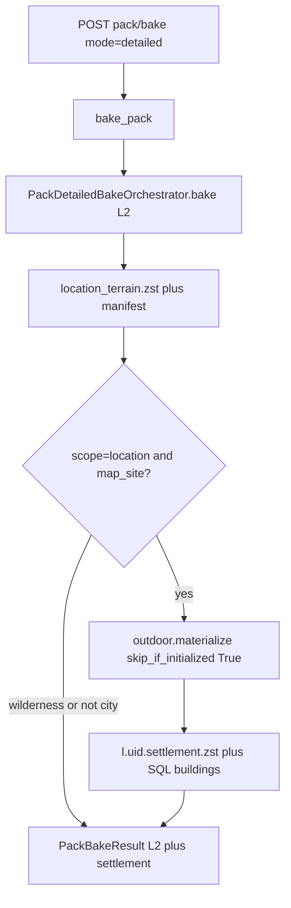

# detailed_bake: хук C11 поверх L2 ✅ DONE

План архитектуры (согласован 2026-09-06). Продуктовый контракт [`docs/tz_world_pack_storage.md`](../../docs/tz_world_pack_storage.md) § Bake modes **не** переписывать.

## 1. Целевое состояние

**Callers**

- Product job: `POST …/map/pack/bake?mode=detailed&scope=location&location_uid=` → `WorldSurfaceMaterializationOrchestrator.bake_pack` → `materialize_pack_detailed`.
- Тот же C11: debug `POST …/generate-settlement` (и C16 batch). Не второй packing, не копипаст C22.
- `full_bake` не трогать (уже L0 → `plan_topology`). HTTP generate-settlement не склеивать с bake.

**Интерфейсы (bake = консьюмер)**

| Шаг | Контракт | Кто реализует |
|---|---|---|
| 1 | L2 refine / `FineChunkRunner` | `PackDetailedBakeOrchestrator.bake` |
| 2 | `materialize(world_uid, location_uid)` | `SettlementOutdoorOrchestrator.materialize` |

Bake не знает `DistrictSlot`, `plan_district_slots`, assembler, FineChunk internals.

**Инварианты**

- Порядок: L2 persist (manifest + `location_terrain`) **затем** C11 поверх этой земли (C1: packing не переписывает землю).
- `scope=wilderness` — только шаг 1.
- Не settlement-like `scope=location` — только шаг 1.
- Topology не invent в detailed; `materialize` сам добирает freeze, если нет.
- Интерьеры, DAG, CITY-T-5b, mill/paint product-off — вне job.

**Где хук**

Зеркало C23: surface facade, не L2-оркестратор.

- Да: конец `materialize_pack_detailed` после `await self._detailed.bake(...)`.
- Нет: `_bake_location_scope` / outdoor на `PackDetailedBakeOrchestrator`.
- Нет: `plan_district_slots` в pack bake.

`Container.surface_materialization_orchestrator` уже передаёт `outdoor=`. Если `outdoor is None` — шаг 2 skip.

## 2. Контракты

**Сигнатура:** после L2 — `_maybe_materialize_c11(world, locations, request)`. `world_uid` = `world.world_uid`.

**Предикат:** `is_settlement_outdoor_target` (`named_location_is_settlement_map_site`), не `== "settlement"` и не широкий `uses_settlement_fine_footprint` (включает district).

**`skip_if_initialized=True`** (как generate-settlement). Повтор = C14 skip.

**Отчёт:** `PackBakeResult.settlement: MaterializeResult | None`. Не поле на `PackDetailedBakeResult`. Не копировать CITY-T-5m (молчаливые ошибки).

**HTTP:** facade ловит `SettlementOutdoorError`; L2 не откатывать; 207 при terrain_failed или `settlement.status=error`. Route не зовёт C11.

**Schema:** без `0001` / `0002`.

## 3. Data flow

**Ошибка C11 после L2:** землю не откатывать; `settlement.error` + 207.

**CITY-T-5g:** C11 skip = C14 (zst + дети). После C23 без zst шаг 2 идёт. 5g — legacy persist, не этот путь.

**CITY-T-5a:** `persist_outdoor` с зданиями как прямыми детьми города → authored skip. Не чинить в этом хуке.

## 4. Порядок impl

1. Фасад `_maybe_materialize_c11`.
2. `PackBakeResult.settlement` + HTTP 207.
3. Docstring / галки статуса в ТЗ.
4. Юнит фасада.
5. Smoke мастера (агент backend не стартует).

## 5. Вне scope

DAG, CITY-T-5b, интерьеры, mill, 4-й mode, C11 на wilderness, `full_bake`, C16 из detailed, фикс 5a/5g/5m, schema, коммит, старт backend.

## 6. Чеклист мастера после impl

Предусловие: `full_bake` (L0 + C23), нет `settlement.zst`.

1. Detailed `scope=location` на city → 200, `settlement.status=published` (повтор — `skipped`).
2. `l.{uid}.settlement.zst` + SQL здания parent = район.
3. Wilderness detailed — нет `settlement`, нет city blobs.
4. Non-city pin — L2 без C11.
5. `generate-settlement` после detailed → C14 skip.
