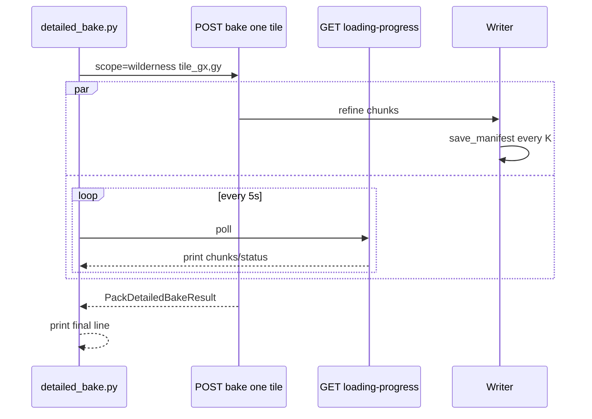

# Plan: detailed wilderness — per-tile smoke + online progress ✅ DONE

**Контекст:** smoke `scope=wilderness&max_tiles=1` на world-test-003: **1 macro-tile ≈ 8836 meter-chunks** (`fine_cells_per_map_cell=3000`, chunk=32). Sync HTTP 50+ мин → timeout / connection reset; script молчит до конца ответа; `save_manifest` только в конце `refine_rects` → на диске orphan files без manifest status.

**Цель:** дергать **один tile за вызов**; видеть прогресс **онлайн** (не ждать финальный JSON).

---

## 0. Правило

Architecture-first. Slice = только stub. Не bolt-on «ещё один max_chunks» без tile wire.

---

## 1. Почему долго (факт)

| Фактор | Эффект |
|---|---|
| Full-tile wilderness = все `iter_fine_chunks` | ~8.8k chunks / tile @ 3000 m |
| Sync `POST pack/bake` | один HTTP до конца job |
| Script `httpx` ждёт response | stdout пустой 30–60+ мин |
| `FineChunkRunner` → `save_manifest` в конце tile | interrupt = blobs есть, manifest `absent` |

**Не** чинить «ускорить generate» в этом плане. Чинить **unit of work** + **observability**.

---

## 2. Целевое состояние

### A. Per-tile wire (SoT)

Расширить `DetailedBakeRequest` (wilderness):

```text
tile_gx: int | None = None
tile_gy: int | None = None
# invariant: оба None → current list (max_tiles cap)
# оба set → ровно один tile (игнор max_tiles / skip-complete всё ещё действует)
# один set → 422
```

Orch `_wilderness_tiles`:
- если `(tile_gx, tile_gy)` заданы → `[(gx,gy)]` (после require world_map_path / parent light)
- иначе — как сейчас (все incomplete + `max_tiles`)

HTTP: `?scope=wilderness&tile_gx=&tile_gy=`  
Script:

```text
python detailed_bake.py --world-uid … --scope wilderness --gx N --gy M
python detailed_bake.py --world-uid … --scope wilderness --all-tiles   # loop: один HTTP на tile
```

`--all-tiles` = внешний цикл скрипта (отдельные POST), **не** один гигантский bake.

### B. Online progress (два слоя)

**B1 — Server logs (уже есть, сделать видимым)**  
`packBakeLog` chunk start/done → world generation log. Документировать в script: «смотри backend log / generation_world_log». Опционально: flush после каждого N chunks (не обязательно если B2).

**B2 — Client-visible online (обязательно для smoke)**  

Предпочтение (минимальный churn, architecture-clean):

1. **Periodic manifest save** внутри wilderness detailed tile loop (каждые K chunks или каждые T sec) — `writer.save_manifest()` / recalc status provisional.  
   - Тогда interrupt не теряет progress; resume skip `complete` / partial chunks (WP-12).
2. **Script poller** в параллельном thread/async: пока ждёт POST (или между per-tile POSTs), поллит `GET …/loading-progress` или тонкий `GET …/pack/fine-terrain-read?gx=&gy=` и **печатает** `chunks_done / status` в stdout.

Альтернатива тяжелее: SSE stream на bake — **не** в этом плане (новый transport).



### C. Script timeout

- `DEBUG_API_TIMEOUT` читать **после** setdefault в script (сейчас helpers фиксируют 120 при import).
- Default per-tile: 600–1800 s; `--all-tiles` = N×per-tile.

---

## 3. Слои / порядок

1. **dataModel** — `tile_gx`/`tile_gy` на `DetailedBakeRequest` + validate.
2. **Orch** — `_wilderness_tiles` single-tile branch; optional mid-tile `save_manifest` cadence (POJO cap в `PackBakeDefaults`, e.g. `detailed_manifest_save_every_chunks: int`).
3. **Route** — query `tile_gx`/`tile_gy` thin.
4. **Script** — `--gx/--gy`, `--all-tiles` loop, live poll printer, fix timeout import order.
5. **TZ/docstring** — detailed wilderness unit = one tile per job recommended for debug.

**Вне scope:** max_chunks cap; SSE bake; ускорение generate; orphan blob GC.

---

## 4. Приёмка

| Check | Ожидание |
|---|---|
| Per-tile | `--gx -2 --gy -2` → один HTTP; chunks растут; status partial→complete |
| Online | во время bake stdout каждые ~5s показывает progress (не тишина) |
| all-tiles | loop печатает per-tile result; можно Ctrl+C между tiles без потери уже complete |
| Interrupt mid-tile | после mid-save: manifest chunks > 0 (не stuck absent при наличии blobs) |

---

## Todos

- [x] `DetailedBakeRequest.tile_gx/gy` + orch filter
- [x] Mid-tile manifest save cadence (PackBakeDefaults)
- [x] Route query + script `--gx/--gy` / `--all-tiles`
- [x] Script live poll + timeout fix (tee flush online into detailed-bake log)
- [ ] Smoke one cell online на world-test-003 (мастер: restart backend)
