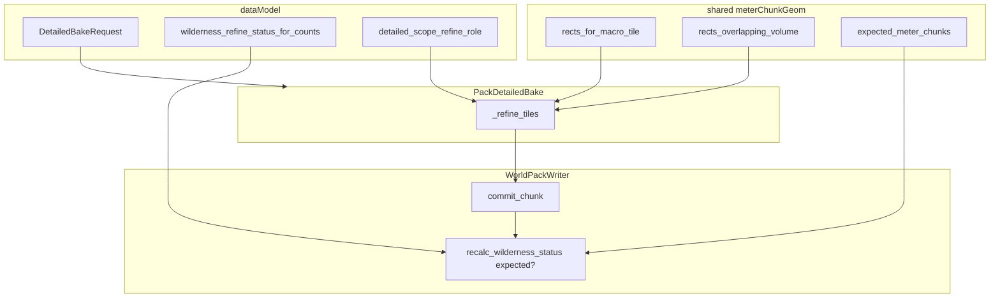
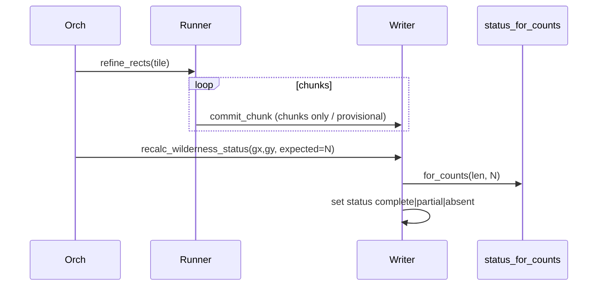

# Plan: фиксы smells detailed bake (post-review) ✅ DONE

**Источник:** canvas `detailed-bake-architecture-review` · ревью 2026-07-22.  
**Не блокер** product smoke; чинит dual-write status, дубли geom, dataModel gaps, SRP.  
**Правило:** architecture-first; slice = только stub. Не bolt-on «ещё один helper рядом».

---

## 0. Критическое правило

1. **Architecture-first** — целевой каркас статуса/geom/role/request **до** правок callers.
2. **Only stubs as slice** — нельзя оставить working half (например `commit_chunk` без policy + старый `apply_*` «на всякий»).

---

## 1. Целевое состояние

| Компонент | Ответственность после фикса |
|---|---|
| `dataModel` | SoT: `WildernessRefineStatus`, status-from-counts, detailed→`ChunkRefineRole` mapping, `DetailedBakeRequest` |
| Shared geom (`worldTile` или `pack/refine/meterChunkGeom`) | full-tile / volume-overlap rects + expected chunk count |
| `WorldPackWriter` | single status writer: append chunk → **recalc status** (не hardcode `partial`) |
| `PackDetailedBakeOrchestrator` | scope policies + `_refine_tiles`; **не** дублирует geom; climate post остаётся (осознанно) |
| Facade | `bake_pack` detailed принимает / собирает `DetailedBakeRequest` один раз |
| Route | thin; query rename optional (`detailed_scope`) |



### Инварианты

1. **Один writer статуса:** после любого изменения `tile.chunks` status = `wilderness_refine_status_for_counts(baked, expected)` или `partial` только если `expected` неизвестен (entry/ring path).
2. **Один geom SoT** для full-tile meter chunks — detailed + FineTerrainRefine (+ path/entry где уместно).
3. Role literals для detailed scope — только через dataModel mapping.
4. HTTP/facade: detailed kwargs → один `DetailedBakeRequest` до orch.

---

## 2. Контракты

### F1 — Single status write (P0)

**Проблема:** `commit_chunk` всегда `partial`; orch потом `apply_wilderness_complete_policy` → dual-write.

**Целевое API writer:**

```text
commit_chunk(..., *, expected_chunks: int | None = None)
  → append ChunkRef
  → if expected_chunks is not None:
        status = wilderness_refine_status_for_counts(len(chunks), expected_chunks)
     else:
        status = "partial" if chunks else "absent"   # runtime rings без full-tile expected
  → replace tile

# deprecate / remove:
apply_wilderness_complete_policy  → thin wrapper на recalc или удалить
mark_wilderness_refine_status     → только явный override (debug); или удалить если нет callers
```

**Callers:**

| Caller | `expected_chunks` |
|---|---|
| Detailed wilderness `_refine_tiles` | `expected_meter_chunks(world, gx, gy)` — прокинуть в runner или post-batch **один** recalc на tile |
| Detailed location | `None` (не обязан complete wilderness) |
| Entry / FineChunkRunner background | `None` → partial (как сейчас по смыслу), **или** optional expected если ring=full tile |

**Предпочтительный поток (меньше churn в FineChunkRunner):**

1. `commit_chunk` **не** трогает status (только chunks), **или** ставит provisional `partial`.
2. Единый `writer.recalc_wilderness_status(gx, gy, expected_chunks: int | None)` — **единственное** место set status.
3. Detailed wilderness: после `refine_rects` одного тайла → `recalc(..., expected=full)`.
4. `commit_chunk` перестаёт зашивать `"partial"` как финальный SoT — либо вызывает `recalc(None)`, либо не пишет status.

Минимум для закрытия dual-write: убрать hardcoded `"partial"` из `commit_chunk`; всегда `recalc` после mutate chunks.

### F2 — Shared meter-chunk geom (P0)

**Новый модуль** (предпочтение application, не dataModel — это grid math):

`backend/app/application/worldData/pack/refine/meterChunkGeom.py`  
(или расширения `generators/coordinates/worldTile.py` — если без World/chunk_size deps)

```text
rects_for_macro_tile(world, gx, gy) -> list[ColumnRect]
expected_meter_chunks(world, gx, gy) -> int
rects_overlapping_volume(world, volume, gx, gy) -> list[ColumnRect]
tiles_covering_volume(world, volume) -> list[(gx,gy)]   # move from detailed orch
```

**Миграция callers:**

- `PackDetailedBakeOrchestrator` — удалить локальные копии
- `FineTerrainRefineOrchestrator.refine_scene_volume` — full-tile list через shared
- опционально `pathCorridorSelect` / `entryRingGeom` — только если уже дублируют full list; не раздувать scope

### F3 — dataModel status + role (P1)

1. `wilderness_refine_status_for_counts` → возвращает / аннотирует `WildernessRefineStatus` из `worldPackManifest` (импорт типа, не второй Literal).
2. Перенос функции: либо в `worldPackManifest.py`, либо тонкий `wildernessRefineStatus.py`; **не** держать status policy в `detailedBakeScope.py` (там только request/scope).
3. Mapping:

```text
# dataModel/worldPack/detailedBakeScope.py или chunkRefineRoleMap
def refine_role_for_detailed_scope(scope: DetailedBakeScopeKind) -> ChunkRefineRole:
    location → "location"
    wilderness → "background"   # documented until offline role exists
```

Удалить `LOCATION_REFINE_ROLE` / `WILDERNESS_REFINE_ROLE` module constants из orch.

4. `DetailedBakeRequest.canonical_defaults` — либо убрать, либо явно `raise` / docstring «not product default»; не `scope=wilderness` как будто default bake.

### F4 — Facade request SoT (P1)

```text
bake_pack(..., mode=detailed, detailed_request: DetailedBakeRequest | None = None,
          # legacy kwargs → resolve_detailed_bake_request внутри если request is None
)
materialize_pack_detailed(..., request: DetailedBakeRequest)
```

Route: собрать `DetailedBakeRequest` через `resolve_*` **в facade** (как сейчас) или один раз в route через resolve — без дубля validate. Предпочтение: route передаёт raw query → facade `resolve` (route остаётся thin).

Optional rename query: `detailed_scope` вместо `scope` (breaking debug API) — отдельный микрошаг; в плане отметить, default = оставить `scope` + docstring.

### F5 — Out of scope / defer

- Вынос climate fine из detailed orch в отдельный post-pass class — не в этом плане (med SRP, не bug).
- Climate fine на wilderness.
- DAG / schema.
- Полный refactor FineChunkRunner volumes double-compute.

---

## 3. Data flow после F1



---

## 4. Порядок имплементации (слои)

1. **dataModel** — `WildernessRefineStatus` reuse; move status fn; `refine_role_for_detailed_scope`; cleanup `canonical_defaults`.
2. **Shared geom** — `meterChunkGeom` (+ tests smoke import).
3. **Writer** — single `recalc_wilderness_status`; `commit_chunk` без финального hardcode partial; удалить/свести `apply_*` / `mark_*`.
4. **Orch** — import geom + role map; wilderness path вызывает один recalc; убрать локальные helpers.
5. **FineTerrainRefine** — full-tile через shared geom (минимальный diff).
6. **Facade** — `DetailedBakeRequest` на границе detailed (kwargs → resolve один раз).
7. **Route/script** — docstring; optional `detailed_scope` rename.
8. **Приёмка** — unit-level: status_for_counts; writer recalc; import cycle check. Smoke: `--scope wilderness --max-tiles 1` → status `complete` или `partial` согласован с chunks (не stuck wrong).

---

## 5. Приёмка

| Check | Ожидание |
|---|---|
| Dual-write | grep: `commit_chunk` не содержит `"wilderness_refine_status": "partial"` как единственный путь; один recalc API |
| Geom | `rects_for_full_tile` отсутствует в detailed orch; FineTerrainRefine использует shared |
| dataModel | нет второго Literal для refine status; role через mapping fn |
| Facade | detailed path всегда проходит `DetailedBakeRequest` |
| Smoke | world-test-003 wilderness max_tiles=1: chunks>0; status ≠ absent после bake |

---

## Todos

- [x] F1 Writer single status recalc (убрать dual-write)
- [x] F2 Shared `meterChunkGeom` + migrate detailed + FineTerrainRefine
- [x] F3 dataModel status type + role mapping + move fn
- [x] F4 Facade `DetailedBakeRequest` boundary
- [x] Optional: query `detailed_scope` rename — deferred (оставили `scope` + docstring)
- [ ] Smoke wilderness max_tiles=1 после фиксов (мастер: restart backend)
