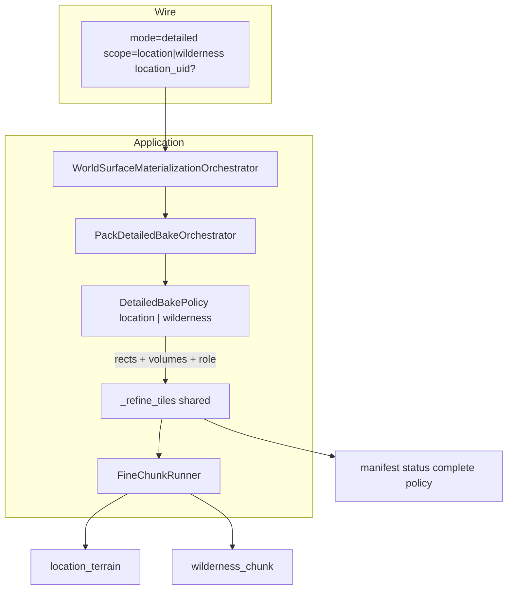
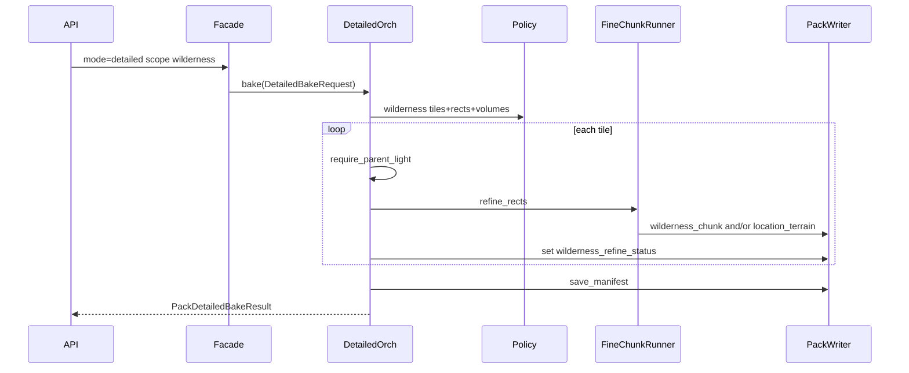

# Detailed bake — architecture-first (location + wilderness) ✅ DONE

**Принцип:** целевой каркас offline L2 **до** кода. Не bolt-on `bake_wilderness` рядом с `bake_location`.  
**ТЗ:** [`docs/tz_world_pack_storage.md`](../../docs/tz_world_pack_storage.md) § Bake modes, Job boundaries, WP-12/19/20; Идея 2.  
**Слои:** `dataModel` → application orchestrator → facade → thin API → smoke script.

### Критическое правило состава кода

1. **Architecture-first** — сначала полный целевой каркас (типы, scope, shared refine, policies, facade/route контракты), потом наполнение.
2. **Only stubs are allowed as a slice version** — единственный допустимый «срез»: stub/NotImplemented/empty policy body на границе ещё не заполненного слоя. Запрещены: working half-implementations, bolt-on второй цикл рядом с первым, «пока без uid ⇒ wilderness», copy-paste `bake_location` → `bake_wilderness`, временный wire без `DetailedBakeRequest`.

Нарушение = откат к каркасу, не «допилить slice».

---

## 1. Целевое состояние

### Роли

| Компонент | Ответственность |
|---|---|
| `dataModel` detailed scope | SoT wire/scope: `location` \| `wilderness`; uid только для location |
| `PackDetailedBakeOrchestrator` | **Единый** offline L2 detailed: resolve scope → shared refine loop → manifest status |
| `FineChunkRunner` | generate + partition + persist (без изменений контракта WP-19) |
| `WorldSurfaceMaterializationOrchestrator` | thin: `mode=detailed` → detailed orch по scope |
| `map.py` | thin HTTP: validate query → facade → DTO |
| Entry / WP-13 | **не** detailed; runtime scene + queue |

### Инварианты

1. L2 ∉ light/full (Job boundaries).
2. Один generate/persist path: только `FineChunkRunner.refine_rects` (не второй движок).
3. Mixed tile: partition по `territory_volume` (inside → location file, outside → wilderness); wilderness-scope **всегда** передаёт volumes всех локаций.
4. Location-scope **не** обязан дописывать wilderness того же тайла; wilderness-scope **не** затирает territory (partition).
5. Manifest: после wilderness-scope на тайле — корректный `wilderness_refine_status` (`partial` / `complete` по ожидаемым chunks), не вечный `partial` без complete policy.
6. API не содержит tile/rect/partition логики.



---

## 2. Контракты

### 2.1 dataModel — scope SoT

Новый тонкий контракт (например [`backend/app/dataModel/worldPack/detailedBakeScope.py`](../../backend/app/dataModel/worldPack/detailedBakeScope.py)):

```text
DetailedBakeScopeKind = Literal["location", "wilderness"]

class DetailedBakeRequest(BaseModel):  # frozen
    scope: DetailedBakeScopeKind
    location_uid: str | None = None
    # optional debug: max_tiles for wilderness (0 = all L0 tiles)
    max_tiles: int = 0

    # validate: scope=location ⇒ location_uid required
    # scope=wilderness ⇒ location_uid ignored / forbidden
```

Canonical resolve для HTTP/scripts: явный `scope`; **не** «нет uid ⇒ wilderness» как единственный SoT (это был slice). Допускается helper `resolve_detailed_bake_request(scope=..., location_uid=...)` в dataModel или тонком shim рядом с POJO.

### 2.2 Application result

```text
PackDetailedBakeResult:
  scope: DetailedBakeScopeKind
  terrain: PersistResult
  tiles_refined: int
  wilderness_chunks: int
  climate_fine_tiles: int   # location scope only; wilderness = 0 until policy exists
  location_uid: str | None
```

### 2.3 Shared refine (ядро orchestrator)

Один private/internal метод, **не** два copy-paste цикла:

```text
_refine_tiles(
  world, locations, writer, mat_ctx, surface_ctx,
  tiles: list[(gx,gy)],
  *,
  rects_for_tile(gx,gy) -> list[ColumnRect],
  location_volumes: list[TerritoryVolume],
  refine_role: ChunkRefineRole,
  phase: str = "detailed",
) -> FineAggregate  # persist + chunks_written + meter_z
```

**Location policy**

- tiles = `tiles_covering_volume(volume)`
- rects = chunks ∩ volume
- volumes = `[volume]` (или pairs для partition)
- role = `location`
- post: climate fine per tile (как сейчас), если `detailed_include_climate_fine`

**Wilderness policy**

- tiles = L0 tiles with `world_map_path` (manifest), optional `max_tiles` debug cap
- rects = **все** `iter_fine_chunks` тайла
- volumes = `territory_volumes_by_location(world, locations)` (может `[]`)
- role = `background` (или явный offline role, если добавим в enum позже — v1 = `background`)
- post: **не** climate fine в v1 (явный debt в результате = 0); complete policy на tile

### 2.4 Manifest complete policy (WP-12)

После refine тайла в wilderness-scope (и при желании shared):

- expected_chunks = число meter-chunks на тайле (`iter_fine_chunks` count)
- если `len(tile.chunks) >= expected` (или все (cx,cy) покрыты) → `wilderness_refine_status = complete`
- иначе → `partial`
- Реализовать в writer helper / detailed orch после tile loop — **один** путь обновления status, не ad-hoc в route

Location-scope не обязан ставить wilderness complete (территория ≠ tile-complete wilds).

### 2.5 Facade / HTTP

```text
bake_pack(..., mode=detailed, scope=..., location_uid=..., max_tiles=...)
  → DetailedBakeRequest.validate
  → PackDetailedBakeOrchestrator.bake(request, ...)
```

Query (debug):

- `scope=location|wilderness` (required for detailed, или default documented)
- `location_uid` required when `scope=location`
- `max_tiles` debug cap for wilderness only

**Запрещено в route:** циклы по tiles, partition, require_parent_light.

---

## 3. Data flow



---

## 4. Порядок имплементации (по слоям архитектуры)

Сначала **каркас всех слоёв** (даже если wilderness policy = stub). Потом наполнение. Slice = только stub.

1. **dataModel** — `DetailedBakeScopeKind` + `DetailedBakeRequest` (+ resolve/validate).
2. **Orchestrator skeleton** — `bake(request)` + shared `_refine_tiles` signature; location policy wire; wilderness policy **stub** (`NotImplemented` / empty tiles) допустим до шага 4.
3. **Writer/manifest helper** — `mark_wilderness_status` (может stub до complete policy).
4. **Fill policies** — location через shared loop; wilderness rects/volumes/role; complete policy.
5. **Facade** — `mode=detailed` → request → `bake`; убрать hard require uid.
6. **Route** — query `scope` + docstring; thin.
7. **Script** — `--scope location|wilderness`; `--location-uid` / `--all` только для location; default для 003: `--scope wilderness`.
8. **TZ sync** — Bake modes: detailed wire = scope + optional uid; wilderness topping = scope=wilderness; mixed = WP-19; entry отдельно.

Не делать: working wilderness без `DetailedBakeRequest` / без shared loop; bolt-on второй bake-метод как «временный slice».

---

## 5. Вне scope

- City `radius` / footprint shim (002 location 409).
- Entry rings / `schedule_chunk_refine`.
- Climate fine на wilderness.
- DAG, schema migrations.
- Новый bake mode name (остаётся `detailed`).

---

## 6. Приёмка

| Check | Ожидание |
|---|---|
| Architecture | один `_refine_tiles`; два policy; нет дублирования циклов |
| Wire | `scope=wilderness` на 003 после full → chunks > 0; status не все `absent`; часть/все `complete` при полном tile |
| Wire | `scope=location&location_uid=` — прежний location path |
| Route | grep: нет `iter_fine_chunks` / partition в `map.py` |
| Script | `detailed_bake.py --world-uid world-test-003 --scope wilderness` |

---

## Todos

- [x] dataModel `DetailedBakeRequest` / scope kind
- [x] Shared `_refine_tiles` + location/wilderness policies в `PackDetailedBakeOrchestrator`
- [x] Manifest wilderness complete policy
- [x] Facade + thin route (`scope` query)
- [x] Script + TZ sync
- [ ] Smoke wilderness detailed on world-test-003 (мастер: restart backend + script)
