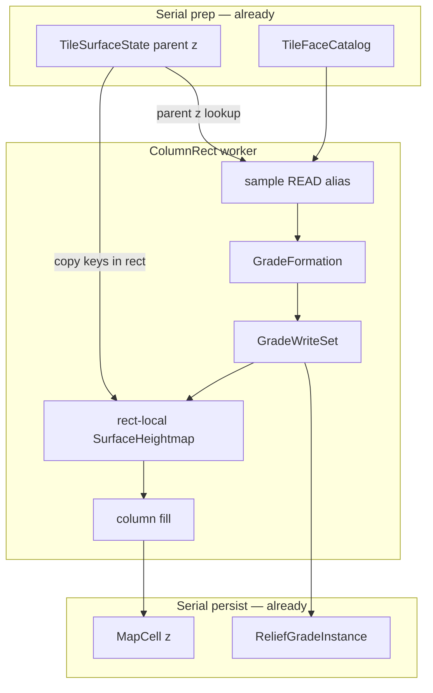

# Grade formation apply (Post-R36w) ✅ DONE

**Status:** shipped 2026-08-14.  
**SoT:** [`docs/tz_terrain_relief.md`](../docs/tz_terrain_relief.md) R36i / C1 / C6 / R36t / R28 / R36p / R36j · § **Post-R36w**.  
**Debt:** [`docs/tz_generator_technical_debt.md`](../docs/tz_generator_technical_debt.md) § **R36i-T** (T-1 ✅; T-2/T-3 вне apply; post-impl **T-4…T-15** ✅).

Код не писать, пока мастер не скажет «делай» **эту архитектуру** (не «делай только z»).

R36u/v/w **не** переоткрывать. Wave E **не** этот план. BAR-1 / `ReliefGradeSystem` / face-graph union-find — **вне** этой архитектуры (отдельное решение later).

## Целевое состояние (одно, не слайс)

После `compute_rect` Grade — **геометрия**, не ярлык на parent cliff.

| Есть | Нет |
|---|---|
| Один apply: volume z + canal resolve/draw + uid на **том же** коридоре | Продукт «сначала uid+z, canal потом» / второй pass |
| `columnFillPass` читает **rect-local** heightmap = parent z ⊕ overlay | Запись в общий `TileSurfaceState.heightmap` из pool |
| Canal на `ReliefGradeInstance` через уже существующие `build_canal` / `draw_canal` | Новый voxel-ditch writer; L0 Intent |
| R36t: high/low не трогать, кроме cut на укороченном конце | Мутация якорей на fit-path |
| Домен overlay = домен uid (`rect_contains` ∩ corridor) | Второй writer на чужой rect |

`MeterGradeSurface` *uid stamp, no z mutation* — **баг vs R36i**, не контракт. Target: surface — **read** z; writes — `GradeWriteSet`.

Не часть этой архитектуры: BAR-1 fence consumer, `ReliefGradeSystem`, R36w union-find, L0 ASCII omit, patch helper / DAG, Wave E, `refresh_tile_gaps`, parent `surface_z` upsample.

## Слои и контракты

```text
generators/terrain/relief/     pack/refine/                      fill / persist
plan_seed_volume               MeterGradeSurface (READ z)        run_column_fill
resolve_seed_canal             corridor → GradeFormation         FineChunkPersist
draw_canal / build_canal       GradeWriteSet (z + uid + inst)    MapCell.z = overlay
R36t corridor                  compute_rect: local heightmap
```

| Компонент | Делает | Не делает |
|---|---|---|
| `plan_seed_volume` | per-column `surface_z`; `sum(steps)==h` | persist; pack IO |
| `resolve_seed_canal` + `draw_canal` | Canal \| None → поля instance (R36p/q) | voxel terrain; silent auto-canal |
| `GradeFormation` (новый frozen dataclass) | corridor + plan + canal + facing + uid | stamp; heightmap |
| `GradeWriteSet` / расширенный `DetailedGradeResult` | `{xy: z}` + `{xy: uid}` + instances; только клетки этого rect | alias write в shared z |
| `MeterGradeSurface` | sample / clearance **читает** parent z; uid dict локальный | `surface_z[xy] =` |
| `compute_rect` | rect-local `SurfaceHeightmap.surface_z` для ключей rect: `overlay.get(k, parent[k])`; fill из него | `refresh_tile_gaps`; mutate shared dict |
| Persist | как сейчас: z с `MapCell`; grades `replace_world=False` | wipe; отдельный heightmap dump |

**Параллель (R36v):** воркер не пишет shared heightmap. Overlay только на клетки, которые этот task и так штампует uid. Соседний чанк — то же правило, что uid (owner sample / neighbor stamp). Не invent второго z-writer.

**`n_eff`:** SoT остаётся precomputed parent gap. Пандус снижает Δz → старый `N_eff` консервативен (лишний solid, не void). Пересчёт gap **не** в этой архитектуре.

**Canal vs voxels:** `draw_canal` / `build_canal` остаются проекцией на поля Grade (`earthen_canal`, `structure_*`). Новый ditch-terrain writer **запрещён**. R36t-исключение: на **not-fit + canal enable** overlay z **может** попасть на клетку укороченного конца, даже если она в `ref_cells` (низ/край обреза). Fit-path (`L_eff ≥ requested`) якоря не трогает, даже если knobs canal заданы.

**Кто резолвит canal:** один раз в formation assemble (pack/refine), knobs с `RibbonGradeDecision`, policy с `WorldReliefPickPolicy` / registry POJO — не дублировать литералы.

## Data flow

```text
sample (fine Δz, alias read)
  → catalog uid (R36w, уже есть)
  → per seed: clearance → L_eff → plan_seed_volume → resolve_seed_canal
  → GradeFormation (immutable)
  → GradeWriteSet: overlay z + uid на corridor ∩ rect; instance + canal fields
  → rect-local heightmap = parent ⊕ overlay
  → columnFillPass
  → persist cells (z) + instances
```



Serial: catalog + parent surface. Parallel: formation + write-set + fill. Persist: без смены очереди.

## Порядок имплементации (слои архитектуры)

Не «фаза 1 только z». Скелет типов **до** наполнения. Canal в типах и `commit` с первого слоя, не болтом после merge.

| Слой | Сделать | Done when |
|---|---|---|
| **L0 types** | `GradeFormation`; `DetailedGradeResult` + `surface_z` overlay (тот же rect-фильтр, что uid); `SeedCorridor` несёт canal | типы компилируются; materialize ещё может не писать z |
| **L1 assemble** | `corridor_for_seed` → formation: volume plan **и** `resolve_seed_canal`; `commit_segment` передаёт `draw_canal` в factory (поля уже есть) | instance.earthen_canal / structure_* из knobs/policy; без shared z write |
| **L2 write-set** | overlay из `plan.columns` на corridor ∩ rect; R36t skip refs **кроме** cut-конца; `MeterGradeSurface` не пишет `surface_z` | result несёт z+uid+instances одним объектом |
| **L3 fill** | `compute_rect`: local heightmap на ключи rect; `replace` heightmap+uid; fill без смены `n_eff` | клетки коридора имеют ramp z в `MapCell` |
| **L4 tests** | один набор: ramp z, якоря, uid, canal fit, canal not-fit cut | таблица приёмки ниже |

Stub на границе: нет. Canal resolve в L1 может вернуть `None` — это валидный formation, не «слой не готов».

## Запрещено

- Слайс «смержить z без canal в типах / factory»
- Wave E, DAG, mask carry, hydro corridor, facing/parent z upsample
- Вернуть L0 ribbon Apply / Intent bag
- `surface_z[xy]=` на aliased `MeterGradeSurface`
- `refresh_tile_gaps` из worker на весь тайл
- Новый оркестратор / второй пул
- Хардкод сторон / context / uid / canal XOR вне POJO
- Voxel-ditch generator «заодно»
- BAR-1 / GradeSystem «заодно»

## Код (ориентир)

- `pack/refine/detailedGradeResult.py` — write-set
- `pack/refine/detailedGradeMaterialize.py` — formation assemble + commit
- `pack/refine/meterGradeSurface.py` — read-only z
- `pack/refine/fineChunkCompute.py` — rect-local heightmap
- `generators/terrain/relief/volumeMaterialize.py` — формулы не менять
- `generators/terrain/relief/seedCanalResolve.py` — caller = detailed
- `generators/terrain/relief/gradeInstanceFactory.py` — уже принимает canal
- Tests: `test_detailed_grade_generate.py`

## Приёмка (архитектура целиком)

| ID | Критерий |
|---|---|
| A-z | Parent Δz=4, Geom-A L=2 → колонки коридора несут steps, не две высоты обрыва |
| A-anchor | High/low на fit-path: z и terrain как до apply; без uid |
| A-uid | `system_grade_uid` на коридоре; домен uid = домен overlay |
| A-canal-fit | Knobs earthen + `L_eff ≥ requested` → поля на instance; якоря целы |
| A-canal-skip | Не fit, policy off / no match → нет auto-canal |
| A-canal-cut | Не fit + enable → cut укороченного конца; якорь **без** этой ветки цел |
| A-pool | Shared `heightmap.surface_z` после worker = parent (не мутирован) |
| A-fill | `MapCell` коридора: `z` = overlay; persist `_note_surface_z` видит ramp |

## T-12 — write-set reconcile ✅

**Status:** shipped 2026-08-15.  
**SoT:** [`docs/tz_generator_technical_debt.md`](../docs/tz_generator_technical_debt.md) § **R36i-T-12**. Продукт: [`docs/tz_terrain_relief.md`](../docs/tz_terrain_relief.md) § Post-R36w · R36j.

Uid-домен = состав Grade на этом write-set. `merged_with` / `clipped_to_rect` / `to_write_set` заканчиваются `reconcile`. Поля сущности last-wins (как SQL upsert). `cell_refs` после clip ⊆ uid rect. Persist сшивает полный объект.
