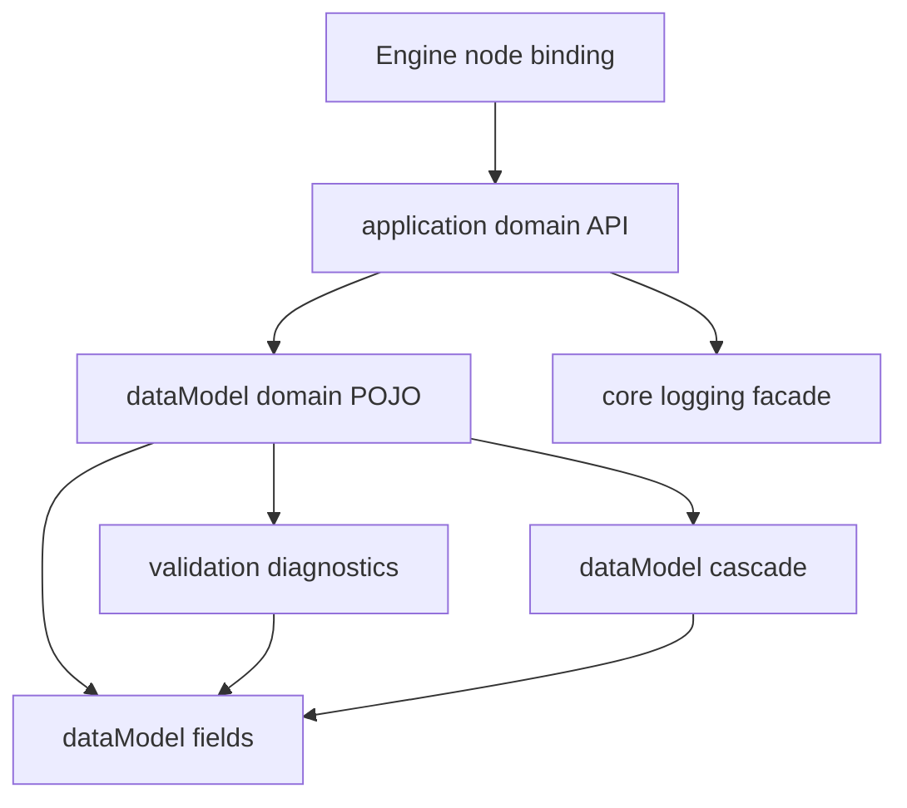

# ERROR-CONTRACTS-1 — типизированные ошибки, проверки и диагностика

**Статус:** архитектурные решения по разделению семейств, размещению `<...>TypeError`, варианту B для `FieldPathError`, обязательным типизированным аргументам, политике логирования и продуктовой политике отказов **ЗАФИКСИРОВАНЫ владельцем 2026-11-04**. Обязательная последовательность **архитектура и размещение → реализация общего ядра → домены после ревью существующих POJO и ошибок и принятия необходимых контрактов** уточнена владельцем 2026-11-04. Повторное ревью от 2026-11-04 добавило requirements немедленной прямой миграции callers после C1 (без переходных состояний), семантики outcome vs transport, технологии runtime admission, policy emit/silent/aggregate, nullable paths и bounded batch. Не требуется повторный freeze неизменяемых существующих доменных POJO; конкретные новые/изменяемые error/enum/argument/path contracts, generator dispositions и полный реестр остаются DRAFT/OPEN. **A0 ACCEPTED владельцем 2026-11-04:** файловая карта §0.1.1–0.1.3 и полный checkout-backed impact register §0.1.4. **C0 ACCEPTED владельцем 2026-11-04:** §3.9 C0-1…C0-8. A0-F1 решено: persisted error records при C1 пересоздаются, без legacy v1. Для несовместимого C1 заранее обязательны принятые scoped D0/D1 всех непосредственно затронутых consumers; реальный logging I0 обязателен до эксплуатационной приёмки затронутой операции. C1 больше не заблокирован A0/C0; остаётся заблокирован scoped D0/D1 затронутых consumers, которые владелец делает вместе с переездом доменов.** Изменения production-кода не разрешены этим документом.

**Срез аудита:** `AndrewBondaren/AI-Project`, `master`, commit [`fa48c082`](https://github.com/AndrewBondaren/AI-Project/commit/fa48c082fb0883bed68ca9f60de83953538eb2f3), 2026-11-04; адресная перепроверка `FieldRef`, `FieldPathError`, Water Input и нового Snapshot builder на [`d031508e`](https://github.com/AndrewBondaren/AI-Project/commit/d031508ee225727be6a0f03231712c81c20df4c6). Перечень ниже фиксирует проверенные точки **накопления, передачи и преобразования** ошибок. Это первичная инвентаризация, а не доказательство полноты по всем файлам: поиск `FieldPathError(` уже достигает лимита 100 результатов. Полный реестр всех производителей диагностик — отдельный обязательный gate до массовой миграции.

## 0. Архитектурный этап — первый и обязательный до реализации

**Порядок владельца:** сначала согласовать архитектуру механизмов, существующие места в проекте, owning-пакеты и точную карту файлов; только после этого писать общее ядро; после ядра переходить к доменам. Нельзя начинать с массового изменения доменных POJO, enum и validators.

### 0.1. Место в проекте и карта владения

| Ответственность | Существующее место / целевой принцип размещения | Решение архитектурного этапа |
| --- | --- | --- |
| Нормативный план разработки | Канонический путь в репозитории: `.cursor/plans/error-contracts-1.md`; cross-cutting навигационная связь с [WORLD-PLAN-GRAPH-1](./world-generation-plan-dependency-graph.md) отражает только затронутые gates, не блокирует все owning-планы. | Поддерживать двустороннюю навигацию и per-domain gates D0/D1/D2/I0; не создавать вторую конкурирующую спецификацию. |
| Общее поле-диагностическое ядро | Existing `backend/app/dataModel/validation/diagnostics/fieldPathError.py`; target generic issue остаётся **в этом же файле**. Для immutable checks reuse `dataModel/validation/immutableValue.py`. | A0-PROPOSAL §0.1.1: reuse/refactor generic `FieldPathError[CodeT]` без второй модели и без Cascade dependency; реальную schema/stdlib dataclass vs Pydantic решить в C0. |
| Typed field selectors / nested path | Existing `backend/app/dataModel/cascade/cascadeSpec.py` (`FieldRef`) и `cascadeGraph.py` (`BoundField`/`bind_field`); ими уже пользуются Policy, Encoding, Hydrology, Climate и другие. | A0-PROPOSAL §0.1.1: единый neutral `backend/app/dataModel/fields/` с `fieldRef.py`, `fieldBinding.py`, `checkedPath.py`, `validatedFieldPath.py`; удалить исходные определения в Cascade после быстрой миграции, не делать alias/re-export. |
| Накопление ошибок | Existing `backend/app/core/validatorAggregationHelper.py`, `InputIssues` и другие локальные collectors. | A0-PROPOSAL §0.1.1: **переместить** единственный generic `ValidatorAggregationHelper[IssueT]` в `backend/app/dataModel/validation/diagnostics/validatorAggregationHelper.py`, старый файл в `core` удалить после direct D2; доменные specialized collectors — D0/D1. |
| Доменная ошибка и её аргументы | **Тот же `backend/app/dataModel/<domain>/...` пакет, что owning POJO**, соседний файл при необходимости | Сначала инвентаризировать существующие ошибки и enum. Новый `<...>TypeError`/`<...>Arguments`/enum создаётся **только при доказанной нехватке**; существующий подходящий контракт переиспользуется. |
| DAG declared errors / runtime | Existing `backend/app/dataModel/engine/dag/errors/nodeError.py`, `backend/app/application/engine/runtime/` | Сохранить самостоятельный `NodeError[E]`, gate/error policy в application binding, явные адаптеры домена; не перемещать domain POJO в engine. |
| Логирование / транскрипт | Existing `backend/app/core/loggingConfig.py`, `generationLogging.py`, доменные emitter/helpers | Повторно использовать фасад и sinks `docs/tz_logging.md`; exact event ownership и typed safe args фиксируются по операциям, без новой инфраструктуры logger. |
| Pydantic, wire, API, persistence boundary | Existing `backend/app/application/jsonValidation/`, `backend/app/api/errorMapping.py` и domain codecs | Архитектурно назначить владельца каждого typed mapper и его место до изменения; внешние строки допустимы только на boundary. |

### 0.1.1. Точная целевая карта общего ядра — A0 ACCEPTED (2026-11-04)

**Основание:** `master` @ `d31ceed42e2b29ef4e88608c52270413ff2253d8`; проверены директории и исходные `FieldRef` / `bind_field` / `BoundField` / `FieldPathError` / `ValidatorAggregationHelper`. Это **точное предложение пакетов и файлов**, но ещё **не A0 ACCEPTED**: владелец утверждает placement до C0 и любого production-кода. Новые *доменные* error/enum/argument POJO и их имена здесь умышленно не предрешаются — только D0/D1.

| Точный путь от корня репозитория | Решение A0-PROPOSAL | Владелец / содержимое |
| --- | --- | --- |
| `backend/app/dataModel/fields/__init__.py` | **NEW** | Нейтральный пакет идентичности полей без Cascade/domain/business-кодов. |
| `backend/app/dataModel/fields/fieldRef.py` | **EXTRACT** из `dataModel/cascade/cascadeSpec.py` | Единственный `FieldRef[ModelT, ValueT]`, deferred model supplier + direct selector. Исходный класс из Cascade удаляется; не делать re-export/alias/копию. |
| `backend/app/dataModel/fields/fieldBinding.py` | **EXTRACT** из `dataModel/cascade/cascadeGraph.py` | Единственные `BoundField`, `_FieldProbe` и `bind_field`; runtime проверка прямого поля/модели/computed-field admission. Без imports из `cascade`. |
| `backend/app/dataModel/fields/checkedPath.py` | **NEW** | Construction-time `CheckedPath[RootT, CurrentT]`: `field/item/key/variant/nullable` + связь с типом валидируемого `ValueT`; не хранит domain codes или callable в output. Exact API/typing — C0. |
| `backend/app/dataModel/fields/validatedFieldPath.py` | **NEW** | Immutable canonical `ValidatedFieldPath` и закрытые path-segment models/identities для root/field/index/key/branch; пригодность cold restore и версия identity — C0. Не второй FieldRef. |
| `backend/app/dataModel/validation/diagnostics/fieldPathError.py` | **MODIFY IN PLACE** | Единственный generic field issue `FieldPathError[CodeT]`, schema strictness/deep immutability. Исходный stdlib dataclass: сохранить или обоснованно refactor в C0. Доменный `ReferenceIssueReason/Context` и specialized fields требуют D0/D1 ownership review **до несовместимого C1**: установить точный owning POJO, consumers и решение reuse/extend/new, затем убрать доменную зависимость из нейтрального generic, не теряя факты и не вводя временный alias. Их нельзя объявлять обязательными полями нейтрального generic. |
| `backend/app/dataModel/validation/diagnostics/validatorAggregationHelper.py` | **MOVE** из `app/core/validatorAggregationHelper.py` | Единственный generic `ValidatorAggregationHelper[ConcreteIssueT]` с typed admission и immutable ordered snapshot. Mutable состояние строго request-local; никакой общей классификации F01–F07. |
| `backend/app/dataModel/validation/immutableValue.py` | **REUSE** | Действующая recursive `validate_immutable` для dataclass/BaseModel/tuple; не создавать аналог в `fields` или `core`. |
| `backend/app/dataModel/validation/diagnostics/runtimeIssueContext.py` | **REUSE** | Существующий typed runtime provenance; сохранять лишь семантически применимые контексты, без принудительного расширения generic field issue. |
| `backend/app/dataModel/cascade/cascadeSpec.py` | **MODIFY** | Оставить `Cascade`, `CascadeChannel`, `CascadeLink`, `CascadeDefault`, `ScopeAxis` и прочую декларацию; импортировать тот же `FieldRef` из `dataModel.fields.fieldRef`. Удалить локальное определение FieldRef. |
| `backend/app/dataModel/cascade/cascadeGraph.py` | **MODIFY** | Оставить Cascade introspection/graph/order; импортировать `BoundField`/`bind_field` из `dataModel.fields.fieldBinding`; удалить собственные реализации и probe. |
| `backend/app/dataModel/cascade/cascadeVerify.py` | **MODIFY IMPORTS** | Cascade verifier сохраняет свои правила; прямые imports neutral binding исправить без нового verifier. |
| `backend/app/core/validatorAggregationHelper.py` | **REMOVE AFTER DIRECT MIGRATION** | После C1 и немедленного D2 всех прямых users не оставлять compatibility wrapper, re-export или параллельный collector. |
| `backend/app/dataModel/engine/dag/errors/nodeError.py` и `backend/app/application/engine/runtime/` | **REUSE / NO MOVE** | F04 node error и F05/F06 runtime остаются собственностью DAG, доменные причины переводятся только node binding adapter. |
| `backend/app/core/loggingConfig.py`, `backend/app/core/generationLogging.py` | **REUSE / NO MOVE** | EC-10 только через существующий facade, sinks и transcript; event schema / safe mapper принадлежит конкретной операции после D1. |
| `backend/app/application/jsonValidation/`, `backend/app/api/errorMapping.py`, domain codecs | **REUSE / DOMAIN D1** | F09 Pydantic/wire/API/persistence mappers остаются на действующих boundary. Новые конкретные adapter-файлы — только если D0/D1 докажет отсутствие подходящего. |

**Запрещённые альтернативные центры:** не создавать `app/core/errorContracts`, `app/dataModel/errors`, второй `FieldPathError`, generic domain-error registry или новый logger. Общие типы полей принадлежат `dataModel/fields`, диагностика/collector — `dataModel/validation/diagnostics`, domain variants — своему owning `dataModel/<domain>/...` после D0/D1.

**Тестовые места C1 (точные target paths, типы/фикстуры после C0):** `backend/tests/test_error_contracts_core.py`, `backend/tests/typing/error_contracts_valid.py`, `backend/tests/typing/error_contracts_invalid.py`, `pyrightconfig.error-contracts.json`; существующие `backend/tests/test_location_context_contract.py`, `backend/tests/typing/cascade_fields_valid.py`, `cascade_fields_invalid.py`, `pyrightconfig.cascade.json`, `backend/tests/snapshotCore/` и GEO/Policy tests — regression gates после extraction. Способ проверки negative typing cases выбирается на C0 по текущему `scripts/check-cascade-types.cjs`; новый runner не создавать без доказанной нужды.

### 0.1.2. Направление импортов и размещение семейств F01–F09

Стрелка означает разрешённую **зависимость по импортам/контрактам**, не runtime-вызов и не новый orchestration pipeline.

| Семейство | Физический owner / механизм | Запрещённая обратная зависимость |
| --- | --- | --- |
| F01 field issue | `dataModel/fields` + `dataModel/validation/diagnostics`, concrete domain issue рядом с owning POJO | `fields/validation → cascade/domain/application/engine` |
| F02 contract/admission | owning domain `dataModel`, checked related fields через `dataModel/fields` по необходимости | Общий `FieldPathError` как фиктивная model-level ошибка |
| F03 domain operation | owning domain error/result POJO и application operation | Domain POJO → DAG `NodeError` |
| F04 DAG declared E | `dataModel/engine/dag/errors/nodeError.py`, runtime/binding в `application/engine` | Domain → engine imports |
| F05 infrastructure fault | существующий runtime/infra owner и `ExecutionDiagnostic`; конкретная transport policy в D1 | `FieldPathError` как маска IO/SQL |
| F06 control outcome | owning operation/engine lifecycle contracts, существующие typed results/exceptions после D0 | Универсальный обязательный `OperationOutcome` wrapper |
| F07 nonfatal diagnostic | существующие `dataModel/planning/diagnostics/planDiagnostic.py` или owning domain models | Все warning → `FieldPathError`/`NodeError` |
| F08 batch/import | нейтральный generic collector в `validation/diagnostics`; domain batch/report остаётся у владельца | Общая доменная таблица причин в collector |
| F09 wire/API/persistence/log | существующие `application/jsonValidation`, `api/errorMapping`, domain codecs, `core/loggingConfig` | Wire mapper → source of truth внутреннего кода, logger → domain POJO |

**Допустимое направление:** `application/engine binding → application/domain → dataModel/domain → dataModel/validation/diagnostics → dataModel/fields`. `dataModel/cascade → dataModel/fields`. `app/core/loggingConfig` получает только safe projection и не импортирует доменные error-POJO. `FieldRef` не import-ится из Cascade после extraction; `dataModel/fields` никогда не импортирует Cascade или приложение. Удаление старых symbol owners и исправление всех импортов выполняются быстро после C1 без промежуточного re-export.

### 0.1.3. Impact ledger перемещений и быстрый C1 → D2 cutover

**Скан GitHub Code Search на `master` @ `d31ceed` (2026-11-04):** `FieldRef` — 52 файла (24 `backend/app`, 14 tests), `bind_field` — 22 (16 `backend/app`, 2 tests), `BoundField` — 10 (5 `backend/app`), `ValidatorAggregationHelper` — 8 (4 `backend/app`, 1 test). `FieldPathError` — 197 файлов по индексу поиска (126 `backend/app`, 38 tests, 33 docs/other): **это упоминания, не доказательство 197 direct constructors**. Набор ниже — точные найденные app-файлы для переезда field symbols/collector, не окончательный реестр всех F01 issues.

Обозначения: **F** = `FieldRef`, **B** = `bind_field`, **D** = `BoundField`, **C** = `ValidatorAggregationHelper`. Владельцы определений включены в таблицу.

| Точный app-файл с найденным символом | Символы |
| --- | --- |
| `backend/app/application/cascade/contextResolver.py` | B |
| `backend/app/application/jsonValidation/declaredRegions.py` | B |
| `backend/app/application/policy/declarations/verify.py` | F, D |
| `backend/app/application/worldData/generators/hydrology/policy/hydrologyGenerationBinding.py` | B |
| `backend/app/application/worldData/generators/hydrology/sources/proceduralSourceAdmission.py` | B |
| `backend/app/application/worldData/generators/terrain/designedWater/preparation/coastlineWaterSourceAdapter.py` | F, B, C |
| `backend/app/application/worldData/generators/terrain/landcover/planning/capturedSources.py` | F, B |
| `backend/app/application/worldData/masks/regionIdentity.py` | B |
| `backend/app/application/worldData/regions/declaredRegionEdit.py` | B |
| `backend/app/application/worldData/registries/worldService.py` | B |
| `backend/app/application/worldSnapshot/service/snapshotMetadataBuilder.py` | F, B, C |
| `backend/app/application/worldSnapshot/service/worldSnapshotService.py` | C |
| `backend/app/core/validatorAggregationHelper.py` | C |
| `backend/app/dataModel/cascade/cascadeGraph.py` | F, B, D |
| `backend/app/dataModel/cascade/cascadeSpec.py` | F |
| `backend/app/dataModel/cascade/cascadeVerify.py` | B |
| `backend/app/dataModel/climate/planning/inputs/climateBaseInput.py` | F, B |
| `backend/app/dataModel/encoding/decodeLimits.py` | F, B, D |
| `backend/app/dataModel/hydrology/generation/categorySource.py` | F |
| `backend/app/dataModel/hydrology/generation/waterGenerationSettings.py` | F |
| `backend/app/dataModel/hydrology/pack/root.py` | F |
| `backend/app/dataModel/hydrology/pack/shard.py` | F |
| `backend/app/dataModel/hydrology/policy/hydrologyPlacementPolicy.py` | F |
| `backend/app/dataModel/locations/context/cascadeParams.py` | F |
| `backend/app/dataModel/locations/namedLocation/bundleNamedLocation.py` | F |
| `backend/app/dataModel/locations/settlement/settlement/settlementPayload.py` | F |
| `backend/app/dataModel/locations/structure/building/plotLayoutTemplate.py` | F |
| `backend/app/dataModel/policy/declarations/policyIdentity.py` | D |
| `backend/app/dataModel/policy/objectAdmissionPolicyDefinition.py` | F |
| `backend/app/dataModel/policy/policyReferences.py` | F, B, D |
| `backend/app/dataModel/terrain/designedWater/inputValidation.py` | F, B |
| `backend/app/dataModel/terrain/planning/inputs/geoWaterPlacementInput.py` | F |
| `backend/app/dataModel/terrain/relief/surfaceCoating/surfaceCoatingPolicyDefinition.py` | F |
| `backend/app/dataModel/terrainMasks/regions/specs.py` | F |
| `backend/app/dataModel/terrainMasks/worldTerrainMasks.py` | F |

**`FieldPathError`: подтверждённые дополнительные точки прямого/транзитивного влияния (не полный реестр A0).** Существующая запись `FieldPathError(path: tuple[str | int,...], message, code: str | None, ...)` используется как field issue, model/operation failure и transport; единая механическая замена конструктора некорректна. Для каждого указанного потребителя D0 назначает F01–F07 и applicable F08/F09, а D1 утверждает точный owning outcome/error contract, **до начала несовместимого C1**.

| Точный путь | AS-IS связь с общим API | Что обязан решить D0/D1 до несовместимого C1 |
| --- | --- | --- |
| `backend/app/dataModel/planning/diagnostics/planDiagnostic.py` | `PlanDiagnostic.issue: FieldPathError` без параметра, при разных `disposition` | Для F07/других применимых вариантов выбрать конкретный typed issue/closed union; не заставлять все generator diagnostics быть F01 и не терять disposition. |
| `backend/app/application/planning/service/planningService.py` | `PlanContractFailure.issues`, `PlanBuildFailure.issues` — `tuple[FieldPathError,...]`; синтетические пути `("planning",)` / `("provider",)` без обязательного code | Отдельно F02 contract, F03 provider refusal и F05 unexpected fault; существующие typed `PlanContractFailureReason` и transport проверить прежде новых классов. |
| `backend/app/application/jsonValidation/types.py` | Повторный экспорт `FieldPathError` / `ReferenceIssueContext`, `ImportValidationError`, `ImportValidationReport`, `_error_code` | Определить все импортирующие через этот путь consumers и F09 mapper; временный re-export после cutover не сохранять, а wire format не смешивать с внутренним typed code. |
| `backend/app/application/worldBundle/worldBundleService.py` | Конструкторы с `()` / synthetic section path, строковыми кодами, `str(exc)` и Pydantic `loc` | F02/F03/F08/F09, typed section/root identity, полнота ошибок и технические faults; отсутствие real field path не превращать в фиктивный F01. |
| `backend/app/application/worldSnapshot/service/snapshotMetadataBuilder.py` | `SnapshotMetadataFailure(tuple[FieldPathError,...])`, строковый prefix code, leaf-only `_field` | Owning Snapshot POJO/errors, checked related paths, strict mapper всех Pydantic errors, согласованный transport. |
| `backend/app/dataModel/terrain/designedWater/inputValidation.py` | `InputIssues` формирует `ValidationError.from_exception_data` из string parents и `ValueError(message)` | Scoped Water Input D0/D1: F01/F02 и Pydantic bridge с typed reasons/args; сохранить независимое накопление. |
| `backend/app/dataModel/validation/diagnostics/fieldPathError.py` | Нейтральная `FieldPathError` содержит специфичный `ReferenceIssueContext` / `RuntimeIssueContext` | Проверить ownership/потребителей каждого контекста: общий core не зависит от чужого домена; размещение конкретных variants решает D1. |

**Полный A0 impact register (обязательный deliverable; DRAFT собран в [§0.1.4](#014-полный-a0-impact-register--checkout-backed-draft-на-приёмку-владельца), ждёт приёмки владельца):** перед A0 acceptance выполнить поиск **по актуальному checkout**, а не только ограниченным GitHub Code Search, и записать **каждый** затронутый app/test consumer: `direct import` / `re-export` / `constructor` / `type annotation` / `collector` / `carrier/adapter` / `codec/restore` / `static test`. Для каждого — точный путь + symbol, owning домен/операция, **предварительная** категория F01–F07 и applicable F08/F09 (точное решение — D0), ломающее изменение C1, ожидаемое направление миграции **без предрешения новых доменных типов**, нужный D0/D1 gate и migration test. Нельзя выводить полноту из лимита 100 GitHub Search или только из таблицы F/B/D/C. Файлы, где найдено лишь текстовое упоминание, отделять от реально вызываемого API. Неизвестный consumer блокирует A0/C1, а не получает compatibility adapter.

**Перед C1 (обязательный impact acceptance):** повторить полный `rg` в актуальном checkout по imports (включая re-export из `jsonValidation.types`), constructors `FieldPathError(`, bare annotations `FieldPathError`, `ValidationError.from_exception_data`, `errors/issues` collectors, `ReferenceIssueContext`, `BoundField`, persistence/wire restore и static tests. Сверить результаты с **полным A0 register выше**, зафиксировать точно ломаемые consumers и получить **принятые scoped D0/D1 для каждого из них до первого несовместимого production C1**. Если изменение C1 не затрагивает конкретный домен, его D0/D1 можно не готовить; полный ERROR-CONTRACTS-1 DONE не prerequisite независимых планов.

**Порядок без промежуточной архитектуры:** (1) закрыть A0 impact register и согласовать C0; **до начала несовместимого C1 принять scoped D0/D1 всех непосредственно затронутых владельцев** (документальную подготовку можно вести параллельно A0/C0); (2) первым кодом сделать общее ядро C1 по принятой файловой карте; (3) **сразу** выполнить D2 всех непосредственно затронутых consumers в **том же непрерывном рабочем срезе**, удалить старые definitions/re-exports/collector, не держать bridge или живой несовместимый master; (4) прогнать typing/runtime `cascade`, Policy, decode limits, Water Input, Hydrology Pack, Snapshot, Planning и JSON boundary smoke; (5) публиковать/принимать **только совместно работающее состояние C1 + direct D2 + tests**, без отдельной долгоживущей ветки или обязательного split на промежуточные commits. Для эксплуатационно доступного продукта с обязательным логированием довести нужный I0 sink/transcript до включения вызовов. Независимые домены не обязаны ждать полного ERROR-CONTRACTS-1 DONE.

**Документационный handoff после C1/D2:** обновить `.cursor/rules/cascade-pojo.mdc`, `docs/tz_cascade_context.md`, typing configs и тестовые imports, чтобы они не называли `cascadeSpec.FieldRef` и `cascadeGraph.bind_field` каноническими после extraction. Семантика Cascade и текущие проверки не пересоздаются.

**D0/D1, а не A0**, определяет конкретные новые/изменённые файлы `ReferenceIssueReason`/`ReferenceIssueContext`, `WaterDesign...TypeError`, `Planning...TypeError` и прочие domain errors/arguments. Для непосредственно ломаемых shared C1 владельцев такое решение принимается **до C1**, а не после уже выполненной несовместимой миграции. Их нельзя заранее складывать в общий `fields`, `validation/diagnostics` или `core`; если existing error POJO подходит, новый файл не создаётся.

**Артефакт A0 (требует согласования владельцем):** схема зависимостей без циклов, **матрица F01–F09 §2.4 с подходом для каждого типа**, обоснованные reuse/refactor/new и **точная карта пакетов/файлов общего ядра из A0-PROPOSAL §0.1.1–0.1.3 после её утверждения**, правила размещения будущих доменных error contracts, ownership generic/домен/engine/logging, границы публичных API и интеграционные gates. Дополнительно составить **полный impact register прямых и транзитивных потребителей изменяемых shared interfaces** (`FieldPathError`, collector, checked path; включая re-exports и typed carriers) и порядок **немедленной миграции**: после C1 без искусственной промежуточной архитектуры последовательно исправить все затронутые call sites, прогнать targeted tests и только после этого считать совместный кодовый срез завершённым. Не создавать временные V1-адаптеры, вторую модель `FieldPathError` или отдельный долгоживущий compatibility phase. **A0 не предрешает, какие конкретные новые доменные классы/файлы нужны:** это устанавливается после D0-review в D1. Согласовать A0 до любых production-правок. Названные выше существующие пути — evidence; новые пути не объявляются созданными без отдельного утверждения.

### 0.1.4. Полный A0 impact register — checkout-backed (ACCEPTED 2026-11-04)

**Основание:** локальный checkout `master` @ `ca159fc6`, полный проход `backend/app` + `backend/tests` (`*.py`) по `FieldPathError`, `ReferenceIssueContext`, `ReferenceIssueReason`, `ValidatorAggregationHelper`, `FieldRef`, `bind_field`, `BoundField`, `_FieldProbe`, включая многострочные `from … import (…)` и re-export `jsonValidation.types`. Итого: **207 файлов: 152 app + 55 tests**. `FieldPathError` — 126 app + 38 tests, из них 131 файл с прямыми конструкторами (251 вызов). Через re-export `app.application.jsonValidation.types` импортирует 46 файлов. Вне кода — `pyrightconfig.cascade.json`, `scripts/check-cascade-types.cjs`, 2 rules (`cascade-pojo.mdc`, `pojo-world-row-wire.mdc`) и 11 `docs/tz_*.md`; это документационный handoff §0.1.3, не C1.

**Категория F01–F09 в таблице — предварительная, по домену-владельцу.** Точную категорию каждого конструктора ставит scoped D0. Gate `механический D2` = только смена import path, без изменения семантики (D0/D1 не нужен). Gate `scoped D0/D1 до C1` = consumer ломается от изменения схемы `FieldPathError`/collector, его D0/D1 принимается при имплементации переезда домена, но **до** несовместимого C1 (TC-24).

Обозначения: FPE = `FieldPathError`, RIC/RIR = `ReferenceIssueContext`/`ReferenceIssueReason`, VAH = `ValidatorAggregationHelper`, FR = `FieldRef`, bf = `bind_field`, BF = `BoundField`; `ctor×N` — вызовы конструктора, `annot` — аннотация, `str-code` — строковый `code=`, `empty-path` — `path=()`.

#### 0.1.4.1. Находки A0 (влияют на приёмку)

| ID | Серьёзность | Находка (evidence) | Что требуется |
| --- | --- | --- | --- |
| A0-F1 | **B → RESOLVED** | `FieldPathError`, `ReferenceIssueContext`, `ReferenceIssueReason`, `RuntimeIssueContext` — **персистентные canonical records**: [`surfaceManifest.py`](../../backend/app/application/worldData/planning/encoding/surfaceManifest.py) ids 105–109; [`hydrology/encoding/sourceSchema.py`](../../backend/app/application/worldData/generators/hydrology/encoding/sourceSchema.py) `OPEN_WATER_SOURCE_SCHEMA_V1` ids 105–109 с `_SHAPE_LOCK` (sha256 от qualified name + полей); [`artifacts/encoding/coreManifest.py`](../../backend/app/application/artifacts/encoding/coreManifest.py) ids 20016/20137–20139 → `PATCH_CORE_SCHEMA` и `SNAPSHOT_CORE_SCHEMA`, а [`terminalCodec.py`](../../backend/app/db/repositories/sqlite/snapshotCore/operations/terminalCodec.py) пишет в SQL `OperationCancelled.reason: FieldPathError`. `canonicalCodec._decode_one` отвергает запись при `missing, duplicate, extra or reordered record fields`. Значит, любое изменение полей FPE или перенос RIC из `fieldPathError.py` ломает decode уже записанных pack/surface/SQL данных и проверку `require_source_schema_v1`. | **DECISION 2026-11-04 (владелец):** вариант (б) — персистентной совместимости нет; при C1 локальные БД, pack и surface **пересоздаются** (по аналогии с recreate для `0001_initial.sql`). Legacy-decoder v1 и маппинг v1→v2 **не создаются**. Новая форма записей регистрируется под существующими type_id; `_SHAPE_LOCK` и manifests обновляются в том же срезе. |
| A0-F2 | **B** | `require_source_diagnostics_v1` проверяет `type(diagnostic.issue) is not FieldPathError`, а `_PRODUCER_DISPOSITIONS` ключуется **строковыми** кодами (`"WATER_PUDDLE"`, … — Spatial §15.18.1). Concrete `<Domain>TypeError(FieldPathError[Code])` будет отвергнут, а строковые коды v1 заморожены в wire. | Входит в решение A0-F1. Для v2 нужна exact-type таблица разрешённых concrete классов и enum вместо строк (D1 Hydrology/Planning). |
| A0-F3 | M | AS-IS `ValidatorAggregationHelper` **не generic** (`list[FieldPathError]`, `add`, `raise_if_any`); в §0.1.1 он назван «единственный generic». Прямые users: `snapshotMetadataBuilder.py`, `worldSnapshotService.py`, `coastlineWaterSourceAdapter.py` (2 экземпляра); тестов 0 (в §0.1.3 по Code Search указан 1). | C1 = move + generify (§3.9). Snapshot и Designed Water входят в scoped D0/D1 до C1. |
| A0-F4 | M | `CascadeNode(BoundField)` в `cascadeGraph.py` наследует dataclass `BoundField`; `isinstance(..., FieldRef)` есть в `cascadeGraph.py` и `policyReferences.py`, `isinstance(..., BoundField)` — в `policyIdentity.py`. | Extraction в `dataModel/fields` сохраняет тот же класс-объект (не копию), чтобы наследование и `isinstance` не изменились; это механический D2. |
| A0-F5 | M | Пустой/синтетический path там, где ошибка не F01: `leaseStore.py` `OperationCancelled(reason=FieldPathError(path=(), message="cancelled"))` (F06, персистится), `artifactGc.py` `FieldPathError(path=(), message=str(exc))` (F05), `worldSnapshotService.py` `"world publication changed"` (F03/F06), `worldBundleService.py` `((), str(exc), code="BUNDLE_INVALID")`, `cacheService.py` `("cache",)`, `planningService.py` `("planning",)`/`("provider",)`. | Это не механическая замена конструктора: scoped D0/D1 Artifacts, Snapshot, Bundle, Cache и Planning выбирают свой не-F01 тип. |
| A0-F6 | m | Re-export `jsonValidation/types.py` (`FieldPathError as FieldPathError` …) используют 46 файлов; `tests/planning/contracts/test_contracts.py` проверяет атрибуты модуля `legacy` (`types`) по именам. | D2 переводит все 46 файлов на канонический путь и удаляет re-export вместе с этим тестом-якорем. |
| A0-F7 | m | `pyrightconfig.cascade.json` включает `dataModel/cascade/cascadeSpec.py`, но не будущий `dataModel/fields/`; positive/negative runner — `scripts/check-cascade-types.cjs` (pyright 1.1.414). | C1 добавляет `dataModel/fields/*.py` в cascade config или в новый `pyrightconfig.error-contracts.json` (§0.1.1); runner переиспользуется. |

#### 0.1.4.2. Реестр по владельцам

**Artifacts** — предварительно F03/F05/F06

| Путь | Символы (связь) | Ломается в C1 | Gate |
| --- | --- | --- | --- |
| `backend/app/application/artifacts/lifecycle/artifactGc.py` | FPE (import, ctor×1, annot×1, empty-path) | FPE: ctor: `code`→обяз. CodeT, path→checked; bare annot→concrete/union; `()` path = не F01 | scoped D0/D1 до C1 |
| `backend/app/dataModel/artifacts/lifecycle/gc.py` | FPE (import, annot×1) | FPE: bare annot→concrete/union | scoped D0/D1 до C1 |
| `backend/app/dataModel/artifacts/lifecycle/operation/record.py` | FPE (import, annot×1) | FPE: bare annot→concrete/union | scoped D0/D1 до C1 |

**Artifacts (SQL lease)** — предварительно F06 (cancel) / F09

| Путь | Символы (связь) | Ломается в C1 | Gate |
| --- | --- | --- | --- |
| `backend/app/db/repositories/sqlite/artifacts/leaseStore.py` | FPE (import, ctor×1, empty-path) | FPE: ctor: `code`→обяз. CodeT, path→checked; `()` path = не F01 | scoped D0/D1 до C1 |

**Cache** — предварительно F03/F05

| Путь | Символы (связь) | Ломается в C1 | Gate |
| --- | --- | --- | --- |
| `backend/app/application/cache/service/cacheService.py` | FPE (import, ctor×1, annot×1) | FPE: ctor: `code`→обяз. CodeT, path→checked; bare annot→concrete/union | scoped D0/D1 до C1 |

**Cascade** — предварительно F02

| Путь | Символы (связь) | Ломается в C1 | Gate |
| --- | --- | --- | --- |
| `backend/app/application/cascade/contextResolver.py` | bf (import, call×1) | bf: import path | механический D2 (import path) |
| `backend/app/dataModel/cascade/cascadeGraph.py` | FR (import, annot×2, isinstance); bf (DEFINITION, call×2); BF (DEFINITION, ctor×1, annot×1, SUBCLASS); probe (DEFINITION, ctor×1) | FR: import path; определение | механический D2 (import path) |
| `backend/app/dataModel/cascade/cascadeSpec.py` | FR (DEFINITION, ctor×2, annot×2) | определение | механический D2 (import path) |
| `backend/app/dataModel/cascade/cascadeVerify.py` | bf (import, call×1) | bf: import path | механический D2 (import path) |

**Climate** — предварительно F01/F03/F07

| Путь | Символы (связь) | Ломается в C1 | Gate |
| --- | --- | --- | --- |
| `backend/app/application/worldData/generators/assemblers/climateAssembler/passes/anchorCollectPass.py` | FPE (import, ctor×2, str-code) | FPE: ctor: `code`→обяз. CodeT, path→checked; str code | scoped D0/D1 до C1 |
| `backend/app/application/worldData/generators/climate/planning/climatePlanProvider.py` | FPE (import, ctor×1) | FPE: ctor: `code`→обяз. CodeT, path→checked | scoped D0/D1 до C1 |
| `backend/app/application/worldData/generators/climate/registry.py` | FPE (import, ctor×1, str-code) | FPE: ctor: `code`→обяз. CodeT, path→checked; str code | scoped D0/D1 до C1 |
| `backend/app/dataModel/climate/planning/inputs/climateBaseInput.py` | FPE (import, ctor×1, annot×1); FR (import, ctor×2); bf (import, call×2) | FPE: ctor: `code`→обяз. CodeT, path→checked; bare annot→concrete/union; FR: import path; bf: import path | scoped D0/D1 до C1 |

**Core collector** — предварительно F08 mech

| Путь | Символы (связь) | Ломается в C1 | Gate |
| --- | --- | --- | --- |
| `backend/app/core/validatorAggregationHelper.py` | FPE (import, annot×3); VAH (DEFINITION) | FPE: bare annot→concrete/union; определение | scoped D0/D1 до C1 |

**Core diagnostics** — предварительно —

| Путь | Символы (связь) | Ломается в C1 | Gate |
| --- | --- | --- | --- |
| `backend/app/dataModel/validation/diagnostics/fieldPathError.py` | FPE (DEFINITION, wire?); RIC (DEFINITION, annot×1); RIR (DEFINITION, ctor×1, annot×1) | определение | scoped D0/D1 до C1 |

**Designed Water** — предварительно F01/F03/F07

| Путь | Символы (связь) | Ломается в C1 | Gate |
| --- | --- | --- | --- |
| `backend/app/application/worldData/generators/terrain/designedWater/fields/continentalFieldComposer.py` | FPE (import, ctor×1) | FPE: ctor: `code`→обяз. CodeT, path→checked | scoped D0/D1 до C1 |
| `backend/app/application/worldData/generators/terrain/designedWater/fields/noiseFieldGenerator.py` | FPE (import, ctor×2) | FPE: ctor: `code`→обяз. CodeT, path→checked | scoped D0/D1 до C1 |
| `backend/app/application/worldData/generators/terrain/designedWater/fields/plateFieldGenerator.py` | FPE (import, ctor×2) | FPE: ctor: `code`→обяз. CodeT, path→checked | scoped D0/D1 до C1 |
| `backend/app/application/worldData/generators/terrain/designedWater/preparation/authoredWaterSourceAdapter.py` | FPE (import, ctor×1) | FPE: ctor: `code`→обяз. CodeT, path→checked | scoped D0/D1 до C1 |
| `backend/app/application/worldData/generators/terrain/designedWater/preparation/coastlineConstraintPreparer.py` | FPE (import, ctor×2) | FPE: ctor: `code`→обяз. CodeT, path→checked | scoped D0/D1 до C1 |
| `backend/app/application/worldData/generators/terrain/designedWater/preparation/coastlineWaterSourceAdapter.py` | FPE (import, ctor×6); VAH (import, ctor×2); FR (import, ctor×1); bf (import, call×1) | FPE: ctor: `code`→обяз. CodeT, path→checked; VAH: move + generic admission; FR: import path; bf: import path | scoped D0/D1 до C1 |
| `backend/app/application/worldData/generators/terrain/designedWater/preparation/designUniverse.py` | FPE (import, ctor×1) | FPE: ctor: `code`→обяз. CodeT, path→checked | scoped D0/D1 до C1 |
| `backend/app/application/worldData/generators/terrain/designedWater/preparation/placementPreparation.py` | FPE (import, ctor×5, annot×1, reference=) | FPE: ctor: `code`→обяз. CodeT, path→checked; bare annot→concrete/union; ctx-поля | scoped D0/D1 до C1 |
| `backend/app/application/worldData/generators/terrain/designedWater/preparation/proceduralWaterSourceAdapter.py` | FPE (import, ctor×4) | FPE: ctor: `code`→обяз. CodeT, path→checked | scoped D0/D1 до C1 |
| `backend/app/application/worldData/generators/terrain/designedWater/strategies/authoredRegionStrategy.py` | FPE (import, ctor×3) | FPE: ctor: `code`→обяз. CodeT, path→checked | scoped D0/D1 до C1 |
| `backend/app/application/worldData/generators/terrain/designedWater/strategies/procedural/continentalNoiseStrategy.py` | FPE (import, ctor×2) | FPE: ctor: `code`→обяз. CodeT, path→checked | scoped D0/D1 до C1 |
| `backend/app/application/worldData/generators/terrain/designedWater/strategies/procedural/fieldRecipeFactory.py` | FPE (import, ctor×1) | FPE: ctor: `code`→обяз. CodeT, path→checked | scoped D0/D1 до C1 |
| `backend/app/application/worldData/generators/terrain/designedWater/strategies/procedural/plateNoiseStrategy.py` | FPE (import, ctor×2) | FPE: ctor: `code`→обяз. CodeT, path→checked | scoped D0/D1 до C1 |
| `backend/app/application/worldData/generators/terrain/designedWater/strategies/procedural/plateStrategy.py` | FPE (import, ctor×2) | FPE: ctor: `code`→обяз. CodeT, path→checked | scoped D0/D1 до C1 |
| `backend/app/application/worldData/generators/terrain/designedWater/strategies/strategyFactory.py` | FPE (import, ctor×1) | FPE: ctor: `code`→обяз. CodeT, path→checked | scoped D0/D1 до C1 |
| `backend/app/dataModel/terrain/designedWater/fields/field.py` | FPE (import, annot×1) | FPE: bare annot→concrete/union | scoped D0/D1 до C1 |
| `backend/app/dataModel/terrain/designedWater/fields/plateLayout.py` | FPE (import, annot×1) | FPE: bare annot→concrete/union | scoped D0/D1 до C1 |
| `backend/app/dataModel/terrain/designedWater/geometry/authoredGeometry.py` | FPE (import, annot×1) | FPE: bare annot→concrete/union | scoped D0/D1 до C1 |
| `backend/app/dataModel/terrain/designedWater/geometry/waterDesignConstraints.py` | FPE (import, annot×1) | FPE: bare annot→concrete/union | scoped D0/D1 до C1 |
| `backend/app/dataModel/terrain/designedWater/inputValidation.py` | FR (import, ctor×1); bf (import, call×1) | FR: import path; bf: import path | механический D2 (import path) |
| `backend/app/dataModel/terrain/designedWater/preparation/result.py` | FPE (import, annot×1) | FPE: bare annot→concrete/union | scoped D0/D1 до C1 |

**Generator registries** — предварительно F01/F02

| Путь | Символы (связь) | Ломается в C1 | Gate |
| --- | --- | --- | --- |
| `backend/app/application/worldData/generators/utils/economicTierBands.py` | FPE (import-via:types, ctor×3, str-code, wire?) | FPE: ctor: `code`→обяз. CodeT, path→checked; str code | scoped D0/D1 до C1 |
| `backend/app/application/worldData/generators/utils/materialResolver.py` | FPE (import-via:types, ctor×3, str-code) | FPE: ctor: `code`→обяз. CodeT, path→checked; str code | scoped D0/D1 до C1 |
| `backend/app/application/worldData/generators/utils/tierRegistry.py` | FPE (import-via:types, ctor×1, str-code) | FPE: ctor: `code`→обяз. CodeT, path→checked; str code | scoped D0/D1 до C1 |

**Hydrology** — предварительно F01/F03/F07

| Путь | Символы (связь) | Ломается в C1 | Gate |
| --- | --- | --- | --- |
| `backend/app/application/worldData/generators/hydrology/boundaries/boundaryGeometry.py` | FPE (import, ctor×1) | FPE: ctor: `code`→обяз. CodeT, path→checked | scoped D0/D1 до C1 |
| `backend/app/application/worldData/generators/hydrology/boundaries/boundaryPreparation.py` | FPE (import, ctor×1) | FPE: ctor: `code`→обяз. CodeT, path→checked | scoped D0/D1 до C1 |
| `backend/app/application/worldData/generators/hydrology/boundaries/boundaryResult.py` | FPE (import, annot×1) | FPE: bare annot→concrete/union | scoped D0/D1 до C1 |
| `backend/app/application/worldData/generators/hydrology/load/paint/declaredWaterPaintProjector.py` | FPE (import, ctor×3, str-code, wire?) | FPE: ctor: `code`→обяз. CodeT, path→checked; str code | scoped D0/D1 до C1 |
| `backend/app/application/worldData/generators/hydrology/placement/projectDeclaredHydrology.py` | FPE (import-via:types, ctor×1, annot×2) | FPE: ctor: `code`→обяз. CodeT, path→checked; bare annot→concrete/union | scoped D0/D1 до C1 |
| `backend/app/application/worldData/generators/hydrology/planning/assembly/final/riverFacts.py` | FPE (import, ctor×1) | FPE: ctor: `code`→обяз. CodeT, path→checked | scoped D0/D1 до C1 |
| `backend/app/application/worldData/generators/hydrology/planning/assembly/hydrologyFactsAssembler.py` | FPE (import, ctor×1) | FPE: ctor: `code`→обяз. CodeT, path→checked | scoped D0/D1 до C1 |
| `backend/app/application/worldData/generators/hydrology/planning/hydrologyPlanProvider.py` | FPE (import, ctor×1) | FPE: ctor: `code`→обяз. CodeT, path→checked | scoped D0/D1 до C1 |
| `backend/app/application/worldData/generators/hydrology/policy/hydrologyGenerationBinding.py` | bf (import, call×1) | bf: import path | механический D2 (import path) |
| `backend/app/application/worldData/generators/hydrology/policy/hydrologyPolicyFacts.py` | FPE (import, ctor×1, str-code) | FPE: ctor: `code`→обяз. CodeT, path→checked; str code | scoped D0/D1 до C1 |
| `backend/app/application/worldData/generators/hydrology/query/nativeFinalWaterQuery.py` | FPE (import, ctor×1) | FPE: ctor: `code`→обяз. CodeT, path→checked | scoped D0/D1 до C1 |
| `backend/app/application/worldData/generators/hydrology/rivers/planning/coarse/execution.py` | FPE (import, ctor×1) | FPE: ctor: `code`→обяз. CodeT, path→checked | scoped D0/D1 до C1 |
| `backend/app/application/worldData/generators/hydrology/rivers/planning/fine/execution.py` | FPE (import, ctor×3) | FPE: ctor: `code`→обяз. CodeT, path→checked | scoped D0/D1 до C1 |
| `backend/app/application/worldData/generators/hydrology/rivers/planning/fine/publication.py` | FPE (import, ctor×1) | FPE: ctor: `code`→обяз. CodeT, path→checked | scoped D0/D1 до C1 |
| `backend/app/application/worldData/generators/hydrology/rivers/riverPrepare.py` | FPE (import, ctor×7, str-code, wire?) | FPE: ctor: `code`→обяз. CodeT, path→checked; str code | scoped D0/D1 до C1 |
| `backend/app/application/worldData/generators/hydrology/rivers/riverRouteDiagnostics.py` | FPE (import-via:types, ctor×1, wire?) | FPE: ctor: `code`→обяз. CodeT, path→checked | scoped D0/D1 до C1 |
| `backend/app/application/worldData/generators/hydrology/sources/proceduralSourceAdmission.py` | FPE (import, ctor×2, empty-path); bf (import, call×3) | FPE: ctor: `code`→обяз. CodeT, path→checked; `()` path = не F01; bf: import path | scoped D0/D1 до C1 |
| `backend/app/application/worldData/generators/hydrology/water/planning/fine/execution.py` | FPE (import, ctor×2) | FPE: ctor: `code`→обяз. CodeT, path→checked | scoped D0/D1 до C1 |
| `backend/app/application/worldData/generators/hydrology/water/planning/fine/projection.py` | FPE (import, ctor×1) | FPE: ctor: `code`→обяз. CodeT, path→checked | scoped D0/D1 до C1 |
| `backend/app/application/worldData/generators/hydrology/water/planning/fine/publication.py` | FPE (import, ctor×1) | FPE: ctor: `code`→обяз. CodeT, path→checked | scoped D0/D1 до C1 |
| `backend/app/application/worldData/generators/hydrology/water/planning/geoExecution.py` | FPE (import, ctor×1) | FPE: ctor: `code`→обяз. CodeT, path→checked | scoped D0/D1 до C1 |
| `backend/app/application/worldData/generators/hydrology/water/planning/waterBodyJob.py` | FPE (import, ctor×5) | FPE: ctor: `code`→обяз. CodeT, path→checked | scoped D0/D1 до C1 |
| `backend/app/application/worldData/generators/hydrology/water/waterDiagnostics.py` | FPE (import-via:types, ctor×1) | FPE: ctor: `code`→обяз. CodeT, path→checked | scoped D0/D1 до C1 |
| `backend/app/dataModel/hydrology/boundaries/attachedCoastline.py` | FPE (import, annot×1, wire?) | FPE: bare annot→concrete/union | scoped D0/D1 до C1 |
| `backend/app/dataModel/hydrology/generation/categorySource.py` | FR (import, ctor×6, annot×2) | FR: import path | механический D2 (import path) |
| `backend/app/dataModel/hydrology/generation/waterGenerationSettings.py` | FR (import, ctor×9) | FR: import path | механический D2 (import path) |
| `backend/app/dataModel/hydrology/pack/root.py` | FR (import, ctor×2) | FR: import path | механический D2 (import path) |
| `backend/app/dataModel/hydrology/pack/shard.py` | FR (import, ctor×5) | FR: import path | механический D2 (import path) |
| `backend/app/dataModel/hydrology/policy/hydrologyPlacementPolicy.py` | FR (import, ctor×9) | FR: import path | механический D2 (import path) |

**JSON import** — предварительно F01/F02/F08/F09

| Путь | Символы (связь) | Ломается в C1 | Gate |
| --- | --- | --- | --- |
| `backend/app/application/jsonValidation/__init__.py` | FPE (import-via:types, annot×1, wire?) | FPE: bare annot→concrete/union | scoped D0/D1 до C1 |
| `backend/app/application/jsonValidation/bundle/connectionGraph.py` | FPE (import-via:types, ctor×5, str-code, wire?) | FPE: ctor: `code`→обяз. CodeT, path→checked; str code | scoped D0/D1 до C1 |
| `backend/app/application/jsonValidation/bundle/preflight.py` | FPE (import-via:types, ctor×4, annot×1, str-code, pydantic-errors()) | FPE: ctor: `code`→обяз. CodeT, path→checked; bare annot→concrete/union; str code; Pydantic mapper | scoped D0/D1 до C1 |
| `backend/app/application/jsonValidation/declaredRegions.py` | FPE (import-via:types, ctor×1, str-code); bf (import, call×2) | FPE: ctor: `code`→обяз. CodeT, path→checked; str code; bf: import path | scoped D0/D1 до C1 |
| `backend/app/application/jsonValidation/facade.py` | FPE (import-via:types, ctor×1, annot×1, str-code, wire?) | FPE: ctor: `code`→обяз. CodeT, path→checked; bare annot→concrete/union; str code | scoped D0/D1 до C1 |
| `backend/app/application/jsonValidation/index/validate.py` | FPE (import-via:types, ctor×3, annot×8, str-code) | FPE: ctor: `code`→обяз. CodeT, path→checked; bare annot→concrete/union; str code | scoped D0/D1 до C1 |
| `backend/app/application/jsonValidation/resolve.py` | FPE (import-via:types, ctor×1, annot×8, str-code, pydantic-errors(), wire?) | FPE: ctor: `code`→обяз. CodeT, path→checked; bare annot→concrete/union; str code; Pydantic mapper | scoped D0/D1 до C1 |
| `backend/app/application/jsonValidation/settlementSizeResolve.py` | FPE (import-via:types, ctor×2, str-code, wire?) | FPE: ctor: `code`→обяз. CodeT, path→checked; str code | scoped D0/D1 до C1 |
| `backend/app/application/jsonValidation/sourceValidation.py` | FPE (import-via:types, ctor×6, str-code, pydantic-errors(), wire?) | FPE: ctor: `code`→обяз. CodeT, path→checked; str code; Pydantic mapper | scoped D0/D1 до C1 |
| `backend/app/application/jsonValidation/types.py` | FPE (import, RE-EXPORT, annot×4, wire?); RIC (import, RE-EXPORT); RIR (import, RE-EXPORT) | FPE: bare annot→concrete/union; re-export удалить; RIC: перенос к owner D1; RIR: перенос к owner D1 | scoped D0/D1 до C1 |
| `backend/app/application/jsonValidation/worldColumnResolve.py` | FPE (import-via:types, ctor×3, str-code, wire?) | FPE: ctor: `code`→обяз. CodeT, path→checked; str code | scoped D0/D1 до C1 |

**Landcover** — предварительно F01/F03

| Путь | Символы (связь) | Ломается в C1 | Gate |
| --- | --- | --- | --- |
| `backend/app/application/worldData/generators/terrain/landcover/planning/capturedSources.py` | FR (import, ctor×1); bf (import, call×1) | FR: import path; bf: import path | механический D2 (import path) |
| `backend/app/application/worldData/generators/terrain/landcover/planning/preWaterHillHosts.py` | FPE (import, ctor×1) | FPE: ctor: `code`→обяз. CodeT, path→checked | scoped D0/D1 до C1 |
| `backend/app/application/worldData/generators/terrain/landcover/regionCoverageValidation.py` | FPE (import-via:types, ctor×1, pydantic-errors()) | FPE: ctor: `code`→обяз. CodeT, path→checked; Pydantic mapper | scoped D0/D1 до C1 |

**Locations** — предварительно F02

| Путь | Символы (связь) | Ломается в C1 | Gate |
| --- | --- | --- | --- |
| `backend/app/dataModel/locations/context/cascadeParams.py` | FR (import, ctor×6) | FR: import path | механический D2 (import path) |
| `backend/app/dataModel/locations/namedLocation/bundleNamedLocation.py` | FR (import, ctor×6) | FR: import path | механический D2 (import path) |
| `backend/app/dataModel/locations/settlement/settlement/settlementPayload.py` | FR (import, ctor×1) | FR: import path | механический D2 (import path) |
| `backend/app/dataModel/locations/structure/building/plotLayoutTemplate.py` | FR (import, ctor×2) | FR: import path | механический D2 (import path) |

**Patch** — предварительно F03

| Путь | Символы (связь) | Ломается в C1 | Gate |
| --- | --- | --- | --- |
| `backend/app/dataModel/patch/results/sectionResult.py` | FPE (import, annot×1) | FPE: bare annot→concrete/union | scoped D0/D1 до C1 |

**Placement** — предварительно F01/F03/F07

| Путь | Символы (связь) | Ломается в C1 | Gate |
| --- | --- | --- | --- |
| `backend/app/application/worldData/placement/adapters/water.py` | FPE (import-via:types, ctor×4, annot×5, reference=) | FPE: ctor: `code`→обяз. CodeT, path→checked; bare annot→concrete/union; ctx-поля | scoped D0/D1 до C1 |
| `backend/app/application/worldData/placement/adapters/waterGeometry/nativeGeometry.py` | FPE (import, ctor×4) | FPE: ctor: `code`→обяз. CodeT, path→checked | scoped D0/D1 до C1 |
| `backend/app/application/worldData/placement/adapters/waterTypes.py` | FPE (import-via:types, annot×2) | FPE: bare annot→concrete/union | scoped D0/D1 до C1 |
| `backend/app/application/worldData/placement/diagnostics.py` | FPE (import-via:types, ctor×1, annot×1) | FPE: ctor: `code`→обяз. CodeT, path→checked; bare annot→concrete/union | scoped D0/D1 до C1 |
| `backend/app/application/worldData/placement/resolver.py` | FPE (import-via:types, ctor×1) | FPE: ctor: `code`→обяз. CodeT, path→checked | scoped D0/D1 до C1 |

**Planning** — предварительно F02/F03/F05/F07

| Путь | Символы (связь) | Ломается в C1 | Gate |
| --- | --- | --- | --- |
| `backend/app/application/planning/providers/planRegistry.py` | FPE (import, ctor×2) | FPE: ctor: `code`→обяз. CodeT, path→checked | scoped D0/D1 до C1 |
| `backend/app/application/planning/service/planningService.py` | FPE (import, ctor×2, annot×2) | FPE: ctor: `code`→обяз. CodeT, path→checked; bare annot→concrete/union | scoped D0/D1 до C1 |
| `backend/app/dataModel/planning/diagnostics/planDiagnostic.py` | FPE (import, annot×1) | FPE: bare annot→concrete/union | scoped D0/D1 до C1 |

**Policy** — предварительно F02/F07

| Путь | Символы (связь) | Ломается в C1 | Gate |
| --- | --- | --- | --- |
| `backend/app/application/policy/declarations/verify.py` | FR (import, ctor×3); BF (import, ctor×1, annot×3) | FR: import path; BF: import path | механический D2 (import path) |
| `backend/app/application/policy/policyRead.py` | FPE (import, ctor×1, annot×4, pydantic-errors()) | FPE: ctor: `code`→обяз. CodeT, path→checked; bare annot→concrete/union; Pydantic mapper | scoped D0/D1 до C1 |
| `backend/app/application/policy/policyStages.py` | FPE (import, annot×1) | FPE: bare annot→concrete/union | scoped D0/D1 до C1 |
| `backend/app/dataModel/policy/declarations/policyIdentity.py` | BF (import, annot×2, isinstance) | BF: import path | механический D2 (import path) |
| `backend/app/dataModel/policy/objectAdmissionPolicyDefinition.py` | FR (import, ctor×1) | FR: import path | механический D2 (import path) |
| `backend/app/dataModel/policy/policyBindings.py` | FPE (import, annot×1) | FPE: bare annot→concrete/union | scoped D0/D1 до C1 |
| `backend/app/dataModel/policy/policyDecision.py` | FPE (import, annot×1) | FPE: bare annot→concrete/union | scoped D0/D1 до C1 |
| `backend/app/dataModel/policy/policyFacts.py` | FPE (import, annot×1) | FPE: bare annot→concrete/union | scoped D0/D1 до C1 |
| `backend/app/dataModel/policy/policyReferences.py` | FR (import, annot×5, isinstance); bf (import, call×1); BF (import, annot×5) | FR: import path; bf: import path; BF: import path | механический D2 (import path) |

**Relief** — предварительно F01/F03/F07

| Путь | Символы (связь) | Ломается в C1 | Gate |
| --- | --- | --- | --- |
| `backend/app/application/worldData/generators/terrain/relief/canal/attachments.py` | FPE (import-via:types, ctor×1, str-code) | FPE: ctor: `code`→обяз. CodeT, path→checked; str code | scoped D0/D1 до C1 |
| `backend/app/application/worldData/generators/terrain/relief/canal/obstacleResolve.py` | FPE (import-via:types, ctor×1, str-code) | FPE: ctor: `code`→обяз. CodeT, path→checked; str code | scoped D0/D1 до C1 |
| `backend/app/application/worldData/generators/terrain/relief/pick/gradePass.py` | FPE (import-via:types, ctor×1, str-code) | FPE: ctor: `code`→обяз. CodeT, path→checked; str code | scoped D0/D1 до C1 |
| `backend/app/application/worldData/generators/terrain/relief/pick/templatePick.py` | FPE (import-via:types, ctor×3, str-code) | FPE: ctor: `code`→обяз. CodeT, path→checked; str code | scoped D0/D1 до C1 |
| `backend/app/application/worldData/generators/terrain/relief/planning/naturalRelief.py` | FPE (import, ctor×1) | FPE: ctor: `code`→обяз. CodeT, path→checked | scoped D0/D1 до C1 |
| `backend/app/application/worldData/generators/terrain/relief/planning/reliefPlanProvider.py` | FPE (import, ctor×6) | FPE: ctor: `code`→обяз. CodeT, path→checked | scoped D0/D1 до C1 |
| `backend/app/application/worldData/generators/terrain/relief/planning/river/beds.py` | FPE (import, ctor×2) | FPE: ctor: `code`→обяз. CodeT, path→checked | scoped D0/D1 до C1 |
| `backend/app/application/worldData/generators/terrain/relief/planning/river/execution.py` | FPE (import, ctor×1) | FPE: ctor: `code`→обяз. CodeT, path→checked | scoped D0/D1 до C1 |
| `backend/app/application/worldData/generators/terrain/relief/surfaceCoatingSupport.py` | FPE (import, ctor×1) | FPE: ctor: `code`→обяз. CodeT, path→checked | scoped D0/D1 до C1 |
| `backend/app/dataModel/terrain/relief/surfaceCoating/surfaceCoatingPolicyDefinition.py` | FR (import, ctor×4) | FR: import path | механический D2 (import path) |

**Snapshot** — предварительно F02/F03/F05

| Путь | Символы (связь) | Ломается в C1 | Gate |
| --- | --- | --- | --- |
| `backend/app/application/worldSnapshot/service/snapshotMetadataBuilder.py` | FPE (import, ctor×1, annot×1, str-code, pydantic-errors()); VAH (import, ctor×1); FR (import, ctor×1); bf (import, call×1) | FPE: ctor: `code`→обяз. CodeT, path→checked; bare annot→concrete/union; str code; Pydantic mapper; VAH: move + generic admission; FR: import path; bf: import path | scoped D0/D1 до C1 |
| `backend/app/application/worldSnapshot/service/worldSnapshotService.py` | FPE (import, ctor×3, annot×1, str-code, empty-path); VAH (import, ctor×1) | FPE: ctor: `code`→обяз. CodeT, path→checked; bare annot→concrete/union; str code; `()` path = не F01; VAH: move + generic admission | scoped D0/D1 до C1 |
| `backend/app/dataModel/worldSnapshot/results/apply.py` | FPE (import, annot×1) | FPE: bare annot→concrete/union | scoped D0/D1 до C1 |

**Spatial read** — предварительно F03

| Путь | Символы (связь) | Ломается в C1 | Gate |
| --- | --- | --- | --- |
| `backend/app/dataModel/spatial/read/failure.py` | FPE (import, annot×1) | FPE: bare annot→concrete/union | scoped D0/D1 до C1 |
| `backend/app/dataModel/spatial/read/result.py` | FPE (import, annot×1) | FPE: bare annot→concrete/union | scoped D0/D1 до C1 |

**Structure** — предварительно F01/F03

| Путь | Символы (связь) | Ломается в C1 | Gate |
| --- | --- | --- | --- |
| `backend/app/application/worldData/generators/structure/passages/doorHeight.py` | FPE (import-via:types, ctor×1, str-code) | FPE: ctor: `code`→обяз. CodeT, path→checked; str code | scoped D0/D1 до C1 |
| `backend/app/application/worldData/generators/structure/structureGeneratorService.py` | FPE (import-via:types, ctor×1, str-code, wire?) | FPE: ctor: `code`→обяз. CodeT, path→checked; str code | scoped D0/D1 до C1 |

**Template Library** — предварительно F01/F02 (+reference)

| Путь | Символы (связь) | Ломается в C1 | Gate |
| --- | --- | --- | --- |
| `backend/app/application/templateLibrary/packs/domainAdapters/bodyPreparation.py` | FPE (import-via:types, ctor×5, annot×1, pydantic-errors()) | FPE: ctor: `code`→обяз. CodeT, path→checked; bare annot→concrete/union; Pydantic mapper | scoped D0/D1 до C1 |
| `backend/app/application/templateLibrary/packs/domainAdapters/plot.py` | FPE (import-via:types, ctor×1) | FPE: ctor: `code`→обяз. CodeT, path→checked | scoped D0/D1 до C1 |
| `backend/app/application/templateLibrary/packs/domainAdapters/relief.py` | FPE (import-via:types, ctor×1, str-code, wire?) | FPE: ctor: `code`→обяз. CodeT, path→checked; str code | scoped D0/D1 до C1 |
| `backend/app/application/templateLibrary/packs/domainAdapters/remapRefs.py` | FPE (import-via:types, ctor×1, str-code, wire?) | FPE: ctor: `code`→обяз. CodeT, path→checked; str code | scoped D0/D1 до C1 |
| `backend/app/application/templateLibrary/packs/lifecycleContracts.py` | FPE (import-via:types, annot×2) | FPE: bare annot→concrete/union | scoped D0/D1 до C1 |
| `backend/app/application/templateLibrary/packs/refResolve.py` | FPE (import-via:types, ctor×1, annot×3, reference=, wire?); RIC (import-via:types, ctor×1); RIR (import-via:types, annot×8) | FPE: ctor: `code`→обяз. CodeT, path→checked; bare annot→concrete/union; ctx-поля; RIC: перенос к owner D1; RIR: перенос к owner D1 | scoped D0/D1 до C1 |
| `backend/app/application/templateLibrary/packs/referenceResolver.py` | FPE (import-via:types, ctor×2, str-code, reference=); RIC (import-via:types, ctor×2); RIR (import-via:types) | FPE: ctor: `code`→обяз. CodeT, path→checked; str code; ctx-поля; RIC: перенос к owner D1; RIR: перенос к owner D1 | scoped D0/D1 до C1 |
| `backend/app/application/templateLibrary/packs/templateGraphValidation.py` | FPE (import-via:types, ctor×2, annot×1, reference=); RIC (import-via:types, ctor×1); RIR (import-via:types) | FPE: ctor: `code`→обяз. CodeT, path→checked; bare annot→concrete/union; ctx-поля; RIC: перенос к owner D1; RIR: перенос к owner D1 | scoped D0/D1 до C1 |
| `backend/app/application/templateLibrary/packs/write/writePlanContracts.py` | FPE (import-via:types, annot×1) | FPE: bare annot→concrete/union | scoped D0/D1 до C1 |
| `backend/app/application/templateLibrary/reliefGeomWarn.py` | FPE (import-via:types, ctor×1, str-code) | FPE: ctor: `code`→обяз. CodeT, path→checked; str code | scoped D0/D1 до C1 |

**Terrain masks / regions** — предварительно F01/F02

| Путь | Символы (связь) | Ломается в C1 | Gate |
| --- | --- | --- | --- |
| `backend/app/application/worldData/masks/regionIdentity.py` | FPE (import-via:types, ctor×1, str-code, wire?); bf (import, call×1) | FPE: ctor: `code`→обяз. CodeT, path→checked; str code; bf: import path | scoped D0/D1 до C1 |
| `backend/app/application/worldData/regions/declaredRegionEdit.py` | FPE (import-via:types, ctor×1, str-code, wire?); bf (import, call×2) | FPE: ctor: `code`→обяз. CodeT, path→checked; str code; bf: import path | scoped D0/D1 до C1 |
| `backend/app/dataModel/terrainMasks/regions/specs.py` | FR (import, ctor×1) | FR: import path | механический D2 (import path) |
| `backend/app/dataModel/terrainMasks/worldTerrainMasks.py` | FR (import, ctor×1) | FR: import path | механический D2 (import path) |

**Terrain planning** — предварительно F01/F03

| Путь | Символы (связь) | Ломается в C1 | Gate |
| --- | --- | --- | --- |
| `backend/app/application/worldData/generators/terrain/planning/preWater/prepared/provider.py` | FPE (import, ctor×1) | FPE: ctor: `code`→обяз. CodeT, path→checked | scoped D0/D1 до C1 |
| `backend/app/application/worldData/generators/terrain/planning/projection/coarseSurface.py` | FPE (import, ctor×2) | FPE: ctor: `code`→обяз. CodeT, path→checked | scoped D0/D1 до C1 |
| `backend/app/application/worldData/generators/terrain/planning/projection/heightDelta.py` | FPE (import, ctor×1) | FPE: ctor: `code`→обяз. CodeT, path→checked | scoped D0/D1 до C1 |
| `backend/app/application/worldData/generators/terrain/planning/waterPlacementPlanProvider.py` | FPE (import, ctor×1) | FPE: ctor: `code`→обяз. CodeT, path→checked | scoped D0/D1 до C1 |
| `backend/app/application/worldData/generators/terrain/regions/regionExtent.py` | FPE (import, ctor×1) | FPE: ctor: `code`→обяз. CodeT, path→checked | scoped D0/D1 до C1 |
| `backend/app/dataModel/terrain/planning/inputs/geoWaterPlacementInput.py` | FR (import, ctor×2, annot×2) | FR: import path | механический D2 (import path) |

**Time** — предварительно F02/F03

| Путь | Символы (связь) | Ломается в C1 | Gate |
| --- | --- | --- | --- |
| `backend/app/application/time/calendar/validation.py` | FPE (import, ctor×1) | FPE: ctor: `code`→обяз. CodeT, path→checked | scoped D0/D1 до C1 |
| `backend/app/application/worldData/timeSettings/preparation/shared/candidate.py` | FPE (import, ctor×1) | FPE: ctor: `code`→обяз. CodeT, path→checked | scoped D0/D1 до C1 |
| `backend/app/application/worldData/timeSettings/reader.py` | FPE (import, ctor×1) | FPE: ctor: `code`→обяз. CodeT, path→checked | scoped D0/D1 до C1 |
| `backend/app/dataModel/world/calendar/projection/errors.py` | FPE (import, annot×1) | FPE: bare annot→concrete/union | scoped D0/D1 до C1 |
| `backend/app/dataModel/world/settings/timeOperations/results.py` | FPE (import, annot×1) | FPE: bare annot→concrete/union | scoped D0/D1 до C1 |

**Wire codec (artifact core)** — предварительно F09 persistence

| Путь | Символы (связь) | Ломается в C1 | Gate |
| --- | --- | --- | --- |
| `backend/app/application/artifacts/encoding/coreManifest.py` | FPE (import, annot×1); RIC (import, annot×1); RIR (import, annot×1) | FPE: bare annot→concrete/union; RIC: перенос к owner D1; RIR: перенос к owner D1; **wire: type_id/shape** | scoped D0/D1 до C1 |

**Wire codec (hydrology source v1)** — предварительно F09 persistence (shape-lock)

| Путь | Символы (связь) | Ломается в C1 | Gate |
| --- | --- | --- | --- |
| `backend/app/application/worldData/generators/hydrology/encoding/sourceSchema.py` | FPE (import, annot×1, wire?); RIC (import, annot×1); RIR (import, annot×1) | FPE: bare annot→concrete/union; RIC: перенос к owner D1; RIR: перенос к owner D1; **wire: type_id/shape** | scoped D0/D1 до C1 |

**Wire codec (surface manifest)** — предварительно F09 persistence

| Путь | Символы (связь) | Ломается в C1 | Gate |
| --- | --- | --- | --- |
| `backend/app/application/worldData/planning/encoding/surfaceManifest.py` | FPE (import); RIC (import); RIR (import) | FPE: import; RIC: перенос к owner D1; RIR: перенос к owner D1; **wire: type_id/shape** | scoped D0/D1 до C1 |

**Wire codec limits** — предварительно F02

| Путь | Символы (связь) | Ломается в C1 | Gate |
| --- | --- | --- | --- |
| `backend/app/dataModel/encoding/decodeLimits.py` | FR (import, annot×2); bf (import, call×1); BF (import, annot×1) | FR: import path; bf: import path; BF: import path | механический D2 (import path) |

**World bundle import** — предварительно F02/F03/F08/F09

| Путь | Символы (связь) | Ломается в C1 | Gate |
| --- | --- | --- | --- |
| `backend/app/application/worldBundle/worldBundleService.py` | FPE (import-via:types, ctor×8, str-code, empty-path, pydantic-errors(), wire?) | FPE: ctor: `code`→обяз. CodeT, path→checked; str code; `()` path = не F01; Pydantic mapper | scoped D0/D1 до C1 |

**World registries** — предварительно F02

| Путь | Символы (связь) | Ломается в C1 | Gate |
| --- | --- | --- | --- |
| `backend/app/application/worldData/registries/worldService.py` | bf (import, call×1) | bf: import path | механический D2 (import path) |

**tests: Cascade** — предварительно по владельцу

| Путь | Символы (связь) | Ломается в C1 | Gate |
| --- | --- | --- | --- |
| `backend/tests/test_context_extend.py` | FR (import, ctor×4) | FR: import path | механический D2 (import path) |
| `backend/tests/test_location_context_contract.py` | FR (import, ctor×12); bf (import, call×8) | FR: import path; bf: import path | механический D2 (import path) |

**tests: Designed Water / Hydrology (GEO-1)** — предварительно по владельцу

| Путь | Символы (связь) | Ломается в C1 | Gate |
| --- | --- | --- | --- |
| `backend/tests/geo1/composition/test_composer.py` | FPE (import, ctor×2) | FPE: ctor: `code`→обяз. CodeT, path→checked | scoped D0/D1 до C1 |
| `backend/tests/geo1/contracts/cascade/test_runtime.py` | FR (import, ctor×6) | FR: import path | механический D2 (import path) |
| `backend/tests/geo1/contracts/cascade/test_settings.py` | FR (import, ctor×1); bf (import, call×1) | FR: import path; bf: import path | механический D2 (import path) |
| `backend/tests/geo1/contracts/strategies/test_dispatch_budget.py` | FPE (import, ctor×1, wire?) | FPE: ctor: `code`→обяз. CodeT, path→checked | scoped D0/D1 до C1 |
| `backend/tests/geo1/contracts/test_hydrology_generation.py` | BF (import, ctor×4) | BF: import path | механический D2 (import path) |
| `backend/tests/geo1/contracts/test_policy.py` | FPE (import, ctor×3, empty-path); FR (import, ctor×12) | FPE: ctor: `code`→обяз. CodeT, path→checked; `()` path = не F01; FR: import path | scoped D0/D1 до C1 |
| `backend/tests/geo1/contracts/test_policy_resolver.py` | FPE (import, ctor×1); FR (import, ctor×7) | FPE: ctor: `code`→обяз. CodeT, path→checked; FR: import path | scoped D0/D1 до C1 |
| `backend/tests/geo1/declarations/test_compiler.py` | FPE (import, ctor×1, wire?); FR (import, ctor×2) | FPE: ctor: `code`→обяз. CodeT, path→checked; FR: import path | scoped D0/D1 до C1 |
| `backend/tests/geo1/declarations/test_declarations.py` | FR (import, ctor×3); BF (import, ctor×3) | FR: import path; BF: import path | механический D2 (import path) |
| `backend/tests/geo1/declarations/test_identity.py` | BF (import, ctor×2) | BF: import path | механический D2 (import path) |
| `backend/tests/geo1/final_publication/test_publication.py` | FPE (import, ctor×1) | FPE: ctor: `code`→обяз. CodeT, path→checked | scoped D0/D1 до C1 |
| `backend/tests/geo1/fine_water/test_review.py` | FPE (import, ctor×1) | FPE: ctor: `code`→обяз. CodeT, path→checked | scoped D0/D1 до C1 |
| `backend/tests/geo1/fine_water/test_routing.py` | FPE (import, ctor×1, wire?) | FPE: ctor: `code`→обяз. CodeT, path→checked | scoped D0/D1 до C1 |
| `backend/tests/geo1/integration/support/pipeline.py` | FPE (import, ctor×1) | FPE: ctor: `code`→обяз. CodeT, path→checked | scoped D0/D1 до C1 |
| `backend/tests/geo1/integration/test_activation.py` | FPE (import, ctor×2, str-code) | FPE: ctor: `code`→обяз. CodeT, path→checked; str code | scoped D0/D1 до C1 |
| `backend/tests/geo1/integration/test_competitor_roster.py` | FPE (import, ctor×1) | FPE: ctor: `code`→обяз. CodeT, path→checked | scoped D0/D1 до C1 |
| `backend/tests/geo1/integration/test_design_preparation.py` | FPE (import, ctor×8, str-code) | FPE: ctor: `code`→обяз. CodeT, path→checked; str code | scoped D0/D1 до C1 |
| `backend/tests/geo1/integration/test_native_placement_dependencies.py` | FPE (import, ctor×1) | FPE: ctor: `code`→обяз. CodeT, path→checked | scoped D0/D1 до C1 |
| `backend/tests/geo1/integration/test_procedural_preparation.py` | FPE (import, ctor×2, str-code) | FPE: ctor: `code`→обяз. CodeT, path→checked; str code | scoped D0/D1 до C1 |
| `backend/tests/geo1/integration/test_revisions.py` | FPE (import, ctor×2, str-code, wire?) | FPE: ctor: `code`→обяз. CodeT, path→checked; str code | scoped D0/D1 до C1 |
| `backend/tests/geo1/native_relief/test_beds.py` | FPE (import, ctor×1) | FPE: ctor: `code`→обяз. CodeT, path→checked | scoped D0/D1 до C1 |
| `backend/tests/geo1/natural_preparation/test_preparation.py` | FPE (import, ctor×1) | FPE: ctor: `code`→обяз. CodeT, path→checked | scoped D0/D1 до C1 |
| `backend/tests/geo1/natural_preparation/test_publication.py` | FPE (import, ctor×1) | FPE: ctor: `code`→обяз. CodeT, path→checked | scoped D0/D1 до C1 |
| `backend/tests/geo1/source_projection/test_projection.py` | FPE (import, ctor×1) | FPE: ctor: `code`→обяз. CodeT, path→checked | scoped D0/D1 до C1 |
| `backend/tests/geo1/water_query/test_query.py` | FPE (import, ctor×1) | FPE: ctor: `code`→обяз. CodeT, path→checked | scoped D0/D1 до C1 |

**tests: Generator registries** — предварительно по владельцу

| Путь | Символы (связь) | Ломается в C1 | Gate |
| --- | --- | --- | --- |
| `backend/tests/test_e6_consumers.py` | FPE (import-via:types, ctor×1, str-code, wire?) | FPE: ctor: `code`→обяз. CodeT, path→checked; str code | scoped D0/D1 до C1 |

**tests: Hydrology pack codec** — предварительно по владельцу

| Путь | Символы (связь) | Ломается в C1 | Gate |
| --- | --- | --- | --- |
| `backend/tests/spatial_pack/test_bounded_decode.py` | FR (import, ctor×4) | FR: import path | механический D2 (import path) |
| `backend/tests/spatial_pack/test_source_schema.py` | FPE (import, ctor×3, reference=, runtime_context=, wire?); RIC (import, ctor×1); RIR (import) | FPE: ctor: `code`→обяз. CodeT, path→checked; ctx-поля; RIC: перенос к owner D1; RIR: перенос к owner D1 | scoped D0/D1 до C1 |

**tests: Placement** — предварительно по владельцу

| Путь | Символы (связь) | Ломается в C1 | Gate |
| --- | --- | --- | --- |
| `backend/tests/test_placement_contract.py` | FPE (import-via:types, ctor×1, reference=, wire?) | FPE: ctor: `code`→обяз. CodeT, path→checked; ctx-поля | scoped D0/D1 до C1 |

**tests: Planning** — предварительно по владельцу

| Путь | Символы (связь) | Ломается в C1 | Gate |
| --- | --- | --- | --- |
| `backend/tests/planning/consumers/test_request_boundary.py` | FPE (import, ctor×3, str-code) | FPE: ctor: `code`→обяз. CodeT, path→checked; str code | scoped D0/D1 до C1 |
| `backend/tests/planning/consumers/test_revisions.py` | FPE (import, ctor×1) | FPE: ctor: `code`→обяз. CodeT, path→checked | scoped D0/D1 до C1 |
| `backend/tests/planning/contracts/test_contracts.py` | FPE (runtime_context=, wire?); RIC (annot×1); RIR (annot×1) | FPE: ctx-поля; RIC: перенос к owner D1; RIR: перенос к owner D1 | scoped D0/D1 до C1 |
| `backend/tests/planning/contracts/test_domain_payloads.py` | FPE (import, ctor×1, str-code, wire?) | FPE: ctor: `code`→обяз. CodeT, path→checked; str code | scoped D0/D1 до C1 |
| `backend/tests/planning/providers/test_diagnostics.py` | FPE (import, ctor×2, wire?) | FPE: ctor: `code`→обяз. CodeT, path→checked | scoped D0/D1 до C1 |
| `backend/tests/planning/providers/test_domain_providers.py` | FPE (import, ctor×2, annot×1, str-code, wire?) | FPE: ctor: `code`→обяз. CodeT, path→checked; bare annot→concrete/union; str code | scoped D0/D1 до C1 |

**tests: Snapshot / Artifacts** — предварительно по владельцу

| Путь | Символы (связь) | Ломается в C1 | Gate |
| --- | --- | --- | --- |
| `backend/tests/snapshotCore/contracts/test_codec.py` | FPE (import, ctor×1, reference=, runtime_context=); RIC (import, ctor×1); RIR (import) | FPE: ctor: `code`→обяз. CodeT, path→checked; ctx-поля; RIC: перенос к owner D1; RIR: перенос к owner D1 | scoped D0/D1 до C1 |
| `backend/tests/snapshotCore/contracts/test_models.py` | FPE (import, ctor×3, str-code, empty-path, wire?) | FPE: ctor: `code`→обяз. CodeT, path→checked; str code; `()` path = не F01 | scoped D0/D1 до C1 |
| `backend/tests/snapshotCore/storage/artifacts/test_leases.py` | FPE (import, ctor×1, empty-path) | FPE: ctor: `code`→обяз. CodeT, path→checked; `()` path = не F01 | scoped D0/D1 до C1 |
| `backend/tests/snapshotCore/storage/artifacts/test_staging.py` | FPE (import, ctor×2, empty-path, wire?) | FPE: ctor: `code`→обяз. CodeT, path→checked; `()` path = не F01 | scoped D0/D1 до C1 |
| `backend/tests/snapshotCore/storage/publication/test_atomicity.py` | FPE (import, ctor×5, empty-path) | FPE: ctor: `code`→обяз. CodeT, path→checked; `()` path = не F01 | scoped D0/D1 до C1 |
| `backend/tests/snapshotCore/storage/publication/test_cas.py` | FPE (import, ctor×2, empty-path) | FPE: ctor: `code`→обяз. CodeT, path→checked; `()` path = не F01 | scoped D0/D1 до C1 |

**tests: Spatial read** — предварительно по владельцу

| Путь | Символы (связь) | Ломается в C1 | Gate |
| --- | --- | --- | --- |
| `backend/tests/test_spatial_read_contract.py` | FPE (import, ctor×3) | FPE: ctor: `code`→обяз. CodeT, path→checked | scoped D0/D1 до C1 |

**tests: Template Library** — предварительно по владельцу

| Путь | Символы (связь) | Ломается в C1 | Gate |
| --- | --- | --- | --- |
| `backend/tests/test_library_pack_logging.py` | RIR (import-via:types, annot×4) | RIR: перенос к owner D1 | scoped D0/D1 до C1 |
| `backend/tests/test_library_pack_update_plan.py` | RIR (import-via:types, annot×1) | RIR: перенос к owner D1 | scoped D0/D1 до C1 |
| `backend/tests/test_library_packs_5a.py` | RIR (import-via:types, annot×8) | RIR: перенос к owner D1 | scoped D0/D1 до C1 |
| `backend/tests/test_template_domain_preparation.py` | RIR (import-via:types, annot×1) | RIR: перенос к owner D1 | scoped D0/D1 до C1 |

**tests: static typing** — предварительно по владельцу

| Путь | Символы (связь) | Ломается в C1 | Gate |
| --- | --- | --- | --- |
| `backend/tests/typing/cascade_fields_invalid.py` | FR (import, ctor×5, annot×3) | FR: import path | механический D2 (import path) |
| `backend/tests/typing/cascade_fields_valid.py` | FR (import, ctor×5, annot×5) | FR: import path | механический D2 (import path) |
| `backend/tests/typing/planning/invalid.py` | FR (import, ctor×3) | FR: import path | механический D2 (import path) |
| `backend/tests/typing/planning/valid/policy.py` | FR (import, ctor×6) | FR: import path | механический D2 (import path) |
| `backend/tests/typing/snapshotCore/invalid.py` | FPE (import, annot×1) | FPE: bare annot→concrete/union | scoped D0/D1 до C1 |
| `backend/tests/typing/snapshotCore/valid.py` | FPE (import, annot×1) | FPE: bare annot→concrete/union | scoped D0/D1 до C1 |
| `backend/tests/typing/spatial_pack_limits_invalid.py` | FR (import, ctor×3) | FR: import path | механический D2 (import path) |

### 0.2. Непереопределение существующих POJO

Ревью текущего доменного POJO — **проверка пригодности и источника истины**, а не предложение заново frozen-copy всех полей. Если исходный POJO корректен и его поля не меняются, **никакого повторного freeze POJO нет**. Контрактное согласование относится к **конкретной границе ошибок, проверок, аргументов и outcome**, а для новых/изменяемых моделей — только к их новым полям и поведению. Старые типы не переименовываются и не копируются ради соответствия схеме плана; несовместимость доказывается конкретным требованием.

## 1. Главный инвариант

Ошибки, проверки и результаты валидации должны **сохранять типизацию на всём внутреннем пути**: формирование → сбор → возвращаемый результат/исключение → обработка вызывающим кодом → междоменная передача. Сериализация в строки, JSON и HTTP-коды допускается только на **явных границах представления** (wire, persistence и строго локальные адаптеры сторонних библиотек вроде Pydantic). Внутри такого адаптера строковый код допустим лишь как формат библиотеки с явным обратным отображением в typed cause **до выхода в доменный контракт**; строка не становится источником истины. Человекочитаемое `message: str` допустимо, но не является машинным кодом и не участвует в маршрутизации.

**Унификация — это единые требования к типобезопасности, а не один универсальный класс ошибок.** Нельзя смешивать отказ DAG-ноды, нарушение валидатора, событие runtime, терминальный отказ операции и инфраструктурное исключение.

## 2. Семейства и границы ответственности

| Семейство / механизм | Владение / действующие примеры | Семантика и ограничения |
| --- | --- | --- |
| **F01 — Проверка конкретного поля** | `FieldPathError`, field selectors, specialised field validation POJO | Типизированный code и проверенный field path; не охватывает автоматически все нарушения модели и операции. Не определяет DAG policy. |
| **F02 — Contract/admission** | Graph/Cascade/registry contracts, входные инварианты модели | Проверка допуска или контракта может иметь **несколько связанных полей или только model identity**; не требует фиктивного единственного field path. |
| **F03 — Отказ доменной операции** | `PlanBuildFailure`, `SpatialReadFailure`, `CalendarInvalid`, typed Time results, `BakeError` | Отражает неуспешную операцию или набор причин. Исключения — транспорт там, где это объявлено контрактом. |
| **F04 — Типизированный отказ DAG-ноды** | `dataModel/engine/dag/errors/nodeError.py`; `NodeContract[I,O,E]`, `PythonNodeError[E]` | Объявленный тип `E: NodeError`; участвует в error/retry/gate policy, не заменяет исходную доменную причину. |
| **F05 — Runtime / инфраструктурная ошибка** | `ExecutionDiagnostic`, SQL/IO, непредвиденные исключения | Не маскируется валидацией и не включается в `E` ноды без явного контракта. Trace сам по себе не доменный code. |
| **F06 — Управляющий исход исполнения** | cancellation, execution deadline timeout, busy | Самостоятельные исходы; технический IO timeout может быть F05. Транспорт через typed exception допустим только по явному контракту вызова. |
| **F07 — Нефатальная диагностика** | `PlacementDiagnostic`, `PolicyProblem`, `PlanDiagnostic` в соответствующих нефатальных вариантах | Warning/notice/fallback не обязаны быть error-POJO. Severity не является политикой abort. |
| **F08 — Batch/import (надстройка)** | `ImportValidationReport`, typed collectors | Накопляет исходные F01–F07 без переименования в общее семейство причин; учитывает partial success. Для потенциально больших входов scope/порционирование и полнота диагностики — явный контракт; тихое усечение запрещено. |
| **F09 — Wire/API/persistence/log projection (надстройка)** | `api/errorMapping.py`, JSON-import HTTP detail, serializers | Отвечает за проверяемое представление и разрешённое восстановление типов, **не является новой причиной отказа**. |

**Примеры в таблице не присваивают типам единственную роль навсегда:** у `PlanDiagnostic` может быть fatal/degraded/notice disposition, а у `PlacementDiagnostic` — разные причины. D0 классифицирует **конкретный вариант и контекст его использования**, а не весь класс только по имени. F08/F09 — механизмы над F01–F07, не самостоятельные исходные причины.

Перенос доменной ошибки через DAG выполняется **явным адаптером на границе ноды**. Доменный POJO не наследуется от `NodeError` и не импортирует DAG. Модель ноды вправе содержать доменный failure как типизированное поле, если это объявлено её `E`-контрактом.

### 2.1. Размещение и имя типизированной ошибки — обязательный контракт

1. **Единственный владелец схемы ошибки — владелец доменного POJO или операции.** До создания нового error-POJO изучается существующий доменный контракт и уже имеющиеся ошибки. Если новый/изменённый error-POJO действительно нужен, он размещается в том же доменном `dataModel` и в том же пакете/предметной области, что owning POJO. Не создавать центральную копию схемы в `core`, `planning`, `engine` или API. Соседний файл в том же пакете допустим; складывать все доменные ошибки в общий каталог запрещено.
2. **Для новых конкретных error-POJO действует суффикс `TypeError`:** `<DomainOrOperation>TypeError`, при нескольких независимых семантиках — `<DomainOrOperation><FailureKind>TypeError`. Примеры целевых имён: `WaterDesignTypeError`, `PlacementTypeError`, `CascadeContractTypeError`. Это модели данных, а **не** подклассы встроенного исключения Python `TypeError`; голое имя `TypeError` никогда не переопределять. Уже существующие подходящие POJO/enum не переименовывать механически только ради соглашения: необходимость изменений устанавливается ревью домена.
3. Код, вариант, причина, идентичности и контекст — типизированные поля owning доменного POJO и существующего подходящего enum либо нового enum **только при необходимости**. Для разнотипных причин внутри домена применим закрытый union существующих/новых конкретных моделей. Нельзя свести различающиеся варианты к `code: str` или `details: dict`.
4. Абстрактный reusable тип (generic или интерфейс) разрешён в общей `dataModel/validation` только как **механизм**, без доменных значений и правил. Его наличие не переносит владение `WaterDesignTypeError` из water-domain.
5. Ноды владеют собственными объявленными `NodeError`-контрактами в `dataModel` своего node/engine слоя. Существующие инфраструктурные имена (`NodeError`, `PythonNodeError`, `PlanBuildFailure`, `ValidationError`, системный `TypeError`) не переименовываются механически: суффикс `TypeError` относится к **конкретным типизированным error-POJO**, а не к транспортным исключениям.

### 2.2. Решение по `FieldPathError`: generic (вариант B, ЗАФИКСИРОВАНО)

| Критерий | Вариант A — интерфейс / `Protocol` | Вариант B — generic `FieldPathError[CodeT]` |
| --- | --- | --- |
| Кто определяет данные | Каждый домен реализует свой `<...>TypeError` со своими полями и инвариантами; общий read-only контракт задаёт минимальные операции чтения диагностики. | Базовый generic задаёт общие `code/path/message` и invariant, домен специализирует его собственным `<...>TypeError` с закрытым enum и, при необходимости, доп. полями. |
| Выигрыш | Полная свобода самостоятельных доменных диагностик без общей схемы хранения. | Повторно используется действительно общая форма field-ошибки; единое поведение валидации/сериализации и меньше дублирования. |
| Риск | `Protocol` сам не гарантирует deep immutability, runtime-валидацию и точный concrete type; `tuple[Protocol, ...]` может стереть конкретный тип ошибки. | Если использовать `FieldPathError[StrEnum]` / `Any`, происходит такое же стирание; generic по коду не типизирует автоматически вложенный `path`, контекст и проверяемое значение. |
| Допустимый сборщик | `ValidatorAggregationHelper[ConcreteIssueT]` сохраняет конкретный тип доменного POJO, а не коллекцию обезличенных протоколов. | `ValidatorAggregationHelper[DomainTypeError]` сохраняет специализацию; для нескольких доменов требуется явно объявленный union, не общий базовый тип без параметра. |
| Междоменный consumer | Читает только нужное read-only представление через интерфейс, не меняет и не классифицирует чужую ошибку. | Читает согласованные общие поля generic; доменные дополнения доступны только при проверенном concrete type. |

**ПРИНЯТО 2026-11-04:** вариант **B**, generic `FieldPathError[CodeT]` с закрытым доменным `CodeT` (enum) как базовый контракт для ошибок, которые действительно относятся к проверке **поля** и имеют одинаковую структуру. Домен переиспользует существующий подходящий typed error или, **если после D0 доказана необходимость**, объявляет рядом со своим POJO новый конкретный `<...>TypeError`, специализирующий generic; нельзя отдавать наружу обезличенный `FieldPathError`, `FieldPathError[StrEnum]` или `FieldPathError[Any]`. Узкий read-only интерфейс допускается исключительно для отображения/логирования, но не является вторым source of truth и не заменяет конкретный тип в collector. Вариант A **не выбран** как основная архитектура field-ошибки. Для ошибок с другой природой (`NodeError`, timeout/cancel, terminal operation result) сохраняются **самостоятельные архитектуры**, без наследования от `FieldPathError`.

**Недостаточно просто сделать `code: CodeT`:** выбор поля должен оставаться типизированной операцией через `FieldRef`/равноценный checked selector. Для вложенных путей и индексов нужно отдельно согласовать построение машинно-проверяемой identity поля и её immutable диагностическую проекцию; `tuple[str | int, ...]` сам по себе полной типизации проверки не гарантирует. Конкретная реализация принятого generic, проверки вложенных путей и runtime-валидации — следующий design gate до кода.

### 2.3. Разные архитектуры по назначению, согласованные на границах

| Архитектура | Когда применима | Формирование/сбор | Что видит потребитель |
| --- | --- | --- | --- |
| **Field validation** | Проверка конкретного поля POJO или ограничения с явно определённым owning field | Типизированный selector + доменный `<...>TypeError`; все независимые нарушения собираются в typed collector | Непустой immutable набор issues или валидный POJO; не строку и не `NodeError` |
| **Contract/admission validation** | Проверка деклараций, graph/cascade/registry контрактов, инвариантов всей модели и взаимных ограничений нескольких полей | Собственные typed contract/admission issues; при необходимости typed root/model identity и набор связанных checked paths; независимые ошибки суммируются | Типизированный отказ admission/contract до побочных стадий; **не фиктивный `FieldPathError` одного поля** |
| **Domain operation failure** | Построение плана, чтение Spatial, изменение времени, bake и т. п. | Доменный `<...>TypeError`/закрытый union, где нужно — отдельный typed failure/outcome | Явная причина отказа с доменным контекстом; исключение-транспорт не становится схемой ошибки |
| **DAG declared node failure** | Ошибка, предусмотренная `NodeContract[I,O,E]` | Конкретный `E: NodeError`; при необходимости явная адаптация доменного error-POJO | Runtime обрабатывает declared E для retry/gate, не произвольную доменную ошибку |
| **Infrastructure/runtime fault** | IO, SQL, непредвиденное исключение | Отдельная техническая классификация, status/trace, проверяемые исключения | Runtime fault с причиной, не фальшивый `INVALID_INPUT`/`FieldPathError` |
| **Control/execution outcome** | Cancellation, execution deadline timeout, busy | Собственные типизированные исходы и lifecycle; typed exception как транспорт допускается, если это явно объявлено контрактом вызываемой операции | `CANCELLED` / timeout / busy сохраняют самостоятельный смысл, не превращаются в runtime fault либо `MISSING` |
| **Non-fatal diagnostic** | Warning, notice, fallback без отказа операции | Domain issue + типизированные disposition/severity, без изменения смысла code | Диагностическое событие/набор фактов, а не ошибка ноды |
| **Batch/import** | Проверка независимых записей и секций | Typed row/section `<...>TypeError`, позиция и источник в POJO, сбор по каждой записи | Immutable список с частичным успехом/отказом согласно контракту batch |
| **Transport/wire** | JSON, HTTP, persistence, UI | Явный mapper каждого поддерживаемого семейства | Стабильный wire-код и данные; обратный decode восстанавливает конкретный тип либо явно отказывает |

Инвариант совместимости: **каждая архитектура отвечает только за собственный lifecycle**, а переходы между ними реализуют boundary adapters с типизированным входом/выходом и исчерпывающей проверкой поддерживаемых вариантов. Не делать единую иерархию наследования ошибок и не заставлять Field/Domain/Node/Runtime использовать одинаковый протокол управления выполнением.

### 2.4. Матрица подходов по каждому типу — обязательное архитектурное решение

**Принцип:** типы §2 и варианты §2.3 не становятся одной иерархией. Для **каждого** типа выбирается свой подход к модели, проверке, накоплению, управлению исполнением и логированию. Таблица задаёт рекомендуемое направление архитектуры, но **не заставляет создавать новые POJO/enum** — сначала D0-review существующих контрактов, затем решение reuse/extend/new (§6).

| ID | Тип / случай из общей таблицы | Подход к ошибке и накоплению | Кто управляет последствиями и где граница |
| --- | --- | --- | --- |
| **F01** | Field validation | Типизированный field selector/path; только для этого семейства применим `FieldPathError[DomainCode]` и concrete domain issue, typed аргументы; накопление всех независимых нарушений. | Домен валидирует и возвращает immutable issue batch; вызывающая операция решает admission, логирование — у согласованного owner. |
| **F02** | Contract / admission, включая межполевые инварианты модели | Доменный контрактный отказ с typed reason/context и, если нужно, накопителем независимых нарушений; связь нескольких полей выражается checked path set/model identity. `FieldPathError` только если реально проверяется конкретное поле POJO. | Owner не допускает зависимые стадии/side effects; причина не становится техническим fault или автоматическим `NodeError`. |
| **F03** | Domain operation failure | Действующий typed failure/outcome или нужный конкретный доменный error-POJO; может содержать typed batch/cause. Не наследовать field generic ради единой формы. | Домен определяет невозможность завершения; caller/DAG решает реакцию по объявленной политике. |
| **F04** | DAG declared node failure | Существующий `NodeContract[I,O,E]`, конкретный `E: NodeError`, допустимый union и явный adapter из доменных ошибок. | DAG binding/runtime решает gate/retry/status, пишет lifecycle diagnostic; доменный POJO не импортирует engine. |
| **F05** | Runtime / infrastructure fault | Отдельный технический тип/диагностика и безопасный causal trace. Не замещать неизвестное исключение `FieldPathError` или `INVALID_INPUT`. | Runtime/infrastructure owner решает восстановление/аварийное завершение и технический лог; ожидаемые доменные ошибки не перехватываются catch-all. |
| **F06** | Cancellation / deadline timeout / busy | Самостоятельный typed control/execution result либо объявленный typed exception как транспорт; cancellation не рассматривается как ошибка по умолчанию, deadline timeout отличен от IO timeout. | Owner lifecycle/checkpoints, caller/DAG policy; отдельные статусы и log events, без маскировки под missing/fault/success. |
| **F07** | Non-fatal diagnostic / warning / fallback / notice | Типизированная причина и `disposition/severity`; необязательно error-POJO и суффикс `TypeError`, если это не ошибка. Накопление независимо от terminal failure. | Продуктовая policy решает допустимый degraded и continuation; log severity сама по себе не задаёт abort. |
| **F08** | Batch / import | Сборщик конкретных row/section domain issues либо закрытых union; сохраняет источник/индекс, порядок и partial results, без приведения причин к `str`/`Any`. Для большого входа использовать проверяемые bounded partitions/streaming либо отдельное утверждённое ограничение с typed completeness/truncation outcome; не терять ошибки молча. | Batch owner определяет partial/full failure, полноту результата и реакцию на достижение бюджета; исходные доменные типы остаются неизменными. |
| **F09** | API / wire / persistence / logging projection | Явные версионированные boundary mappers конкретных типов, JSON-safe allowlist typed arguments, reversible decode там, где требуется. Это **не новое семейство причин**. | Boundary преобразует форму, не меняя код, принадлежность домену, disposition и политику исполнения; logging owner определяется отдельно EC-10. |

**Обязательный gate A0:** для F01–F09 принять/уточнить конкретный подход (reuse/extend/new, owner, runtime/wire/log boundaries), указать где заканчивается общий механизм и начинаются доменные правила. **Обязательный gate D0/D1:** каждому выявленному в домене error/diagnostic/control outcome назначить **основную семантическую категорию F01–F07**, а при необходимости — дополнительные способы обработки F08 (batch) и F09 (boundary). Это не взаимоисключающие классы наследования: field issue может попасть в batch и затем в wire, сохраняя собственный конкретный тип. Нельзя без отдельного обоснования переводить разные категории в один общий `FieldPathError`, `NodeError` или `Exception`.

## 3. Обязательные требования

- **EC-01. Типизированный код и владелец.** Каждая машинно обрабатываемая ошибка/причина имеет enum или другой закрытый доменный тип. Нельзя использовать `code: str`, строковые литералы и `.value` внутри внутренних контрактов. Семейства не обязаны пользоваться одним общим enum. Источник истины — owning доменный error-POJO/enum по §2.1; новые конкретные модели получают суффикс `TypeError`, существующие подходящие типы переиспользуются без принудительной пересборки.
- **EC-02. Типизированная проверка.** Валидатор получает конкретный POJO, типизированное значение и селектор (`FieldRef`/`bind_field` либо равноценный контракт). Имена существующих полей и их типы нельзя повторно объявлять произвольными строками. Вложенные пути и индексы должны строиться проверяемым способом; строковое представление пути — только диагностическая проекция.
- **EC-03. Типизированное накопление.** Сборщик принимает и отдаёт конкретное семейство диагностик с его типизированным кодом и контекстом. Он должен быть generic по **конкретному типу диагностики** или принимать явно объявленный union; переход к общему базовому типу без параметра, `Protocol` без сохранения concrete type и к `Any` запрещён. Нельзя заменять типизированный факт на `str`, `tuple[str,str]`, `dict[str,Any]` или неструктурированный `ValueError(message)`.
- **EC-04. Независимые проверки.** За один **ограниченный этап** собираются все доступные независимые нарушения в детерминированном порядке. При сломанном предусловии пропускается лишь зависимая ветвь; остальные проверки продолжаются. До следующей зависимой стадии формируется единый типизированный outcome/failure. Не делать fail-fast ради удобства реализации. Для потенциально неограниченных F08 batch/import D1 задаёт порционирование/бюджет, гарантию полноты либо явный явный typed признак неполноты при утверждённом ограничении (возможные названия — `TRUNCATED`/`INCOMPLETE`, только после D1); скрытое отбрасывание ошибок и ложное «проверено всё» запрещены.
- **EC-05. Границы.** Преобразования `Pydantic ValidationError → доменная диагностика`, `доменный failure → NodeError`, `failure → API`, `failure → лог/trace`, `POJO ↔ persistence` выполняются явно, с проверяемым соответствием кодов и без потери причин и вложенных полей. Неизвестное исключение не становится автоматически `INVALID_INPUT`.
- **EC-06. Иммутабельность.** Публичные результаты ошибок — неизменяемые POJO с неизменяемыми вложенными данными. Внутренний mutable collector допускается только в пределах одного вызова; наружу выдаёт immutable snapshot с гарантированным порядком.
- **EC-07. Отдельные решения.** Ошибка, предупреждение, fallback, waiting/cancel/retry и execution event не отождествляются. Их disposition/status задаётся типизированным владельцем и не вычисляется из текста сообщения.
- **EC-08. Никакой скрытой legacy-совместимости.** Сохранение старого строкового формата должно быть отдельным утверждённым wire/persistence-требованием, а не причиной ослабить новый внутренний POJO. Текущий `DAG-TYPING`/V2 не получает совместимый слой по умолчанию.
- **EC-09. Типизированные аргументы ошибок (ПРИНЯТО).** Каждая ошибка, требующая предметных значений для объяснения или решения, переносит их как собственный strict, frozen, deeply immutable доменный POJO аргументов. Допустимые поля/типы и соответствие `code ↔ arguments` закрыты и проверяются статически и в runtime; никакого `*args`, `**kwargs`, `dict[str, Any]`, `Exception.args` как canonical данных. Доменный `message` — пояснение/рендеринг, не единственный носитель фактов. Отдельные typed causes/identities сохраняются без `str(exc)`; техническая trace-корреляция не подменяет доменные аргументы.
- **EC-10. Обязательная политика логирования (ПРИНЯТО).** Для **каждого** поддерживаемого исхода и диагностического события заранее указать владельца эмиссии, точку события, тип/код, severity, безопасную проекцию typed arguments, correlation IDs, домен/сервис/sink, включение в generation transcript, правило no-duplicate **и решение об эмиссии**: обязательное событие, явно разрешённая тишина для штатного исхода либо bounded aggregation для высокочастотного потока. Терминальные ошибки и audit-critical события по умолчанию требуют эмиссии; право не логировать их требует отдельного обоснования владельца. Текущий общий `loggingConfig`/`docs/tz_logging.md` — SoT маршрутизации; не создавать logger/handler на каждый тип ошибки. Валидаторы создают факты без автоматического `logger.error`; итоговый владелец операции эмитирует причинный event согласно policy, DAG отдельно логирует собственный lifecycle-факт. Необъявленное отсутствие обязательного лога — дефект контракта, намеренная тишина явно фиксируется. Отдельно проверить не-JSON-safe POJO, privacy, высокочастотные read/diagnostic events и ошибки самого logging boundary. «Один event» относится к единственному owning emit на event identity/attempt, **не** к exactly-once доставке sink при retry/crash.
- **EC-11. Продуктовая политика обработки отказов и исходов (ПРИНЯТО).** Каждый публичный доменный pipeline/read/bake объявляет **полную типизированную таблицу семантических исходов операции** с допустимыми вариантами `FAIL admission | FAIL operation | SUCCESS | explicit DEGRADED | MISSING | CANCELLED | TIMEOUT/BUSY` (конкретный набор принадлежит операции) **и отдельно** отображение поддерживаемых `typed issue/failure` в разрешённые failure/degraded-исходы. `OperationOutcome` здесь — термин смыслового контракта, **не обязательный новый общий wrapper/POJO и не требование менять действующую сигнатуру**: D1 выбирает существующий typed result/closed union/объявленные typed exceptions либо необходимый новый контракт, доказывая недостаток reuse. Неожиданный F05 runtime fault имеет отдельную out-of-band exception/runtime outcome границу и **не** маскируется `FAIL operation`, `MISSING` или полевой ошибкой; конкретный транспорт утверждает D1. `SUCCESS`, нормальный `MISSING` и штатный `CANCELLED` не возникают из ошибки по определению и не требуют искусственного issue. Для каждого исхода фиксируются разрешённость fallback, публикационный/commit gate, cancel-before/after-commit semantics, logging policy и owner. `ERROR`-diagnostic с payload без явно разрешённого DEGRADED не становится `SUCCESS`. Retry/replan DAG определяет только из объявленного `E` и binding policy, не из строки/Severity/trace.
  - **Применение EC-11 к полям POJO (уточнение D1, к согласованию).** Для каждого поля, на котором различаются validate и runtime, D1 фиксирует три решения:
    1. **Разрешение значения.** Источник правил — объявление поля POJO и его валидаторы: wire policy, тип, nullable, default, ограничения и инварианты. Различать пропуск ключа в полной модели, пропуск в PATCH, явный null и невалидное значение. Для `DefaultWhenMissing` объявленный default применяется при отсутствии ключа в полной модели; невалидное переданное значение остаётся неразрешённым. Валидатор может учитывать режим только по явно объявленному доменному правилу (например, обязательность имени региона в авторской проверке).
    2. **Исход операции.** Для того же входа указать отдельно результат preview, обычного импорта и runtime: разрешённое значение, отказ зависимой операции или конкретный допустимый fallback, а также право на запись. Обычный импорт использует wire-контракт импорта. Переход в runtime сам по себе не разрешает подстановку значения после ошибки.
    3. **Доставка факта.** Указать, кто собирает типизированную причину и кто её логирует. Переключение только `collect_only` сохраняет выбранное значение, исход и допуск к записи. Это правило относится к полевой валидации и владельцу доменной операции; решения DAG о retry/gate/status остаются у binding и исполнителя. Примеры и критерии проверки — в разделе «Политика поля POJO и реакция операции».
- **EC-12. Раздельный подход к каждому типу ошибок (архитектурный gate).** Все семьи из §2 и варианты обработки из §2.3 должны получить **собственный обоснованный подход** по матрице F01–F09 (§2.4). Для каждого выясняются существующие POJO/enum, модель причины, accumulation/transport, lifecycle, policy, logging и boundary. `FieldPathError` не универсальная ошибка, `NodeError` не доменная причина, runtime fault не cancellation, batch/wire — надстройки над конкретным типом. D0/D1 обязаны указать основную семантику F01–F07 и применимые overlays F08/F09. Реализация общего ядра не навязывает всем семействам единую схему хранения или обработки.

### 3.1. Конкретные контракты типизированных field-ошибок — проект реализации

Ниже предложена **целевая форма для следующего design-review**, а не разрешение писать код. Она конкретизирует уже принятое решение о generic и доменном владении.

| Контракт | Обязательная форма | Чего не допускаем |
| --- | --- | --- |
| `FieldPathError[CodeT]` | Общий strict-admitted, deeply immutable typed issue с обязательными `code: CodeT`, проверенным field path и необязательным для машинной логики `message: str`. `CodeT` — конкретный закрытый доменный enum либо другой утверждённый закрытый тип; C0 выбирает допустимое ограничение generic и обосновывает reuse/refactor существующего **stdlib frozen dataclass**. Если C0 утверждает Pydantic BaseModel, применять `strict=True`, `extra="forbid"`, `revalidate_instances="always"` с дополнительным exact-type/deep-immutable admission; при dataclass — эквивалентные контрактные гарантии через явную проверку/TypeAdapter при применимости. | `code: str | None`, сырой `tuple[str,int]` как единственное доказательство пути, `Any`, незаданный type parameter, обязательный `StrEnum` без обоснования; молчаливая замена dataclass на BaseModel до C0. |
| `<Domain>TypeError` при необходимости нового error-POJO | Конкретный класс в том же доменном `dataModel`-пакете, специализирует `FieldPathError[DomainIssueCode]`; при нужде — типизированные domain IDs, контекст и варианты. Если существующий тип удовлетворяет контракту, не создавать замену. | Объявить доменную ошибку в `application/core`, наследовать от Python `TypeError`, подставить чужой enum, дублировать пригодную модель. |
| `ValidatedFieldPath` | Immutable field identity, проверенная относительно root-модели и последовательности declared fields/index/key/union branch; хранит каноническую ссылку на поле, а не лишь строку для лога. | Самостоятельно написать parent/leaf names строками, сериализовать callable `FieldRef`, угадывать тип поля по тексту. |
| `ValidatorAggregationHelper[IssueT]` | Один collector на одну операцию; явно объявленный конкретный `IssueT` или закрытый union; `add(IssueT)` и `snapshot() -> tuple[IssueT,...]`, `raise_if_any`/result от того же `IssueT`. Runtime admission проверяет точный разрешённый тип. | Беспараметрический `FieldPathError`, `list[object]`, расширение до `Any`/`StrEnum`, хранение mutable списка как публичного результата. |
| Domain failure/result | Отдельный владелец предоставляет immutable непустой tuple ошибок доменного типа или явно объявленный typed outcome. Transport exception лишь переносит этот value. | Автоматический `except ValueError → INVALID_INPUT`, слепое исключение без исходного typed value. |

Существующий `FieldRef[M,T]` в `cascadeSpec.py` уже статически связывает модель и один direct selector. Но нынешний `bind_field()` в `cascadeGraph.py` возвращает **не-generic** `BoundField(model: type[BaseModel], field: str)`, а многие валидаторы добавляют `*parent: str`. Поэтому EC-02 пока выполнен **только частично**: нельзя считать типобезопасным весь вложенный путь на основании типизации последнего поля.

### 3.2. Typed nested path: точные правила построения

1. Ввести композиционный construction-time API вида `CheckedPath[RootT, CurrentT]`: `root(ModelT)` → `field(FieldRef[CurrentT, NextT])` → `item(index)` / `key(key)` / `variant(branch)` → повторный `field(...)`. Это **контракт типов и операций**, а не обязательные имена будущих классов.
2. `field` допускается только когда владелец нового `FieldRef` совпадает с типом текущего результата, а поле реально объявлено в его POJO. Изменение модели или типа поля нарушает статический typing test либо fail contract admission до вычисления стадии. Селектор должен оставаться прямым, без побочного вычисления.
3. `item(index: int)` допустим только после типизированной sequence-коллекции и передаёт её element type. `key(key: K)` — только после mapping с ключом `K`. Оба шага сохраняют тип значения; корректность фактического индекса, когда объект доступен, проверяется отдельно.
4. Для discriminated union требуется явный branch/variant, объявленный в POJO. Для `T | None`/nullable и иных union-типов требуется явное narrowing/guard перед дальнейшим `field(...)`; путь к отсутствующему значению строится по схеме, но не притворяется, что значение присутствует. Если ветку нельзя однозначно установить, нельзя произвольно брать одноимённое поле другого типа.
5. После проверки пути фиксируется **immutable `ValidatedFieldPath`**: canonical owner/model identity, типизированная цепь `field/index/key/variant` и подтверждённая terminal type. Функции и лямбды `FieldRef` остаются только construction-time механизмом; в error-POJO и persistence они не попадают.
6. Человекочитаемый `tuple[str | int, ...]` для Pydantic/HTTP/логов — *проекция* `ValidatedFieldPath`, не источник истинности. При cold decode путь проверяется по объявленной схеме и типам; неизвестная или устаревшая identity не заменяется ближайшим существующим полем.
7. Если структурная ошибка относится к ещё отсутствующему или неверно типизированному значению, построитель пути ориентируется на **объявленную модель**, а не читает невалидный объект. Если поле идентифицировать нельзя, формируется отдельный typed model/contract error, не вымышленный `FieldRef`.
8. **Межполевые и model-level инварианты** (`start_time <= end_time` и подобные) не должны приписываться произвольному одному полю. Если owning contract проверяет допустимость всей входной модели, это F02 с typed model/root identity и, при необходимости, **несколькими проверенными related field paths**. Если невозможность операции возникла из состояния домена при исполнении — F03. Отсутствие единственного поля здесь **не означает технический сбой** и не обязывает наследоваться от `FieldPathError`; точный тип утверждается в D1.
9. API валидации связывает тип терминального шага `CheckedPath[RootT, ValueT]` с типом фактически проверяемого `ValueT` и с root-моделью; одного проверенного имени поля недостаточно. Неверный тип значения, чужая root-модель или переход через nullable без narrowing отвергаются статически, а при недоверенном динамическом вводе — runtime admission.

**Критерий:** путь `Input.metadata.source_uid` должен получаться последовательной типобезопасной композицией, а не `("metadata", "source_uid")` с отдельно типизированным последним полем. Для `items[3].source_uid` индекс и type element проверяются на соответствующих шагах.

### 3.3. Runtime strictness, generics и сериализация

1. На каждом boundary, где принимается доменный error-POJO, передавать **конкретную** модель (`WaterDesignTypeError`), её закрытый union или эквивалентную проверку/`TypeAdapter` в зависимости от утверждённой технологии. Не использовать не-параметризованный `FieldPathError`, `FieldPathError[StrEnum]` либо `FieldPathError[Any]`.
2. Проверять **точный разрешённый класс** или явно объявленный набор concrete subclasses до и после Pydantic-валидации. Не полагаться на `isinstance(issue, FieldPathError[CodeT])`: Pydantic не рекомендует такие проверки для параметризованных generic. Если subclass допускается, он отдельный член контракта, а не случайно принятый объект.
3. Требования strict admission, запрета неизвестных полей, проверки вложенных типов и exact concrete type обязательны независимо от механизма POJO. Для принятой Pydantic BaseModel-реализации использовать `strict=True`, `extra="forbid"`, `revalidate_instances="always"`, но **не считать эти флаги достаточными**; для stdlib/Pydantic dataclass C0 утверждает эквивалентные явные invariants и validation entrypoint. При чтении/записи валидировать конкретный error-POJO, его `CodeT`, внутренние union-ветви и все immutable payloads.
4. `frozen=True` не делает вложенные `list`/`dict` immutable. Все экспортируемые пути, контексты и наборы issues проходят существующую recursive `validate_immutable` или эквивалентный тест; mutable структуры запрещены в публичном результате.
5. **Для тех error/outcome-контрактов, которые действительно проходят wire/persistence/restore**, codec использует стабилизированный типизированный discriminator/registry contract для конкретного варианта и версию формата. Не выбирать декодер по сообщению, строке имени класса, одному совпавшему полю или порядку «подходящих» типов. Новая сериализуемая разновидность ошибки требует явного расширения закрытого набора, не fallback к base model. Для purely in-memory типов **не требуется искусственно создавать codec**.
6. Проверить применимые пути: для Pydantic BaseModel — `model_validate(..., strict=True)`, для иных утверждённых POJO — соответствующий `TypeAdapter`/contract validator; JSON/persistence restore — **только для типов с реально используемой boundary**. `model_copy(update=...)` (где применим), `dataclasses.replace`/forged subclass не обходят admission. Отсутствие параметров generic и сериализация через менее конкретную базовую модель не должны терять поля.

Основание для пп. 2–4: официальная документация [Pydantic generic models](https://docs.pydantic.dev/latest/concepts/models/), [dataclasses](https://docs.pydantic.dev/latest/concepts/dataclasses/), [revalidate_instances](https://docs.pydantic.dev/latest/api/config/) и [frozen models](https://docs.pydantic.dev/latest/concepts/models/). Сейчас `backend/requirements.txt` задаёт `pydantic>=2.7.0`, **не фиксируя точную версию**. До C0/mapper acceptance выбрать закреплённую версию/lock либо явно поддерживаемый диапазон с CI-матрицей; поимённая таблица Pydantic error types и поведение generic подтверждаются на выбранных реальных версиях, а не предположением о pin.

### 3.4. Междоменные ошибки без стирания типа

1. **Внутри домена:** `IssueBatch[DomainTypeError]` / `tuple[DomainTypeError,...]`; одна категория или явно типизированное доменное объединение. Полный набор независимых проблем на одном этапе остаётся доступен.
2. **Между доменами:** consumer/assembler объявляет closed union конкретных типов (`WaterDesignTypeError | PlacementTypeError | ...`) либо закрытый набор отдельных typed domain batches. Общий `FieldPathError` без аргумента и `tuple[FieldPathError[StrEnum],...]` в рабочих контрактах запрещены.
3. Каждый элемент сохраняет исходный exact concrete type, код, **field/model identity и связанные checked paths только там, где они семантически применимы**, типизированный контекст, принадлежность домену и порядок. F03/F05/F06 и другие не-полевые случаи не получают искусственный путь ради формы общего collector. Агрегатор не создаёт новый «универсальный код» и не извлекает причину из `message`.
4. Порядок детерминированный: объявленный порядок этапов → источник/индекс → порядок проверок. Дедупликация допустима только по явно установленной идентичности typed issue; ни текст сообщения, ни случайный порядок словаря не считаются идентичностью.
5. Неподдерживаемый тип из нового домена — **ошибка междоменного контракта**, а не повод расширить union до `Any`. Non-fatal `PlanDiagnosticDisposition` и terminal error остаются различными уровнями.
6. DAG переводит поддерживаемый доменный batch в объявленный `E: NodeError` **в адаптере ноды**, не меняя конкретных доменных ошибок. Статусы, retry/gate и runtime diagnostics принадлежат DAG, а не domain collector.
7. Для F08 batch/import D1 задаёт конечную единицу проверки (row/section/chunk), порядок выдачи и план накопления: все независимые нарушения внутри принятой единицы сохраняются, а большой поток допускает bounded последовательность immutable batches. Если выполнение действительно ограничено бюджетом, result несёт typed completeness/continuation либо утверждённый D1 признак неполноты, включая количество/coverage проверенного; конкретные enum/POJO не предрешаются; запрещено молча обрезать список и считать batch полным.

### 3.5. Pydantic `ValidationError` → доменный `<...>TypeError`

1. Разделить **structural** Pydantic-валидацию входной схемы и **semantic** проверки домена. Обе могут вернуть доменные typed issues, но источник/причина должны оставаться различимыми. Pydantic `ValidationError` — транспорт ошибки библиотеки, **не каноническая модель доменного отказа**.
2. На границе Pydantic использовать отдельный mapper с типизированным входным target (`type[ConcreteDomainTypeError]` либо объявленный union), исходной `BaseModel`-схемой и таблицей `Pydantic error type → typed domain reason/code`. Таблица явная, покрывает поддерживаемые коды закреплённой версии; по `msg` классификация запрещена.
3. Каждую запись `ValidationError.errors()` обрабатывать полностью и в стабильном порядке: `type` → checked enum mapping, `loc` → проверенный schema-based `ValidatedFieldPath`, разрешённый `ctx` → отдельный typed context, `msg` → только описание. Не использовать только `errors()[0]` и не терять последующие нарушения.
4. `loc` может содержать строку поля, индекс, mapping key или union branch. Эти токены — **не доверенный `FieldRef`**. Mapper восстанавливает путь через объявленную схему, aliases и branch; неоднозначный/невозможный путь становится typed boundary-contract error, а не угаданным полем.
5. Для доменного `@model_validator`, которому Pydantic требует `ValidationError.from_exception_data` или custom error, сначала формируются **типизированные доменные issues**. Их временный перевод в строковый Pydantic error-code допустим **исключительно внутри адаптера библиотеки** с обратимой явной картой. Нельзя использовать `ValueError(message)` как единственный переносчик code/context.
6. Неизвестный Pydantic `type`, неподдерживаемый `ctx` или повреждённый путь не переименовывать в ожидаемый `INVALID_INPUT`. Это отдельный typed integration/contract failure с сохранением безопасного evidence; сырые `input` и произвольные объекты исключений не прокидываются в публичный POJO.
7. Доменный collector собирает остальные независимые ошибки, когда структурное нарушение не блокирует их входы. Для зависимой ветки — gate, для остальных — продолжение. Запрещён общий широкий `except ValueError`, подменяющий технический сбой валидацией.

Источник формы `errors()` и вложенного `loc`: [Pydantic Error Handling](https://docs.pydantic.dev/latest/errors/errors/). Поддерживаемый набор mapping фиксируется в тестах именно той версии библиотеки, которую реально использует backend.

### 3.6. Typed arguments без размывания `FieldPathError[CodeT]` — проект контракта EC-09

1. Принятый базовый `FieldPathError[CodeT]` сохраняется. После ревью домена existing error POJO/enum/arguments переиспользуются, если уже удовлетворяют требованиям. Только при недостаточности контракта новый/изменяемый `<DomainOrOperation>TypeError` объявляет `arguments: <Domain><Reason>Arguments` либо закрытый discriminated union типизированных argument-POJO того же владельца. Не расширять базовый generic вторым параметром автоматически: приёмка exact schema решается по каждой области.
2. Для разных структур параметров предпочтительны отдельные concrete `<Domain><Reason>TypeError` с `code: Literal[SpecificDomainCode]` и конкретным `arguments: ReasonArguments`; если используется общий `<Domain>TypeError`, обязателен runtime-enforced discriminator `code ↔ arguments`, не независимый union двух полей.
3. Пример **семантики, не объявление реальных классов**: причина `SOURCE_NOT_READY` переносит `source_uid: EntityUid`, `expected_state: SourceState`, `actual_state: SourceState`. У каждого поля известен тип, и caller может принимать решение без разбора текста. Сообщение для UI/localization строится из `code + arguments` через явный renderer; ни message, ни лог не являются source of truth.
4. Аргументы и поле/path сохраняются при `validator → collector → domain failure → NodeError[E] adapter → persistence/wire`. При переходах нельзя отбрасывать `arguments`, копировать только текст, заменять enum его `.value` во внутреннем контракте. Транспорту Python-исключения разрешено `raise ... from exc` для traceback, но это не замена типизированным причинам в POJO.
5. Domain facts (`expected/actual`, domain UID, revision) принадлежат error-POJO. `request_id`, `node_attempt`, thread/trace и sink — execution/log context, **не** универсальные поля каждого доменного error-POJO. Публичный log/API adapter сериализует только разрешённую JSON-safe проекцию typed arguments с redaction.

### 3.7. Logging contract EC-10: один факт, один владелец события

| Уровень | Что создаёт | Что/куда логирует | Чего не делает |
| --- | --- | --- | --- |
| Validator / typed issue collector | Typed issues и immutable batch | По умолчанию без собственного emit | Не пишет `logger.error` на каждый `if`, не решает severity по `message`. |
| Публичная операция домена | Typed outcome/failure, итоговую severity/disposition и event policy по варианту | Для разрешённого emit — один owning domain event на event identity/attempt в утверждённый `{domain}/{service}`; код, bounded safe arguments, outcome, domain IDs. Для штатных высокочастотных исходов D1 может утвердить тишину или bounded aggregation. | Не создаёт свой handler, не эмитирует обязанные быть тихими события и не дублирует один root cause в дочерних helpers. |
| DAG runtime | `ExecutionDiagnostic`, `NodeOutcome`/level transition | Существующий `app.engine.dag` → `engine/dagExecution`; identity, event code/status, gate/abort, без Input/Output/error POJO | Не переэмитит доменный cause как второе domain event; не хранит traceback в NodeOutcome. |
| HTTP boundary | Response status и correlation | `http/api` как отдельный request lifecycle event | Не определяет доменные коды по HTTP status/message. |
| Generation transcript | Копию выбранных событий уже работающих доменных sinks | `generation/{world_uid}/bake-...log` по существующему allowlist | Не делает второй вызов logger, не создаёт общий `app.log`, не выводит per-cell storm в stdout. |

`docs/tz_logging.md` L1–L8 остаются нормативными. Формат `loggingConfig.JsonLogFormatter` — JSON: передача произвольного `BaseModel` через `extra` без явного безопасного mapper не допускается. Для каждого supported outcome заводится **проверяемая карта** `owner → event identity/attempt → emit/silent/aggregate policy → level → safe fields → sink → transcript/no transcript`, включая нормальное отсутствие данных, cancellation и неожиданный fault. Для значимых отказов и audit-critical publication операций emit обязателен, если владелец отдельно не доказал иную безопасную policy; штатный read/SUCCESS не обязан порождать запись на каждый вызов. **Domain outcome event** и **DAG lifecycle event** — разные факты с общей correlation identity; технический traceback unexpected fault эмитирует один назначенный runtime/infra owner, остальные уровни не дублируют его как новый cause event. No-duplicate проверяется на уровне owning emission/идентичности, а не как обещание exactly-once доставки в файл при crash/retry: существующий `tz_logging.md` этого не гарантирует. Ошибка собственной сериализации/logging — отдельная техническая проблема с явной политикой (для audit-critical операций owner отдельно решает обязательность подтверждённого audit trail), а не новый доменный `INVALID_INPUT`.

**Эксплуатационный logging gate:** D2 вправе принимать **локальную** генерацию/suppression/aggregation событий, однако если новая/изменённая операция уже доступна реальному DAG/API/generator flow и её D1 требует sink, generation transcript или audit trail, до включения нового runtime-пути необходимо завершить соответствующий I0 routing/trace/correlation и end-to-end тест. Без I0 допустима только изолированная реализация D2, **не product acceptance** операции; отсутствие обязательного real emit нельзя оправдать ожидаемой последующей интеграцией. Явно silent outcome не требует искусственного лога.

### 3.8. Product error policy EC-11: generator как обязательный первый review

| Генератор: ситуация | Целевой смысл | Правило исполнения / логирования |
| --- | --- | --- |
| Невалидный captured POJO / contract mismatch | Typed validation/admission failure | Собрать независимые причины, не выпускать success-bundle и не запускать зависимые writes. Одно итоговое событие owner с typed args. |
| План или bake ещё не подготовлен | `MISSING` / typed readiness, не автоматически failure | Передать точный missing scope; право запускать подготовку определяется вызывающим flow/DAG. Не маскировать повреждение как `MISSING`. |
| Обязательный provider не смог построить план | Typed domain operation failure | Запретить успех и публикацию; сохранить typed reasons и выделить неожиданный fault отдельно. |
| `PlanDiagnosticDisposition.ERROR` при наличии payload | Admission decision **OPEN для конкретного pipeline** | По умолчанию не принимать как success; исключение допускается только через утверждённую domain policy со строгой семантикой DEGRADED и downstream acceptance. Нельзя просто понизить до WARNING. |
| Допустимый `FALLBACK` / `NOTICE` | Явный degraded/notice без подмены фактов | Сохранить disposition и arguments. Fallback разрешается policy, NOTICE не блокирует; log level выбирается отдельно от outcome. |
| Busy / Timeout / Cancel | Три различных состояния | Не превращать в `MISSING`, success либо generic `PlanBuildFailure`. Retry/replan — контракт caller/DAG. |
| SQL/IO/unexpected exception | Infrastructure/runtime fault | Запретить catch-all→`INVALID_INPUT` или field issue с `str(exc)`; сохранить техническую cause/trace в runtime logging один раз. |
| R44 / post-generation structural diagnostic с `ERROR` log level | Отдельное событие продукта | Сам уровень ERROR не требует abort, если owning contract явно разрешает продолжение; не путать log severity и статус публикации. |

**Важная граница:** таблица — **требование провести отдельный freeze политики генератора**, а не изменение существующего поведения. `GEN-SURFACE-PLAN §4` оставляет точный тип отказов и приём warning/degraded открытыми; `GEN-BAKE-READ §7` уже предлагает `FOUND/MISSING/Error/cancellation` по разным контрактам. Согласовать их без создания одного «универсального error policy engine».

### 3.9. C0 — контракты общего ядра (ACCEPTED 2026-11-04)

**Основание:** код `master` @ `ca159fc6`; эксперименты на Python 3.12.13, Pydantic 2.14.2 и pyright 1.1.414 (версия из `package.json`). Решения по §3.1–3.3 и §6 C0, **приняты владельцем 2026-11-04**. Доменные `CodeT`, arguments и concrete `<...>TypeError` здесь не вводятся, их определяет D0/D1. **Wire:** A0-F1 RESOLVED — пересоздание данных, без v1-совместимости (§0.1.4.1).

**Evidence выбора runtime-механизма (C0-1):**

| Механизм generic `FieldPathError[CodeT]` + concrete subclass | Чужой enum в `code` | Обход через `replace`/`model_copy` | Голый generic / `FieldPathError[X](…)` |
| --- | --- | --- | --- |
| stdlib `@dataclass(frozen=True)` + `TypeAdapter(...).validate_python(strict=True)` (AS-IS) | **принят** (TypeVar не связывается в subclass) | `dataclasses.replace` проходит | не отличим |
| `pydantic.dataclasses.dataclass(strict, forbid, revalidate)` | **принят** | `replace` проходит | не отличим |
| `BaseModel, Generic[CodeT]` (`frozen`, `strict`, `extra="forbid"`, `revalidate_instances="always"`) | **отвергнут** | `model_copy(update=…)` создаёт объект, но любой strict BaseModel-carrier при приёме его **отвергает** (revalidate) | отличим по `__pydantic_generic_metadata__` (`origin`/`parameters`) → `TypeError` в `model_post_init` |

| ID | Решение C0-PROPOSAL | Точный контракт | Обоснование / проверка |
| --- | --- | --- | --- |
| C0-1 | **Pydantic `BaseModel`** вместо stdlib dataclass для `FieldPathError` | `class FieldPathError(BaseModel, Generic[CodeT])`, `model_config = ConfigDict(frozen=True, strict=True, extra="forbid", revalidate_instances="always")`. `model_post_init` отвергает голый `FieldPathError` и параметризацию без именованного subclass (`TypeError`, ошибка программиста, F05). Admitted — только именованный `class <Domain>TypeError(FieldPathError[<DomainCode>])` в owning `dataModel`. | Только этот вариант связывает `CodeT` в runtime (таблица выше). `canonicalCodec` уже поддерживает BaseModel (`model_fields`, `model_validate(strict=True)`), carriers (`PlanDiagnostic`, `SpatialReadFailure`, …) уже strict BaseModel с revalidate. TC-03/TC-04. |
| C0-2 | Поля generic | `code: CodeT`; `path: ValidatedFieldPath`; `message: StrictStr` (только для человека). **Удаляются из generic:** `schema_id`, `reference: ReferenceIssueContext \| None`, `runtime_context: RuntimeIssueContext \| None`. Они переходят в concrete subclass owning домена (JSON import / Template Library / GEO-1) по D1. `CodeT = TypeVar("CodeT", bound=Enum)`: закрытый enum, `StrEnum` не обязателен (§3.1). | Нейтральное ядро не зависит от домена (§0.1.1). Существующие enum-коды (`ClimateBaseIssueCode` и др.) переиспользуются как `CodeT`. TC-01. |
| C0-3 | `ValidatedFieldPath` (`dataModel/fields/validatedFieldPath.py`) | `ModelIdentity(module: StrictStr, qualname: StrictStr)`. Сегменты — discriminated union по `kind: Literal[…]`: `FieldSegment(owner: ModelIdentity, name: StrictStr)`, `IndexSegment(index: StrictInt ≥ 0)`, `KeySegment(key: StrictStr \| StrictInt)`, `VariantSegment(owner: ModelIdentity, branch: StrictStr)`. `ValidatedFieldPath(root: ModelIdentity, segments: tuple[PathSegment, ...])`, `min_length=1`, первый сегмент — `FieldSegment` от `root`. Метод `projection() -> tuple[str \| int, ...]` — только для HTTP/лога. Все модели frozen/strict/forbid. | Callable `FieldRef` не сериализуется (§3.2 п.5). Cold restore `ModelIdentity` — только по allowlist типов manifest’а, без `importlib`. Если домену нужен путь без поля (`()`), это не F01 (A0-F5). TC-02, TC-11. |
| C0-4 | `CheckedPath[RootT, CurrentT]` (`dataModel/fields/checkedPath.py`), construction-time, не сериализуется | `root(model: type[RM]) -> CheckedPath[RM, RM]` (staticmethod с собственным TypeVar); `field(self: CheckedPath[R, M], ref: FieldRef[M, N]) -> CheckedPath[R, N]`; `item` — `@overload` по self-типу `CheckedPath[R, tuple[E, ...]]` / `CheckedPath[R, list[E]]` / `CheckedPath[R, Sequence[E]]` → `CheckedPath[R, E]`; `key` — `@overload` `CheckedPath[R, dict[K, V]]` / `CheckedPath[R, Mapping[K, V]]` → `CheckedPath[R, V]` (по одному overload на вид контейнера, встречающийся в POJO); `present(self: CheckedPath[R, X \| None]) -> CheckedPath[R, X]`; `variant(branch: type[B]) -> CheckedPath[R, B]`; `freeze() -> ValidatedFieldPath`; `from_pydantic_loc(root: type[RM], loc: tuple[str \| int, ...]) -> ValidatedFieldPath \| None` (схемное разрешение `loc`, `None` → домен формирует typed boundary failure). `CurrentT` **инвариантен**. Runtime: `field` вызывает `bind_field` и сверяет `bound.model` с текущим типом; `item`/`key`/`present`/`variant` сверяют фактическую аннотацию (`get_origin`/`get_args`). | Pyright 1.1.414 на прототипе: `Input.metadata?.source_uid` → `CheckedPath[Inp, str]`, `items[3].source_uid` → `CheckedPath[Inp, str]`, `tags["a"]` → `CheckedPath[Inp, int]`. Отвергнуты: `field` после nullable без `present()`, `FieldRef` чужой модели, `item` на `dict`, `check(path, 5)` для `str`-пути. Почему инвариант: при covariant `CurrentT` путь `CheckedPath[R, str]` является подтипом `CheckedPath[R, object]`, и `check(p, 5)` проходит (проверено). Следствие инварианта: self-тип `Sequence[E]` не сопоставляется с полем `tuple[...]`, поэтому `item`/`key` — набор overload по видам контейнеров; проверено pyright: `tuple`/`list`/`Sequence`/`dict`/`Mapping` выводятся верно, `item` на `dict`/`str`, неверный тип ключа и значения отвергаются. Новый вид контейнера в POJO (`frozenset`/`set` индексом не адресуются) = новый overload + typing-фикстура. `variant` статически не проверяет членство в union, только runtime. TC-02, TC-20. |
| C0-5 | `ValidatorAggregationHelper[IssueT]` → `dataModel/validation/diagnostics/validatorAggregationHelper.py` | `__init__(self, admitted: tuple[type[IssueT], ...])` (непустой, только concrete классы); `add(issue: IssueT) -> None`: `type(issue) in admitted` и `validate_immutable(issue)`, иначе `IssueAdmissionError(ValueError)` (тот же файл, F05 ошибка программиста); `snapshot() -> tuple[IssueT, ...]`; `raise_if_any(failure: Callable[[tuple[IssueT, ...]], Exception]) -> None`. Экземпляр request-local. Отдельный `IssueBatch` **не вводится**: immutable `tuple` из `snapshot()` достаточно, пока D1 не докажет нужду. | AS-IS не generic (A0-F3). Exact-type admission вместо `isinstance` на параметризованном generic (§3.3 п.2). TC-04, TC-05. |
| C0-6 | Версия Pydantic | `backend/requirements.txt`: `pydantic>=2.7.0` → **`pydantic==2.14.2`** (`pydantic-core` pin-ится транзитивно). Python для backend — 3.12 (как `pythonVersion` в `pyrightconfig.cascade.json`; код использует `type X = …`). Матрица версий не вводится. | Пин проще, чем доказывать поведение generic/strict/`errors()` на диапазоне; эксперименты выше — на 2.14.2. Пин — единственная правка вне `dataModel` в C1. §3.3, §3.5. |
| C0-7 | Static typing gate | Valid/invalid фикстуры `backend/tests/typing/error_contracts_{valid,invalid}.py` + `pyrightconfig.error-contracts.json`. `scripts/check-cascade-types.cjs` параметризуется списком пар (config, invalid fixture), а не копируется. `dataModel/fields/*.py` добавляются в include. | Повторное использование runner (§0.1.1). Каждый positive-кейс имеет negative (§7.1). |
| C0-8 | Pydantic `errors()` → domain issue (§3.5) | В ядре — только `CheckedPath.from_pydantic_loc`. Таблица `type` → `DomainCode` и typed boundary failure для неизвестного `type`/`loc` — у owning домена (D1), на пинованной 2.14.2. | Без центральной таблицы доменных кодов (§0.1.1 запрет). TC-06, TC-07. |
| C0-9 | Carrier-поля ошибок разных доменов | Поле с аннотацией `FieldPathError` / `FieldPathError[Any]` (напр. `PlanDiagnostic.issue`, `PlanBuildFailure.issues`) принимает только экземпляр named concrete-подкласса и ревалидирует его **по схеме его собственного класса** (wrap `model_validator` в базе). `FieldPathError[XCode]` дополнительно требует подкласс этой параметризации. `dict`/чужой `BaseModel`/подделка через `model_copy` отклоняются; wire-decode — кодеком по точному классу из manifest. Сериализация carrier — `SerializeAsAny[...]`. | Вариант A, принят владельцем 2026-11-04. Отклонены: union concrete-классов (обратная зависимость §0.1.2), нейтральный реестр классов (глобальное состояние, дубль manifest), `arbitrary_types_allowed` (нет ревалидации, C0-5), базовая схема (теряет `CodeT` и поля подкласса). Найдено при D0 Planning. |

**C1 — ядро реализовано локально 2026-11-04 (не опубликовано):** `dataModel/fields/{fieldRef,fieldBinding,validatedFieldPath,checkedPath}.py`, generic `FieldPathError[CodeT]`, `validation/diagnostics/validatorAggregationHelper.py` (старый `core/` удалён), импорты FieldRef/bind_field/BoundField переписаны без re-export, пин `pydantic==2.14.2`, тесты `tests/errorContracts/`, typing-фикстуры `tests/typing/errorContracts/`. Отклонение от C0-3: `VariantSegment(branch: ModelIdentity)` без строкового tag. Публикация — только после D2 всех прямых потребителей (домены по списку §0.1.4).

**Состав файлов `dataModel/fields/`:** `__init__.py`, `fieldRef.py`, `fieldBinding.py`, `checkedPath.py`, `validatedFieldPath.py` — 5 файлов, лимит folder-composition не превышен. **Принято владельцем 2026-11-04:** C0-1…C0-8 целиком (C0-4 — инвариантный `CurrentT` + overload по видам контейнеров; C0-6 — пин `pydantic==2.14.2` применяется в C1).

## 4. Инвентаризация мест сбора и преобразования

В таблицах указаны пути относительно корня репозитория. Обозначения: **С** — собирает несколько нарушений; **П** — производит диагностику; **Т** — переносит/конвертирует; **К** — хранит итоговый контракт. Одно место может иметь несколько ролей. Наличие строки в перечне **не означает установленный дефект** — оно делает точку обязательной для проверки.

### 4.1. Общая валидация, Pydantic и импорт

| ID | Место | Роль / текущий механизм | Что проверить |
| --- | --- | --- | --- |
| V01 | `backend/app/core/validatorAggregationHelper.py` | С: `list[FieldPathError]`, `raise_if_any(failure)` | Сохранение типа кода; immutable export; применимость только к семейству issue. |
| V02 | `backend/app/dataModel/terrain/designedWater/inputValidation.py` | С/П: `InputIssues` накапливает `InitErrorDetails`, формирует `ValidationError.from_exception_data` | `FieldRef` типизирует leaf, но `*parent: str` и `type="value_error"` теряют доменную идентичность; определить typed bridge без потери loc. |
| V03 | `backend/app/dataModel/terrain/designedWater/input.py` | П: `model_validator` вызывает cross-field checks | Проверить, что при вызове проверок и сборщика тип модели/поля сохраняется, а независимые ошибки собираются. |
| V04 | `backend/app/dataModel/validation/diagnostics/fieldPathError.py` | К: existing **stdlib frozen dataclass** `FieldPathError` с nullable `code: str` | Типизировать машинный code, определить typed path/context и обосновать dataclass reuse/refactor vs BaseModel в C0; после изменения общего контракта **сразу мигрировать прямых потребителей**, без временного bridge. |
| V05 | `backend/app/application/jsonValidation/types.py` | С/К/Т: `ResolveReport.issues`, `ImportValidationError.errors`, `ImportValidationReport`, HTTP detail; **re-export `FieldPathError` и `ReferenceIssueContext`** | `list` наружу, `_error_code` угадывает код по message; перевод enum в строку только на wire. Проследить транзитивных импортёров; после direct migration не оставлять legacy re-export. |
| V06 | `backend/app/application/jsonValidation/resolve.py` | С/Т: `ResolveContext.report`, `report_issues`, `reject_unresolved`, `UnresolvedModelError`; рекурсивный `_reference_issues` | Хранение typed issue, дедупликация и перевод ошибок Pydantic/REF-W. |
| V07 | `backend/app/application/jsonValidation/index/validate.py` | С: `validate_ref_w`, `_shore_class_errors`, `_declared_water_identity_errors` | Сырые строковые коды и динамические пути; проверить selector/value checks. |
| V08 | `backend/app/application/jsonValidation/bundle/preflight.py`, `bundle/connectionGraph.py` | С/Т: списки issues, `ctx.errors.append/extend`, перехват исключений секций | Не сводить `ValidationError` и `ValueError` к одному произвольному коду. |
| V09 | `backend/app/application/jsonValidation/facade.py`, `sourceValidation.py`, `worldColumnResolve.py` | С/Т: объединение ошибок REF-W/подготовки, append в отчёт | Единый тип результата сбора, точность path/code, отсутствие дублирования. |
| V10 | `backend/app/application/worldBundle/worldBundleService.py` | С/Т: сбор ошибок archive/handlers/import в `ctx.errors`, финальный `ImportValidationError` | Раздельная классификация доменных и технических исключений; не терять исходный код. |
| V11 | `backend/app/api/errorMapping.py` | Т: перевод исключений в HTTP | Сохранить как внешний адаптер; не использовать wire-словарь внутри доменов. |

### 4.2. Planning, Hydrology, Terrain и Policy

| ID | Место | Роль / текущий механизм | Что проверить |
| --- | --- | --- | --- |
| P01 | `backend/app/application/planning/service/planningService.py`, `planning/providers/planRegistry.py` | К/Т: `PlanBuildFailure(issues)`, `PlanContractFailure(reason, issues)` | Не сводить непредвиденные exceptions к одной `FieldPathError(str(exc))`; типизировать причину и содержимое отдельно. |
| P02 | `backend/app/application/worldData/generators/terrain/designedWater/preparation/coastlineWaterSourceAdapter.py` | С/П: `_ready_mode` + `prepare_native`, `ValidatorAggregationHelper` | `.value` у `WaterDesignIssueCode`, строковые parent path, широкий `except ValueError`; точность агрегации после новой правки. |
| P03 | `backend/app/application/worldData/placement/adapters/water.py` | С/Т: проверка context/snapshot, `PlanBuildFailure`, `FieldPathError` | Сохранение enum и причин при переносе в Planning. |
| P04 | `backend/app/application/policy/policyRead.py`, `policyStages.py` | С/П: `PolicyReader.validate` и `PolicyProblem` | `PolicyIssueReason.value` → `str`; path от связанного поля и вложенной ошибки; typed result. |
| P05 | `backend/app/application/worldData/generators/hydrology/placement/projectDeclaredHydrology.py` | С/П: список `FieldPathError` по нескольким водным объектам | Результаты от разных объектов и причин, не подмена `WaterPreparationCode` строкой. |
| P06 | `backend/app/application/worldData/generators/hydrology/water/planning/fine/execution.py` | С/Т: `PlanDiagnostic` → ERROR issues → `PlanBuildFailure` | Не терять `PlanDiagnosticDisposition` и исходный код при извлечении `.issue`. |
| P07 | `backend/app/application/worldData/generators/hydrology/water/waterDiagnostics.py`, `rivers/riverRouteDiagnostics.py` | П/Т: создание `PlanDiagnostic`/`FieldPathError` | Типизированные коды и контекст гидрологии; не унифицировать с NodeError. |
| P08 | `backend/app/application/worldData/planning/composition/surfacePlanningAssembler.py`, `generators/terrain/planning/preWater/terrainBaseJob.py` | С/Т: объединение `PlanDiagnostic` разных envelopes, фильтр ERROR | Сохранение причин и порядка при merge; граница consumer vs provider. |
| P09 | `backend/app/application/worldData/generators/terrain/relief/surfaceCoatingSupport.py` | С: `PlanDiagnostic` из policy decisions | Не терять typed cause / disposition при переносе из Policy в Terrain. |
| P10 | `backend/app/application/worldData/generators/hydrology/boundaries/boundaryResult.py` | Т: передача `FieldPathError` в placement diagnostics | Явное типизированное соответствие разных семейств. |
| P11 | `backend/app/dataModel/planning/diagnostics/planDiagnostic.py` | К: `PlanDiagnostic.issue: FieldPathError` без параметра; disposition ERROR/FALLBACK/NOTICE | Обязательный Planning D0/D1 **до несовместимого C1**: классифицировать реальный тип каждого issue (F01/F02/F03/F07), закрыть тип результата/union без фиктивных field paths, проверить все producers/consumers и сохранение disposition. |

### 4.3. Placement и Template Library

| ID | Место | Роль / текущий механизм | Что проверить |
| --- | --- | --- | --- |
| D01 | `backend/app/application/worldData/placement/lifecycle/session.py`, `lifecycle/outcomes.py` | С/К: V2 placement failures, причинные связи и diagnostics | Типизированные `PlacementIssueCode`, неизменяемый outcome и точный cause graph. |
| D02 | `backend/app/application/worldData/placement/resolver.py`, `constraints.py` | С: preflight и ошибки кандидатов; `PlacementBatchResult` | Отдельно проверить legacy V1 путь; не делать из него compatibility-слой V2. |
| D03 | `backend/app/application/worldData/placement/diagnostics.py`, `backend/app/dataModel/placement/result.py` | К/Т: `PlacementDiagnostic` и результаты V1/V2 | Сохранить domain enum при переводе из field issue; не смешивать status, reason, diagnostic. |
| D04 | `backend/app/application/templateLibrary/packs/templateGraphValidation.py` | С: ошибки подготовки body и ссылок, дедупликация issues | Строковые коды и typed refs, исходные причины в цикле по members. |
| D05 | `backend/app/application/templateLibrary/packs/domainAdapters/bodyPreparation.py`, `domainAdapters/plot.py` | С/Т: `TemplatePreparationError(issues)` | Адаптация Pydantic ошибок, typed path и неизменяемость результата. |
| D06 | `backend/app/application/templateLibrary/packs/write/writeRetentionPlanner.py` | С: diagnostics нескольких write-решений | Причины и owner каждой ошибки до acceptance. |
| D07 | `backend/app/application/templateLibrary/packs/write/writePolicy.py`, `packs/packOps.py` | С: в том числе `list[str]` и строковые issue-фрагменты | Установить отдельные типы write-policy/pack-operation ошибок; не сводить к `FieldPathError` без основания. |

### 4.4. DAG, LLM, runtime и импортные batch-операции

| ID | Место | Роль / текущий механизм | Что проверить |
| --- | --- | --- | --- |
| E01 | `backend/app/dataModel/engine/dag/errors/nodeError.py`, `backend/app/application/engine/contracts/nodeContract.py` | К: `NodeError` и объявленный `E` union | Сохранить существующий typed DAG-contract. |
| E02 | `backend/app/application/engine/runtime/execution/pythonNodeError.py`, `nodeOutcome.py`, `nodeRunner.py` | Т/К: typed `PythonNodeError[E]`, `NodeOutcome[O,E]`, runtime diagnostics | Не сворачивать техническую ошибку в доменную; проверить пути catch/validation/error policy. |
| E03 | `backend/app/application/engine/runtime/invocations/sessionFrame.py`, `runtime/dag/executionTrace.py` | Т/К: snapshot/restore ошибок по зарегистрированному `error_types` и execution trace | Тип после сериализации/restore, точный error type/index; trace отдельно от факта ошибки. |
| E04 | `backend/app/application/engine/validation/validationStatus.py`, `nodeValidationError.py`, `validators/intentDetectionValidator.py`, `validators/contextSnapGathererValidator.py` | С/К: `ValidationResult.errors: list`, `NodeValidationError.code: str`, `field: str` | Проверить актуальное владение/legacy на GEN-DAG cutover; не создавать бессрочную совместимость со старым валидатором. |
| E05 | `backend/app/application/engine/dag/executionState.py`, `repair/repairOrchestrator.py`, `prompt/pojo/llmRepairPayload.py` | С/Т: старые node error lists, repair payload | Отдельный аудит миграции и typed repair; не смешивать с новым `NodeError`. |
| E06 | `backend/app/application/llm/models.py` | К: собственный `ValidationResult.errors` с моделями ошибок | Выявить потребителей, сохранить отдельно от DAG `E`. |
| E07 | `backend/app/application/imports/result.py`, `imports/helpers.py` | С/К: `ImportResult.errors: list[ImportError]`, `ImportError(message)` | Отдельный batch/row error contract; ныне нет типизированного machine-code. |
| E08 | `backend/app/application/worldData/registries/seedService.py`, `locations/namedLocationService.py`, `registries/worldService.py` | С/Т: списки ImportError и конвертация import issues | Не терять тип и исходное поле/индекс на уровне коллекции. |

### 4.5. Контрактная проверка и дополнительные домены

| ID | Место | Роль / текущий механизм | Что проверить |
| --- | --- | --- | --- |
| O01 | `backend/app/dataModel/cascade/cascadeVerify.py`, `cascadeGraph.py` | С: `errors: list[str]`, финальный общий `ValueError` | Отдельное семейство `CascadeContractIssue` с typed cause/field/edge; сам `FieldRef` сохраняется. |
| O02 | `backend/app/dataModel/flora/worldCropsRegistry.py`, `livestock/worldLivestockRegistry.py`, `resources/worldResourceTypeRegistry.py` | С: `issues: list[tuple[str,str]]` | Typed registry member/reference + enum причины; не плодить дублирующие общие registry-POJO. |
| O03 | `backend/app/dataModel/locations/settlement/settlement/settlementFootprint.py` | С: `issues: list[tuple[str,str]]` | Типизировать код и местоположение нарушения footprint. |
| O04 | `backend/app/db/database.py` | С: список строк при проверках схемы БД | Классифицировать как инфраструктурную проверку, не как доменный validation failure. |
| O05 | `backend/app/application/time/calendar/validation.py`, `dataModel/world/calendar/projection/errors.py`, `dataModel/time/results/errors.py` | П/К: `CalendarInvalid(issues)`, отдельные typed Time results | Сохранить самостоятельные типы; проверить одноошибочный fail-fast на независимых проверках. |
| O06 | `backend/app/dataModel/spatial/read/failure.py`, `read/result.py` | К: `SpatialReadFailure(errors: tuple[SpatialReadError,...])` | Проверить создание/агрегацию при реализации SPATIAL; typed reason уже отделён от field issue. |
| O07 | `backend/app/application/worldSnapshot/service/worldSnapshotService.py` | П/Т: `FieldPathError` в snapshot rejection diagnostics | Типизированный конфликт publication/player, не деградация в общий message. |
| O08 | `backend/app/dataModel/world/bakeOperation/record.py` | К/Т: `BakeError(kind: BakeErrorKind, message)`, encode/decode | Отдельный терминальный контракт операции, без наследования от NodeError; проверить strict round-trip. |
| O09 | `backend/app/application/worldSnapshot/service/snapshotMetadataBuilder.py` | С/П/Т: `SnapshotMetadataBuilder.build` создаёт `ValidatorAggregationHelper`, формирует `FieldPathError(code="snapshot.metadata." + code, path=...)`; `_field()` типизирует лишь конечное поле; в части Pydantic-веток берётся `ValidationError.errors()[0]["msg"]` | Ввести ошибки Snapshot metadata рядом с соответствующим POJO; проверить родительские пути и domain code; переносить **все** ошибки Pydantic через typed mapper, не только первую; сохранить отличие contract failure от ошибки значения. |

### 4.6. Генератор: политика ошибок и логирования — адресная проверка `d031508e`

| ID | Место / AS-IS evidence | Подтверждённое поведение или открытая граница | Нужное решение EC-09–11 |
| --- | --- | --- | --- |
| G01 | `backend/app/application/planning/service/planningService.py` (`_request`, `_envelope`, `_build`; [source](https://github.com/AndrewBondaren/AI-Project/blob/d031508ee225727be6a0f03231712c81c20df4c6/backend/app/application/planning/service/planningService.py#L94-L150)) | Широкий `except Exception` преобразует ошибки проверки в `PlanContractFailureReason.INVALID_INPUT`/`KEY_MISMATCH`, а неожиданный provider exception — в `PlanBuildFailure((FieldPathError(("provider",), str(exc)),))`. Исходная причина не представлена typed error-POJO. | Разграничить expected contract/build failure и runtime fault; typed argument POJO и safe logging/trace для unexpected exception. |
| G02 | `backend/app/application/worldData/generators/terrain/relief/planning/reliefPlanProvider.py` ([source](https://github.com/AndrewBondaren/AI-Project/blob/d031508ee225727be6a0f03231712c81c20df4c6/backend/app/application/worldData/generators/terrain/relief/planning/reliefPlanProvider.py#L96-L104)) | `PlanBuildResult(payload=...)` допускает `PlanDiagnosticDisposition.ERROR`; `PlanBuildFailure` создаётся через `FieldPathError` со строковым message. | Freeze условия принятия bundle при ERROR/degraded, typed reasons/arguments и stop-before-publication. |
| G03 | `backend/app/application/worldData/planning/composition/surfacePlanningAssembler.py` ([source](https://github.com/AndrewBondaren/AI-Project/blob/d031508ee225727be6a0f03231712c81c20df4c6/backend/app/application/worldData/planning/composition/surfacePlanningAssembler.py#L178-L190)) | `ERROR` и `FALLBACK` теряют `disposition` при преобразовании в `issue` для `report_issues`; terminal rejection вызывается только при `validate_only`. `NOTICE` пишет `logging.getLogger(__name__)`. | Не понижать disposition в reporting; explicit success/error/degraded admission и назначенный emitter/sink. |
| G04 | `backend/app/application/jsonValidation/resolve.py` ([source](https://github.com/AndrewBondaren/AI-Project/blob/d031508ee225727be6a0f03231712c81c20df4c6/backend/app/application/jsonValidation/resolve.py#L96-L110)) | `report_issues` без знания исходного `PlanDiagnosticDisposition` логирует все полученные issues через `logger.warning` при разрешённых режимах; `collect_only` suppresses emit. | Типизированный report с сохранением disposition/arguments; проверка полного набора ошибок и no-duplicate. |
| G05 | `backend/app/application/worldData/generators/terrain/relief/log/log.py` ([source](https://github.com/AndrewBondaren/AI-Project/blob/d031508ee225727be6a0f03231712c81c20df4c6/backend/app/application/worldData/generators/terrain/relief/log/log.py#L27-L53)) | Хелперы `relief_*` используют `**fields: Any`, `_fmt` собирает произвольный `repr` в message, `extra` несёт только activity/worker. | Сохранить current logger/sink, ввести typed event/arguments и explicit JSON-safe projection без новых handler. |
| G06 | `backend/app/core/loggingConfig.py`, `backend/app/core/generationLogging.py`, `docs/tz_logging.md` ([route](https://github.com/AndrewBondaren/AI-Project/blob/d031508ee225727be6a0f03231712c81c20df4c6/backend/app/core/loggingConfig.py#L54-L139), [transcript](https://github.com/AndrewBondaren/AI-Project/blob/d031508ee225727be6a0f03231712c81c20df4c6/backend/app/core/generationLogging.py#L29-L43), [SoT](https://github.com/AndrewBondaren/AI-Project/blob/d031508ee225727be6a0f03231712c81c20df4c6/docs/tz_logging.md#L34-L67)) | Единый фасад/JSON/allowlist и запрет двойного logger уже заданы. Префикс `app.application.worldData.planning` отсутствует в route/transcript allowlist: `NOTICE` assembler по имени logger потенциально оказывается в `core/runtime` и вне generation transcript. | Проверить фактический caller и явный owning sink, без создания per-module файлов. Typed arguments сериализовать до `logging.extra`; `JsonLogFormatter` не принимает произвольный BaseModel автоматически. |
| G07 | `.cursor/plans/generator-public-surface-planning.md §4`, `.cursor/plans/generator-light-relief-review.md LR-Q2`, `.cursor/plans/generator-public-bake-reads.md §7` | В `GEN-SURFACE-PLAN` точная failure/degraded policy OPEN; LR-Q2 подтверждает неопределённость admission для ERROR payload. `GEN-BAKE-READ` различает proposed `FOUND`, `MISSING`, `Error`, `cancellation`. | Согласовать policy per public operation, не копировать status из одного pipeline на другой; BAKEREAD proposal не выдавать за реализованный runtime. |
| G08 | `docs/tz_engine_node_context.md §8.2/§10`, `docs/tz_logging.md` | DAG `NodeError[E]` и единый `dagLog.emit` уже отделены от доменных причин и их payload; engine логирует lifecycle outcome/identity, а не вложенный error POJO. | Сохранить отдельный engine event от domain cause event, связать ID, не смешивать retry policy и domain logging severity. |

**Для последующего полного поиска:** кроме перечисленных накопителей найти все `FieldPathError(`, `*.append/extend` для `errors/issues/diagnostics`, `ValidationError.from_exception_data`, `ValueError("; ".join(...))`, все `except ...: ... str(exc)`, списки `errors: list[str]`, сериализаторы и все конвертации `.value`. Каждую найденную точку сопоставить с владельцем и пометить `producer / collector / transport / boundary / legacy`. Не переписывать автоматически конструкцию только на основании совпадения по строке.

## 5. Приоритетный список подтверждённых проблем контракта

1. `FieldPathError.code: str | None` и `.value` у `WaterDesignIssueCode`, `PolicyIssueReason`, `PlacementIssueCode` — теряется закрытый тип кода до wire-границы.
2. `InputIssues` хранит `InitErrorDetails(type="value_error", ctx={"error": ValueError(message)})`; доменная семантика кода не сохраняется даже при типизированном leaf selector. Родительские части пути передаются строками.
3. `jsonValidation/types.py` восстанавливает код эвристикой из текста сообщения (`_error_code`); такое восстановление машинной причины запрещено.
4. `cascadeVerify.py` и `cascadeGraph.py` собирают строки и в конце склеивают их в один `ValueError`, теряя отдельные структурированные причины.
5. Batch import, три registry validators и `SettlementFootprint` собирают преимущественно строковые сообщения/коды без отдельной типизированной модели нарушения.
6. `NodeValidationError(code: str, field: str)` с mutable `ValidationResult.errors` расходится с новым строгим DAG `NodeError`; перед миграцией установить реальный статус каждого runtime-потребителя. Отдельно существующие `PlanDiagnostic.issue: FieldPathError` и `PlanBuildFailure.issues: tuple[FieldPathError,...]` используют generic без параметра и иногда синтетические пути: требуется обязательный scoped Planning D0/D1 до несовместимого C1.
7. Широкие `except ValueError` в некоторых adapters/services переводят разные причины в общий код; нужна граница между ожидаемой ошибкой валидации и неожиданным сбоем.
8. Новый `SnapshotMetadataBuilder` строит строковый префикс кода `snapshot.metadata.` и в отдельных проверках читает только первый `ValidationError.errors()[0]`; этот накопитель необходимо включить в миграцию и покрыть тестом нескольких независимых проблем.
9. Генератор: `PlanningService` преобразует неожиданные исключения через общий `except Exception` в `INVALID_INPUT`/`KEY_MISMATCH` либо `PlanBuildFailure(FieldPathError(..., str(exc)))`; риск потери технической классификации и typed arguments.
10. Генератор: `ReliefPlanProvider` может вернуть payload с `PlanDiagnosticDisposition.ERROR`; `SurfacePlanningAssembler` при reporting отделяет только NOTICE и в общем пути утрачивает `ERROR` vs `FALLBACK`, а `report_issues` логирует оставшиеся проблемы как WARNING. Точная admission policy публичного pipeline OPEN, **не** заявлять автоматически, что любой действующий результат ошибочен.
11. Генератор: Relief logging принимает `**fields: Any`, текстово форматирует произвольные аргументы; планирование использует logger без явного route/transcript allowlist. Для EC-10 требуется проверяемый typed event schema и назначенный владелец sink, а не новое общее логирование.

## 6. Порядок согласования и реализации

| Gate / этап | Содержание | Выход и разрешение следующей работы |
| --- | --- | --- |
| **A0 — Architecture first** | Проверить текущие механизмы, **пройти F01–F09 §2.4 по каждому типу**, dependency direction, владельцев. Для каждого типа выбрать свой подход к данным, накоплению, исполнению, boundary/logging; проверить и утвердить **точную предложенную карту пакетов/файлов общего ядра §0.1.1–0.1.3**, правила размещения доменных контрактов и core reuse/refactor/new. **Не утверждать перечень новых доменных классов без D0.** Отделить общий механизм от доменных правил, DAG и logging. Составить **полный checkout-backed impact register (§0.1.3)** изменяемых API, включая constructors, bare type annotations, carriers, re-exports и boundaries, а также короткую последовательность прямого cutover. Scoped D0/D1 всех реально ломаемых consumers должны быть **приняты до несовместимого C1**; их документальную подготовку можно начать параллельно A0/C0. | Матрица per-family approaches, архитектура ядра, правила размещения и объём быстрого direct-consumer cutover согласованы владельцем; **до A0 production-код запрещён**. |
| **C0 — Контракты ядра** | Исследовать существующие `FieldPathError` (**stdlib dataclass**), `FieldRef`/`bind_field`, collectors, Pydantic/runtime validation и existing helpers. Определить ровно необходимые новые/изменяемые generic contracts, API, `CodeT`, nullable/union checked paths и typed-value binding, immutable projection и error boundaries. Выбрать dataclass/Pydantic/другой доказанный runtime admission подход; **для Pydantic выбрать pin/lock или проверяемый диапазон версий** (`requirements.txt` сейчас `>=2.7.0`) и его typing/runtime tests. Не дублировать existing types. | Приняты только **контракты общего ядра** и version/test matrix, не требуется повторный freeze доменных POJO. Нет заранее навязанного BaseModel вместо пригодного existing dataclass. |
| **C1 — Реализация архитектурного ядра** | **Первый кодовый этап:** реализовать/переработать generic typed issues, field path, нейтральную поддержку typed arguments, collector/admission, нужные нейтральные boundary primitives и их тесты **на изолированных test fixtures**. Конкретные связи `DomainCode ↔ DomainArguments`, доменные схемы и product policies — только D1/D2; не подмешивать Water/Planning/Placement enum в ядро. **До первого несовместимого C1** удостовериться в принятом scoped D0/D1 всех затронутых consumers из A0 register. При изменении действующего общего API **сразу после локальной реализации ядра C1 переходить к D2 всех непосредственно затронутых consumers**; сохранить единственный согласованный кодовый срез C1 + direct D2, без публикации неработающего промежуточного master, отдельного переходного контракта, параллельной версии модели, временного адаптера или ожидания нового design-review. | Ядро первым проходит свои runtime/static typing tests; **C1 — не конечная точка совместного кодового среза**. Следующее действие без организационной паузы — миграция затронутых D2 и targeted regression **по заранее принятым D1**, не по решениям, впервые принимаемым после C1. Только после исправления всех direct call sites считать объединённый срез рабочим и допустимым к публикации. |
| **D0 — Ревью конкретного домена до кода** | Прочитать действующие domain POJO (поля, вложенность, инварианты, идентичности), текущие validators/issues/failures/enums/arguments, генераторы ошибок, **всех прямых и транзитивных consumers** и логирование. Исследовать возможные нарушения и независимые проверки, включая nullable/union и F08 объёмы/источники. Классифицировать каждую причину по F01–F07, обозначить F08/F09, если применимы. | Заполнен доменный review ledger с per-type классификацией, impact для C1 cutover и условиями полноты batch; неизменённые исходные POJO остаются действующими без нового freeze. |
| **D1 — Контрактная карта доменных ошибок и policy** | По результату D0 выбрать `reuse as-is` → доказанный `refactor/extend` → **только затем** `new`. Для каждого используемого error/outcome зафиксировать owner, family-specific approach F01–F09, code/args/path если применимы; **перечень смысловых outcomes отдельно от их конкретного transport** (existing typed result, union, declared exception или нужный новый POJO), границу F05 unexpected fault, cancel/commit, batch completeness/budget, logging `emit/silent/aggregate`, DAG/boundary mapping; для новых/изменяемых — точные схему, пакет и файл. Не навязывать единый `OperationOutcome` wrapper. | **Domain error map accepted** владельцем до первого изменения кода домена, а **для потребителя, ломаемого shared C1, — до C1**; типы не смешаны, product/logging policy не выводится из severity, чужая схема не копируется. |
| **D2 — Реализация домена** | После **C1 + D1** внедрить нужные изменения в текущих владельцев, сохранить существующие схемы при reuse, подключить typed collector и **локальные domain boundaries**, написать static/runtime tests и проверить **согласованную emit/silent/aggregate policy**: обязательные события с типизированными безопасными аргументами на контролируемом sink, разрешённую тишину и bounded diagnostics. Для Generator решить LR-Q2 и конкретную product policy на соответствующем D1. **Затронутые несовместимым C1 call sites мигрировать без задержки в продолжение того же кодового среза**, а не создавать промежуточную архитектуру. | Приёмка конкретного доменного контракта, исходов, полноты проверок и локальной политики событий; реальный междоменный routing/transcript и DAG correlation остаются I0. **D2 без обязательного I0 не даёт права включать новый/изменённый публичный runtime-путь**, если D1 требует реального sink/transcript/audit; независимые домены не объявляются готовыми автоматически. |
| **I0 — Интеграция доменов** | После принятия соответствующих D2 подключать explicit domain→DAG `E`, Pydantic/API/persistence mappers **там, где граница реально используется**, generator readers, реальный logging routing/transcript. Провести end-to-end проверки ошибок, аргументов, отмены/commit, независимых отказов, sink/trace correlation, no-duplicate **emission** и разрешённой тишины. После несовместимого C1 проверить targeted smoke всех уже оперативно мигрированных прямых consumers. Перед массовой миграцией/глобальной приёмкой сверить полный реестр активных producers/collectors/adapters; поэтапно каждый D0 гарантирует полноту своего scope. | Завершён конкретный cross-domain gate; глобальная приёмка не объявляется до полного реестра. Нет единого глобального cutover независимых доменов; нельзя считать C1/D2 завершёнными, пока непосредственно затронутые потребители не работают на новом контракте. **Для затронутой публичной операции I0 является эксплуатационным gate, когда D1 требует реального sink/transcript/audit**, а не необязательным последующим улучшением. |

**Шаблон D0/D1 (обязателен для каждого домена):**

1. **POJO-review:** точный путь owning модели, существующие поля/селекторы, валидация и invariant; отметить `UNCHANGED / CHANGE_REQUIRED` с доказательством. `UNCHANGED` **не** требует дополнительного freeze.
2. **Error-review:** какие ошибки уже существуют (класс/enum/поле/arg/output), какие потенциальные нарушения реально доступны этому домену, где они формируются, накапливаются, теряются, каковы зависимости между проверками. Для каждой записи проставить F01–F07 + F08/F09 при необходимости; для batch — объём, bounded unit и полноту результата; для общего C1 API — все прямые call sites и их migration impact.
3. **Reuse-ledger:** для **каждого** будущего вида ошибки `EXISTING_REUSE | EXISTING_EXTEND | NEW_REQUIRED`; обоснование `EXTEND/NEW` через конкретный недостаток и невозможность выразить контракт существующим POJO/enum. Запрещены speculative enum/POJO «на будущее» и зеркальные модели.
4. **Контрактная карта всех используемых ошибок и исходов:** ссылки на existing error-POJO/enum или exact schema только новых/изменяемых типов; для каждого варианта — семейство и свой подход, typed code/arguments/path (если применим), семантические исходы (`SUCCESS/MISSING/CANCELLED` при наличии) **и транспорт этих исходов** (result/union/typed exception, без обязательного общего wrapper), admission/fail/degraded/notice policy, F05 unexpected boundary, cancel/commit, batch budget/completeness, boundary mapping и logging `emit/silent/aggregate` + owner/event/sink. Новым/изменяемым типам дополнительно exact package/file в owning dataModel.
5. **Review acceptance:** владелец принимает (а) перечень реально нужных проверок и ошибок, (б) решение reuse/change/new, (в) изменяемые/новые контракты и (г) критерии тестов **до D2**. Если весь домен уже удовлетворяет инвариантам, D2 может завершиться без новых POJO/enum и без лишних правок.

**Параллельность и обязательная готовность:** scoped D0/D1 по **всем непосредственно ломаемым shared C1 consumers** можно подготовить параллельно архитектурным A0/C0, но **они должны быть утверждены до начала несовместимого C1**, чтобы прямой D2 не зависел от новых решений после кода. Для остальных независимых доменов D0/D1 остаются per-domain gates перед собственным D2; глобального стопа нет. **Код D2 запрещён до реализации C1 и принятия своего D1.** Несовместимый C1 → немедленная миграция всех direct callers → targeted regression образуют единый непрерывный рабочий срез; нельзя публиковать несовместимый/сломаный master между ними, создавать compatibility layers или отдельный долгоживущий branching/merge-процесс. Междоменные изменения выполняются после согласования producer/consumer contracts; не создавать циклические gates в WORLD-PLAN-GRAPH. Тесты локальной event policy — D2, реального sink/transcript и DAG-correlation — I0 **до эксплуатации операции**, если такие события обязательны по её D1.

### 6.1. Очередь выполнения и допустимый параллелизм

Исходная точка — `error-contracts-c1` на `767501eb`. A0/C0 приняты, C1 реализован, для Planning D2 и jsonValidation J1/J2 в §7 записан DONE. Открытые замечания ревью проверяются отдельно от этих отметок. Таблица задаёт зависимости задач внутри общего среза §6. Для каждой строки кода обязательны принятый D1 её домена и стабильный контракт используемого механизма.

| Пункт исполнения | Что требуется до старта | С чем можно вести одновременно | Результат и граница изменений |
|---|---|---|---|
| **R1. Ядро C1** | Список замечаний к enum, вложенной валидации и typing gate, принятый C0 | R2 в файлах Planning, D0/D1 всех доменов, подготовка J3 | Один исполнитель владеет `fields/`, общим carrier/collector, их тестами и typing runner. Изменение публичного интерфейса сначала согласовать с потребителями. |
| **R2. Planning** | Принятый Planning D1, C1 | R1, J3, доменные D0/D1 | Классификация сбоев и неизменяемость `PlanBuildFailure` в Planning. Ошибку Cache проверять отдельно с владельцем Cache. После R1 повторить Planning smoke на общей версии. |
| **J3a. Локальные проверки импорта** | J1, J2, принят JSON D1 | J3b, R2, доменные D0/D1 | Перевести producers в `declaredRegions.py`, `settlementSizeResolve.py`, `worldColumnResolve.py`, `sourceValidation.py` и их адресные тесты. Использовать существующие типы и `ResolveContext`. |
| **J3b. Индекс и bundle-проверки** | Те же J1/J2 и JSON D1 | J3a, R2, доменные D0/D1 | Владеет `jsonValidation/index/validate.py`, `bundle/connectionGraph.py`, `bundle/preflight.py` и их адресными тестами. Доменный смысл внешней ошибки сохраняет её producer. |
| **J3c. Общая JSON-граница** | J1/J2 и исправления mapper из `767501eb`; результаты J3a и J3b для сборки фасада | Проверки J1 можно вести рядом с J3a/b при сохранении интерфейса. Изменения общей формы пути согласовать с R1 до их использования. | Один владелец `types.py`, `resolve.py`, `importIssues/`, `facade.py` и общих JSON-тестов. Проверить регрессии wire loc и неизменяемости отчёта после `767501eb`, сверить остаток producers по реестру, проверить весь J3 через фасад. |
| **J4. World Bundle** | Интегрированы J3a/b/c, доступны итоговые результаты фасада | D0/D1 остальных доменов, локальные тесты Planning | Владеет `worldBundleService.py` и bundle-тестами. Проверить validate-only и 422 на общем срезе. |
| **D0/D1. Остальные владельцы** | Реестр §0.1.4, для D1 — аудит D0 своего scope | Snapshot/Artifacts, Cache, Water Input/Hydrology, Template Library/reference могут независимо инвентаризировать producers, callers и тесты параллельно R/J и друг другу | Для каждого домена получить решение владельца по типам, policy и границам до его D2. Согласовать общие persisted records между владельцами до изменения manifest. |
| **D2. Доменные реализации** | C1, принятый D1 данного домена и согласованный интерфейс каждого затрагиваемого соседа | С J3/J4 или другим D2 только для непересекающихся файлов и уже согласованных входов/выходов. Локальные тесты запускаются с работой соседнего домена. | Snapshot/Artifacts совместно планируют `coreManifest` и terminal codec. Water Input/Hydrology владеют `GENERATION_SETTINGS_CONFLICT`, source schema и shape lock. Перенос reference-контекста согласуется с потребителями и владельцами manifests. |
| **Интеграция и I0** | Все producer/consumer D2 для проверяемой цепочки сведены на одной ревизии | Независимые цепочки I0 могут проверяться одновременно | Прогнать регрессии §0.1.3–0.1.4, wire/restore и требуемый D1 реальный sink/transcript. Публикация общего среза — по §6 после миграции всех прямых callers. |

Если двум пунктам нужен один enum, manifest, общий тест или новая сигнатура, назначить одного владельца файла. Сначала интегрировать его контракт, затем обновлять зависимые callers. Остальные перечисленные независимые пункты продолжаются.

## 7. Критерии приёмки

- Проверена **полнота F01–F09** из §2.4: для каждого типа принят собственный подход (reuse/extend/new, owner, representation, accumulation, execution policy, logging/boundary). Ни одна категория не получает `FieldPathError` или `NodeError` исключительно ради единообразия. F08 batch и F09 wire указаны как способы обработки, а не замена основного семейства ошибки.
- До кода принят **A0**: точная карта файлов общего ядра, dependency/reuse decisions и **полный checkout-backed impact register** всех непосредственно затронутых constructors, annotations, re-exports, collectors, carriers, adapters/restore и tests (не GitHub Search top-100), правила размещения и границы общего ядра/доменов. Точная карта новых доменных файлов и reuse/extend/new — D1 после D0. Первый implementation — **C1 (ядро)**; если оно меняет общий API несовместимо, следующий непосредственный шаг — быстрый D2 всех затронутых call sites и targeted regression. **Не объявлять совместный срез завершённым, пока это не работает**, не вводить V1 compatibility layer и не требовать специальной долгоживущей ветки.
- Для каждого домена предъявлены **D0 POJO-review + error-review**, перечень существующих enum/POJO и потенциальных нарушений, семейство F01–F07 и применимые F08/F09, решение `EXISTING_REUSE | EXISTING_EXTEND | NEW_REQUIRED` и его обоснование. Не существует обязательной задачи «повторно freeze всех доменных POJO»; неизменённые типы переиспользованы.
- До D2 принята **карта всех реально используемых error/outcome контрактов** с ссылками на existing модели; точные новые схемы утверждаются **только для новой или изменяемой** ошибки. Локальные policy/argument/path/logging mappings и тесты обязательны независимо от reuse; если existing typed error подходит, второй error-POJO или enum не создаётся.
- Положительные и отрицательные статические typing-тесты: неверная модель/селектор, несовместимое значение, чужой enum кода, неверный тип диагностик у collector и ошибка вне объявленного `E` не проходят проверку.
- Проверяется расположение **каждого нового** concrete `<...>TypeError` рядом с владельцем доменного POJO. Запрещены дублирующие схемы в инфраструктуре, нарушение соглашения об имени для новых моделей, механическое переименование пригодных existing POJO, импорт DAG в домен и неявное расширение `FieldPathError[DomainCode]` до общего `FieldPathError` / `Any`.
- Runtime contract tests: strict admission, deep immutability, корректный concrete type после сборки; API тестов соответствует утверждённому C0 механизму (Pydantic BaseModel, dataclass/TypeAdapter либо явный validator), без предварительного требования переписать действующий dataclass на BaseModel. Версия Pydantic закреплена либо CI проверяет утверждённый диапазон; **serialization/restore проверяется лишь для реально используемых границ**. Подменённый подкласс/чужой объект отвергается там, где контракт требует exact type.
- В одном тесте минимум три независимых нарушения в разных ветках: все собраны в стабильном порядке с корректными typed code и field path; зависимая операция не запущена. Отдельный тест — сломанное предусловие не блокирует независимые проверки. Для большого F08 batch доказана полнота bounded partitions либо явная typed неполнота при утверждённом лимите, без silent truncation.
- Для каждого адаптера тест соответствия исходный failure → типизированный результат получателя; неизвестный exception не классифицируется как ожидаемая доменная ошибка.
- Для DAG сохраняются `NodeContract[I,O,E]`, typed error union, retry/gate policies и корректная snapshot-реконструкция; ValidationIssue и NodeError не смешиваются.
- Никакой внутренний потребитель не читает текст `message` для определения кода, ветки выполнения или статуса. Wire-коды и человекочитаемые сообщения не служат источником внутренней типизации.
- Для каждого конкретного error-варианта code↔arguments проверяется статически и в runtime; wrong arguments POJO/forged mapping/deep mutable payload отклоняется. Формирование UI/log message не меняет POJO, typed cause сохраняется при **используемых** transport/restore границах.
- У каждой public operation есть утверждённая продуктовая таблица **семантических типизированных исходов отдельно от причин ошибок и конкретного транспорта**; общий `OperationOutcome` wrapper не создаётся автоматически. `SUCCESS`, нормальный `MISSING` и `CANCELLED` не требуют вымышленного failure; неожиданный F05 имеет отдельную техническую границу; cancel после commit не может подменить уже подтверждённый эффект. Статус, degraded acceptance и retry/gate owner не выводятся из уровня логирования. `ERROR`-diagnostic с payload без явно разрешённого DEGRADED не становится `SUCCESS`.
- **D2:** для каждого supported terminal outcome и обязательной non-fatal diagnostic есть **утверждённая policy эмиссии**: для log-worthy / audit-critical — ровно один owning typed domain event на event identity/attempt на контролируемом sink с JSON-safe allowlisted arguments/redaction; для явно тихого штатного исхода — отсутствие эмиссии; для высокочастотного потока — bounded aggregation, если она принята. **I0:** отдельно проверены реальные sink/transcript routing, correlation IDs, отсутствие дублирующего emit и отсутствие ложного обещания exactly-once file delivery при crash/retry; DAG lifecycle event — другой факт, не второй root cause.
- Для каждого D0 подтверждена полнота реестра активных producers/collectors и прямых/transitive consumers shared API в scope домена; для несовместимого C1 **до первой кодовой правки** приняты scoped D0/D1 каждого непосредственно затронутого caller/carrier/re-export, и собран полный impact всех таких callers, которые мигрируют **сразу после ядра**. Перед массовой миграцией/глобальной I0-приёмкой подтверждён общий реестр всех активных producers/collectors/adapters. V1-механизмы либо удалены по согласованному плану, либо явно исключены из ещё не мигрированного scope без ложной приёмки; временный compatibility layer ради C1 не создаётся.

- **Эксплуатационный gate EC-10:** для изменённой/новой публичной операции, которой D1 предписывает обязательные sink/transcript/audit события, нельзя считать product path готовым или подключать его к реальным callers по одному D2. Приёмка требует I0 проверок реального маршрута, correlation и необходимой аудиторской записи; для явно тихих операций ложные логи не создаются.
- **Planning gate:** отдельно классифицированы `PlanDiagnostic.issue`, `PlanContractFailure.issues`, `PlanBuildFailure.issues` и synthetic `("planning",)/("provider",)` paths. После C1 ни один F02/F03/F05/F07 не маскируется фиктивной F01, бездумным generic или string-only `FieldPathError`; existing contract reuse имеет приоритет.
  - **Planning D1 (ACCEPTED 2026-11-04):** `PlanContractFailure(reason: PlanContractFailureReason, message: str)` без `issues`, `str()` = `"{reason}: {message}"` (отдельного `Source` enum нет); synthetic `("planning",)/("dependencies",)/("contract",)` → F02 reason+message. Сбой провайдера → `PlanProviderFault(Exception)` с `__cause__`, без `("provider",)`. `PlanBuildFailure.issues` и `PlanDiagnostic.issue` — carrier по C0-9. Своего enum кодов у Planning нет; test-only `ProbeTypeError` в `tests/planning`. `surfaceManifest` Planning-records не добавляет.
  - **Planning D2 DONE (2026-11-04, ветка `error-contracts-c1`):** `PlanContractFailure(reason, message)`, `PlanProviderFault`, carrier в `PlanBuildFailure`/`PlanDiagnostic`; test-only `tests/planning/probeIssues.py`. `tests/planning`: 81→55 ERROR/FAIL, новых нет; оставшиеся — старые конструкторы `FieldPathError` в доменах (hydrology/terrain/placement/jsonValidation) и их тесты.
  - **R2 DONE (2026-11-05):** `PlanBuildFailure.issues` — read-only property; при создании carrier + рекурсивный `validate_immutable` (EC-06). Cache (`CacheFailure`, импорт `_complete_record`/`_immutable` из `cacheService`) не менялся — домен владельца Cache. R1 без новых замечаний; Planning smoke на общей версии: `tests/planning` 54 ERROR/FAIL до и после, набор совпадает.

- **jsonValidation/worldBundle gate:**
  - **jsonValidation D1 (ACCEPTED 2026-11-04):** две координаты — `WireLocation(parts)` (F09, позиция POJO в документе, может быть `()`, заменяет `ResolveContext.path_prefix`) + `ValidatedFieldPath` от проверяемого POJO-класса. `JsonFieldError(FieldPathError[JsonValidationCode])` (F01) с `location`, `schema_id: str | None`, `pydantic_type: pydantic_core ErrorType | None`; `WireShapeIssue(code, location, message)` (F09, не `FieldPathError`) для ошибок без POJO/поля (expected list/object на сыром ряду, `map_cells`, `REMOVED_FROM_WIRE`, `BUNDLE_INVALID`, `LIBRARY_INVALID`, сырой `REF-W-CONN`, неразрешимый Pydantic `loc`). `JsonValidationCode` — только существующие wire-строки + `SCHEMA_VIOLATION`. Контейнеры (`ResolveReport`, `ctx.errors`, `ImportValidationError`, `ImportValidationReport`, `UnresolvedModelError`, `ResolveResult`) — `FieldPathError[Any] | WireShapeIssue` через carrier; `ctx.errors` остаётся request-local списком. `StrictFieldError(issue)`. 422 mapper — единственное место строк: `loc` = `location.parts` + путь в wire-именах, `code` = `code.value`; для `SCHEMA_VIOLATION` `code` = `pydantic_type` (wire не меняется, решение A). `_error_code` и re-export `jsonValidation.types` удаляются. Порядок: J1 POJO + `types.py` + mapper + re-export → J2 `ResolveContext`/`resolve.py` → J3 остальные producers → J4 `worldBundleService`. Папка: `dataModel/validation/importIssues/`.
  - **Core (C0-4, ACCEPTED 2026-11-04, вариант A):** `CheckedPath.from_pydantic_loc` сопоставляет wire alias (`alias`, str `validation_alias`, str-члены `AliasChoices`) с полем; в путь пишется имя поля; неоднозначность или `AliasPath` → `None`.
  - **jsonValidation J1 DONE (2026-11-04, ветка `error-contracts-c1`):** `dataModel/validation/importIssues/` (`JsonValidationCode`, `WireLocation`, `JsonFieldError`, `WireShapeIssue`); `jsonValidation/types.py` — `ImportIssue` carrier в `ResolveReport`/`ImportValidationError`/`ImportValidationReport`, 422 mapper (`loc` через alias владельца поля, `SCHEMA_VIOLATION` → `pydantic_type`), `_error_code` и re-export удалены; 46 импортов переведены на `diagnostics.fieldPathError`.
  - **jsonValidation J2 DONE (2026-11-04, ветка `error-contracts-c1`):** `ResolveContext.location: WireLocation` вместо `path_prefix` (47 файлов механически); `resolve.py` переводит Pydantic `errors()` через `CheckedPath.from_pydantic_loc` в `JsonFieldError` (enum → `UNKNOWN_ENUM`, тип из `ErrorType` → `SCHEMA_VIOLATION`+`pydantic_type`, custom → `VALIDATION_ERROR`), неразрешённый loc → `WireShapeIssue` (+`pydantic_type`); `StrictFieldError(issue: ImportIssue)`, `report_issues`/`log_issues` с carrier admission; `reference`-extras в логе сняты до домена 5.
  - **Решение J2 (C):** `PydanticCustomError("GENERATION_SETTINGS_CONFLICT")` в `dataModel/hydrology/generation/legacySettings.py` выдаётся concrete-ошибкой hydrology в домене Water Input; в `JsonValidationCode` не добавляется. До миграции Water Input custom-тип Pydantic в jsonValidation даёт `VALIDATION_ERROR` (`test_legacy.test_shared_wire_engine_uses_the_owning_before_validator` ожидаемо падает).
  - **jsonValidation J3a DONE (2026-11-05, `master`):** 12 producers в `declaredRegions`/`settlementSizeResolve`/`worldColumnResolve`/`sourceValidation` → `JsonFieldError`/`WireShapeIssue` через локальные хелперы; `resolve.py` и сигнатуры `validate_reference_value`/`registry_vocabulary` не менялись (решение B). Ошибки из `validate_reference_value` — F09 по абсолютному wire path (POJO-корень в сигнатуре нет); дублирование хелперов — долг для J3c. Адресные тесты: 78 → 21 ERROR/FAIL, новых нет; остаток — старые конструкторы templateLibrary/relief/utils/J3b. Pyright по 4 файлам 16 → 4 (старые).
    - **Ревью после мержа** (2026-11-05, J3a `d6771432`, проверен `master` на `197165af`). В девяти тестовых модулях коммита прошли 96 из 100 тестов. Три ошибки вызваны прямым созданием `FieldPathError` в `tierRegistry.py`, `materialResolver.py` и `facade.py`. Ещё один тест сравнивает кортеж точек полигона со списком.
    - **P1, интеграция — DONE (2026-11-05).** Доменный `RegionIdentityIssue` (D1, вариант B) хранит проверенное поле `RegionSpecBase.name` и позицию POJO. Runtime пишет `REGION_DEGRADED_IDENTITY` и продолжает с вычисленным UID; preview отклоняет безымянный регион без предупреждения; `collect_only` собирает диагностику без логирования.
    - **Политика JSON-ошибок — проверена на фасаде и записи колонок.** Срез наследует `collect_only`; ошибки удалённого ключа, REF-W и недопустимой колонки проходят через `report_issues`. Тесты проверяют одинаковые факты при четырёх сочетаниях `validate_only`/`collect_only` и одно предупреждение только при обычном выполнении. Прошли 37 тестов errorContracts и 38 адресных тестов, включая HTTP preview и импорт безымянного региона с записью в SQLite.
    - **EC-11 для JSON и World Bundle — OPEN, условие архитектурной приёмки.** В `normalize_world`, `WorldService.prepare_import` и `WorldBundleService._prepare_bundle` проверка `if ctx.errors` управляет отказом. При передаче общего отчёта собранный `REGION_DEGRADED_IDENTITY` может превратить разрешённое продолжение в отказ. Пройти каждую границу от producer до решения о записи.
      - **Контракт.** Владелец операции фиксирует, для каких типизированных причин и режимов результатом будет отказ, успех или допустимый DEGRADED с указанным fallback. Граница записи использует этот исход. Владелец доставки отвечает за полный wire loc, правила emit/silent/collect и наследование контекста. При переключении только `collect_only` доменный исход, UID и разрешение записи должны совпадать. Форму представления блокирующих и неблокирующих фактов выбрать в D1 с учётом существующих типов.
      - **Сквозная приёмка.** На одном безымянном регионе проверить preview (ошибка имени, ноль записей), обычный импорт (предупреждение, сохранён вычисленный UID) и ту же подготовку с `collect_only` (диагностика собрана без предупреждения, тот же UID и допуск к записи). Повторить с блокирующей ошибкой REF-W, затем с обоими фактами в общем отчёте: блокирующая причина доступна вызывающему коду, транзакция не публикует мир. Проверять фактический результат операции, содержимое отчёта, логи и состояние хранилища. Статус OPEN снимается после реализации и прохождения этих сценариев.
    - **P2, адресный тест J3a — DONE:** проверка заменена на полный `wire_loc(...) == (field,)`, тест проходит. В `backend/tests/test_e6_consumers.py`, метод `test_location_wire_policy_has_identical_facts_and_one_log`, сравнение `wire_loc(...)[-1:]` пропустит лишний префикс. Проверить полный адрес `(field,)` для всех трёх полей. Решение B подтверждено: для неизвестной ссылки в `validate_reference_value` ожидается `WireShapeIssue` с абсолютным wire loc без `schema_id`.
  - **jsonValidation J3b IMPLEMENTED, ревью — OPEN (2026-11-05, `master`, a89b6742):** `index/validate.py`, `bundle/connectionGraph.py`, `bundle/preflight.py` → `JsonFieldError`/`WireShapeIssue`, старых `FieldPathError` нет. Адресные тесты (33 модуля): 34 → 23 ERROR/FAIL, новых нет; Pyright по 3 файлам 18 → 3 (старые). Замечания ревью до DONE:
    - **R-J3b-1 CLOSED (J3c):** согласованы публичные функции resolve.field_issue и resolve.pydantic_issues, на них переведены вызывающие модули J3a/b.
    - **R-J3b-2 (P1):** mojibake `—` → `—` в docstrings `connectionGraph.py` (3) и `index/validate.py` (1); до шага то же в `tests/test_terrain_masks.py`. Вернуть UTF-8. **FIXED (2026-11-05):** `—` → `—` в `connectionGraph.py`/`index/validate.py`; `tests/test_terrain_masks.py` (тройная порча, до J3b) не трогал.
    - **R-J3b-3 (P2, контракт):** `_normalize_rows` больше не принимает пустую/`null` секцию: `connection_nodes: null`/`{}` → `EXPECTED_LIST` (раньше → `[]`); закреплено в `tests/errorContracts/test_bundle_issues.py`. **Решение: оставить `EXPECTED_LIST`** — исправление бага, не ужесточение: прежнее `null`/`{}` → `[]` было подстановкой при ошибке, запрещённой `docs/tz_runtime_world_edit_policy.md` (§45 absent/null/empty различаются; §74 null вне типа → ошибка; §103 новые error fallback запрещены). Режимы: validate → issue в отчёте; runtime import → 422 + rollback bundle-транзакции. Отсутствующая секция пропускается, `[]` — валидная пустая. Пункт закрыт решением; код не требует правки.
    - **R-J3b-4 (P2):** `preflight`: `ReliefValidationError` теперь даёт 422 `LIBRARY_INVALID` вместо `VALIDATION_ERROR` — расходится с D1 «wire-коды не меняются». **Решение: вернуть `VALIDATION_ERROR`** (см. R-J3c-4). **FIXED (2026-11-05):** `preflight` ловит `(ReliefValidationError, ValueError)` → `VALIDATION_ERROR`.
    - **R-J3b-5 (P2):** `index/validate._index_issue` выбирает позицию POJO хардкодом `offset = 0 if model is WorldClimateScalars else 1`; источник — `WorldSlice.world_keys` (`slice_for_pojo`). **FIXED (2026-11-05):** `_index_issue` берёт `slice_for_pojo(model)`: `multi_column` → loc `()`, иначе `(world_keys[0],)`; незарегистрированный POJO или путь вне колонки → `RuntimeError`, `schema_id` из slice.
    - Мелкое: `preflight` передаёт `BaseModel` как «нет POJO» в `_pydantic_issues`; двойной импорт `jsonValidation.types` в `tests/test_hydrology_hy12_contract.py`.
  - **jsonValidation J3c IMPLEMENTED, ревью — OPEN (2026-11-05, `master`, a47e75bb; DONE снят ревью):** общий mapper producers J3a/b, REMOVED_FROM_WIRE с полным loc в фасаде, единая проекция validate-only и HTTP. Проверены alias loc, неизменяемость отчёта и отклонение одноразового iterable. Адресный прогон: 71/73, две ошибки вне JSON в economicTierBands и materialResolver (прямой FieldPathError).
    - **Ревью (2026-11-05, `master` на `d7c8a545`, база `fd687a15`):** R-J3b-1 закрыт публикацией `resolve.field_issue`/`resolve.pydantic_issues`, локальные хелперы J3a/J3b удалены; `reject_unresolved` больше не расходует одноразовый iterable; `REMOVED_FROM_WIRE` с полным loc; прямых `FieldPathError(...)` в `jsonValidation/` и `worldBundle/` нет. Адресные тесты (40 модулей): 39 → 30 ERROR/FAIL, новых нет, исправлено 9. Pyright по 10 изменённым файлам 39 → 27, одна новая (R-J3c-3).
    - **R-J3c-1 (P1):** не выполнена зависимость D1 (B) регионов: `wire_loc` и `import_validation_http_detail` в `jsonValidation/types.py` по-прежнему добавляют `location` только для `JsonFieldError`. `regionIdentity.declared_region_identity` всё ещё создаёт базовый `FieldPathError` → `TypeError`; `tests/test_region_identity.py` падает. Закрыть вместе с P1 J3a. **FIXED (2026-11-05):** `RegionIdentityCode`/`RegionIdentityIssue` (`location`, `schema_id`) в `dataModel/terrainMasks/regions/identityIssue.py`; `declared_region_identity` создаёт его (`path` = `CheckedPath.root(RegionSpecBase).field(REGION_NAME)`); `wire_loc` добавляет `location` любого подкласса, 422/report выводят `schema_id` любого подкласса; `test_region_identity` на `wire_loc` — все 7 падений модуля закрыты. P1 J3a закрыт.
    - **R-J3c-2 (P1, границы):** изменён `application/worldBundle/worldBundleService.py` (+58/−20) — по §6.1 это J4. По содержанию корректно (`world_ctx`, `StrictFieldError.issue`, `WireShapeIssue`), но в плане не отражено, статус J4 не обновлён. **Решение (2026-11-05): вынести в J4** — эти правки — вход J4, принимаются ревью J4; J3c их не засчитывает.
    - **R-J4-1 (P2, OPEN, J4):** `location` одного документа различается между проверкой и записью: `_prepare_bundle` валидирует `world` с `world_ctx` → loc `("world", "terrain_masks", "declared_regions", i)`; запись (`worldCopyImport.run` → `prepare_import(data["world"])`, `WorldSectionHandler.import_section` → `import_from_json`) — без ctx → `("terrain_masks", …)`. Runtime лог `degraded_identity` пишется дважды с разными loc. Видно после R-J3c-1: `test_declared_region_edit.test_import_missing_name_preview_and_runtime` ERROR → FAIL на строке 88 (ожидает loc без `world`). Решение — какой loc канонический (с `world` по F09) и протаскивать ли bundle ctx в путь записи; затрагивает `worldCopyImport`/`WorldService` сигнатуры.
    - **R-J3c-3 (P2):** `WorldBundleService._prepare_bundle` вызывает `pydantic_issues(world_ctx, World, exc)`, где `World` — dataclass `db/models/world.py`, не POJO. Воспроизведено: `CheckedPathError: path root must be a POJO model`, выброшенный внутри `except` → вместо 422 сырое исключение. Pyright: новая ошибка аргумента. `WorldService.prepare_import` уже переводит ошибки в `ImportValidationError`, ветка, вероятно, недостижима — удалить или передавать `None`. **FIXED (2026-11-05):** (J4) `pydantic_issues(world_ctx, None, exc)`, импорт `World` удалён.
    - **R-J3c-4 (P2):** у `ReliefValidationError` два 422-кода: `VALIDATION_ERROR` в цикле handlers `worldBundleService` и `LIBRARY_INVALID` в `bundle/preflight` (R-J3b-4). **Решение: `VALIDATION_ERROR` в обоих местах** до миграции домена Template Library; `LIBRARY_INVALID` остаётся за архивом `library_packs` целиком (`LibraryPackValidationError`, loc `(library_packs,)`). Целевое: concrete domain-owned issue Template Library (как C hydrology / B regions) — вход в D1 домена Template Library. Исправление: `bundle/preflight.py` → `VALIDATION_ERROR` (J3b-хвост).
    - **R-J3c-5 (P2, порядок):** J3c по §6.1 — финальная интеграция после J3a/J3b, но R-J3b-2…5 открыты (mojibake `—` в `connectionGraph.py`/`index/validate.py`, offset-хардкод, `null`/`{}` → `EXPECTED_LIST`). DONE J3c — только после их закрытия. Цифру «71/73» не воспроизвёл (вероятно, иной набор модулей). **Статус (2026-11-05):** R-J3b-2/4/5, R-J3c-1/3/4 закрыты; J3c → DONE после приёмки этих правок.
    - Мелкое: `field_issue(..., root=None)` стал штатным «нет POJO»; `sourceValidation._wire_issue` — второй способ того же.
  - **OPEN (вне ERROR-CONTRACTS-1):** `BundleSection` — `ClassVar[str]`, не enum; типизировать отдельной задачей по `type-kind-str-fields`. До неё секция в `WireLocation` остаётся wire-строкой.

### EC-11. Где действует политика validate/runtime (проект D1, OPEN)

Срез проверен по коду на `b3c23193`. Для каждой операции отдельно учитываются три вещи: какие данные она принимает, как доставляет диагностику и имеет ли право записывать результат. `ResolveContext.for_import` задаёт `ResolveMode.IMPORT` и для preview, и для обычного импорта. `validate_only=False` поэтому само по себе не означает runtime генератора. `collect_only` переключает доставку; его включение должно сохранять доменный результат при том же режиме.

| Где смотреть | Что сохранить при изменении архитектуры |
|---|---|
| HTTP и сервисы: `api/routes/worlds.py`, `WorldBundleService.import_bundle`, `WorldService.edit_region` | Preview проверяет запрос и возвращает отчёт без записи или резервирования. Обычный импорт повторно проверяет вход, при отказе исключает запись, при успехе передаёт управление транзакции. Ошибки инфраструктуры остаются техническими исключениями. |
| Строгие поля, enum, REF-W, колонки: `jsonValidation/resolve.py`, `sourceValidation.py`, `worldColumnResolve.py`, `facade.py` | Сохранить действующие правила для отсутствующего значения, явного null и неверного значения. Обязательная неразрешимая ссылка блокирует оба режима, сохранены wire code и полный loc. Для этой группы режим управляет отчётом/логом; добавлять runtime fallback на основании одного флага нельзя. |
| Имя региона: `terrainMasks/regions/specs.py`, `worldData/masks/regionIdentity.py` | Здесь режим **меняет исход**. Авторская проверка требует имя; обычный импорт и runtime могут получить детерминированный UID и диагностику деградации. Уникальность UID проверяется отдельно. Префикс адреса принадлежит входному документу; для bundle включает `world`. Повторное использование уже проверенного значения проследить до записи (R-J4-1). |
| Placement: `worldData/placement/diagnostics.py::emit_diagnostics` | Контракт этого sink меняет доставку диагностики; набор кандидатов и пространственный результат принадлежат resolver. Здесь ещё есть прямой вызов базового `FieldPathError`: это существующий дефект реализации, а не основание объявлять все placement-диагностики блокирующими. |
| Генерация: `riverRouteDiagnostics.py`, `riverPrepare.py`, `surfaceCoatingSupport.py`, `waterPlacementPlanProvider.py` | Речной контекст учитывает и `ResolveMode.RUNTIME`, и `validate_only`. Проверки рек различают ошибку и поддерживаемое перенаправление. Для surface coating конкретный producer выбирает ERROR при validate и FALLBACK при runtime. Сохранить передаваемый `PlanDiagnostic.disposition` и результат конкретного provider. Отдельно учитывать адаптеры, где disposition сейчас выводится из локального набора кодов. |
| Планирование и запись pack: `surfacePlanningEntry.py`, `worldSurfaceMaterializationOrchestrator.py`, `packMaterializationOrchestrator.py` | Планирование получает `ResolutionMode` из контекста запроса. Оба materialization entry point запрещают запись pack при validate. Разрешённый fallback внутри плана не даёт разрешения материализовать pack в preview. |

**Предлагаемая граница изменений.** Начать с JSON/import. Сохранить типизированные `ImportIssue`, `UnresolvedModelError` и `ImportValidationError`. В request-local отчёте явно различать блокирующий факт и диагностику разрешённого продолжения. Выбор принадлежит producer/доменной операции; отчёт отвечает за сбор и проекцию. Проверить все чтения `ctx.errors`, включая `normalize_world`, `prepare_import`, `_prepare_bundle`, `bundle/preflight.py` и `connectionGraph.py`: наличие предупреждения не должно пропускать последующую проверку REF-W или само по себе останавливать запись. Публичный preview сохраняет существующую форму HTTP-ответа. Выбор конкретного внутреннего типа и совместимость всех потребителей отчёта — предмет D1.

**Порядок проверки.** Сначала зафиксировать поведение через существующие входы (`test_import_validation_policy.py`, `test_policy_field_migration.py`, `test_region_identity.py`, `test_world_error_policy.py`). Затем проверить смешанный отчёт и R-J4-1 сквозным тестом bundle: ожидаемый UID, полный loc, число предупреждений на операцию, preview без записи и откат при блокирующем факте. Различия validate/runtime у генераторов проверяются их собственными сценариями до миграции соответствующего домена. Чистые вычисления, формирование UID и SQL-хранилище не получают флаги политики без собственного решения об исходе или доставке.

#### Политика поля POJO и реакция операции

Источник истины — тип и metadata поля (`annotationPolicy.py`), Pydantic default/default_factory, nullable, constraints, field/model validators и доменная проверка ссылок. Сначала определить результат для конкретного поля и вида входа (полная модель либо PATCH); затем применить политику операции. Отдельно учитывать валидаторы, которым явно передан `validate_only`, например авторское требование имени региона. Запрещено выводить fallback из одного факта запуска в runtime.

| Вход | Validate / preview | Runtime обычного resolver |
|---|---|---|
| Полная модель: поле `DefaultWhenMissing` отсутствует | Получить объявленный схемой default, когда он задан; обязательность определяет схема. | То же разрешённое значение, без WarningError. |
| Поле передано, включая явный null | Применить тип, nullable, ограничения, alias и валидаторы; для enum — его wire-контракт. При неразрешимом значении вернуть структурированную причину. | При том же контракте вернуть тот же факт и WarningError; зависимая операция не получает выдуманное значение. Nullable допускает null с учётом валидаторов. |
| Обязательное strict-поле отсутствует либо задана неизвестная обязательная ссылка | Отклонить неразрешимый вход с полным loc. | Для такой проверки — unresolved и диагностика. Продолжение возможно только по отдельному явно объявленному правилу домена. |
| Частичный PATCH: ключ отсутствует | Сохранить прежнее значение; проверить инварианты полной модели после merge. | То же правило при обработке PATCH; обычное runtime-чтение полной модели использует контракт полной модели. |

**Критерий шагов 1 и 6.** Прогнать `test_runtime_world_edit_policy.py` и `test_policy_field_migration.py`. Контрольный пример из кода — `LandcoverRegionsCategoryPolicy.max_radius`: при `seed_spacing=1000` пропуск даёт 2250, переданное 60 сохраняется, а -1, "abc" и null дают unresolved в обоих контекстах; пустой PATCH оставляет поле нетронутым. Дополнить покрытие конкретных strict/enum/ignore-полей по их схемам: отсутствие ключа и явно переданный невалидный ввод — разные случаи. Сохранить паритет preview/apply там, где у POJO нет авторской ветки, и отдельно проверить её там, где она объявлена. См. [ТЗ полевой политики](../../docs/tz_runtime_world_edit_policy.md).

#### План реализации EC-11 для JSON/import и World Bundle

**Статус: к согласованию.** Основы полевой валидации, обработка региона и часть доставки уже реализованы. Открыты разделение причин отказа и фактов разрешённого продолжения, их использование на границах импорта и R-J4-1. Остальные домены входят в этот срез как потребители, чьё поведение требуется сохранить.

**Сверка реализации на `b3c23193`.** Пути ниже относительно `backend/app/`.

| Участок | Что уже выполняет код | Остаток D1 |
|---|---|---|
| `dataModel/annotationPolicy.py`; `application/jsonValidation/resolve.py::resolve_model, resolve_result, resolve_patch` | POJO задаёт metadata, тип, ограничения и default. `resolve_model` передаёт `validate_only` в контекст Pydantic; ошибка становится typed issue. `resolve_result` возвращает issues без значения; PATCH проверяет переданные поля. | Переиспользовать существующий resolver. Удержать тестами missing/null/invalid и модели с явным авторским валидатором. |
| `jsonValidation/resolve.py::ResolveContext.child, report_issues, reject_unresolved`; `worldSliceMerge.py` | Дети разделяют отчёт, наследуют оба флага; срез сохраняет их через `replace`. Строгий отказ регистрируется, в обычном режиме логируется, затем выбрасывается. | У `ResolveReport` пока один список `issues`; `ctx.errors` возвращает тот же список. Добавить отдельную регистрацию разрешённого продолжения. |
| `terrainMasks/regions/specs.py` (под `dataModel/`); `application/worldData/masks/regionIdentity.py::declared_region_identity` | В validate имя обязательно. Для runtime уже есть доменный `RegionIdentityIssue`, вычисление UID, полный wire loc и warning. При `collect_only` producer пишет этот же факт через `report_issues`. | Перевести именно запись неблокирующего факта на новый канал. Сохранить UID, причину и строгую проверку коллизий. |
| `jsonValidation/facade.py::normalize_world`; `bundle/preflight.py::validate_rows`; `bundle/connectionGraph.py`; `WorldService.prepare_import`; `WorldBundleService._prepare_bundle` | Фасад пропускает REF-W, если в отчёте уже есть запись. Проверки секций и границы допуска используют содержимое или прирост `ctx.errors`. | После разделения отчёта считать только блокирующие факты. Покрыть одну общую цепочку с обоими видами фактов; изолированные тесты этого не доказывают. |
| `application/worldBundle/worldCopyImport.py::run` и world section handler | Preflight уже имеет `world_ctx`. При записи отдельно подготавливается исходный мир ради `created_at`, затем сохраняется remapped-мир через world handler. | Закрыть R-J4-1: устранить лишнюю подготовку исходного мира, сохранить проверку целевого мира, единый адрес и один emit на операцию. |

**Воспроизведение открытого дефекта.** На одном `ResolveContext(collect_only=True)` вызвать `declared_region_identity` для безымянного `ForestSpec`, затем `normalize_world` с этим контекстом. При `precipitation_liquid="water"` получен отказ только с `REGION_DEGRADED_IDENTITY`; при `"absent"` — тот же отказ, REF-W пропущена. В свежем контексте первый ввод проходит, второй даёт `REF_W_UNKNOWN`. Отдельно на той же ревизии прошли 28 тестов из `test_runtime_world_edit_policy`, `test_region_identity`, `test_world_error_policy`. Смешанный сценарий воспроизведён прямым вызовом; закрепление его постоянным тестом — шаг 1.

**Граница применения (обязательна для шагов 1–6).**

| Причина и место | Кто принимает решение | Что допускается в этом срезе |
|---|---|---|
| F01/F02: невалидное поле, ссылка или инвариант во входе мира; F08/F09: строки, секции и их JSON-проекция | Валидатор устанавливает причину; фасад/операция импорта решает допуск к записи. | Собирать блокирующие факты в общем контексте запроса. Preview возвращает отчёт без записи, apply сохраняет действующий отказ. |
| F07: разрешённое доменом продолжение для безымянного региона | Владелец идентичности региона выбирает реакцию на отсутствие имени. | В runtime сохранить запасной UID и предупреждение; в validate сохранить авторский отказ. Внутри одного режима `collect_only` меняет доставку, сохраняя исход. Другие F07 включаются только по решению владельца конкретной операции. |
| F03: отказ доменной операции; диагностики Planning/placement | Домен определяет типизированный исход; Planning использует собственный disposition. | Проверить совместимость существующих читателей отчёта. Правила retry, fallback и завершения этих операций лежат вне изменений JSON/import. |
| F04: объявленный отказ ноды DAG | Node binding переводит только предусмотренную контрактом причину в `E: NodeError`; исполнитель применяет политику retry/gate/status. | `ResolveContext`, каналы JSON-отчёта и `collect_only` заканчиваются у владельца проверки входа. Даже если нода вызывает импорт, результат импорта передаётся в DAG через её объявленный контракт. Классы `NodeError`, `PythonNodeError[E]` и политика исполнителя остаются в engine. |
| F05/F06: сбой БД/хранилища, неожиданное исключение, отмена, deadline/busy | Инфраструктура и владелец жизненного цикла выполняют rollback, завершение или восстановление по своему контракту. | Во всех режимах дать техническому/управляющему исходу дойти до своего обработчика. Запрещено превращать его в `ImportIssue`, HTTP 422 или допустимую деградацию общим перехватом исключений. |

**Проверка границы при приёмке.** Сохранить тест `test_import_validation_policy.test_infrastructure_failure_is_not_a_validation_report` (метод в модуле `test_import_validation_policy.py`); проверить распространение отмены без сборки JSON-отчёта и отсутствие частичной записи. В diff этого среза не вводить зависимости из `dataModel/engine/dag` или `application/engine/runtime` на `jsonValidation`. Для F04 действует контракт `NodeContract[I,O,E]`; изменение поведения ноды потребует отдельного D1 её binding.

1. **Зафиксировать поведение до изменения типов.** В `test_world_error_policy.py`, `test_region_identity.py`, `test_import_validation_policy.py` и `test_declared_region_edit.py` разделить проверки на три уровня: решение producer, доставка факта и решение публичной операции о записи. Переиспользовать существующие зелёные тесты. Добавить воспроизведение: собрать разрешённую диагностику безымянного региона, передать **тот же отчёт** в `normalize_world` с неизвестной REF-W и проверить, что REF-W действительно выполнена. Второй тест — та же подготовка с валидной ссылкой должна вернуть значение. Зафиксировать исходный результат этих тестов отдельно от старых падений других доменов. Сохранить контракт самостоятельного world-ввода и bundle-ввода: префикс `world` относится только ко второму.

2. **Разделить два назначения отчёта.** В `jsonValidation/types.py` оставить существующий список ошибок и добавить отдельную request-local коллекцию диагностик разрешённого продолжения, обе с типом `ImportIssue`. В `resolve.py` оставить `reject_unresolved` и текущий путь регистрации блокирующих ошибок; добавить отдельную операцию для разрешённого продолжения. Она валидирует факт тем же carrier, хранит его в новой коллекции, пишет warning только при разрешённом emit. Дочерний контекст наследует отчёт, оба флага и wire location. Существующий `ctx.errors` сохраняет прежнее представление для прямых читателей/писателей; новый producer не помещает туда разрешённую диагностику. `ImportValidationError`, `UnresolvedModelError` и публичный preview получают только причины отказа; формат HTTP, `valid`, код и loc сохраняются. **Готово**, когда тест отчёта различает «только продолжение», «только отказ» и «оба», включая тихий сбор и отсутствие повторного emit одного переданного факта.

3. **Перенести решение региона, проверить остальные producers.** В `worldData/masks/regionIdentity.py` направить `RegionIdentityIssue` в операцию разрешённого продолжения в ветке, которая уже вычислила запасной UID. Авторский отказ за отсутствующее имя остаётся у валидатора `terrainMasks/regions/specs.py`; коллизия идентичности в `jsonValidation/declaredRegions.py` остаётся блокирующей. Проверить `settlementSizeResolve.py`, `sourceValidation.py`, `index/validate.py` и `worldColumnResolve.py`: строгие значения, неизвестные ссылки и нарушения инвариантов сохраняют прежние коды и исходы. Не назначать реакцию глобально по коду ошибки. **Готово**, когда для одного и того же безымянного spec runtime и тихий runtime возвращают одинаковый UID, а preview даёт прежний отказ без warning; тест тихого runtime читает новый канал.

4. **Проверить все границы отказа и агрегации.** В `facade.normalize_world` запускать REF-W при отсутствии блокирующей ошибки нормализации; в `bundle/preflight.validate_rows` отслеживать новые блокирующие ошибки текущего вызова; в `connectionGraph.normalize_bundle_connections`, `WorldService.prepare_import` и `WorldBundleService._prepare_bundle` отказывать по блокирующим причинам. Сохранить поведение веток, где при невалидной модели продолжение проверки технически невозможно. Пройти прямые `append/extend` секций библиотек и обработчики исключений: уже зарегистрированный в общем контексте факт не регистрируется и не логируется повторно, факт из отдельного контекста не теряется. **Готово**, когда смешанный отчёт содержит обе причины в своих коллекциях, исключение содержит блокирующую REF-W, а чисто разрешённый случай проходит каждую границу.

5. **Закрыть R-J4-1 на пути записи.** В `WorldBundleService.import_bundle/_prepare_bundle` создать единый контекст операции с дочерним адресом `world`. Передать в `WorldCopyImport.run` уже подготовленный `created_at`: убрать повторный `prepare_import(data["world"])` ради одного поля, сохранить source hash и повторное использование timestamp из continuation. После remap обязательно проверить и записать **целевой** мир внутри действующей транзакции. Протянуть контекст до world-записи через world-specific вход `WorldSectionHandler`/`WorldService`; прямому импорту сохранить корневой адрес и существующую сигнатуру вызова без контекста. Эмитить предупреждение об одном дефекте исходной строки один раз на операцию: для degraded identity сопоставлять исходную wire location и доменный код, а не UID из сообщения, меняющийся после remap. Новый блокирующий дефект целевого мира проходит обычный отказ и rollback. **Готово**, когда тест считает один warning с полным bundle loc, подтверждает запись целевого UID, проверяет повторный запрос с continuation и отсутствие частичной записи при отказе. Повторный независимый запрос имеет собственный отчёт и может снова эмитить warning.

6. **Приёмка и предел миграции.** Прогнать `tests/errorContracts`, модули из шага 1, `test_world_column_write.py`, `test_policy_field_migration.py` и существующие тесты rollback/continuation импорта библиотек. Для preview проверить отсутствие записи, выдачи версии и резервирования; для apply — фактическую запись либо rollback; для `collect_only` — совпадение исхода и UID при обоих значениях флага. Отдельно проверить прямой world import и world edit. Инвентаризировать оставшиеся чтения/записи `ctx.errors` в placement, water, relief и Planning: для каждого указать, читает ли он блокирующий набор или переводит факты в собственный `PlanDiagnosticDisposition`. При несовместимости не менять поведение генератора в этом срезе: выделить его миграцию с отдельной таблицей исходов и characterization-тестом до переключения. Зафиксировать результаты прогонов и оставшиеся внешние дефекты в плане.

**Порядок сдачи.** Шаг 1 — контрольная точка; шаги 2–4 сдавать вместе с зелёными тестами общего отчёта и смешанного случая. Шаг 5 зависит от их готовности. Закрытие EC-11 для JSON/import — после шага 6. Отдельное изменение продуктовых правил validate/runtime, HTTP-контракта или стратегии remap требует самостоятельного решения.

### 7.1. Адресные тест-кейсы для следующего design gate

| ID | Ситуация | Ожидаемый контрактный результат |
| --- | --- | --- |
| TC-01 | `Input.metadata.source_uid` строится через `CheckedPath`; попытка после `Input.metadata` выбрать поле чужой модели | Корректная цепь сохраняет тип `source_uid`, неправильная не проходит статическую проверку либо checked admission; ручной `parent: str` отсутствует. |
| TC-02 | `items[3].source_uid`, nullable `metadata: Optional[T]`, выбор поля после `list`, ключ несовместимого типа после `mapping`, неизвестная union-ветка | Индекс и key сохраняют element/value type; после nullable/union нет следующего `field(...)` без проверенного narrowing; неправильный шаг отклонён, ветка не угадывается. |
| TC-03 | В утверждённый D1 concrete domain field issue (существующий подходящий тип либо одобренный новый `<Domain>TypeError`) передали enum другой области, незнакомое поле или неверный typed context | Strict runtime admission отвергает объект; сборщик не принимает его как обезличенный базовый `FieldPathError`. Тест **не** обязывает создавать `WaterDesignTypeError`, если D0/D1 признал existing error достаточным. |
| TC-04 | Generic без параметра, `FieldPathError[StrEnum]`, forged subclass или обход admission через `model_copy(update=...)`/`dataclasses.replace`, если это разрешено для выбранного POJO | Объект не попадает в typed collector; проверяется выбранный C0 runtime mechanism, а не только Pydantic-specific методы. |
| TC-05 | Два домена выдают по две ошибки; междоменный consumer получает третью, не объявленную в union | **Четыре исходных typed issue-экземпляра** сохранены с конкретными классами и порядком (у разных экземпляров класс может совпадать); пятый неожиданный экземпляр — отдельный contract failure, без `Any` и без изменения предыдущих причин. |
| TC-06 | Pydantic возвращает три ошибки: неверный leaf type, отсутствующее поле и nested/index error | Все три преобразованы по явной таблице кода и schema-based location; невозможно незаметно использовать `errors()[0]` или `msg` как code. |
| TC-07 | Pydantic вернул неизвестный `type`, неразрешимый `loc` или произвольный `ctx`; отдельно — библиотека бросила техническое исключение | Срабатывает typed boundary/contract failure с безопасными данными; нет подмены на `INVALID_INPUT`, нет утечки объекта исключения в доменный POJO. |
| TC-08 | Пакет доменных ошибок в **I0-сценарии с wire/persistence boundary** проходит `collector → outcome → DAG adapter → wire codec → restore`; во вложенном payload есть mutable `dict` | Каждая внутренняя передача сохраняет конкретный класс и enum; DAG принимает только объявленный `E`; **используемый** wire round-trip восстанавливает точные варианты; mutable payload не принимается. Для in-memory-only типов отдельный codec не создаётся. |
| TC-09 | `SnapshotMetadataBuilder` получает несколько независимых ошибок, включая несколько `ValidationError.errors()` | Все нарушения накоплены, коды не составляются строковым префиксом внутри домена, каждый checked path разрешён относительно модели. |
| TC-10 | Утверждённый D1 reason с предметными аргументами (пример `SOURCE_NOT_READY`: `source_uid/expected_state/actual_state`) корректен; затем переданы чужой POJO аргументов либо неверный enum | Валидная ошибка сохраняет конкретные argument types; неверная пара `code ↔ arguments` не проходит static/runtime admission. Пример не является требованием создать отдельный тип/код до D0/D1. |
| TC-11 | **Field-ошибка** с аргументами проходит `collector → domain failure → NodeError[E] adapter → wire/restore` в I0-сценарии, использующем эти границы | После каждого перехода сохранены исходные concrete error type, enum, **применимый checked path** и аргументные POJO; UI text может меняться без изменения machine facts. Для ошибок без field path проверяется сохранение их own typed identity/context вместо искусственного пути. |
| TC-12 | В **I0-сценарии** валидатор выдаёт три независимых ошибки; операция завершается failure, для которого D1 требует domain emit, а DAG фиксирует FAILED | Ни один `if` не пишет отдельный дублирующий root cause; один owning domain outcome event с разрешёнными аргументами, отдельный DAG lifecycle event с тем же correlation без полного error POJO в DAG log. |
| TC-13 | В `logging.extra` попытались передать raw Pydantic error POJO/не-JSON-safe значение/секрет | Safe mapper отклоняет или редактирует payload по контракту; JSON formatter не падает втихую, event/data не утекают в общий `app.log` либо stdout storm. |
| TC-14 | Relief план возвращает `PlanDiagnosticDisposition.ERROR` и готовый payload; отдельно `FALLBACK` и `NOTICE` | Отчёт сохраняет исходный disposition и typed arguments; ERROR admission соответствует утверждённой product policy, FALLBACK только explicit degraded, NOTICE не меняет успех; ERROR не понижается до WARNING автоматически. |
| TC-15 | PlanningService получает invalid POJO, provider `ValueError`-bug, SQL/IO fault, `PlanWaitCancelled`, `PlanWaitTimeout`, `PlanningBusy` | Семейства различимы; неожиданные fault не превращаются в `INVALID_INPUT`/string-only FieldPathError; у terminal paths правильные owner, log event и gate/retry semantics. |
| TC-16 | Событие Planning NOTICE в реальном generation scope и отдельная R44 per-cell ошибка | Планирование попадает в согласованный owning sink и транскрипт, если требуется policy; R44 не штормит stdout и не дублируется; `ERROR` logging level сам по себе не определяет abort. |
| TC-17 | Входная модель имеет `start_time > end_time`, при этом оба отдельных поля валидны; отдельно нарушение доменного состояния обнаружено уже при выполнении операции | Первый случай даёт F02 typed model-level/admission reason с checked related paths без ложного единственного `FieldPathError`; второй — F03 typed operation failure. Оба не классифицируются как технический F05. |
| TC-18 | **Три независимых вызова** публичного read: штатный `MISSING`, отменённое чтение и отдельный `SUCCESS`; отдельно write/publication operation получает late cancellation после подтверждённого commit | Все исходы имеют типизированную семантику без фиктивного issue/failure и не обязаны возвращать универсальный wrapper; F05 fault отдельно. `CANCELLED`/`MISSING` не превращаются в `INVALID_INPUT`, `NodeError` или технический fault, а подтверждённая публикация не отменяется задним числом. |
| TC-19 | D2 проверил domain event policy, но generation transcript ещё не подключён; позднее на I0 подключён DAG runtime | D2 может завершиться по локальному emit/silent/aggregate contract, но **не разрешает включить** новую/изменённую публичную операцию, если D1 требует реального transcript/sink/audit. I0 перед эксплуатацией проверяет owning sink, transcript, correlation и отсутствие дублей. Для silent read отсутствие записи — PASS, если явно принято в D1. |
| TC-20 | `CheckedPath[RootT, ValueT]` разрешён относительно POJO, но validator получает значение чужого типа или root другой модели | Static typing отвергает неподходящее `ValueT`/root, dynamic boundary отвергает несовместимый ввод; type terminal identity не хранится только в строковом path. |
| TC-21 | Большой F08 import обрабатывается порциями, часть секций ошибочна; отдельно лимит прерывает проверку | Все доступные независимые ошибки каждой bounded unit сохраняются по порядку; глобальная полнота подтверждена доказательством coverage/continuation или отражена принятым D1 typed признаком неполноты, без ложного полного SUCCESS. |
| TC-22 | В C1 меняется `FieldPathError` или collector API, а прямой consumer ещё конструирует старый dataclass/string-code | **До C1** для всех impacted direct/transitive consumers приняты scoped D0/D1 и полный register. После тестов ядра немедленно мигрируются все call sites/carriers/re-exports, затем targeted regression подтверждает работоспособность **до публикации совместного C1/D2**; нельзя выпускать сломанный промежуточный master или V1 bridge/duplicate `FieldPathError`. |
| TC-23 | Тысячи нормальных read/SUCCESS, один ожидаемый терминальный отказ, retry после подтверждённого commit, отдельный SQL fault | D1 logging policy явно допускает тихий/агрегированный read, требует один owning emit для значимого отказа, не обещает exactly-once sink delivery; SQL fault остаётся F05, а уже подтверждённый commit нельзя записать как CANCELLED из-за позднего сигнала. |
| TC-24 | До несовместимого C1 найден `PlanDiagnostic.issue: FieldPathError` и `jsonValidation.types` re-export, но scoped Planning/JSON D0/D1 ещё не утверждены | **BLOCK C1**, даже при готовых generic тестах; принять конкретные owner/errors/reuse decisions, включить carriers/re-export в impact register, не оставлять их на «потом D2». Незатронутый домен не блокирует C1. |
| TC-25 | Planning генерирует F02 model contract, F03 provider failure, F05 exception и F07 NOTICE, а consumer ранее хранил всё как `FieldPathError` | После scoped D1 каждый факт имеет свой typed contract/outcome/disposition; synthetic provider/planning path не объявляется валидным POJO field; ни тип кода, ни args, ни причины не теряются. |
| TC-26 | После D2 новая публичная генерация с обязательными domain/audit events включается в DAG до I0; отдельно штатный silent read | Первое включение **BLOCK** до end-to-end I0 sink/transcript/correlation verification; silent read допустим без эмиссии по принятой D1 policy. |

Все тесты исполняются для валидного и недоверенного входа на C0-утверждённой версии Pydantic либо CI-матрице допустимых версий; проверка альтернативного dataclass/TypeAdapter runtime выполняется там, где этот механизм принят. Положительный `mypy`/`pyright`-кейс без отрицательного (заведомо неверного) не считается доказательством статической типобезопасности.

## 8. Открытые решения до кодирования

- **EC-12 / A0:** пройти все F01–F09, утвердить per-family treatment и границы владения. Конкретные классы/enum и type mappings определяются D0/D1 по реальным POJO домена; универсальное наследование всех причин от одного класса не рассматривается. Для cancellation/timeout/busy подтвердить отдельную execution policy, не смешивая с runtime fault.
- **Архитектурный gate A0:** утвердить exact core file/package map (§0.1), судьбу FieldRef/bind_field и ValidatorAggregationHelper, dependency direction, **полный checkout-backed direct/transitive impact register (constructors, annotations, re-exports, carriers, restore и тесты)** и порядок их немедленной миграции после C1, правило same-domain placement и target repo-plan location. Навигационная связь с WORLD-PLAN-GRAPH отражает только применимые gates, не делает полный ERROR-CONTRACTS глобальной зависимостью GEO/Spatial/GEN-DAG. Конкретные новые доменные POJO/enum/файлы — D1 после D0. Сначала A0 → C0; для **ломаемых C1 consumers** принять scoped D0/D1 до первого несовместимого C1, затем C1 → быстрый D2 direct/transitive consumers → regression как один публикуемый рабочий срез. Документальный D0/D1 можно готовить заранее параллельно A0/C0; незатронутые домены не блокируются.
- **Владельцы доменов:** для каждого D0 провести ревью **существующих** POJO и ошибок; D1 определяет только нужные контракты новых/изменяемых моделей и их integration policy. Никакого blanket POJO freeze и массового создания enum/POJO.
- **Решено:** вариант B (`FieldPathError[CodeT]`), доменные concrete `<...>TypeError`; вариант A (`Protocol`) не используется как primary storage/collector contract.
- **Предложено в §3.1–3.2, требует утверждения:** композиционный `CheckedPath[RootT, CurrentT]`, immutable `ValidatedFieldPath`, nullable/union narrowing и binding terminal value type к validator API. Подтвердить reuse/refactor текущего `FieldRef`/`bind_field` и static+dynamic проверки модели/значения. Отдельно закрепить F02 model-level/межполевые инварианты без вымышленного F01 path; проверить границу `CodeT` относительно existing enum, **не требуя `StrEnum` без доказательства**.
- **Предложено в §3.3–3.4, требует проверки:** exact concrete type + strict runtime admission, закрытые междоменные unions и immutable `IssueBatch`. Existing `FieldPathError` — stdlib dataclass; C0 выбирает сохранять/расширять его либо обоснованно перейти к Pydantic BaseModel, не выдавая решение за принятое заранее. `requirements.txt` сейчас `pydantic>=2.7.0`: принять pin/lock **либо** тестируемый диапазон с CI-матрицей до Pydantic mapper freeze; проверить Planning/Placement/JSON и model identity при restore.
- **Предложено в §3.5, требует поимённой таблицы:** mapper `pydantic_core.InitErrorDetails` / `ValidationError.errors()` → доменная ошибка. Зафиксировать покрываемые Pydantic `type` коды, aliases/union loc и typed boundary failure для каждого владельца **на принятой версии/диапазоне версий**, без предположения о существующем pin.
- **Принято EC-09, exact schema OPEN:** typed domain arguments обязательны; требуется определить конкретные `<...>Arguments` и `code ↔ arguments` union/`Literal` для каждого владельца. Принятый `FieldPathError[CodeT]` сохраняется, добавление второго generic-параметра не согласовано и по умолчанию не требуется.
- **Принято EC-10, exact routing и emit policy OPEN:** подтвердить owner/emitter/severity/allowed context/sink/transcript **и `emit/silent/aggregate`** каждой generator outcome, включая `SurfacePlanningAssembler` NOTICE и `relief_*`; нормальные высокочастотные read/SUCCESS могут быть явно тихими, терминальные отказы/audit-critical требуют отдельно проверяемого решения. Реальный I0 обязателен **до эксплуатационной приёмки** операции с mandatory events, даже если локальный D2 уже прошёл. No-duplicate ownership не обещает exactly-once sink delivery. Не создавать новые логгеры без согласованного потребителя; для audit-critical publication определить последствия потери log/receipt.
- **Принято EC-11, per-operation policy OPEN:** для `GEN-SURFACE-PLAN`, Relief, Pack Bake и GEN-BAKE-READ принять точную таблицу **смысловых typed outcomes** (включая нормальные `SUCCESS/MISSING/CANCELLED`, если операция их поддерживает) **отдельно** от typed causes и concrete transport (существующий typed result/exception или доказанно новый POJO). F05 unexpected fault имеет отдельную техническую границу; отмена до/после commit фиксируется по publication owner. Принять policy blocking `ERROR`, explicit DEGRADED, fatal corruption, Busy/Timeout/Cancel и retry decision. Не навязывать общий wrapper и не заменять действующую GEO/World Pack publication policy.
- Какие `engine/validation/*` и `engine/dag/*` являются legacy и удаляются при GEN-DAG handoff, а какие продолжают быть runtime-контрактом?
- **F08 batch/import:** до D1 определить bounded unit, детерминированное объединение, доказательство полноты/continuation и разрешённое поведение при лимите. Требование собрать независимые ошибки не означает бесконтрольный рост памяти и никогда не допускает скрытую потерю причин.
- Что делать с накопителями ошибок контрактов Cascade/Registry: общее ограниченное семейство декларативных ошибок или отдельные точные domain POJO?

**Gate:** никаких production-правок до A0 и C0; **для всех ломаемых shared C1 consumers дополнительно принять scoped D0/D1 до первого несовместимого C1**. Первый код — ядро C1; после его локальной приёмки **без промедления** выполнить D2 всех непосредственно затронутых callers/carriers/re-exports и targeted regression как один непрерывный **публикуемый только в работающем состоянии** срез; не создавать несовместимый промежуточный master, compatibility, двойные модели или специальную долгоживущую ветку. Остальные домены проходят D0/D1 перед собственным D2; их независимость сохраняется. Операцию с mandatory logging нельзя включать в product flow до её I0. Новые enum/POJO разрешены только по доказанному `NEW_REQUIRED`, existing POJO не проходят повторный freeze без изменения. Никаких массовых изменений или универсальных error classes без отдельного контракта.
