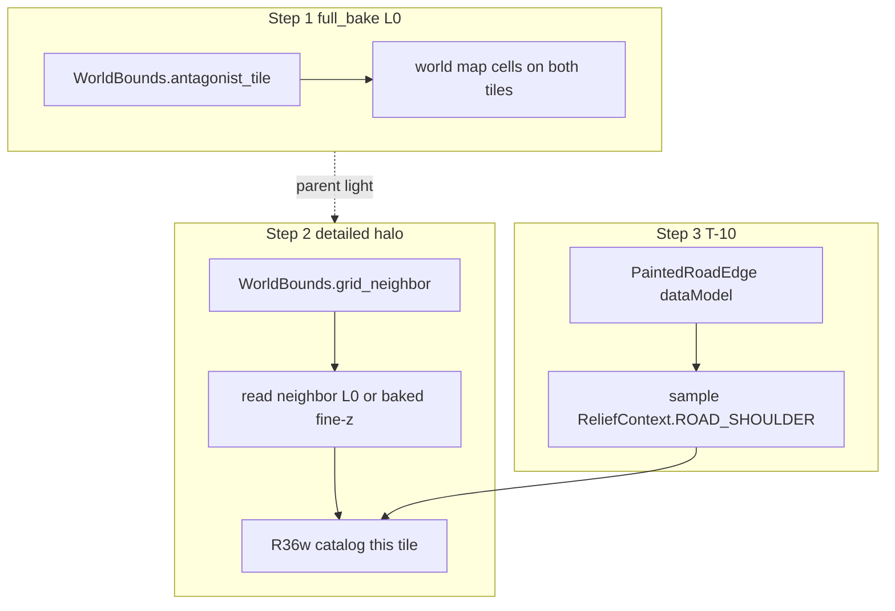

# Full-bake seam · detailed halo · road_shoulder (T-10) ✅ DONE

**Status:** shipped 2026-08-14 (all three steps).

Product SoT: [`docs/tz_world_pack_storage.md`](../docs/tz_world_pack_storage.md) (шов мира, Идея 2), [`docs/tz_terrain_relief.md`](../docs/tz_terrain_relief.md) R36u/v/w / C27, [`docs/tz_terrain_generation.md`](../docs/tz_terrain_generation.md) § Форма мира / Planet topology.

**Не** дублировать Идею 2 и R36w. Три **отдельных** шага. Код шага не писать, пока мастер не скажет «делай» этот шаг.

## Целевое состояние

| Шаг | Что появляется | Что не появляется |
|---|---|---|
| **1. Шов мира** | При `full_bake` L0 край AABB смыкается с антагонистом на **макро-тайлах** | Wrap в `detailed_bake` / `_owner_site` / `face_key`; magma antipode |
| **2. Halo соседа** | Sample detailed читает z **grid-смежного** тайла (L0 и/или уже fine) без ожидания чужого `detailed_bake` | Wrap/антагонист в halo; второй writer на чужой тайл |
| **3. T-10** | `road_shoulder` sample+stamp на detailed, тот же каталог граней | Новый оркестратор; L0 ribbon writer; литерал `"road_shoulder"` |

Uid/идентичность **не изобретать**: [`PackJobUid`](../backend/app/dataModel/worldPack/packJobUid.py), [`pack_job_seed`](../backend/app/application/worldData/pack/bake/macroTileUid.py), [`WorldBounds`](../backend/app/dataModel/worldPack/worldBounds.py), [`Facing`](../backend/app/dataModel/spatial/facing.py) / `COMPACT_LETTER` / `CARDINAL_WALL_OUTWARD_DELTA`, [`ReliefContext`](../backend/app/dataModel/terrain/relief/enums.py), [`FaceGridAxis`](../backend/app/dataModel/worldPack/packJobUid.py).

## Контракты (запрет хардкодов)

Lookup соседа / антагониста — **только** POJO `WorldBounds` (уже в модели):

| Метод | Смысл |
|---|---|
| `contains(gx, gy)` | тайл в AABB |
| `grid_neighbor(gx, gy, facing)` | `gx+dx` внутри bounds; **нет** → `None` (без wrap) |
| `antagonist_tile(gx, gy, facing)` | только если `grid_neighbor` is None на этой стороне; min x ↔ max x / min y ↔ max y |

Сторона — `Facing`, дельта — `CARDINAL_WALL_OUTWARD_DELTA`. **Запрещено:** `gx+1`, `x_max`, `"E"`, `"east"` в bake/refine.

Идентичность тайла шва — `PackJobUid.tile_uid` + `pack_job_seed`. **Запрещено:** новый kind сайта, wrap-`face_key`, второй `tile_edge` namespace.

`FaceKey.axis` — только `FaceGridAxis` (не `str`).

Halo (шаг 2): сосед = `WorldBounds.grid_neighbor` **этого** `Facing`. Источник z = parent light соседнего тайла и/или уже записанный fine. **Не** `antagonist_tile`. Rim detailed по-прежнему 1 chunk-parent (гейт R36w).

T-10 (шаг 3): контекст = `ReliefContext.ROAD_SHOULDER`; шаблон = `ReliefTemplate.context`; длина halo = `outward_length_cells()`. Handoff L0 → detailed: `PaintedRoadEdge` **перенести в `dataModel`** до sample (сейчас dataclass в application). Каталог / uid — те же `PackJobUid` / R36w.

## Data flow

Шаг 2 **не** ждёт шаг 1 для grid-смежных тайлов внутри AABB. Шаг 1 нужен, чтобы *край мира* имел L0-соседа-антагониста; detailed wrap туда **не** ходит.

## Порядок имплементации (слои)

1. **dataModel уже:** `WorldBounds.*`, `PackJobUid`, `FaceGridAxis`, `Facing`. T-10 сначала: `PaintedRoadEdge` → `dataModel`.
2. **L0 orchestrator** (шаг 1): `WorldMapBakeOrchestrator` / light compose — стык высот/mask по `antagonist_tile`; лог `PackJobUid.tile_uid`. Не generators relief.
3. **Detailed refine** (шаг 2): halo expand читает соседний tile state через `grid_neighbor`. Каталог не меняет owner-site wrap.
4. **T-10** (шаг 3): sample context в `detailedGradeGenerate` / runner; persist тот же `replace_world=False`.

Тесты: шаг 1 — `WorldBounds` ✅ + bake двух крайних тайлов; шаг 2 — Δz через grid-шов один `grade_uid` при halo; шаг 3 — uid-тест как `test_two_tile_bakes_along_seam_one_uid` с `ReliefContext.ROAD_SHOULDER`.

## Запрещено во всех шагах

- Литералы координат/сторон/context/uid kind вне POJO
- Climate/hydro seam «заодно»
- DAG / wait-both-detailed
- Сфера / antipode как шов AABB
- Идея 2 пересказом в коде шага
