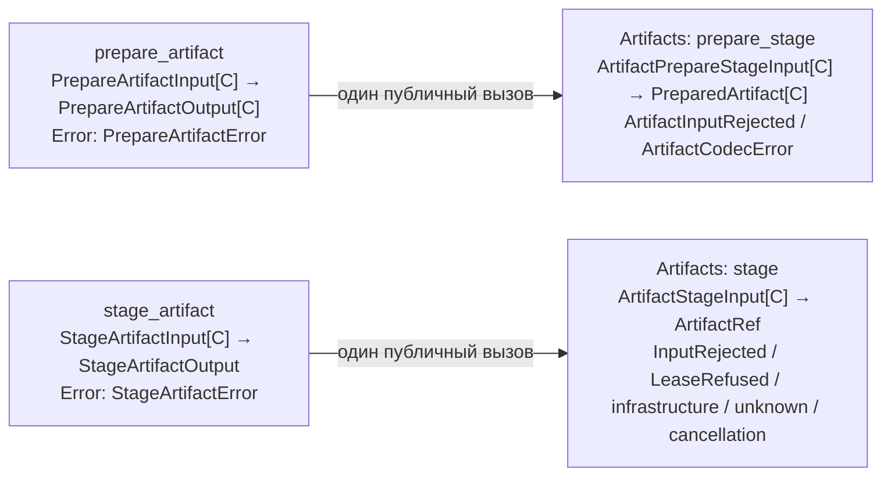

# GEN-DAG: базовые ноды Artifacts

Дата: 2026-11-18.

Статус: отдельный проект контрактов двух согласованных нод; НЕ принят к реализации. Публичный срез Artifacts остаётся DESIGN OPEN до ARCH-0. Согласование двух операций не означает принятия конкретных специализаций, регистрации или графа.

## 1. Основание и границы

Пользователь согласовал `prepare_artifact` и `stage_artifact`, затем поручил конкретно записать план. Источник публичных сигнатур — [Artifacts public staging](artifacts-public-staging-dag.md), верхний раздел «Завершённое предложение Artifacts: публичный срез V1». Этот раздел имеет приоритет над отозванными предложениями ошибок ниже в том документе.

Только две новые листовые ноды. Укрупнённая нода не вводится. Legacy-ноды не используются и не изменяются. Reserve, backend write, seal, открытие lease, публикация, retention и GC не становятся дополнительными нодами этого плана. Производители content, источник lease, consumers результата, триггеры, deps и порядок нового графа определяются отдельно совместно с пользователем.

## 2. Собственные POJO нод

Ниже объявлены проектные имена и полный состав полей. Предлагаемый модуль — `backend/app/dataModel/engine/nodes/artifacts.py`, владелец — Engine/DAG. Это спецификация, не утверждение о существующих классах.

| POJO | Поля | Назначение |
|---|---|---|
| `PrepareArtifactInput[C]` | `request: ArtifactPrepareStageInput[C]` | Вход ноды подготовки |
| `PrepareArtifactOutput[C]` | `value: PreparedArtifact[C]` | Результат ноды подготовки |
| `StageArtifactInput[C]` | `request: ArtifactStageInput[C]` | Вход ноды staging |
| `StageArtifactOutput` | `value: ArtifactRef` | Результат ноды staging |
| `PrepareArtifactError` | `error: ArtifactInputError` | Ожидаемый отказ в данных входа подготовки |
| `StageArtifactError` | `error: ArtifactInputError \| ArtifactLeaseFailure` | Ожидаемый отказ во входе или lease |

Все модели strict/frozen/extra-forbid; вложенные значения deep immutable. Это только оболочки контракта ноды: без codec, IO, выбора формата, вычисления descriptor и повторения полей доменных POJO. Типизированная команда — соответствующий input; дополнительный строковый selector операции не нужен.

`C` — параметр проектной формы, а не разрешение регистрировать generic payload. Для регистрации необходим конкретный тип: `bytes` для согласованного BLOB либо конкретная owning frozen model для SQL_ROWS. `Any`, generic `BaseModel`, словарь произвольных данных и не связанный `C` недопустимы. Конкретные format key/version, payload, NodeContract IDs и регистрационные специализации здесь не назначены.

Обёртки должны сохранять admitted экземпляр content при локальной передаче в публичный метод. JSON round-trip через engine не гарантирует Python identity. До реализации требуется проверить совместимость транспорта Engine с owning identity admission и временным runtime-only `PreparedArtifact`: нельзя молча сериализовать его как persisted payload или обещать сохранение identity через восстановление. Изменение этой семантики требует согласования, а не обхода через model_construct.

## 3. Точное соответствие публичным операциям

| Нода | Публичный интерфейс Artifacts | Вызов | Выход ноды |
|---|---|---|---|
| `prepare_artifact` | `IArtifactPrepareStageOpenPipeline[C]` | `prepare_stage(input.request)` | `PrepareArtifactOutput[C](value=result)` |
| `stage_artifact` | `IArtifactStageOpenPipeline[C]` | `await stage(input.request)` | `StageArtifactOutput(value=result)` |

Интерфейсы принадлежат Artifacts, целевые модули — `application/artifacts/contracts/artifactPrepareStageOpenPipeline.py` и `artifactStageOpenPipeline.py`. Публичные реализации — одноимённые классы без префикса `I` в `application/artifacts/staging/`. Нода зависит от интерфейса через composition и делает ровно один публичный вызов. Prepare и stage используют один заранее связанный `ArtifactFormatContract[C]` и поддерживаемую версию; нода не выбирает их по содержимому.

Доменные типы, используемые без копирования:

| Тип, владелец Artifacts | Модуль относительно `backend/app/dataModel/artifacts/` | Поля / смысл |
|---|---|---|
| `ArtifactPrepareStageInput[C]` | `staging/preparedArtifact.py` (TARGET) | `content: C` |
| `PreparedArtifact[C]` | `staging/preparedArtifact.py` (TARGET) | `content: C`, `descriptor: ArtifactRef`; временный envelope, не capability |
| `ArtifactStageInput[C]` | `staging/stageInput.py` (TARGET) | `lease: OperationLeaseRef`, `prepared: PreparedArtifact[C]` |
| `ArtifactRef` | `references.py` | kind, format_key, format_version, content_hash, nbytes, row_count; canonical descriptor |
| `OperationLeaseRef` | `lifecycle/lease.py` | operation_id, world_uid, kind, preparation_fingerprint, fence; owning capability |
| `ArtifactInputError` | `staging/inputErrors.py` (TARGET) | Непустой `issues: tuple[JsonFieldError \| WireShapeIssue \| ArtifactInputIssue, ...]` |
| `ArtifactInputIssue` | `staging/inputErrors.py` (TARGET) | Existing `FieldPathError[ArtifactInputIssueCode]`: code/path/message |
| `ArtifactInputIssueCode` | `staging/inputErrors.py` (TARGET) | CONTENT_NOT_IMMUTABLE, CONTENT_TYPE_MISMATCH, FORMAT_BINDING_MISMATCH, DESCRIPTOR_MISMATCH |
| `ArtifactLeaseFailure` | `lifecycle/leaseFailure.py` (TARGET) | lease, requirement (WRITABLE/CLOSED), code; без копий identity-полей |

`ArtifactLeaseFailureCode`: OPERATION_MISSING, BINDING_MISMATCH, FENCE_MISMATCH, LEASE_ABSENT, PHASE_NOT_WRITABLE, ADMISSION_CLOSED, ADMISSION_OPEN. Совместимость requirement/code валидирует Artifacts. Existing JsonFieldError/WireShapeIssue переиспользуются из owning validation/importIssues; их определения не копируются в Engine.

## 4. Ошибки и эффекты

`ArtifactInputRejected.error` переносится без изменения в соответствующий error POJO ноды; `ArtifactLeaseRefused.failure` — в `StageArtifactError.error`. Пути ошибок остаются относительно публичного request; оболочка не переписывает их и не добавляет второй список issues. Конкретное подключение к существующему механизму PythonNodeError проверяется до реализации.

`ArtifactCodecError`, `ArtifactDescriptorConflictError`, `ArtifactStorageInvariantError` (подтипы PublicationInfrastructureError), existing `CorruptBlobError`, `OperationBusyError`, `PublicationInfrastructureError`, `UnknownCommitOutcome` и `CancelledError` не превращаются в успешный output или input/lease refusal. Exact применимость следует owning операции; pure prepare имеет codec fault, не storage IO. Сохраняются категория и cause; cancellation распространяется после owning drain. Нода не вводит retries/recovery/rollback/fallback/повторный log. ArtifactIntegrityError отозван; ArtifactStageFailure/ArtifactStageRefused не используются.

`prepare_artifact`: pure; без IO, lease, holds и мутаций registry. `stage_artifact`: owning staging IO. Успех — ref, равный descriptor; seal и operation hold подтверждены в момент seal commit при live writer claim. После освобождения claim concurrent cancel может снять hold до доставки ответа. Нода не усиливает эту гарантию до «hold при return» или «до apply». Непрерывную защиту между стадиями и atomic target acquisition→READY обеспечивает отдельный согласуемый protection/completion contract; эта обязанность не снимается уточнением stage. Закрытый/READY lease не разрешает повторный stage; exact replay принадлежит lifecycle-владельцу. Частичная запись и unknown outcome не означают отсутствие эффекта.

## 5. Карта контрактов, не граф исполнения

Stage требует `PreparedArtifact[C]` во входе. Это зависимость по данным, а не утверждённое ребро между нодами, deps, порядок запуска или привязка к генератору. Выбор маршрута и передача междоменных результатов принадлежат DAG.

## 6. Ответственности и вложенные вызовы

| Класс / семейство | Ответственность, зависимости и эффекты | Проверка / основание отказа |
|---|---|---|
| Проектный `PrepareArtifactNode[C]` | Только свой input/output/error и публичный prepare interface; pure | Один вызов с исходным request; отказ при IO, codec или выборе downstream операции |
| Проектный `StageArtifactNode[C]` | Только свой input/output/error и публичный stage interface; IO исключительно за этим интерфейсом | Один awaited вызов; отказ при прямом reserve/write/seal, retry или публикации |
| Шесть Engine POJO из §2 | Типизация оболочки; зависимости только от публичных типов | Нет дублирования доменных полей/правил; отказ при алгоритме, IO, копировании диагностик |
| Публичные интерфейсы Artifacts | Сигнатуры §3, typed результаты/ошибки | Не раскрывают backend/reservation; отказ при внутренних типах в сигнатуре |
| `ArtifactPrepareStageOpenPipeline[C]` | Линейная подготовка через admission и descriptor builder | Нет соседних операций/IO; отказ при выборе маршрута |
| `ArtifactStageOpenPipeline[C]` | Admission, пересчёт descriptor, затем reserve → backend.write → seal | Не вызывает public prepare; отказ при перестановке стадий или обходе admission |
| `ArtifactInputAdmission[C]` | Проверки schema/immutability/binding и field aggregation существующими helpers | Сохраняет content instance; отказ при IO или transport-copy |
| `ArtifactDescriptorBuilder[C]` | Fixed pure encode/digest/row_count | Не зависит от DAG; отказ при IO или выборе доменной стратегии |
| `ArtifactFormatContract[C]` | Immutable фиксированная конфигурация codec и concrete model | Совпадающий binding обеих операций; отказ при dynamic fallback |
| Доменные POJO/enums §3 | Данные и собственная validation; без эффектов | Нет второго canonical ref/lease/error; отказ при смешении обязанностей |
| Публичные exception carriers | Перенос owning error/category/cause | Нет логирования, persistence или orchestration |

Внутренние catalog/backend/lease/holder реализации и их конкретные классы принимаются в owning ARCH-0 Artifacts, а не выбираются Engine. До полной трассировки этих классов и nested callers общая приёмка НЕ пройдена. Старый `TypedArtifactStager.stage(lease, content)` не является заменой целевого публичного `stage(request)`.

Источник внутреннего порядка — верхний публичный срез Artifacts; этот документ его сохраняет, но не объявляет утверждённым вместо ARCH-0. Междоменный порядок не задан: producer → DAG и DAG → Artifacts остаются требованиями к контрактам, пока совместно не назначены конкретные producers/callers и условия.

## 7. Обязательная приёмка и открытые пункты

Критерии — [dag-generator-interface.mdc](../rules/dag-generator-interface.mdc#обязательная-приёмка-плана-любого-домена). Отсутствие сведений означает отказ в приёмке, а не условный PASS.

| Критерий | Место и результат проверки |
|---|---|
| Нет pipeline с выбором маршрута | §3, §6: задан один вызов и линейная атомарная операция; проверка реализации OPEN |
| Нет скрытой оркестрации | §3, §5: прямые вызовы нод; полный inventory callers OPEN |
| Нет прямых междоменных вызовов | §1, §5–6: только через DAG; owning nested audit OPEN |
| Ответственность каждого класса | §6: роли нод/оболочек/публичного среза заданы; полный внутренний реестр зависит от ARCH-0, OPEN |
| Граница public/implementation | §3, §6: внутренние стадии не доступны ноде; приёмка owning API OPEN |
| Неизменность утверждённого порядка | §5–6: порядок графа не утверждён; OPEN |
| Конкретность CRUD данных и настроек | Матрица ниже; полный публичный CRUD не заявлен, OPEN |
| Протокол междоменного CRUD | Конкретные producer, lease owner и consumer ещё не назначены; протокол не завершён, OPEN |
| Анализ POJO и типизированных ошибок | §2–4: reuse owning типов; полный inventory existing/planned POJO и отсутствие пересечения ещё не проверены, OPEN |

| Объект | Create/write | Read | Update | Delete |
|---|---|---|---|---|
| Данные Artifacts | Только staging через `stage`, не опубликованное состояние; TARGET | Публичная нода не согласована, OPEN | Публичная нода не согласована, OPEN | Публичная нода не согласована, OPEN |
| Настройки Artifacts | OPEN | OPEN | OPEN | OPEN |

Pure prepare не считается read сохранённых данных или полным CRUD. Этот узкий план не закрывает ART-Q4–Q6 owning плана.

До кода необходимо: принять ARCH-0 и проверить наличие целевых публичных методов; совместно определить concrete C и binding; разрешить transport/identity вопрос §2; сверить все POJO и ошибки с inventory; согласовать точные NodeContract/регистрацию, provenance и граф; пройти все обязательные критерии без пропусков.

После этих согласований проверки реализации должны подтвердить точный публичный вызов, typed output и перенос отказов, отсутствие скрытых retries/IO у prepare, сохранение локальной identity, concrete payload validation и корректный engine transport. Порядок reserve/write/seal, lease admission и drain проверяет owning Artifacts. Код в рамках текущего поручения не изменяется.
