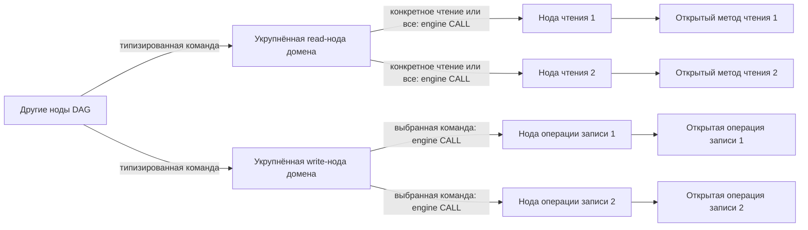
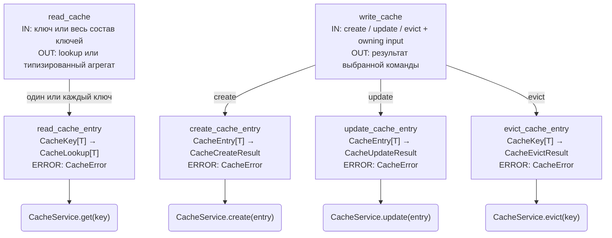
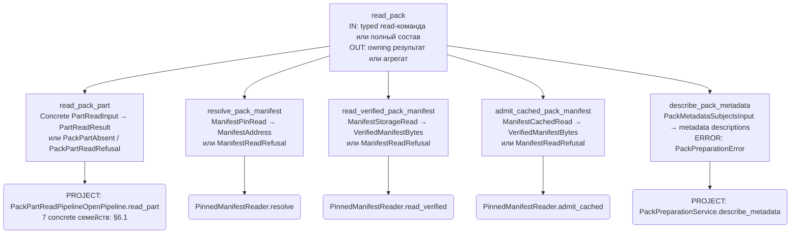
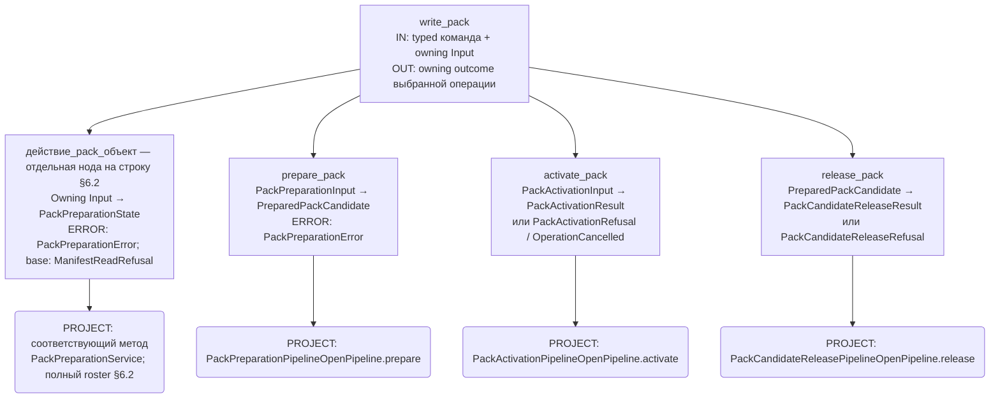
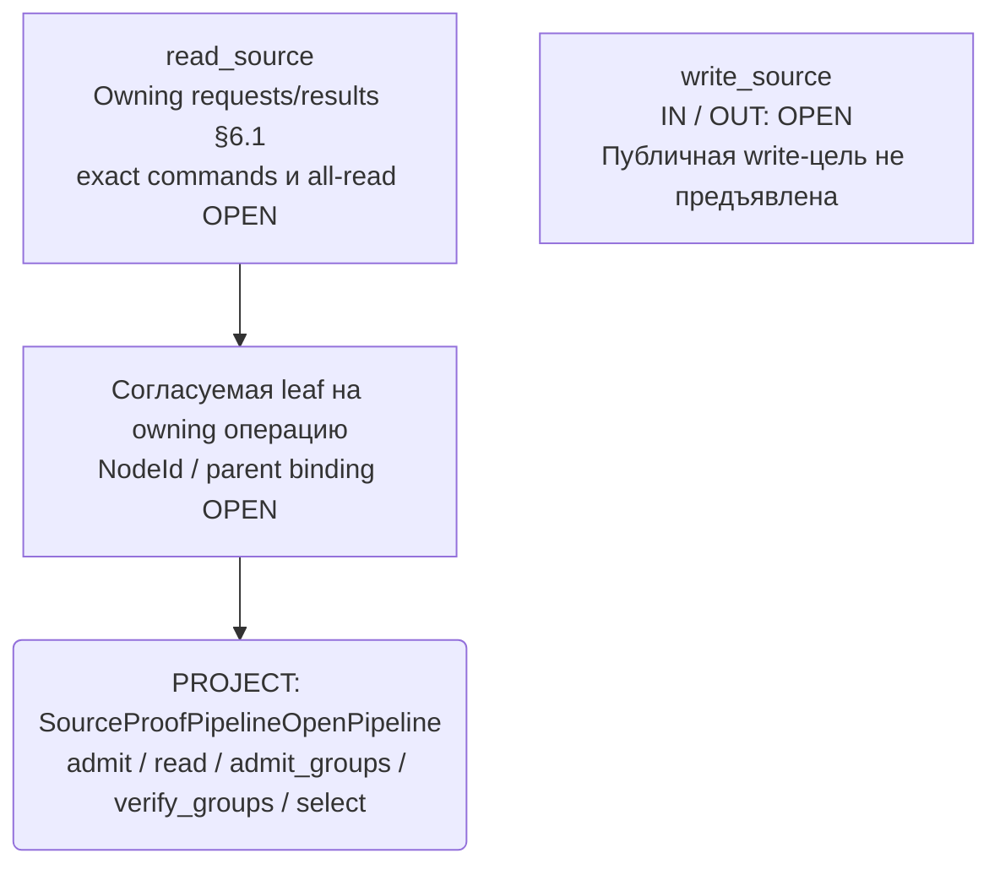

# GEN-DAG: семейства Cache, Pack и Source

Дата: 2026-11-13. Статус: PROPOSAL / OPEN, варианты для совместного обсуждения. Полная приёмка НЕ ПРОЙДЕНА: exact node contracts, bindings и lifecycle ещё не согласованы. Документ не разрешает код, cutover, новые NodeId или изменение существующего родства.

## 1. Основание и граница

Поручение пользователя: вынести анализ в отдельный новый план и предложить варианты. Пользователь подтвердил схему: публичный метод домена используется собственной read/write-нодой DAG; другие ноды используют эту ноду через её контракт. DAG обращается к доменам только через открытые методы и OpenPipeline.

Основания: [GEN-DAG-1](gen-dag-1-post-geo-ws.md), [семейства и связи §0/§13](gen-dag-node-dependency.md), [обязательная приёмка](../rules/dag-generator-interface.mdc). Пример P3 light_bake_readers показывает семейство без parent-ноды. Parent/child, CALL и producer/consumer — разные отношения. CALL выполняется engine, не прямым вызовом чужого execute(). Семейство не задаёт порядок исполнения.

Ниже имена в backticks — кандидаты имён, не принятые NodeId. Пользователь выбрал двухуровневую структуру: над отдельными нодами операций каждого домена находятся укрупнённые read/write-ноды DAG с типизированными командами. Отдельная общая root-нода над read/write не назначается. Source рассматривается как вспомогательный модуль согласно owning-документу, а не как новый владелец CRUD исходных данных.

## 2. Выбранная организация: A + укрупнённые read/write-ноды

| Вариант | Устройство | Преимущество | Ограничение |
|---|---|---|---|
| A. Нода на публичную операцию | Отдельные get/create/update/evict для Cache; отдельные атомарные read/write/prepare/activate операции Pack; отдельные принятые Source операции | Явные эффекты, точные контракты и зависимости; удобно принимать leaf bindings | Много карточек и связей; нельзя механически превратить каждый helper в ноду |
| B. Ноды по группе CRUD | Например read_cache и write_cache; write получает закрытый типизированный набор команд create/update/evict | Меньше нод, единая точка записи | Ветка команды должна исполняться engine; dispatch внутри ноды требует отдельного принятого engine-контракта. Общий execute(operation, Any) неприемлем. Нельзя смешать prepare и activate как внутренние стадии write |
| C. Семейства операций и отдельные сценарные ноды | Leaf-ноды варианта A предоставляют доступ к доменам; принятые сценарные ноды используют их через engine CALL и результаты | Повторное использование read/write между семействами; orchestration остаётся в DAG | Нужен exact CALL/lifecycle binding. Сценарная нода не может стать самостоятельным executor |

**Решение пользователя 2026-11-13 заменяет прежнюю рекомендацию C:** сохранить A и добавить над операциями каждого домена укрупнённые read/write-ноды с типизированными командами. Таблица выше сохраняет сравнение альтернатив, но выбор между ними больше не OPEN.

- Запрос конкретных данных приходит в укрупнённую read-ноду; она через engine вызывает соответствующую отдельную ноду чтения и возвращает собственный типизированный результат.
- Запрос всех данных приходит в ту же read-ноду; она через engine вызывает все ноды чтения согласованного состава и собирает их результаты в собственный контракт.
- Укрупнённая write-нода принимает типизированную команду и через engine вызывает соответствующую отдельную ноду операции записи. Команда «записать всё» и произвольный batch этим решением не вводятся.
- Только отдельные ноды операций вызывают открытые методы/OpenPipeline домена. Укрупнённые ноды выбирают операции и агрегируют данные внутри DAG; доменный pipeline не получает эту оркестрацию.

Для каждого домена нужны собственные закрытые union команд и результатов. Конкретные имена классов, поля и модули OPEN. Строковый operation + Any, универсальный dict результатов и callbacks не заменяют типизированный контракт. Команда конкретного чтения определяет соответствующий вариант результата; команда полного чтения возвращает отдельную композицию всех требуемых результатов с переиспользованием owning POJO.

«Всё» означает все чтения явно принятого состава для заданного scope и согласованного контекста версий. Это не неограниченный обход хранилища. Состав, аргументы каждой операции, согласованность версий, required/optional outcomes и поведение при ошибке должны быть предъявлены до приёмки. Неполный набор нельзя выдавать за успешный полный результат. Fan-out не означает автоматическое параллельное исполнение: порядок и возможность параллелизма принимаются отдельно.

Выбрана иерархия read/write → операции, но exact parent/child roster и runtime CALL binding ещё требуют карточек. Прямой доступ внешних callers к leaf-нодам отдельно не согласован; основной описанный маршрут проходит через укрупнённые ноды. Не создавать по умолчанию cache_get_or_build или общий source_pack_publish.

## 3. Cache: кандидаты leaf-ролей

Проверенная реализация: [CacheService](../../backend/app/application/cache/service/cacheService.py). Порядок миграции и границы: [Cache plan](cache-public-contracts.md), GEN-DAG-1, решение 2026-11-09.

| Роль DAG | Открытый метод | Доменные данные | Ответственность ноды |
|---|---|---|---|
| read_cache_entry | get(key) | CacheKey → CacheLookup: hit или miss; CacheFailure содержит CacheError | Передать ключ, вернуть различимые hit/miss/error; не запускать producer |
| create_cache_entry | create(entry) | CacheEntry → CacheCreateResult | Передать готовую проверенную producer-запись, сохранить outcome admission |
| update_cache_entry | update(entry) | CacheEntry → CacheUpdateResult | Явное обновление по доменной семантике; не fallback create |
| evict_cache_entry | evict(key) | CacheKey → CacheEvictResult | Удалить точный ключ, не инвалидировать другие домены самостоятельно |

Над этими leaf-ролями: `read_cache` вызывает `read_cache_entry`, а `write_cache` выбирает `create_cache_entry`, `update_cache_entry` или `evict_cache_entry` по типизированной команде. Для полного чтения нужно определить состав ключей/контрактов: существующий get(key) не предоставляет перечисление всех записей cache. Нельзя придумать такой API или объявить полный cache scan готовым. Если состав содержит несколько ключей, это несколько вызовов принятой read leaf-ноды по конкретным входам.

Это доменные типы, не уже утверждённые node Input/Output/Error. Node contracts должны иметь собственную роль/идентичность в DAG, переиспользуя значения домена без копирования полей CacheKey/CacheError. Нужны concrete schemas и проверка поддерживаемых generic bindings engine.

На miss сценарий DAG получает результат producer и вызывает create_cache_entry. На hit применяются требования owning consumer. Ошибка Cache не превращается в miss. Cache отвечает за binding/version, immutable admission, RAM и eviction; engine/runtime — за согласованные single-flight, cancel, timeout, shutdown. Cache не проверяет Pack pin и не запускает Planning. Публичный codec callback с IO/планированием блокирует binding.

CRUD настроек не выводится из четырёх методов данных. Проверить принятые исключения/решения CachePolicy и состав owning settings API перед добавлением любых settings-нод.

## 4. Pack: кандидаты групп операций

SoT: [domain contract](pack-v2-domain-contract-spec.md), [write operations](pack-v2-public-write-operations.md), [текущая приёмка](pack-current-scope-acceptance.md), [порядок](pack-write-order-trace.md). Это преимущественно проектные границы, не заявление о готовых runtime методах.

| Группа кандидатов | Публичная доменная граница | Что запрещено ноде |
|---|---|---|
| Pack read | Принятые публичные чтения pinned данных; exact список и binding OPEN | Считать cache hit доказательством pin/coverage; читать latest вместо закреплённой версии |
| start_pack_from_base | start_from_base → PackPreparationState | Пересобирать базовый manifest внутри DAG |
| Pack payload writes | Specialized write операции → новый state | Единый Any payload; запуск producer из Pack write; копирование алгоритма merge в ноду |
| describe_pack_metadata | describe_metadata → tuple[PackMetadataDescription, ...] по уточнённому проекту (subject + dependencies/basis) | Выводить source usage из fingerprint силами DAG; вызывать Source helper из Pack |
| bind_pack_metadata_provenance | bind_metadata_provenance → state | Подменять proof inherited полей текущим capture |
| prepare_pack | PackPreparationPipelineOpenPipeline.prepare → PreparedPackCandidate | Запускать Source/producer внутри Pack; выдавать READY без owning admission и holds |
| activate_pack | activate(candidate, expected publication) по owning input | Повторять capture/materialization, самостоятельно выбирать retry/latest |
| release_pack | Отдельная owning release операция | Считать release побочным действием удаления cache entry |

Над отдельными операциями вводятся роли `read_pack` и `write_pack`. Pack read выбирает конкретное чтение либо вызывает весь согласованный read-состав и возвращает агрегированный контракт закреплённого scope. Pack write выбирает отдельную операцию по команде; prepare/activate/release остаются различимыми операциями, не скрытым общим publish workflow.

Read-группа должна быть сопоставлена с уже существующими кандидатами read_world_light_bake/read_scoped_light_bake и checks. Не добавлять их дубли и не менять P3/родство автоматически. Specialized writes раскладываются в конкретные карточки только после принятия payload role и интерфейса. Строка таблицы не равна новой ноде.

Не переоткрывать локально принятые describe/bind, diagnostic union и settings exceptions. OPEN интеграции: exact atomic adoption/CAS/handoff/release, resource execution failure после OWNER, historical Transition context для соответствующего payload. Serialization и PACK-METADATA-PLANNING сохраняют отдельный согласованный scope.

## 5. Source: варианты без искусственного CRUD

SoT: [Source module transition](source-module-transition.md), [proof proposal](source-durable-proof-contract.md), [Source integration](source-proof-v2-contract-spec.md), [актуальная Pack boundary](pack-source-admission-boundary.md).

Актуализация по поручению пользователя: текущая основа — [Source integration §6.0.A–G](source-proof-v2-contract-spec.md), а не старый single-capture проект create/verify/collect_refs. Предъявлены async admit/read/admit_groups/verify_groups/select. Это PROJECT, не готовая реализация и не приёмка новых нод. Source не владеет записью World/location/library и не приобретает её через ноду write_source.

| Вариант Source | Роли | Условие выбора |
|---|---|---|
| S1. Раздельные операции | Текущие owning admit/read/admit_groups/verify_groups/select; exact leaf mapping OPEN | Owning API принимает независимые операции и точный поток их результатов |
| S2. Одна атомарная read/admission операция | Одна нода вызывает один принятый публичный Source pipeline, возвращающий полный owning результат | Владелец Source принимает единую атомарную операцию; это не wrapper, который внутри запускает другие домены |

S1/S2 остаются вопросом атомарности публичного Source API, а не альтернативой выбранной двухуровневой структуре DAG. Над принятыми отдельными операциями предусмотрены `read_source` и `write_source`. Source read выбирает конкретную операцию либо собирает весь принятый набор чтений. Состав команд/leaf-операций Source write OPEN: наличие верхней роли не разрешает приписать Source запись World или назвать verify операцией записи. Не формировать Source create/update/delete ради симметрии с Cache. Capture creation/finalization и удержания требуют отдельных владельцев и bindings; их нельзя приписать proof verification.

Multi-capture, typed usage, group selection/exact matching и async IO теперь предъявлены Source как concrete проект (§6.0.A–G). Остаток: принятие owning schema/errors/codec и bindings, точный Pack mapping, capture finalization и удержание до handoff. Более поздние решения Pack по field-level usage и отказу partial update при неизвестном происхождении сохраняются. Прямой Pack → SourceProofValues из §H пользователем не разрешён: запрет междоменных вызовов сохраняется и для предложенного helper. Нельзя превращать его в новую DAG-ноду автоматически либо переносить Source алгоритмы в Pack. Точки дополнительной передачи рассмотрены в §6.7 без назначения порядка и новых NodeId.

## 6. Карта обсуждения связей

Это выбранная двухуровневая структура для каждого из Cache, Pack и Source. Конкретный состав leaf-нод и execution dependencies ещё требует приёмки:

Результаты leaf-нод возвращаются через engine укрупнённой ноде; она формирует свой контракт результата и возвращает его caller. Агрегация компонует готовые данные, не вычисляет заново proof, closure или manifest. Стрелка Source → Pack как прямой доменный вызов отсутствует. Наличие POJO успеха само по себе не доказывает действительность hold или admission.

Согласованный Cache miss flow сохраняется. Порядок Pack writes определяется owning trace; describe/bind следует фактическим изменениям соответствующего state, prepare проверяет конечный состав, activate — отдельный шаг. Никакое новое распараллеливание здесь не принято. Exact integrated Source/Pack sequence остаётся OPEN.

## 6.1. Сверка текущих публичных read-контрактов доменов

Проверено 2026-11-13 по owning-планам. Эта таблица конкретизирует прежние общие строки §3–5. Контракты доменов уже описаны существенно подробнее, чем исходная карта этого плана; OPEN node mapping не означает отсутствия доменного проекта. Имена leaf ниже остаются предложениями; типизированные команды верхнего уровня обозначены по смыслу, без выдуманных новых POJO.

### Cache

Источник: [публичные контракты](cache-public-contracts.md), разделы публичного чтения и production callers шага 5.

| Команда read_cache | Leaf-кандидат | Конкретный публичный контракт | Результат / ошибка |
|---|---|---|---|
| Чтение точного ключа | read_cache_entry | CacheService.get[T](key: CacheKey[T]) → CacheLookup[T] | CacheHit[T](entry) либо CacheMiss; исключение CacheFailure(error: CacheError), operation=GET |

Контракт и реализация V2 существуют; production DAG cutover ещё OPEN. Hit обновляет LRU. Плановый cache использует CacheKey[PlanEnvelope[T]], manifest cache — CacheKey[bytes]; это разные заранее связанные экземпляры/контракты, а не динамический dispatch по содержимому результата. Полное чтение не имеет публичного enumerate/all API: верхняя команда должна предъявить определённый набор точных ключей и агрегировать результаты get, сохраняя miss отдельно от ошибки.

### Pack: чтение typed частей

Источники: [CRUD roster, раздел R](pack-data-crud-roster.md), [concrete read-модели](pack-read-concrete-models.md), [domain contract §2](pack-v2-domain-contract-spec.md).

Один публичный метод PROJECT: `PackPartReadPipelineOpenPipeline.read_part[T: BaseModel](request: PackPartReadInput[T]) -> PackPartReadResult[T] | PackPartAbsent | PackPartReadRefusal`, async. Модуль: application/worldData/pack/read/packPartReadPipelineOpenPipeline.py. Input содержит pin/address/contract/budget; success — publication/manifest/address/contract/artifact/value/provenance. Отдельные публичные методы на каждый payload этим проектом не вводятся.

В соответствии с выбранным A базовый leaf-кандидат — `read_pack_part`; конкретные команды read_pack передают ему следующие именованные специализации одного публичного контракта:

| Команда / logical role | Input → success | Contract / payload T |
|---|---|---|
| map_tile | WorldMapTileReadInput → WorldMapTileReadResult | WorldMapTileReadContract / WorldMapTileWire |
| wilderness_chunk или location_terrain | FineTerrainReadInput → FineTerrainReadResult | FineTerrainReadContract / FineTerrainChunkWire |
| settlement | SettlementReadInput → SettlementReadResult | SettlementReadContract / SettlementStructureWire |
| climate_coarse или climate_fine | ClimateFieldReadInput → ClimateFieldReadResult | ClimateFieldReadContract / ClimateFieldWire |
| locations_index | LocationsIndexReadInput → LocationsIndexReadResult | LocationsIndexReadContract / LocationsIndexWire |
| tile_grade_slots или location_grade_slots | GradeSlotsReadInput → GradeSlotsReadResult | GradeSlotsReadContract / GradeSlotSidecar |
| spatial_root(HYDROLOGY_OPEN_WATER) | HydrologyRootReadInput → HydrologyRootReadResult | HydrologyRootReadContract / HydrologyPackRoot |

Это семь семейств моделей для десяти logical roles, не семь уже принятых NodeId. Все получают также shared PackPartAbsent/PackPartReadRefusal. Concrete классы — PROJECT; registry, strict payload admission, budgets, error mapping и canonical registration имеют собственные незакрытые gates. Shards читаются внутри owning реализации spatial dataset, отдельная нода публичного чтения произвольного shard не выводится.

Команда полного Pack read вызывает read leaf для всех адресов согласованного состава; один метод может быть вызван несколько раз с разными concrete inputs. Полный roster адресов/coverage и агрегированный DAG output пока не определены. Из списка schema families нельзя получить все адреса мира. Нельзя копировать manifest traversal в DAG; необходим owning публичный способ получить/передать требуемый состав. Existing P3 bake-read ноды требуют отдельного сопоставления с coverage: read_part сам по себе не доказывает готовность полного light bake.

### Pack: существующие manifest bytes и проект metadata read

| Команда read_pack / leaf-кандидат | Публичный метод | Input → success / отказ | Статус |
|---|---|---|---|
| Разрешить manifest / resolve_pack_manifest | PinnedManifestReader.resolve, async | ManifestPinRead → ManifestAddress или ManifestReadRefusal | EXISTING |
| Прочитать manifest из storage / read_verified_pack_manifest | PinnedManifestReader.read_verified, async | ManifestStorageRead → VerifiedManifestBytes или ManifestReadRefusal | EXISTING |
| Допустить cached manifest / admit_cached_pack_manifest | PinnedManifestReader.admit_cached, async | ManifestCachedRead → VerifiedManifestBytes или ManifestReadRefusal | EXISTING |
| Описать metadata текущего state / describe_pack_metadata | PackPreparationService.describe_metadata, sync | PackMetadataSubjectsInput → tuple[PackMetadataDescription, ...]; PackPreparationFailure(error: PackPreparationError) | PROJECT дополнения metadata usage/basis; старый subject-only output не закрывает новый маршрут, exact binding требует приёмки |

Existing manifest types находятся в dataModel/worldPack/read/pinnedManifest.py; reader — application/worldData/pack/read/pinnedManifestReader.py. Metadata types и уточнения: [CRUD roster](pack-data-crud-roster.md), [актуальная admission boundary](pack-source-admission-boundary.md), [metadata POJO](pack-metadata-dependency-pojo.md).

read_verified и admit_cached — альтернативные операции cold/hit маршрута. «Все чтения» не означает безусловный запуск обеих веток или включение describe_metadata без preparation state: полный состав определяется согласованной командой и её предусловиями. Cache hit/miss выбирается DAG; повторный pin admission принадлежит Pack. Manifest bytes read не заменяет typed read_part. Включение этого Cache-маршрута внутрь конкретной верхней read_pack-ноды ещё требует отдельного CALL/deps binding; прямой Pack → Cache запрещён.

### Source

Актуальный источник сигнатур: [Source integration §6.0.A–G](source-proof-v2-contract-spec.md). Concrete класс/интерфейс: SourceProofPipelineOpenPipeline / ISourceProofPipelineOpenPipeline, проектный модуль app.application.worldData.sourceVersioning.sourceProofPipelineOpenPipeline. Owning POJO — app.dataModel.sourceVersioning. Старые SourceProofReadPipelineOpenPipeline/create/verify/collect_refs ниже не сохраняются как второй действующий API. Это синхронизация проекта, не runtime rename.

| Требуемая операция read_source | Назначение leaf | Текущая проектная сигнатура |
|---|---|---|
| Допустить заявленный usage | OPEN: метод предъявлен, NodeId не назначен | async admit(SourceProofInput) → SourceProofResult или SourceProofFailure |
| Проверить сохранённый proof и получить полный closure | OPEN | async read(SourceProofReadInput) → SourceProofResult или SourceProofFailure |
| Допустить ordered groups и создать общий proof/selections | OPEN | async admit_groups(SourceProofGroupsInput) → SourceProofGroupsResult или SourceProofFailure |
| Проверить предъявленный grouped result против exact usage | OPEN | async verify_groups(SourceProofGroupsVerifyInput) → SourceProofGroupsResult или SourceProofFailure |
| Извлечь historical subset с owning проверкой и closure | OPEN | async select(SourceProofSelectInput) → SourceProofResult или SourceProofFailure |

Все пять операций read-only: не создают captures/revisions и не приобретают holds. SourceProofInput(world_uid, uses) несёт declared usage; SourceProofResult(proof, durable_refs) — owning проверку и полный closure на момент чтения. GroupsResult(admission, selections) сохраняет исходный порядок groups; Selection привязана к fingerprint полного multi-capture proof, не к Pack metadata. Pure helpers §H не включаются как разрешённые прямые вызовы Pack. Exact Source schema/errors/ports и DAG binding ещё требуют приёмки.

write_source остаётся структурно предусмотренной верхней ролью без предъявленной публичной операции записи и без разрешённого leaf binding. Нельзя направить admit в write только по имени или дополнить API новым writer без owning решения. «Прочитать всё» не означает выполнить все пять методов: требуются explicit scope, inputs и недублирующий состав результата. SourceProofFailure сохраняет owning field/logic issues; ошибки Artifacts/infrastructure не переписываются как отсутствие body.

### Что остаётся на стороне DAG

Доменная сторона read mapping теперь перечислена по точным текущим методам и типам. Требуют дальнейшей совместной конкретизации: собственные Input/Output/Error каждой DAG-ноды, закрытые команды read/write, полный состав каждого all-read, aggregation/failure semantics, parent/child roster и engine CALL. Наличие проектной сигнатуры не снимает owning статус PROJECT и не закрывает обязательную приёмку.

## 6.2. Контракты верхних нод и передача результата

Ниже — функциональная карта DAG-контрактов. Именованные POJO, поля, закрытые union и модули объявлены в §6.5; их runtime freeze ещё требует приёмки. Доменные типы из §6.1 переиспользуются, а не копируются.

| Нода | Входной контракт DAG | Выходной контракт DAG | Передача в leaf |
|---|---|---|---|
| read_cache | «ключ»: конкретный CacheKey[T]; «весь состав»: согласованный типизированный набор ключей | Для ключа — CacheLookup[T]; для состава — композиция результатов с однозначной связью с каждым запросом | Каждый ключ → read_cache_entry → get(key) |
| write_cache | Закрытый выбор «create»/«update» с CacheEntry[T] либо «evict» с CacheKey[T] | Соответствующий CacheCreateResult / CacheUpdateResult / CacheEvictResult, вариант соответствует команде | Только соответствующая leaf-нода; никакого автоматического update→create |
| read_pack | «part» с одним из семи concrete inputs; «resolve», «storage», «cached», «metadata» с owning input; «весь состав» с согласованными read requirements | Соответствующий owning result/outcome; для полного состава — именованная композиция результатов одного согласованного pinned scope | Команда → конкретная leaf из §6.1; для всех частей возможно несколько вызовов read_pack_part |
| write_pack | Закрытая команда каждой операции текущего Pack CRUD roster с её именованным owning Input | Owning результат именно выбранной операции; state/candidate/activation/release не смешиваются | Leaf на соответствующий открытый метод; порядок нескольких команд принадлежит принятому DAG workflow |
| read_source | Owning requests admit/read/admit_groups/verify_groups/select из §6.1; точные варианты DAG command и all profile требуют приёмки | SourceProofResult либо SourceProofGroupsResult по выбранной операции; SourceProofFailure сохраняется | Leaf → owning метод; точные новые имена/NodeId не назначены |
| write_source | OPEN: текущий owning API не предъявляет write operation | OPEN | Нет разрешённой публичной цели; не реализовать пустую успешную заглушку |

Отдельная leaf-нода получает типизированный request своего DAG-контракта и передаёт owning input публичному методу. Её результат сохраняет owning success/absent/refusal; wrapper/correlation берётся из принятого engine-контракта, а не вводится новым универсальным envelope. Поля node context, identity и lifecycle остаются OPEN до сверки engine SoT. Таблица задаёт содержимое границы, не выдаёт доменный Input за уже готовый класс Input ноды.

**Ошибки и полное чтение — предложение для приёмки:** CacheMiss/PackPartAbsent остаются штатными отдельными outcomes. Полный результат означает завершение каждого требуемого чтения, а не обязательное наличие всех объектов. Missing обязательных данных оценивается по owning coverage rule. Domain refusal сохраняет исходный тип и не становится miss; failure обязательной операции запрещает success полного чтения. Infrastructure и cancellation сохраняют engine/owning семантику. Точный агрегат ошибок, fail-fast/collect, поведение уже запущенных siblings и optional reads пока OPEN; автоматический retry не добавляется.

### Pack write: полный реестр назначения команд

Источник сигнатур и errors — [Pack CRUD roster](pack-data-crud-roster.md). Для каждой строки предлагается отдельная leaf-нода с именем «действие + pack + объект»: start_empty → start_empty_pack; start_from_base → start_pack_from_base; sync_grid_metadata → sync_pack_grid_metadata; set_last_l0_mode → set_pack_last_l0_mode; остальные write/replace/recalculate/bind/delete методы → вставка pack после первого глагола (write_map_tile → write_pack_map_tile, delete_part → delete_pack_part, bind_metadata_provenance → bind_pack_metadata_provenance). Это правило именования кандидатов, не назначение NodeId. Все перечисленные публичные операции PROJECT.

| Команда / метод PackPreparationService | Owning Input | Success |
|---|---|---|
| start_empty | PackPreparationEmptyInput | PackPreparationState |
| start_from_base | PackPreparationBaseInput | PackPreparationState либо ManifestReadRefusal |
| sync_grid_metadata | PackGridMetadataInput | PackPreparationState |
| set_last_l0_mode | PackLastL0ModeInput | PackPreparationState |
| write_map_tile | PackMapTileInput | PackPreparationState |
| write_wilderness_chunk | PackWildernessChunkInput | PackPreparationState |
| write_location_terrain | PackLocationTerrainInput | PackPreparationState |
| write_settlement_structure | PackSettlementStructureInput | PackPreparationState |
| write_coarse_climate | PackCoarseClimateInput | PackPreparationState |
| write_fine_climate | PackFineClimateInput | PackPreparationState |
| replace_locations_index | PackLocationsIndexInput | PackPreparationState |
| replace_region_index | PackRegionIndexInput | PackPreparationState |
| write_tile_grade_slots | PackTileGradeSlotsInput | PackPreparationState |
| write_location_grade_slots | PackLocationGradeSlotsInput | PackPreparationState |
| write_spatial_root | PackSpatialRootInput | PackPreparationState |
| recalculate_wilderness_status | PackWildernessStatusInput | PackPreparationState |
| bind_metadata_provenance | PackMetadataProvenanceInput | PackPreparationState |
| delete_part | PackDeletePartInput | PackPreparationState |
| delete_wilderness_chunk | PackDeleteWildernessChunkInput | PackPreparationState |
| delete_fine_climate | PackDeleteFineClimateInput | PackPreparationState |
| delete_location_terrain | PackDeleteLocationTerrainInput | PackPreparationState |
| delete_settlement_structure | PackDeleteSettlementStructureInput | PackPreparationState |

Общий failure этих операций — PackPreparationFailure с owning PackPreparationError. Отдельные pipeline-команды: prepare_pack → PackPreparationPipelineOpenPipeline.prepare(PackPreparationInput) → PreparedPackCandidate; activate_pack → PackActivationPipelineOpenPipeline.activate(PackActivationInput) → PackActivationResult | PackActivationRefusal | OperationCancelled; release_pack → PackCandidateReleasePipelineOpenPipeline.release(PreparedPackCandidate) → PackCandidateReleaseResult | PackCandidateReleaseRefusal. Busy/infrastructure/unknown outcome не теряются. Эти методы не объединяются в одну транзакцию или автоматическую последовательность самой write-командой.

## 6.3. Графы имён, контрактов нод и публичных целей

Внутри прямоугольника ноды показано содержимое предлагаемого DAG Input → Output; конкретные именованные POJO объявлены в §6.5. Скруглённые цели — публичные методы доменов. Все межнодовые стрелки означают engine CALL, возврат результата идёт обратно. Полные owning errors приведены в §6.1–6.2, node error mapping — §6.5. PROJECT обозначает доменную проектную цель; все node contracts пока проектные.

В Pack write графе блок roster — сокращённое изображение отдельных нод из таблицы, не универсальная dispatch leaf-нода.

Source граф показывает соответствие ролей и owning целей, не новую универсальную dispatch leaf и не execution sequence пяти методов. Новые NodeId, замена прежних кандидатов и deps принимаются отдельно.

## 6.4. Семантические readers GEN-BAKE-READ и согласованный нейминг

Уточнение пользователя 2026-11-13: имена новых нод строятся как действие → объект. Верхние ноды: **read_cache / write_cache**, **read_pack / write_pack**, **read_source / write_source**. Публичные имена классов и методов доменов не переименовываются. Existing GEN NodeId сохраняются дословно, включая check_full_bake и check_detailed_bake. Названия read_cache_entry и прочих новых leaf-нод — кандидаты до node freeze.

Источники: [GEN-BAKE-READ §15 и §17](generator-public-bake-reads.md), [актуальная карта GBR-2](generator_public_method.md), [GEN-DAG §9.5](gen-dag-node-dependency.md). Принята архитектура domain readers, но exact GBR-2 contracts и composition bindings ещё на приёмке. Старые PackFullBakeReader и скрытый Pack→topology вызов отозваны. Эти ограничения имеют приоритет над историческими строками первоначального GBR-1.

### Карта semantic reads

Это дополнительный уровень смысла чтения, который не заменяется storage read_part. Последний читает адресованный payload; семантический reader отвечает за coverage, owning scope и согласованный комплект.

| DAG-нода / статус имени | Содержимое node Input → Output, concrete POJO freeze OPEN | Публичная цель и статус |
|---|---|---|
| read_world_light_bake — existing роль P3 | World identity, pinned publication, WorldLight coverage, access/control → Found[LightBakeData] / Missing; typed error отдельно | PROJECT PackL0BakeReader.read_light_bake(WorldLight) |
| read_scoped_light_bake — existing роль P3 | Та же identity/publication, RequestLight с explicit scope/target, access/control → Found[LightBakeData] / Missing | PROJECT PackL0BakeReader.read_light_bake(RequestLight) |
| check_full_bake — existing роль | Требуемый full scope и единая pin/source/frame → совместный L0+C23 found/missing/error | PROJECT PackL0BakeReader.read_full_bake → FullL0BakeData плюс отдельный topology-domain read. Точный состав CALL-нod OPEN |
| check_detailed_bake — existing роль | NamedLocation identity и owning L2 scope на pin → Found[LocationL2BakeData] / Missing; не C11 readiness | PROJECT PackTerrainBakeReader.read_location_l2 |
| Coordinate/wilderness read — NodeId OPEN | Explicit XYZ scope, publication/access → owning terrain result, missing/error | Отдельная операция PackTerrainBakeReader, имя и exact signature OPEN; прежнее read_wilderness_l2 отозвано |
| L0 ref resolution — NodeId OPEN | Ref, requested_subscope, access_evidence, control → immutable projection с exact coverage/provenance | PROJECT PackL0BakeReader.resolve; executable freeze OPEN |
| Terrain ref resolution — NodeId OPEN | Ref, requested_subscope, access_evidence, control → immutable terrain projection с coverage/provenance | PROJECT PackTerrainBakeReader.resolve; executable freeze OPEN |
| Topology read — NodeId OPEN, домен settlementOutdoor | C23 applicability/required scope и согласованный pinned контекст → owning topology data/refs, missing/error | PROJECT SettlementTopologyRead; точный method/Input/Output/Error OPEN |

Node Input/Output в таблице — смысловая карта, не объявление новых классов вместо отсутствующих owning POJO. Ошибки resolution, loss/stale/out-of-scope не становятся missing; все операции read-only, durable удержания обеспечивает согласованный внешний lifecycle.

### Граница справочного сопоставления

Существующие ноды в таблице выше приведены только как справка по owning-планам. Этот документ не назначает им новых callers, CALL-связей, детей или ответственности и не связывает их с read_pack.

Публичные full-L0 и terrain-L2 контракты учитываются при анализе Pack. Новые leaf NodeId для них и resolution не назначаются из имени метода автоматически. Topology read не включается в Pack как собственный публичный метод. Полное чтение Pack не означает чтение всех остальных доменов.

Полный scoped/world-light result не требует безусловного запуска всех read_part/manifest/resolve операций снаружи. Семантический domain reader выполняет атомарное owning чтение целого комплекта; DAG не дробит его internals на ноды. Команда «весь состав» агрегирует самостоятельные согласованные read-операции, сохраняя их границы. Current plan не назначает parallelism и не требует одновременно world-light и scoped-light.

## 6.5. Объявления POJO-контрактов нод — проект для приёмки

Поручение пользователя: объявить POJO-контракты нод с переиспользованием доменных POJO при вызове публичных методов. Этот раздел заменяет прежние формулировки «классы не объявлены» для перечисленных ниже операций. Это объявления в плане, **не созданные Python-файлы и не принятый runtime freeze**.

Норматив: [DAG-TYPING-1 § согласованных принципов](dag-typing-1.md), пункты 1–2: отдельный дублирующий POJO на каждую ноду не требуется; доменный POJO допускается непосредственно как Input/Output. Композиции принадлежат DAG в backend/app/dataModel/engine/nodes/. Проверен existing NodeError в engine/dag/errors/nodeError.py; новые typed ошибки наследуют его, не создают вторую runtime error-инфраструктуру.

### Общие правила объявления

Все новые records — Pydantic BaseModel, strict=True, frozen=True, extra=forbid, revalidate_instances=always; каждое указанное поле обязательно, defaults отсутствуют. Вложенные значения deep immutable. Tuple сохраняет порядок запроса. Literal-метки ниже — закрытые значения discriminator kind, не свободная строка; новые enum ради дублирования Literal не вводятся. Union команд — Annotated[... , Field(discriminator="kind")]. Runtime context, status, trace, cancellation и scheduling не добавляются полями Input/Output.

Команда одновременно является самостоятельным POJO Input leaf-ноды. Leaf передаёт только request публичному методу; результат кладёт в собственный именованный Output лишь там, где нужно сохранить соответствие команде/агрегату. Эти wrappers принадлежат DAG: kind задаёт семантику команды DAG, request/value остаются owning POJO. На доменном boundary они не передаются вместо owning request.

### Cache: точные объявления

Планируемый модуль: backend/app/dataModel/engine/nodes/cache/contracts.py. T — заранее связанный immutable тип значения; никакого Any. Для manifest конкретный T=bytes. Planning T определяется конкретным зарегистрированным PlanEnvelope, а не незамкнутым динамическим union.

| POJO | Все поля |
|---|---|
| ReadCacheEntryInput[T] | key: CacheKey[T] |
| ReadCacheEntryOutput[T] | key: CacheKey[T]; lookup: CacheLookup[T] |
| CreateCacheEntryInput[T] | kind: Literal["create"]; request: CacheEntry[T] |
| CreateCacheEntryOutput | kind: Literal["create"]; value: CacheCreateResult |
| UpdateCacheEntryInput[T] | kind: Literal["update"]; request: CacheEntry[T] |
| UpdateCacheEntryOutput | kind: Literal["update"]; value: CacheUpdateResult |
| EvictCacheEntryInput[T] | kind: Literal["evict"]; request: CacheKey[T] |
| EvictCacheEntryOutput | kind: Literal["evict"]; value: CacheEvictResult |
| ReadOneCacheInput[T] | kind: Literal["one"]; request: ReadCacheEntryInput[T] |
| ReadAllCacheInput[T] | kind: Literal["all"]; requests: tuple[ReadCacheEntryInput[T], ...] |
| ReadCacheInput[T] | command: ReadOneCacheInput[T] \| ReadAllCacheInput[T] |
| ReadOneCacheOutput[T] | kind: Literal["one"]; value: ReadCacheEntryOutput[T] |
| ReadAllCacheOutput[T] | kind: Literal["all"]; values: tuple[ReadCacheEntryOutput[T], ...] |
| ReadCacheOutput[T] | result: ReadOneCacheOutput[T] \| ReadAllCacheOutput[T] |
| WriteCacheInput[T] | command: CreateCacheEntryInput[T] \| UpdateCacheEntryInput[T] \| EvictCacheEntryInput[T] |
| WriteCacheOutput | result: CreateCacheEntryOutput \| UpdateCacheEntryOutput \| EvictCacheEntryOutput |
| CacheNodeError(NodeError) | error: CacheError |

ReadCacheEntryOutput.key нужен для связи miss с запросом: CacheMiss не несёт ключ. При hit entry.key обязан совпадать с key. All возвращает ровно один output на каждый request в исходном порядке; никаких лишних ключей/пропусков. All — все явно заданные ключи, не enumerate cache. Вопрос допустимости пустого состава и owner scope полного чтения остаётся на приёмке. Generic declarations не обходят ModelIdentity: до runtime регистрации объявить именованные nongeneric специализации для exact bindings. Набор Planning специализаций пока OPEN.

| Нода | Input | Output | Declared error |
|---|---|---|---|
| read_cache_entry | ReadCacheEntryInput[T] | ReadCacheEntryOutput[T] | CacheNodeError |
| create_cache_entry | CreateCacheEntryInput[T] | CreateCacheEntryOutput | CacheNodeError |
| update_cache_entry | UpdateCacheEntryInput[T] | UpdateCacheEntryOutput | CacheNodeError |
| evict_cache_entry | EvictCacheEntryInput[T] | EvictCacheEntryOutput | CacheNodeError |
| read_cache | ReadCacheInput[T] | ReadCacheOutput[T] | CacheNodeError |
| write_cache | WriteCacheInput[T] | WriteCacheOutput | CacheNodeError |

### Pack read: точные объявления

Планируемый модуль: backend/app/dataModel/engine/nodes/pack/readContracts.py. ConcretePackPartReadInput — закрытый alias union семи owning concrete Inputs из §6.1; ConcretePackPartReadResult — union соответствующих семи Results. Это alias, не новый Pack POJO. Descriptor/exact-class mapping остаётся за Pack. Для успешного part output его concrete семейство должно соответствовать входному; generic cast этого не доказывает.

В каждой строке объявляются **два конкретных класса**: имя из первой колонки + Input и + Output, с полями, указанными в заголовках. Поля перечислены полностью; ни один classname не является runtime factory.

| Имя классов | kind: Literal | Input.request | Output.value | Нода |
|---|---|---|---|---|
| ReadPackPartInput / ReadPackPartOutput | "read_pack_part" | ConcretePackPartReadInput | ConcretePackPartReadResult | PackPartAbsent | PackPartReadRefusal | read_pack_part |
| ResolvePackManifestInput / ResolvePackManifestOutput | "resolve_pack_manifest" | ManifestPinRead | ManifestAddress | ManifestReadRefusal | resolve_pack_manifest |
| ReadVerifiedPackManifestInput / ReadVerifiedPackManifestOutput | "read_verified_pack_manifest" | ManifestStorageRead | VerifiedManifestBytes | ManifestReadRefusal | read_verified_pack_manifest |
| AdmitCachedPackManifestInput / AdmitCachedPackManifestOutput | "admit_cached_pack_manifest" | ManifestCachedRead | VerifiedManifestBytes | ManifestReadRefusal | admit_cached_pack_manifest |
| DescribePackMetadataInput / DescribePackMetadataOutput | "describe_pack_metadata" | PackMetadataSubjectsInput | tuple[PackMetadataDescription, ...] (PROJECT дополнения usage/basis) | describe_pack_metadata |

Input каждой leaf — соответствующий Input из таблицы; Output — соответствующий Output. Например ReadPackPartInput(kind: Literal["read_pack_part"], request: ConcretePackPartReadInput), ReadPackPartOutput(kind: Literal["read_pack_part"], value: ConcretePackPartReadResult | PackPartAbsent | PackPartReadRefusal). Это самостоятельные DAG-композиции поверх domain records, не новые сигнатуры доменных методов.

PackReadCommand — закрытый union пяти Input таблицы; PackReadItemOutput — закрытый union пяти Output таблицы. Общая метка kind не принимает иные операции.

| POJO | Все поля |
|---|---|
| ReadOnePackInput | kind: Literal["one"]; request: PackReadCommand |
| ReadAllPackInput | kind: Literal["all"]; requests: tuple[PackReadCommand, ...] |
| ReadPackInput | command: ReadOnePackInput \| ReadAllPackInput |
| ReadOnePackOutput | kind: Literal["one"]; value: PackReadItemOutput |
| ReadAllPackOutput | kind: Literal["all"]; values: tuple[PackReadItemOutput, ...] |
| ReadPackOutput | result: ReadOnePackOutput \| ReadAllPackOutput |
| PackPreparationNodeError(NodeError) | error: PackPreparationError |

read_pack объявляет Input=ReadPackInput, Output=ReadPackOutput; leaf declared error для describe — PackPreparationNodeError. Domain refusals сохраняются в owning value, не переобъявляются зеркальными Error-кодами. Malformed input обрабатывает existing engine validation; инфраструктурные исключения сохраняют runtime semantics. Полная error mapping всех проектных Pack ports OPEN и не заменяется произвольным NodeError(message).

ReadAllPackInput задаёт явный состав requests, не instructions/callbacks для поиска данных. All output сохраняет длину, порядок, kind и exact identities исходных requests. Same pin/scope проверяется по owning contracts; describe_metadata и alternative manifest reads не становятся автоматически обязательными членами all. Согласование допустимых профилей полного чтения остаётся OPEN, схема tuple не доказывает полноту мира. Отказ нельзя выдать за полный successful data set: соответствующий owning outcome сохраняется явно.

### Pack write: точные объявления

Планируемый модуль: backend/app/dataModel/engine/nodes/pack/writeContracts.py. Каждая строка объявляет классы Input/Output с двумя обязательными полями: Input(kind, request), Output(kind, value). kind — Literal ровно указанного имени ноды. Command Input одновременно leaf Input; Output — leaf Output. Нода вызывает публичный метод §6.2 с request, не передаёт команду домену.

| Классы Input / Output | kind: Literal и имя ноды | Input.request | Output.value |
|---|---|---|---|
| StartEmptyPackInput / StartEmptyPackOutput | "start_empty_pack" | PackPreparationEmptyInput | PackPreparationState |
| StartPackFromBaseInput / StartPackFromBaseOutput | "start_pack_from_base" | PackPreparationBaseInput | PackPreparationState | ManifestReadRefusal |
| SyncPackGridMetadataInput / SyncPackGridMetadataOutput | "sync_pack_grid_metadata" | PackGridMetadataInput | PackPreparationState |
| SetPackLastL0ModeInput / SetPackLastL0ModeOutput | "set_pack_last_l0_mode" | PackLastL0ModeInput | PackPreparationState |
| WritePackMapTileInput / WritePackMapTileOutput | "write_pack_map_tile" | PackMapTileInput | PackPreparationState |
| WritePackWildernessChunkInput / WritePackWildernessChunkOutput | "write_pack_wilderness_chunk" | PackWildernessChunkInput | PackPreparationState |
| WritePackLocationTerrainInput / WritePackLocationTerrainOutput | "write_pack_location_terrain" | PackLocationTerrainInput | PackPreparationState |
| WritePackSettlementStructureInput / WritePackSettlementStructureOutput | "write_pack_settlement_structure" | PackSettlementStructureInput | PackPreparationState |
| WritePackCoarseClimateInput / WritePackCoarseClimateOutput | "write_pack_coarse_climate" | PackCoarseClimateInput | PackPreparationState |
| WritePackFineClimateInput / WritePackFineClimateOutput | "write_pack_fine_climate" | PackFineClimateInput | PackPreparationState |
| WritePackTileGradeSlotsInput / WritePackTileGradeSlotsOutput | "write_pack_tile_grade_slots" | PackTileGradeSlotsInput | PackPreparationState |
| WritePackLocationGradeSlotsInput / WritePackLocationGradeSlotsOutput | "write_pack_location_grade_slots" | PackLocationGradeSlotsInput | PackPreparationState |
| WritePackSpatialRootInput / WritePackSpatialRootOutput | "write_pack_spatial_root" | PackSpatialRootInput | PackPreparationState |
| ReplacePackLocationsIndexInput / ReplacePackLocationsIndexOutput | "replace_pack_locations_index" | PackLocationsIndexInput | PackPreparationState |
| ReplacePackRegionIndexInput / ReplacePackRegionIndexOutput | "replace_pack_region_index" | PackRegionIndexInput | PackPreparationState |
| RecalculatePackWildernessStatusInput / RecalculatePackWildernessStatusOutput | "recalculate_pack_wilderness_status" | PackWildernessStatusInput | PackPreparationState |
| BindPackMetadataProvenanceInput / BindPackMetadataProvenanceOutput | "bind_pack_metadata_provenance" | PackMetadataProvenanceInput | PackPreparationState |
| DeletePackPartInput / DeletePackPartOutput | "delete_pack_part" | PackDeletePartInput | PackPreparationState |
| DeletePackWildernessChunkInput / DeletePackWildernessChunkOutput | "delete_pack_wilderness_chunk" | PackDeleteWildernessChunkInput | PackPreparationState |
| DeletePackFineClimateInput / DeletePackFineClimateOutput | "delete_pack_fine_climate" | PackDeleteFineClimateInput | PackPreparationState |
| DeletePackLocationTerrainInput / DeletePackLocationTerrainOutput | "delete_pack_location_terrain" | PackDeleteLocationTerrainInput | PackPreparationState |
| DeletePackSettlementStructureInput / DeletePackSettlementStructureOutput | "delete_pack_settlement_structure" | PackDeleteSettlementStructureInput | PackPreparationState |
| PreparePackInput / PreparePackOutput | "prepare_pack" | PackPreparationInput | PreparedPackCandidate |
| ActivatePackInput / ActivatePackOutput | "activate_pack" | PackActivationInput | PackActivationResult | PackActivationRefusal |
| ReleasePackInput / ReleasePackOutput | "release_pack" | PreparedPackCandidate | PackCandidateReleaseResult | PackCandidateReleaseRefusal |

PackWriteCommand — закрытый union **всех 25 перечисленных Input**, без других вариантов. PackWriteItemOutput — union ровно соответствующих Output. Это декларация конечного union; расширение требует изменения node contract.

- WritePackInput(command: PackWriteCommand).
- WritePackOutput(result: PackWriteItemOutput).

write_pack получает/возвращает эти POJO; output.kind обязан совпадать с input.command.kind. Эти команды не объявляют batch или автоматический prepare→activate. Общий declared error start/write/delete/bind/prepare — PackPreparationNodeError. ManifestReadRefusal, activation/release refusals сохраняются в owning result. OperationCancelled не включается в успешный DAG Output: передаётся в existing runtime cancellation boundary; exact adapter требует engine freeze. Atomic busy/infrastructure/unknown outcome также не превращаются в success.

### Source: точные объявления

Планируемый модуль: backend/app/dataModel/engine/nodes/source/contracts.py. Статус underlying API — PROJECT. Прежние CreateSourceProofInput/VerifySourceProofInput/CollectSourceRefsInput и их outputs относились к отозванному API; не использовать их как aliases новых операций. Ниже точное соответствие owning Input/Output/Error без назначения новых имён leaf-нод и Literal keys.

| Owning метод | Новый DAG kind / leaf | Input.request | Output.value |
|---|---|---|---|
| admit | OPEN | SourceProofInput | SourceProofResult |
| read | OPEN | SourceProofReadInput | SourceProofResult |
| admit_groups | OPEN | SourceProofGroupsInput | SourceProofGroupsResult |
| verify_groups | OPEN | SourceProofGroupsVerifyInput | SourceProofGroupsResult |
| select | OPEN | SourceProofSelectInput | SourceProofResult |

- SourceReadCommand / SourceReadItemOutput: состав owning типов предъявлен таблицей; точные именованные варианты и discriminator keys требуют совместной приёмки новых leaf contracts. Старый union из трёх команд больше не нормативен; никакой Any replacement не вводится.
- ReadOneSourceInput(kind: Literal["one"], request: SourceReadCommand).
- ReadAllSourceInput(kind: Literal["all"], requests: tuple[SourceReadCommand, ...]).
- ReadSourceInput(command: ReadOneSourceInput | ReadAllSourceInput), discriminator kind.
- ReadOneSourceOutput(kind: Literal["one"], value: SourceReadItemOutput).
- ReadAllSourceOutput(kind: Literal["all"], values: tuple[SourceReadItemOutput, ...]).
- ReadSourceOutput(result: ReadOneSourceOutput | ReadAllSourceOutput), discriminator kind.
- SourceNodeError(NodeError, error: SourceProofFailure).

ReadSourceInput → ReadSourceOutput с error=SourceNodeError остаётся проектной формой верхней ноды; замкнутый exact union и карточки leaf ещё не приняты. Для каждой строки owning SourceProofFailure сохраняется в SourceNodeError, не копируется по полям; infrastructure/cancellation не превращаются в domain mismatch. Полное чтение — весь явно переданный согласованный состав с соответствием результатов по порядку, не автоматическое выполнение пяти методов. Наличие этой таблицы не разрешает регистрировать ноды.

**write_source:** нельзя объявить содержательный Input/Output без публичной операции записи. Роль остаётся OPEN и не регистрируется; пустые WriteSourceInput/Output, Any request и успех-заглушка запрещены. Это единственное семейство записи без owning предмета контракта, а не повод придумывать Source writer.

### Ответственность, отсутствие дублей и приёмка POJO

Все перечисленные классы принадлежат DAG. Input/Command хранит выбор публичной операции и owning request; Output хранит соответствующий owning результат; AllInput/AllOutput хранят состав запроса и позиционную связь результатов. Effects самих POJO — отсутствуют. Допустимые зависимости — указанные domain records, Pydantic и existing NodeError; запрещены services, registry, codecs, storage handles, SQL, callbacks и worker/context объекты.

Для **каждого** класса выше критерий: все и только объявленные поля, strict immutable вложенность, exact type/discriminator round-trip и сохранение owning identity. Нарушение — разворачивание/копирование domain fields, mutable вложенное значение, чужой вариант результата, implicit default/нормализация, скрытое выполнение операции. Для каждого AllOutput дополнительно равенство количества/порядка/типов запросам; для command/output — соответствие kind; для ошибок — неизменное owning error и отсутствие дублирующего code/message.

Повторение входного/выходного wrapper оправдано не вторым доменным контрактом, а связью node command/result в DAG. CacheError/PackPreparationError/SourceProofFailure не клонируются. Field errors не объявляются заново: existing engine validation и owning field diagnostics остаются владельцами. Три NodeError-композиции добавляют только требуемую declared-error base совместимость; новых reason enums нет. POJO не выполняют engine dispatch.

**Остаток приёмки:** exact concrete Cache bindings и registry identities; complete domain error adapters; accepted All profiles/coverage и consistency; Source owning API и write absence; canonical registration и сверка полного графа nested types. Новые поля/классы теперь объявлены в документе, но общий gate НЕ закрыт. Код не изменён, существующие GEN-ноды не затронуты.

## 6.6. Первый implementation-срез: четыре Cache leaf-ноды

**Срез evict 2026-11-13:** реализована evict_cache_entry: EvictCacheEntryInput/Output, concrete manifest subclasses, EvictCacheEntryNode/factory и explicit NodeContract engine.cache.manifest.evict_entry/version 1. Единственный public call — CacheService.evict(input.request), owning EVICTED/NOT_FOUND и CacheNodeError. Все 77 Cache-тестов прошли, включая 8 новых evict-тестов: точный ключ, malformed input до Cache, foreign version до backend, binary/error round-trip и checkpoint/replay без удаления заново созданной записи. Pyright Cache node/POJO модулей: 0 errors. Четыре leaf-ноды реализованы; evict предъявлена к per-node acceptance. Укрупнённые read_cache/write_cache требуют отдельной конкретизации continuation/All contracts; production callers и существующие GEN-ноды не менялись.

**Текущий статус 2026-11-13:** после команды «Следующий шаг» реализована update_cache_entry: UpdateCacheEntryInput/Output, concrete manifest subclasses, UpdateCacheEntryNode/factory и explicit NodeContract engine.cache.manifest.update_entry/version 1. Единственный public call — CacheService.update(input.request); NOT_FOUND не создаёт запись, UNCHANGED сохраняет значение, конфликт передаётся через CacheNodeError без overwrite. Все 69 Cache-тестов прошли, включая 8 новых update-тестов, malformed input до вызова Cache, binary transport и engine checkpoint/replay без повторного update. Pyright Cache node/POJO модулей: 0 errors. Срез предъявлен к per-node acceptance; далее evict_cache_entry. Укрупнённые ноды, production callers и существующие GEN-ноды не менялись. Ниже сохранены статусы предыдущих срезов.

**Статус следующего среза 2026-11-13:** после приёмки read_cache_entry реализована create_cache_entry: CreateCacheEntryInput/Output, concrete manifest subclasses, CreateCacheEntryNode/factory и explicit NodeContract engine.cache.manifest.create_entry/version 1. Один вызов CacheService.create, owning STORED/ALREADY_PRESENT/SKIPPED_OVERSIZE и CacheNodeError. Все 61 Cache-тест прошли, включая 8 новых create-тестов и регрессию read; проверены конфликт без overwrite, malformed input до записи, binary transport, engine checkpoint/replay без повторной записи после eviction. Pyright Cache node/POJO модулей: 0 errors. Срез предъявлен к per-node acceptance; update/evict и укрупнённые ноды ещё не реализованы. Production callers и существующие GEN-ноды не менялись.

**Статус 2026-11-13:** первый отдельный срез read_cache_entry реализован и предъявлен к per-node acceptance. Созданы generic lookup/error POJO и concrete manifest Input/Output, ReadCacheEntryNode, factory и explicit registration с contract_id engine.cache.manifest.read_entry/version 1. Проверены 9 tests/cache/test_read_cache_node.py: NodeRunner, реальный DAGExecutor invocation/checkpoint replay, hit/miss/error, invalid input до Cache, binary round-trip и concrete ModelIdentity. Вложенные field diagnostics сохраняют owning CacheContractMetadata paths; нода не создаёт CheckedPath внутри CacheKey[T]. Pyright новых production-файлов: 0 errors. Общий Cache suite до добавления последнего replay-кейса: 52 tests OK; после добавления — все 9 node tests OK. create/update/evict и укрупнённые ноды не реализованы. Production graph/callers и существующие GEN-ноды не менялись. Nested generic owner для произвольных будущих node field paths не объявляется поддержанным.

Подготовлено после согласия пользователя завершить карточки. Статус: **конкретный проект среза; code gate не закрыт по бинарному transport и окончательной приёмке карточек**. Этот раздел уточняет generic §6.5, не запускает все семейства и не меняет существующие GEN-ноды.

### Scope и проверенная инфраструктура

Предлагается первый binding **manifest bytes**, T=bytes, namespace world_pack.manifest_bytes/schema_version=1 из existing MANIFEST_BYTES_CONTRACT. Это конкретный Cache-потребитель, а не универсальный Planning binding. Planning специализации остаются следующим отдельным срезом. Те же NodeId не регистрируются повторно с несовместимой специализацией в одном registry.

Проверены реальные классы:
- NodeContract в application/engine/contracts/nodeContract.py: конкретные input_type/output_type, contract_id/version, reads, error_types, calls, lifecycle.
- PythonNode/BaseNode в application/engine/nodeTypes/: prepare_input(view), execute(input), deps/phase/skip_on_replan.
- NodeRegistry.register_python и NodeRegistration.validate_node в application/engine/registration/: explicit registration, exact binding identity.
- CallTarget в application/engine/contracts/invocation/callTarget.py; NodeRunner.run с explicit_input; DAGExecutor._invocation_step восстанавливает JSON request по contract.input_type.
- PythonNodeExecutor в application/engine/runtime/execution/pythonNodeExecutor.py; PythonNodeError в том же пакете.
- PacksWiring.pack_manifest_cache_service возвращает отдельный CacheService с MemoryCache, CacheBindingRegistry и ManifestBytesCodec. Нода получает готовый сервис через composition, не контейнер и не codec.
- CacheService публичные get/create/update/evict уже существуют; ManifestBytesCodec.validate/retained_bytes pure, IO/producer callbacks отсутствуют.

### Concrete POJO

Модуль проекта: backend/app/dataModel/engine/nodes/cache/manifestContracts.py. Восемь nongeneric named subclasses уточняют generic declarations §6.5 без новых полей:
ReadManifestCacheEntryInput(ReadCacheEntryInput[bytes]),
ReadManifestCacheEntryOutput(ReadCacheEntryOutput[bytes]),
CreateManifestCacheEntryInput(CreateCacheEntryInput[bytes]),
CreateManifestCacheEntryOutput(CreateCacheEntryOutput),
UpdateManifestCacheEntryInput(UpdateCacheEntryInput[bytes]),
UpdateManifestCacheEntryOutput(UpdateCacheEntryOutput),
EvictManifestCacheEntryInput(EvictCacheEntryInput[bytes]),
EvictManifestCacheEntryOutput(EvictCacheEntryOutput).

Input/Output поля остаются ровно как §6.5; owning nested CacheKey[bytes]/CacheEntry[bytes]/CacheLookup[bytes] не клонируются. Выделенные классы Output нужны для самостоятельной exact registration manifest binding, не для копирования domain результата. Ошибка общая existing-проектная CacheNodeError(error: CacheError) из contracts.py, наследует existing NodeError. Concrete nested ModelIdentity/CheckedPath и transport ещё проверяются отдельно: nongeneric внешний класс сам по себе nested generic проблему не закрывает.

### Карточки нод и публичные операции

Все implementation классы — frozen PythonNode[I,O,CacheNodeError]. Предлагаемые пути относительно backend/app/application/engine/nodes/cache/. Имена NodeId сохраняют выбранный пользователем нейминг.

| NodeId / класс / файл | I → O | Публичный вызов и эффект | DoD / нарушение |
|---|---|---|---|
| read_cache_entry / ReadCacheEntryNode / readCacheEntryNode.py | ReadManifestCacheEntryInput → ReadManifestCacheEntryOutput | cache.get(input.key), один раз; hit обновляет LRU. Output.key=input.key, lookup=доменный результат | Точный hit/miss/error и key; нарушение — build на miss, другой ключ, Cache error→miss |
| create_cache_entry / CreateCacheEntryNode / createCacheEntryNode.py | CreateManifestCacheEntryInput → CreateManifestCacheEntryOutput | cache.create(input.request), один раз; вставка/admission/LRU по Cache | STORED/ALREADY_PRESENT/SKIPPED_OVERSIZE без подмены; нарушение — put fallback, подмена значения при конфликте |
| update_cache_entry / UpdateCacheEntryNode / updateCacheEntryNode.py | UpdateManifestCacheEntryInput → UpdateManifestCacheEntryOutput | cache.update(input.request), один раз; existing семантика UNCHANGED/NOT_FOUND либо конфликт, не произвольная замена | Все три исхода сохраняются; нарушение — update→create или overwrite |
| evict_cache_entry / EvictCacheEntryNode / evictCacheEntryNode.py | EvictManifestCacheEntryInput → EvictManifestCacheEntryOutput | cache.evict(input.request), один раз; удаление RAM записи точного ключа | EVICTED/NOT_FOUND; нарушение — GC artifacts, release Pack или другая namespace |

Каждый класс зависит только от своего I/O/Error, PythonNode, CacheService и PythonNodeError. Доменный CacheFailure перехватывается узко и переводится в PythonNodeError(CacheNodeError(error=exc.error)); CacheError не переписывается. Остальные exceptions/cancellation не превращаются в miss либо успех. Ноды не пишут мир, Artifact storage или Snapshot: эффекты ограничены RAM Cache и LRU.

Для всех четырёх: phase=PRE_LLM; deps=(); reads=(); calls=(); continuation=None; input_wait=None; retry_policy=None; error_policy=None. Предложение skip_on_replan=False: новый запрос повторно выполняет Cache operation, исторический lookup не подменяет актуальное чтение. Решение относится к новому запуску, не replay завершённого invocation.

### Регистрация и фабрики

Планируемый модуль application/engine/nodes/cache/registration.py:
- четыре явных NodeContract с contract_id соответственно engine.cache.manifest.read_entry, engine.cache.manifest.create_entry, engine.cache.manifest.update_entry, engine.cache.manifest.evict_entry; version=ContractVersion("1");
- input_type/output_type — concrete пары выше, error_types=(CacheNodeError,), остальные параметры как в карточках;
- register_manifest_cache_nodes(registry: NodeRegistry) -> None вызывает register_python для каждого класса с existing PythonNodeExecutor и его единственным contract instance;
- четыре фабрики make_read_cache_entry_node(cache: CacheService) -> ReadCacheEntryNode, make_create_cache_entry_node(cache: CacheService) -> CreateCacheEntryNode, make_update_cache_entry_node(cache: CacheService) -> UpdateCacheEntryNode, make_evict_cache_entry_node(cache: CacheService) -> EvictCacheEntryNode;
- фабрика фиксирует id/phase/deps, внедряет CacheService, не вызывает Cache и не читает глобальный контейнер; import-time registration запрещена.

ContractId здесь — **предложенные строковые engine identifiers**, не CanonicalSchema numeric IDs. Перед реализацией проверить отсутствие коллизий. Dynamic factory по строке request, перенос service/backend/codec в POJO и дублирование Schema в registry запрещены.

### Вход, вызов и parent boundary

Leaf предназначена для explicit typed input принятого engine invocation. Existing DAGExecutor передаёт его NodeRunner через explicit_input после JSON restore; execute получает только I. Это проверенный механизм, а не предполагаемое отсутствие CALL API.

prepare_input не извлекает ключ из мира и не запускает другой домен: при ошибочном запуске без explicit input завершает выполнение как configuration/runtime failure до Cache. Точное implementation поведение предлагается RuntimeError с фиксированным описанием missing explicit invocation input; не новый domain error и не успешный пустой Input. Проверить через NodeRunner, что Cache не вызван.

Целевые родители по выбранной структуре — read_cache/write_cache; их реализация и production CALL composition вне этого первого leaf-среза. В нём допускается проверенный engine invocation в тестовой композиции, не прямой вызов execute как доказательство integration. Реальные внешние consumers и production edges не добавляются. Это поставка leaf bindings, не завершение миграции callers и не разрешение удаления Cache V1.

### Lifecycle и результаты

Output — наблюдение завершённой операции, а не гарантия текущего наличия записи. В частности STORED/ALREADY_PRESENT не удерживают entry от eviction; сохранённый CacheHit содержит immutable bytes и не является Pack pin/admission capability.

Предлагаемый lifecycle=None допустим для materialized value без внешней lease: generic engine restore проверяет контракт/неизменяемость, не повторяет Cache write и не проверяет свежесть RAM. Повторный actual lookup выполняется новым invocation. При использовании восстановленных manifest bytes Pack обязан заново выполнить собственный admission; эта нода не подтверждает живой pin.

Cancellation и terminal status остаются engine. Sync RAM operation может завершиться до обработки отмены; отмена не обещает rollback Cache. Не добавлять await/to_thread между локальными стадиями Cache и не вводить автоматический retry. Повтор явно запрошенной операции следует owning Cache семантике: outcome может отличаться после eviction. Release execution освобождает ссылки на Outputs, но не evict записи самостоятельно.

### Найденный transport gate — воспроизводимое свидетельство

**Обновление 2026-11-13, после команды пользователя «Делай»: binary JSON transport исправлен.** В owning CacheKey и CacheEntry заданы ser_json_bytes="base64" / val_json_bytes="base64"; ключи и bytes payload восстанавливаются побайтно, включая вложенный CacheHit. Новые tests/cache/test_binary_transport.py проверяют non-UTF8/zero/all-byte payload, InvocationCoordinator.encode с реальным CacheService, hit/miss, независимые malformed поля и decoded key bounds. Все 44 Cache-теста прошли. Это новый явный JSON-формат binary fields, без эвристического чтения старых UTF-8 строк; Python bytes, Cache namespace/version и canonical content encoding не меняются. Ни concrete Cache-ноды, ни nested ModelIdentity gate этим исправлением не объявляются реализованными. Ниже сохранено исходное воспроизводящее свидетельство.

DAGExecutor._invocation_step читает record.input через contract.input_type.model_validate_json. CacheKey.item_key содержит произвольные 32 bytes; CacheEntry.value для manifest — bytes. На текущих owning моделях нет ser_json_bytes/val_json_bytes. Проверка из backend через .venv/Scripts/python.exe -B: CacheKey[bytes](contract=MANIFEST_BYTES_CONTRACT, item_key=CacheItemKey(bytes([255])*32)).model_dump_json() завершилась:

PydanticSerializationError: Error serializing to JSON: invalid utf-8 sequence of 1 bytes from index 0.

Таким образом, runtime binary input ещё не готов, хотя sync Cache API готов. Нельзя ограничить digest UTF-8 ключами, декодировать bytes с потерями или обходить invocation persistence прямым execute.

Нужно принять owning transport решение для binary CacheKey/CacheEntry/CacheHit и node wrappers, проверить non-UTF8/zero/high-byte payload и ключи на JSON encode/decode/restore. Не добавлять молча serialization config в доменные модели и не создавать mirrored wire DTO. Точное место решения требует отдельной сверки общего domain/engine serialization контракта; новый codec/store этим планом не назначается. Пока это **блокер code-ready**, а не отсутствие разрешения пользователя на ноды.

### Приёмка и порядок поставки

1. Закрыть binary transport и nested ModelIdentity/field-path gate, подтвердить ограничение первого binding на manifest bytes и proposed contract IDs/policies.
2. Реализовать read_cache_entry вместе с его concrete POJO, error/registration/factory и engine test. Показать diff и получить per-node acceptance по GEN-NODE-JOINT-REVIEW.
3. create_cache_entry → update_cache_entry → evict_cache_entry, каждый с собственной приёмкой. Это предложение порядка leaf-срезов, не перенос callers.
4. Укрупнённые read_cache/write_cache и production migration — отдельно после их exact continuation/All contracts. Pack/Source implementation не включается.

Обязательные проверки: реальный CacheService/MemoryCache за нодой; hit/miss; все create outcomes; update absent/equal/conflict; evict present/absent; сохранение CacheError; отказ malformed/foreign input до Cache; вызов через NodeRegistry/NodeRunner/invocation; binary input/output/error round-trip; restore не повторяет mutation; новая попытка чтения после eviction видит miss. Для независимых input validation failures используется существующий engine/owning aggregation, не дополнительный валидатор с копированием доменных правил.

Class roster: восемь concrete POJO и generic основы — только форма данных; CacheNodeError — owning error adapter; четыре node-класса — один public call; NodeContract/CallTarget — typed binding; NodeRegistry/NodeRegistration — admission; PythonNodeExecutor/NodeRunner/DAGExecutor — execution/lifecycle; CacheService/CacheBindingRegistry/MemoryCache/ManifestBytesCodec — owning Cache validation/storage. Для existing классов новый срез не меняет ответственность. Отказ в приёмке при переносе storage/codec/dispatch в POJO, алгоритмов Cache в ноды, новых public междоменных calls, обходе engine или потере binary identity.

CRUD настройки не добавляется. Изоляция namespace и policy остаётся existing composition; настройки не читаются и не изменяются этими четырьмя нодами. Другие домены не вызываются. Полная приёмка пока НЕ ПРОЙДЕНА из-за transport/nested identity и ещё не принятого exact binding; наличие карточек не объявляет их утверждёнными.

## 6.7. Source ↔ DAG ↔ Pack: сопоставление данных после уточнения contracts

По поручению пользователя синхронизированы owning signatures, а не назначена новая sequence нод. Действует read/write → operation leaf → public owning method через engine. Прямой Pack → SourceProofValues/extract_usage/match_groups запрещён; pure характер helper исключения не создаёт. Source internals могут использовать его внутри собственной операции. DAG не вычисляет canonical atoms, union, indices, hash или domain merge.

| Данные на границе | Owning операция / тип | Возврат к Pack и состояние binding |
|---|---|---|
| Готовые usage групп новой/вычисленной projection | Pack describe: PackMetadataSubjectsInput → tuple[PackMetadataDescription, ...]; каждая запись содержит subject и ordered dependencies с basis | DAG сохраняет Pack subject/group/basis; Source их не получает. `source_usage` в Pack-проекте должно использовать SourceProofInput, не локальный SourceDependencyUsage alias. Сам output PROJECT до приёмки |
| Исторические зависимости поля, заданные общим proof и selection | Source select(SourceProofSelectInput(world_uid, proof, selection)) → SourceProofResult | proof результата содержит exact subset; world_uid/uses могут механически переноситься в SourceProofInput. **OPEN:** конкретный Pack output для запроса extraction и input, принимающий полученный usage до зависимого write/describe. Нельзя исполнить SELECT внутри Pack или восстановить usage в DAG |
| Ordered готовые usages | Source admit_groups(SourceProofGroupsInput(groups)) → SourceProofGroupsResult(admission, selections) | selection[i] соответствует исходной группе i. DAG механически сопоставляет с сохранённым group key. Кандидат Pack binding: subject из description; groups[].selection из selections; groups[].basis из description; provenance.source_proof из admission.proof; source_admission — owning SourceProofResult. Не дублировать selections внутри второго persisted proof |
| Expected usages + предъявленный grouped result | Source verify_groups(SourceProofGroupsVerifyInput(expected, result)) → SourceProofGroupsResult либо SourceProofFailure | **OPEN:** exact Pack input/consumer mapping результата owning verification. Текущий bind(subject/provenance/groups) сам не выполняет Source matching. Success POJO не является token, соответствие verified request/result и доверие к execution transport должны быть предъявлены до интеграционной приёмки |
| Общий сохранённый Source proof конечного состава | Source read(SourceProofReadInput(world_uid, proof)) → SourceProofResult | durable_refs — полный owning closure; не subset из selections. **OPEN:** exact final prepare admission/retention input или принятый scoped binding. Не объявлять body.capture готовым носителем без сверки |

При admit_groups допускается точный новый результат сразу от Source; отдельный verify_groups не объявляется обязательным дополнительным шагом всегда. Его необходимость зависит от принятой границы предъявления чужого результата. Таблица не запускает обе операции автоматически и не добавляет проверки по кругу.

Запросы исторического select потребуют данных до операции, которой нужен extracted usage. Конкретное место получения этих данных (например, отдельный accepted read результата pinned базы), input Pack и порядок должны быть предъявлены в совместной карточке. Нельзя молча вставить select между каждым write, повторно вызвать describe до его предусловий или добавить hidden fallback. Unchanged inheritance целого record не требует раскрывать поля, пока их usage не нужен частичному update; согласованная политика старой базы сохраняется.

**Что закрыто этой синхронизацией:** Source операции и owning POJO вместо старой single-capture схемы; кандидат metadata description output; позиционное соответствие groups/selections и место отдельных Pack/Source проверок. **Что не закрыто:** точные read_source command/leaf identities, Pack request/response для historical extraction и verification, final admission binding, execution trust и согласованный порядок. Это адресные незавершённые связи, не основание блокировать независимый Pack или Cache scope. Source failure сохраняет owning тип; ошибочный Source result не передаётся как успешный bind, infrastructure не переименовывается в proof mismatch.

## 7. Обязательная карточка перед принятием каждой ноды

Для каждой выбранной роли предъявить NodeId, класс/модуль, caller, parent при наличии, точные Input/Output/Error и field mapping к публичному доменному методу; required/optional reads, provenance, effects и publication owner; runtime CALL, cancellation, retry, idempotency и recovery. Собственные классы нод и задействованные доменные/инфраструктурные классы перечислить без пропусков: ответственность, допустимые зависимости/эффекты, DoD и признак нарушения.

Отдельно предъявить полный roster POJO и field/logic errors с владельцами, полями и доказательством отсутствия семантических дублей. Не создавать зеркальные Cache/Pack/Source ошибки в DAG: конкретное переиспользование либо композицию нужно принять. Generic envelope не заменяет exact schema.

## 8. Результат обязательной приёмки этого предложения

| Критерий | Основание здесь | Статус |
|---|---|---|
| Нет pipeline с выбором следующих операций | §2–6: ветви и CALL принадлежат engine | Направление задано; nested call trace OPEN |
| Нет скрытой оркестрации | §1/6: только engine dispatch | Exact runtime binding OPEN |
| Нет прямых междоменных вызовов | §3–6: owning результаты через DAG | Полный транзитивный trace OPEN |
| Каждый класс: роль, зависимости, эффекты, DoD, отказ | §7 задаёт обязательный roster | OPEN: классы нод ещё не выбраны, полного roster нет |
| Public / OpenPipeline / implementation | §3–5: границы и известные API | OPEN: exact signatures/mapping всех ролей отсутствуют |
| Утверждённый порядок | §1/3/4/6 и owning traces | Существующие решения сохраняются; integrated sequence OPEN |
| C/R/U/D данных отдельно | Cache §3; Pack §4; Source §5 | Cache API установлен; полный Pack binding OPEN; Source CRUD не навязывается |
| C/R/U/D настроек отдельно | §3/4, owning settings dispositions | Полная матрица используемых настроек OPEN; новые exceptions не вводятся |
| Междоменный CRUD-протокол | Сначала owning API и его статус, затем node mapping, затем приёмка связи | OPEN: полный mapping пока не предъявлен |
| POJO и ошибки без пересечения | §6.5: именованные классы, поля, модули, owning reuse, критерии; §7 | Проект объявлен; полная nested-type/registration/error-binding приёмка OPEN |

Итог: двухуровневая организация выбрана пользователем; документ НЕ принят как полный план реализации. Отсутствующие сведения являются причиной отказа в полной приёмке, а не разрешением додумать контракты в коде.

## 9. Предлагаемый порядок дальнейшего обсуждения

1. Конкретизировать выбранную структуру A + укрупнённые read/write: состав команд конкретного/полного чтения, агрегированный результат и exact hierarchy для каждого домена.
2. Разобрать Cache: четыре leaf-роли под read_cache/write_cache; concrete node contracts, scope полного чтения и caller сценарий hit/miss/error.
3. Разобрать Pack: сопоставить read-кандидатов с P3, выбрать write/prepare/activate/release роли без изменения owning порядка.
4. Разобрать Source S1/S2 после предъявления owning API; принять Source → DAG → Pack mapping и lifecycle.
5. Собрать карту CALL/deps/результатов, полный class/POJO/error roster и пройти все обязательные критерии. Только затем обсуждать отдельно разрешаемый implementation slice.

Этот список — предложение порядка анализа, не изменение согласованной последовательности поставки доменов.
