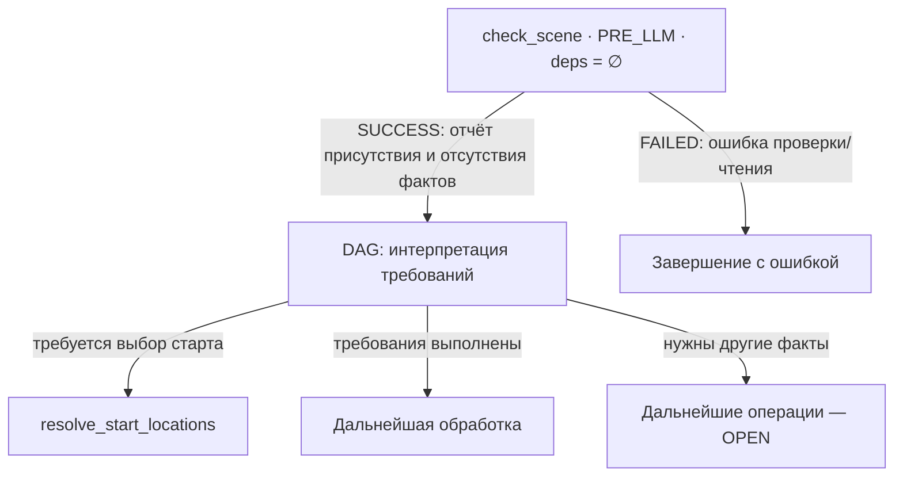

# GEN-DAG-NODE-DEPENDENCY

Совместный реестр подтверждённых нод нового GEN-DAG и их зависимостей.

Owning-план: [GEN-DAG-1 / GEN-NODE-JOINT-REVIEW](./gen-dag-1-post-geo-ws.md). Общие механизмы контрактов и исполнения: [tz_engine_node_context](../../docs/tz_engine_node_context.md).

## Статус и порядок согласования

2026-11-02: пользователь поручил создать отдельный документ и закрепить `check_scene`, её Input/Output и подробную ответственность.

- Подтверждено: назначение `check_scene` и её первое место в сценариях session scene, включая вход в инициализацию новой сцены.
- Ниже зафиксирована первая контрактная редакция для совместного согласования. Детали, ещё не обсуждённые с пользователем, не считаются автоматически принятыми.
- Дополнительно согласована отдельная роль `resolve_start_locations`; точная карточка и POJO требуют совместного разбора. Старые 15 ID не являются целевым составом.
- Сначала согласуются нода, смысл Input/Output/Error и переходов; затем reuse/new POJO, поля, типы, bindings и exact files. Настоящий документ не разрешает реализацию, удаление legacy или production cutover.

## 1. Подтверждённая нода: `check_scene`

**Уточнение пользователя — отдельная проверка первого входа:** состояние старта по сочетанию мир + игрок + сессия проверяется отдельной нодой (см. §4). Оно больше не определяется `check_scene`. Прежнее абсолютное «первая в сценариях» уточнено: `check_scene` — проверка самой сцены; место относительно отдельной проверки старта и ветвление графа требуют совместного согласования. Упоминания lifecycle старта ниже описывают предыдущую редакцию и подлежат этому уточнению.

### 1.1. Назначение — уточнение пользователя 2026-11-02

Общая read-only проверка сцены и её требований: установить, какие необходимые факты присутствуют, какие отсутствуют и что удалось проверить. Нода возвращает фактический отчёт. DAG интерпретирует отчёт и выбирает дальнейшие операции; сама нода не создаёт недостающее и не запускает другие ноды.

Первое место в сценариях session scene сохраняется. Bootstrap/bake мира без session scene не получает эту зависимость. Phase: PRE_LLM; scope: текущая сессия/мир и требования текущего сценария; deps: отсутствуют. После изменения сцены или требуемых доменных фактов DAG может повторить проверку в новом pass.

Согласована отдельная нода `resolve_start_locations` и три режима world settings. Точные POJO обеих нод проектируются вместе с их карточками; код не разрешён.

### 1.2. Input — факты и требования проверки

Предлагаемый состав:

- Session/world identity из доверенного контекста сессии.
- Явные требования текущего сценария: какие факты обязательны, условны или не нужны. Их состав задаётся согласованным контрактом сценария, не догадкой LLM или наличием nullable поля.
- Scene state либо подтверждённое отсутствие записи, полученные через public read.
- Результаты разрешённых публичных проверок требуемых фактов и evidence согласованности чтений.

`prepare_input` получает domain reads через внедрённые bindings. Точные владельцы/типы scene read, позиции и revisions остаются OPEN. Не вводить новые порты или универсальный словарь `dict[str, Any]` для обхода этих пробелов.

В первой проверке нет producer Output. Если для какого-либо факта нужен ещё не произведённый результат, он не читается тайно из будущей ноды: отчёт отражает отсутствие проверки/доступности, а DAG организует следующий pass. Дополнительная producer dependency потребует повторного согласования карты.

### 1.3. Output — отчёт проверки, включая неполную сцену

Отсутствие scene или требуемого факта является нормальным успешным результатом диагностики, если отсутствие достоверно установлено. Успешный Output не означает полной готовности сцены.

Предлагаемый состав Output:

- Session/world identity и evidence прочитанных revisions.
- Наличие записи сцены и установленное состояние её стартовой инициализации, если его можно определить по принятому domain contract.
- Типизированные результаты проверки конкретных фактов сцены.
- Итог соответствия явным требованиям текущего сценария, выводимый из результатов проверки. Не отдельный mutable флаг, способный противоречить им.

Предлагаемые различимые состояния проверки факта (смысл, пока не новый enum):

| Состояние | Значение |
|---|---|
| Присутствует | Факт получен и прошёл соответствующую проверку |
| Отсутствует | Успешный read подтвердил отсутствие факта |
| Не проверено | Нельзя утверждать наличие или отсутствие; например, ещё нет позиции для пространственного запроса |
| Не применимо | Факт не требуется в данном контексте, например indoor level вне помещения |

Пустое значение рассматривается по контракту факта. `actors=()` после успешного чтения может быть присутствующим фактом с пустым значением, а не отсутствием. `location_uid=None` в wilderness может быть допустимым отсутствием необязательной привязки. Read failure не превращается ни в пустоту, ни в «не проверено».

Для каждого факта нужно определить обязательность и применимость; одного nullable поля недостаточно. Точные POJO, discriminator и поля фиксируются после разбора фактов в §3.1. Успешный отчёт с отсутствующей scene не содержит выдуманный ready-scene payload.

### 1.4. Error

Предлагаемые ошибки: некорректный session/world context, несовместимые identities, битая заданная ссылка, read failure/corruption, невозможность подтвердить требуемую согласованность. Отмена обрабатывается runtime как CANCELLED.

Различать «ссылка не задана и допустима» и «ссылка задана, но объект не существует». Вторая ситуация — ошибка целостности, а не повод автоматически выбрать другую location.

Прежнее предложение missing scene/pending location передавать через GATED заменено отчётом диагностики. Способ ветвления DAG по Output и точные task/pass bindings OPEN; прежние legacy errors/next_task не переносятся автоматически. Error POJO ещё не frozen.

### 1.5. Подробная логика

1. Проверить доверенные identities и получить явные требования сценария.
2. Прочитать scene; подтвердить наличие/отсутствие записи. Read failure завершает проверку ошибкой.
3. При отсутствии scene сформировать отчёт об отсутствии; зависимые проверки, которые выполнить невозможно, обозначить как не проверенные. Не создавать draft.
4. При наличии scene проверить её session identity и получить факты её lifecycle/позиции из согласованных read contracts. Не определять завершённость старта только по location_uid.
5. Если location reference задана, проверить существование и принадлежность миру. Отсутствие reference допустимо для готовой wilderness scene при валидной позиции.
6. Проверить применимость level и остальных согласованных фактов. Не выдавать неопределённый indoor level за подтверждённый outdoor.
7. Проверять лишь факты согласованного scope, доступные через public reads. Непроверенные terrain/water/actors facts не объявлять готовыми по одному наличию scene record.
8. Сопоставить результаты с обязательными/условными требованиями сценария; сформировать immutable отчёт с provenance.
9. Runtime публикует Output. DAG выбирает дальнейшую ветку, а после выполненных изменений при необходимости повторяет проверку в новом pass.

### 1.6. Карта подтверждённой части

Блоки D/R/P/E — не новые NodeId; D обозначает policy DAG, не скрытый executor. SUCCESS-стрелка несёт Output. Стартовая ветка выбирается по состоянию инициализации и потребности старта, не по отсутствию location_uid. Повторный pass после изменений не изображает цикл внутри одного execution DAG.

### 1.7. Атомарность, effects и приёмка

Одна операция — проверить согласованный набор требований сцены и вернуть отчёт, без исправления обнаруженного. Публичные reads для проверки разных фактов не становятся pipeline изменений мира. Нода не запрашивает materialization и не координирует производителей недостающего.

Effects: только runtime result publication; никаких scene upsert, world writes, выбора старта за игрока, LLM, staging/materialization, scheduling/drain и Snapshot commit. Изменение shared_context в обход typed Output запрещено.

Нода не превращается в центральный gameplay facade: solids/water/objects читаются через owning domains по согласованным контрактам; bounded gameplay response и SP-R0 сохраняют отдельное владение. Какие domain readiness checks нужны именно здесь — ещё OPEN, не разрешение читать весь мир.

AS-IS: legacy CheckSceneNode читает scene_repo.get и location_repo.get_by_id, использует missing/pending errors с next_task и shared_context. Это evidence для переработки, не целевой binding.

Acceptance cases: отсутствующая scene; незавершённый старт; готовая named-location scene; готовая wilderness scene без location UID; допустимый пустой факт; отсутствующий обязательный факт; неприменимый факт; невозможная пока проверка; битая ссылка; read failure; stale revisions; cancel; повторная проверка после изменения. Resume требует проверки актуальности evidence; точный domain revision contract OPEN.

## 2. Выбор стартовых локаций — отдельная ответственность

**Решение пользователя 2026-11-02:** настройки мира должны поддерживать три режима:

1. Разрешены все локации как стартовые.
2. Разрешены города как стартовые.
3. Разрешены определённые мастером локации как стартовые.

Пользователь согласился с отдельной нодой определения стартовых локаций. Роль и предложенное имя фиксируются; полная карточка и POJO ещё требуют согласования.

### Кандидат: `resolve_start_locations`

- Назначение: определить допустимые стартовые локации согласно настройкам текущего мира.
- Trigger: требуется определить место старта при незавершённой стартовой инициализации. Перемещение уже начавшего игру персонажа в wilderness не является таким trigger.
- Phase: PRE_LLM; scope — мир и текущий стартовый запрос/сессия.
- Dependency: RequiredOutput отчёта `check_scene`; запуск условный, когда отчёт устанавливает необходимость выбора места старта. Успешный отчёт проверки не требует уже готовой scene. Точный task/pass binding согласовать с lifecycle.
- Input facts: world identity; принятый режим стартовых локаций из world settings; для режима мастера — явные location refs; domain read evidence/revisions. Player-specific eligibility добавляется только после отдельного решения о её правилах, без автоматического переноса legacy home/depth/access policy.
- Output facts: проверенные допустимые location refs и необходимые данные для предъявления выбора; provenance применённых настроек и прочитанных локаций. Поле коллекции обязательно; политика пустого множества ниже предлагается отдельно.
- Error proposal: отсутствующие/некорректные настройки; invalid/foreign-world location refs; невозможность получить согласованные reads; нет допустимых кандидатов. Предлагается не скрывать пустую конфигурацию fallback на все локации. Exact Error POJO и семантика пустого множества ещё не приняты.
- Domain reads: world settings и публичные location reads. Новый public API здесь не объявляется.
- Effects: нет записи scene, выбора за игрока, materialization, LLM, world commit или запуска следующей операции изнутри ноды.

Результат — допустимые кандидаты, а не уже созданная сцена. Предъявление выбора, обработка выбранного UID и установка стартовой позиции требуют отдельных согласованных контрактов; автоматически новые NodeId для них здесь не утверждаются.

### Граница с `check_scene`

`check_scene` отвечает за состояние инициализации и текущую готовность сцены. Она не читает каталог всех локаций, не вычисляет стартовые кандидаты и не выбирает режим старта. DAG по её исходу запускает стартовую ветку; `resolve_start_locations` интерпретирует world setting в рамках одной операции определения допустимого множества.

После завершённого старта настройки стартовых локаций не ограничивают дальнейшее перемещение игрока. Optional текущий location_uid в wilderness не означает необходимость повторно запускать стартовую ветку.

### OPEN перед POJO freeze

- Точный существующий/новый world-settings POJO, discriminator трёх режимов, default режима и owner хранения.
- «Города» означает только city или более широкий класс settlement — не расширять молча до town/village/camp.
- «Все локации»: допустимость intermediate/transit мест и связь с выбором конкретной стартовой позиции. Legacy leaf/home/depth ограничения не приняты автоматически.
- Явный выбор мастера разрешает только перечисленные UID или также вложенные места — требуется решение.
- Дополнительные ограничения доступности, приоритет дома персонажа и пустое множество кандидатов.
- Exact NodeId, Input/Output/Error POJO, bindings и файлы. Настройки принадлежат миру, не дублируются полями session scene.

Это документальный дизайн, без кода, concrete registration, legacy removal и cutover.

## 3. Отдельные незакрытые решения

### 3.1. Факты для доменного POJO сцены — discovery 2026-11-02

По поручению пользователя POJO обсуждается сразу вместе с нодой. Перед схемой фиксируются факты, обязательность и допустимая пустота. Нижеследующая матрица — предложение для согласования, а не принятый новый scene API.

### Проверенные источники

- `backend/app/db/models/sessionScene.py`: session_id, description, actors, location_uid, level_uid, created_at, updated_at. Это SQL dataclass, не готовый immutable domain POJO.
- `backend/app/db/migrations/0001_initial.sql`, session_scene: session_id PK/FK; nullable location/level FK; description/actors/timestamps NOT NULL.
- `docs/tz_locations.md`, «SessionScene — состояние сцены»: actors — JSON array of character_uid; location/level — якорь; location=None — draft; level=None — outdoor либо ещё не определён.
- `docs/tz_settlement_outdoor.md`, C18: объём карты и событий вокруг игрока не равен location/level; соседство сохраняется при входе в здание.
- `GameSession`: world_uid и player_character_id находятся у сессии. Дублирование этих полей в persisted scene ещё не решено.
- Активные sceneInit/sceneLocationSelect writers создают actors=[] и пустой draft description; при готовой сцене description берётся из location description, level_uid пока всегда None. Writer непустого состава actors в проверенных scene usages не найден.
- `ActorSnapshot(name, role)` в application/contracts — LLM output, не список character_uid; автоматическое переиспользование некорректно.
- `SceneVolumePolicy` уже существует, задаёт радиусы загрузки. Текущий scene record не содержит точную позицию игрока, bounds или revision. Loading radius не является автоматически радиусом симуляции событий.

### Значения и пустота

Обязательное поле должно присутствовать даже при разрешённом пустом значении. Optional значение не равно optional наличию поля. Для коллекций `()` означает достоверно пустой результат, а не «не читали»; unknown/read failure нельзя превращать в пустую коллекцию.

| Факт | Возможный reuse/тип | Draft | Ready | Допустимая пустота и проверка |
|---|---|---|---|---|
| Session identity | EntityUid из dataModel/identity/uid.py; совместимость session IDs проверить перед binding | Обязательно | Обязательно | None/пустая строка запрещены; существующая сессия |
| World identity | EntityUid, источник GameSession | Обязательно в контексте проверки | Обязательно в контексте проверки | None/пустая строка запрещены; persisted duplication OPEN |
| Player character identity | EntityUid, источник GameSession | Обязательно в текущей модели игровой сессии | Обязательно в текущей модели игровой сессии | Это отдельный факт от actors; включение игрока в actors OPEN |
| Location anchor | EntityUid или None | None допустим | Non-null не является общим требованием: wilderness допускает отсутствие NamedLocation | Если UID задан, location должна существовать и принадлежать миру; None не доказывает draft. Для первой инициализации через выбранную location — обязательна по обсуждаемому стартовому сценарию |
| Level anchor | EntityUid или None | None допустим | Условная обязательность | Для outdoor None допустим; для indoor правило требует решения. Неопределённость indoor level нельзя выдавать за подтверждённый outdoor |
| Description | str — осознанно текст, не identifier/registry key | Поле обязательно, "" допустимо | Предлагается разрешить "" | None запрещён; отсутствие текста само по себе не означает отсутствие сцены и не требует LLM |
| Present character references | tuple[EntityUid, ...] | Поле обязательно, () допустим | Поле обязательно; () условно допустим | Только если состав установлен и участников действительно нет; не default при read failure. Входит ли игрок, snapshot ли это состава или актуальный read — OPEN |
| Created/updated times | Предложение: timezone-aware datetime; SQL строки преобразуются на boundary | Обязательны у сохранённой записи | Обязательны у сохранённой записи | None/"" не допускаются для persisted record; updated>=created. Точный тип/defaults согласовать; время не заменяет revision |
| Scene lifecycle | Предложение: разные draft/ready варианты POJO | Draft | Ready | Представление и discriminator ещё не приняты; derived состояние предпочтительнее противоречащих status/location полей |
| Scene read revision/evidence | Доменный контракт OPEN | Нужен для подтверждённого read, включая отсутствие | Нужен для актуальности результата | Не выдумывать timestamp/fingerprint как revision; поле пока не frozen |

`EntityUid` — существующий строгий непустой строковый alias; это пока кандидат reuse, не новый класс идентификаторов. Названия в таблице обозначают факты, не окончательные Python field names. Новые domain POJO/enum и порты не вводятся до согласования.

### Факты игрового окна, которые нельзя молча сделать полями persisted scene

| Факт | Когда обязателен | Что может быть пустым |
|---|---|---|
| Точная позиция/anchor XYZ | Для пространственного read вокруг игрока | Координаты не заменяются нулями; источник позиции OPEN |
| Ограниченный read scope и policy | Для запроса окна | Нужны явные bounds/правило scope; location UID их не заменяет |
| Pinned world publication | Для согласованного world read | Reuse WorldPublicationRef после согласования binding; не nullable fallback для ready gameplay read |
| Solids/terrain facts | Для потребителя, которому они нужны | Подтверждённо пустой участок допустим по domain semantics; missing/corrupt не пустота |
| Water/media facts | Для water-aware gameplay window | Подтверждённое отсутствие воды допустимо; отсутствие SQL water cells не означает отсутствие воды |
| Objects/other characters | По требованиям потребителя | Пустая коллекция допустима после успешного чтения |
| Hazards/events | По требованиям потребителя | Нет событий/опасностей — допустимый пустой результат; «не проверяли» должно различаться |
| Structural facts | Для соответствующего building consumer | Не применимо вне structural scope; не подменять неизвестность значением stable |
| Weather/time facts | Для действий/описания, требующих этих данных | Optional для потребителя, которому не нужны; отсутствие не превращать в вымышленные defaults |

Состав окна и его producers не утверждается этой таблицей. Проверка готовности session scene и готовность facts для конкретного действия — разные условия. Расширение check_scene до проверки всего окна требует отдельного решения о границе ноды.

### Вопросы до точного POJO freeze

1. Представляет ли actors всех присутствующих, включая игрока, либо только остальных? Где authoritative owner состава и допустима ли пустая ready-сцена?
2. Требуется ли resolved level для indoor ready scene и как различается outdoor от ещё не определённого level?
3. Где находится authoritative позиция игрока для окна: отдельный character/position domain или часть scene state?
4. Хранится ли description как текст состояния сцены либо это derived read location description? Сейчас writer копирует его из location.
5. Кто владеет scene revision/read consistency? Текущая SQL модель этого контракта не предоставляет.

### Уточнение wilderness: геометрическая позиция без NamedLocation

Проверка по вопросу пользователя 2026-11-02 установила:

- `docs/tz_locations.md`, NamedLocation: autoresolve geometry без location — норма; именованная сущность опциональна для географии. Отсутствие NamedLocation не означает отсутствия поверхности/пространства.
- `docs/tz_world_pack_storage.md`, WP-19/20: wilderness имеет отдельные L2 chunks и участвует в spatial merge; граница location не является границей мира.
- `EntryAnchorTracker.EntryAnchor` содержит обязательные entry_x/entry_y и optional location_uid. Anchor kinds: session_start/tile_cross/location_entry. Это anchor загрузки, не готовый authoritative player-position POJO.
- `EntryRefineOrchestrator.refine_from_entry` принимает anchor_x/anchor_y при location_uid=None; detailed wilderness scope также формирует plan с location_uid=None.
- `MapCellService.get_scene_volume` и pack gameplay read принимают world + x/y/z; location UID не является обязательным аргументом spatial read.
- Legacy `check_scene` при любом location_uid=None отправляет в выбор стартовой location; persisted SessionScene не имеет координат и discriminator готовности. Геометрические операции поддерживают безымянное пространство, но полноценная session scene для такого положения этим не доказана.

Следствие: legacy правило «location_uid=None всегда означает pending selection» непригодно как общее TO-BE правило. Раздел 1 переработан: возвращает отчёт проверки, допускает wilderness без NamedLocation и не определяет lifecycle по одному nullable location UID.

Предлагаемая семантика для согласования:

1. Первая инициализация через выбор NamedLocation требует выбранного location UID и разрешения стартовой геометрической позиции; координаты не заменяются произвольными нулями.
2. После инициализации ready scene может находиться в wilderness без NamedLocation, если есть валидная authoritative позиция и подтверждённое состояние инициализации.
3. location_uid — optional привязка к именованному месту; если задан, ссылка проверяется. Для отсутствующей привязки не создаётся фиктивный NamedLocation и не требуется сохранять прежний UID после выхода из его области.
4. Отсутствие location_uid при наличии валидной позиции не вызывает повторный выбор старта. Отсутствие и позиции, и установленного старта — отдельный случай, а не нормальная wilderness scene.
5. Членство в wilderness/region не подменяет NamedLocation identity. Близость к именованной location не доказывает принадлежность ей.

OPEN: точный POJO позиции, его owner и связь с topology/высотой/indoor coordinates; persisted lifecycle сцены и правило initial spawn. Эти решения не приняты одним наличием entry-refine debug API. Нода/POJO реализации не менялись.

Эти ответы определяют конкретные поля POJO; их нельзя закрыть `Any`, нетипизированным list, defaults или выдуманным read API. Код пока не создаётся.

SP-R2 не принимается этим документом: `check_scene` не читает water media и не заменяет bounded gameplay-read. Его положение относительно единого cutover остаётся отдельным решением GEN-P0.

`RepairPatchApplier` относится к публикации результатов выполнения DAG. World Snapshot относится к записи/истории мира. Замена одного другим запрещена; `check_scene` не выполняет ни одну из этих записей.

Следующий совместный шаг: принять/уточнить смысловые Input/Output/Error и границу проверки `check_scene`; затем определить доменные reuse POJO, exact fields/types, read bindings и файлы. Остальные ноды добавляются в этот реестр только после отдельного обсуждения.

## 4. Отдельная проверка первого входа и фиксация фактического старта

### Существующий API/frontend flow — уточнение пользователя и evidence

Пользователь указал сохранять существующий интерактивный flow: стартовая ветка отдаёт данные фронту через API, затем принимает выбор следующим запросом. Это не одна непрерывная server-side загрузка без участия пользователя.

Подтверждённая статическая цепочка:

- Legacy SceneInit возвращает `{type: "select_child", parent: null, children: [...]}`.
- Legacy SceneStartLocationSelect при наличии children возвращает `{type: "select_child", parent: {uid, name}, children: [...]}`; при leaf пишет SessionScene и возвращает `{type: "scene_ready", location: {uid, name, description}}`.
- ResponseResolver выбирает node output; ChatService возвращает result; `POST /chat/stream` отправляет `ResultEvent(response=result)` по SSE.
- `frontend/src/features/chat/ui/MessageList.jsx` различает `select_child` и `scene_ready`; LocationSelectMessage рендерит варианты.
- Кнопка вызывает `onSelect(child.uid, child.name)`; ChatPage передаёт send; useChatStream отправляет UID как message следующим stream-запросом, имя использует как displayText.
- При отсутствии явного task_type ChatService начинает с intent detection; legacy check_scene видит draft и переводит в start selection. При переработке это поведение выбора ветки должно быть явно перенесено, а не потеряно из-за отдельного check_world_entry.

Target направление: concrete-нода стартового flow формирует типизированный response для текущего шага, existing response binding/API доставляют его фронту. Нода не вызывает HTTP handler и не управляет SSE транспортом. Состав/имя этой ноды и POJO уточняются; это не восстановление старых ID 1:1.

`resolve_start_locations` определяет допустимые варианты по настройкам; стартовый interaction должен поддерживать первоначальную выдачу и последующие запросы выбора. Объединение этих ролей в одну ноду либо отдельный response binding/consumer требует совместного решения; новую лишнюю ноду только ради транспорта не вводить.

Ожидание выбора означает завершение текущего API-ответа, а не блокирующее ожидание внутри DAG. При следующем запросе нужно различать незавершённый выбор и необходимость первоначально выдать список, чтобы started=false не сбрасывал flow на каждом клике.

`scene_ready` в AS-IS означает создание scene record; это НЕ доказательство завершённой фактической загрузки игрока. Момент записи started=true остаётся привязан к согласованному completion contract загрузки.

**Решение пользователя 2026-11-02:** проверку первого запуска игрока в мире вынести из `check_scene` в отдельную ноду. В БД хранить флаг старта для сочетания **мир + игрок + сессия**. Флаг ставится **после фактической загрузки игрока в мир**, а не после проверки или выбора локации.

Это запись состояния конкретного сочетания identities, а не три независимых глобальных флага в world/player/session. Точный player identity (игрок аккаунта либо персонаж) требует согласования; не подменять его автоматически character_id.

### Проверяющая нода — предложенное имя `check_world_entry`

- Input facts: world identity, player identity, session identity; согласованный результат чтения записи старта.
- Output facts: проверенное сочетание identities и состояние «фактический старт зафиксирован / ещё не зафиксирован» с read evidence. Подтверждённое отсутствие записи трактуется как «не зафиксирован», а не как завершённая загрузка.
- Errors: некорректное/несовместимое сочетание identities, read failure, повреждённая запись. Read failure не подменяется первым запуском.
- Domain reads: состояние входа по точному сочетанию identities; owner/API/revision contract OPEN.
- Effects: нет. Проверка никогда не устанавливает флаг и не запускает загрузку самостоятельно.
- Trigger: вход/resume игрока в мир текущей сессии. Повторные проверки до успешной загрузки продолжают показывать незавершённый старт.

### Запись флага — после загрузки, отдельная ответственность

1. DAG читает состояние входа и выбирает необходимые операции старта.
2. Выбор локации, подготовка геометрии или создание scene по отдельности не означают, что игрок уже загружен в мир.
3. Только подтверждённое завершение фактической загрузки допускает запись started=true для того же сочетания world/player/session.
4. Ошибка или отмена до завершения загрузки не устанавливает флаг. Сбой самой записи после загрузки нельзя выдавать за успешно сохранённый старт; retry должен исключать повторную стартовую загрузку по одному отсутствующему флагу.
5. Повторная фиксация того же завершённого входа должна быть идемпотентной. Механизм completion evidence/idempotency и восстановление после сбоя OPEN.

Запись не включается внутрь проверяющей ноды. Точная отдельная операция/нода финализации, её owner, транзакционная граница и применение Snapshot-пути определяются после классификации данных: session bookkeeping не объявляется автоматически изменением мира и не получает самовольный repository write из DAG.

### Влияние на граф и оставшиеся вопросы

- `check_scene` проверяет scene facts; `check_world_entry` — отдельный факт завершённого входа. Нельзя выводить одно из другого, наличия location_uid или готовности Pack.
- Стартовая ветка с `resolve_start_locations` выбирается DAG с учётом отдельного entry report. Прежняя стрелка выбора старта только из check_scene больше не является достаточным контрактом.
- Точное место обеих проверок, их data/order dependencies и возможность независимого чтения ещё не приняты. Новое имя является предложением, не готовой регистрацией.
- «Фактически загружен» нуждается в точном completion contract: серверный authoritative spawn/готовность необходимого состояния либо подтверждение клиентской загрузки. Ни один вариант не выбирается молча.
- Нужны решения: player vs character identity; owner/таблица/ключ записи; поведение новой сессии того же игрока; completion evidence и согласованность записи; конкретные Input/Output/Error POJO.

Код, SQL schema/migration и production routing не менялись.
