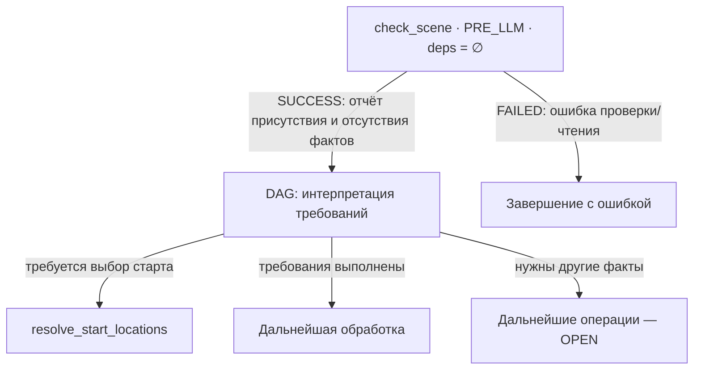

# GEN-DAG-NODE-DEPENDENCY

**Текущий контрактный срез:** world start settings и location payload для `select_start_location` / `initialize_world_entry` — §5. Это спецификация планируемой реализации, не уже существующий API. Новые схемы до совместной приёмки являются предложениями.

Совместный реестр подтверждённых нод нового GEN-DAG и их зависимостей.

Owning-план: [GEN-DAG-1 / GEN-NODE-JOINT-REVIEW](./gen-dag-1-post-geo-ws.md). Общие механизмы контрактов и исполнения: [tz_engine_node_context](../../docs/tz_engine_node_context.md).

## Статус и порядок согласования

2026-11-02: пользователь поручил создать отдельный документ и закрепить `check_scene`, её Input/Output и подробную ответственность.

- Подтверждено: назначение `check_scene` и её первое место в сценариях session scene, включая вход в инициализацию новой сцены.
- Ниже зафиксирована первая контрактная редакция для совместного согласования. Детали, ещё не обсуждённые с пользователем, не считаются автоматически принятыми.
- Дополнительно согласована отдельная роль `resolve_start_locations`; точная карточка и POJO требуют совместного разбора. Старые 15 ID не являются целевым составом.
- Сначала согласуются нода, смысл Input/Output/Error и переходов; затем reuse/new POJO, поля, типы, bindings и exact files. Настоящий документ не разрешает реализацию, удаление legacy или production cutover.

## 1. Подтверждённая нода: `check_scene`

**Уточнение пользователя — отдельная проверка первого входа:** состояние старта по сочетанию мир + игрок + сессия проверяется отдельной нодой (см. §4). Оно больше не определяется `check_scene`. Прежнее абсолютное «первая в сценариях» уточнено: `check_scene` — проверка самой сцены; место относительно отдельной проверки старта и ветвление графа требуют совместного согласования. Упоминания lifecycle старта ниже описывают предыдущую редакцию и подлежат этому уточнению.

### 1.1. Назначение — уточнение пользователя 2026-11-02

Общая read-only проверка сцены и её требований: установить, какие необходимые факты присутствуют, какие отсутствуют и что удалось проверить. Нода возвращает фактический отчёт. DAG интерпретирует отчёт и выбирает дальнейшие операции; сама нода не создаёт недостающее и не запускает другие ноды.

Первое место в сценариях session scene сохраняется. Bootstrap/bake мира без session scene не получает эту зависимость. Phase: PRE_LLM; scope: текущая сессия/мир и требования текущего сценария; deps: отсутствуют. После изменения сцены или требуемых доменных фактов DAG может повторить проверку в новом pass.

Согласована отдельная нода `resolve_start_locations` и три режима world settings. Точные POJO обеих нод проектируются вместе с их карточками; код не разрешён.

### 1.2. Input — факты и требования проверки

Предлагаемый состав:

- Session/world identity из доверенного контекста сессии.
- Явные требования текущего сценария: какие факты обязательны, условны или не нужны. Их состав задаётся согласованным контрактом сценария, не догадкой LLM или наличием nullable поля.
- Scene state либо подтверждённое отсутствие записи, полученные через public read.
- Результаты разрешённых публичных проверок требуемых фактов и evidence согласованности чтений.

`prepare_input` получает domain reads через внедрённые bindings. Точные владельцы/типы scene read, позиции и revisions остаются OPEN. Не вводить новые порты или универсальный словарь `dict[str, Any]` для обхода этих пробелов.

В первой проверке нет producer Output. Если для какого-либо факта нужен ещё не произведённый результат, он не читается тайно из будущей ноды: отчёт отражает отсутствие проверки/доступности, а DAG организует следующий pass. Дополнительная producer dependency потребует повторного согласования карты.

### 1.3. Output — отчёт проверки, включая неполную сцену

Отсутствие scene или требуемого факта является нормальным успешным результатом диагностики, если отсутствие достоверно установлено. Успешный Output не означает полной готовности сцены.

Предлагаемый состав Output:

- Session/world identity и evidence прочитанных revisions.
- Наличие записи сцены и установленное состояние её стартовой инициализации, если его можно определить по принятому domain contract.
- Типизированные результаты проверки конкретных фактов сцены.
- Итог соответствия явным требованиям текущего сценария, выводимый из результатов проверки. Не отдельный mutable флаг, способный противоречить им.

Предлагаемые различимые состояния проверки факта (смысл, пока не новый enum):

| Состояние | Значение |
|---|---|
| Присутствует | Факт получен и прошёл соответствующую проверку |
| Отсутствует | Успешный read подтвердил отсутствие факта |
| Не проверено | Нельзя утверждать наличие или отсутствие; например, ещё нет позиции для пространственного запроса |
| Не применимо | Факт не требуется в данном контексте, например indoor level вне помещения |

Пустое значение рассматривается по контракту факта. `actors=()` после успешного чтения может быть присутствующим фактом с пустым значением, а не отсутствием. `location_uid=None` в wilderness может быть допустимым отсутствием необязательной привязки. Read failure не превращается ни в пустоту, ни в «не проверено».

Для каждого факта нужно определить обязательность и применимость; одного nullable поля недостаточно. Точные POJO, discriminator и поля фиксируются после разбора фактов в §3.1. Успешный отчёт с отсутствующей scene не содержит выдуманный ready-scene payload.

### 1.4. Error

Предлагаемые ошибки: некорректный session/world context, несовместимые identities, битая заданная ссылка, read failure/corruption, невозможность подтвердить требуемую согласованность. Отмена обрабатывается runtime как CANCELLED.

Различать «ссылка не задана и допустима» и «ссылка задана, но объект не существует». Вторая ситуация — ошибка целостности, а не повод автоматически выбрать другую location.

Прежнее предложение missing scene/pending location передавать через GATED заменено отчётом диагностики. Способ ветвления DAG по Output и точные task/pass bindings OPEN; прежние legacy errors/next_task не переносятся автоматически. Error POJO ещё не frozen.

### 1.5. Подробная логика

1. Проверить доверенные identities и получить явные требования сценария.
2. Прочитать scene; подтвердить наличие/отсутствие записи. Read failure завершает проверку ошибкой.
3. При отсутствии scene сформировать отчёт об отсутствии; зависимые проверки, которые выполнить невозможно, обозначить как не проверенные. Не создавать draft.
4. При наличии scene проверить её session identity и получить факты её lifecycle/позиции из согласованных read contracts. Не определять завершённость старта только по location_uid.
5. Если location reference задана, проверить существование и принадлежность миру. Отсутствие reference допустимо для готовой wilderness scene при валидной позиции.
6. Проверить применимость level и остальных согласованных фактов. Не выдавать неопределённый indoor level за подтверждённый outdoor.
7. Проверять лишь факты согласованного scope, доступные через public reads. Непроверенные terrain/water/actors facts не объявлять готовыми по одному наличию scene record.
8. Сопоставить результаты с обязательными/условными требованиями сценария; сформировать immutable отчёт с provenance.
9. Runtime публикует Output. DAG выбирает дальнейшую ветку, а после выполненных изменений при необходимости повторяет проверку в новом pass.

### 1.6. Карта подтверждённой части



Блоки D/R/P/E — не новые NodeId; D обозначает policy DAG, не скрытый executor. SUCCESS-стрелка несёт Output. Стартовая ветка выбирается по состоянию инициализации и потребности старта, не по отсутствию location_uid. Повторный pass после изменений не изображает цикл внутри одного execution DAG.

### 1.7. Атомарность, effects и приёмка

Одна операция — проверить согласованный набор требований сцены и вернуть отчёт, без исправления обнаруженного. Публичные reads для проверки разных фактов не становятся pipeline изменений мира. Нода не запрашивает materialization и не координирует производителей недостающего.

Effects: только runtime result publication; никаких scene upsert, world writes, выбора старта за игрока, LLM, staging/materialization, scheduling/drain и Snapshot commit. Изменение shared_context в обход typed Output запрещено.

Нода не превращается в центральный gameplay facade: solids/water/objects читаются через owning domains по согласованным контрактам; bounded gameplay response и SP-R0 сохраняют отдельное владение. Какие domain readiness checks нужны именно здесь — ещё OPEN, не разрешение читать весь мир.

AS-IS: legacy CheckSceneNode читает scene_repo.get и location_repo.get_by_id, использует missing/pending errors с next_task и shared_context. Это evidence для переработки, не целевой binding.

Acceptance cases: отсутствующая scene; незавершённый старт; готовая named-location scene; готовая wilderness scene без location UID; допустимый пустой факт; отсутствующий обязательный факт; неприменимый факт; невозможная пока проверка; битая ссылка; read failure; stale revisions; cancel; повторная проверка после изменения. Resume требует проверки актуальности evidence; точный domain revision contract OPEN.

## 2. Выбор стартовых локаций — отдельная ответственность

**Решение пользователя 2026-11-02:** настройки мира должны поддерживать три режима:

1. Разрешены все локации как стартовые.
2. Разрешены города как стартовые.
3. Разрешены определённые мастером локации как стартовые.

Пользователь согласился с отдельной нодой определения стартовых локаций. Роль и предложенное имя фиксируются; полная карточка и POJO ещё требуют согласования.

### Кандидат: `resolve_start_locations`

- Назначение: определить допустимые стартовые локации согласно настройкам текущего мира.
- Trigger: требуется определить место старта при незавершённой стартовой инициализации. Перемещение уже начавшего игру персонажа в wilderness не является таким trigger.
- Phase: PRE_LLM; scope — мир и текущий стартовый запрос/сессия.
- Dependency: RequiredOutput отчёта `check_scene`; запуск условный, когда отчёт устанавливает необходимость выбора места старта. Успешный отчёт проверки не требует уже готовой scene. Точный task/pass binding согласовать с lifecycle.
- Input facts: world identity; принятый режим стартовых локаций из world settings; для режима мастера — явные location refs; domain read evidence/revisions. Player-specific eligibility добавляется только после отдельного решения о её правилах, без автоматического переноса legacy home/depth/access policy.
- Output facts: проверенные допустимые location refs и необходимые данные для предъявления выбора; provenance применённых настроек и прочитанных локаций. Поле коллекции обязательно; политика пустого множества ниже предлагается отдельно.
- Error proposal: отсутствующие/некорректные настройки; invalid/foreign-world location refs; невозможность получить согласованные reads; нет допустимых кандидатов. Предлагается не скрывать пустую конфигурацию fallback на все локации. Exact Error POJO и семантика пустого множества ещё не приняты.
- Domain reads: world settings и публичные location reads. Новый public API здесь не объявляется.
- Effects: нет записи scene, выбора за игрока, materialization, LLM, world commit или запуска следующей операции изнутри ноды.

Результат — допустимые кандидаты, а не уже созданная сцена. Предъявление выбора, обработка выбранного UID и установка стартовой позиции требуют отдельных согласованных контрактов; автоматически новые NodeId для них здесь не утверждаются.

### Граница с `check_scene`

`check_scene` отвечает за состояние инициализации и текущую готовность сцены. Она не читает каталог всех локаций, не вычисляет стартовые кандидаты и не выбирает режим старта. DAG по её исходу запускает стартовую ветку; `resolve_start_locations` интерпретирует world setting в рамках одной операции определения допустимого множества.

После завершённого старта настройки стартовых локаций не ограничивают дальнейшее перемещение игрока. Optional текущий location_uid в wilderness не означает необходимость повторно запускать стартовую ветку.

### OPEN перед POJO freeze

- Точный существующий/новый world-settings POJO, discriminator трёх режимов, default режима и owner хранения.
- «Города» означает только city или более широкий класс settlement — не расширять молча до town/village/camp.
- «Все локации»: допустимость intermediate/transit мест и связь с выбором конкретной стартовой позиции. Legacy leaf/home/depth ограничения не приняты автоматически.
- Явный выбор мастера разрешает только перечисленные UID или также вложенные места — требуется решение.
- Дополнительные ограничения доступности, приоритет дома персонажа и пустое множество кандидатов.
- Exact NodeId, Input/Output/Error POJO, bindings и файлы. Настройки принадлежат миру, не дублируются полями session scene.

Это документальный дизайн, без кода, concrete registration, legacy removal и cutover.

## 3. Отдельные незакрытые решения

### 3.1. Факты для доменного POJO сцены — discovery 2026-11-02

По поручению пользователя POJO обсуждается сразу вместе с нодой. Перед схемой фиксируются факты, обязательность и допустимая пустота. Нижеследующая матрица — предложение для согласования, а не принятый новый scene API.

### Проверенные источники

- `backend/app/db/models/sessionScene.py`: session_id, description, actors, location_uid, level_uid, created_at, updated_at. Это SQL dataclass, не готовый immutable domain POJO.
- `backend/app/db/migrations/0001_initial.sql`, session_scene: session_id PK/FK; nullable location/level FK; description/actors/timestamps NOT NULL.
- `docs/tz_locations.md`, «SessionScene — состояние сцены»: actors — JSON array of character_uid; location/level — якорь; location=None — draft; level=None — outdoor либо ещё не определён.
- `docs/tz_settlement_outdoor.md`, C18: объём карты и событий вокруг игрока не равен location/level; соседство сохраняется при входе в здание.
- `GameSession`: world_uid и player_character_id находятся у сессии. Дублирование этих полей в persisted scene ещё не решено.
- Активные sceneInit/sceneLocationSelect writers создают actors=[] и пустой draft description; при готовой сцене description берётся из location description, level_uid пока всегда None. Writer непустого состава actors в проверенных scene usages не найден.
- `ActorSnapshot(name, role)` в application/contracts — LLM output, не список character_uid; автоматическое переиспользование некорректно.
- `SceneVolumePolicy` уже существует, задаёт радиусы загрузки. Текущий scene record не содержит точную позицию игрока, bounds или revision. Loading radius не является автоматически радиусом симуляции событий.

### Значения и пустота

Обязательное поле должно присутствовать даже при разрешённом пустом значении. Optional значение не равно optional наличию поля. Для коллекций `()` означает достоверно пустой результат, а не «не читали»; unknown/read failure нельзя превращать в пустую коллекцию.

| Факт | Возможный reuse/тип | Draft | Ready | Допустимая пустота и проверка |
|---|---|---|---|---|
| Session identity | EntityUid из dataModel/identity/uid.py; совместимость session IDs проверить перед binding | Обязательно | Обязательно | None/пустая строка запрещены; существующая сессия |
| World identity | EntityUid, источник GameSession | Обязательно в контексте проверки | Обязательно в контексте проверки | None/пустая строка запрещены; persisted duplication OPEN |
| Player character identity | EntityUid, источник GameSession | Обязательно в текущей модели игровой сессии | Обязательно в текущей модели игровой сессии | Это отдельный факт от actors; включение игрока в actors OPEN |
| Location anchor | EntityUid или None | None допустим | Non-null не является общим требованием: wilderness допускает отсутствие NamedLocation | Если UID задан, location должна существовать и принадлежать миру; None не доказывает draft. Для первой инициализации через выбранную location — обязательна по обсуждаемому стартовому сценарию |
| Level anchor | EntityUid или None | None допустим | Условная обязательность | Для outdoor None допустим; для indoor правило требует решения. Неопределённость indoor level нельзя выдавать за подтверждённый outdoor |
| Description | str — осознанно текст, не identifier/registry key | Поле обязательно, "" допустимо | Предлагается разрешить "" | None запрещён; отсутствие текста само по себе не означает отсутствие сцены и не требует LLM |
| Present character references | tuple[EntityUid, ...] | Поле обязательно, () допустим | Поле обязательно; () условно допустим | Только если состав установлен и участников действительно нет; не default при read failure. Входит ли игрок, snapshot ли это состава или актуальный read — OPEN |
| Created/updated times | Предложение: timezone-aware datetime; SQL строки преобразуются на boundary | Обязательны у сохранённой записи | Обязательны у сохранённой записи | None/"" не допускаются для persisted record; updated>=created. Точный тип/defaults согласовать; время не заменяет revision |
| Scene lifecycle | Предложение: разные draft/ready варианты POJO | Draft | Ready | Представление и discriminator ещё не приняты; derived состояние предпочтительнее противоречащих status/location полей |
| Scene read revision/evidence | Доменный контракт OPEN | Нужен для подтверждённого read, включая отсутствие | Нужен для актуальности результата | Не выдумывать timestamp/fingerprint как revision; поле пока не frozen |

`EntityUid` — существующий строгий непустой строковый alias; это пока кандидат reuse, не новый класс идентификаторов. Названия в таблице обозначают факты, не окончательные Python field names. Новые domain POJO/enum и порты не вводятся до согласования.

### Факты игрового окна, которые нельзя молча сделать полями persisted scene

| Факт | Когда обязателен | Что может быть пустым |
|---|---|---|
| Точная позиция/anchor XYZ | Для пространственного read вокруг игрока | Координаты не заменяются нулями; источник позиции OPEN |
| Ограниченный read scope и policy | Для запроса окна | Нужны явные bounds/правило scope; location UID их не заменяет |
| Pinned world publication | Для согласованного world read | Reuse WorldPublicationRef после согласования binding; не nullable fallback для ready gameplay read |
| Solids/terrain facts | Для потребителя, которому они нужны | Подтверждённо пустой участок допустим по domain semantics; missing/corrupt не пустота |
| Water/media facts | Для water-aware gameplay window | Подтверждённое отсутствие воды допустимо; отсутствие SQL water cells не означает отсутствие воды |
| Objects/other characters | По требованиям потребителя | Пустая коллекция допустима после успешного чтения |
| Hazards/events | По требованиям потребителя | Нет событий/опасностей — допустимый пустой результат; «не проверяли» должно различаться |
| Structural facts | Для соответствующего building consumer | Не применимо вне structural scope; не подменять неизвестность значением stable |
| Weather/time facts | Для действий/описания, требующих этих данных | Optional для потребителя, которому не нужны; отсутствие не превращать в вымышленные defaults |

Состав окна и его producers не утверждается этой таблицей. Проверка готовности session scene и готовность facts для конкретного действия — разные условия. Расширение check_scene до проверки всего окна требует отдельного решения о границе ноды.

### Вопросы до точного POJO freeze

1. Представляет ли actors всех присутствующих, включая игрока, либо только остальных? Где authoritative owner состава и допустима ли пустая ready-сцена?
2. Требуется ли resolved level для indoor ready scene и как различается outdoor от ещё не определённого level?
3. Где находится authoritative позиция игрока для окна: отдельный character/position domain или часть scene state?
4. Хранится ли description как текст состояния сцены либо это derived read location description? Сейчас writer копирует его из location.
5. Кто владеет scene revision/read consistency? Текущая SQL модель этого контракта не предоставляет.

### Уточнение wilderness: геометрическая позиция без NamedLocation

Проверка по вопросу пользователя 2026-11-02 установила:

- `docs/tz_locations.md`, NamedLocation: autoresolve geometry без location — норма; именованная сущность опциональна для географии. Отсутствие NamedLocation не означает отсутствия поверхности/пространства.
- `docs/tz_world_pack_storage.md`, WP-19/20: wilderness имеет отдельные L2 chunks и участвует в spatial merge; граница location не является границей мира.
- `EntryAnchorTracker.EntryAnchor` содержит обязательные entry_x/entry_y и optional location_uid. Anchor kinds: session_start/tile_cross/location_entry. Это anchor загрузки, не готовый authoritative player-position POJO.
- `EntryRefineOrchestrator.refine_from_entry` принимает anchor_x/anchor_y при location_uid=None; detailed wilderness scope также формирует plan с location_uid=None.
- `MapCellService.get_scene_volume` и pack gameplay read принимают world + x/y/z; location UID не является обязательным аргументом spatial read.
- Legacy `check_scene` при любом location_uid=None отправляет в выбор стартовой location; persisted SessionScene не имеет координат и discriminator готовности. Геометрические операции поддерживают безымянное пространство, но полноценная session scene для такого положения этим не доказана.

Следствие: legacy правило «location_uid=None всегда означает pending selection» непригодно как общее TO-BE правило. Раздел 1 переработан: возвращает отчёт проверки, допускает wilderness без NamedLocation и не определяет lifecycle по одному nullable location UID.

Предлагаемая семантика для согласования:

1. Первая инициализация через выбор NamedLocation требует выбранного location UID и разрешения стартовой геометрической позиции; координаты не заменяются произвольными нулями.
2. После инициализации ready scene может находиться в wilderness без NamedLocation, если есть валидная authoritative позиция и подтверждённое состояние инициализации.
3. location_uid — optional привязка к именованному месту; если задан, ссылка проверяется. Для отсутствующей привязки не создаётся фиктивный NamedLocation и не требуется сохранять прежний UID после выхода из его области.
4. Отсутствие location_uid при наличии валидной позиции не вызывает повторный выбор старта. Отсутствие и позиции, и установленного старта — отдельный случай, а не нормальная wilderness scene.
5. Членство в wilderness/region не подменяет NamedLocation identity. Близость к именованной location не доказывает принадлежность ей.

OPEN: точный POJO позиции, его owner и связь с topology/высотой/indoor coordinates; persisted lifecycle сцены и правило initial spawn. Эти решения не приняты одним наличием entry-refine debug API. Нода/POJO реализации не менялись.

Эти ответы определяют конкретные поля POJO; их нельзя закрыть `Any`, нетипизированным list, defaults или выдуманным read API. Код пока не создаётся.

SP-R2 не принимается этим документом: `check_scene` не читает water media и не заменяет bounded gameplay-read. Его положение относительно единого cutover остаётся отдельным решением GEN-P0.

`RepairPatchApplier` относится к публикации результатов выполнения DAG. World Snapshot относится к записи/истории мира. Замена одного другим запрещена; `check_scene` не выполняет ни одну из этих записей.

Следующий совместный шаг: принять/уточнить смысловые Input/Output/Error и границу проверки `check_scene`; затем определить доменные reuse POJO, exact fields/types, read bindings и файлы. Остальные ноды добавляются в этот реестр только после отдельного обсуждения.

## 4. Отдельная проверка первого входа и фиксация фактического старта

### Родительская нода и поднода выбора — решение пользователя

Пользователь определил композицию: родительская нода «Выбор старта и загрузка игрока» запускает подноду интерактивной выдачи/выбора локации. Поднода ведёт текущий API-flow, получает выбор игрока и возвращает родителю стартовую локацию. Родитель передаёт downstream статус «загрузка подтверждена» и саму стартовую локацию.

Предложенные имена:

- `initialize_world_entry` — родительская нода инициализации входа игрока в мир.
- `select_start_location` — поднода интерактивного выбора стартовой локации.

`select_start_location` должна опираться на три режима world settings. Ранее предложенный `resolve_start_locations` описывает вычисление допустимых вариантов; будет ли это публичная операция внутри подноды либо отдельный producer, нужно согласовать. Дополнительный третий NodeId автоматически не вводится.

Контрактное направление:

- Input родителя: world/player/session identities и необходимый контекст входа; exact POJO OPEN.
- Поднода выдаёт UI-flow response через API и принимает следующие шаги выбора. Пока выбор не завершён, родитель не публикует успешный terminal Output и не выдаёт подтверждение загрузки.
- Успешный Output подноды: выбранная и проверенная стартовая локация. Это ещё не подтверждение загрузки.
- Успешный terminal Output родителя: подтверждённая загрузка + стартовая локация, доступные downstream-нodам как RequiredOutput. Точный тип location payload и completion evidence OPEN.
- Родитель публикует этот Output только после фактической загрузки, а не сразу после возврата выбранной локации. Состав загрузки, запись started flag и их согласованность ещё требуют контрактного разбора.

Архитектурная граница: это явно видимая композиция engine DAG/подграфа с сохраняемым interaction state между API-запросами, не скрытая оркестрация внутри world generator. Возможность такого parent/child lifecycle в target engine необходимо проверить отдельно; вложенный executor/порт самовольно не создаётся. Ожидание ответа фронта не удерживает HTTP-запрос до выбора.

Ранее нарисованный плоский стартовый фрагмент и прежние кандидаты не считаются frozen относительно этой композиции. Механизм вложенности, exact NodeIds и POJO остаются предметом совместного проектирования; код не меняется.

### Существующий API/frontend flow — уточнение пользователя и evidence

Пользователь указал сохранять существующий интерактивный flow: стартовая ветка отдаёт данные фронту через API, затем принимает выбор следующим запросом. Это не одна непрерывная server-side загрузка без участия пользователя.

Подтверждённая статическая цепочка:

- Legacy SceneInit возвращает `{type: "select_child", parent: null, children: [...]}`.
- Legacy SceneStartLocationSelect при наличии children возвращает `{type: "select_child", parent: {uid, name}, children: [...]}`; при leaf пишет SessionScene и возвращает `{type: "scene_ready", location: {uid, name, description}}`.
- ResponseResolver выбирает node output; ChatService возвращает result; `POST /chat/stream` отправляет `ResultEvent(response=result)` по SSE.
- `frontend/src/features/chat/ui/MessageList.jsx` различает `select_child` и `scene_ready`; LocationSelectMessage рендерит варианты.
- Кнопка вызывает `onSelect(child.uid, child.name)`; ChatPage передаёт send; useChatStream отправляет UID как message следующим stream-запросом, имя использует как displayText.
- При отсутствии явного task_type ChatService начинает с intent detection; legacy check_scene видит draft и переводит в start selection. При переработке это поведение выбора ветки должно быть явно перенесено, а не потеряно из-за отдельного check_world_entry.

Target направление: concrete-нода стартового flow формирует типизированный response для текущего шага, existing response binding/API доставляют его фронту. Нода не вызывает HTTP handler и не управляет SSE транспортом. Состав/имя этой ноды и POJO уточняются; это не восстановление старых ID 1:1.

`resolve_start_locations` определяет допустимые варианты по настройкам; стартовый interaction должен поддерживать первоначальную выдачу и последующие запросы выбора. Объединение этих ролей в одну ноду либо отдельный response binding/consumer требует совместного решения; новую лишнюю ноду только ради транспорта не вводить.

Ожидание выбора означает завершение текущего API-ответа, а не блокирующее ожидание внутри DAG. При следующем запросе нужно различать незавершённый выбор и необходимость первоначально выдать список, чтобы started=false не сбрасывал flow на каждом клике.

`scene_ready` в AS-IS означает создание scene record; это НЕ доказательство завершённой фактической загрузки игрока. Момент записи started=true остаётся привязан к согласованному completion contract загрузки.

**Решение пользователя 2026-11-02:** проверку первого запуска игрока в мире вынести из `check_scene` в отдельную ноду. В БД хранить флаг старта для сочетания **мир + игрок + сессия**. Флаг ставится **после фактической загрузки игрока в мир**, а не после проверки или выбора локации.

Это запись состояния конкретного сочетания identities, а не три независимых глобальных флага в world/player/session. Точный player identity (игрок аккаунта либо персонаж) требует согласования; не подменять его автоматически character_id.

### Проверяющая нода — предложенное имя `check_world_entry`

- Input facts: world identity, player identity, session identity; согласованный результат чтения записи старта.
- Output facts: проверенное сочетание identities и состояние «фактический старт зафиксирован / ещё не зафиксирован» с read evidence. Подтверждённое отсутствие записи трактуется как «не зафиксирован», а не как завершённая загрузка.
- Errors: некорректное/несовместимое сочетание identities, read failure, повреждённая запись. Read failure не подменяется первым запуском.
- Domain reads: состояние входа по точному сочетанию identities; owner/API/revision contract OPEN.
- Effects: нет. Проверка никогда не устанавливает флаг и не запускает загрузку самостоятельно.
- Trigger: вход/resume игрока в мир текущей сессии. Повторные проверки до успешной загрузки продолжают показывать незавершённый старт.

### Запись флага — после загрузки, отдельная ответственность

1. DAG читает состояние входа и выбирает необходимые операции старта.
2. Выбор локации, подготовка геометрии или создание scene по отдельности не означают, что игрок уже загружен в мир.
3. Только подтверждённое завершение фактической загрузки допускает запись started=true для того же сочетания world/player/session.
4. Ошибка или отмена до завершения загрузки не устанавливает флаг. Сбой самой записи после загрузки нельзя выдавать за успешно сохранённый старт; retry должен исключать повторную стартовую загрузку по одному отсутствующему флагу.
5. Повторная фиксация того же завершённого входа должна быть идемпотентной. Механизм completion evidence/idempotency и восстановление после сбоя OPEN.

Запись не включается внутрь проверяющей ноды. Точная отдельная операция/нода финализации, её owner, транзакционная граница и применение Snapshot-пути определяются после классификации данных: session bookkeeping не объявляется автоматически изменением мира и не получает самовольный repository write из DAG.

### Влияние на граф и оставшиеся вопросы

- `check_scene` проверяет scene facts; `check_world_entry` — отдельный факт завершённого входа. Нельзя выводить одно из другого, наличия location_uid или готовности Pack.
- Стартовая ветка с `resolve_start_locations` выбирается DAG с учётом отдельного entry report. Прежняя стрелка выбора старта только из check_scene больше не является достаточным контрактом.
- Точное место обеих проверок, их data/order dependencies и возможность независимого чтения ещё не приняты. Новое имя является предложением, не готовой регистрацией.
- «Фактически загружен» нуждается в точном completion contract: серверный authoritative spawn/готовность необходимого состояния либо подтверждение клиентской загрузки. Ни один вариант не выбирается молча.
- Нужны решения: player vs character identity; owner/таблица/ключ записи; поведение новой сессии того же игрока; completion evidence и согласованность записи; конкретные Input/Output/Error POJO.

Код, SQL schema/migration и production routing не менялись.


## 5. Явные world settings и location contract стартовой ветки

### 5.1. Решения и AS-IS evidence

Пользователь потребовал объявить world setting и её реализацию в плане до реализации ноды: настройка является обязательной частью её контракта. Три режима приняты ранее. **Уточнение пользователя: «города» включает city и underground_city.** Village этим режимом не разрешается.

Проверено:

- В `db/models/world.py` настройки старта нет. World settings сейчас содержат JSON blobs отдельных доменов; generic create/update идут через WorldService и JSON validation.
- `dataModel/locations/locationType/worldLocationTypeRegistry.py`: оба city и underground_city — подтипы `settlement`, а не самостоятельные system_location_type. Village — другой subtype.
- `db/models/namedLocation.py` даёт identity, world, parent, name, descriptions, type/subtype, map_x/y/z, access/selectable/transit/outdoor flags, owner/state, registry refs и optional typed host payload.
- `dataModel/locations/namedLocation/bundleNamedLocation.py` уже содержит BundleNamedLocation: это import wire model, без world_uid, с mutable вложенными коллекциями. Не объявляется готовым immutable gameplay-read Output. Domain field definitions/registry types переиспользуются; универсальный дубль всей NamedLocation не создаётся ради ноды.
- NamedLocationService.get_by_id(world_uid, location_uid) проверяет принадлежность миру; get_all/get_children дают существующие read paths. API возвращает asdict SQL model; exact target revision-aware immutable read contract ещё отсутствует.
- В bundle импорт world идёт до locations; cross-reference validation стартового списка нельзя выполнять только в world-row parse до чтения locations.
- Copy-import remaps entity IDs; новый список location refs в world settings потребует отдельного remap.
- WorldSettingsPage.jsx сейчас placeholder. Рабочий чат-flow выбора уже существует; это не доказательство наличия UI настройки старта.

### 5.2. World setting: предложенная точная wire-схема

Путь: `world.start_location_policy`. Хранение: отдельный JSON blob `worlds.start_location_policy`; SQL модель World получает одноимённое поле. Это планируемое изменение, сейчас поля нет.

Предлагаемый доменный POJO: `WorldStartLocationPolicy` — discriminated union по mode трёх strict/frozen моделей. Во всех вариантах extra=forbid; нормализация JSON в immutable значения выполняется на boundary, а не внутри ноды.

```json
{"start_location_policy": {"mode": "all_locations"}}
```

```json
{"start_location_policy": {"mode": "cities"}}
```

```json
{"start_location_policy": {
  "mode": "explicit_locations",
  "location_uids": ["location_a", "location_b"]
}}
```

| Модель / поля | Тип и обязательность | Правило |
|---|---|---|
| AllStartLocationsPolicy.mode | Literal["all_locations"], обязательно | Все NamedLocation мира входят в policy pool; не означает любую безымянную XYZ-точку |
| CityStartLocationsPolicy.mode | Literal["cities"], обязательно | Только type=settlement и subtype в {city, underground_city}; оба подтипа подтверждены пользователем |
| ExplicitStartLocationsPolicy.mode | Literal["explicit_locations"], обязательно | Только явно указанные location refs |
| ExplicitStartLocationsPolicy.location_uids | tuple[EntityUid, ...], обязательно и min_length=1 | Unique; все refs существуют в том же мире; wire — JSON array |

location_uids запрещён в all_locations/cities; null не заменяет список. В explicit_locations пустой список и duplicates — validation errors. Удаление указанной location требует согласованного изменения policy либо явной ошибки, не молчаливого удаления refs.

**Default proposal:** в runtime политика обязательна, без silent fallback на all_locations. При создании мира мастер выбирает режим явно. Миграция существующих миров требует отдельного решения о backfill; выбор default ещё НЕ ПРИНЯТ. Missing policy — типизированная ошибка конфигурации стартовой ветки, не запрет чтения существующего мира.

Политика задаёт допустимые корни/места старта; трактовка descendants ещё OPEN: выбор города целиком либо дальнейший выбор внутри него. Пока это не принято, расширять explicit allowlist всеми потомками нельзя. Legacy home/depth/faction/NPC/transit filters не становятся частью policy автоматически; all_locations не следует молча сужать до прежней стартовой глубины.

### 5.3. План реализации настройки (без выполнения сейчас)

1. Принять схему §5.2, default/backfill и семантику descendants; затем freeze domain POJO и node contracts.
2. Предлагаемые новые файлы policy в `backend/app/dataModel/locations/start/`: `__init__.py`, `worldStartLocationPolicy.py` (union и три варианта). Отдельный enum не нужен при Literal discriminator. Папка новая, плановый direct count=2; это предложение размещения до file freeze.
3. Добавить JSON column в `backend/app/db/migrations/0001_initial.sql` и поле в `backend/app/db/models/world.py`; способ обновления существующей БД согласовать с принятым migration process, без reset/user-data deletion.
4. Добавить JSON-validation slice в `backend/app/application/jsonValidation/worldSlices.py`, typed accessor в `worldRow.py`, экспорт facade в соответствии с существующим механизмом. Structural validation — POJO; reference/world validation — domain service. Принятый missing policy не должен неожиданно ломать несвязанные операции мира.
5. WorldService create/update/import/export сохраняют policy; validate-only проверяет её без writes. Bundle final validation проверяет location refs после availability всей locations section; порядок world→locations не менять ради обхода проверки. Для registry-only export определить поведение ссылок без locations — OPEN до bundle contract freeze.
6. `backend/app/application/worldBundle/bundleRemapService.py`: remap каждого explicit location UID при копировании мира. Не сохранять ссылки на старый мир.
7. `frontend/src/features/settings/world/ui/WorldSettingsPage.jsx`: три режима; picker локаций для explicit; сохранение через существующий world API. Не создавать отдельный параллельный settings store.
8. Обновить `docs/tz_locations.md` и owning GEN plan: политика старта, reference validation, новые bindings и контракты. Фактические folder counts/import map остальных изменяемых папок — обязательный gate до кода, ещё не выполнен.
9. Проверить три режима, обе городские морфологии, missing/empty/foreign refs, copy-remap, bundle round-trip и continuation существующего API flow. Это план validation, не выполненная приёмка.

### 5.4. Что реально доступно из выбранной локации

| Факт из NamedLocation | Наличие сейчас | В target контракте |
|---|---|---|
| location_uid, world_uid | Обязательные SQL поля | Обязательные EntityUid, проверка мира |
| display_name | Обязательный str | Обязательное непустое имя для выбора; некорректные данные не скрывать |
| parent_location_uid | Nullable | Обязательное поле с разрешённым None для root |
| system_location_type | Registry ref | Reuse LocationTypeKey |
| system_location_subtype | Nullable str | Сохранить optional subtype; проверять относительно type registry, не новый произвольный enum |
| display/system description | Nullable тексты | Один presentation description: display_description ?? system_description ?? ""; пустая строка допустима |
| map_x/map_y/map_z | Каждый nullable | Передать как anchor facts с сохранением неизвестности; не обещать готовый spawn XYZ |
| is_accessible/is_selectable/is_transit | bool | Факты для eligibility; применение как обязательных фильтров ещё требует решения |
| is_outdoor | bool или None | None означает неизвестность, не False/outdoor по умолчанию |
| is_sheltered/is_mobile | bool | Доступные факты; подвижный anchor требует повторной проверки перед загрузкой |
| owner_uid/state_uid | Nullable refs | Можно получить через location read при необходимости; не требуются для минимального selection payload |
| climate/economic/material/template refs | Nullable refs | Не переносить весь registry/assembler context в UI selection; получать по доменным контрактам при загрузке |
| location_payload | SettlementPayload/DistrictPayload или None по host type | Есть typed domain payload; не передавать dict[Any] и не разворачивать internals в DAG |

Семантика map_z: по ТЗ omit допускает pin 0 через TerritoryVolumePolicy. Это правило пина territory, а НЕ доказательство, что игрок может появиться в z=0. Для выбора точки загрузки нужен отдельный согласованный domain result с учётом поверхности/входа/уровня. Level UID и пригодный spawn point не являются полями NamedLocation и не могут выдаваться как уже известные.

### 5.5. Предлагаемые POJO локации в контракте подноды

Новая композиция минимальной immutable проекции оправдана отличием gameplay read от SQL/import wire. Proposed owner — locations domain; exact public read binding должен быть согласован, порт сейчас не создаётся.

`StartLocationView` (новый domain read projection, все поля присутствуют, без defaults):

| Поле | Тип | Пустота |
|---|---|---|
| world_uid | EntityUid | Запрещена |
| location_uid | EntityUid | Запрещена |
| parent_location_uid | EntityUid or None | None разрешён |
| display_name | str, min_length=1 | Пустая/whitespace-only строка запрещена; это presentation text, осознанное str |
| description | str | "" разрешено; presentation fallback определён в §5.4 |
| system_location_type | LocationTypeKey | Обязательно валидный registry key |
| system_location_subtype | str or None | None разрешён; str — существующий subtype key, проверяемый type-dependent registry lookup, не закрытый enum. Закрытие dependent-key типизации отдельного доменного контракта OPEN |
| map_x | FineX or None | None разрешён, не заменяется 0 |
| map_y | FineY or None | None разрешён, не заменяется 0 |
| map_z | FineZ or None | None разрешён, pin fallback не выполняет spawn resolve |
| is_accessible | bool | Обязательно |
| is_selectable | bool | Обязательно |
| is_transit | bool | Обязательно |
| is_outdoor | bool or None | None разрешён как неизвестность |
| is_mobile | bool | Обязательно |

Reuse: EntityUid, LocationTypeKey, FineX/FineY/FineZ. Предлагаемый файл `backend/app/dataModel/locations/start/startLocationView.py` (вместе с policy папка имеет плановый count=3). До кодирования проверить immutable validator/schema handling этих aliases; raw SQL dict не является экземпляром Output. Проекция не дублирует полный NamedLocation и не задаёт defaults доменным фактам.

Presentation вариант для существующего frontend wire может быть уже этой проекции. API mapping сохраняет uid/name/description и select_child/scene_ready flow; frontend не обязан получать owner/access/revision или все геометрические данные.

### 5.6. Контракт parent/child flow с явной policy

`initialize_world_entry` получает identities и использует отдельный entry check. Если нужен старт, активирует подноду `select_start_location`; не фиксирует started до фактической загрузки.

Предлагаемый Input `select_start_location`:

- world_uid: EntityUid — обязательно.
- session_id: EntityUid — обязательно для корреляции interaction (не утверждение готового SessionId alias).
- policy: WorldStartLocationPolicy — обязательно; читается из мира, а не доверяется frontend.
- selected_location_uid: EntityUid or None — поле обязательно; None для первоначального запроса вариантов, UID для продолжения/завершения выбора.
- Interaction state и evidence policy/location reads — обязательный контракт, exact POJO OPEN. Сам клиентский UID не доказывает допустимость выбора.

Public location reads выполняются через согласованный binding. Ни полный World SQL object, ни все registry dumps не являются Input ноды.

Промежуточный API response: `type=select_child`, parent (None либо выбранный родитель), children (варианты uid/name с согласованными presentation fields). При необходимости drill-down формат сохраняется, но разрешение descendants должно быть явно определено.

Terminal Output `select_start_location`: `location: StartLocationView` — обязательно, плюс согласованное source evidence (тип OPEN). Location относится к world Input и разрешена актуальной policy. Успешный terminal Output не бывает None и не является списком всех кандидатов. До выбора публикуется UI-flow response, а не ложный terminal success родителя.

Ошибки подноды: missing/invalid policy; broken/foreign refs; недопустимый клиентский выбор; пустое множество кандидатов (предлагается явная ошибка); read failure/stale interaction. Изменение policy между выдачей и кликом требует повторной валидации/обновления выбора, а не применения устаревшего разрешения.

Terminal Output родителя: подтверждение завершённой загрузки + `start_location: StartLocationView`; фактическая resolved позиция и completion receipt должны прийти из owning load operation. Их типы ещё OPEN; map_x/y/z не заменяют их. Флаг старта и подтверждение должны относиться к тому же world/player/session.

Механизм resumable parent/child lifecycle и промежуточного response, точные node POJO/error classes/files пока не приняты. Настоящая спецификация делает зависимости явными, но не объявляет runtime поддержку вложенных нод или load contract готовыми.


## 6. GEN-START-POLICY — реализация полного механизма и интеграция с DAG

**Отдельный implementation item owning GEN-P0. Статус: PLAN / до совместного contract/file freeze.** Пользователь поручил конкретизировать реализацию настройки и её интеграцию с нодой. Это разрешение на планирование, не код/cutover. §6 уточняет реализацию §5.3; три режима и состав городов уже согласованы, прочие предложенные решения отмечены ниже.

### 6.1. Где сохраняется настройка

Source of truth: одна запись `worlds` по `world_uid`, колонка **start_location_policy TEXT**, сериализованный JSON. Отдельной таблицы политики, копии в session scene или отдельного frontend store нет. Значение входит в world JSON под ключом `start_location_policy` и в world section bundle.

Предложенная storage-семантика до решения default: SQL NULL = настройка не задана. World dataclass: `start_location_policy: dict | None = json_nullable_col(default=None)`. Это осознанное SQL-boundary представление, не typed Input ноды. Заполненное значение обязано соответствовать одному из трёх policy вариантов §5.2. Хранить {} как скрытый режим запрещено. Новый мир не получает all_locations автоматически.

Разрешение хранить NULL сохраняет возможность редактировать/читать ещё не настроенный мир. Стартовая ветка требует заданную валидную policy и возвращает configuration error при её отсутствии. Итоговый default/backfill остаётся отдельным решением; это предложение поддерживает отсутствие настройки явно, не выбирает режим за мастера.

Schema work: изменить только `backend/app/db/migrations/0001_initial.sql` и `backend/app/db/models/world.py`, согласно `.cursor/rules/database-migrations.mdc`. Новые numbered migrations и ALTER-migration сейчас не планируются. Изменение 0001 само по себе не обновляет уже созданную БД: применение новой схемы к имеющейся базе — отдельный deployment/dev-data шаг; удалять пользовательские данные ради этой настройки нельзя.

### 6.2. Typed schema и запись/чтение

Предлагаемые модели в `backend/app/dataModel/locations/start/worldStartLocationPolicy.py`:

- три strict/frozen варианта из §5.2;
- `WorldStartLocationPolicy`: RootModel над Annotated union с discriminator=mode, SCHEMA_ID="SCH-WORLD-START-LOCATION-POLICY"; JSON остаётся плоским {mode, ...}, без поля root на wire;
- schema-generated validation: mode обязателен, explicit location_uids обязателен/непуст/unique, extra fields запрещены. Field policies для общего JSON resolve объявляются на моделях.

`worldSlices.py`: один json_blob WorldSlice для start_location_policy, без canonical fallback на разрешающий режим. `worldRow.py`: typed accessor `start_location_policy(world) -> WorldStartLocationPolicy | None`; отсутствие остаётся None, malformed non-null value не становится None. Конкретный start consumer требует non-null policy.

В `WorldService.create/update/import_from_json` структурная валидация выполняется до записи. Проверка ссылок дополнительно выполняется доменной операцией в write UOW: все explicit UIDs существуют в world; тип города определяется registry key settlement + subtype city/underground_city. Проверка доступности конкретному игроку не добавляется автоматически.

**Атомарная замена policy:** в `PUT /worlds/{world_uid}` переданное start_location_policy заменяет blob целиком. Его отсутствие в payload сохраняет прежнее значение. При обновлении заданной policy null предлагается отклонять (422), чтобы случайная очистка не сбрасывала flow; создание старого/ненастроенного мира с отсутствующим полем сохраняет SQL NULL.

AS-IS `jsonValidation.facade.merge_world_patch` deep-merges JSON blobs. Запланировать в WorldSlice явную декларацию patch semantics для этого slice (replace whole value), а в facade/worldSliceMerge использовать её: supplied policy валидируется как полный объект, не как partial patch. Конкретное имя metadata и diff согласовать до кода; не вводить локальную очистку location_uids в DAG или frontend. Для остальных slices их существующую merge semantics не менять. Критичный acceptance case: explicit_locations → cities удаляет старый список из сохранённого blob.

Сохранение проходит `WorldService → IWorldRepository → SqliteWorldRepository/BaseRepository → mapper JSON → worlds.start_location_policy`. mapper уже умеет nullable JSON. Repository не выбирает defaults/режим и не валидирует business eligibility.

### 6.3. API и frontend

Существующие endpoints используются без отдельного второго settings API:

- GET /worlds/{world_uid} возвращает сохранённый start_location_policy (либо null для ненастроенного мира).
- POST /worlds принимает policy при создании.
- PUT /worlds/{world_uid} принимает полный объект policy; после domain validation возвращает сохранённый world. Invalid structural/reference input — 422; missing world — существующий 404 contract.

Пример update payload:

```json
{"start_location_policy":{"mode":"explicit_locations","location_uids":["start_city"]}}
```

`frontend/src/api/worldApi.js`: добавить getWorld(worldUid), updateWorld(worldUid, patch), getWorldLocations(worldUid) поверх существующих endpoints; проверять HTTP status и сохранять backend diagnostics.

`WorldSettingsPage.jsx`: загрузка мира и каталога locations, три режима, explicit picker; показать ненастроенное состояние без автоматически выбранного сохранённого режима; сохранить только по действию мастера; UI показывает сохранённое значение после успешного API ответа. При смене режима отправляется целый новый policy объект. В cities режиме UI поясняет city + underground_city. Пустой explicit выбор не сохраняется. Frontend validation помогает вводу, backend остаётся authoritative.

Не считать нажатие «Сохранить» завершённым до успешного ответа. Противоречивый/невалидный запрос не изменяет старую policy. При concurrent world updates нужна согласованная existing/new write consistency — OPEN, не обещать CAS по одному JSON hash.

### 6.4. Ссылки, import/export и копирование

1. Обычный world update: validate explicit location refs перед записью в том же write UOW. Нужен injected location read binding; proposed service helper `backend/app/application/worldData/locations/startLocationPolicyService.py` владеет reference/eligibility checks, а не HTTP handler.
2. Bundle import: структурная policy validation на world parse; reference validation по совокупности incoming locations и существующих допустимых rows в принятом import context. До появления locations не отклонять валидный self-contained bundle. Итоговую cross-reference проверку выполнить до commit import UOW.
3. WorldCopyImport: после UID remap и импорта locations проверить refs в target world до выхода из существующей transaction. Ошибка откатывает весь copy import. Аналогичный gate нужен обычному import path в WorldBundleService; конкретный insertion point подтвердить по обоим путям до кода.
4. bundleRemapService: remap world.start_location_policy.location_uids через тот же location UID map. Не remap произвольный текст и registry keys. Отсутствующий ref в map не «чинить» новым случайным UID.
5. Export/import round-trip сохраняет режим и список. Registry-only export с explicit refs вне exported locations требует согласованного portability contract; до его решения такой export/import нельзя объявлять полным переносом стартового сценария.
6. NamedLocationService.delete/update: не оставлять скрыто сломанную explicit policy. Предложение — отклонять удаление referenced location, пока policy явно не изменена; при смене subtype повторно проверить текущие cities interactions. Каскадное расширение/изменение списка мастера запрещено без явного решения.

### 6.5. Интеграция с select_start_location

Настройка — обязательный domain Input подноды. Не передавать raw World/dict в execute и не принимать policy из клиентского message/meta.

Proposed binding lifecycle:

1. Родитель initialize_world_entry активирует select_start_location для незавершённого стартового flow после check_world_entry.
2. prepare_input читает мир через WorldService, получает typed policy через worldRow accessor, читает locations через public location service и формирует immutable input с identities и interaction state.
3. Policy отсутствует/invalid — объявленная configuration error без UI fallback на все локации.
4. Domain operation вычисляет policy pool: all_locations → NamedLocations этого мира; cities → settlement/city и settlement/underground_city; explicit → только перечисленные refs. Нарушение ref integrity — error, не silent filter.
5. Поднода выдаёт текущие варианты через существующее select_child response mapping/API/SSE и сохраняемый interaction state. Нужный parent/child runtime binding всё ещё требует отдельной engine приёмки; новый скрытый executor не вводится.
6. Следующий запрос передаёт выбранный UID. Поднода повторно читает authoritative policy и проверяет принадлежность выбора актуальному pool; одного наличия UID в frontend button недостаточно.
7. При изменении policy или relevant locations устаревший выбор не применяется автоматически. Обновить варианты/вернуть declared stale-selection outcome; exact error type и transport binding согласовать в node card.
8. Terminal result подноды: location: StartLocationView (§5.5), принадлежность миру/актуальной policy проверена; source evidence передаётся по принятому доменному контракту. Список кандидатов не является terminal выбранной location.
9. Родитель использует location facts для loading operation. К моменту load заново проверяется актуальность location, особенно is_mobile; nullable map coordinates не превращаются в spawn=(0,0,0). Completion/load receipt и resolved position должны прийти от load owner.
10. Только после фактической загрузки выполняется предусмотренная фиксация started и публикуется успешный parent Output. Policy update сам по себе не меняет started flag, текущую сцену или положение уже вошедшего игрока.

Стартовая policy не инвалидирует Pack/terrain и не запускает bake/replan геометрии. Затронута валидность незавершённого стартового выбора, не состояние игрового мира после входа.

### 6.6. Планируемые изменения по файлам и границы приёмки

| Срез | Файлы / изменения | Результат |
|---|---|---|
| Domain POJO | locations/start/__init__.py, worldStartLocationPolicy.py, startLocationView.py | Новая папка: 3 direct files, включая __init__; schema и immutable projection |
| SQL mapping | db/migrations/0001_initial.sql, db/models/world.py | Nullable JSON column, schema/model sync |
| JSON validation | jsonValidation/worldSlices.py, worldSliceMerge.py, facade.py, worldRow.py | Typed slice, целиковая замена policy, read accessor |
| Domain service | worldData/locations/startLocationPolicyService.py (новый), registries/worldService.py, locations/namedLocationService.py | Policy pool/reference checks и writes/deletion integrity |
| DI | core/container/worldData.py: WorldDataWiring.world_service (фактический provider найден; имя owning класса сверить при diff) | Внедрение location bindings без repository доступа из node |
| Bundle | worldBundle/worldBundleService.py, worldCopyImport.py, bundleRemapService.py, entity/sections.py при необходимости | Reference validation до commit, remap и round-trip |
| API | api/routes/worlds.py | Передача validation errors/сохранённого world, без собственного policy resolver |
| Frontend | api/worldApi.js, settings/world/ui/WorldSettingsPage.jsx и существующий CSS module | Чтение/редактирование/сохранение трёх режимов |
| DAG binding | select_start_location и initialize_world_entry cards; exact node contract/runtime files после общей приёмки | Typed policy input, выбранная location output, existing API-flow integration |
| Документы | docs/tz_locations.md, gen-dag-node-dependency.md, owning GEN plan | Единая утверждённая семантика |

Direct file counts на 2026-11-02 (включая __init__, до → после запланированных добавлений): db/models 33→33; db/migrations 1→1; jsonValidation 14→14; worldData/locations 5→6 (WARN, новая policy service — шестой файл); worldData/registries 9→9; core/container 9→9; worldBundle 12→12; worldBundle/entity 2→2; api/routes 16→16; frontend/src/api 4→4; settings/world/ui 2→2; новая dataModel/locations/start 0→3. Для папок с ≥10 существующими файлами отдельная проверка composition обязательна перед кодом, restructuring попутно не разрешён. Immutable read evidence, runtime interaction state и точные node error POJO остаются prerequisites file/contract freeze. Ни один OPEN не разрешает выбрать недостающий API при реализации. Сначала предъявить общий согласованный file/import map; затем код ровно разрешённого среза.

### 6.7. Acceptance механизма

- Save → GET → restart read сохраняют одинаковый режим/refs.
- Оба городских подтипа разрешены, village исключён в cities.
- Переключение explicit→cities не сохраняет старые location_uids.
- Null/malformed update, empty explicit, duplicate/missing/foreign refs отклоняются без изменения старой policy.
- Ненастроенный мир явно сообщает отсутствие настройки на старте; другие world reads работают.
- Bundle full round-trip и copy-import сохраняют смысл, при копии refs относятся новому миру; invalid import не коммитится частично.
- Существующий API-flow выдаёт варианты, принимает UID, не сбрасывает прогресс при каждом started=false.
- Policy change между показом кнопки и кликом не допускает старый запрещённый выбор.
- Terminal child возвращает location projection, а не готовность загрузки; parent публикует подтверждение только по load completion.
- Нет прямых SQL writes из нод, скрытых generation pipelines, policy-induced terrain rebuild или подмены RepairPatchApplier на Snapshot.

Это запланированные проверки. Они не выполнены и не означают GEN-P0/production acceptance; происхождение функциональных acceptance tests проверяется по owning GEN-plan.
