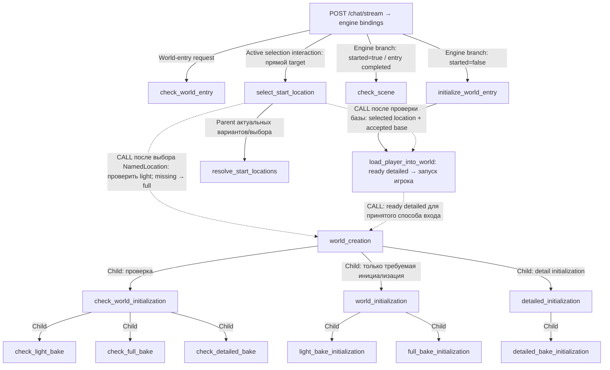
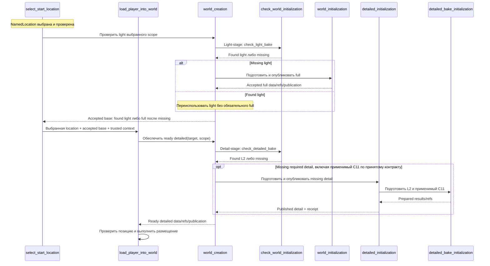

# GEN-DAG-NODE-DEPENDENCY

Совместный реестр целевых ролей, контрактов и зависимостей. **Единая актуальная редакция 2026-11-02**, собрана после замечаний пользователя о накоплении старых версий и неопределённом parent/child lifecycle. История правок — в git; прежние конкурирующие карты в документе не сохраняются как действующие.

Owning-план: [GEN-DAG-1](./gen-dag-1-post-geo-ws.md). Infrastructure SoT: [tz_engine_node_context](../../docs/tz_engine_node_context.md), [DAG-TYPING-1](./dag-typing-1.md).

**Статус:** роли и решения пользователя зафиксированы; пакеты родства §0, граф вызовов §1 и контракты связей §13 — НА СОВМЕСТНОЙ ПРИЁМКЕ. OPEN caller не имеет придуманной стрелки. Полный граф, exact POJO и parent/child mechanism не приняты. Актуальные два способа входа и условные bake gates — §16; существующее родство неизменно. Код, удаление legacy и production cutover не разрешены. Старые 15 ID не определяют target; сохраняется назначение check_scene с переработкой.

## 0. Реализация по родству — обязательные отдельные срезы

**Приоритетное решение пользователя:** имя ноды — **select_start_location**. **Она НЕ parent world_creation; world_creation также НЕ parent select_start_location.** Это ограничение **родства**, не автоматический запрет callers между разными семействами. Конкретный cross-family caller требует явной декларации и runtime binding; его нельзя ни запретить, ни утвердить только по отсутствию parent/child. Общие данные/порядок не создают родства. Прямой API entry через engine остаётся, это не parent NodeId.

Ноды агрегированы по родству, а не по очереди исполнения. Каждый NodeId ниже имеет одну primary карточку; родитель ссылается на контракты детей, не дублирует их. Вопросы обсуждаются обычным диалогом. Все перечисленные роли — PYTHON; generic composite lifecycle ещё OPEN.

### P0. Общие prerequisites

Typed engine/public domain contracts, publication path, parent/child и intermediate results, session/interaction state и прямой POST /chat/stream binding — §4. Без их приёмки нет реализации composite-ноды как самостоятельного executor.

### P1. Семейство world_creation

- P1.1 **world_creation** — root данного семейства; выбирает missing preparation по check results. External caller OPEN. Карточка §14.
- P1.2 **check_world_initialization** — непосредственный child world_creation. Карточка §8.0.
  - P1.2.1 **check_light_bake** — child check_world_initialization. I/O/Error §8.1/§9.2.
  - P1.2.2 **check_full_bake** — child check_world_initialization. I/O/Error §8.2/§9.3.
  - P1.2.3 **check_detailed_bake** — child check_world_initialization. I/O/Error §8.3/§9.4.
- P1.3 **world_initialization** — непосредственный child world_creation. Карточка §11.6.
  - P1.3.1 **light_bake_initialization** — child world_initialization. Карточка §11.4.
  - P1.3.2 **full_bake_initialization** — child world_initialization. Карточка §11.5.

- P1.4 **detailed_initialization** — непосредственная поднода world_creation, parent detail publication. Карточка §11.8.
  - P1.4.1 **detailed_bake_initialization** — child detailed_initialization, готовит L2 + применимый C11. Карточка §11.7.

Родство P1.4 принято пользователем; check_detailed_bake остаётся в P1.2, а не переносится в detailed subtree. World_creation организует три непосредственных поддерева P1.2/P1.3/P1.4. Check/read children не вызывают initialization. Light/full preparation готовят missing части, parent world_initialization публикует light и full по отдельности, light отдаётся раньше full. Никаких selection children в P1 нет.

### P2. Семейство выбора локации

- P2.1 **select_start_location** — API-flow нода, direct engine target POST /chat/stream. Её NodeId-parent вне этого семейства OPEN. Контракт §§2.6/5.6/6.5.
- P2.2 **resolve_start_locations** — child select_start_location: актуальные candidates/проверка выбора по policy и public location reads. Собственный I/O/Error §2.6.
- Resolve предложен как parent актуального списка, но его внутренние child NodeIds не определены; не создавать их из service/helper names.

P2 не является parent P1 и не является child P1. Base readiness проверяется после подтверждения выбора (§16); interaction/response binding требует отдельной engine приёмки. CALL не делает callee дочерней нодой caller; циклический execution graph и hidden executor не разрешаются.

### P4. Семейство initialize_world_entry

- P4.1 **initialize_world_entry** — parent завершённого входа; engine branch по check_world_entry. Карточки §§2.2/7.
- P4.2 **load_player_into_world** — child: placement/load, completion receipt, без скрытого bake orchestrator. Карточка §7.
- Started finalization — effect/binding flow, не новая автоматически добавленная нода. Owner/UOW OPEN.

Прямой вызов selection отсюда не восстановлен предположением. Как P4 получает selection/world/detail результаты от других семейств — OPEN контракт между семействами (§13/§15).

### P5. Независимые входные read-ноды

- **check_world_entry** — engine entry read по world/player/session; без started write. §2.1.
- **check_scene** — engine scene branch, проверка scene facts/requirements. §2.5.

Они не являются children друг друга и не вызывают world/selection families самостоятельно.

### P6. Внешние доменные срезы

World settings/projection — §§5–6; public reads — GEN-BAKE-READ/GEN-READ-1..3; generator prepared results — §11. Они поставляют контракты семействам, а не становятся скрытыми DAG children. Реальный порядок разработки отдельно задан в §15.2; нумерация P1–P6 — каталог родства, НЕ инструкция начать код с root parent.

## 1. Актуальный граф вызовов и родства

**Родство и отдельно маркированные CALL/API entry связи**, не порядок/data graph. Сплошные Child edges — родство; пунктир CALL — отдельный межнодовый вызов и НЕ меняет primary parent. Вызов между разными семействами может быть отдельно согласован и не изображается здесь как parent→child. Стрелки не означают передачу произвольного Output. Данные каждой связи заданы отдельно в §13; последовательность entry flow — §13.3. Отсутствие стрелки к initialization parents означает OPEN caller, не запрет их нужной реализации и не разрешение выбрать caller агенту.



Деревья world_creation и select_start_location независимы по родству. CALL select_start_location→world_creation выполняется после выбора NamedLocation: проверить light в требуемом scope, при missing подготовить и опубликовать full. Координатный вход требует full перед detailed; его внешний dispatch остаётся OPEN, новый caller/parent этим решением не добавляется. CALL/RETURN не меняет родство; entry routing остаётся engine binding.

## 2. Актуальные роли и смысловые контракты

### 2.1. check_world_entry

Первая проверка входа/resume по world + player + session. Input: три доверенные identities; read результата entry record. Output: те же identities, started: bool и read evidence. started=true только если ранее зафиксирована завершённая загрузка. Подтверждённое отсутствие записи → false; read failure → Error, не false. Сам проверяющий узел флаг не ставит.

Player/account vs character identity, owner/таблица уникального ключа и revision contract OPEN. Первый вход — отдельный факт, не выводится из location_uid/scene/наличия Pack. При started=false и уже начатом выборе entry routing продолжает interaction; список не начинается заново на каждом клике.

### 2.2. initialize_world_entry / select_start_location

initialize_world_entry организует завершённый вход/загрузку. select_start_location ведёт выдачу вариантов и получение выбора через existing POST /chat/stream. Select не child и не parent world_creation. Binding передачи выбранной location от selection семейства в entry/world-check flow ещё OPEN; прямой initialize_world_entry→selection тоже не добавляется без решения. Три режима world policy и детали контракта — §§5–6.

**Решение пользователя:** resolve_start_locations — самостоятельная DAG-нода со своими Input/Output/Error (§2.6), producer кандидатов для select_start_location. Она не скрывается внутри select_start_location как обычный helper. Ноды могут вызывать public domain reads, но ответственность producer/consumer и результат явно представлены в DAG.

Parent/child — согласованная продуктовая роль, но механизм исполнения через несколько HTTP requests OPEN (§4). Нельзя объявить промежуточный UI response успешным terminal Output родителя либо скрыть orchestration внутри генератора.

### 2.3. check_light_bake / check_full_bake / check_detailed_bake

Три самостоятельные read-ноды. Проверки выбираются по способу входа (§16): после выбора NamedLocation выполняется check_light_bake, при missing готовится и публикуется full; координатный вход требует full перед detailed. Нет общей обязательной цепочки light→full до выбора. Каждая проверка возвращает found(data/refs) или missing(required scope); corruption/read failure — Error. Public reads — §9 и GEN-BAKE-READ; проверки не выполняют bake/repair/publication.

### 2.4. load_player_into_world

Получает target входа (NamedLocation либо координаты ГМ), accepted base по §16, identities/publication и operation identity; ready detailed получает собственным CALL world_creation. Выполняет согласованное размещение/загрузку, возвращает completion evidence и фактическую позицию (§7). Не дублирует bake readiness checks и не запускает скрытый междоменный pipeline. Atomic operation vs видимая DAG composition этой стадии ещё OPEN.

Started фиксируется после фактической загрузки, не после проверки, выбора или создания scene record. Placement/flag consistency и retry после load-success/flag-write-failure требуют согласованного owner/UOW/idempotency.

### 2.5. check_scene

Общая read-only проверка **scene facts и требований текущего сценария**, после entry routing/завершённой инициализации на карте §1. Она не является первым world-entry guard, не вычисляет started и не выбирает стартовые локации.

Input facts: доверенные world/session identities; требования сценария; public scene/location/position reads и evidence. Admission получает подтверждённый entry result либо terminal initialization result через условный DAG binding; exact RequiredOutput/OptionalOutput topology для взаимоисключающих branches ещё OPEN. Нельзя подписать две альтернативы как два безусловных RequiredOutput.

Output: identities, scene facts и результаты сопоставления с требованиями. Для каждого факта различаются присутствует / подтверждённо отсутствует / не проверен / не применим. Пустое допустимое значение не равно отсутствию. Отсутствующая scene может быть успешной диагностикой, но не автоматически первым входом. Успешный Output проверки не гарантирует, что все требования выполнены.

Логика: прочитать scene; проверить identities; проверить заданные location/level refs и применимость; получить согласованные position/actor facts; сопоставить с требованиями; вернуть immutable отчёт. Если location_uid=None в wilderness при валидной позиции, это допустимая optional привязка, а не trigger выбора старта. При заданной битой ссылке — Error, не автоматическая новая location.

Error: invalid context/identity/reference, corrupt/read failure, невозможность подтвердить обязательную согласованность. Отмена — runtime CANCELLED. Нет scene writes, generation, LLM, scheduling, определения режима старта или самостоятельного запуска других нод. Точные POJO остаются на совместном freeze после матрицы §3.

### 2.6. resolve_start_locations — отдельная нода, решение пользователя

Собственные контракты, не доменная операция, скрытая внутри select_start_location. Trigger: начало стартового выбора и необходимость обновить кандидатов после изменения source/policy. Phase PRE_LLM; scope — мир и конкретный стартовый interaction. Public location/settings reads внедряются через binding, не прямое файловое/SQL чтение.

**Input (предложение полей POJO):** world_uid: EntityUid; policy: WorldStartLocationPolicy из authoritative world read; source read evidence по принятому доменному контракту. Все факты обязательны; policy не берётся из клиентского message. Player-specific фильтры пока не приняты, поэтому identities игрока/сессии не добавляются автоматически в domain calculation payload; execution/interaction correlation принадлежит binding.

**Output (предложение полей POJO):** world_uid: EntityUid; candidates: tuple[StartLocationView, ...]; policy и location source evidence. Candidates — все разрешённые текущим запросом варианты, не уже выбранная location. Порядок детерминирован; duplicates запрещены. Предлагается nonempty terminal candidates; пустое множество — объявленная NoStartCandidates ошибка, а не fallback на все места. Exact evidence types и error POJO OPEN.

**Error:** missing/invalid policy; invalid/foreign explicit location refs; no candidates; read failure/corruption; несовместимые source revisions. Не менять policy и не допускать выбор по непроверенным refs.

**Effects:** нет UI/SSE, scene writes, spawn/load, started flag или вызова select.execute. Runtime публикует candidates; DAG передаёт их select_start_location как RequiredOutput.

**Input select_start_location:** отдельный candidate Output resolve_start_locations + trusted interaction/session context + optional выбранный UID следующего HTTP запроса. **Terminal Output select:** одна выбранная проверенная StartLocationView. После окончательного выбора и base-stage (§16) select_start_location вызывает load_player_into_world с выбранной location и accepted found-light либо full-after-missing. Запуск load не ждёт L2 check внутри selection: selection не проверяет/не создаёт L2. Detail prerequisites проверяются до фактического размещения в load-flow; exact caller route к world_creation ещё согласуется. Выбор и L2 found не подтверждают загрузку игрока. Resolver evidence валидируется при продолжении; stale candidates требуют явного запуска producer через DAG, не локального повторения его логики в select.

Новый producer меняет граф/контракты select; exact RequiredOutput binding, source consistency, full POJO/files и stale continuation routing возвращаются на совместный freeze. Общие три режима settings и подтверждённые city/underground_city сохраняются.

## 3. Отдельные незакрытые решения

### 3.1. Факты для доменного POJO сцены — discovery 2026-11-02

По поручению пользователя POJO обсуждается сразу вместе с нодой. Перед схемой фиксируются факты, обязательность и допустимая пустота. Нижеследующая матрица — предложение для согласования, а не принятый новый scene API.

### Проверенные источники

- `backend/app/db/models/sessionScene.py`: session_id, description, actors, location_uid, level_uid, created_at, updated_at. Это SQL dataclass, не готовый immutable domain POJO.
- `backend/app/db/migrations/0001_initial.sql`, session_scene: session_id PK/FK; nullable location/level FK; description/actors/timestamps NOT NULL.
- `docs/tz_locations.md`, «SessionScene — состояние сцены»: actors — JSON array of character_uid; location/level — якорь; location=None — draft; level=None — outdoor либо ещё не определён.
- `docs/tz_settlement_outdoor.md`, C18: объём карты и событий вокруг игрока не равен location/level; соседство сохраняется при входе в здание.
- `GameSession`: world_uid и player_character_id находятся у сессии. Дублирование этих полей в persisted scene ещё не решено.
- Активные sceneInit/sceneLocationSelect writers создают actors=[] и пустой draft description; при готовой сцене description берётся из location description, level_uid пока всегда None. Writer непустого состава actors в проверенных scene usages не найден.
- `ActorSnapshot(name, role)` в application/contracts — LLM output, не список character_uid; автоматическое переиспользование некорректно.
- `SceneVolumePolicy` уже существует, задаёт радиусы загрузки. Текущий scene record не содержит точную позицию игрока, bounds или revision. Loading radius не является автоматически радиусом симуляции событий.

### Значения и пустота

Обязательное поле должно присутствовать даже при разрешённом пустом значении. Optional значение не равно optional наличию поля. Для коллекций `()` означает достоверно пустой результат, а не «не читали»; unknown/read failure нельзя превращать в пустую коллекцию.

| Факт | Возможный reuse/тип | Draft | Ready | Допустимая пустота и проверка |
|---|---|---|---|---|
| Session identity | EntityUid из dataModel/identity/uid.py; совместимость session IDs проверить перед binding | Обязательно | Обязательно | None/пустая строка запрещены; существующая сессия |
| World identity | EntityUid, источник GameSession | Обязательно в контексте проверки | Обязательно в контексте проверки | None/пустая строка запрещены; persisted duplication OPEN |
| Player character identity | EntityUid, источник GameSession | Обязательно в текущей модели игровой сессии | Обязательно в текущей модели игровой сессии | Это отдельный факт от actors; включение игрока в actors OPEN |
| Location anchor | EntityUid или None | None допустим | Non-null не является общим требованием: wilderness допускает отсутствие NamedLocation | Если UID задан, location должна существовать и принадлежать миру; None не доказывает draft. Для первой инициализации через выбранную location — обязательна по обсуждаемому стартовому сценарию |
| Level anchor | EntityUid или None | None допустим | Условная обязательность | Для outdoor None допустим; для indoor правило требует решения. Неопределённость indoor level нельзя выдавать за подтверждённый outdoor |
| Description | str — осознанно текст, не identifier/registry key | Поле обязательно, "" допустимо | Предлагается разрешить "" | None запрещён; отсутствие текста само по себе не означает отсутствие сцены и не требует LLM |
| Present character references | tuple[EntityUid, ...] | Поле обязательно, () допустим | Поле обязательно; () условно допустим | Только если состав установлен и участников действительно нет; не default при read failure. Входит ли игрок, snapshot ли это состава или актуальный read — OPEN |
| Created/updated times | Предложение: timezone-aware datetime; SQL строки преобразуются на boundary | Обязательны у сохранённой записи | Обязательны у сохранённой записи | None/"" не допускаются для persisted record; updated>=created. Точный тип/defaults согласовать; время не заменяет revision |
| Scene lifecycle | Предложение: разные draft/ready варианты POJO | Draft | Ready | Представление и discriminator ещё не приняты; derived состояние предпочтительнее противоречащих status/location полей |
| Scene read revision/evidence | Доменный контракт OPEN | Нужен для подтверждённого read, включая отсутствие | Нужен для актуальности результата | Не выдумывать timestamp/fingerprint как revision; поле пока не frozen |

`EntityUid` — существующий строгий непустой строковый alias; это пока кандидат reuse, не новый класс идентификаторов. Названия в таблице обозначают факты, не окончательные Python field names. Новые domain POJO/enum и порты не вводятся до согласования.

### Факты игрового окна, которые нельзя молча сделать полями persisted scene

| Факт | Когда обязателен | Что может быть пустым |
|---|---|---|
| Точная позиция/anchor XYZ | Для пространственного read вокруг игрока | Координаты не заменяются нулями; источник позиции OPEN |
| Ограниченный read scope и policy | Для запроса окна | Нужны явные bounds/правило scope; location UID их не заменяет |
| Pinned world publication | Для согласованного world read | Reuse WorldPublicationRef после согласования binding; не nullable fallback для ready gameplay read |
| Solids/terrain facts | Для потребителя, которому они нужны | Подтверждённо пустой участок допустим по domain semantics; missing/corrupt не пустота |
| Water/media facts | Для water-aware gameplay window | Подтверждённое отсутствие воды допустимо; отсутствие SQL water cells не означает отсутствие воды |
| Objects/other characters | По требованиям потребителя | Пустая коллекция допустима после успешного чтения |
| Hazards/events | По требованиям потребителя | Нет событий/опасностей — допустимый пустой результат; «не проверяли» должно различаться |
| Structural facts | Для соответствующего building consumer | Не применимо вне structural scope; не подменять неизвестность значением stable |
| Weather/time facts | Для действий/описания, требующих этих данных | Optional для потребителя, которому не нужны; отсутствие не превращать в вымышленные defaults |

Состав окна и его producers не утверждается этой таблицей. Проверка готовности session scene и готовность facts для конкретного действия — разные условия. Расширение check_scene до проверки всего окна требует отдельного решения о границе ноды.

### Вопросы до точного POJO freeze

1. Представляет ли actors всех присутствующих, включая игрока, либо только остальных? Где authoritative owner состава и допустима ли пустая ready-сцена?
2. Требуется ли resolved level для indoor ready scene и как различается outdoor от ещё не определённого level?
3. Где находится authoritative позиция игрока для окна: отдельный character/position domain или часть scene state?
4. Хранится ли description как текст состояния сцены либо это derived read location description? Сейчас writer копирует его из location.
5. Кто владеет scene revision/read consistency? Текущая SQL модель этого контракта не предоставляет.

### Уточнение wilderness: геометрическая позиция без NamedLocation

Проверка по вопросу пользователя 2026-11-02 установила:

- `docs/tz_locations.md`, NamedLocation: autoresolve geometry без location — норма; именованная сущность опциональна для географии. Отсутствие NamedLocation не означает отсутствия поверхности/пространства.
- `docs/tz_world_pack_storage.md`, WP-19/20: wilderness имеет отдельные L2 chunks и участвует в spatial merge; граница location не является границей мира.
- `EntryAnchorTracker.EntryAnchor` содержит обязательные entry_x/entry_y и optional location_uid. Anchor kinds: session_start/tile_cross/location_entry. Это anchor загрузки, не готовый authoritative player-position POJO.
- `EntryRefineOrchestrator.refine_from_entry` принимает anchor_x/anchor_y при location_uid=None; detailed wilderness scope также формирует plan с location_uid=None.
- `MapCellService.get_scene_volume` и pack gameplay read принимают world + x/y/z; location UID не является обязательным аргументом spatial read.
- Legacy `check_scene` при любом location_uid=None отправляет в выбор стартовой location; persisted SessionScene не имеет координат и discriminator готовности. Геометрические операции поддерживают безымянное пространство, но полноценная session scene для такого положения этим не доказана.

Следствие: legacy правило «location_uid=None всегда означает pending selection» непригодно как общее TO-BE правило. check_scene возвращает отчёт scene facts, допускает wilderness без NamedLocation и не определяет первый вход. Первый вход принадлежит check_world_entry.

Предлагаемая семантика для согласования:

1. Первая инициализация допускает выбранную NamedLocation либо координаты мира от ГМ (§16). В первой ветви нужен location UID, во второй он не требуется. Обе требуют пригодной геометрической позиции, без нулевого fallback.
2. После инициализации ready scene может находиться в wilderness без NamedLocation, если есть валидная authoritative позиция и подтверждённое состояние инициализации.
3. location_uid — optional привязка к именованному месту; если задан, ссылка проверяется. Для отсутствующей привязки не создаётся фиктивный NamedLocation и не требуется сохранять прежний UID после выхода из его области.
4. Отсутствие location_uid при наличии валидной позиции не вызывает повторный выбор старта. Отсутствие и позиции, и установленного старта — отдельный случай, а не нормальная wilderness scene.
5. Членство в wilderness/region не подменяет NamedLocation identity. Близость к именованной location не доказывает принадлежность ей.

OPEN: точный POJO позиции, его owner и связь с topology/высотой/indoor coordinates; persisted lifecycle сцены и правило initial spawn. Эти решения не приняты одним наличием entry-refine debug API. Нода/POJO реализации не менялись.

Эти ответы определяют конкретные поля POJO; их нельзя закрыть `Any`, нетипизированным list, defaults или выдуманным read API. Код пока не создаётся.

SP-R2 не принимается этим документом: `check_scene` не читает water media и не заменяет bounded gameplay-read. Его положение относительно единого cutover остаётся отдельным решением GEN-P0.

`RepairPatchApplier` относится к публикации результатов выполнения DAG. World Snapshot относится к записи/истории мира. Замена одного другим запрещена; `check_scene` не выполняет ни одну из этих записей.

Незакрытые поля/типы в этой матрице блокируют соответствующий POJO freeze; дальнейшее согласование ведётся по единому графу §1 и lifecycle gate §4.

## 4. GEN-ENTRY-LIFECYCLE — parent/child и продолжение HTTP flow

**Статус: OPEN / BLOCKER приёмки initialize_world_entry и select_start_location.** Сам факт согласования ролей не утверждает runtime механизм вложенности. Этот gate не является задачей генераторных read methods.

### 4.1. Проверенное состояние target runtime

- [executionBindings.py](../../backend/app/application/engine/contracts/executionBindings.py): LifecycleBinding compile/transition/apply_effects/response и ExecutionCursor(task_type, stage); parent/child invocation contract и штатный waiting-for-user outcome не объявлены.
- [nodeOutcome.py](../../backend/app/application/engine/runtime/execution/nodeOutcome.py): LevelDecision = CONTINUE/CANCEL/FAIL/REPLAN; NodeOutcome допускает terminal SUCCESS/FAILED/CANCELLED/GATED, не штатное ожидание пользовательского ввода. BLOCKED в общем NodeStatus само по себе не реализует такой lifecycle.
- [dagEngine.py](../../backend/app/application/engine/runtime/dagEngine.py): _drive сохраняет snapshot в обработке CancelledError; обычный RESPONSE удаляет store snapshot и возвращает результат. run/resume обслуживают execution lifecycle, но проверенный путь не доказывает продолжение parent после нормальной выдачи выбора.
- [typed SessionSnapshot](../../backend/app/application/cancellation/typed/sessionSnapshot.py): extension/cursor существуют, но нет уже принятой семантики persisted interaction/parent stack. Использовать extension как доказательство готового waiting lifecycle нельзя.
- Existing frontend/API flow select_child → следующий POST → scene_ready подтверждён, но это несколько legacy executions с draft scene, не доказательство целевого nested runtime.

Вывод: **cancel/resume не принимается как ожидание ответа игрока**. Нельзя симулировать отмену ради каждого select_child; держать HTTP/coroutine открытым до клика тоже не предлагается.

### 4.2. Что нужно совместно утвердить до кода

1. Execution model: настоящая resumable composite-node семантика в engine либо композиция нескольких завершённых executions с persisted application interaction. Это альтернативы для обсуждения, не два разрешённых production пути. Вторая требует явно согласовать, что parent — логическая операция, а не незавершённый runtime NodeOutcome.
2. Typed interaction state: identities, stage выбора/загрузки, parent/child identity, выбранная location, policy/source evidence, version и operation id; exact поля/owner/storage/POJO OPEN.
3. Штатный intermediate API response, terminal child result и terminal parent result; их response binding и условия публикации. Один и тот же POST /chat/stream; UID приходит в message, как сейчас.
4. Correlation входящего запроса с interaction, защита от чужой сессии, duplicate/retry/stale/out-of-order clicks, concurrent requests, restart recovery и отличие user wait от cancellation.
5. Переход selection→readiness→load→started, visibility результатов, failure/recovery после каждого effect. Child selected location не подтверждает loading.
6. Exact engine/application owner split и handoff DAG-TYPING-1 при необходимости generic runtime расширения. GEN не реализует второй executor внутри родителя или генератора.
7. Функциональное evidence: обычная выдача select_child завершает HTTP, следующий запрос продолжает выбор, process restart восстанавливает его, отмена не маскируется user wait, terminal Output выдаётся ровно при согласованном завершении.

Ни один вариант в этом списке не выбран автоматически. До explicit acceptance родительские concrete bindings и integration/cutover BLOCKED этим контрактным пробелом; read-only проектирование и domain-read requirements продолжаются.

### 4.3. Отдельные неизменённые gates

SP-R2 — отдельное решение, не закрыто readiness checks. RepairPatchApplier относится к публикации execution results; World Snapshot — к данным мира. Settings implementation (§6), public generator read methods (§9), player position/load completion и parent/child lifecycle — разные owner gates, не взаимозаменяемые проверки.

## 5. Явные world settings и location contract стартовой ветки

### 5.1. Решения и AS-IS evidence

Политика этого раздела ограничивает выбор NamedLocation. Координатный вход ГМ (§16) — отдельная ветвь; его настройка и dispatch OPEN, четвёртый policy mode этим не вводится.

Пользователь потребовал объявить world setting и её реализацию в плане до реализации ноды: настройка является обязательной частью её контракта. Три режима приняты ранее. **Уточнение пользователя: «города» включает city и underground_city.** Village этим режимом не разрешается.

Проверено:

- В `db/models/world.py` настройки старта нет. World settings сейчас содержат JSON blobs отдельных доменов; generic create/update идут через WorldService и JSON validation.
- `dataModel/locations/locationType/worldLocationTypeRegistry.py`: оба city и underground_city — подтипы `settlement`, а не самостоятельные system_location_type. Village — другой subtype.
- `db/models/namedLocation.py` даёт identity, world, parent, name, descriptions, type/subtype, map_x/y/z, access/selectable/transit/outdoor flags, owner/state, registry refs и optional typed host payload.
- `dataModel/locations/namedLocation/bundleNamedLocation.py` уже содержит BundleNamedLocation: это import wire model, без world_uid, с mutable вложенными коллекциями. Не объявляется готовым immutable gameplay-read Output. Domain field definitions/registry types переиспользуются; универсальный дубль всей NamedLocation не создаётся ради ноды.
- NamedLocationService.get_by_id(world_uid, location_uid) проверяет принадлежность миру; get_all/get_children дают существующие read paths. API возвращает asdict SQL model; exact target revision-aware immutable read contract ещё отсутствует.
- В bundle импорт world идёт до locations; cross-reference validation стартового списка нельзя выполнять только в world-row parse до чтения locations.
- Copy-import remaps entity IDs; новый список location refs в world settings потребует отдельного remap.
- WorldSettingsPage.jsx сейчас placeholder. Рабочий чат-flow выбора уже существует; это не доказательство наличия UI настройки старта.

### 5.2. World setting: предложенная точная wire-схема

Путь: `world.start_location_policy`. Хранение: отдельный JSON blob `worlds.start_location_policy`; SQL модель World получает одноимённое поле. Это планируемое изменение, сейчас поля нет.

Предлагаемый доменный POJO: `WorldStartLocationPolicy` — discriminated union по mode трёх strict/frozen моделей. Во всех вариантах extra=forbid; нормализация JSON в immutable значения выполняется на boundary, а не внутри ноды.

```json
{"start_location_policy": {"mode": "all_locations"}}
```

```json
{"start_location_policy": {"mode": "cities"}}
```

```json
{"start_location_policy": {
  "mode": "explicit_locations",
  "location_uids": ["location_a", "location_b"]
}}
```

| Модель / поля | Тип и обязательность | Правило |
|---|---|---|
| AllStartLocationsPolicy.mode | Literal["all_locations"], обязательно | Все NamedLocation мира входят в policy pool; не означает любую безымянную XYZ-точку |
| CityStartLocationsPolicy.mode | Literal["cities"], обязательно | Только type=settlement и subtype в {city, underground_city}; оба подтипа подтверждены пользователем |
| ExplicitStartLocationsPolicy.mode | Literal["explicit_locations"], обязательно | Только явно указанные location refs |
| ExplicitStartLocationsPolicy.location_uids | tuple[EntityUid, ...], обязательно и min_length=1 | Unique; все refs существуют в том же мире; wire — JSON array |

location_uids запрещён в all_locations/cities; null не заменяет список. В explicit_locations пустой список и duplicates — validation errors. Удаление указанной location требует согласованного изменения policy либо явной ошибки, не молчаливого удаления refs.

**Default proposal:** в runtime политика обязательна, без silent fallback на all_locations. При создании мира мастер выбирает режим явно. Миграция существующих миров требует отдельного решения о backfill; выбор default ещё НЕ ПРИНЯТ. Missing policy — типизированная ошибка конфигурации стартовой ветки, не запрет чтения существующего мира.

Политика задаёт допустимые корни/места старта; трактовка descendants ещё OPEN: выбор города целиком либо дальнейший выбор внутри него. Пока это не принято, расширять explicit allowlist всеми потомками нельзя. Legacy home/depth/faction/NPC/transit filters не становятся частью policy автоматически; all_locations не следует молча сужать до прежней стартовой глубины.

### 5.3. План реализации настройки (без выполнения сейчас)

1. Принять схему §5.2, default/backfill и семантику descendants; затем freeze domain POJO и node contracts.
2. Предлагаемые новые файлы policy в `backend/app/dataModel/locations/start/`: `__init__.py`, `worldStartLocationPolicy.py` (union и три варианта). Отдельный enum не нужен при Literal discriminator. Папка новая, плановый direct count=2; это предложение размещения до file freeze.
3. Добавить JSON column в `backend/app/db/migrations/0001_initial.sql` и поле в `backend/app/db/models/world.py`; способ обновления существующей БД согласовать с принятым migration process, без reset/user-data deletion.
4. Добавить JSON-validation slice в `backend/app/application/jsonValidation/worldSlices.py`, typed accessor в `worldRow.py`, экспорт facade в соответствии с существующим механизмом. Structural validation — POJO; reference/world validation — domain service. Принятый missing policy не должен неожиданно ломать несвязанные операции мира.
5. WorldService create/update/import/export сохраняют policy; validate-only проверяет её без writes. Bundle final validation проверяет location refs после availability всей locations section; порядок world→locations не менять ради обхода проверки. Для registry-only export определить поведение ссылок без locations — OPEN до bundle contract freeze.
6. `backend/app/application/worldBundle/bundleRemapService.py`: remap каждого explicit location UID при копировании мира. Не сохранять ссылки на старый мир.
7. `frontend/src/features/settings/world/ui/WorldSettingsPage.jsx`: три режима; picker локаций для explicit; сохранение через существующий world API. Не создавать отдельный параллельный settings store.
8. Обновить `docs/tz_locations.md` и owning GEN plan: политика старта, reference validation, новые bindings и контракты. Фактические folder counts/import map остальных изменяемых папок — обязательный gate до кода, ещё не выполнен.
9. Проверить три режима, обе городские морфологии, missing/empty/foreign refs, copy-remap, bundle round-trip и continuation существующего API flow. Это план validation, не выполненная приёмка.

### 5.4. Что реально доступно из выбранной локации

| Факт из NamedLocation | Наличие сейчас | В target контракте |
|---|---|---|
| location_uid, world_uid | Обязательные SQL поля | Обязательные EntityUid, проверка мира |
| display_name | Обязательный str | Обязательное непустое имя для выбора; некорректные данные не скрывать |
| parent_location_uid | Nullable | Обязательное поле с разрешённым None для root |
| system_location_type | Registry ref | Reuse LocationTypeKey |
| system_location_subtype | Nullable str | Сохранить optional subtype; проверять относительно type registry, не новый произвольный enum |
| display/system description | Nullable тексты | Один presentation description: display_description ?? system_description ?? ""; пустая строка допустима |
| map_x/map_y/map_z | Каждый nullable | Передать как anchor facts с сохранением неизвестности; не обещать готовый spawn XYZ |
| is_accessible/is_selectable/is_transit | bool | Факты для eligibility; применение как обязательных фильтров ещё требует решения |
| is_outdoor | bool или None | None означает неизвестность, не False/outdoor по умолчанию |
| is_sheltered/is_mobile | bool | Доступные факты; подвижный anchor требует повторной проверки перед загрузкой |
| owner_uid/state_uid | Nullable refs | Можно получить через location read при необходимости; не требуются для минимального selection payload |
| climate/economic/material/template refs | Nullable refs | Не переносить весь registry/assembler context в UI selection; получать по доменным контрактам при загрузке |
| location_payload | SettlementPayload/DistrictPayload или None по host type | Есть typed domain payload; не передавать dict[Any] и не разворачивать internals в DAG |

Семантика map_z: по ТЗ omit допускает pin 0 через TerritoryVolumePolicy. Это правило пина territory, а НЕ доказательство, что игрок может появиться в z=0. Для выбора точки загрузки нужен отдельный согласованный domain result с учётом поверхности/входа/уровня. Level UID и пригодный spawn point не являются полями NamedLocation и не могут выдаваться как уже известные.

### 5.5. Предлагаемые POJO локации в контракте подноды

Новая композиция минимальной immutable проекции оправдана отличием gameplay read от SQL/import wire. Proposed owner — locations domain; exact public read binding должен быть согласован, порт сейчас не создаётся.

`StartLocationView` (новый domain read projection, все поля присутствуют, без defaults):

| Поле | Тип | Пустота |
|---|---|---|
| world_uid | EntityUid | Запрещена |
| location_uid | EntityUid | Запрещена |
| parent_location_uid | EntityUid or None | None разрешён |
| display_name | str, min_length=1 | Пустая/whitespace-only строка запрещена; это presentation text, осознанное str |
| description | str | "" разрешено; presentation fallback определён в §5.4 |
| system_location_type | LocationTypeKey | Обязательно валидный registry key |
| system_location_subtype | str or None | None разрешён; str — существующий subtype key, проверяемый type-dependent registry lookup, не закрытый enum. Закрытие dependent-key типизации отдельного доменного контракта OPEN |
| map_x | FineX or None | None разрешён, не заменяется 0 |
| map_y | FineY or None | None разрешён, не заменяется 0 |
| map_z | FineZ or None | None разрешён, pin fallback не выполняет spawn resolve |
| is_accessible | bool | Обязательно |
| is_selectable | bool | Обязательно |
| is_transit | bool | Обязательно |
| is_outdoor | bool or None | None разрешён как неизвестность |
| is_mobile | bool | Обязательно |

Reuse: EntityUid, LocationTypeKey, FineX/FineY/FineZ. Предлагаемый файл `backend/app/dataModel/locations/start/startLocationView.py` (вместе с policy папка имеет плановый count=3). До кодирования проверить immutable validator/schema handling этих aliases; raw SQL dict не является экземпляром Output. Проекция не дублирует полный NamedLocation и не задаёт defaults доменным фактам.

Presentation вариант для существующего frontend wire может быть уже этой проекции. API mapping сохраняет uid/name/description и select_child/scene_ready flow; frontend не обязан получать owner/access/revision или все геометрические данные.

### 5.6. Контракт parent/child flow с явной policy

`initialize_world_entry` получает identities и использует отдельный entry check; не фиксирует started до фактической загрузки. select_start_location активируется через прямой API engine binding; её внешний NodeId-parent OPEN. Никакого activation из world_creation нет.

Предлагаемый Input `select_start_location`:

- world_uid: EntityUid — обязательно.
- session_id: EntityUid — обязательно для корреляции interaction (не утверждение готового SessionId alias).
- candidates result: RequiredOutput ноды resolve_start_locations — обязательно, содержит варианты и evidence применённой policy; select не читает policy из frontend и не вычисляет список вместо producer.
- selected_location_uid: EntityUid or None — поле обязательно; None для первоначального запроса вариантов, UID для продолжения/завершения выбора.
- Interaction state и evidence policy/location reads — обязательный контракт, exact POJO OPEN. Сам клиентский UID не доказывает допустимость выбора.

Public location reads выполняются через согласованный binding. Ни полный World SQL object, ни все registry dumps не являются Input ноды.

Промежуточный API response: `type=select_child`, parent (None либо выбранный родитель), children (варианты uid/name с согласованными presentation fields). При необходимости drill-down формат сохраняется, но разрешение descendants должно быть явно определено.

Terminal Output `select_start_location`: `location: StartLocationView` — обязательно, плюс согласованное source evidence (тип OPEN). Location относится к world Input и разрешена актуальной policy. Успешный terminal Output не бывает None и не является списком всех кандидатов. До выбора публикуется UI-flow response, а не ложный terminal success родителя.

Ошибки подноды: missing/invalid policy; broken/foreign refs; недопустимый клиентский выбор; пустое множество кандидатов (предлагается явная ошибка); read failure/stale interaction. Изменение policy между выдачей и кликом требует повторной валидации/обновления выбора, а не применения устаревшего разрешения.

Terminal Output родителя: подтверждение завершённой загрузки + `start_location: StartLocationView`; фактическая resolved позиция и completion receipt должны прийти из owning load operation. Их типы ещё OPEN; map_x/y/z не заменяют их. Флаг старта и подтверждение должны относиться к тому же world/player/session.

Механизм resumable parent/child lifecycle и промежуточного response, точные node POJO/error classes/files пока не приняты. Настоящая спецификация делает зависимости явными, но не объявляет runtime поддержку вложенных нод или load contract готовыми.


## 6. GEN-START-POLICY — реализация полного механизма и интеграция с DAG

**Отдельный implementation item owning GEN-P0. Статус: PLAN / до совместного contract/file freeze.** Пользователь поручил конкретизировать реализацию настройки и её интеграцию с нодой. Это разрешение на планирование, не код/cutover. §6 уточняет реализацию §5.3; три режима и состав городов уже согласованы, прочие предложенные решения отмечены ниже.

### 6.1. Где сохраняется настройка

Source of truth: одна запись `worlds` по `world_uid`, колонка **start_location_policy TEXT**, сериализованный JSON. Отдельной таблицы политики, копии в session scene или отдельного frontend store нет. Значение входит в world JSON под ключом `start_location_policy` и в world section bundle.

Предложенная storage-семантика до решения default: SQL NULL = настройка не задана. World dataclass: `start_location_policy: dict | None = json_nullable_col(default=None)`. Это осознанное SQL-boundary представление, не typed Input ноды. Заполненное значение обязано соответствовать одному из трёх policy вариантов §5.2. Хранить {} как скрытый режим запрещено. Новый мир не получает all_locations автоматически.

Разрешение хранить NULL сохраняет возможность редактировать/читать ещё не настроенный мир. Стартовая ветка требует заданную валидную policy и возвращает configuration error при её отсутствии. Итоговый default/backfill остаётся отдельным решением; это предложение поддерживает отсутствие настройки явно, не выбирает режим за мастера.

Schema work: изменить только `backend/app/db/migrations/0001_initial.sql` и `backend/app/db/models/world.py`, согласно `.cursor/rules/database-migrations.mdc`. Новые numbered migrations и ALTER-migration сейчас не планируются. Изменение 0001 само по себе не обновляет уже созданную БД: применение новой схемы к имеющейся базе — отдельный deployment/dev-data шаг; удалять пользовательские данные ради этой настройки нельзя.

### 6.2. Typed schema и запись/чтение

Предлагаемые модели в `backend/app/dataModel/locations/start/worldStartLocationPolicy.py`:

- три strict/frozen варианта из §5.2;
- `WorldStartLocationPolicy`: RootModel над Annotated union с discriminator=mode, SCHEMA_ID="SCH-WORLD-START-LOCATION-POLICY"; JSON остаётся плоским {mode, ...}, без поля root на wire;
- schema-generated validation: mode обязателен, explicit location_uids обязателен/непуст/unique, extra fields запрещены. Field policies для общего JSON resolve объявляются на моделях.

`worldSlices.py`: один json_blob WorldSlice для start_location_policy, без canonical fallback на разрешающий режим. `worldRow.py`: typed accessor `start_location_policy(world) -> WorldStartLocationPolicy | None`; отсутствие остаётся None, malformed non-null value не становится None. Конкретный start consumer требует non-null policy.

В `WorldService.create/update/import_from_json` структурная валидация выполняется до записи. Проверка ссылок дополнительно выполняется доменной операцией в write UOW: все explicit UIDs существуют в world; тип города определяется registry key settlement + subtype city/underground_city. Проверка доступности конкретному игроку не добавляется автоматически.

**Атомарная замена policy:** в `PUT /worlds/{world_uid}` переданное start_location_policy заменяет blob целиком. Его отсутствие в payload сохраняет прежнее значение. При обновлении заданной policy null предлагается отклонять (422), чтобы случайная очистка не сбрасывала flow; создание старого/ненастроенного мира с отсутствующим полем сохраняет SQL NULL.

AS-IS `jsonValidation.facade.merge_world_patch` deep-merges JSON blobs. Запланировать в WorldSlice явную декларацию patch semantics для этого slice (replace whole value), а в facade/worldSliceMerge использовать её: supplied policy валидируется как полный объект, не как partial patch. Конкретное имя metadata и diff согласовать до кода; не вводить локальную очистку location_uids в DAG или frontend. Для остальных slices их существующую merge semantics не менять. Критичный acceptance case: explicit_locations → cities удаляет старый список из сохранённого blob.

Сохранение проходит `WorldService → IWorldRepository → SqliteWorldRepository/BaseRepository → mapper JSON → worlds.start_location_policy`. mapper уже умеет nullable JSON. Repository не выбирает defaults/режим и не валидирует business eligibility.

### 6.3. API и frontend

Существующие endpoints используются без отдельного второго settings API:

- GET /worlds/{world_uid} возвращает сохранённый start_location_policy (либо null для ненастроенного мира).
- POST /worlds принимает policy при создании.
- PUT /worlds/{world_uid} принимает полный объект policy; после domain validation возвращает сохранённый world. Invalid structural/reference input — 422; missing world — существующий 404 contract.

Пример update payload:

```json
{"start_location_policy":{"mode":"explicit_locations","location_uids":["start_city"]}}
```

`frontend/src/api/worldApi.js`: добавить getWorld(worldUid), updateWorld(worldUid, patch), getWorldLocations(worldUid) поверх существующих endpoints; проверять HTTP status и сохранять backend diagnostics.

`WorldSettingsPage.jsx`: загрузка мира и каталога locations, три режима, explicit picker; показать ненастроенное состояние без автоматически выбранного сохранённого режима; сохранить только по действию мастера; UI показывает сохранённое значение после успешного API ответа. При смене режима отправляется целый новый policy объект. В cities режиме UI поясняет city + underground_city. Пустой explicit выбор не сохраняется. Frontend validation помогает вводу, backend остаётся authoritative.

Не считать нажатие «Сохранить» завершённым до успешного ответа. Противоречивый/невалидный запрос не изменяет старую policy. При concurrent world updates нужна согласованная existing/new write consistency — OPEN, не обещать CAS по одному JSON hash.

### 6.4. Ссылки, import/export и копирование

1. Обычный world update: validate explicit location refs перед записью в том же write UOW. Нужен injected location read binding; proposed service helper `backend/app/application/worldData/locations/startLocationPolicyService.py` владеет reference/eligibility checks, а не HTTP handler.
2. Bundle import: структурная policy validation на world parse; reference validation по совокупности incoming locations и существующих допустимых rows в принятом import context. До появления locations не отклонять валидный self-contained bundle. Итоговую cross-reference проверку выполнить до commit import UOW.
3. WorldCopyImport: после UID remap и импорта locations проверить refs в target world до выхода из существующей transaction. Ошибка откатывает весь copy import. Аналогичный gate нужен обычному import path в WorldBundleService; конкретный insertion point подтвердить по обоим путям до кода.
4. bundleRemapService: remap world.start_location_policy.location_uids через тот же location UID map. Не remap произвольный текст и registry keys. Отсутствующий ref в map не «чинить» новым случайным UID.
5. Export/import round-trip сохраняет режим и список. Registry-only export с explicit refs вне exported locations требует согласованного portability contract; до его решения такой export/import нельзя объявлять полным переносом стартового сценария.
6. NamedLocationService.delete/update: не оставлять скрыто сломанную explicit policy. Предложение — отклонять удаление referenced location, пока policy явно не изменена; при смене subtype повторно проверить текущие cities interactions. Каскадное расширение/изменение списка мастера запрещено без явного решения.

### 6.5. Интеграция с select_start_location

**Прямое назначение API выбора — уточнение пользователя:** запрос выбора на существующий POST /chat/stream должен адресоваться непосредственно **select_start_location через typed engine binding**. Для начального запуска DAG сначала обеспечивает её dependency resolve_start_locations; для продолжения выбирается active selection interaction. Endpoint не запускает parent заново для каждого клика и не маршрутизирует выбор через intent_detection/check_scene.

initialize_world_entry остаётся владельцем логического flow, не обязательной промежуточной точкой API dispatch. Terminal выбранная location передаётся ожидающему parent через согласованный engine lifecycle. Прямое target binding не означает вызов node.execute из FastAPI и не обходит RequiredOutput producer. Exact parent notification/persistence mechanism всё ещё OPEN (§4).


**URL ЗАФИКСИРОВАН пользователем: существующий `POST ${API_URL}/chat/stream`** (backend route `POST /chat/stream`). Один и тот же URL используется для первоначального запроса, следующих шагов выбора и продолжения/resume. Не создавать отдельные endpoints select-start-location/world-entry и не менять URL текущего chat flow.

**Обязательная target маршрутизация:** initial world entry активирует initialize_world_entry через DAG; запросы UI выбора адресуются `chat_stream → typed engine selection binding → select_start_location` напрямую, с обеспечением RequiredOutput resolve_start_locations. Endpoint должен доводить запрос до исполнения/продолжения этих нод, а не только читать сохранённый response или обращаться к отдельному legacy selection service. Первоначальную стартовую ветку DAG выбирает по check_world_entry; продолжение незавершённого выбора адресуется тому же parent/child interaction, не запускает начальный список заново. После завершённого входа тот же endpoint обслуживает обычный scene/action DAG.

HTTP route не вызывает node.execute напрямую и не сам выбирает порядок внутренних операций: исполнение, lifecycle и публикация результатов остаются у engine DAG. Selection entry binding обязан связывать входящий запрос с select_start_location и её parent interaction; его точные типы и runtime files требуют freeze. Прежняя маршрутизация через legacy intent_detection/check_scene для выбора старта — только AS-IS evidence, не target binding.

Acceptance маршрутизации: первый стартовый POST реально активирует parent/child через DAG; POST с выбранным UID продолжает ту же ноду выбора; её terminal location result поступает принятому consumer binding (owner OPEN); API возвращает output текущего шага через existing response binding. Не допускаются второй selection pipeline в handler/service и прямой вызов concrete-ноды мимо runtime. Это требование реализации на будущем едином cutover, не утверждение уже изменённого endpoint.

Подтверждено `frontend/src/api/chatApi.js::streamChat` и `backend/app/api/routes/chat.py::chat_stream`. Сохраняется request envelope: session_id, message, request_id, resume, llm_provider, model, meta; при выборе UID локации передаётся в message, как сейчас. Новый request_id относится к новому запросу; session_id связывает interaction. World/player identities берутся сервером из сохранённой сессии, не из доверия клиентскому meta.

Ответ остаётся SSE `ResultEvent(response=...)` с текущими structured payload: select_child для выдачи вариантов и существующий scene_ready для соответствующего UI-шага. Не менять смысл scene_ready на доказательство load completion: это отдельный контракт родителя. HTTP handler маршрутизирует запрос в engine; поднода формирует typed response и обрабатывает flow через binding, а не вызывает собственный HTTP API. Target interaction state между запросами ещё требует runtime freeze.

API настроек мира GET/PUT /worlds/{world_uid} служит редактированию политики мастером, не заменяет chat endpoint выбора игрока.

Настройка — обязательный domain Input resolve_start_locations. Select получает producer Output кандидатов и policy evidence. Не передавать raw World/dict в execute и не принимать policy из клиентского message/meta.

Proposed binding lifecycle:

1. POST /chat/stream адресует selection engine binding и select_start_location. Внешний coordinator начального запуска/межсемейного обмена ещё OPEN; она не child world_creation; возможный cross-family вызов должен иметь отдельный явный binding и не выводится из родства.
2. prepare_input resolver-ноды читает authoritative policy и public location data; select_start_location получает candidates через RequiredOutput и отдельный trusted interaction context. Select не вычисляет список заново внутри себя.
3. Policy отсутствует/invalid — объявленная configuration error без UI fallback на все локации.
4. Отдельная нода resolve_start_locations вычисляет policy pool по публичным domain reads: all_locations → NamedLocations этого мира; cities → settlement/city и settlement/underground_city; explicit → только перечисленные refs. Её typed Output — RequiredOutput для select_start_location. Нарушение ref integrity — error, не silent filter. Select node не дублирует resolver.
5. Поднода выдаёт текущие варианты через существующее select_child response mapping/API/SSE и сохраняемый interaction state. Нужный runtime/interaction binding всё ещё требует отдельной engine приёмки; новый скрытый executor не вводится.
6. Следующий запрос напрямую адресует select_start_location и передаёт UID. Select проверяет выбор по актуальному producer Output/evidence. При изменении sources accepted selection binding повторно запускает resolve_start_locations; select не дублирует его policy calculation. Одного наличия UID в frontend button недостаточно.
7. При изменении policy или relevant locations устаревший выбор не применяется автоматически. Обновить варианты/вернуть declared stale-selection outcome; exact error type и transport binding согласовать в node card.
8. Terminal result подноды: location: StartLocationView (§5.5), принадлежность миру/актуальной policy проверена; source evidence передаётся по принятому доменному контракту. Список кандидатов не является terminal выбранной location.
9. Родитель использует location facts для loading operation. К моменту load заново проверяется актуальность location, особенно is_mobile; nullable map coordinates не превращаются в spawn=(0,0,0). Completion/load receipt и resolved position должны прийти от load owner.
10. Только после фактической загрузки выполняется предусмотренная фиксация started и публикуется успешный parent Output. Policy update сам по себе не меняет started flag, текущую сцену или положение уже вошедшего игрока.

Стартовая policy не инвалидирует Pack/terrain и не запускает bake/replan геометрии. Затронута валидность незавершённого стартового выбора, не состояние игрового мира после входа.

### 6.6. Планируемые изменения по файлам и границы приёмки

| Срез | Файлы / изменения | Результат |
|---|---|---|
| Domain POJO | locations/start/__init__.py, worldStartLocationPolicy.py, startLocationView.py | Новая папка: 3 direct files, включая __init__; schema и immutable projection |
| SQL mapping | db/migrations/0001_initial.sql, db/models/world.py | Nullable JSON column, schema/model sync |
| JSON validation | jsonValidation/worldSlices.py, worldSliceMerge.py, facade.py, worldRow.py | Typed slice, целиковая замена policy, read accessor |
| Domain service | worldData/locations/startLocationPolicyService.py (новый), registries/worldService.py, locations/namedLocationService.py | Policy pool/reference checks и writes/deletion integrity |
| DI | core/container/worldData.py: WorldDataWiring.world_service (фактический provider найден; имя owning класса сверить при diff) | Внедрение location bindings без repository доступа из node |
| Bundle | worldBundle/worldBundleService.py, worldCopyImport.py, bundleRemapService.py, entity/sections.py при необходимости | Reference validation до commit, remap и round-trip |
| API | api/routes/worlds.py | Передача validation errors/сохранённого world, без собственного policy resolver |
| Frontend | api/worldApi.js, settings/world/ui/WorldSettingsPage.jsx и существующий CSS module | Чтение/редактирование/сохранение трёх режимов |
| DAG binding | select_start_location и initialize_world_entry cards; exact node contract/runtime files после общей приёмки | Typed policy input, выбранная location output, existing API-flow integration |
| Документы | docs/tz_locations.md, gen-dag-node-dependency.md, owning GEN plan | Единая утверждённая семантика |

Direct file counts на 2026-11-02 (включая __init__, до → после запланированных добавлений): db/models 33→33; db/migrations 1→1; jsonValidation 14→14; worldData/locations 5→6 (WARN, новая policy service — шестой файл); worldData/registries 9→9; core/container 9→9; worldBundle 12→12; worldBundle/entity 2→2; api/routes 16→16; frontend/src/api 4→4; settings/world/ui 2→2; новая dataModel/locations/start 0→3. Для папок с ≥10 существующими файлами отдельная проверка composition обязательна перед кодом, restructuring попутно не разрешён. Immutable read evidence, runtime interaction state и точные node error POJO остаются prerequisites file/contract freeze. Ни один OPEN не разрешает выбрать недостающий API при реализации. Сначала предъявить общий согласованный file/import map; затем код ровно разрешённого среза.

### 6.7. Acceptance механизма

- Save → GET → restart read сохраняют одинаковый режим/refs.
- Оба городских подтипа разрешены, village исключён в cities.
- Переключение explicit→cities не сохраняет старые location_uids.
- Null/malformed update, empty explicit, duplicate/missing/foreign refs отклоняются без изменения старой policy.
- Ненастроенный мир явно сообщает отсутствие настройки на старте; другие world reads работают.
- Bundle full round-trip и copy-import сохраняют смысл, при копии refs относятся новому миру; invalid import не коммитится частично.
- Существующий API-flow выдаёт варианты, принимает UID, не сбрасывает прогресс при каждом started=false.
- Policy change между показом кнопки и кликом не допускает старый запрещённый выбор.
- Terminal child возвращает location projection, а не готовность загрузки; parent публикует подтверждение только по load completion.
- Нет прямых SQL writes из нод, скрытых generation pipelines, policy-induced terrain rebuild или подмены RepairPatchApplier на Snapshot.

Это запланированные проверки. Они не выполнены и не означают GEN-P0/production acceptance; происхождение функциональных acceptance tests проверяется по owning GEN-plan.


## 7. Загрузка игрока — первый подробный разбор, НЕ ПРИНЯТ

Предложенное имя: `load_player_into_world`. Это стадия внутри initialize_world_entry после terminal результата select_start_location. Пользователь запросил разбор Input и внутренней ответственности; границы/состав здесь предложены, не авторизованы к реализации.

### 7.1. Input facts

Актуальная последовательность получения detailed и начала запуска игрока показана в §16.1; Input load не требует заранее готового full или detailed.

**Решение пользователя:** два способа входа (§16). Координаты мира от ГМ не являются NamedLocation: full → detailed → размещение. Для выбранной NamedLocation после выбора выполняется check_light_bake; found открывает detailed, missing требует подготовки и принятой публикации full, затем detailed. Готовый detailed не является Input prerequisite load: load получает его собственным CALL world_creation. Родство не меняется.


| Факт | Источник | Обязательность |
|---|---|---|
| world_uid | Проверенный session context | Обязателен |
| player/character identity | Проверенный session context | Обязателен; разграничение player vs character пока OPEN |
| session_id | Текущая сессия | Обязателен |
| Цель входа: NamedLocation либо координаты мира от ГМ | Проверенный selection Output либо доверенный контекст ГМ | Ветви взаимоисключающие; для NamedLocation обязательна StartLocationView, для координатного входа — координаты и bounded scope без фиктивной location. Exact union/owner OPEN |
| Load operation identity / persisted interaction identity | Parent/runtime binding | Обязательна для retry/resume; не случайный новый HTTP request_id для каждого повтора |
| Expected publication / согласованный world-read context | World domain read | Обязателен для coherent load; reuse WorldPublicationRef при принятом binding |
| Bounded load requirements / policy | World/engine settings по domain contract | Обязательны для определения готовности; существующий SceneVolumePolicy — кандидат reuse, не весь контракт игровой сцены |

Input не содержит всемирный список cells, полный SQL World, raw repository handles или fabricated spawn=(0,0,0). Registry/domain dependencies внедряются через bindings. Стартовая policy не должна заново выбирать другую локацию внутри загрузки; выбор должен быть проверен на актуальность, а устаревший возвращён DAG как stale-selection outcome. Нужно согласовать точку фиксации выбора относительно параллельного редактирования policy.

### 7.2. Предлагаемая работа стадии

1. Проверить world/player/session identities и способ входа. Для NamedLocation проверить принадлежность миру и актуальность выбора/mobile anchor; для координатного входа — доверенное происхождение координат и применимость world/topology scope.
2. Определить предварительный scope выбранной NamedLocation либо координатной области. Окончательную пригодную позицию разрешить после ready detailed через public position operation; координатный anchor ещё не доказывает пригодность spawn. Точный spawn contract/owner OPEN; нет позиции — declared error.
3. Передать в world_creation target/scope и evidence требуемой базы по §16. Координатный вход требует full; NamedLocation использует найденный light либо опубликованный full после missing light. Точное окно по resolved position определяется после detailed; scope не равен автоматически всему миру.
4. Выполнить согласованный CALL world_creation с требованием ready detailed для принятого target/scope и базы по §16. World_creation сама организует check_detailed_bake и missing preparation/publication через своих children. Load принимает готовые detailed data/refs и принятую publication; Три безусловных check Outputs на вход load не требуются; evidence базы обязательно согласно способу входа (§16).
5. Дождаться успешного ready detailed результата CALL. После этого инициализировать запуск/размещение игрока, используя актуальные данные и publication. При Error не размещать игрока и не фиксировать started. Detail compute не реализуется внутри load, отсутствует прямой вызов bake_pack/generator pipeline.
6. Получить согласованное окно через public reads на принятой публикации, проверить возможность размещения персонажа. Набор обязательных facts (например, collision/support/media/body constraints) не frozen: не объявлять все типы персонажей пригодными для любой точки.
7. Подготовить/применить размещение персонажа и scene binding через owning operations. World effects идут согласованным Snapshot-путём; session bookkeeping классифицируется отдельно. Не выполнять произвольные repository writes из ноды.
8. Подтвердить применённое размещение и доступность обязательного состояния. Если «загрузка» включает client readiness, требуется отдельный ответ/подтверждение через существующий chat flow; это OPEN и не подменяется server scene_ready.
9. Вернуть parent load result. Только затем фиксировать started для того же world/player/session с согласованной idempotency/recovery policy; точное объединение placement и started bookkeeping в UOW ещё не выбрано.

Шаги разрешения позиции и размещения имеют самостоятельные domain results/effects; preparation/recheck вынесен upstream. Поэтому atomic boundary самой load стадии требует совместного разбора; она пока не доказана как единая concrete-нода. Если оставляем load_player_into_world одной публичной нодой, сначала совместно принять её parent/child lifecycle и явные зависимости; завернуть orchestration в generator service запрещено.

**Gate REVIEW-P1-03:** L2 found не доказывает C11. До кода нужен отдельный принятый C11 readiness/receipt input; check_detailed_bake не расширяется скрыто до проверки structures. Parent detailed_initialization — world_creation; точный C11 readiness trigger остаётся OPEN.

### 7.3. Предлагаемый terminal Output

- Проверенные world/player/session identities.
- start_location: StartLocationView — выбранное место старта; не путать с текущей optional NamedLocation привязкой после движения.
- Resolved player position, coordinate space и optional resolved level/location refs по domain position contract.
- Scene identity/ref и evidence её binding, не обязательная копия всей карты.
- World publication/ref, на которой обязательные факты и применённое размещение согласованы.
- Load completion receipt для данного operation identity. Его точный POJO и критерий server/client completion OPEN.

Успешный Output означает фактически завершённую загрузку по согласованному критерию, не «задание поставлено в очередь». Неполная загрузка не даёт terminal success. Промежуточный progress и API response принадлежат runtime/response binding. Started flag — следующий effect, не предположение по наличию выбранной location.

### 7.4. Error / повторные попытки

Предлагаемые различимые errors: invalid identities; stale/rejected selection; missing spatial placement; no valid spawn; mandatory domain facts missing; corrupt/stale read; preparation/publication failure; placement conflict. Ошибка проверки не превращается в fallback geometry или первый запуск заново. Отмена не даёт подтверждения загрузки; recovery после уже выполненного placement использует operation identity/receipt, а не повторяет spawn вслепую.

### 7.5. AS-IS ограничения

EntryRefineOrchestrator.refine_from_entry выполняет scene-volume refine и path corridor по anchor_x/y, принимает optional location_uid. Это подготовка детализации, не завершённое размещение игрока. Debug refine route дополнительно schedules background и finalize pack; этот путь не принимается автоматически как runtime load operation.

Legacy SceneStartLocationSelect пишет SessionScene с level_uid=None и actors=[] и возвращает scene_ready. Это не доказательство ready world position. В Player есть system_location: str|None, но проверенная модель не содержит строгий XYZ position contract; его нельзя выдумать при связывании ноды.

Первое решение для совместного обсуждения: что является завершением загрузки (authoritative server placement либо также client acknowledgement), и какая операция выдаёт пригодную spawn position. После этого уточнить POJO и граф внутри стадии.


## 8. Родитель и отдельные ноды проверки инициализации мира

Checks остаются теми же children; изменены только условия запуска. Проверяются запрошенные stages по §16. Полные exact scope/read/preparation контракты координатного входа пока OPEN.


**Решение пользователя 2026-11-02:** проверять наличие/готовность light_bake, full_bake и отдельно detailed_bake (L2) у start_location. **Каждая проверка — отдельная нода.** Эти проверки вынесены из внутренней логики стадии load_player_into_world (§7). Имена ниже предложены для закрепления, смысл разделения подтверждён.

### 8.0. check_world_initialization — родитель, решение пользователя

Пользователь определил отдельного parent проверки статуса инициализации мира, который вызывает check_light_bake, check_full_bake и check_detailed_bake. В исходном перечислении full был повторён; набор light/full/L2 следует предыдущему согласованному разделению. Название родителя предложено как check_world_initialization.

Input различает stage и способ входа: NamedLocation light-check после выбора; coordinate/full requirement; detail-check по NamedLocation либо координатному bounded scope. World/publication expectations обязательны. Exact discriminated Input и scope types OPEN; ни одна ветвь не запускается с неразрешённым target.

Родитель вызывает только проверки запрошенного stage. NamedLocation-stage: check_light_bake после подтверждения выбора; found не запускает check_full_bake, missing передаётся world_creation для full preparation/publication. Координатный вход требует подтверждённый full перед detailed; exact full-read binding OPEN. Detail-stage использует check_detailed_bake. Общей безусловной последовательности трёх checks нет.

Output facts: world, способ входа/target, scope и publication; typed found(data/refs) либо missing только запрошенных checks. Невыполненный check не представляется missing или found. Error/cancellation не маскируется missing; exact stage-specific union/partial failure policy OPEN.

initialize_world_entry не является прямым launcher bake checks. check_world_initialization остаётся child world_creation и владеет своими check children. Условный routing — §16; exact binding/lifecycle — §4. Нельзя исполнять проверки скрытым executor или менять их родство.

### 8.1. check_light_bake

- Назначение: проверить готовность L0/light данных мира в явно объявленном scope.
- Input: world_uid; pinned world publication/ref; требуемый scope покрытия. Light bake может быть partial: требование полного мира не выводится из имени ноды.
- Domain read: публичный Pack/readiness contract; manifest и проверка доступности refs принадлежат этому домену, DAG не открывает zst/файлы самостоятельно.
- Output facts: world/publication identity; проверенный scope; наличие L0, полнота требуемого покрытия и пригодность данных; отсутствующее покрытие/refs и provenance. Exact POJO OPEN.
- Effects: нет; не запускает light bake, repair или publication.

### 8.2. check_full_bake

- Назначение: отдельно проверить результат/полноту full bake согласно принятому контракту этого job, включая обязательную settlement topology там, где она требуется.
- Input: world_uid; та же pinned publication/ref; scope и критерии полноты full job.
- Domain reads: public Pack readiness и public settlement topology readiness. Наличие topology должно быть проверено по её owning revision contract, не выведено из наличия manifest.
- Output facts: world/publication identity; полнота L0 для full scope; readiness обязательной topology; отсутствующие результаты и provenance. Exact POJO OPEN.
- Effects: нет; не запускает full bake или plan_topology.

### 8.3. check_detailed_bake

- Назначение: проверить terrain L2 для NamedLocation либо координатного bounded scope. Расширение public read на coordinate/wilderness scope требует доменной приёмки (§16).
- Input: world_uid; discriminated target (проверенная NamedLocation либо координаты/область без NamedLocation); pinned publication; required volume/LOD. Exact union и domain operation OPEN.
- Domain read: public location terrain readiness. Для district/building/room разрешение owning terrain scope выполняет домен; нельзя выдумать обязательный l.{leaf_uid}.terrain blob для любого leaf.
- Output facts: проверенная location identity; resolved terrain scope; наличие/полнота/актуальность L2, missing detail и provenance. Exact POJO OPEN.
- Effects: нет; не вызывает detailed bake/refine, C11 и Snapshot.
- L2 terrain readiness не доказывает готовность settlement structures/interiors. Если они необходимы, отдельные проверки обсуждаются отдельно, не добавляются скрыто внутрь этой проверки.

### 8.4. Общие правила результатов и deps

- Нормально отсутствующий/неполный bake — успешный диагностический Output с отсутствием/неполнотой, не fabrication ready и не автоматический запуск bake.
- Corrupt/stale/mismatched/read-failure — различимые ошибки по согласованному domain contract; не выдавать за отсутствие данных с автоматическим rebake.
- Только manifest.bake_mode недостаточно: в текущем коде это режим последнего L0 bake (light/full), не история выполнения всех jobs и не доказательство L2. Default light в wire-модели не доказывает наличие L0.
- AS-IS evidence: WorldPackManifest.tiles содержит world_map_path/hash; location_terrain_entries — location_uid, territory_volume, terrain_path/hash; settlement_structure_entries отдельно содержит status/packed districts. WorldPackMetadata path/hash сами по себе не доказывают completeness/актуальность.
- Все проверки должны относиться к согласованному состоянию/публикации. После подготовки/commit недостающего повторная проверка использует новое принятое состояние.
- Порядок entry-checks определяется §16: NamedLocation выбирается до light-check; при missing light публикуется full, затем выполняется detail-stage. Координатная ветвь требует full → detail. Нет обязательного full-check после найденного light и нет общей пары checks до выбора. Exact RequiredOutput/order dependencies требуют freeze.
- Required full scope задаётся принятым запросом/доменом; требование full не означает автоматически full-world bake. При missing light NamedLocation-ветвь требует full preparation/publication; размеры и необходимые C23 части OPEN, не выбираются нодой самостоятельно.

### 8.5. Влияние на стадию загрузки

check_world_initialization сохраняет три check children и выдаёт stage-specific результаты через world_creation. Load получает/проверяет accepted base по способу входа, а ready detailed — собственным CALL world_creation. Он не дублирует read implementation. Consistency guard перед placement допустим; родство и существующие callers не меняются.

Три отдельные проверки показаны на единой карте §1:

Актуальная единая карта — §1. Локальный дублирующий граф не используется.

На карте §1 domain preparation/publication branches намеренно остаются OPEN; это не принятые новые ноды. Exact Input/Output/Error POJO и readiness owners — следующий совместный шаг; код не менялся.


## 9. Input → Output трёх bake-read нод — уточнение пользователя

**Внешнее требование к генератору:** [GEN-BAKE-READ](./generator-public-bake-reads.md), вне scope реализации GEN-DAG. Дублирующий реестр: [generator_public_method](./generator_public_method.md). Target mapping (методы ещё не реализованы/не приняты):

| Нода | Публичный метод генераторного домена | Блокирующий техдолг |
|---|---|---|
| check_light_bake | read_light_bake | [GEN-READ-1](../../docs/tz_generator_technical_debt.md#gen-read-1) |
| check_full_bake | read_full_bake | [GEN-READ-2](../../docs/tz_generator_technical_debt.md#gen-read-2) |
| check_detailed_bake | read_location_l2 | [GEN-READ-3](../../docs/tz_generator_technical_debt.md#gen-read-3) |

До приёмки соответствующего публичного read-контракта и операции concrete binding ноды OPEN; GEN-DAG не реализует чтение файлов/SQL и completeness вместо доменного owner.

**Решение пользователя:** Output каждой проверки — либо результат успешного получения данных, либо факт их отсутствия. Отчёт «ready=true» без данных/пригодных refs не является достаточным результатом. Этот раздел уточняет §8: диагностические поля покрытия не подменяют полученные данные.

### 9.1. Общая форма контрактов

Предлагаемая обязательная форма Output — discriminated union двух immutable POJO-вариантов:

- `result="found"`: identities и scope исходного запроса, publication/read evidence, обязательный non-null domain data payload (для объёмных результатов — проверенные domain-owned immutable refs, разрешимые downstream).
- `result="missing"`: те же identities и запрошенный scope; факт отсутствия, reason `absent` либо `incomplete`, обязательный непустой missing scope. Поля data в этом варианте нет.

Конкретные классы/field types domain data и missing scope должны быть согласованы с владельцами public reads. Нельзя закрывать их Any, raw dict, путём к файлу или выдуманным новым портом. Форма found/missing фиксируется сейчас, полная POJO/file freeze ещё OPEN.

`found` означает данные для всего требуемого Input scope реально получены/разрешены и проверены на соответствие публикации. Не требуется держать весь мир в памяти: для bulk используется принятый доменный ref contract. Один manifest entry без проверки доступности/пригодности refs не доказывает found.

`missing/absent` — данные для scope не опубликованы. `missing/incomplete` — часть данных есть, но запрошенный комплект/покрытие отсутствует в полном объёме. Это не утверждение «вообще ничего не существует»; missing scope указывает конкретный пробел. Частичный комплект не выдаётся как полный found.

Если данные повреждены, недоступны из-за read failure, несовместимы по world/revision или ссылка manifest указывает на пропавший обязательный artifact, возвращается Error, а не missing с приглашением к автоматическому rebake. Пустой разрешённый доменный результат (например, нет поселений в области) не равен отсутствующему bake.

### 9.2. check_light_bake: Input → Output

Input:

- world_uid: EntityUid — обязательно;
- publication: WorldPublicationRef | None — поле обязательно; None только при подтверждённом отсутствии active publication, иначе world identity согласована;
- required_scope — обязательно, область L0 покрытия, заданная контрактом запроса; exact domain type OPEN.

Output found:

- world_uid, publication, scope;
- data — полученные L0/light tiles для scope или проверенные domain refs на них с coordinate binding. Для декодированного tile уже существует ParentLightTile/WorldMapCellWire; multi-tile public read composition/ref binding ещё требует domain freeze.

Output missing:

- world_uid, publication, scope;
- reason: absent/incomplete;
- missing_scope — какие требуемые L0 tiles/области отсутствуют, nonempty.

Error: invalid scope/world, publication conflict, corrupt/unreadable manifest/artifact, hash/format mismatch. Нет generator calls, writes и L0 fallback вместо required data.

### 9.3. check_full_bake: Input → Output

Input:

- world_uid: EntityUid — обязательно;
- publication: WorldPublicationRef | None — поле обязательно; None только при подтверждённом отсутствии active publication;
- required_scope — обязательно, scope полноты full job; не выводить его из последнего manifest.bake_mode;
- requirements полноты full результата — по принятому public full-read contract: L0 и требуемая topology. Exact domain POJO OPEN.

Output found:

- world_uid, publication, scope;
- data — согласованный полный L0 результат для scope и topology data/immutable refs для соответствующих settlement scopes. Не job counters, не TopologyResult.status и не assembler SettlementTopologyPlan со slots/list/SQL internals.

Output missing:

- world_uid, publication, scope;
- reason: absent/incomplete;
- missing_scope — конкретное недостающее L0 покрытие и/или обязательная topology, с различением доменных частей. Нулевая потребность в topology при отсутствии settlement не считается missing.

Error: несовместимые refs/revisions, failed/corrupt reads, invalid scope. Нода не вызывает check_light_bake.execute или plan_topology: переиспользует public domain reads, остаётся самостоятельной DAG-нодой. Оптимизация общих pinned reads — задача принятого domain binding, не скрытый запуск соседней ноды.

### 9.4. check_detailed_bake: Input → Output

Input:

- world_uid: EntityUid — обязательно;
- publication: WorldPublicationRef | None — поле обязательно; None только при подтверждённом отсутствии active publication;
- target — проверенная NamedLocation либо координаты мира и bounded scope без NamedLocation; world совпадает. Exact discriminated POJO и public coordinate/wilderness read contract OPEN; одного nullable location недостаточно;
- required_scope/LOD — обязательное требование к L2 территории/окну; точный scope type согласовать. Leaf UID не подменяет owning terrain scope.

Output found:

- world_uid, publication, target identity/evidence и resolved terrain scope;
- data — полученные L2 terrain columns/chunks или проверенные immutable domain refs для всего required scope. Существующие FineTerrainChunkWire/FineTerrainColumnWire — wire candidates; они содержат mutable lists и не объявляются готовым immutable node Output. Нужен принятый read/ref contract, а не копирование wire схем ради DAG.

Output missing:

- те же identities и scope;
- reason: absent/incomplete;
- missing_scope — недостающие terrain volumes/chunks в запрошенном scope, nonempty.

Error: location не принадлежит миру, owning scope не может быть разрешён, corrupt/stale/unreadable данные. L0 не заменяет required L2; готовность terrain не доказывает готовность C11/interiors.

### 9.5. Downstream и повторная проверка

DAG ветвится по found/missing. При found передаёт сами domain data/refs downstream через typed Output, без обязательного повторного чтения тех же данных только ради получения payload. При missing выбирает отдельную подготовку по missing scope; её actual состав и допустимость runtime extension принимаются отдельно. После принятой публикации проверяет новый scope/publication.

Если active publication отсутствует целиком, Input содержит publication=None после подтверждённого domain read; результат missing/absent относится ко всему required scope. При found publication обязательно non-null. Read failure не допускает подстановку None и missing. Это явная nullability политика, не фиктивный WorldPublicationRef; read evidence отсутствия требует принятого domain contract.

Read ownership gaps: public immutable light multi-tile result, full/topology result, L2 result/refs, missing scopes и source consistency. AS-IS packFineTerrainReadFacade возвращает dict[str, Any], поэтому не принимается как целевой typed port. Новые POJO/порты на месте этих пробелов без совместного согласования не создаются. Код/регистрация/cutover не менялись.


## 10. Родительские ноды инициализации — предложение пользователя 2026-11-02

Пользователь предложил две композиции. В текущей карте фиксируем их как target роли для совместной детализации:

- **world_initialization** → **light_bake_initialization**, **full_bake_initialization**.
- **detailed_initialization** → пока одна child **detailed_bake_initialization**.

Это отдельные initialization ноды, не переименование check_world_initialization/check_light_bake/check_full_bake/check_detailed_bake. Проверки возвращают found/missing; инициализация подготавливает недостающие результаты. Read-ноды не получают скрытых effects.

### 10.1. world_initialization

Назначение: родитель world-level подготовки light/full. Предлагаемый Input: world identity, согласованные source/publication expectations, requested scope и missing light/full результаты проверок. Точный typed request и phase bindings OPEN.

Дочерние ноды:

- light_bake_initialization: подготовить light/L0 required scope через публичную доменную операцию генератора.
- full_bake_initialization: подготовить полный L0 и topology C23 — состав явно подтверждён пользователем; готовить только отсутствующие части через согласованные публичные доменные операции. Не считать legacy bake_pack стабильным атомарным контрактом: его nested planning/climate/L0/topology/publication scope требует доменной приёмки.

Когда нужны обе операции, порядок light → full. По решению пользователя готовятся только недостающие части штатного scope: из 10 требуемых тайлов при 7 актуальных готовятся 3. Готовые актуальные результаты не пересоздаются. Stale/corrupt не считаются просто missing и требуют отдельного исхода. Родитель управляет child lifecycle через engine DAG, не вызывает generator internals. По решению пользователя дочерние ноды только готовят результат; world_initialization отвечает за публикацию.

Output родителя: произведённые domain results/immutable refs по выполненным child operations и evidence принятой публикации. Output дочерних нод — prepared results, не publication success. Не возвращать successful readiness до завершения необходимой публикации. Проверяющие ноды должны получить found после recheck соответствующего принятого состояния.

### 10.2. detailed_initialization

Назначение: родитель подготовки detail для переданного scope. Пока включает только detailed_bake_initialization; terrain/wilderness/structure дополнительные children автоматически не добавляются.

Input proposal: world identity, target (NamedLocation либо координатная область), requested L2 scope/LOD, publication expectations и missing detailed requirements. Exact domain target union OPEN. Для координатного входа обязательна accepted full base; для NamedLocation база определяется §16.

Child detailed_bake_initialization подготавливает location L2 через публичную доменную операцию. Заданные coordinate/terrain scope разрешает domain contract. Нельзя использовать location_uid как UID chunk или создавать фиктивный terrain blob для каждого leaf.

Output родителя: опубликованные L2/C11 результаты и publication evidence; Output дочерней ноды: только подготовленные L2/C11 результаты/refs, без изменения active publication. Готовность L2 terrain не означает готовность C11/interiors/фактический spawn. По решению пользователя detailed_bake_initialization включает L2 и C11 для settlement-like location. Для остальных location C11 неприменим, а не missing. Дочерняя нода только готовит результат; detailed_initialization публикует его. Nested public operations и граница composition должны быть явно приняты; копирование старого скрытого pipeline не разрешено.

### 10.3. Предлагаемое включение missing-веток

- NamedLocation сначала выбирается и подтверждается; затем select_start_location вызывает world_creation для check_light_bake через check_world_initialization.
- При found light используется существующая accepted база; check_full_bake/full preparation для этой ветви не требуются.
- При missing light world_creation вызывает world_initialization для подготовки и публикации full; standalone light preparation и ранний light milestone не заменяют требуемый full completion.
- Координаты от ГМ — отдельный способ входа без NamedLocation: full → detailed. Exact внешний dispatch координатной ветви OPEN; новые NodeIds/callers/родство не добавляются. В обоих случаях placement ждёт required base и detailed.
- После выбора select_start_location вызывает load_player_into_world. Detail readiness/preparation остаётся prerequisite фактического placement, не prerequisite запуска load-flow; CALL load_player_into_world→world_creation для detailed результата принят. World_creation использует собственные check/detail subtrees. Selection не запускает detail check перед передачей выбора.
- Read node не запускает initialization сама. Found не требует лишнего повторного compute. Corruption/read failure не подменяются missing и не запускают автоматический repair/rebake.

Имена и роли initialization parents/children предложены пользователем; exact missing routing/поведение API пока предлагается и требует приёмки. При started gameplay базовый Pack не перепекается; runtime extension идёт только по принятым domain Patch/Snapshot контрактам. Bootstrap staged Pack activation и runtime Snapshot commit — разные publication paths, не выбор внутри генератора по усмотрению ноды.

### 10.4. Что нужно закрыть до реализации

1. По каждой initialization child совместно определить атомарную публичную domain operation, её nested calls, Input/Output/Error и scope. Имена public compute methods пока не назначаются по аналогии с read methods.
2. Конкретные effects/staging/publication owner, отмена, retry/operation identity, partial completion и recovery.
3. Родительские typed Input/Output, порядок/условия child activation и engine binding. Это проходит тот же parent/child lifecycle gate §4; отдельный внутренний executor не создаётся.
4. Внести новые public generation requirements во внешний owning-план только после согласования exact методов. GEN-BAKE-READ/GEN-READ-1..3 остаются требованиями к чтению и не объявляются закрытыми наличием initialization роли.
5. Обновить единый graph/contract/file freeze и получить поузловую авторизацию до кода.

Код, concrete bindings, SQL и production cutover не менялись. Player started flag не устанавливается world/detail initialization: он относится к завершённой загрузке игрока.


## 11. Контракты initialization нод и reuse POJO — согласование 2026-11-02

### 11.1. Подтверждённые решения пользователя

**Область применения:** generic light/full preparation и ранние milestones ниже не заменяют entry gates §16. Для координатного входа и missing-light NamedLocation обязательна full publication до detailed. Три world.start_location_policy режима относятся только к выбору NamedLocation; настройка/доверенный dispatch координат от ГМ — отдельный OPEN контракт без нового режима policy по предположению.


- Только недостающие части штатных light/full областей: при 7 актуальных готовых тайлах из 10 подготавливаются оставшиеся 3.
- full_bake_initialization включает **L0 + C23 topology**.
- detailed_bake_initialization включает **L2 + C11** для settlement-like location; вне подходящей location C11 не применяется.
- Дочерние ноды **готовят**, родительские **публикуют**. Успех child не означает активированную публикацию. **Порядок world_initialization принят пользователем:** light preparation → parent light publication → full preparation на принятой light publication → parent full publication.
- Предпочтение — reuse POJO генератора, без копирования полей/defaults/validators в DAG.

### 11.2. Инвентарь существующих POJO и решение о reuse

| Существующий тип | Где | Решение |
|---|---|---|
| PackTileRef | dataModel/worldPack/bake/packTilePlan.py | Reuse для адресов недостающих L0 тайлов: gx, gy |
| PackTilePlan | тот же модуль | Reuse domain planning result после решения deep immutability: tiles сейчас list. Не строить план в ноде по собственному алгоритму |
| DetailedBakeRequest | dataModel/worldPack/bake/detailedBakeScope.py | Reuse candidate: location для NamedLocation, wilderness для координатного входа. Exact bounded entry adapter OPEN; location_uid обязателен только для scope=location |
| MaterializationContext | application/worldData/materialize/surface/materializationContext.py | Existing frozen dataclass; кандидат вложенного execution request. Contains resource и legacy persistence knobs — не объявлять готовым target persistence контрактом. Проба CPU/worker policy не задаётся генератором |
| MaterializationJobReport | тот же модуль | Reuse optional diagnostic report, не payload результата/доказательство публикации |
| PersistResult | application/worldData/materialize/shared/persistResult.py | Reuse diagnostic counters; total/succeeded/failed не заменяют data/refs |
| PackDetailedBakeResult | application/worldData/pack/bake/detailed/packDetailedBakeOrchestrator.py | Reuse diagnostic detailed result; frozen dataclass, но находится в concrete orchestrator module. Его перенос в domain-owned contract file — задача owner, не создание дубля |
| MaterializeResult / TopologyBatchResult | application/worldData/settlementOutdoor/settlementOutdoorContract.py | Mutable dataclasses, string status/optional error; не готовые immutable terminal data для typed ноды. Domain contract gap, не copied fields в engine |
| PackBakeResult | application/worldData/pack/bake/packBakeResult.py | Не использовать целиком: mutable HTTP DTO, loading_progress dict[str, Any], смешаны report/detailed/settlement. Сохранить как AS-IS response evidence |
| ArtifactRef | dataModel/artifacts/references.py | Reuse immutable content refs; format keys и domain meaning должны быть приняты; голого tuple refs без binding к scope/owner недостаточно |
| PlanRef | dataModel/planning/identity/planRef.py | Reuse ссылок на существующие domain plans; не заставлять ноду читать assembler/working maps |
| WorldPublicationRef | dataModel/worldSnapshot/identity/publication.py | Reuse expected/current publication, optional только при достоверно отсутствующем base |
| PackActivationResult | dataModel/worldSnapshot/results/publication.py | Reuse bootstrap publication result родителя; ACTIVE означает активацию, READY_INACTIVE не выдавать за опубликованную готовность |
| SnapshotApplyResult / SnapshotCommitRefs | dataModel/worldSnapshot/results/apply.py | Reuse runtime publication result при committed; неприменимо как замена bootstrap activation. Refusal не означает successful initialization |

Поля собственной композиции ноды — только необходимые identity/request/producer result поля, вкладывающие эти POJO. Generic I/O требуют Pydantic BaseModel root; frozen dataclass может рассматриваться как вложенный тип после проверки boundary/deep immutability. Самостоятельную зеркальную схему отчётов не создавать.

### 11.3. Общая граница preparation contract

Для всех initialization children:

- operation_id: EntityUid — обязательно, устойчивый при retry;
- world_uid: EntityUid — обязательно;
- expected_publication: WorldPublicationRef | None — поле обязательно; None только при подтверждённом отсутствии base, не после read failure;
- requested missing scope — обязательно и nonempty для actual compute; готовые части с согласованными refs передаются как prerequisites, не пересоздаются;
- domain request/planning refs и execution resource policy — по существующему принятому generator request, без SQL World/NamedLocation и storage writer в node Input.

Точные request/prepared-result POJO генератора для scoped staging пока не найдены. Требуемый child Output должен содержать произведённые artifacts/row-set refs с domain/scope binding и source evidence. Reuse ArtifactRef/PlanRef — компоненты, но не готовая целая модель результата. **Exact type OPEN:** не объявлять новую модель/порт на месте пробела без приёмки domain owner. Это блокирует полный POJO freeze, но смысл I/O ниже определён.

Каждая child выполняет подготовку/staging, не active writes: SQL C23/scene entities и artifact blobs должны возвращаться prepared через принятый domain lifecycle. Прямой вызов legacy метода, который уже пишет SQL/manifest, нарушит согласованное «child готовит — parent публикует».

### 11.4. light_bake_initialization

**Input:** общие identity/publication поля; missing_tiles: tuple[PackTileRef, ...] (обязательно nonempty); необходимые согласованные domain plan refs; execution resource context по принятому generator contract.

**Работа:** подготовить light/L0 для missing_tiles; использовать актуальные parent/source данные; не пересчитывать готовые tiles, не создавать topology/L2 по собственному решению.

**Output:** подготовленный domain light result для тех же tile refs (включает artifacts/refs + source evidence, exact generator POJO OPEN); optional MaterializationJobReport для diagnostics. Нет activated publication и started flag.

**Error semantics:** invalid/mismatched missing scope; stale source; missing required upstream; generation/staging failure; cancelled preparation; incompatible artifact format. Частичный compute не выдаётся за полный успешный result. Existing concrete Error POJO не найдены — состав и reuse/new types на domain freeze.

### 11.5. full_bake_initialization

**Input:** общие identity/publication поля; недостающее полное L0 покрытие через PackTileRef; недостающие C23 settlement scopes (location identities); готовые согласованные L0 prerequisites и domain request/plans. Должна отсутствовать хотя бы одна требуемая часть, не обязательно обе.

**Работа:** подготовить только missing full L0 и missing C23. При готовом L0 и отсутствующем C23 не пересчитывать L0. C23 сохраняется частью ответственности этой child; публичные самостоятельные L0/C23 операции должны быть видимы в engine composition, не скрыты в generator pipeline.

**Output:** подготовленные L0 и C23 domain results/refs по запрошенным missing частям + source/dependency evidence; optional reuse diagnostics reports. Existing TopologyBatchResult не считается пригодным staged SQL data payload. Exact prepared topology type OPEN.

**Error:** ошибки light child плюс topology preparation/placement conflict и несовместимость L0↔C23 dependencies. Нет публикации из child.

### 11.6. world_initialization

**Gate REVIEW-P1-04:** ранний вход по light не даёт права завершать full путём rebake/смены frozen base после gameplay_started. Соответствующий publication path должен быть отдельно принят.

**Ранний light milestone — generic lifecycle контракт подготовки.** Он сохраняется для отдельных preparation flows, но не разрешает ранний вход в ветвях с обязательным full (§16): координаты и missing-light NamedLocation ждут full completion. NamedLocation с уже найденным light использует этот found результат без запуска full.

Контракт делится по моменту выдачи:

- **Light milestone:** world_uid, operation identity, полученные light data/refs, принятая publication/receipt. Выдаётся после light publication либо после подтверждения уже готовой актуальной light base.
- **Full completion:** world_uid, operation identity, full L0/C23 data/refs и принятая full publication/receipt. Выдаётся после full publication; не задерживает light milestone.

Это смысловые результаты, не автоматически новый enum или два SUCCESS у одной runtime-ноды. Точная доставка раннего typed milestone downstream при продолжающемся parent/full, его durable storage и отличие от progress/SSE — OPEN GEN-ENTRY-LIFECYCLE. Нельзя обозначать его RequiredOutput финального родителя, который ещё не завершён, без нового принятого runtime binding.

Приготовленный light без publication не открывает вход. Light readiness не означает готовность выбранного L2/C11 или безопасной player position. Продолжение full после начала gameplay должно соблюдать запрет rebake frozen base Pack: допустимый extension/publication path требует отдельного domain решения; ранний вход этот gate не отменяет.


**Публикация по этапам — принято:** light child готовит → parent публикует light → full child готовит на принятой light base → parent публикует full. Light publication receipt — prerequisite full child. Если light был готов ранее, его актуальная принятая publication переиспользуется; новая публикация ради пустой light работы не требуется.

После принятой light publication родитель может предоставить typed light milestone; его допустимость для entry определяется исключительно §16. При обязательном full этот milestone не открывает detailed или placement. Это отдельный завершённый light milestone, но не terminal success всей full подготовки. Full failure не отзывает уже принятую light готовность. Durable parent phase и отдельные operation/idempotency identities light/full publication должны позволять resume без двойной публикации; exact model остаётся частью GEN-ENTRY-LIFECYCLE.


**Input:** world/operation/publication identities, requested preparation stage и его основание: missing light выбранной NamedLocation требует full preparation; coordinate entry требует full; иные standalone light/full requests остаются отдельными. Missing scopes/готовые prerequisites и generator requests — по domain freeze. Не требовать оба check Outputs безусловно; отсутствующий full-check не подменяется found/missing. Derivation full requirements из missing light — domain gate.

**Работа:** выполнить только запрошенную подготовку через существующих children. В entry missing-light ветви результатом должна стать принятая full publication, не только light milestone. При необходимости внутреннего light этапа сохраняется light preparation → parent light publication → full preparation → parent full publication. Готовые актуальные части не пересоздаются. Full может быть terminal без нового light compute при готовой базе; exact prerequisites/first full preparation OPEN.

**Output:** world/operation identities; результаты запрошенных этапов с reused/created refs и accepted publication. Entry request с обязательным full завершается только full completion; отдельный light milestone не заменяет terminal result. Для bootstrap — PackActivationResult с ACTIVE; для допустимого runtime extension — committed SnapshotApplyResult/refs по owning domain contract. Это фазовые варианты композиции, не «любой receipt подходит всегда».

**Error:** child failure; несовместимые results; stale expected publication; refused/failed commit/activation; invalid artifact refs. Parent success только после публикации, не после счётчиков compute. Exact union/error classes/files OPEN.

### 11.7. detailed_bake_initialization

**Input:** world/operation/publication identities; detailed request для NamedLocation либо coordinate/wilderness target; missing L2 и применимые C11 requirements, accepted base согласно §16 и domain inputs/resources. DetailedBakeRequest — reuse candidate, exact bounded coordinate adapter/request OPEN.

Для location-ветви location_uid обязателен; для coordinate/wilderness ветви фиктивный UID запрещён. Required world coordinates/scope и topology semantics требуют domain freeze. Offline wilderness request не объявляется автоматически готовым bounded entry contract.

**Работа:** подготовить missing L2 в scope цели входа; применимый C11 определяется domain requirements, не выдумывается из отсутствующей NamedLocation. При готовом L2 и missing C11 L2 не пересоздаётся. Координатный вход требует full base, NamedLocation использует found light либо full после missing light. Нода не выбирает spawn и не запускает interiors; exact coordinate/C11 applicability OPEN.

**Output:** подготовленные L2 и применимые C11 domain results/refs, source/dependency evidence; optional PackDetailedBakeResult и MaterializeResult только после принятого immutable/domain contract. Exact prepared terrain/structure result types OPEN. Никакой активной публикации.

**Error:** invalid location/request; missing parent light, incompatible detailed domain inputs; generation/staging/packing error; stale inputs. C11 failure не превращается в успешную «только terrain» загрузку, если C11 входит в requested обязательный состав.

### 11.8. detailed_initialization

**Input:** world/operation/publication identities; NamedLocation либо coordinate target/scope, missing detail requirements и accepted base по §16. Exact coordinate contract OPEN. Child остаётся detailed_bake_initialization.

**Работа:** вызвать child для недостающих L2/C11, проверить staged results и опубликовать их через owning publication contract.

**Output:** world/location/operation identities; опубликованные terrain/structure refs по requested scope; успешный publication result как в §11.6 с phase-specific invariants. Generic L2 read afterwards не доказывает C11 readiness; проверка/receipt C11 не теряется при передаче родителю.

**Error:** child failures, domain consistency conflict, invalid refs, refused/failed publication. Started игрока не меняется этой нодой.

### 11.9. Остаток contract freeze — конкретные вопросы

1. **Закрыто ответом пользователя:** world_initialization сначала публикует light, затем запускает full и публикует full. Full child получает новую принятую publication light как expected_publication, а не первоначальную. После full failure опубликованный light остаётся принятой базой; retry проверяет её актуальность и продолжает missing full, не переподготавливает light без причины. Exact durable phase/receipt/recovery binding ещё требует lifecycle freeze.
2. Генератор должен предоставить immutable prepared result для L0/C23/L2/C11: reuse ArtifactRef/PlanRef и domain POJO без копирования. Текущие public bake методы пишут state и возвращают главным образом diagnostics. Точный prepared contract/owner/files — внешний domain gate; node schema нельзя ложно считать законченной.
3. Public generator preparation methods и declared errors для children ещё не назначены. Они не равны трём public read methods GEN-READ-1..3; новый контракт согласуется отдельно.
4. Input/Output root composition names/точные files, parent/child runtime и conditional producer deps остаются до общего freeze. Предлагаемые составы §11.4–11.8 ещё требуют явной поузловой приёмки.

Это контрактный план, не implementation. Новые классы/порты, production nodes и tests не создавались.


## 12. Тип ноды, callers/callees и минимальная логика

**Уточнение пользователя:** карточка должна явно объявлять тип Python/LLM, кто вызывает ноду, кого она может вызывать и контракты этих связей. Логика внутри минимальна: typed Input → public domain operation либо согласованный child dispatch → typed Output/Error. Расчёты генератора, storage details и самостоятельные policy pipelines не копируются в ноды.

### 12.1. AS-IS target infrastructure и граница требования

**Различать три отношения:** parent/child — владение composition/lifecycle; caller/callee — разрешённая активация по контракту, включая cross-family calls; producer/consumer — получение typed Output через declared dependencies. Caller не обязан быть parent; producer тоже не обязан быть parent. Общий DAG сам по себе не накладывает «вызывать можно только ребёнка». Текущая инфраструктура ещё не содержит готового arbitrary node-call/child-dispatch API, поэтому возможность конкретного cross-family activation должна быть принята отдельно; это не право вызвать execute напрямую.


[NodeKind](../../backend/app/application/engine/nodeTypes/support/nodeKind.py) объявляет PYTHON/LLM; [NodeRegistration](../../backend/app/application/engine/registration/nodeRegistration.py) содержит kind, node class, NodeContract и executor binding. [BaseNode](../../backend/app/application/engine/nodeTypes/baseNode.py) содержит deps; NodeContract — input_type/output_type/error_types, RequiredOutput/OptionalOutput и callbacks. PythonNode реализует prepare_input/execute, LLMNode объявляет DSL/temperature/repair mapping.

**В прочитанных target декларациях нет готовых allowed_callers/allowed_callees или child-dispatch API.** Ниже это явная плановая карта допустимых связей, не уже существующие поля Python класса. Их runtime representation/validation согласуется с DAG-TYPING owner и GEN-ENTRY-LIFECYCLE. Не создавать динамический второй executor в parent или поля, которые registry фактически не проверяет.

Родительская роль не является третьим NodeKind. Предложение для текущего world-entry среза: все перечисленные ноды — **PYTHON**, в том числе родители как детерминированная engine composition. Возможность реализации composite lifecycle этим не объявляется готовой. LLM в выборе UID, проверках и bake initialization не нужен; будущие narrative/intent ноды определяются отдельно.

### 12.2. Карта допустимых связей текущего среза

«Вызывает» здесь означает engine-controlled activation/continuation по принятому binding, а не node.execute из handler/соседней ноды. Caller и RequiredOutput producer — разные отношения.

| Нода | Предлагаемый kind | Допустимый caller/entry | Разрешённые child nodes |
|---|---|---|---|
| check_world_entry | PYTHON | Engine world-entry binding из POST /chat/stream | Нет; branch выбирает DAG |
| initialize_world_entry | PYTHON | Engine по результату check_world_entry | load_player_into_world; вызов world_creation пока OPEN, прямого select child нет |
| select_start_location | PYTHON | API entry/continuation binding; NodeId-parent OPEN | resolve_start_locations; CALL world_creation для готового light; CALL load_player_into_world после выбора (не родство) |
| resolve_start_locations | PYTHON | select_start_location через DAG | Нет |
| check_world_initialization | PYTHON | world_creation | Те же check_light_bake, check_full_bake, check_detailed_bake; условная активация по stage/способу входа (§16), не общая цепочка до выбора |
| check_light_bake | PYTHON | check_world_initialization | Нет; только public read_light_bake |
| check_full_bake | PYTHON | check_world_initialization | Нет; только public read_full_bake |
| check_detailed_bake | PYTHON | check_world_initialization в этом flow | Нет; public read_location_l2 для location, coordinate read contract OPEN. Иные consumers добавляются явно, общая семантика не зависит от стартовой роли |
| world_creation | PYTHON | CALL от select_start_location после выбора: light-check, missing → full; CALL от load_player_into_world: detailed target | check_world_initialization, world_initialization, detailed_initialization; select_start_location НЕ child |
| world_initialization | PYTHON | world_creation по missing light/full | light_bake_initialization, затем full_bake_initialization |
| light_bake_initialization | PYTHON | world_initialization | Нет самостоятельного child graph до отдельного решения; public preparation contract OPEN |
| full_bake_initialization | PYTHON | world_initialization | Самостоятельные L0/C23 operations должны быть явно представлены в принятой composition; дополнительные NodeId не утверждены |
| detailed_initialization | PYTHON | world_creation; C11 readiness trigger OPEN | detailed_bake_initialization |
| detailed_bake_initialization | PYTHON | detailed_initialization | Самостоятельные L2/C11 operations должны быть явно представлены в принятой composition; дополнительные NodeId не утверждены |
| load_player_into_world | PYTHON | CALL select_start_location после выбора; прежний entry binding подлежит согласованию, чтобы не было двойного запуска | CALL world_creation для detailed (не child); placement/load public contract OPEN |
| check_scene | PYTHON | Engine после entry routing / завершённого initialize_world_entry | Нет; возвращает scene facts, дальнейшее выбирает DAG |

Это карта разрешаемого проектом среза для совместного freeze. Неявный вызов ноды, которой нет в соответствующем наборе, требует изменения карты и приёмки. OPEN означает отсутствие принятого dispatch, не wildcard-разрешение вызывать любую ноду. Добавление caller извне world-entry требует явного контракта, а не изменения business semantics универсальной read-ноды.

### 12.3. Обязательные поля каждой карточки до реализации

- NodeId, NodeKind, phase, task/trigger/scope и parent/composite role.
- Разрешённые caller/entry bindings с входным контрактом каждого маршрута, включая прямой API selection entry.
- Разрешённые child nodes: какой typed Input передаётся, required terminal/intermediate Output, допустимые Error и реакция на них.
- Отдельно deps: order-only и RequiredOutput/OptionalOutput с точными producers. Наличие caller в списке не даёт права читать любой его Output.
- Public domain methods и domain POJO reuse; точные Input/Output/Error types/files; runtime factory/executor/validators. Недостающий public contract — внешний owner gate.
- Effects/publication owner и момент выдачи результатов; cancellation, retry, idempotency и durable interaction lifecycle.
- Для LLM дополнительно DSL, model options, aggregation/repair contract. В текущей карте LLM нет.

Минимальность — не количество строк: parent не превращается в generator pipeline, а leaf не координирует чужие world operations. Локальная сборка Input/валидация/вызов публичной операции/возврат результата допустимы. Неопределённые dispatcher/parent mechanisms и prepared POJO не считаются закрытыми этим перечнем.


## 13. Межродительские вызовы и передача информации

### 13.1. Правила допуска связей

Каждая связь состоит из caller/entry, callee, trigger, Input, ожидаемого Output/Error и момента выдачи. Это контрактная граница, не свободный вызов execute. «После» обозначает порядок; RequiredOutput — данные; parent/child — право activation/lifecycle; эти три отношения не взаимозаменяемы.

Таблица фиксирует смысловые типизированные поля. Поля, чей domain/runtime POJO ещё OPEN, не считаются frozen новым классом по факту перечисления. Добавление/перенос caller или child возвращает граф на совместную приёмку. До решения неизвестного caller никакая нода не получает wildcard dispatch.

### 13.2. Зафиксированные направления и контракты передачи (exact POJO/lifecycle OPEN)

**CALL по решению пользователя:** после выбора NamedLocation select_start_location вызывает world_creation для проверки light. Через собственный check_world_initialization выполняется check_light_bake; found переиспользуется, missing требует world_initialization с full preparation/publication. До принятого full completion missing-light ветвь не допускается к detailed/load. Координатный вход требует full → detailed; его внешний binding OPEN. Родство неизменно.


| Caller → callee | Trigger и Input | Возвращаемая информация / обработка |
|---|---|---|
| select_start_location → world_creation (CALL, не родство) | После подтверждения NamedLocation: world/location, stable operation identity, expected publication и required light scope | Found light data/refs либо после missing light — accepted full data/refs/publication. Error при read/preparation/publication failure; ранний light milestone не заменяет full completion |
| select_start_location → load_player_into_world (CALL после выбора и base readiness) | Проверенная StartLocationView, trusted identities, stable load operation и accepted found-light либо full-after-missing evidence | Load completion либо Error; detailed получается до placement через CALL load→world_creation |
| load_player_into_world → world_creation (CALL, НЕ родство) | World, способ входа/target, operation ID, expected publication, required detailed scope и accepted base по §16 | Ready detailed refs/publication либо Error; coordinate scope/readiness contract OPEN |
| Engine API entry → check_world_entry | World/player/session identities; вход или resume | Started + identities/read evidence; Error не заменяется false |
| Engine → initialize_world_entry | Started=false; тот же доверенный context и существующий interaction, если есть | Terminal подтверждение фактической загрузки + start_location. Intermediate flow не terminal success |
| API selection entry → select_start_location | Тот же POST, session/request IDs и выбранный UID в message; authoritative identities из server session | Тот же selection interaction, без повторного первого запуска на каждом клике. UI response через SSE; terminal location передаётся принятому consumer binding (owner OPEN), не world_creation как parent |
| select_start_location → resolve_start_locations | Запрос актуальных вариантов или проверки текущего UID/родителя; world, world policy source и trusted interaction context | Актуальные candidate location POJO, policy/location evidence; результат допустимости выбора/дальнейших вариантов. Exact union схемы списка/validation ещё OPEN; ошибки refs/read не маскируются |
| world_creation → check_world_initialization, base-stage | NamedLocation после выбора: light scope; coordinate entry: full requirement по принятому binding | Только requested checks с found/missing/evidence; full-check не является безусловным dependency NamedLocation light-stage |
| world_creation → check_world_initialization, detail-stage | World/publication, target NamedLocation либо координатная область, required L2 scope | Typed found/missing L2; coordinate public-read contract OPEN |
| world_initialization → light_bake_initialization | Объявленный missing light scope, expected publication, operation identity и domain request/prerequisites | Prepared light artifacts/refs + source evidence; без active writes. Parent публикует, выдаёт light milestone |
| world_initialization → full_bake_initialization | Только после принятой light base: missing full L0/C23, новая publication expectation, operation identity и prerequisites | Prepared L0/C23 результаты/refs; parent публикует full. Ошибка full не откатывает light |
| detailed_initialization → detailed_bake_initialization | Target/scope, missing L2/C11, expected publication и accepted base согласно §16 | Prepared L2 и применимый C11; parent публикует; coordinate contract OPEN |
| initialize_world_entry → load_player_into_world | Цель входа и required base по §16, identities/operation ID; прежний entry binding для NamedLocation не допускает второго запуска после CALL selection | Load completion/position; exact coordinate dispatch и completion delivery OPEN, новые callers не добавляются |
| Engine → check_scene | Started=true либо завершённый entry; identities и требования scene scenario | Отчёт scene facts, без start-policy и без первого входа |

Вызовы check parent→трём check children принадлежат семейству P1.2 и §9; они не становятся прямыми вызовами из resolve_start_locations. Pub-method calls не входят в список child NodeIds.

### 13.3. Передача между этапами без изменения родства

1. NamedLocation: resolve_start_locations поставляет кандидатов; select_start_location выдаёт UI и подтверждает окончательный выбор по актуальному producer evidence. До выбора bake checks не являются общим prerequisite списка.
2. После выбора select_start_location вызывает world_creation: check_world_initialization → check_light_bake в required scope. Found light переиспользуется; full-check не запускается как безусловная зависимость.
3. При missing light world_creation вызывает world_initialization для подготовки и публикации full через её существующих children. Domain contract должен определить scoped full requirements и необходимые upstream части. До accepted full completion эта ветвь не переходит к detailed/load; один light milestone недостаточен.
4. Select передаёт load выбранную NamedLocation и accepted base: found light либо full после missing. Load через прежний CALL world_creation получает ready detailed, затем выполняет placement. Required C11 readiness сохраняет отдельный gate.
5. Координатный вход от ГМ не требует NamedLocation: required full → detailed координатной области → пригодная позиция → load completion → started. Exact координатный dispatch, target/read/preparation POJO и scope OPEN; новых callers/NodeIds/родственных связей этим не вводится.
6. Completion поступает accepted entry binding без второго запуска load. Точный lifecycle/notification, placement/started UOW и retry сохраняются OPEN. Отказ required read/preparation/publication не открывает placement.

### 13.4. Критические OPEN связи — не допускать в реализацию

- World_creation получает check results и активирует world_initialization по missing light/full (решение пользователя). Caller world_creation для NamedLocation light-check/full-after-missing — select_start_location; detail caller — load; координатный внешний dispatch OPEN; detailed_initialization теперь её поднода по решению пользователя. Ни initialize_world_entry, ни select не назначаются агентом автоматически.
- Как selection interaction отдаёт intermediate response и final location ожидающему parent; где durable state и correlation.
- Как stage-specific accepted base поступает load: found light либо full completion по §16. Ранний light milestone при required full не открывает вход. Generic intermediate publication требует отдельной runtime semantics.
- Точное место приема initialization receipts и повторного check-stage; read children не запускают recheck/prepare сами.
- Child состав resolve_start_locations; самостоятельные L0/C23 и L2/C11 operations: не маскировать неутверждённые children публичным методом с hidden pipeline.

### 13.5. Критерий приёмки связей

Перед приёмкой плана предъявить для каждой строки точные I/O/Error POJO и producer identities, allowed caller/callee binding, phase/order/read requirements, lifecycle и negative cases. Проверить, что runtime отклоняет недекларированный вызов/чтение и wrong session/world; пользовательский POST не подменяет policy/refs; retries не создают вторую загрузку/публикацию.

Если хотя бы одна обязательная связь остаётся OPEN либо в коде существует дополнительный скрытый caller, соответствующий срез не принимается. Зелёные тесты не заменяют согласование контракта/родства. Код и cutover не начаты.


## 14. world_creation — parent check и initialization (решение пользователя)

### 14.1. Назначение, тип и родство

**NodeId: world_creation. NodeKind: PYTHON.** Не parent и не child select_start_location. Родитель трёх нод:

- check_world_initialization — получить фактические typed результаты проверок;
- world_initialization — подготовить/опубликовать только те light/full части, необходимость которых установлена check results;
- detailed_initialization — подготовить/опубликовать недостающие detail результаты переданной location, с child detailed_bake_initialization.

Родство: world_creation → check_world_initialization → {check_light_bake, check_full_bake, check_detailed_bake}; world_creation → world_initialization → {light_bake_initialization, full_bake_initialization}; world_creation → detailed_initialization → detailed_bake_initialization.

World_creation не вызывает перечисленных grandchildren напрямую и не реализует их алгоритмы. Несмотря на имя, это orchestration подготовки существующего world, не создание записи worlds и не новый generator service. Detailed_initialization — третий непосредственный child; detailed_bake_initialization остаётся grandchild и напрямую не вызывается world_creation.

### 14.2. Input — предлагаемый смысловой контракт

**Принятый NamedLocation-вызов:** после выбора select_start_location передаёт world/location, stable operation identity, expected publication и required light scope. Запрос: проверить light; при missing подготовить/опубликовать full, затем разрешить detailed. Exact request POJO OPEN; frontend не передаёт произвольные NodeIds.

Результат NamedLocation base-вызова: существующий found light либо принятый full после missing light, с data/refs и publication evidence. Read corruption — Error. При missing light standalone light publication недостаточна для завершения этого запроса.

Full условно обязателен для NamedLocation при missing light и безусловно обязателен перед detailed для координатного входа от ГМ. Found light NamedLocation не запускает full. Требуемый full scope не равен автоматически всему миру. Координатный внешний binding OPEN; родство неизменно.


- world_uid: EntityUid — обязательно, существующий мир;
- operation identity — обязательно, устойчиво при retries/resume;
- expected_publication: WorldPublicationRef | None — поле обязательно, None лишь при подтверждённом отсутствии;
- request stage/scopes: NamedLocation light после выбора; coordinate full; detail по выбранному target; exact discriminated request POJO OPEN;
- target: NamedLocation identity/facts либо координаты мира/область; фиктивная NamedLocation для координатной ветви запрещена;
- принятые generator preparation inputs/resource policy — передаются world_initialization лишь при необходимости preparation, без raw repositories/writers/assembler internals.

Существующие CALL сохраняются: select_start_location запрашивает base после выбора NamedLocation; load_player_into_world — ready detailed по target. Внешний координатный dispatch OPEN и не добавляет caller/родство автоматически. Reuse POJO — §11.

### 14.3. Child calls и отдельный cross-family selection call

**CALL принят пользователем:** select_start_location → world_creation после выбора: check light, при missing full preparation/publication. World_creation использует прежних check/initialization children. Обратного CALL к selection нет; родство неизменно.


**Уточнение пользователя имеет приоритет:** select_start_location сохраняет старое имя. World_creation НЕ её parent; select_start_location НЕ parent world_creation. Её API entry/resolve contract сохраняются, но передачу selection/world readiness через общий binding ещё нужно согласовать.


| Caller → child | Что передаёт | Что принимает |
|---|---|---|
| world_creation → check_world_initialization | World/publication context; requested base/detail-stage и target согласно §16 | Идентифицированные light/full/L2 found(data/refs) или missing scopes, source evidence; Error отдельно |
| world_creation → world_initialization | Stable operation ID/publication, requested full для missing-light NamedLocation либо coordinate entry; scoped domain requirements и готовые prerequisites | Accepted full completion для этих entry requests; ранний light milestone не открывает переход к detailed |
| world_creation → detailed_initialization | World/target, operation ID/publication, missing L2/C11, accepted base по способу входа (§16) | Published L2/применимый C11 и receipt; coordinate contract OPEN |

Второй вызов отсутствует, если запрошенные light/full уже found. Check parent read-only и сам world_initialization не вызывает.

### 14.4. Минимальная управляющая логика

1. Вызвать check parent с требуемым stage/scopes, проверить identities/publication результата.
2. Для world-stage проанализировать отдельные found/missing результаты. Если всё требуемое found — вернуть эти данные без compute/publication.
3. Для NamedLocation missing light передать world_initialization запрос подготовки full; для coordinate entry обеспечить required full. Scoped requirements/готовые части разрешает домен, не повторный алгоритм в ноде.
4. В entry-ветви с обязательным full дождаться accepted full completion. Ранний light milestone может оставаться отдельным результатом generic preparation, но не удовлетворяет этому entry gate.
5. После принятой публикации при необходимости вызвать собственный check child повторно на обновлённой publication, подтвердить required scope. Recheck не делает initialization leaf.
6. Full preparation/publication остаётся последовательной после light. Ошибка full не отзывает опубликованный light; не выдавать full found по одной light готовности.
7. Для detail-stage получить L2 result по target; при missing вызвать собственную detailed_initialization. Coordinate read и применимый C11 readiness/trigger остаются domain gates; без них ready не фабрикуется.

Если missing исходит из corruption/read failure, preparation не выбирается автоматически: это Error, не нормальная ветка отсутствующих данных.

### 14.5. Output / Error

Output facts: world/operation identity; текущая принятая publication; запрошенные check results с data/refs или missing; phase-specific accepted initialization results, если они выполнялись. Ранний light result и full completion различаются по моменту выдачи. Exact Output union, durable intermediate result и его consumer binding OPEN по §4, а не два SUCCESS одной незавершённой runtime ноды.

Error: invalid request/world/stage; check failure; несовместимость identities/revisions; preparation failure; publication refusal/failed activation; invalid refs. Failed full after accepted light должен сохранять stage/evidence для recovery; точный error/result binding OPEN.

Собственных direct writes нет: эффекты staging/publish принадлежат initialization семье и её принятому domain publication entrypoint. Started игрока здесь не записывается.

### 14.6. Что закрыто и что осталось

Закрыто решение **кто вызывает world_initialization по missing light/full:** world_creation. Его дети и каналы результатов определены смысловым контрактом выше.

Открыты: остальные external callers/requests world_creation; location-stage routing после UI выбора; C11 readiness trigger; конкретные POJO/classes/files, generic parent lifecycle и ранние results. Дальнейшие вопросы обсуждаются в чате. Никакие OPEN не заменяются неподтверждёнными стрелками.

Код и production routing не менялись.


## 15. Ревью непротиворечивости и порядка разработки — 2026-11-02

### 15.1. Находки и текущий статус

| ID / приоритет | Противоречие или пробел | Решение / статус |
|---|---|---|
| REVIEW-P1-01 | В §0/§1/§2/§6/§12/§13/§14 одновременно присутствовали старое/новое имя и world_creation→selection; это противоречит последней явной коррекции пользователя | **ИСПРАВЛЕНО:** везде select_start_location; у world_creation check_world_initialization, world_initialization и detailed_initialization (последний добавлен отдельным решением пользователя). Исключено родство в обоих направлениях. Поправка ревью: отсутствие родства само по себе не запрещает cross-family caller; конкретные calls остаются на согласовании. Прямой API entry — не родство |
| REVIEW-P1-02 | Parent/child, пользовательское ожидание, ранний light result и consumer load описывались как требуемые, хотя проверенный runtime завершает normal response и не имеет принятого wait/child lifecycle | **OPEN/BLOCKER:** §4. Нельзя реализовывать parents через hidden executor или считать cancel/resume штатным user wait. До node implementation нужна отдельная принятая generic/application lifecycle граница |
| REVIEW-P1-03 | Detailed initialization включает L2+C11, но check_detailed_bake подтверждает только terrain; missing C11 при уже готовом L2 может не вызвать подготовку | **OPEN/BLOCKER:** нужен явный owner и data contract C11 readiness/accepted receipt + C11 readiness trigger (parent detailed_initialization теперь world_creation). Не добавлять новую ноду/не расширять L2 read без согласования. Load не допускается лишь по L2 found, если для location C11 обязателен |
| REVIEW-P1-04 | Игрок может войти после light, а full публикуется позже; existing full job и bootstrap Pack activation могут конфликтовать с freeze base после gameplay | **OPEN/BLOCKER:** owning Pack/Snapshot должен определить допустимый full continuation/publication. Не разрешать rebake frozen base и не отменять ранний light entry молча |
| REVIEW-P1-05 | Full init обещает L0+C23, location init — L2+C11; существующие generate/bake методы включают staging/writes и nested pipelines, а согласовано child prepares/parent publishes | **OPEN/BLOCKER:** внешние публичные prepared-result/input/error контракты генератора и atomic/composite boundaries. Одни MaterializationJobReport/PersistResult не подтверждают prepared данные. GEN не реализует недостающий writer в ноде |
| REVIEW-P1-06 | Нумерация прежних work packages начиналась с parents и перемежала независимые families; могла восприниматься как готовая очередь реализации до leaf/domain contracts | **ИСПРАВЛЕНО:** §0 — вложенный каталог по родству; §15.2 — отдельный contract-first/topological delivery order. Номер каталога не разрешает начать код с root |
| REVIEW-P1-07 | Нет accepted coordinator для двух независимых selection/world_creation деревьев, но flow требует список→world checks→выбор→location checks, а entry/load ждёт результаты обоих | **OPEN/BLOCKER:** определить engine/application entry/response/data routing с отдельным согласованием cross-family callers; запретить их только из отсутствия родства было ошибкой агента. Не назначать initialize_world_entry этим coordinator по предположению |
| REVIEW-P2-08 | Контракты нод описаны смысловыми полями, но exact POJO/error union/evidence/files содержат OPEN; фраза «контракты зафиксированы» могла восприниматься как полный freeze | **OPEN:** фиксирован смысл/решения, полный contract/file freeze НЕ достигнут. Перед кодом закрыть типы и ownership, без Any/raw dict и copied domain validators |
| REVIEW-P2-09 | Resolve обозначен parent списка, но его children не объявлены; navigation/drill-down и допустимость descendants в policy пока не определены | **OPEN:** оставить отсутствие children явным, public reads не выдавать за DAG-ноды; не фильтровать/расширять список по старой глубине/home автоматически |

Исправленные строки не означают приёмку всего графа. План **не готов к реализации composite flow** до P1 blockers. Документальный GEN-P0 и внешние domain contract tasks могут продолжаться.

### 15.2. Порядок разработки — отдельно от порядка исполнения

**D0. Единый contract/ownership freeze до кода.** Принять дерево §0/§1, отсутствие запрещённых связей, coordinator/entry bindings и input/output/error semantics между families. Принять C11 readiness, full-after-entry publication, родительский lifecycle/ранние результаты. Закрыть exact domain/node POJO/factory/file/import/count map. Сначала проектируются внешние и parent контракты, но это не означает, что parent кодируется первым.

**D1. Внешние поставщики контрактов.** В owning domain срезах принять/реализовать нужные typed settings/locations, public generator reads GEN-READ-1..3, preparation/staging results, publication receipts и position/load operations. Generic runtime изменения — отдельный DAG-TYPING owner slice после его согласования. Нет требования сначала закончить весь генератор: у каждой leaf integration свой локальный accepted prerequisite. Нельзя подменить missing domain API реализацией в DAG.

**D2. Семейство world_creation, внутри снизу вверх.**

1. Check children: check_light_bake, check_full_bake, check_detailed_bake — каждый только после своего public read contract и отдельной авторизации.
2. Parent check_world_initialization — после принятия child bindings и staged world/location Input contracts.
3. Preparation children: light_bake_initialization и full_bake_initialization — после respective generator preparation contracts и требуемых source prerequisites.
4. Parent world_initialization — после child prepared results, accepted publication/recovery и раннего light milestone lifecycle.
5. Root world_creation — после приёмки трёх parent subtrees (check, world initialization, detailed initialization) и decision/result propagation contracts. Вызывает только непосредственных детей.

Проверки и подготовка — разные child families, не последовательное переписывание legacy node IDs. Реальные full L0/C23 operations должны быть явны на boundary; не скрывать их в leaf ради сохранения одного имени.

**D3. Семейство выбора, внутри снизу вверх.** World policy/public location reads → resolve_start_locations → select_start_location с existing POST /chat/stream binding и accepted interaction persistence. Не добавлять world_creation child/caller в select ради integration. Согласованный coordinator поставляет world-ready данные через определённый binding. Этот family может развиваться отдельно от world compute только при принятом локальном contract gate.

**D4. Семейство detailed_initialization, внутри снизу вверх.** Accepted L2/C11 requests/prepared contracts/readiness/prerequisites → detailed_bake_initialization → parent detailed_initialization с publication/recovery. Parent — world_creation; сначала согласовать C11 trigger; наличие одного L2 read API не снимает эти gates.

**D5. Семейство входа.** Accepted identities/entry state и scene reads → check_world_entry/check_scene; accepted position/load operation и inputs от прочих families → load_player_into_world; затем initialize_world_entry и started finalization. Получение результата от selection/world/detail не означает право вызвать ноду с неутверждённым caller. Exact coordinator остаётся D0 blocker.

**D6. Общая integration acceptance и единый cutover.** Проверить API на initial/continuation/resume, data flow между families, отсутствие неразрешённых вызовов, источники revisions, partial/stale/cancel/retry, ранний light/full continuation и load→started. Затем owning prerequisites/cutover/removal по GEN-DAG-1. До этого isolated bindings не маршрутизируют реальные запросы.

D2–D5 обозначают dependency gates, не безусловное разрешение параллельного или полного кодирования семейств. Любая конкретная нода реализуется только после своей совместной карточки и per-node авторизации, принимается до следующей.

### 15.3. Автоматизируемые проверки документа перед приёмкой

- Один принятый NodeId select_start_location; неподтверждённый alias не участвует в карточках/графе/API.
- В дереве родства нет world_creation→select_start_location и обратной parent/child связи. Caller table проверяется отдельно: cross-family calls допустимы после явной декларации I/O/Error и engine binding, не превращают независимые family roots в parent/child.
- Primary parent selection семейства не придуман; API route не считается NodeId-parent.
- Children check/init принадлежат своим parent, root не вызывает grandchildren.
- Family graph не выдаётся за execution DAG; RequiredOutput data requirements не заменяются parent arrows/order-only.
- Каждая proposed extra нода/связь обозначена OPEN, а не реализована как helper/порт.

Review только документов; production code/tests/schema не менялись. Другие рабочие изменения репозитория не являются частью этого ревью.


## 16. Способы входа и CALL загрузки — актуальное решение пользователя

**Родственные связи менять запрещено.** Дерево §0 и Child edges §1 сохранены. Условия checks/preparation и данные CALL меняются без переноса нод, новых NodeIds или назначения неизвестного caller.

### 16.1. Два способа входа

| Способ входа | Проверка/подготовка базы | Далее |
|---|---|---|
| Координаты мира, заданные ГМ | Обязателен full в required scope: подтвердить существующий либо подготовить и опубликовать недостающий | Detailed координатной области → проверка пригодной позиции → загрузка игрока |
| Выбранная NamedLocation | После подтверждения выбора check_light_bake для required scope. Found: использовать light. Missing: подготовить и опубликовать full | Detailed выбранного scope → проверка пригодной позиции → загрузка игрока |

Координаты мира не являются NamedLocation и не требуют её создания. В NamedLocation-ветви проверяется именно **light**, а при missing готовится именно **full**. Found light не влечёт обязательного full-check/compute. Подготовка full не означает автоматически bake всего мира: full requirements/scope определяет принятый domain contract.

### 16.2. CALL/RETURN NamedLocation-ветви, не родство



### 16.3. Координатная ветвь и незакрытые границы

Порядок обязателен: full → detailed → размещение. Full может быть переиспользован только при подтверждённой актуальности и полноте required scope. Переданное ГМ положение — доверенный target/anchor; пригодность spawn подтверждается после detailed. Ошибка не заменяется нулевыми координатами или случайной NamedLocation.

Exact внешний caller/engine dispatch координатного входа OPEN; автоматически назначать его select_start_location или добавлять CALL запрещено. Существующий CALL load_player_into_world→world_creation остаётся путём получения ready detailed. Для координатной ветви требуется совместно принять target union, bounded full/L2 scopes, public wilderness read/preparation и provenance координат. Existing DetailedBakeRequest(scope=wilderness) и EntryRefineOrchestrator — reuse candidates, не доказательство готового entry API. Coordinate selection/random sampling этим решением не добавляются.

### 16.4. Инварианты и ownership

1. До placement обязательны accepted base по выбранной ветви, ready detailed и пригодная позиция.
2. Missing light выбранной NamedLocation требует accepted full completion. Ранний light milestone не заменяет этот gate. Координатный вход также не допускается к detailed по одному light.
3. Проверки read-only; missing передаётся world_creation, который активирует собственную world_initialization. Checks не запускают preparation сами.
4. World_creation → {check_world_initialization, world_initialization, detailed_initialization}; detailed_initialization → detailed_bake_initialization. Все прочие primary parent/children остаются как в §0. Load не вызывает чужих grandchildren.
5. Children готовят; initialization parents публикуют. Prepared/job counters не заменяют accepted publication. Готовые актуальные части не пересоздаются.
6. C11 applicability/readiness, source/publication consistency, placement/started UOW и generic CALL/parent lifecycle остаются OPEN gates. L2 found само по себе не доказывает применимый C11.
7. Error/read corruption/publication refusal запрещают placement и started. Retry использует стабильные operation identities и не создаёт вторую загрузку.
8. Full-after-gameplay continuation — отдельный generic сценарий с frozen-Pack gate; он не отменяет обязательный full-before-detail там, где его требует эта таблица.

Exact POJO/files/owner bindings ещё требуют приёмки. Изменены только документальные контракты; код и production routing не разрешены этим уточнением.
