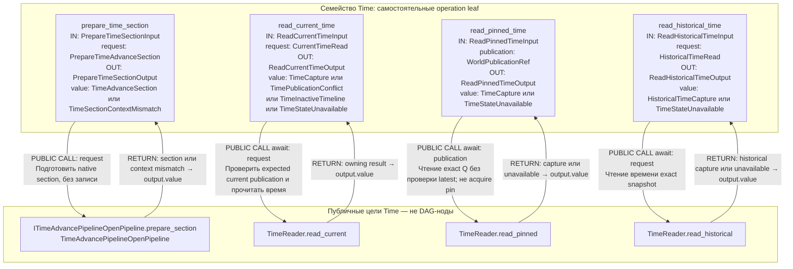

# Time: локальные ноды и публичные контракты

Отдельная фиксация оркестрации настроек и привязки восьми операций к публичным методам: [Настройки времени — контракты методов](gen-dag-time-settings-method-contracts.md). Она не меняет родство четырёх нод ниже; ownership, batch-семантика и producer settings section отмечены там отдельно как OPEN.

**Решение пользователя 2026-11-21:** фиксируются четыре предложенные локальные ноды prepare_time_section/read_current_time/read_pinned_time/read_historical_time как самостоятельные operation leaf семейства Time, без родительской исполняемой ноды в этом срезе. Семейство — логическая группа; CALL не задаёт родство. Эта фиксация не закрывает отмеченные ниже owning nested-read/Error/runtime gaps и не разрешает реализацию. Исторические PROPOSED именно по именам/группировке заменены решением; настройки рассматриваются отдельно по owning контрактам.

2026-11-21. PROPOSED NodeId, родство и node POJO; пользователь поручил предложить ноды и сохранить диаграмму. Это документация, не реализация/регистрация нод и не приёмка runtime. Только локальные ноды Time, без общего read_world/write flow. Подготовка advance выше по процессу, initial artifact-read и settings в этот срез не добавлены.

## Семейство и связи

Все четыре ноды — самостоятельные operation leaf семейства Time, без parent-ноды в данном срезе. Семейство является группой регистрации, не исполняемой нодой. Нет порядка между четырьмя leaf и нет CALL друг к другу. Каждый leaf вызывает один публичный метод. Дополнительный read_time orchestration parent без отдельного процесса не вводится.

PUBLIC CALL/RETURN — связь ноды с публичным методом, не engine CALL другой ноды. Родство выражено общей группой и отсутствием parent; двунаправленные стрелки отражают вызов и результат, не цикл исполнения DAG. NodeId в диаграмме предложены, не зарегистрированы. Ноды read не вызываются автоматически из prepare_time_section.

## Полные node POJO

Предлагаемый модуль backend/app/dataModel/engine/nodes/time/contracts.py. Все wrappers strict/frozen/extra-forbid/revalidate-always, обязательные поля без defaults. Owning модели используются вложенно, не копируются. Это новые проектные declarations, не actual код.

| Нода | Input POJO: все поля | Output POJO: все поля |
|---|---|---|
| prepare_time_section | PrepareTimeSectionInput: request: PrepareTimeAdvanceSection | PrepareTimeSectionOutput: value: TimeAdvanceSection \| TimeSectionContextMismatch |
| read_current_time | ReadCurrentTimeInput: request: CurrentTimeRead | ReadCurrentTimeOutput: value: TimeCapture \| TimePublicationConflict \| TimeInactiveTimeline \| TimeStateUnavailable |
| read_pinned_time | ReadPinnedTimeInput: publication: WorldPublicationRef | ReadPinnedTimeOutput: value: TimeCapture \| TimeStateUnavailable |
| read_historical_time | ReadHistoricalTimeInput: request: HistoricalTimeRead | ReadHistoricalTimeOutput: value: HistoricalTimeCapture \| TimeStateUnavailable |

Owning inputs: PrepareTimeAdvanceSection(proposal:TimeAdvanceProposal, operation_id:EntityUid, expected_world:WorldPublicationRef); CurrentTimeRead(expected:WorldPublicationRef); HistoricalTimeRead(snapshot:WorldSnapshotRef). ReadPinnedTimeInput напрямую содержит owning WorldPublicationRef согласно existing method, новый зеркальный request не создаётся.

Owning outputs: TimeCapture(publication:WorldPublicationRef,point:TimePoint); HistoricalTimeCapture(snapshot:WorldSnapshotRef,point:TimePoint); TimePublicationConflict(expected,observed:WorldPublicationRef); TimeInactiveTimeline(requested:EntityUid,active:EntityUid|None); TimeStateUnavailable(world_uid:EntityUid,reason:TimeUnavailableReason). TimeAdvanceSection/TimeAdvancePatch и TimeSectionContextMismatch — принятые локальные owning формы из Time-плана; нода не вычисляет header/ordinal/identity и не создаёт section самостоятельно.

## Exact цели и mapping

| Публичная цель | Signature | Статус |
|---|---|---|
| application/time/changes/advancePipelineOpenPipeline.py::ITimeAdvancePipelineOpenPipeline; concrete TimeAdvancePipelineOpenPipeline | prepare_section(request:PrepareTimeAdvanceSection) → TimeAdvanceSection \| TimeSectionContextMismatch | Локальный owning контракт принят в плане; метода в текущем коде ещё нет |
| application/time/reads/reader.py::TimeReader | async read_current(request:CurrentTimeRead) → TimeCapture \| TimePublicationConflict \| TimeInactiveTimeline \| TimeStateUnavailable | Existing signature; целевой nested route требует проверки |
| тот же | async read_pinned(publication:WorldPublicationRef) → TimeCapture \| TimeStateUnavailable | Existing signature; pinned означает чтение заданной Q, не выдачу retention authority |
| тот же | async read_historical(request:HistoricalTimeRead) → HistoricalTimeCapture \| TimeStateUnavailable | Existing signature; не restore и не переключение timeline |

Для каждого leaf: единственное поле input передаётся соответствующему аргументу метода; owning результат помещается в output.value без переопределения category/reason, fallback, latest lookup или повторного вызова. Конфликт/unavailable — owning value, не инфраструктурная ошибка и не повод скрытого retry. Политика действий по результату принадлежит внешней orchestration, которая здесь не проектируется.

## Error, внутренние вызовы и границы приёмки

Полный node Error ещё OPEN: owning публичный infrastructure fault carrier и его точное соответствие engine NodeError должны быть предъявлены Time. Не придумывать TimePublicFault/TimeNodeError только для заполнения диаграммы. Structural input errors обрабатываются existing engine admission; native validation не переносится в DAG. Cancellation сохраняет runtime semantics; исключения не превращаются в TimeStateUnavailable/TimeSectionContextMismatch. Никаких blanket catch/default success.

Existing TimeReader делегирует ITimeReadSource. Existing SnapshotTimeReadSource вызывает AcceptedStateReader и открывает scopes; это не принимается автоматически как целевой nested route. Локальные public signatures чтения можно описать, но полная приёмка read-ноды остаётся OPEN до проверки допустимых зависимостей/authority/lifetime. H3 transaction-bound чтение внутри Time handler — иной internal контракт, не target этих публичных read leaf.

prepare_time_section не пишет данные. Публичная общая запись — Snapshot.apply в другом семействе; TimeSectionHandler/IBoundTimeStateWriter — внутренние transaction participants. Поэтому локальная write_time-нода здесь не выдумывается. Отсутствие её не меняет принятую общую цепочку записи.

## Ответственность и проверка

Каждый node-класс (proposed PrepareTimeSectionNode, ReadCurrentTimeNode, ReadPinnedTimeNode, ReadHistoricalTimeNode в backend/app/application/engine/nodes/time/) только передаёт контракт, вызывает одну owning операцию и возвращает owning value. Запрет: IO/storage/codec/Time predicates/foreign calls в ноде, вычисление времени, node-to-node execute, скрытый retry. POJO только данные, без scopes/services/callbacks. Time pipeline отвечает за prepare semantics; TimeReader за свой публичный контракт; Time storage/dependencies должны пройти отдельную nested проверку. Родство/NodeId/wrappers и Error завершаются через координатора и пользователя; код не разрешён этим документом.

Источники: [Time owning план](time-domain.md), [общая запись](dag-multidomain-patch-publication-draft.md), [DAG критерии](../rules/dag-generator-interface.mdc). Эти четыре ноды не являются полным CRUD-каталогом Time и не проектируют read_world.
