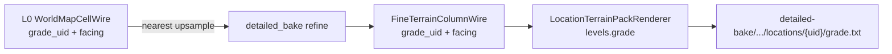

# Plan: Grade ASCII in detailed location render ✅ DONE

**Дата:** 2026-08-11  
**Контекст:** L0 уже умеет `ascii_grade` / `world-grade.txt`, но **главный gameplay/debug путь** — L2 локация после `detailed_bake` — grade не показывает.  
**Product lock (мастер):**

| Bake | Grade generate | Grade render |
|---|---|---|
| light / full (L0) | ✅ ribbon consumers | отдельный `world-grade` (не смешивать с map/height) |
| detailed (L2) | ❌ не генерировать | **в рендере локации** (не отдельный world-grade dump) |

Wilderness detailed ASCII — **out of scope v1** этого плана (только location), unless мастер расширит.

Связанные SoT: [`docs/tz_pack_ascii_render.md`](../../docs/tz_pack_ascii_render.md) (**PAR-G\*** locked / **PAR-Q\*** open); generate — [`docs/tz_terrain_relief.md`](../../docs/tz_terrain_relief.md) R36j/f.

---

## 1. Gap (как есть)

```text
L0 compose → WorldMapCellWire.{system_grade_uid, system_facing}
           → render_light_grade_mosaic ✅

detailed_bake → FineChunkRunner
             → upsample_facing_from_parent_light ✅
             → MapCell.system_facing (surface)
             → FineTerrainColumnWire.system_facing ✅
             → system_grade_uid ❌ не upsample / нет поля на FineTerrain
             → LocationTerrainPackRenderer / fineTerrainAsciiKernel
                → только terrain symbols ❌ facing/grade не рисуются
             → dump_detailed_renders ❌ нет grade layer
```

**Главное место без использования:** `LocationTerrainPackRenderer` + `GET …/render-location-grids` + `dump_detailed_renders`.

---

## 2. Целевое состояние

### 2.1 Data (L2 wire)

Чтобы локальный grade-рендер был честным (не «стрелка без объекта»):

1. **Upsample `system_grade_uid`** с parent light → meter grid (nearest, как facing) — `parentLightTerrain.py`.
2. Проставить на **поверхностный** `MapCell.system_grade_uid` в `columnFillPass` (рядом с facing).
3. Расширить **`FineTerrainColumnWire`**: `system_grade_uid: str | None = None` (колонка, как facing; R36h — uid на поверхности колонки, не per-run).
4. `cells_to_fine_terrain_chunk` — uid с **surface/top** only (**PAR-G9**; не majority).

**Не делать:** повторный ribbon grade apply внутри detailed; invent uid без L0.

### 2.2 Render (location)

Переиспользовать SoT символов (`mapSymbols.grade_symbol` / `FACING_ARROW`):

| Layer key | Содержимое |
|---|---|
| `LEVEL_SURFACE` | как сейчас (terrain) |
| **`LEVEL_GRADE`** (`"grade"`) | crop bbox колонок с `system_grade_uid`; стрелки / sheer; пусто → omit layer (не псевдопустая сетка) |

Модули:

- `fineTerrainAsciiKernel`: `symbols_grade_surface(cols) → dict[(lx,ly), str]`
- `LocationTerrainPackRenderer.render_grade()` + включить в `render_all_levels()` если non-empty
- `LocationGridPayload` / route уже тащит `levels` dict — достаточно нового ключа
- `dump_detailed_renders`: писать `grade.txt` рядом с `surface` **только для location**; wilderness — не писать grade (v1)

### 2.3 L0 (без регрессии)

- `world-grade.txt` остаётся только для L0 dump.
- detailed dump **не** зовёт `render-world-grid` grade заново «вместо» локации.

---

## 3. Data flow



---

## 4. Порядок имплементации (слои)

| # | Слой | Done when |
|---|---|---|
| **A** | Wire: `FineTerrainColumnWire.system_grade_uid` | POJO + parse ok; extra=ignore совместим со старыми blob |
| **B** | Refine: upsample grade_uid + columnFill + `mapCellToFineTerrainWire` | после detailed location blob имеет uid на grade-колонках |
| **C** | Kernel + `LocationTerrainPackRenderer` LEVEL_GRADE | `render-location-grids` → `levels.grade` при наличии |
| **D** | `dump_detailed_renders` / script | location `grade.txt`; empty → файл не создавать |
| **E** | Tests | unit: upsample; render empty=truly empty; smoke fixture с L0 grade → detailed location levels |
| **F** | TZ one-liner | `tz_terrain_relief` / pack storage: L2 location render shows grade overlay; detailed не materialize ribbon |

Параллельно можно **C** на уже существующем `system_facing` alone (стрелки без uid → sheer/`┃` или skip) — **не рекомендуется**: сломает контракт `grade_symbol` (требует uid). Лучше A→B→C строго.

---

## 5. Контракты / инварианты

SoT: [`docs/tz_pack_ascii_render.md`](../../docs/tz_pack_ascii_render.md) — **PAR-G1…G10** locked (G7 wire; G8 nearest; G9 surface; **G10** uid→`ReliefGradeInstance` SLOPE\|SHEER per relief; ASCII = consumer; climb Wave E). Open product Q — нет.

---

## 6. Вне scope / позже

- Wilderness detailed `levels.grade` (PAR-G6)
- Climb / LLM resolve Grade entity по uid (R36f) — Wave E; uid на колонке уже ref на instance (PAR-G10)
- Протаскивание полных Grade entity полей (h/L/θ) в ASCII (символ = uid + facing cache)
- Отдельный HTTP `?layer=grade` — не нужен, если `levels.grade` в существующем endpoint
- Перенос ribbon generate off L0 — отдельный архитектурный PR
- Forced invalidate старых location blobs — не требуется (PAR-G4 omit)

---

## 7. Smoke acceptance

1. full_bake с templates → L0 `world-grade.txt` non-empty (где есть Δz).
2. detailed_bake `scope=location` для локации, пересекающей grade cells.
3. `render-location-grids` → `levels.grade` со стрелками; без grade → ключа нет.
4. `.local/.../detailed-bake/.../locations/{uid}/grade.txt` появляется только при non-empty.

---

## 8. Риски

| Риск | Mitigation |
|---|---|
| Старые location blobs без uid | omit grade layer; facing-only не рисовать как grade |
| Локация без пересечения L0 grade | пустой layer — ок |
| Путаница L0 world-grade vs location grade | разные пути dump; имена файлов `grade.txt` под location uid |

---

**Next after approve:** реализовать A→F; затем full + detailed location smoke на мире с шаблонами.
