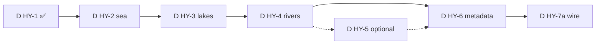

# D HY — surface hydrology (pre-DAG agent plan)

**Статус:** living plan · **2026-07-04**  
**Доменное ТЗ:** [`docs/tz_terrain_hydrology.md`](../docs/tz_terrain_hydrology.md)  
**Terrain pipeline:** [`docs/tz_terrain_generation.md`](../docs/tz_terrain_generation.md) § Phase 9+ «D HY»  
**Tech debt:** [`docs/tz_generator_technical_debt.md`](../docs/tz_generator_technical_debt.md) § HY-1, HY-S*

**Scope:** H-1…H-7a — pure generators + `MapCellService` / debug HTTP wire.  
**Вне scope:** DAG node `apply_hydrology` (H-7b), U13 LLM naming, U12 cave hydrology (Phase B caves).

---

## Целевой pipeline

```
run_surface_pass (P1)           → SurfaceHeightmap (surface_z only)
HydrologyGeneratorService.apply → mutate surface_z + cell_index (roles, liquid_candidate)
run_gap_analysis (P1.5)
run_column_fill (P2)            → MapCell skeleton + hydrology metadata on surface-top
save_terrain_batch
generate_climate                → weather + liquidOverlayPass (phase on liquid_candidate)
```

Debug path 2 (smoke): [`backend/scripts/debug_surface_helpers.py`](../backend/scripts/debug_surface_helpers.py) — `api_materialize_surface_stack`.

---

## Текущее состояние (2026-07-04)

| Подфаза | Статус | Примечание |
|---|---|---|
| **D HY-0** | ✅ | Семантика U1–U28 в TZ; bundle import `connection_nodes/edges` |
| **D HY-1** | ✅ partial | types, loader, stub, `test_hydrology_hy1.py`; `apply()` пустой |
| **D HY-2…4** | ⬜ | Классы генераторов не созданы |
| **D HY-5** | ⬜ optional | Procedural autoresolve — после declare path |
| **D HY-6** | ✅ partial | `MapCellHydrology` POJO + `liquidOverlayPass` via `cell_hydrology_liquid_candidate`; persist on cells ⬜ |
| **D HY-7a** | ⬜ | HY не между P1 и gap; `generate-hydrology` stub без persist |
| **NC-1c** | ✅ partial | `_non_surface_anchor_cells` убран из eager climate (2026-07) |

**Эталонные fixtures:**

| Fixture | Роль |
|---|---|
| [`fixtures/world_template.json`](../fixtures/world_template.json) | declare-only climate/hydrology template |
| [`fixtures/world_test_all.json`](../fixtures/world_test_all.json) | merge + regression (0 false `liquid_body` до HY carve) |

---

## Инварианты (не нарушать)

1. **Pure generators** — без repos/async/SQL в `generators/terrain/hydrology/`.
2. **Persist** — `MapCellService`, `ConnectionPersistService`; generators возвращают DTO/`HydrologyResult`.
3. **POJO source of truth** — policy/bands из `dataModel/hydrology/` + `jsonValidation`; не дублировать literals.
4. **Координаты (C1):** graph nodes — meters; heightmap keys — `(gx, gy)` grid; конверсия только через `generators/coordinates/convert.py`.
5. **Реки = connections** — bed carve в heightmap; graph rows — `riverConnectionEmit` → persist в orchestration.
6. **U28:** `liquid_body` в river bed ставит **hydrology**; climate — только phase/state.
7. **Smoke** — HTTP к running backend; агент не стартует сервер.

---

## Порядок фаз



---

## D HY-1 — foundation ✅ (закрыть HY-1 debt)

**Deliverable:** `HydrologyGeneratorService` stub + loaders.

**Уже есть:**

- `generators/terrain/hydrology/types.py` — scopes, `HydrologyResult`, `HydrologyCellIndex`
- `buildHydrologyMasterInput.py`, `loadConnectionGraph.py`, `loadHydrologyFromWorld.py`
- `resolveHydrologyBands.py`, `resolveRiverTypeClassify.py`, `hydrologyLocations.py`
- `dataModel/hydrology/*` — seas, lakes, rivers policies
- `tests/test_hydrology_hy1.py`

**Осталось для «closed»:**

- [ ] `SeaLevelPolicy` — `resolve_z_sea(world) -> 0` v1 (`seaLevelPolicy.py`)
- [ ] Расширить `HydrologyResult`: mutated `SurfaceHeightmap`, `dirty_bbox`, optional emitted connection DTO lists
- [ ] Split declared edges by `HydrologyConnectionType` в `buildHydrologyMasterInput` (HY-S-3)

---

## D HY-2 — sea + ocean + landforms

**TZ:** H-2, H-2b · **DoD:** declared coastline + shore/deepening bands (max 20); `CoastalLandformClassifier` на fixture.

### Shared (сделать первым — reuse в HY-3/4)

| Файл | Назначение |
|---|---|
| `hydrology/seaLevelPolicy.py` | `z_sea = 0`, `is_land(surface_z, z_sea)` |
| `hydrology/polylineRasterize.py` | Bresenham `(gx,gy)` из declare edge chain |
| `hydrology/deepeningBandCarver.py` | U15: shore → bands 1..N → open water; params из `default_seas.bands` |
| `hydrology/shoreProfile.py` | terrain/material per band (shore solid, center liquid_candidate) |

### Generators

| Файл | Scope | Вход → выход |
|---|---|---|
| `hydrology/seaBasinGenerator.py` | `COASTAL_SEA` | declare `coastline` edges → coastal_sea_mask, `surface_z` at `z_sea`, roles |
| `hydrology/oceanBasinGenerator.py` | `OPEN_OCEAN` | expansion от coastal ring; inland_sea master mask |
| `hydrology/coastalLandformClassifier.py` | `LANDFORMS` | read-only islands/peninsulas (no carve) |

### Orchestration

- [ ] `HydrologyGeneratorService.apply`: вызов COASTAL_SEA → OPEN_OCEAN → LANDFORMS при scope
- [ ] Declare-first (C6): edges из bundle до autoresolve
- [ ] Procedural v1 (C7): bbox padding + flood вне declare polyline если `default_seas.autoresolve_*`

### Unit tests

- [ ] `test_hydrology_hy2.py` — rasterize closed polyline; band count clamp 1..20; `z_sea` land/water

### Smoke (manual, path 2)

- Import `world_template` → surface → hydrology `scope=ocean` → climate
- На declare sea/coast cells: `hydrology.role` in (`coastal_sea`, `shore`), `liquid_candidate` на open water после climate

---

## D HY-3 — lakes

**TZ:** H-3 · **DoD:** 1 declared lake (`loc-template-lake-declared`, `lake_shoreline` chain) на `world_test_all`.

| Файл | Назначение |
|---|---|
| `hydrology/lakeBasinGenerator.py` | `LakeSpec` из declare `lake_shoreline` edges |
| reuse `deepeningBandCarver` | bands 1..5 (`default_lakes.bands`) |

### Tasks

- [ ] `buildHydrologyMasterInput`: extract `declared_lake_shoreline_edges` из graph
- [ ] Fill interior → `liquid_candidate`, role `lake`, lower `surface_z` to basin floor
- [ ] U25: `geographic.lake` vs `inland_sea` subtype routing

### Smoke

- `world_test_all`: после HY-3 + climate — `liquid_body` > 0 только на grid cells озера; dungeon/underground без water

---

## D HY-4 — rivers

**TZ:** H-4, U17, U18 · **DoD:** declared river polyline carved; `ConnectionEdge` persist в orchestration.

| Файл | Назначение |
|---|---|
| `hydrology/riverNetworkPlanner.py` | D8 descent; mouth on water mask; turn ≤ 45° |
| `hydrology/smoothRiverPolyline.py` | U14 smoothing |
| `hydrology/classifyRiverSegments.py` | pure: `river` vs `mountain_river`, rapids |
| `hydrology/riverBedCarver.py` | channel carve; U28 → `liquid_body` + `role: river_bed` |
| `hydrology/riverConnectionEmit.py` | DTO `ConnectionNode`/`ConnectionEdge`; **no persist** |

### Orchestration (вне generators)

- [ ] Debug route / `MapCellService`: после `apply` → `ConnectionPersistService.persist_graph` для **новых** autoresolved segments only (declare edges уже в bundle)
- [ ] Declared river (`ce-river-silver-*`): classifier **skip** (U18) — carve по existing polyline

### Smoke

- Declared Серебряная река: bed cells с `hydrology.role=river_bed`, connected liquid path к water mask

---

## D HY-5 — procedural autoresolve (optional)

**Skip if:** все `default_*.autoresolve: false` в fixture.

- [ ] Procedural lakes (basin detect)
- [ ] Procedural rivers (peak sources → mouth)
- [ ] Deterministic `world_seed`

---

## D HY-6 — metadata + climate contract

**TZ:** H-6, U19, U28.

**Done (2026-07):**

- [x] `liquidOverlayPass` — только `hydrology.liquid_candidate`, не `z≤0`
- [x] NC-1c eager — no meter orphan cells from climate

**Todo:**

- [ ] При column fill / terrain persist: copy `HydrologyResult.cell_index.by_cell` → `MapCell.hydrology` via **`dump_cell_hydrology(MapCellHydrology)`** (C2, U19)
- [ ] River bed: hydrology sets `system_terrain=liquid_body` at carve time (U28); climate overlay skip create, phase only
- [ ] Frozen/vapor: material phase в climate TZ — не в hydrology generator
- [ ] Partial recalc bbox (C14) — document hook; impl с HY-7a

---

## D HY-7a — wire + persist

**TZ:** H-7 pre-DAG · **DoD:** full debug pipeline без отдельного «surface без HY».

### MapCellService

```python
# target save_terrain_batch / new save_surface_with_hydrology:
heightmap = run_surface_pass(...)
hydrology_result = hydrology.apply(..., heightmap=heightmap, ...)
n_eff = run_gap_analysis(world, heightmap)  # after HY mutate
cells = run_column_fill(...)                 # merge hydrology metadata
await save_pass(cells, "terrain")
```

- [ ] Refactor `save_terrain_batch` или добавить `save_surface_materialization` с HY между P1 и gap
- [ ] `POST generate-surface` — опционально inline HY (flag) или документировать strict order surface → hydrology → re-fill

### Debug API

- [ ] `POST generate-hydrology`: persist heightmap mutation + re-run gap+fill OR return preview + second persist step
- [ ] Response: `cells_modified`, `dirty_bbox`, role counts (не `stub: true`)

### Smoke checklist (Definition of Done)

```text
1. Import fixtures/world_test_all.json
2. api_materialize_surface_stack (или surface→hydrology→climate)
3. Assert:
   - liquid_body > 0 on declared lake/sea/river grid cells
   - 0 liquid_body at dungeon/underground meter coords (regression)
   - all map_cells x/y in grid range
   - hydrology JSON present on water surface tops
```

- [ ] Extend `debug_surface_helpers` assertions helper (optional `assert_hydrology_smoke`)

---

## Файловая карта (target tree)

```
backend/app/application/worldData/generators/terrain/hydrology/
  __init__.py
  types.py                          ✅
  hydrologyGeneratorService.py      ✅ stub → orchestrator
  buildHydrologyMasterInput.py      ✅ → split edges by type
  loadConnectionGraph.py            ✅
  loadHydrologyFromWorld.py         ✅
  resolveHydrologyBands.py          ✅
  resolveRiverTypeClassify.py       ✅
  hydrologyLocations.py             ✅
  seaLevelPolicy.py                 ⬜
  polylineRasterize.py              ⬜
  shoreProfile.py                   ⬜
  deepeningBandCarver.py            ⬜
  seaBasinGenerator.py              ⬜
  oceanBasinGenerator.py            ⬜
  coastalLandformClassifier.py        ⬜
  lakeBasinGenerator.py             ⬜
  riverNetworkPlanner.py            ⬜
  smoothRiverPolyline.py            ⬜
  classifyRiverSegments.py          ⬜
  riverBedCarver.py                 ⬜
  riverConnectionEmit.py            ⬜
```

---

## После D HY-7a (не этот план)

| Item | Where |
|---|---|
| DAG node `apply_hydrology` | H-7b · [`docs/tz_world_generation_dag.md`](../docs/tz_world_generation_dag.md) |
| LLM geography naming U13 | DAG only |
| Cave hydrology U12 | Phase B caves |
| Import validator U22 `type_classify` | JV + HY-4 |
| Close HY-1 in tech debt | когда `apply` не stub |

---

## Changelog

| Дата | Изменение |
|---|---|
| 2026-07-04 | `MapCellHydrology` + `HydrologyCellRole` in dataModel; overlay/index typed |
| 2026-07-04 | Plan restored; статус D HY-1 partial, D HY-6 overlay fix, NC-1c, `world_test_all` regression |
| 2026-06 | Initial backlog referenced from `tz_terrain_hydrology.md` § Контракты |
