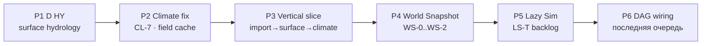

# Implementation Roadmap — terrain · hydrology · climate · snapshot

> **Статус:** active · **Следующий шаг:** **D HY-0**  
> **Обновлено:** 2026-06  
> **Не трогаем сейчас:** cave graph / U12, lazy sim LS-T*, engine DAG nodes, U13 LLM naming

## Контекст

| Область | Код сейчас | ТЗ |
|---|---|---|
| Climate eager (pole/tier) | ✅ | [`docs/tz_climate.md`](../docs/tz_climate.md) |
| Surface hydrology | ⬜ 0% | [`docs/tz_terrain_hydrology.md`](../docs/tz_terrain_hydrology.md) |
| `MapCell.hydrology` | ⬜ | C2 |
| Bundle `connection_*` import | ⬜ | C5 · [`fixtures/world_template.json`](../fixtures/world_template.json) |
| `liquidOverlayPass` | interim `z<=0` | U28 · D HY-6 |
| `recalculate()` / `output_bbox` | ⬜ CL-7 | climate C2, C9 |
| World snapshot runtime | ⬜ schema only | [`docs/tz_world_snapshot.md`](../docs/tz_world_snapshot.md) |
| Lazy sim детали | Todo LS-T* | [`docs/tz_lazy_simulation.md`](../docs/tz_lazy_simulation.md) |

**Правило:** генераторы — pure; persist — services; routing «когда вызывать» — позже DAG. Debug — `map.py` path 2.

**Schema (мастер, до явной отмены):** все SQL-изменения — только [`0001_initial.sql`](../backend/app/db/migrations/0001_initial.sql); **не** создавать `0002_*.sql`. См. [`.cursor/plans/schema-migrations-policy.md`](./schema-migrations-policy.md).

---

## Карта фаз



| Фаза | Цель | DoD кратко |
|---|---|---|
| **P1** | Surface hydrology end-to-end | [`hydrology-pre-dag.md`](./hydrology-pre-dag.md) D HY-0…7a |
| **P2** | Climate контракты в коде | CL-7; liquid U28; optional `SurfaceClimateField` v1 |
| **P3** | Smoke vertical slice мастера | `world_template` → surface → climate без регрессий |
| **P4** | Snapshot на ход | `WorldSnapshotService` capture/restore |
| **P5** | Lazy sim impl | LS-T1…T9 после WS-1 |
| **P6** | DAG nodes | `apply_hydrology`, `recalculate_climate`, capture |

---

## P1 — Surface hydrology (детальный план)

**Документ:** [`.cursor/plans/hydrology-pre-dag.md`](./hydrology-pre-dag.md)

### Pipeline (target)

```
P1 surface pass
  → HydrologyGeneratorService.apply
  → gap analysis
  → column fill (+ MapCell.hydrology)
  → save_terrain_batch
  → ConnectionPersistService (declare + river emit)
--- HTTP ---
  → generate-climate (liquidOverlay U28)
```

### Рекомендуемые спринты

#### Sprint 1 — Foundation (D HY-0 + HY-1)

| Задача | Выход |
|---|---|
| **0a** `MapCell.hydrology` | model + migration/SQL + repo merge не затирает JSON |
| **0b** bundle connections | `WorldBundleService` import/export nodes/edges |
| **0c** `loadConnectionGraph` | meters coords, `location_uid` resolve |
| **1a–1e** types + stub service | unit tests bands, disabled skip |

**Gate:** import `world_template.json` → 14 nodes + edges в БД (GET API или repo test).

#### Sprint 2 — Water bodies declare (D HY-2 + HY-3)

| Задача | Выход |
|---|---|
| **2a–2f** sea/ocean + polyline rasterize | north sea coastline из fixture |
| **3a–3c** lakes | `geo_lake_moon` quadrilateral |
| Wire scopes в service | `COASTAL_SEA`, `LAKES` |

**Gate:** unit masks non-empty; debug preview JSON (можно без full 7a).

#### Sprint 3 — Rivers declare (D HY-4)

| Задача | Выход |
|---|---|
| **4a–4g** smooth, classify, bed carver, emit, persist | Silver River declare path |
| **4g** metadata merge at column fill | `role: river_bed`, `liquid_body` U28 |

**Gate:** generate-surface (partial wire) → river edges in DB + bed cells.

#### Sprint 4 — Autoresolve + climate + wire (D HY-5 + HY-6 + HY-7a)

| Задача | Выход |
|---|---|
| **5a–5c** river planner + procedural | second world with autoresolve ON |
| **6a–6c** liquidOverlay hydrology mask | no global `z<=0`; HY-1 debt closed |
| **7a–7d** full pipeline in `terrainGeneratorService` + `map.py` | smoke checklist |

**Gate:** полный smoke из [hydrology-pre-dag.md § Smoke](./hydrology-pre-dag.md).

### P1 — файлы (новые / главные touch)

```
backend/app/db/models/mapCell.py                    # hydrology JSON
backend/app/application/worldData/worldBundleService.py
backend/app/application/worldData/generators/terrain/hydrology/   # NEW tree
backend/app/application/worldData/generators/terrain/terrainGeneratorService.py
backend/app/application/worldData/mapCellService.py
backend/app/application/worldData/connectionPersistService.py     # call site
backend/app/api/routes/map.py
backend/app/application/worldData/generators/assemblers/climateAssembler/passes/liquidOverlayPass.py
```

### P1 — вне scope (явно)

- Cave hydrology U12, cave connection graph
- DAG node `apply_hydrology` (H-7b)
- U13 LLM naming
- Import validator U22
- `flow_level` seasonal v2

---

## P2 — Climate hardening

После или **parallel tail** P1 Sprint 4 (HY-6).

| ID | Задача | Файлы | DoD |
|---|---|---|---|
| **CL-7a** | Honor `run_cell_weather`, `run_liquid_overlay`, `output_bbox` | `climateSurfaceAssembler.recalculate` | unit: flags gate passes |
| **CL-7b** | Sync `types.py` с TZ | `ClimateRecalcRequest` | |
| **CL-7c** | Partial return только bbox cells | recalculate + MapCellService upsert | hydrology dirty rect C14 |
| **CF-1** | `SurfaceClimateField` + `build_surface_climate_field` | new `surfaceClimateField.py` | in-memory; CellWeatherPass refactor optional |
| **CF-2** | `resolve_cell_weather(field, cell)` | cellWeatherPass | pole/tier не дублировать |
| **RW-1** | `weatherResolve.py` stub | runtime pick registry | минимум для scene |

**Не в P2:** `ClimateLODPolicy` (CL-18) — ждёт lazy sim LS-T2.

**Gate:** `recalculate` с `output_bbox` меняет только rect; season_changed routing spec покрыт тестом-контрактом.

---

## P3 — Vertical slice (мастер smoke)

Ручной чеклист + optional script `backend/scripts/smoke_world_template.py` (без автотест-suite если не просят).

```
1. POST import fixtures/world_template.json
2. POST generate-surface
3. POST generate-climate
4. Assert hydrology roles, liquid_body, connections, no z<=0-only sea
5. debug_settlement / debug_ladder — no regression
```

Зафиксировать в PR / commit message как **P3 DoD**.

---

## P4 — World Snapshot

**ТЗ:** [`docs/tz_world_snapshot.md`](../docs/tz_world_snapshot.md)

| ID | Задача | DoD |
|---|---|---|
| **WS-0** | `WorldSnapshotRepository` + migration | table matches storage TZ |
| **WS-1** | `capture_turn` / `restore` minimal | world + session roundtrip |
| **WS-1b** | Hook после commit хода | один capture на ход |
| **WS-2** | Full blob domains | map_cells, NPC, connections, location_* |
| **WS-3** | Regen diff, TR-2 unblocked | compare snapshot N vs N-1 |

**Открытые решения (можно default v1):**

- messages: FK only, не в blob
- map_cells: full as in DB (lazy = absent cells absent)
- `SurfaceClimateField`: **recompute on restore** (CL-17 default)

**Gate:** restore snapshot → continue turn → new snapshot; checksum verify.

---

## P5 — Lazy Simulation (Todo backlog)

**Не начинать до WS-1b.** Задачи LS-T1…T9 в [`docs/tz_lazy_simulation.md`](../docs/tz_lazy_simulation.md).

Порядок внутри P5 (предложение):

1. LS-T2 — границы near/medium/far (простые defaults)
2. LS-T3 — batch N/M
3. CL-18 — `ClimateLODPolicy` wiring
4. LS-T4…T8 — NPC aggregation / unfold

---

## P6 — DAG (последняя очередь)

| Node | После |
|---|---|
| `apply_hydrology` | P1 ✅ |
| `recalculate_climate` | P2 CL-7 |
| `resolve_weather` | P2 RW-1 |
| `capture_world_snapshot` | P4 WS-1b |
| lazy sim tick nodes | P5 |

**Ref:** [`docs/tz_world_generation_dag.md`](../docs/tz_world_generation_dag.md)

---

## Tech debt — закрытие по фазам

| ID | Фаза |
|---|---|
| HY-1 (liquid `z<=0`) | P1 HY-6 |
| CL-7 | P2 |
| CL-17 (field cache in blob) | P4 или defer recompute |
| CL-18 | P5 |
| TR-2 (double pole HTTP) | P4 WS-3 |
| WS-1 | P4 |

---

## Риски и mitigations

| Риск | Mitigation |
|---|---|
| Repo upsert затирает `hydrology` | HY-0a: explicit merge в terrain/climate upsert |
| Declare/autoresolve conflict | C6: declared edge_uids immutable |
| Coordinate mix grid/meters | C1: только `convert.py`; unit test roundtrip |
| Scope creep caves | explicit out of scope в PR |
| Нет автотестов | unit на pure fns (bands, rasterize, U25); smoke manual P3 |

---

## Ссылки

| Документ | Роль |
|---|---|
| [`hydrology-pre-dag.md`](./hydrology-pre-dag.md) | P1 task breakdown |
| [`docs/tz_terrain_hydrology.md`](../docs/tz_terrain_hydrology.md) | Семантика U1–U28, контракты |
| [`docs/tz_climate.md`](../docs/tz_climate.md) | C1–C13, Climate LOD |
| [`docs/tz_world_snapshot.md`](../docs/tz_world_snapshot.md) | P4 |
| [`docs/tz_generator_technical_debt.md`](../docs/tz_generator_technical_debt.md) | CL-*, HY-*, WS-1 |
| [`fixtures/world_template.json`](../fixtures/world_template.json) | Эталон declare |

---

## Definition of Done (roadmap)

- [ ] **P1** — D HY-0…7a smoke green
- [ ] **P2** — CL-7 + liquid U28 in code
- [ ] **P3** — vertical slice documented / script
- [ ] **P4** — capture + restore one world
- [ ] **P5** — LS-T2 + CL-18 minimum
- [ ] **P6** — hydrology + recalc climate nodes registered
