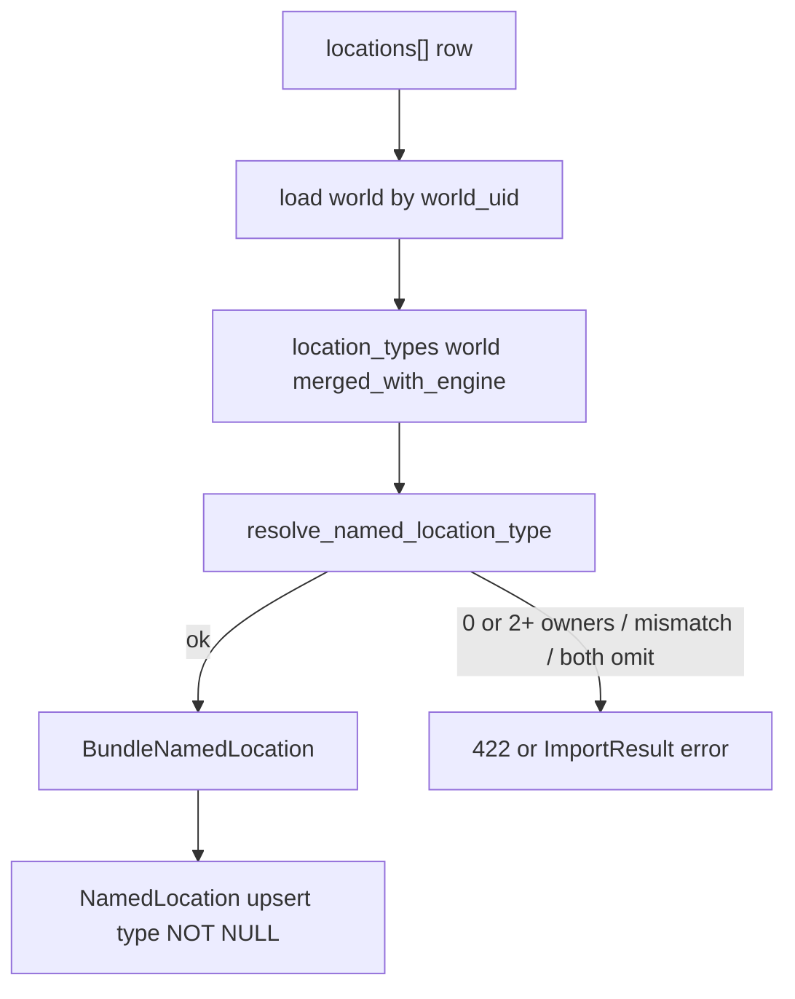

# LOC-T-1: infer `system_location_type` from unique subtype ✅ DONE

План архитектуры (зафиксирован 2026-09-07). Продуктовый контракт: [`docs/tz_locations.md`](../../docs/tz_locations.md) § Import wire **LOC-T-1**. Не CITY-T-5 / packing.

Код не писать, пока мастер не скажет «делай».

## 1. Целевое состояние

Мастер в `locations[]` может опустить `system_location_type`, если `system_location_subtype` принадлежит **ровно одному** type в merged `location_type_registry`. Import заполняет type до persist. SQL колонка остаётся NOT NULL.

**Callers (один helper)**

| Caller | Когда |
|---|---|
| `NamedLocationService.import_from_json` | skeleton bundle (`WORLD` уже импортирован — `BUNDLE_IMPORT_ORDER`) |
| `NamedLocationService.create` | HTTP CRUD одной локации |

`update` не выводит type из subtype задним числом, если клиент прислал частичный patch без type. Infer только на **create/import** (полная строка wire).

**Не callers:** генераторы, bake, DAG, `normalize_world`, Pydantic `model_validator` с fetch мира.

**Инварианты**

- Реестр = `location_types(world)` (`merged_with_engine()`). Не `canonical_engine()` в одиночку.
- Не infer из `system_city_size` и не из parent.
- Legacy `system_location_type: "city"` без subtype — валиден, не трогать.
- Неуникальный subtype без явного type → 422 (`mountain`, `island` в каноне; плюс любые коллизии world N+1).
- Schema: без `0001` / `0002`.

## 2. Контракты

### Helper (dataModel)

На `WorldLocationTypeRegistry` (typed, без world I/O):

```text
types_owning_subtype(system_subtype) -> tuple[str, ...]
resolve_named_location_type(type, subtype, registry) -> str
```

`resolve_named_location_type`:

| Вход | Выход |
|---|---|
| type задан, subtype нет | вернуть type (в т.ч. legacy `city`) |
| type + subtype | subtype ∈ `entry.subtypes` этого type → type; иначе ошибка. Пустой `subtypes` + непустой subtype → ошибка |
| type нет, subtype есть | ровно один owner → этот type; 0 / 2+ → ошибка |
| оба пустые | ошибка |

Ошибка — маленький typed exception (не голый `ValueError` с разными текстами без кода). Сообщения: unknown subtype / ambiguous (`territory|geographic`) / subtype not in type / type required.

Не дублировать списки subtype литералами в service (`dataModel-no-hardcode`).

### Wire POJO

`BundleNamedLocation.system_location_type`: на master JSON — omit допустим.

Рекомендуемый шов:

1. `prepare_named_location_wire(row, registry) -> dict` — копия row с заполненным type.
2. `BundleNamedLocation.model_validate(prepared)`.

После prepare type всегда есть → persist `NamedLocation` без nullable. Не класть `world` в модель.

Policy поля: `DefaultOnWire[str | None] = None` на сыром row **или** fill **до** validate и оставить `StrictOnWire` на DTO после prepare. Предпочтение: fill до validate + `StrictOnWire` на DTO (контракт «после prepare type обязателен»). Omit живёт на границе service, не внутри frozen model без реестра.

### Service

`NamedLocationService` сегодня: только `INamedLocationRepository`. Нужен мир для `location_types(world)`.

- Инжект `IWorldRepository` (или `WorldService.get_by_id`).
- `import_from_json`: **один** load мира на бандл, registry в closure `prepare`.
- `create`: load мира один раз.
- Мира нет → 422/404 как сейчас для unknown world, не silent engine-only infer.

`Container.location_service()` — прокинуть world repo. Циклических импортов с `WorldService` не плодить: repo достаточно.

HTTP: infer-ошибка на `create` → 422. На bundle — строка в `ImportResult.errors` (как сейчас любой `Exception` в `import_list`), не 500.

## 3. Data flow



Bundle: `WORLD` → `STATES` → `LOCATIONS`. Overlay реестра мира уже в SQL к моменту fill.

## 4. Порядок impl

1. Helper + exception на `WorldLocationTypeRegistry` (юнит без HTTP): `city`→`settlement`; `mountain` без type → ambiguous; type+чужой subtype → mismatch; type без subtype → as-is; оба пустые → error; world overlay коллизия `city` на втором type → ambiguous.
2. `NamedLocationService._from_wire` + container inject; load мира один раз на import.
3. Тесты service/import: omit type + `subtype=city`; omit оба; `mountain` без type; explicit type+subtype; legacy type `city`; `system_city_size` без type/subtype **не** становится settlement через этот helper (size — другая ось; footprint policy не менять в этом PR).
4. Fixture `fixtures/world_test_gen.json`: убрать `system_location_type` у Ironhold/Amberport (**только после** helper). `world_test.json` не трогать.
5. Галка LOC-T-1 в `tz_locations.md` открытых вопросах + строка очереди в `tz_json_validation.md`. Не переписывать контрактную таблицу.

Вне scope: полный JV locations slice; parent-type tree validate; DAG; `map_z` код (omit=0 уже runtime). Документ `map_z` — в ТЗ, не в этом PR.

## 5. Почему не в генераторе / не в POJO с fetch

Runtime `uses_settlement_fine_footprint` уже считает subtype-only settlement-like — это **не** import fill. Дыра: `BundleNamedLocation` режет omit type на 422 до persist. Чинится на import-границе, иначе bake/C11 получают пустой type в SQL, которого колонка не допускает.
