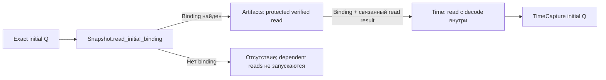
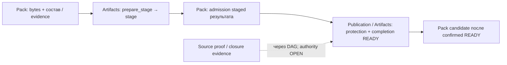

# Смежные процессы: exact initial-read и подготовка Pack

2026-11-21. Вынесены по поручению пользователя из [общей карты записи](dag-multidomain-patch-publication-draft.md), чтобы не смешивать скоупы. Это сохранённые контрактные направления IC-5/IC-6, не обязательные этапы write_changes и не новые NodeId. Статусы ведутся в [едином реестре](interdomain-contract-register.md); файл не переоткрывает принятые решения и не разрешает реализацию.

## IC-5: exact initial-read

Относится к чтению initial state точной initial/start публикации Q. Вариант 2 принят: Time decode внутри одной публичной read-операции. Не является автоматически current-time read, coherent capture записи или общей read_world-нодой. Самостоятельный read-flow прорабатывается после контрактов записи.

Все междоменные переходы через DAG. OPEN: authority/lifetime, exact IO/Error, format binding, mapping Q→binding→ArtifactRef→bytes→capture. None не заменяет corruption. Источники: time-domain.md, artifacts-public-staging-dag.md, Snapshot read contracts.

## IC-6: самостоятельная подготовка Pack

Относится к Pack material/candidate и protection/completion. Не обязательна перед Snapshot.apply, candidate не native section. Схема PROPOSED/OPEN; порядок не принимается этим переносом. Publication — общая инфраструктура ядра Snapshot, не новый предметный домен.

Stage не READY. Источник Source protection отделён от target completion; Source evidence не authority, internal Source adopts не разрешены. Exact public entries, full target set, candidate mapping/replay и root lifetime OPEN; полная актуальная детализация X-READ/X-RET — в реестре. Источники: pack-artifacts-boundary-trace.md, artifacts-public-staging-dag.md, world-pack-v2-single-manifest-contract.md.

[Pack import/export](pack-import-export-after-current-scope.md) — отдельный отложенный этап, не расширение текущих контрактов. Он остаётся зависимостью затрагивающего импорт удаления полей и полного cutover.
