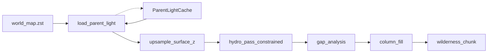

# L0-constrained refine (WP-PERF-22) ✅ DONE

**Статус:** ТЗ зафиксировано; **код не начинать** без явной просьбы.  
**ТЗ:** [`docs/tz_world_pack_storage.md`](../../docs/tz_world_pack_storage.md) § Идея 2 · Parent light SoT · Refine pipeline L2 · WP-PERF-22; [`docs/tz_map_light_bake.md`](../../docs/tz_map_light_bake.md) § Связь с L2 / MLB-8.  
**Правило:** architecture-first — SoT/контракты → adapter → pure generators → orchestrator.

---

## Locked decisions (мастер 2026-07-15)

| # | Решение |
|---|---|
| Scope | Upsample L0 `surface_z` **+** hydro corridor по L0 `hydrology_role` |
| SoT | Baked `world_map.zst` / `WorldMapCellWire` only |
| Perf | Process-local cache after successful write or first read; miss → disk |
| Cache key | `(world_uid, gx, gy)` — pack session / process; not global without world |
| Upsample | Resample (default bilinear) + band-limited noise; fine z within **±1** of L0 form (`z_band`) |
| Hydro | **Hard corridor**; bridge `to_fine_role()`; no bed outside mask |
| Knobs SoT | Future `ParentLightRefinePolicy` in `dataModel/worldPack/` (+ cache knobs in PackRead/BakeDefaults) |
| Forbidden | Live `LightGridCompose` or `SurfaceTerrainContext` as L2 mask SoT |

```text
write_world_map_tile → disk + cache.put
load_parent_light(gx,gy) → cache.get OR read_zst → cache.put
```

ТЗ-норматив: `docs/tz_world_pack_storage.md` § Parent light SoT + § Parent light refine contracts.

---

## Target data flow



---

## Implementation layers (order)

| # | Layer | What | Done when |
|---|---|---|---|
| **1** | dataModel | `ParentLightTile` + `ParentLightRefinePolicy` (`z_band=1`, resample mode, …); helpers sample `(tx,ty)` / meters→light | POJO + unit |
| **2** | Pack adapter | `load_parent_light` on reader; `cache.put` on writer after successful write; same-process miss→disk | bake+refine same run hits cache; restart hits disk |
| **3** | Pure generators | Upsample L0 z → fine `SurfaceHeightmap` + band-limited noise; Pass 1.5 / bed carve **clipped** to hydro mask (`to_fine_role`) | corridor + z-band unit tests |
| **4** | Orchestrator | `build_tile_surface_state` / `FineTerrainRefineOrchestrator` inject parent light; stop sole path `build_fine_surface_tile(coarse)` as L2 SoT | refine reads pack L0 |
| **5** | Tests / smoke | Corridor containment; z band; optional HTTP after bake | MLB-8 |

**Не в scope этого плана:** WP-PERF-20 partial rect+halo; DAG wiring; roads contributor.

---

## Current gap (code today)

- Refine uses `SurfaceTerrainContext` + `build_fine_surface_tile(coarse)` — **not** baked L0.
- L0 used on **read fallback** (`WorldMapPackReader`) only.
- `to_fine_role` ready as role bridge; unused in generate path.

---

## Definition of done (code phase)

- [x] `load_parent_light` + process cache wired on write/read
- [x] Fine heightmap from L0 upsample (not flat coarse stamp alone)
- [x] Fine hydro inside L0 corridor
- [x] MLB-8 unit (+ optional fixture smoke)
- [x] WP-PERF-22 row → ✅ in storage TZ when landed

---

## История

| Дата | Изменение |
|---|---|
| 2026-07-15 | Plan after TZ Parent light SoT (A+cache) + scope B |
| 2026-07-15 | Locked refine contracts synced from TZ (z_band, hard corridor, cache key) |
