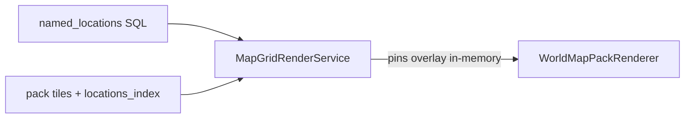

# L0 identity overlay — SQL subtype → pack render ✅ DONE

SoT: [`docs/tz_pack_ascii_render.md`](../../docs/tz_pack_ascii_render.md) § L0 identity. Не слайс «сначала глифы в pack».

## Целевое состояние

Один SoT вида места — `named_locations` (SQL). Pack несёт **геометрию** world map (`location_pin` = индекс, диск footprint, координаты пина). Debug render **на том же API-запросе**, что уже грузит мир, читает локации и накладывает type/subtype/size на пины **по `location_uid`**, не меняя порядок массива.

Движок / сцена / DAG pack за subtype не читают.



| Компонент | Ответственность |
|---|---|
| `NamedLocation` / `NamedLocationService.get_all` | SoT identity |
| `locations_index.json` | якоря + стабильный индекс; **не** SoT subtype |
| `overlay_location_pins(pins, locations)` | copy type/subtype/size с SQL; длина и порядок = pack |
| `LocationTypeSubtypeEntry.l0_map_symbol` | N+1 глиф; canonical city=`u` village=`n` dungeon=`d` underground_city=`g` |
| `wire_symbol` / mosaic | footprint глиф = `pins[cell.location_pin]` → registry symbol; `@` только non-site |
| HTTP `render-world-grid` / tile-grids | overlay обязателен |
| Unit renderer без SQL | поля пина если есть, иначе `u` для site |

**Инварианты**

- Overlay не переставляет и не фильтрует пины.
- Нет SQL-строки на uid пина → оставить pack type; glyph fallback `u` если site.
- Смена только subtype → новый render, **без** rebake. Смена координат / состава поселений → light/full bake.
- `locationsIndexBake` **не** начинает писать subtype как SoT (поле на пине optional только для in-memory overlay / тестов).

## Контракты

```text
overlay_location_pins(
  index: LocationsIndexWire,
  locations: Sequence[NamedLocation],
) -> LocationsIndexWire
  # new pins, same len/order; SQL wins on type, subtype, city_size, display_name

l0_settlement_glyph(pin, *, world) -> str
  # is_settlement_map_site → subtype.l0_map_symbol or "u"
  # else not used for footprint (that's @ overlay)

WorldMapPackRenderer(..., pins: overlaid index)
  # wire_symbol(cell, pins=...) looks up pin by location_pin index
```

`MapGridRenderService`: кроме `MapCellService` — `NamedLocationService`. Route: `container.location_service()`.

`PackMapGridRender._world_renderer(world, source, *, pins=overlaid | source.pins)`.

## Порядок имплементации (слои)

1. **dataModel** — `LocationTypeSubtypeEntry.l0_map_symbol: str | None`; canonical settlement subtypes заполнены. `LocationsIndexPin`: optional `system_location_subtype`, `system_city_size` (не bake-SoT).
2. **render overlay** — pure `overlay_location_pins` + glyph lookup через `location_type_registry` мира / engine (не литерал в contributor).
3. **L0 ASCII** — `lightMapCells` / mosaic / macro: footprint глиф из пина; hydro/road поверх; city footprint важнее `@`.
4. **application + HTTP** — `MapGridRenderService.render_world_grid` / `render_world_tile_grids` async fetch locations → overlay → pack renderer. Dump-скрипты без правок (уже HTTP).
5. **легенда** — `u`/`n`/`d`/`g` + `@` non-settlement.
6. **тесты** — overlay не меняет порядок; SQL village → `n` при том же `location_pin`; без overlay settlement → `u`; geographic `@`; coincident pin vs footprint; `test_world_map_pack_renderer`, render service.

**Вне scope:** движок/DAG; запись subtype в pack bake; новое поле на `WorldMapCellWire`; смена глифа по `system_city_size`.

## Приёмка

- Правка `system_location_subtype` в БД видна на следующем `GET …/render-world-grid` без bake.
- Деревня и город на L0 — разные буквы при том же bake, если subtype разный.
- Pack file `locations_index.json` после bake по-прежнему может не содержать subtype — это не баг.
