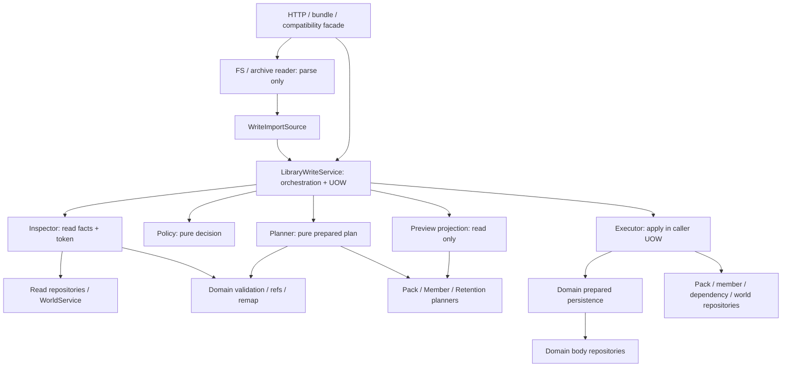

# L-4: архитектура единого application write pipeline

Дата архитектуры: 2026-10-12. Реализация L-4 завершена 2026-10-13;
HTTP/frontend (L-5) остаются отдельным шагом.
Нормативные правила: [ТЗ](../../docs/tz_template_library_packs.md) §0.2–0.3,
§1–4, §6. Порядок работ: [основной план](library-write-policy-done.md).
Факты кода и риски: [анализ L-4](library-write-l4-analysis-done.md).
При расхождении с ТЗ этот документ уточняется, правила ТЗ не переопределяются.

Уточнение 2026-10-12: пользователь потребовал следовать существующему ТЗ.
Отдельные `EditMemberRequest`, `edit_member` и `expected_token`, предложенные
в обсуждении, не являются требованиями или принятыми расширениями L-4.
Базовый протокол уже определён §0.3: запрос → policy_required при совпадениях
→ явные decisions/token → повторная проверка → атомарная запись.
Фронт выбирает copy/replace и точную цель из ответа; UID вычисляет и проверяет
бэкенд через app.ids. `copy_system_name` пака — ключ по ТЗ, не клиентский UID.

## 1. Границы

L-4 соединяет read inspector, pure policy и pure planners с атомарным
исполнением. Пользовательские import/copy/publish/instantiate/reinstantiate
используют один механизм выбора copy/replace. Явное редактирование по UID
использует общие проверки и план замены.

L-4 отвечает за application API, DI, persistence и перевод прежних application
entry points. HTTP wire и frontend относятся к L-5; library sections world
bundle и согласование world/library remap — к 4d. Каталог чтения и генераторы
не входят в write pipeline. Canonical attach остаётся trusted insert-missing.

## 2. Компоненты и зависимости



Стрелки показывают зависимости, не последовательность исполнения.
Service передаёт Snapshot → Decision → Plan между стадиями.
SQL source читает inspector; для него container reader не нужен.

- Service связывает стадии и управляет UOW; не реализует policy/domain rules.
- Inspector читает и валидирует факты; не выбирает действие и не пишет.
- Policy не имеет repository/HTTP/logging I/O и не генерирует UID.
- Planner не читает БД; готовит действия из snapshot через pure adapters.
- Executor не вызывает policy/planner, не нормализует тела и не выделяет UID.
  Он проверяет persistence preconditions: occupancy и наличие точных целей.
- Domain adapters знают модели тел и поля ссылок. Их pure методы используются
  при inspect/prepare; prepared persistence — при apply.
- Repositories выполняют хранение и не выбирают copy/replace.

Общий pack-слой знает library kind и typed контракт, но не поля конкретного
домена. Разные группы adapter методов не должны смешивать preparation и запись.

## 3. Контракты

Существующие DTO L-1…L-3 сохраняются:

- `LibraryWriteRequest`: batch, source references, destination, selections/token.
- `WriteImportSource`: parsed pack/members/dependencies без callbacks/SQL.
- `WriteSnapshot`: факты, inspection state и fingerprint token.
- `WriteDecision`: READY / POLICY_REQUIRED / REJECTED; choices/actions/issues,
  stale. READY означает разрешение планировать, не успешную запись.
- `LibraryWritePlan`: pack/member/world actions, UID maps, removed/held/preserved
  и diagnostics. Новые UID фиксируются до apply.

Целевые application сигнатуры:

```python
await service.execute(request, *, imports=None) -> LibraryWriteOutcome
await executor.apply(plan) -> WriteResult
```

`LibraryWriteOutcome` — discriminated union из `writeResults.py`:

- `WriteResult(status="applied", plan)`: target UID, UID maps, composition changes, diagnostics.
- PolicyRequired: точные matches/options/reasons, preview, token и stale.
- Rejected: причины отказа; executable actions отсутствуют.

`WritePreview` содержит actions и условный план замены либо `CopyPreview`:
source member UIDs, destination scope/pack, последствия для внутренних ссылок,
необходимость новой pack identity; copy не заменяет прежние записи и не меняет
источник. Неизвестные copy UID не назначаются для preview. HTTP status
и JSON serialization относятся к L-5. Persistence failures после начала
apply выходят исключением для rollback, а не превращаются в обычный отказ.

Executor принимает только внутренний plan сервиса из текущей UOW. Plan
не является client API или долгоживущим разрешением на запись. Один token
в произвольном plan не доказывает актуальность его исходного состояния.

## 4. Последовательность запроса

1. Reader разбирает весь выбранный контейнер без writes.
2. Service присоединяется к caller UOW либо открывает свою.
3. Inspector читает SQL source/target и валидирует parsed imports.
4. Policy проверяет доступ, совпадения, selections и token всего batch.
5. PolicyRequired/Rejected возвращаются без mutations.
6. Для READY planner назначает identity всему batch и готовит полный plan.
7. Executor проверяет preconditions и применяет plan.
8. Service выходит из собственной UOW и возвращает результат. Во внешней UOW
   окончательные commit/rollback остаются ответственностью caller.

Повторный запрос снова выполняет read/inspect/decide. Значимые изменения
source/target/usage дают stale preview без записи. Executor не меняет policy
и не подбирает другую identity при конфликте.

FS/archive snapshot определяется прочитанным содержимым этого запроса.
Executor не открывает файлы повторно. Single-file member import не становится
частичной заменой пака с удалением остальных members.

## 5. Preview

### Согласованный ответ API — 2026-10-12

Первый `policy_required` возвращает в одном ответе:

- `item_key` и UID всех совпавших целей;
- допустимые copy/replace для каждой цели и причины ограничений;
- preview последствий: field before/after, добавления/замены/удаления,
  удержание с причинами, изменения dependencies и remap;
- `preview_token`, связанный с проверенным состоянием.

Полные тела всех объектов включать в ответ не требуется. Фронт может
дочитать существующий объект по UID для раскрытия подробностей; такое
чтение не заменяет серверный preview последствий и не разрешает запись.
Отдельный обязательный preview-запрос или третий этап протокола не вводится.

Повторный запрос передаёт явные decisions и полученный token. Бэкенд
перечитывает состояние и атомарно применяет подтверждённые действия;
при stale возвращает обновлённый policy_required с preview/token без writes.
UID новых объектов назначает и проверяет бэкенд через app.ids. Новый UID
независимой копии до выбора/подготовки не выдаётся за окончательно созданный.

WriteDecision сам по себе не содержит preview последствий. Read-only
projection собирает последствия из snapshot и разрешённых вариантов,
переиспользуя pure pack/member/retention preparation. Это роль application
слоя; отдельный класс нужен только при оправданном объёме логики.
Второй выбор policy в projection запрещён.

Replace preview описывает exact target, добавления/замены/удаления,
удержание, dependencies и remap. Copy без `copy_system_name` показывает
семантику независимой копии без фиктивной окончательной identity.
Альтернативные previews не являются executable batch и не обходят READY
контракт публичного planner. После выбора final plan строится заново.
Если copy-only совпадение другого элемента не позволяет построить полный
replace batch, доступный replace всё равно получает условный preview своих
явно перечисленных actions. Остальные элементы в этой проекции не применяются;
их policy не выбирается автоматически. Финальное взаимодействие всего batch
планируется повторно после явных decisions.

## 6. Транзакции, конкурентность и ошибки

Используется существующий `Database.transaction_if_needed()`. Standalone
BEGIN IMMEDIATE предшествует финальной инспекции. Inspect/decide/prepare/apply
проходят в одной UOW. GuardedConnection удерживает gate общей connection;
SQLite transaction исключает конкурирующий writer другой connection.

Executor требует активной caller UOW на той же Database/main connection,
что используют все его repositories. Собственных BEGIN/COMMIT у него нет.

До mutations проверяются все new pack/member identities и body rows.
Body без membership — нарушение инварианта 4a, не штатный legacy-режим;
проверка занятости защищает от повреждённых данных без их присвоения.
Create использует strict INSERT;
replace обновляет точную существующую цель. Uniqueness/missing-target
ошибки не превращаются в upsert или служебный insert-missing.

Все новые packs создаются до связанных members/dependencies. Затем
сохраняются prepared bodies/membership, metadata/dependencies, удаляются
plan.removed и применяются world changes. Retention/remap не пересчитываются
во время apply. Ошибка любой стадии откатывает весь batch.
После первой mutation нельзя вернуть PolicyRequired вместо rollback.

Для 4d outer UOW охватывает world/entity/library sections. Non-applied outcome
останавливает импорт до commit; если внешние writes уже произошли, caller
откатывает их. Persistence exception выходит за общую транзакционную границу.
Способ передачи preview наружу через rollback-границу определяется в 4d.

WorldWrite before/after строится из актуального мира в этой UOW. Executor
применяет предусмотренные планом колонки через общий scoped-write механизм
с установленной invalidation policy, сохраняя остальные изменения caller.
Конкретное подключение W2 сверяется с фактическими примитивами до реализации;
отдельная система invalidation в executor не создаётся.

## 7. Persistence, фасады и DI

Prepared persistence получает validated outline и явный insert/update,
сохраняет body row и не вызывает публичный application service обратно.
Направление: Service → Executor → prepared persistence → repository.
Публичные `upsert_from_dict`/`import_path` не являются нижним слоем executor.
Цикл Service → domain service → Service запрещён.

Прежние pack/member методы становятся compatibility facade: переводят
аргументы/результаты и делегируют общий сценарий. Reinstantiate использует
общие decisions/token; самостоятельные confirm/fingerprint/execution loop
удаляются. Окончательный переход HTTP wire выполняется L-5.

`core/container.py` собирает согласованный набор repositories, world access
и adapters для inspector/planner/executor. User entry points получают
service/facade; executor не публикуется через routes.

Canonical attach имеет отдельный trusted контракт insert-missing и атомарность.
User request не может включить canonical режим или заменить default pack.

## 8. Зафиксированные детали интеграции

- Явное редактирование по UID реализуется ровно по исключению §0.3:
  общие проверки разрешений и план замены, без отдельного выбора копирования
  при однозначной цели. Это перевод существующего входа в общий механизм,
  а не основание вводить новый пользовательский протокол или expected_token.
  Внутренние типы определяются реализацией без изменения требований API.
- Empty pack create, metadata/dependency update и delete: точные service
  методы общей CRUD-границы. Delete сохраняет usage/force контракт §0.2
  и не моделируется выбором copy/replace.
- Outcome/result/preview находятся в `writeResults.py`; read-only
  `prepare_preview` использует общие policy/planner, diagnostics эмитятся
  один раз application-сервисом через штатный `report_issues`.
- Strict prepared body persistence: `persist_prepared(outline, *, member,
  source_file, added)` на адаптере, явный insert/save в доменном хранилище.
  Поведение при
  отсутствующем body существующей membership. Executor не назначает ремонт
  неявно: допустимое действие проверяется и выражается до apply.
- Перевод legacy confirm callers: application часть L-4, transport часть L-5.

Эти детали реализованы без изменения ownership и направления зависимостей.

### Сверка с ранее согласованными шагами — 2026-10-12

Следующие решения уже приняты и не требуют повторного проектирования:

- [4a](library-packs-model-done.md#шаг-4a--pack-application-service-паки-и-member-crud--выполнен-2026-10-09):
  CRUD, ownership/default gates, атомарность и transitional dual-write.
  Body без membership не является поддержанным состоянием. Старое требование
  unique local_uid отменено последующим уточнением идентичности 4c.
- 4b/4c того же плана: full-pack remap через app.ids, snapshot isolation,
  независимый member-copy, сохранение назначенного UID и provenance.
- 4c, утверждённые уточнения 4–6: общая подготовка preview/apply,
  field before/after diff, исключение source_file/timestamps/pointers из
  body diff, fingerprint значимых входов, fresh recheck в одной защищённой
  транзакции, retention по результирующему каталогу. Baseline/merge и
  persisted preview sessions не вводятся. В L-4 расширяется охват общего
  протокола, а не заново выбирается семантика этих механизмов.
- [Ревью 4c](library-packs-4c-review-debt-done.md): существующие typed DTO,
  pure snapshot/planning, единая декларация ref-полей и report_issues на
  application-границе. Новые параллельные diff/ref/logger механизмы не нужны.
- Результат 4c: source_file переносится отдельно и сохраняется при edit;
  metadata/dependencies и причины retention уже представлены в lifecycle
  DTO. Текущие StructureTemplateRow/ReliefTemplateRow/BuildingTemplateRow
  не содержат timestamps; новый timestamp lifecycle в L-4 не вводится.
- [W2-4](world-scoped-column-write-done.md): world-колонки resolve/validate при
  подготовке через adapters/общий resolver. Executor сохраняет подготовленные
  значения без повторной нормализации. W2-1 apply_world_column пока сам
  вызывает resolve; его нельзя механически вызвать в executor с нарушением
  этой границы. Интеграция prepared apply — внутренняя задача L-4/W2-4.
  Scoped здесь означает область нормализации/изменения; W2 сохраняет один
  repo.update(world), а не требует нового SQL column-patch repository API.
- 4d, обязательное переиспользование policy: один batch remap и caller UOW,
  rollback всех секций, preview/stale не записывают даже world row.

Итог L-4: application outcome собран из существующих policy/plan/lifecycle
данных, preview использует общие pure helpers, strict prepared persistence
и executor подключены через DI; прежние callers и prepared world apply
переведены. Отсутствующее body при существующей membership — invalid state по
write-reader; автоматический repair не является открытой пользовательской
политикой. Точные Python-сигнатуры — детали реализации, не новое ТЗ.

## 9. Приёмка архитектуры

Проверки: no-write preview/stale/rejected; rollback batch и outer world UOW;
конкуренция двух задач и двух connections; занятость membership/body identities;
source immutability; lineage/retention; FS single-member и canonical repeat
attach. Source audit проверяет user callers на прямые upsert/import обходы
и вторую policy. Матрица проверок находится в [анализе](library-write-l4-analysis-done.md).
Результаты проверки реализации приведены ниже.

## 10. Реализованные швы и проверка — 2026-10-13

- `writeService.py` / `writeExecutor.py` / `writeServiceFactory.py`: один pipeline,
  caller UOW на той же main connection. Bootstrap/другая connection не могут
  неявно авторизовать запись. Executor получает plan только текущей UOW.
- `writeFacade.py`: совместимые точные CRUD/copy/confirm callers, без прежнего
  fingerprint/execution протокола. `execute_exact_member` — внутренний перевод
  существующей явной edit/copy операции; generic execute всегда проверяет token
  при выбранном действии над совпадением.
- `domainWriteEntry.py`: обычный upsert при совпадении возвращает negotiation
  через `LibraryPackPolicyRequiredError.outcome`, а не безусловный edit.
  `authoring` — внутренний source discriminator для авторского CRUD с прежней
  диагностикой ссылок; L-5 не должен разрешать импортёру выбирать его вместо
  `import`. Exact edit по UID сохраняет прежний source_file и identity.
- `fsWriteSource.py` / `fsWriteService.py`: read-only FS input, общий user write
  и отдельный trusted canonical insert-missing. Single member не меняет состав
  остального пака; повторный запрос перечитывает файлы.
- `legacyWrite.py`: manifest-less bodies нормализуются в полный batch до записи;
  при существующем legacy pack это member batch, не partial pack replace.
- Prepared persistence/deletion доступны только внутренним jobs в UOW;
  публичные SQL services требуют общий writer. In-memory test seam изолирован
  от runtime DI. Delete сохраняет отдельный usage/default/owner CRUD-контракт.

260 библиотечных тестов прошли; после уточнения mixed batch preview повторно
прошли 18 L-4 integration tests. 58 смежных world-column/canonical/bundle tests
прошли. Compileall и diff-check прошли.
В дополнительном bootstrap-наборе 3/4 прошли; один прежний fixture не содержит
`system_grade_uid`, присутствующий в неизменённой HEAD-модели MapCell.
Schema/DAG не менялись, backend не запускался, commits не создавались.
