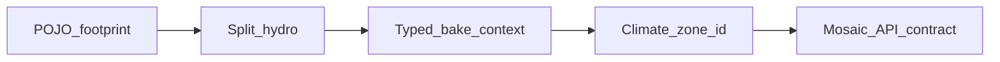

# План правок: light-bake mask cleanup ✅ DONE

**Статус:** план (код не начинать без явной просьбы).  
**Ревью:** canvas `light-bake-change-review` · smell'и post L0 mask impl.  
**Правило:** architecture-first — сначала SoT/контракты, потом тонкие consumers; не slice «только hydro docstring».

---

## Цель

Убрать неявные контракты и хардкоды без ломки compose-архитектуры (contributors остаются; меняются границы и SoT).

---

## P1 — footprint policy в dataModel

**Проблема:** `lightGrid/contributors/settlement.py` — `_footprint_radius_light` = `sqrt(count) * (side/8)` вне POJO.

**Сделать:**

1. POJO в `dataModel/worldPack/` — например `LightSettlementFootprintPolicy`:
   - `min_radius_light: int = 1`
   - параметры шкалы (`scale_divisor` или явная формула с defaults на Field)
   - `canonical_defaults()` + `radius_light(map_cells_count, side) -> int`
2. `SettlementContributor` только вызывает policy API.
3. Unit-тест: радиус из POJO; в contributor нет литерала `8.0`.

**Не делать:** `SettlementLayout` / CitySkeleton на L0.

---

## P1 — split HydroContributor

**Проблема:** один `apply` = rivers + intents + lakes + coast + coarse open-water (~210 строк).

**Сделать** (каталог `lightGrid/contributors/hydro/` или sibling modules):

| Модуль | Ответственность |
|---|---|
| `raster.py` | dilate, meter→light polyline, `paint_role` |
| `declaredRivers.py` | `river_edges` + intents → corridor |
| `declaredBasins.py` | lakes + coastlines |
| `coarseOpenWater.py` | SEA/LAKE fill только из `surface_planning` |
| `hydro.py` | тонкий `HydroContributor.apply` — 4 шага по порядку |

Порядок: declared corridors → basins/coast → coarse open water.

**Правило vs SEA≥RIVER:** global merge в ТЗ не меняем. В `coarseOpenWater` **не затирать** cells, где уже `hydrology_role == RIVER` (узкий инвариант: declared corridor выживает внутри SEA-macro). Зафиксировать в docstring модуля.

---

## P2 — явный bake caller contract

**Проблема:** `bake_tiles(..., **prepare_kwargs)` + `.get("nodes")`; `resolve(fine_cells_per_map_cell)` игнорирует size.

**Сделать:**

1. Единственный вход compose — `LightGridBakeContext` (уже есть); builder в orchestrator без скрытых kwargs.
2. `WorldMapBakeOrchestrator.bake_tiles` — явные `nodes`, `edges`, `hydrology_generator` (или dataclass `SurfacePrepareArgs`).
3. Если `surface_planning is None` — warning `light_compose_no_surface_planning` (раз на bake).
4. WP-10 API: либо `resolve_side(override=None)`, либо оставить `fine_cells_per_map_cell` в сигнатуре с docstring + тест «size не влияет на side».

---

## P2 — climate_zone_id SoT

**Проблема:** `enumerate(ClimateZone)` = хрупкий wire id.

**Сделать:**

1. Стабильный id на enum/POJO (`wire_id` / таблица canonical), не порядок members.
2. Climate contributor — только этот helper.
3. Тест стабильности id при добавлении member (или явная frozen table в POJO).

---

## P3 — mosaic ASCII API contract

**Проблема:** `render_world_grid` → full light mosaic раздувает payload.

**Сделать:**

1. Policy (POJO `PackRenderDefaults` или поле в `PackBakeDefaults`): `light_mosaic_max_tiles` default **16**.
2. Поведение:
   - bbox задан **или** `tiles ≤ N` → mosaic, `read_mode=world_map_light_mask`
   - иначе → macro aggregate, `read_mode=world_map_light_macro_aggregate` + hint на tile grids
3. `render_world_tile_grids` — канонический smoke маски (без смены).
4. Тесты обоих режимов.

---

## Мелочи (в тех же PR слоёв)

| Item | Действие |
|---|---|
| hydro intent `width=1` | default из POJO / `HydrologyMaskWire` |
| дубль clamp 15 | только validator POJO |
| settlement `next(loc…)` | `dict` uid→loc один раз |
| tile log `macro_hydro_role` | optional / убрать из hot path — не SoT wire |

---

## Порядок имплементации

1. **dataModel** — footprint policy + climate zone id (+ mosaic cap policy).
2. **hydro split** + skip RIVER при coarse SEA.
3. **orchestrator / context** — typed kwargs, planning warning, resolve API clarity.
4. **contributors** — тонкие consumers.
5. **PackMapGridRender** — mosaic policy.
6. **tests**.

Не дробить на «только docstring» без P1.

---

## Вне scope

- L2 refine rewrite, DAG, смена `side=32`, SettlementLayout на L0.

---

## Definition of done

- [x] Нет `side/8` в settlement contributor
- [x] Hydro — тонкий facade + helpers
- [x] Coarse SEA не затирает declared RIVER
- [x] Bake без `**prepare_kwargs` для graph
- [x] climate_zone_id стабилен через POJO/enum API
- [x] Mosaic cap / aggregate fallback
- [x] Unit-тесты на footprint, hydro rule, mosaic mode

---

## История

| Дата | Изменение |
|---|---|
| 2026-07-15 | План cleanup по ревью 4 осей |
