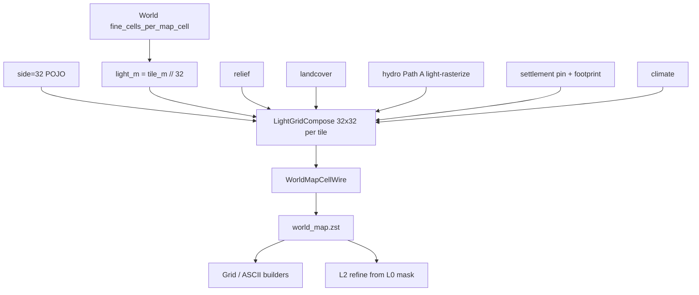

# Light bake mask — architecture-first plan ✅ DONE

**Статус:** утверждённые продуктовые решения (2026-07-15); **код не начат по этому плану** (или WIP-набросок не считать delivery).  
**ТЗ:** [`docs/tz_map_light_bake.md`](../../docs/tz_map_light_bake.md), [`docs/tz_world_pack_storage.md`](../../docs/tz_world_pack_storage.md) § WP-10 v2 / Идея 1–2.  
**Правило:** architecture first — **не** slice «сначала только hydro / только settlement».

---

## 1. Целевое состояние

### Продукт

| Было (симптом) | Нужно |
|---|---|
| Macro `(gx, gy)` на world map ≈ **один символ / один sample** на весь tile | Macro `(gx, gy)` = **один tile** с **маской** L0 `32×32` light-cells |
| L0 не является чертежом L2 | L0 = маска-чертёж; **L2 = refine(L0)** без L2-данных в L0 blob |

### WP-10 v2 (утверждено)

```text
side     = 32                              # константа формы маски
light_m  = fine_cells_per_map_cell // 32           # масштаб; плывёт с tile мира
```

- Число light-cells на tile **всегда 1024**.
- Убрана ∝-формула `3000↔32` / clamp 8…48.
- Optional master override `worlds.world_map_cells_per_tile` — редкий тумблер; default 32.

### Инварианты compose ([`tz_map_light_bake.md`](../../docs/tz_map_light_bake.md))

1. Один in-memory canvas → contributors → `WorldMapCellWire` → `world_map.zst`.
2. Запрещён write-path «один macro sample на все `(tx,ty)`».
3. `SurfaceTerrainContext` / meter hydro — **не** SoT L0 mask.
4. Порядок contributors: relief → landcover → hydro → settlement → climate.

---

## 2. Контракты

| Контракт | SoT | Примечание |
|---|---|---|
| `side` / default 32 | `WorldMapCellsPerTilePolicy` | сменить resolve: default 32, без ∝ |
| Light cell wire | `WorldMapCellWire` | без параллельной схемы |
| Hydro merge | `WorldMapHydrologyRole.merge` | SEA ≥ LAKE ≥ RIVER ≥ SHORE ≥ NONE |
| Pins | `LocationsIndexWire` | `location_pin` = index |
| Compose API | `LightGridCompose` + contributors | каталог `pack/bake/lightGrid/` |
| Orchestrator | `WorldMapBakeOrchestrator` | thin: compose → writer |

Caller: `LightGridBakeContext` (world, locations, index, tiles, scale, optional surface_planning read-only).

---

## 3. Data flow



Параллельно (не write-path L0): `SurfaceTerrainContext` → fine/L2 planning.

---

## 4. Порядок имплементации (слои, не slice)

**Запрещено:** «сначала только hydro corridor», «потом settlement», «потом side=32» как отдельные несвязанные PR без каркаса.

| # | Слой | Что сделать | Готово когда |
|---|---|---|---|
| **A** | dataModel / WP-10 v2 | `WorldMapCellsPerTilePolicy`: default `side=32`; убрать ∝ `3000/clamp`; тесты wire | resolve(любой tile_m)→32 (без override) |
| **B** | lightGrid skeleton | `coords`, `cell`, `compose`, `bakeContext`, `contributor`, `bake.py` + пустые/минимальные contributors | compose → dense `32×32` wire без macro-stamp |
| **C** | Contributors (все в одном каркасе) | relief, landcover, hydro Path A, settlement, climate по ТЗ | MLB-1…7 архитектурная приёмка |
| **D** | Orchestrator | `WorldMapBakeOrchestrator` = thin compose→writer; pack facade передаёт `locations_index` | нет семпла hydro/z в обход compose |
| **E** | **Grid builders (обязательно, не забыть)** | см. §5 | UI/ASCII показывают маску, не один символ/tile как SoT |
| **F** | L2 refine contract | refine читает L0 mask corridors (уже в storage TZ); smoke согласованности | река на карте ≈ река в scene |
| **G** | Tests / smoke | unit compose + pack render; HTTP bake fixture | MLB-2, MLB-6 |

Слои A→B→C→D→E — **один целевой каркас**; E не откладывать «на потом после bake».

---

## 5. Grid builders — обязательный consumer (не забыть)

Любой путь, который сегодня **схлопывает** macro `(gx, gy)` в один символ / один sample, должен быть осознанно обновлён под маску `32×32`:

| Модуль | Роль сейчас | Цель |
|---|---|---|
| `render/worldMapPackRenderer.py` | `render_macro` + `render_tile_light_grid` | macro-вид = явный агрегат **или** только overview; light-grid — основной smoke маски |
| `render/worldGridRenderer.py` | legacy: 1 top cell / macro | не выдавать за L0 SoT; pack path — приоритет |
| `render/worldTileGridRenderer.py` | tile ASCII | согласовать с light mask |
| `pack/read/packMapHelpers.py` (`world_map_sample_index` и аналоги) | sample одной light-cell для macro | документировать семантику агрегата; не подменять маску |
| Debug HTTP / `MapGridRenderService` / pack render facades | выдают grid payload | payload несёт `side`, light cells или явный zoom level |
| Тесты `test_world_map_pack_renderer`, `test_world_grid_renderer` | | обновить ожидания под маску |

**Приёмка E:** после bake ASCII/pack render по tile показывает **вариацию** hydro/relief/pins внутри `(gx,gy)`, а не одинаковый символ на всех 32×32 (при валидном fixture с declared river / location).

---

## 6. Вне scope этого плана

- DAG wiring / `scene_narration`
- Patch Store WP-20 изменения
- Offline `bake mode=tile|full`
- Смена L2 meter resolution

---

## 7. Критерии готовности (definition of done)

- [ ] WP-10 v2 в POJO + ТЗ согласованы
- [ ] Compose-only write path (MLB-1, MLB-3, MLB-5)
- [ ] Declared river → не-all-NONE corridor на light (MLB-2)
- [ ] Pins согласованы с index (MLB-4)
- [ ] **Grid builders** показывают маску (MLB-6 + §5)
- [ ] L2 refine опирается на L0 mask (контракт, smoke)

---

## История плана

| Дата | Изменение |
|---|---|
| 2026-07-15 | Первый план: side=32, compose architecture-first, grid builders mandatory |
