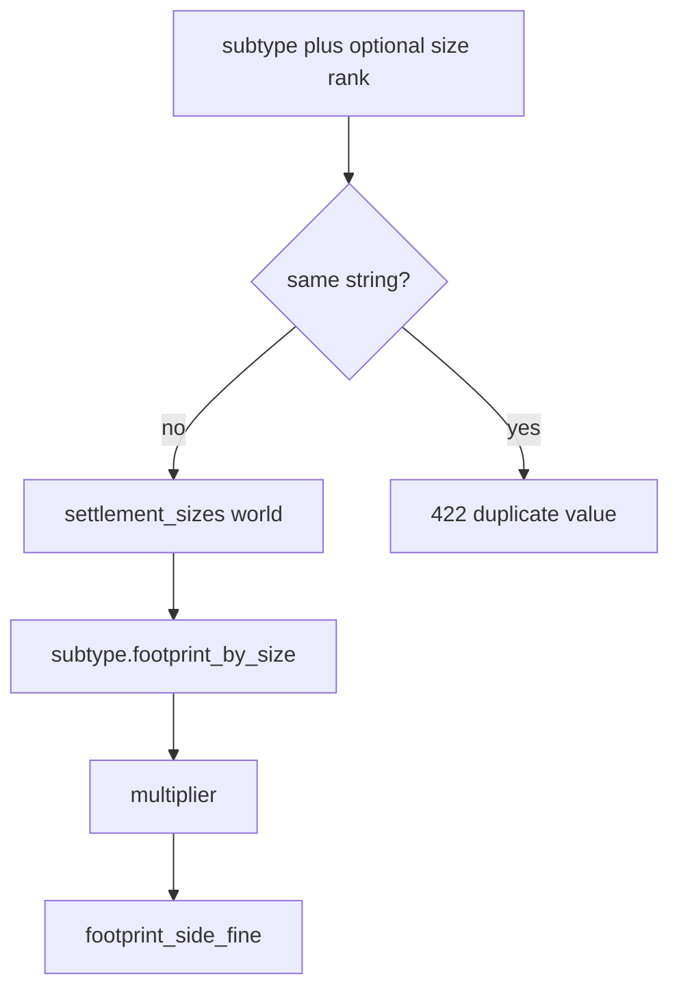

# LOC-T-2: ранг размера поселения ✅ DONE

План архитектуры (2026-09-07). Продуктовый контракт: [`docs/tz_locations.md`](../../docs/tz_locations.md) § Размер поселения **LOC-T-2**. Не CITY-T-5. Не LOC-T-1 (отдельный план: [`infer-location-type-from-subtype-done.md`](./infer-location-type-from-subtype-done.md)).

Имплементация другим агентом: [`/impl-loc-t-2`](../commands/impl-loc-t-2.md).

## 1. Целевое состояние

Два словаря на `named_locations`:

| Поле | Словарь | Канон |
|---|---|---|
| `system_location_subtype` | морфология | `village`, `city`, `dungeon`, … |
| `system_settlement_size` | относительный ранг | `small`, `medium`, `large` |

`village` + `small` — валидно. `village` + `village` — **422** (дубль значения). Абсолютные метры: `footprint_by_size[subtype][size] × fine_cells_per_map_cell`. Инвариант: `footprint(city, small) > footprint(village, large)`.

**Rename (breaking, recreate DB)**

| Сейчас (код) | Цель |
|---|---|
| `system_city_size` | `system_settlement_size` |
| `worlds.city_size_registry` | `worlds.settlement_size_registry` |
| `WorldCitySizeRegistry` / `CitySizeEntry` | `WorldSettlementSizeRegistry` / `SettlementSizeEntry` |
| `city_sizes()` | `settlement_sizes()` |
| `min_city_size` | `min_settlement_size` |
| токены `hamlet`…`megalopolis` + `footprint_multiplier` на ранге | ранги без множителя; множитель на subtype |

Без `0002`. Правка только [`0001_initial.sql`](../../backend/app/db/migrations/0001_initial.sql) + dataclass. Локальная БД: drop + restart.

**Не callers:** генераторы не держат параллельную таблицу множителей; DAG не знает rename; `normalize_world` не нормализует locations (как LOC-T-1).

## 2. Контракты

### Size registry (dataModel)

`SettlementSizeEntry`: `system_size` — `RegistryKey[WorldSettlementSizeRegistry]` (не голый `str`). Refs на NL/skeleton — тот же ключ. SoT типа: [`tz_json_validation.md`](../../docs/tz_json_validation.md) §0 RegistryKey.

`WorldSettlementSizeRegistry.canonical_defaults()`: `small`, `medium`, `large` в этом порядке. `rank()` — индекс в `root`. Default omit на settlement-like → **`medium`** (поле POJO / helper, не литерал в `footprint.py`).

Import реестра: ключ ранга не должен совпадать с морфологией settlement (`village`/`city`/`dungeon`/`underground_city` + engine subtypes). Иначе 422 на world JSON.

### Footprint на subtype

`LocationTypeSubtypeEntry.footprint_by_size: dict[str, float]` — ключи = ранги. Канон (TZ):

| | small | medium | large |
|---|---|---|---|
| village | 0.25 | 0.50 | 0.75 |
| city | 1.00 | 2.00 | 4.00 |
| dungeon | 0.25 | 0.50 | 1.00 |
| underground_city | 1.00 | 2.00 | 4.00 |

Helper на registry (не в assembler):

```text
resolve_settlement_footprint_multiplier(subtype, size, location_types, size_registry) -> float
```

- size omit → `medium`
- нет строки в `footprint_by_size` → ошибка (не fallback `hamlet`)
- после resolve: инвариант village≺city на **каноне и merged world**; нарушение N+1 → 422 import мира

`footprint_side_fine(world, subtype, size)` читает helper. Все нынешние `footprint_*(world, system_city_size)` меняют сигнатуру: нужен subtype.

### Location wire

`BundleNamedLocation` / `SettlementSkeleton` / `NamedLocation` / SQL: поле `system_settlement_size`.

Prepare на create/import (тот же шов, что LOC-T-1, можно один `prepare_named_location_wire`):

1. LOC-T-1 fill type (если уже сделан; иначе не блокировать — ортогонально).
2. Если subtype и size заданы и равны (trim, case-insensitive) → 422.
3. Size задан, ключ не ∈ реестра мира / не строка — **не** 422: generate `resolve_settlement_size_key` → канон **medium** + WARNING фасада (`jsonValidation` / `resolve`). Omit / NULL → medium без warning.
4. Persist: omit size можно оставить NULL в SQL **или** записать `medium`. Предпочтение: NULL в SQL + resolve `medium` в helper (omit = default, не обязательный dump). Если NULL, generate не падает.

Geographic: size задан → 422 или ignore? TZ: omit на non-settlement. **422** если size есть, а запись не settlement-like.

### Placement

`PlacementConditionType.MIN_SETTLEMENT_SIZE = "min_settlement_size"`. Сравнение **ранга в морфологии этого поселения**, не глобальная лестница. Канон шаблонов: `town` → `medium` (порт). Wire `min_city_size` не принимать (breaking).

«Только города» — не этот condition; это subtype.

### Footprint policy

`uses_settlement_fine_footprint`: **не** считать `small`/`medium`/`large` признаком поселения. Сейчас токены `hamlet`/`village`/`city` в size включают pin как settlement — после смены рангов это сломает geographic. Предикат: type/subtype (+ legacy type `city`), не ранг.

## 3. Data flow



Generate/bake/C23 — консьюмеры `footprint_side_fine`; не знают старых токенов.

## 4. Порядок impl

1. **POJO:** `SettlementSizeEntry` без multiplier; `footprint_by_size` на subtype; канон таблицы + `resolve_*` + инвариант village≺city. Юнит: city+small > village+large; omit size → medium; unknown rank → error; village+village на row helper → error.
2. **SQL + db models + world slice:** rename колонок в `0001`; `worldSlices` / `worldRow.settlement_sizes`; `World.settlement_size_registry`. Recreate — мастер.
3. **Wire NL:** rename поля; duplicate-value gate на import/create; geographic + size → 422.
4. **Consumers:** `footprint.py`, skeleton, outdoor orchestrator, barriers, overlay, tests, debug scripts — subtype×size. Убрать `footprint_multiplier_defaults()` keyed by hamlet.
5. **Placement** enum + builtin district templates.
6. **Fixtures:** `world_test_gen.json` — `system_settlement_size: "small"` (бывший `town` = city+small = 1.0) + `subtype: city`. Реестр мира: ранги small/medium/large, без hamlet…. `world_test.json` — те же ключи, не RPG-дерево ломать без нужды.
7. Галка LOC-T-2 в открытых вопросах locations + очередь json_validation. Не переписывать канон-таблицу множителей.

Вне scope: LOC-T-1 infer type (можно тем же prepare, но отдельный PR ок); organic footprint v2; DAG.

## 5. Почему не «просто rename city→settlement»

Имя поля — часть дыры. Главное: множитель на **ранге** с токенами `village`/`city` дублирует морфологию и ломает инвариант «малый город > большая деревня». Lookup должен быть `(subtype, rank)`, иначе `small` не имеет метров.
