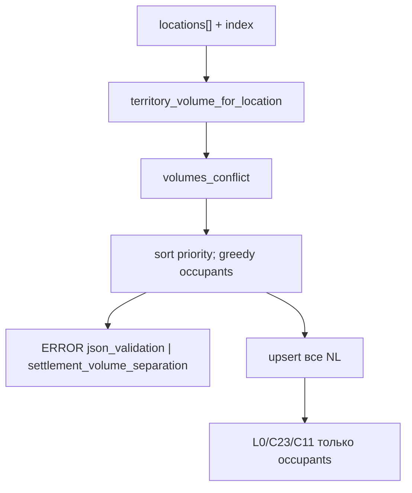

# LOC-T-3: разведение поселений (объём + запас) ✅ DONE

План архитектуры (2026-09-19, occupancy). Продуктовый контракт: [`docs/tz_locations.md`](../../docs/tz_locations.md) § Разведение поселений **LOC-T-3**. Pack: WP-21. Лог: [`docs/tz_logging.md`](../../docs/tz_logging.md) `jsonValidation` / `resolve`.

Имплементация другим агентом: [`/impl-loc-t-3`](../commands/impl-loc-t-3.md).

Не LOC-T-1/2. Не CITY-T-5. Не `deck`. **Не DAG.** Без `0002_*.sql`. **Не HTTP 422.**

## 1. Целевое состояние

Предикат AABB + запас — как раньше. При конфликте:

- мир / bundle **создаётся** (200);
- обе `named_locations` persist;
- **ERROR** лог с парой и причиной;
- карту занимает победитель; проигравший без L0 pin / territory mask / C11 / C23, пока пин не разведут.

| Ось | POJO | Default |
|---|---|---|
| XY | `min_settlement_separation_xy` | 1 (`ge=0` — N+1 может 0; overlap всё равно конфликт) |
| Z | `min_settlement_separation_z` | 50 |

**Победитель:** больший `footprint_side_fine`; при равенстве — меньший индекс в `locations[]`. Жадный: сортировка победитель-первый, отказ следующих, кто конфликтует с уже принятыми.

## 2. Контракты

### POJO + предикат

Как в предыдущей ревизии плана: поля на `TerritoryVolumePolicy`; `empty_inclusive`; `volumes_conflict`. Литералы 50/1 только в POJO.

### Приоритет

```text
priority_key(loc, declaration_index) =
  (-footprint_side_fine(world, loc), declaration_index)
# меньший ключ = сильнее
```

Не ранг в одиночку, не `location_uid`, не `created_at` (в фикстуре timestamps совпадают; uid `amberport` < `ironhold` — сломает «первее в файле»).

`declaration_index` = enumerate `locations[]` import. Bake/generate: тот же порядок, что import (не `get_by_world … ORDER BY location_uid`). v1 без новой колонки: helper принимает явный индекс; import передаёт enumerate; pack `locations_index` / C23 читают **отфильтрованный** список occupant’ов из того же helper, вызвав его с порядком bundle или со стабильным insert-order (`rowid`), не uid. Если `get_by_world` останется `ORDER BY location_uid` — **сменить потребителя occupancy**, не весь CRUD.

### Лог

Sink `jsonValidation` / `resolve`. Уровень **ERROR**. SoT полей — [`tz_locations.md`](../../docs/tz_locations.md) **LOC-T-3** таблица. Обязательны **uid, размер (subtype + rank + `side_fine`), z (пин + `z0…z1` volume)** обоих. `msg` дублирует те же числа (читаемый хвост), `extra` — structured.

Не `print`. Не `packBakeLog` как единственный канал.

### Occupancy

`settlement_map_occupants(world, locations_with_index) -> list[NamedLocation]`.

Потребители (не generator interior): light `locations_index` / settlement contributor, `territory_volumes_by_location` для wilderness mask, C23/C11 callers через тот же список. Проигравший **не** удалять из SQL.

Create/update одной NL: пересчёт против `get_by_world` + новая строка; лог ERROR; persist всё равно.

## 3. Data flow



## 4. Порядок имплементации

1. POJO + `empty_inclusive` + `volumes_conflict` + `pick_occupants` — unit (встык; overlap; large бьёт medium; равные medium — первый индекс).
2. Лог helper в `jsonValidation` (не голый getLogger в route).
3. Gate в `NamedLocationService.import_from_json` / create / update: persist все, occupants наружу для bake.
4. Wire occupants в locations_index bake + `territory_volumes_by_location` (фильтр).
5. Фикстура `world_test_gen.json`: пины (2,2)/(2,6) **можно оставить** — оба medium, Айронхолд первее → он на карте, Амберпорт в SQL + ERROR. Если для smoke нужны **оба** generate — сдвинуть южный пин (`map_y ≥ 2003`). Не 422.

## 5. Вне слайса

- DAG
- колонка ordinal в SQL (если insert-order сломается — отдельный слайс в 0001)
- C23 FK leftover
- L0 `radius_light(None)`

## 6. DoD

- Import overlapping medium+medium → 200, ERROR лог: оба uid, size/side_fine, map_z + volume z0/z1; на карте первый.
- `city`+`large` вторым vs `city`+`medium` первым → large на карте.
- Разведённые XY → без ERROR, оба occupants.
- Нет литералов 50/1 в gate.
