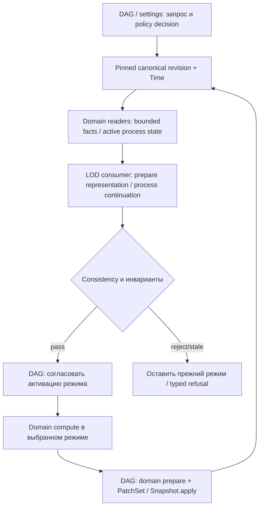

# LOD-SIM-1 — единый LOD Core, переходы симуляции и непрерывность состояния

**Статус:** DRAFT / ARCHITECTURE REVIEW (2026-11-03). **Не CODE-READY; новые классы, POJO/enum, DAG-ноды, writers и runtime wiring не разрешены.** Согласован концептуальный инвариант: FAR/MEDIUM/NEAR должны описывать **один и тот же мир**; детализация меняет представление и точность вычисления, а не уже принятые факты и последствия. Конкретные интерфейсы, бюджеты, алгоритмы и gates ниже — **предложение на совместную приёмку**, не утверждённый freeze.

**Путь / owning-план:** `.cursor/plans/lod-simulation-handoff.md`.

**Навигационный граф разработки:** [WORLD-PLAN-GRAPH-1](./world-generation-plan-dependency-graph.md), §11. Граф показывает зависимости разработки, не causal runtime DAG.

**Нормативные соседи:** [Lazy Simulation ТЗ](../../docs/tz_lazy_simulation.md) (LS-T1–T9), [PHYSICS-1](./physics-spatial-dynamics.md) (PH-ORCH / PH-LOD / PH-HANDOFF), [SPATIAL-1](./spatial-distribution-domain.md), [Snapshot/Patches](./world-domain-patches-snapshots.md), [Time](./time-domain.md), [GEN-DAG-1](./gen-dag-1-post-geo-ws.md), [Structural Mutations](../../docs/tz_structural_mutations.md), [World Snapshot ТЗ](../../docs/tz_world_snapshot.md).

## 1. Цель и разделение двух видов LOD

**Цель:** общий, типизированный механизм выбора детализации, расписания и управляемой передачи продолжающихся процессов между режимами FAR/MEDIUM/NEAR. Он должен давать сопоставимые по доменным инвариантам результаты независимо от того, когда пользователь вошёл в область, вышел из неё, перезапустил игру или изменил детализацию.

**Не смешивать bake и runtime:**

- `light_bake` / `full_bake` готовят L0 по разному охвату; `full_bake` **не** генерирует заранее полный L2.
- `detailed_bake` материализует L2 выбранного scope из уже согласованных исходных данных и их фактов, а не создаёт другую версию мира.
- FAR/MEDIUM/NEAR — **режимы runtime-симуляции**, не названия bake. Система может иметь компактный канонический факт, точную локальную проекцию и разную частоту обновления без взаимной подмены понятий.
- Аналогия с L0 → L2 относится к **одному источнику истины**: runtime materialization также использует актуальные данные; в отличие от bake, активная симуляция может требовать transfer/continuation незавершённого процесса.

**Единственное каноническое состояние на выбранную ревизию:** неизменяемый base World Pack + **принятый** Snapshot/Patches overlay (и согласованные доменные источники, на которые они ссылаются). L0/medium projection/L2 и solver buffers — производные представления. Временный read или rematerialization не пишет PatchSet, не продвигает Time, не выполняет физику и не создаёт альтернативный SoT. Для **активного** процесса могут понадобиться канонически принятые process continuation facts; их точный owner/schema отдельно согласуются с доменом и Snapshot, не дублируя water/material/geometry facts.

## 2. Владельцы и обязательные границы

| Владелец | Что делает | Чего не делает |
|---|---|---|
| **Общий LOD Core (проектируемый)** | Описывает typed policy inputs/decisions, значимость/бюджет/переход и общий generic consumer contract; допускает независимые оси детализации/частоты | Не вычисляет гидрологию, физику, NPC или климат; не пишет мир, не читает напрямую SQL/Pack и не превращается в отдельный runtime orchestrator |
| **DAG + настройки мира** | Единственный owner выбора/исполнения публичных междоменных операций: получает результат policy, выбирает typed calls, зависимости, commit barrier, параллелизм | Не реализует solver, domain transfer law, Snapshot commit или скрытый универсальный CRUD |
| **Domain consumer (Physics/NPC/Climate/...)** | Владеет предметными стратегиями FAR/MEDIUM/NEAR, своим агрегированием, сохранением инвариантов и mapping продолжения процесса | Не заводит собственную независимую LOD-систему управления и не вызывает чужой домен в обход DAG |
| **Physics** | Численные PH-AGG/PH-LOCAL и чистый process-specific AGG↔LOCAL transform; physical balance, continuity и proposals | Не выбирает сам глобальный LOD, не владеет material/water SoT или публикацией |
| **Spatial + L2** | Согласованное bounded read/projection/materialization из принятой world revision | Не управляет сменой LOD, не запускает симуляцию и не делает read причиной мутации |
| **Time** | Точное world time, interval/duration, coherent source и approved advance/restore | Не становится LOD scheduler; не заменяется старым правилом «1 тик = 1 час» без миграции |
| **Snapshot / domain-owned writers** | Принимают реальные изменения, время и применимые continuation facts атомарно через действующий contract; сохраняют историю и версии | Не пересчитывают физику/генерацию, не создают snapshots только ради другого LOD read |
| **World Pack** | Immutable bootstrap facts/refs до gameplay | Не переписывается при runtime переключениях |

**Действующая граница Physics:** FAR/MEDIUM работают без прямого и косвенного Grade/SQL, PH-AGG на компактных фактах; NEAR может использовать только bounded Grade через публичный read. Событийный PH-LOCAL вне NEAR — только без Grade. FAR/MEDIUM/NEAR — три зоны policy, но не обязательные три numerical solver. [PHYSICS-1](./physics-spatial-dynamics.md) остаётся владельцем конкретных PH-LOD/PH-HANDOFF доказательств; этот документ не переписывает PH-ARCH.

## 3. Предлагаемый общий контур без выдуманных API

**Разделять три оси:** (1) пространственная подробность read/materialization, (2) точность domain compute, (3) частота/бюджет выполнения. Зоны задают исходный профиль, но возможны обоснованные event overrides; высокая значимость дальнего процесса не должна автоматически материализовать всю область. Решение policy и фактическая готовность данных — разные результаты.

**Кандидатные поля контракта для review, не принятые POJO:** world/scope и topology reference, current/requested zone, spatial/detail/compute/cadence requirements, pinned source publication/ref/revision, Time interval/last processed time, current active process IDs/versions, cause/priority, affected scopes, resource budget, capability/coverage status, typed outcome/error, provenance и idempotent operation binding. Ни одного нового конкретного класса или enum не создавать до inventory/reuse, exact file/import map и приёмки.

**Управляемый переход (candidate state machine, не имя обязательного класса):**

1. `REQUESTED` — определить причину, affected scopes, source revision/time и целевую mode/policy.
2. `PREPARED` — bounded read, построение нужной проекции, transfer незавершённых process-specific states; без публикации нового мира.
3. `VALIDATED` — проверить identity, time, coverage, allowed errors, conservation/causal invariants, актуальность pin и отсутствие повторно применённых effects.
4. `ACTIVATED` — через runtime владельца переключить одну активную вычислительную модель/право владения для данной области/процесса; устаревший transient state можно освободить.
5. `REJECTED/STALE/UNSUPPORTED` — не делать silent reset/fallback, не выдавать частичный результат за полное покрытие; сохранить согласованный режим и вернуть typed outcome. Если режим больше не может безопасно продолжаться — остановить соответствующий процесс по объявленному контракту, а не выдумывать данные.

**Возврат NEAR→FAR** не менее важен, чем FAR→NEAR: принятые local effects остаются в каноническом состоянии; непогашенное движение/flux/границы переводятся в поддерживаемый агрегатный continuation; нельзя пересчитывать те же последствия по coarse модели.

## 4. Handoff незавершённого процесса и роль Snapshot

Для завершённого события Snapshot/Patches уже фиксируют принятые последствия. Поздняя детализация должна их **конкретизировать**, но не вычислять заново. Для продолжающегося события (волна, пожар, строительные работы, перемещение) итоговых повреждений/уровней недостаточно: нужен **минимальный domain-owned продолжимый state** — например process identity, phase, forcing, необходимые потоки/скорости, Time binding, source revision, kernel/version и причинные refs. Набор фактов определяется доменом; это **не** обязательная запись полного numerical buffer и не новый физический SoT.

Протокол требует:

- transfer только между поддерживаемыми process/model versions; отсутствие converter — `UNSUPPORTED`, а не сброс процесса;
- accepted effects, identities, world time, causal lineage и ledger/idempotency переживают cold reload, смену уровня, cancel/retry;
- упорядочение **читатель/вычисление/подготовка/принятие** со snapshot barrier: concurrent close/open, overlapping scopes и два solver не могут дважды публиковать один effect;
- conservation для физических quantities (масса, энергия, поток + внешние source/sink) с доменно утверждёнными единицами и допусками; недопустимо требовать битового совпадения микросостояний;
- невозможность восстановить неизвестную fine-деталь из агрегата без дополнительных seeds/constraints/accepted facts не маскируется случайной генерацией: домен обосновывает deterministic projection в пределах правил, либо возвращает typed отказ;
- actual world mutation — только domain prepare → PatchSet → Snapshot; derived cache/materialization допускает invalidation и перестроение без Patch.

**Важная асимметрия:** Snapshot сохраняет принятую историю и необходимые факты, но **не способен восстановить динамику, которую ни один owner не сохранил**. Это отдельный acceptance gate PH-HANDOFF/foreign consumers, а не обещание generic Snapshot.

## 5. Policy: приоритет, причинная значимость, частота и устойчивость

**Кандидатные критерии:** дистанция, наблюдаемость/наличие свидетеля, тип/активность процесса, прогноз затрагиваемых областей, связи с другими процессами, существенность последствий, elapsed world time и доступный compute budget. Прогноз воздействия — **сигнал policy**, не каноническое свершившееся событие.

**Пример дороги A→B:** процесс строительства и принятый прогресс должны иметь устойчивые identity, affected corridor и временные факты. Близость игрока к Б повышает значимость соответствующего участка до появления наблюдаемых последствий. Материализация дороги не может самовольно достроить её, повторить прогресс или внезапно нарисовать построенный путь без причинно согласованного состояния. При недоступности необходимых facts — явно недоступный/stale результат либо безопасная задержка показа, не фальсификация мира.

**Hysteresis:** разные границы upgrade/downgrade и/или minimum residence для защиты от thrashing при переходах игрока через порог. Точные значения/units/world overrides — OPEN, не hardcode.

**Budget fairness:** фоновая симуляция имеет ограничение затрат, starvation protection, приоритет для активных causal процессов, bounded catch-up по прошедшему Time. Домен определяет численные substeps и безопасность крупных interval; LOD Core задаёт допустимый schedule, DAG исполняет, Time владеет временем. Нельзя считать, что все процессы можно безопасно обновить единым большим `Δticks`. Конкретные acceptance и междоменные scheduling dependencies — OPEN.

## 6. Архитектурный план и локальные gates (все OPEN)

| Gate | Содержание / собственный результат | Предварительные условия |
|---|---|---|
| **LOD-A0** | Read-only inventory: `tz_lazy_simulation` LS-T1–T9, runtime callers, bake L0/L2, PH-LOD/PH-HANDOFF, Spatial, Time, Snapshot, существующие typed settings/registries; карта AS-IS и reuse/gaps | Можно начинать независимо сейчас; **никакого кода** |
| **LOD-C1** | Принять generic consumer/read-only vs compute vs write seam; все три оси, typed request/outcome/error, версии/revision/time, состояние перехода, ownership; exact POJO/enum/file/import map и negative contracts | LOD-A0, review owners; не замораживать чужие Physics/Time/Snapshot схемы |
| **LOD-P1** | Policy/settings: zone+event importance, budgets, hysteresis, fair scheduling, elapsed-time/catch-up с typed Time; predicates и отсутствие скрытых IO | LOD-C1; exact Time foreign contracts согласовать отдельно |
| **LOD-H1** | Общий протокол handoff (downshift/upshift, active-process continuation, revision/commit barrier, stale/unsupported и fallback semantics); конкретные transforms — в domain owners | LOD-C1; PH-HANDOFF/Time/Snapshot owner agreements для их срезов |
| **LOD-V1** | Спецификация независимых валидаторов, матрица сценариев, tolerances/identity/time conservation, proof of no double effects, negative tests; принятие архитектурных контрактов пользователем | LOD-P1 + LOD-H1; не считать ручной walkthrough runtime evidence |
| **LOD-R1** | **Будущий** runtime/E2E acceptance первого consumer (water-first кандидат): accepted node bindings, Spatial+Snapshot+Time+PH seam, метрики и отказоустойчивость | LOD-V1 и **конкретные принятые** ports/handlers и PH-AGG/LOCAL runtime gates; пока BLOCKED |

**Границы параллельности:** LOD-A0 и read-only policy research могут идти параллельно PH-ARCH, Time и SPATIAL/GEO. После LOD-C1 независимы уточнение policy (P1) и протокола handoff (H1) при раздельных owning файлах; LOD-V1 объединяет результаты. Никакой из этих design-gates не блокирует GEO G10-A, SP-PACK/base read, GEN initial cutover или Snapshot core. LOD-R1 — downstream consumer, не prerequisite для базового Pack/Spatial.

**Порядок перед кодом:** предъявить карту существующих/новых классов и папок, typed POJO/enum со всеми полями, операции domain readers/writers, declared DAG Input/Output/Error и межнодовую карту совместно с владельцем проекта; согласовать versioning/revisions/units, error paths, тесты. Только затем разрешать **отдельный** implementation step. Не превращать это предложение в автоматический code-cutover.

## 7. Независимые сценарии и проверяемые инварианты

- [ ] **L0/full → L2/detail:** одна территория при одинаковой pinned world revision и данных имеет одни canonical identities/topology/facts; другая геометрическая подробность не создаёт событий/patches.
- [ ] **Завершённое FAR-наводнение → NEAR:** факты ущерба/воды уже приняты через Snapshot; детализация не повреждает объекты второй раз, объём/геометрия согласованы с доменными tolerance.
- [ ] **Продолжающаяся волна AGG→LOCAL→AGG:** direction/phase/flux и движения после cold reload/повторного входа согласованы; нет внезапной остановки или повторного ущерба.
- [ ] **Дорога A→B:** причинный progress и affected corridor учитываются до materialization при подходе к Б; stable UID и Snapshot changes не теряются и не возникают вне процесса.
- [ ] **Возврат спустя Δtime:** catch-up учитывает уже рассчитанные intervals и реальные world Time facts, не дублирует события и не меняет прошлые ревизии.
- [ ] **Два перекрывающихся scope / параллельный DAG:** single writer/accepted effect для одного event+revision, корректные CAS/retry/stale outcomes; один consumer не уничтожает продолжение другого.
- [ ] **Порог с hysteresis:** отсутствие бесполезных повторных materialization/transform при осцилляции; корректный high-priority override.
- [ ] **Unknown/missing/unsupported:** неизвестное не трактуется как пустота/отсутствие воды/air, fallback не создаёт ложную полноту; no hidden Grade/SQL FAR/MEDIUM.
- [ ] **Обратная агрегация:** согласованные state invariants для `Aggregate(NEAR)` и `FAR` на одном Time/revision; доменные единицы, допуски и внешние источники/потери явно определены.
- [ ] **Read-only:** LOD switch только представления не рождает Patch/SourceRevision/Time advance; реальные изменения публикуются через существующий Snapshot contract.

**DoD (архитектура, не реализация):** все OPEN поля и конкурирующие требования либо решены владельцами, либо явно блокируют конкретный consumer; нет дублированного SoT, новых скрытых orchestrators/SQL fallback, циклов gate-графа; handoff и обратная агрегация имеют отдельные проверяемые валидаторы; status evidence и source-revision bindings трассируются. Приёмка POJO/enum и code gate — отдельно.

## 8. Открытые вопросы к совместному решению

1. Какой owner/version для generic LOD policy/settings и где его уже существующий typed config-path? Должен ли выбор возвращать три независимые оси или preset + selective overrides?
2. Как фиксируется активность/переход для перекрывающихся пространственных областей и двух observers? Нужна ли вообще durable LOD-state, кроме canonical process continuation?
3. Где граница exact coherent Time + Snapshot capture и atomic commit continuation/effects? Кто хранит process state у не-Physics consumers?
4. Для каждого домена: что нельзя восстановить из coarse state, какие invariants и tolerance допустимы, какие процессы require non-aggregate handling?
5. Какие candidate causal-interest markers доступны у существующих events/road construction; кто владеет прогнозом affected scope, не превращая его в факт?
6. Как согласовать `tz_lazy_simulation` legacy freeze/cell_states и NPC essential full tick с новой непрерывной физикой, без навязывания PH-LOCAL всем NPC?
7. В какой последовательности запускать первый E2E consumer и какие exact GEN-DAG NodeContract, SP-3S/SP-4R, SN-RUNTIME и PH-HANDOFF gates действительно нужны?

**Нельзя закрывать эти вопросы созданием классов или тестов агентом без утверждённого владельцем проекта графа и контрактов.**
