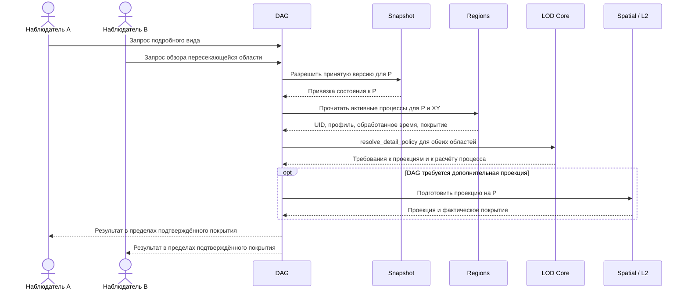
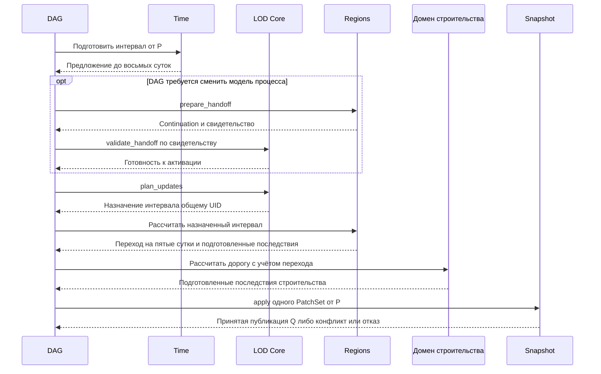

# LOD-SIM-1 — единый LOD Core, переходы симуляции и непрерывность состояния

**Статус:** DRAFT / ARCHITECTURE REVIEW (2026-11-03). **Не CODE-READY; новые классы, POJO/enum, DAG-ноды, writers и runtime wiring не разрешены.** Согласован концептуальный инвариант: FAR/MEDIUM/NEAR должны описывать **один и тот же мир**; детализация меняет представление и точность вычисления, а не уже принятые факты и последствия. Конкретные интерфейсы, бюджеты, алгоритмы и gates ниже — **предложение на совместную приёмку**, не утверждённый freeze.

**Путь / owning-план:** `.cursor/plans/lod-simulation-handoff.md`.

**LOD-A0. Итог сверки Time и Regions принят.** Time задаёт точные точки и длительности в секундах и наносекундах. Фиксированной длительности тика в его контракте нет. Четыре тика опыта A0 относятся к прежнему входу Regions `elapsed_ticks`. Длительность перехода в мировом времени рассчитывает симуляция региона. Regions записывает событие в первую представимую точку Time, совпадающую с расчётным моментом пересечения порога или следующую за ним. Это однократное округление метки вверх до наносекунды. Смена LOD и reopen должны сохранять эту метку. [Контракт Time и граница миграции Regions](./time-domain.md#L414) · [Опыт A0 и пограничные тесты](./lod-a0-region-continuation.md)

**Порядок событий на границе Time согласован для FAR/MEDIUM/NEAR.** В точке T домен сначала завершает расчёт истекшего интервала при действовавших условиях и учитывает порог, достигнутый к T. Затем применяются внешние изменения с меткой T. Следующий интервал начинается с полученного состояния. DAG обеспечивает этот порядок междоменных операций и передаёт известные границы воздействий в LOD; `plan_updates` учитывает их при разбиении интервала. Достижение порога определяет владелец процесса. Для нескольких внешних изменений с одинаковой меткой порядок задают их причинные зависимости.

Для LOD-C1 остаются миграция состояния Regions, владение интервалом при перекрытии областей наблюдения и подключение writer региона к атомарной записи Snapshot/T5.

**Граница принятия длинного шага.** Если восемь суток составляют одно игровое действие, DAG готовит от общей публикации P один Time proposal и один PatchSet с одним operation_id. Доменная секция может содержать несколько упорядоченных patch-операций; ключ каждой секции встречается в наборе один раз. Переход леса в степь на пятые сутки сохраняет свою доменную дату. DAG передаёт подготовленный факт перехода зависимому расчёту дороги на оставшиеся трое суток и связывает зависимые секции по key/fingerprint. Затем один вызов Snapshot.apply принимает весь шаг с конечным временем, последствиями и continuation. При отказе или конфликте CAS вся группа откатывается. После reopen видна исходная P либо принятая публикация полного шага. Остановка вычисления у события относится к подготовке; сама по себе она не создаёт snapshot или границу возобновления мира. [Контракт T5](./time-domain.md#L37) · [Подготовленные зависимости](../../docs/tz_world_snapshot.md#L410) · [Структура PatchSet](../../backend/app/dataModel/patch/request/patchSet.py#L14)

**Навигационный граф разработки:** [WORLD-PLAN-GRAPH-1](./world-generation-plan-dependency-graph.md), §11. Граф показывает зависимости разработки, не causal runtime DAG.

**Нормативные соседи:** [Lazy Simulation ТЗ](../../docs/tz_lazy_simulation.md) (LS-T1–T9), [PHYSICS-1](./physics-spatial-dynamics.md) (PH-ORCH / PH-LOD / PH-HANDOFF), [SPATIAL-1](./spatial-distribution-domain.md), [Snapshot/Patches](./world-domain-patches-snapshots.md), [Time](./time-domain.md), [GEN-DAG-1](./gen-dag-1-post-geo-ws.md), [Structural Mutations](../../docs/tz_structural_mutations.md), [World Snapshot ТЗ](../../docs/tz_world_snapshot.md).

## 1. Цель и разделение двух видов LOD

**Цель:** общий, типизированный механизм выбора детализации, расписания и управляемой передачи продолжающихся процессов между режимами FAR/MEDIUM/NEAR. Он должен давать сопоставимые по доменным инвариантам результаты независимо от того, когда пользователь вошёл в область, вышел из неё, перезапустил игру или изменил детализацию.

**Не смешивать bake и runtime:**

- `light_bake` / `full_bake` готовят L0 по разному охвату; `full_bake` **не** генерирует заранее полный L2.
- `detailed_bake` материализует L2 выбранного scope из уже согласованных исходных данных и их фактов, а не создаёт другую версию мира.
- FAR/MEDIUM/NEAR — **режимы runtime-симуляции**, не названия bake. Система может иметь компактный канонический факт, точную локальную проекцию и разную частоту обновления без взаимной подмены понятий.
- Аналогия с L0 → L2 относится к **одному источнику истины**: runtime materialization также использует актуальные данные; в отличие от bake, активная симуляция может требовать transfer/continuation незавершённого процесса.

**Единственное каноническое состояние на выбранную ревизию:** неизменяемый base World Pack + **принятый** Snapshot/Patches overlay (и согласованные доменные источники, на которые они ссылаются). L0/medium projection/L2 и solver buffers — производные представления. Временный read или rematerialization не пишет PatchSet, не продвигает Time, не выполняет физику и не создаёт альтернативный SoT. Для **активного** процесса могут понадобиться канонически принятые process continuation facts; их точный owner/schema отдельно согласуются с доменом и Snapshot, не дублируя water/material/geometry facts.

## 2. Владельцы и обязательные границы

| Владелец | Что делает | Чего не делает |
|---|---|---|
| **Общий LOD Core (проектируемый)** | Описывает typed policy inputs/decisions, значимость/бюджет/переход и общий generic consumer contract; допускает независимые оси детализации/частоты | Не вычисляет гидрологию, физику, NPC или климат; не пишет мир, не читает напрямую SQL/Pack и не превращается в отдельный runtime orchestrator |
| **DAG + настройки мира** | Единственный owner выбора/исполнения публичных междоменных операций: получает результат policy, выбирает typed calls, зависимости, commit barrier, параллелизм | Не реализует solver, domain transfer law, Snapshot commit или скрытый универсальный CRUD |
| **Domain consumer (Physics/NPC/Climate/...)** | Владеет предметными стратегиями FAR/MEDIUM/NEAR, своим агрегированием, сохранением инвариантов и mapping продолжения процесса | Не заводит собственную независимую LOD-систему управления и не вызывает чужой домен в обход DAG |
| **Physics** | Численные PH-AGG/PH-LOCAL и чистый process-specific AGG↔LOCAL transform; physical balance, continuity и proposals | Не выбирает сам глобальный LOD, не владеет material/water SoT или публикацией |
| **Spatial + L2** | Согласованное bounded read/projection/materialization из принятой world revision | Не управляет сменой LOD, не запускает симуляцию и не делает read причиной мутации |
| **Time** | Точное world time, interval/duration, coherent source и approved advance/restore | Не становится LOD scheduler; не заменяется старым правилом «1 тик = 1 час» без миграции |
| **Snapshot / domain-owned writers** | Принимают реальные изменения, время и применимые continuation facts атомарно через действующий contract; сохраняют историю и версии | Не пересчитывают физику/генерацию, не создают snapshots только ради другого LOD read |
| **World Pack** | Immutable bootstrap facts/refs до gameplay | Не переписывается при runtime переключениях |

**Действующая граница Physics:** FAR/MEDIUM работают без прямого и косвенного Grade/SQL, PH-AGG на компактных фактах; NEAR может использовать только bounded Grade через публичный read. Событийный PH-LOCAL вне NEAR — только без Grade. FAR/MEDIUM/NEAR — три зоны policy, но не обязательные три numerical solver. [PHYSICS-1](./physics-spatial-dynamics.md) остаётся владельцем конкретных PH-LOD/PH-HANDOFF доказательств; этот документ не переписывает PH-ARCH.

## 3. Публичные операции LOD для DAG

Целевая поверхность LOD-C1 для совместной приёмки приведена ниже. Имена обозначают проектируемые методы. Таблица задаёт входы, исходы и владельца следующего действия до выбора конкретных POJO, файлов и DAG-нод. Каждый вызов вычисляет результат по переданным данным, без I/O и записи. За получение согласованных входов и исполнение результата отвечает DAG.

| Метод LOD | Входной контракт от DAG | Выходной контракт в DAG | Функционал и отказ |
|---|---|---|---|
| `resolve_detail_policy` | Мир, timeline и исходная публикация, scope с привязкой к топологии, текущий профиль, версия настроек, требования всех наблюдателей и активных процессов, значимость событий, заявленные возможности домена | Для каждой области наблюдения — зона FAR/MEDIUM/NEAR и пространственная детализация; для каждого процесса — точность расчёта, частота обновления и основание решения. Результат привязан к исходной публикации и версии настроек | Сводит запросы наблюдателей и применяет policy перехода с учётом текущего профиля. При несовместимых scope или версиях возвращает типизированный отказ. DAG использует результат для запроса проекции, подготовки перехода или планирования вычисления. |
| `plan_updates` | Набор решений policy и процессов, их стабильные идентификаторы, подтверждённые границы уже обработанного времени, доступный интервал Time, ограничения интервала от домена, приоритеты и общий бюджет | Упорядоченный список назначений с процессом, scope, исходной публикацией и подынтервалом Time; отложенная работа с причиной. Для одного процесса назначенные интервалы не перекрываются | Определяет, какой объём работы допустим сейчас. Два наблюдателя одного процесса не удваивают назначение. Пустой остаток даёт пустой список, нехватка бюджета оставляет работу отложенной, несовпадение timeline даёт отказ. DAG вызывает доменный compute; численные подшаги выбирает домен. |
| `validate_handoff` | Решение policy, прежний и целевой профили, идентификатор и версия процесса, ожидаемая и наблюдаемая публикации, граница обработанного времени; переданные DAG результаты проверки покрытия и доменной подготовки continuation | Готовность к активации, привязанная к процессу, профилям, публикации и времени, либо конкретная причина: устаревшая привязка, неполное покрытие, неподдерживаемый перенос или отклонённый доменный инвариант | Проверяет согласованность свидетельств для обоих направлений перехода. За преобразование continuation и проверку предметных инвариантов отвечает домен. DAG использует готовность для решения об активации; конкурентное изменение после проверки обнаруживается на границе принятия. |

### 3.1. Ядро LOD и размещение реализаций

**Входы LOD и владелец материализации.** DAG передаёт ядру данные планирования и метаданные на выбранной ревизии: области наблюдения и ожидаемого воздействия, требования к проекции, доступное покрытие, бюджет и сведения об активных процессах. По ним LOD определяет требуемую детализацию и время следующего вычисления. Если для выбранной проекции нужны дополнительные данные, решение LOD указывает требование к покрытию. DAG вызывает публичную операцию Spatial/L2 или соответствующего домена и получает фактический результат. Ядро LOD не загружает клетки, не материализует область и не считает запрошенное покрытие уже готовым.

Три метода выше имеют одну общую реализацию в целевом пакете `backend/app/application/lod/`. Общие типы входов, решений и отказов принадлежат `backend/app/dataModel/lod/`. Абстракция проходит по контракту возможностей потребителя. Обязательный базовый Python-класс и три отдельных solver для зон не требуются. Уровень задаёт требуемый результат, а поддерживаемые способы расчёта определяет владелец процесса.

| Владелец | Место реализации | Что находится здесь |
|---|---|---|
| LOD Core | `application/lod/`, `dataModel/lod/` | Общая policy, планирование интервалов и проверка привязок handoff. Ядро принимает значения от DAG. Импорты конкретных консьюмеров, поиск обработчика по домену и вызовы чужих сервисов из ядра запрещены. |
| Regions | `application/worldData/regions/stateChange/`, предметные модели в `dataModel/regions/` | Правила изменения покрытия, допустимая агрегация, преобразование progress и проверка инвариантов при split/merge. Точка переиспользования — существующий [advance](../../backend/app/application/worldData/regions/stateChange/progress.py). Текущий [evaluate](../../backend/app/application/worldData/regions/stateChange/consumer.py) совмещает расчёт и upsert; для публичного compute потребуется отделить подготовку от принятия записи. |
| Physics | `application/physics/`, предметные модели в `dataModel/physics/` | Публичный compute и реализации PH-AGG/PH-LOCAL, преобразования continuation и проверка физических инвариантов размещаются согласно [карте Physics](./physics-spatial-dynamics.md). |
| Остальные консьюмеры | В существующем application-пакете домена, владеющего процессом; предметные типы в его dataModel-пакете | Владелец объявляет поддержку режимов и переходов при подключении. Для дороги сначала требуется установить владельца строительства; каталог по аналогии с Regions не назначается. |

### 3.2. Публичные операции домена для DAG

**Идентичность возобновляемого чтения Pack.** В существующем storage `pin_id` — первичный ключ удержания; уникальная привязка логического чтения — (store_id, execution_id, invocation_id, logical_read_key). Первый acquire фиксирует world_uid, текущую publication_id и manifest_artifact_id. Повтор с тем же открытым binding возвращает закреплённый manifest; несовпадение identity даёт PackIdentityConflict. Независимые чтения могут держать разные pins даже для общего shard. Для LOD это механизм фиксации источника чтения: при общей базе P требуется согласовать сохранённую publication с P, поскольку PinIntent сам не принимает expected publication. Для сопоставления активного игрового процесса между наблюдателями и запусками используется отдельная доменная identity из этого раздела. [SQL binding](../../backend/app/db/migrations/0001_initial.sql#L1608) · [Acquire и проверка identity](../../backend/app/db/repositories/sqlite/worldPack/executionPins.py#L181) · [Два pins и общий shard](../../backend/tests/spatial_pack/test_execution_pins.py#L225)

**Существующий аналог в storage для двух потребителей одной работы.** В bake уже реализованы durable admission и recovery: `submit` передаёт запрос и waiter в SQLite `admit`. При свободном claim создаётся операция (Started); при активной операции с тем же fingerprint новый waiter присоединяется к её operation_ref (Joined); другой fingerprint даёт BakeConflict. Store поддерживает recovery владельца и fence. Для C1 это образец различения «начать / присоединиться / конфликт» и раздельных идентичностей исполнителя и наблюдателя. Bake удерживает claim на мир. Его operation_id и статус описывают выполнение задания; прогресс перехода покрытия между принятыми игровыми действиями уже хранится отдельно в RegionState. Повтор публикации обслуживает OperationLedger. Применимость admission к одновременному вычислению одного игрового процесса требует отдельного решения DAG (§8); общий storage активных LOD-процессов этим примером не утверждается. [Bake admission](../../backend/app/db/repositories/sqlite/bakeOperations/operationStore.py#L32) · [Сервис и waiter](../../backend/app/application/worldData/bakeOperations/service.py#L29) · [RegionState](../../backend/app/dataModel/regions/regionState.py#L35) · [OperationLedger](../../backend/app/application/publication/service/operationLedger.py)

**Согласованное поведение при приближении наблюдателя.** При достаточном покрытии запрос подробного чтения завершается проекцией для выбранной области. UID, режим вычисления и continuation активного процесса сохраняются. Если локальное действие требует отдельного вычисления участка, DAG запрашивает `prepare_handoff`. Домен возвращает `UNSUPPORTED`, когда безопасное разделение процесса недоступно. DAG передаёт отказ вызывающей стороне: дочерний процесс не создаётся, состояние родителя сохраняется. [Приёмочный пример Regions](./lod-a0-region-continuation.md#отдельные-пограничные-тесты-к-реализации)

**Привязка к владельцу процесса.** Типизированная привязка операции в DAG определяет домен-владелец. DAG передаёт его стабильный ключ вместе с UID процесса в общие контракты LOD. Для процессных входов и результатов `resolve_detail_policy`, `plan_updates` и `validate_handoff` идентичность задаётся сочетанием мира, timeline, ключа владельца и UID процесса. Публикация, версия модели и интервал проверяются отдельно. Ядро сравнивает и возвращает ключ как данные; выбор конкретной доменной операции остаётся в DAG. Ключ относится к домену, который ведёт процесс, даже когда процесс использует факты нескольких доменов.

**Проверка привязки.** Одинаковый локальный UID у Regions и Physics даёт два самостоятельных процесса. Два наблюдателя одного UID у одного владельца дают один процесс для планирования. Свидетельство handoff другого владельца отклоняется даже при совпадении UID и публикации. Для C1 остаётся выбрать канонический тип и источник допустимых ключей при регистрации DAG-привязки. Существующий [MaskDomainId](../../backend/app/dataModel/masks/enums/maskDomainId.py) идентифицирует writers масок L0 и для этой цели не подходит.

Ниже указаны роли методов на границе домена. В DAG конкретная нода привязывается к типизированной операции соответствующего владельца. Существующий доменный entry point переиспользуется, если его входы, выходы и побочные эффекты соответствуют контракту. Ядро LOD и консьюмеры не вызывают публичные операции друг друга.

**Решение C1 по типизации.** На стороне DAG каждой операции соответствует специализация существующего `NodeContract[I, O, E]`: I — конкретная модель входа ноды, O — выхода, E — объявленных ошибок ноды. Доменная операция имеет свою конкретную сигнатуру; нода переводит доменный отказ в объявленный исход. Стабильный ключ владельца задаётся в привязке операции при сборке DAG. Версия контракта ноды и версия формата сохранённого доменного состояния проверяются независимо. На стороне LOD Core три общих метода из §3 принимают конкретные общие модели без параметризации ядра классами доменов. Если несколько доменных операций имеют общую форму вызова, её можно выразить структурным `Protocol` по типам запроса и результата. Маркер вида `Consumer[Regions]` сам по себе не задаёт типы этих данных. [Поля NodeContract](../../backend/app/application/engine/contracts/nodeContract.py#L62) · [Пример generic Protocol в проекте](../../backend/app/application/planning/providers/planProvider.py#L51)

**Примеры специализации одной роли.** Имена моделей ниже иллюстрируют связи типов для проектирования нод; точные имена и пути схем согласуются при реализации.

| Привязка DAG | Пример контракта ноды | Что получает следующий вызов |
|---|---|---|
| Regions, `prepare_handoff` | `NodeContract[RegionHandoffInput, RegionHandoffOutput, RegionHandoffError]`. Вход содержит привязку процесса и продолжение региона с текущим покрытием, целью и прогрессом. | После успешной подготовки DAG передаёт в `LOD.validate_handoff` общее свидетельство с владельцем, UID, временем и публикацией. Подготовленное продолжение с progress=0,5 поступает в Regions compute после разрешения перехода. |
| Physics, `prepare_handoff` | `NodeContract[PhysicsHandoffInput, PhysicsHandoffOutput, PhysicsHandoffError]`. Вход содержит привязку физического процесса и его состояние для AGG↔LOCAL. | В LOD поступает свидетельство той же общей формы с владельцем Physics. Физическое continuation остаётся типизированным на пути к Physics compute. Попытку передать PhysicsHandoffInput в вызов Regions должен обнаружить статический анализ. |

**Пример проверки после reopen.** DAG восстанавливает процесс Regions с UID `r17` на закреплённой публикации. До вычисления привязка сверяет ожидаемые мир, timeline, владельца, UID и публикацию с восстановленными ссылками; доменный декодер проверяет версию и содержимое по конкретной схеме. Для поддерживаемой записи Regions восстанавливаются цель steppe и накопленный progress. Запись Physics с тем же `r17`, неизвестная версия схемы или payload с неверными полями дают отказ до compute и любых последствий. Это целевой контракт восстановления; атомарное сохранение требует интеграции доменного writer со Snapshot/T5. Образец проверки ключа, конкретной модели и версии уже есть у [BoundSectionHandler](../../backend/app/application/patch/registry/sectionRegistry.py#L17). Дополнительный реестр обработчиков внутри LOD отсутствует в целевой архитектуре.

| Метод домена | Что передаёт DAG | Результат и его применение |
|---|---|---|
| `describe_capabilities` | Процесс и его версия, scope, привязка к публикации, подготовленные предметные факты и доступное покрытие | Отдельно сообщает доступную детализацию чтения для scope и поддержку разделения активного процесса с переносом continuation. Возвращает поддерживаемые режимы и направления перехода, требуемые данные, ограничения интервала и условия повышения точности. DAG передаёт эти сведения в `resolve_detail_policy` и `plan_updates`. Недостаток данных явно ограничивает доступные режимы. |
| `prepare_handoff` | Выбранные исходный и целевой профили, процесс и версия, принятое continuation, публикация, обработанная граница Time, подготовленные входные данные | Домен преобразует состояние, проверяет собственные инварианты и возвращает подготовленное continuation и свидетельство с привязками либо причину отказа. DAG передаёт в `validate_handoff` свидетельство; сам предметный payload остаётся у домена. При неподдерживаемом преобразовании активация блокируется. |
| Доменный compute (`compute_interval` — роль операции) | Активный профиль, идентификатор процесса, исходная публикация, назначенный TimeInterval, предметные факты и continuation | При успехе домен возвращает обработанный интервал, сведения о затронутых активных и завершившихся процессах, соответствующее continuation продолжающихся процессов и предлагаемые последствия. При отказе подготовленное обновление активности не применяется. Принятие изменений DAG поручает Snapshot и доменному writer. |

**Учёт процессов при каждом вычислении.** Для обработанной области домен явно сообщает, какие процессы начались, продолжились и завершились. Для каждого затронутого процесса передаются ключ владельца и стабильный UID, scope, фактический профиль/версия модели и граница обработанного времени с привязкой к миру, timeline и исходной публикации. Отсутствие UID в частичном результате не завершает процесс. Внутри одного действия DAG передаёт эти подготовленные метаданные последующим вызовам LOD: новый наблюдатель сопоставляется с действующим UID, `resolve_detail_policy` сравнивает текущий профиль с требуемым, а `plan_updates` учитывает уже обработанную часть интервала. При reopen используются принятые доменные сведения и continuation на выбранной публикации. Отдельная запись Snapshot после каждого compute для этого не требуется. Разрешение конфликта двух независимых запусков остаётся открытым в §8.

**Пример вызовов для Regions.** DAG получает возможности Regions и передаёт их вместе с требованиями двух наблюдателей в `resolve_detail_policy`. Решение адресует проекцию области наблюдателя, а точность расчёта и частоту — общему UID процесса. Если меняется модель активного процесса, DAG получает у домена подготовленное продолжение и передаёт его привязки в `validate_handoff`. Для вычисления DAG вызывает `plan_updates` и передаёт Regions один назначенный интервал на общий UID. Чистому чтению проекции достаточно решения о детализации. Принятие времени, состояния и последствий идёт через Snapshot. Повторяемость вычисления плана сама по себе не обеспечивает однократность записи.

**Граница согласования.** Для методов остаются к приёмке конкретные типы настроек, capability/coverage и свидетельства переноса, точное соответствие исходов типам ошибок и per-node bindings. Для времени и публикации используются существующие TimeInterval, TimePoint и WorldPublicationRef. [Контракт интервала](../../backend/app/dataModel/time/values/interval.py) · [Контракт публикации](../../backend/app/dataModel/worldSnapshot/identity/publication.py) · [Требования к DAG-нодам](./gen-dag-1-post-geo-ws.md)

### 3.3. Обязательная схема вызовов и приёмка маршрута

**Чтение после reopen.** Каждая стрелка обозначает вызов либо возврат результата. Ветвление по покрытию принадлежит DAG.

**Продвижение одного игрового действия.** Показан успешный маршрут. При отказе в переносе или проверке DAG прекращает зависимую ветку до compute и apply. Домен строительства обозначает роль в примере дороги A→B.

**Обязательная приёмка. Любого одного нарушения достаточно для отказа.** Правило действует для архитектурной карты и фактической цепочки вызовов, включая вложенные методы.

| № | Запрещённый случай | Как установить нарушение |
|---|---|---|
| 1 | Pipeline с ветвлением выполняет роль оркестратора. Оркестратор вне DAG запрещён. | Pipeline сам выбирает следующую операцию по результату предыдущей. Например, LOD обнаруживает недостаточное покрытие и запускает дочитывание. Выбор и вызов должны находиться в DAG. |
| 2 | Pipeline внутри домена работает независимо от DAG. Это скрытая оркестрация. | Для pipeline отсутствует прямой вызов из DAG: его запускают фасад, callback, событие или worker. Вызов внешней обёртки из DAG не удовлетворяет этому требованию. |
| 3 | Домен напрямую обращается к другому домену. | В трассе есть вызов LOD Core → Regions, Regions → LOD Core или любой другой переход между доменными операциями в обход DAG, включая вызов через DI. Публичность метода не разрешает обход. |

Для каждой операции при ревью указать DAG-ноду и её прямой вызов публичного метода, объявленные входы/выходы, владельца выбора следующей операции и фактические вложенные вызовы. При обнаружении любого пункта 1–3 результат — **приёмка не пройдена**. [Требование GEN-DAG-1 к проверке вложенных вызовов](./gen-dag-1-post-geo-ws.md#L244)

**Разделять три оси:** (1) пространственная подробность read/materialization, (2) точность domain compute, (3) частота/бюджет выполнения. Зоны задают исходный профиль, но возможны обоснованные event overrides; высокая значимость дальнего процесса не должна автоматически материализовать всю область. Решение policy и фактическая готовность данных — разные результаты.

**Кандидатные поля контракта для review, не принятые POJO:** world/scope и topology reference, current/requested zone, spatial/detail/compute/cadence requirements, pinned source publication/ref/revision, Time interval/last processed time, current active process IDs/versions, cause/priority, affected scopes, resource budget, capability/coverage status, typed outcome/error, provenance и idempotent operation binding. Ни одного нового конкретного класса или enum не создавать до inventory/reuse, exact file/import map и приёмки.

**Управляемый переход (candidate state machine, не имя обязательного класса):**

1. `REQUESTED` — определить причину, affected scopes, source revision/time и целевую mode/policy.
2. `PREPARED` — bounded read, построение нужной проекции, transfer незавершённых process-specific states; без публикации нового мира.
3. `VALIDATED` — проверить identity, time, coverage, allowed errors, conservation/causal invariants, актуальность pin и отсутствие повторно применённых effects.
4. `ACTIVATED` — через runtime владельца переключить одну активную вычислительную модель/право владения для данной области/процесса; устаревший transient state можно освободить.
5. `REJECTED/STALE/UNSUPPORTED` — не делать silent reset/fallback, не выдавать частичный результат за полное покрытие; сохранить согласованный режим и вернуть typed outcome. Если режим больше не может безопасно продолжаться — остановить соответствующий процесс по объявленному контракту, а не выдумывать данные.

**Возврат NEAR→FAR** не менее важен, чем FAR→NEAR: принятые local effects остаются в каноническом состоянии; непогашенное движение/flux/границы переводятся в поддерживаемый агрегатный continuation; нельзя пересчитывать те же последствия по coarse модели.

## 4. Handoff незавершённого процесса и роль Snapshot

### 4.1. Контракт данных одного длинного шага

P обозначает принятую исходную публикацию, S — назначенный world snapshot шага, Q — его целевую публикацию. Подготовка может состоять из нескольких вызовов доменов. Короткая транзакция публикации открывается в Snapshot при apply. Таблица фиксирует порядок для одного игрового действия.

| Момент | Контракт и владелец | Откуда берутся данные → кто их использует |
|---|---|---|
| 1. Перед планированием | Snapshot/Publication владеет `WorldPublicationRef`; Time владеет `TimeCapture` и T4 read | DAG привязывает действие к P и запрашивает время. В одном read scope источник T4 проверяет ожидаемую публикацию при current-read и разрешает адрес часов через accepted state: publication binding либо состояние секции. В DAG возвращаются точка и её привязка. Конфликт текущей головы требует пересмотра исходных данных. [Реальный источник T4](../../backend/app/application/time/reads/snapshotSource.py#L38) |
| 2. До первого вычисления | Предметные факты, версия модели и continuation принадлежат соответствующему домену; Spatial владеет bounded read; LOD владеет контрактом решения и назначения интервала | DAG получает исходные факты из immutable Pack и принятых доменных данных по P через публичные readers, а требования наблюдателей и настройки — из объявленных входов графа. В LOD передаются привязки, возможности и ограничения. В доменный compute передаются факты, continuation и назначенный интервал. Для Regions текущий SQLite-read по UID подтверждает только последнюю строку; reader continuation по P и конкретные producers настроек/наблюдателей ещё требуют binding. [Инвентаризация Regions](./lod-a0-region-continuation.md) |
| 3. При подготовке интервала и его последствий | Time владеет `prepare_advance` и `TimeAdvanceProposal`; Regions владеет смыслом факта перехода; GEN-DAG-1 — DAG-facing Input/Output/Error и привязкой producer → consumer | По capture P и длительности действия Time готовит интервал до восьмых суток. Внутри него Regions вычисляет переход на пятые сутки. Нода зависимого расчёта получает этот факт из объявленного типизированного выхода ноды-производителя до Snapshot.apply. Домен, готовящий patches дороги, включает необходимые входные данные в свои patches. Точная модель этого выхода и владелец расчёта строительства ещё не утверждены. [Prepare Time](../../backend/app/application/time/changes/advancePipelineOpenPipeline.py#L16) · [GEN-DAG-1, подготовка](./gen-dag-1-post-geo-ws.md#L209) |
| 4. После подготовки всех доменов | Домен-владелец определяет содержимое своих patches; Patch владеет `PatchSet` и `SectionDependency`; DAG собирает запрос | В один PatchSet входят operation_id, expected_world=P, timeline, turn и упорядоченные секции, включая предложение Time. Для зависимости от результата этого шага consumer указывает ключ и fingerprint предшествующей подготовленной секции. Для зависимости от принятого ранее состояния используется `PublishedSectionDependency(section_ref)`. Fingerprint позволяет проверить привязку; содержимое для расчёта передано на шаге 3. [PatchSet](../../backend/app/dataModel/patch/request/patchSet.py#L14) · [Оба вида зависимости](../../backend/app/dataModel/patch/sections/dependency.py) |
| 5. Один вызов apply | Snapshot владеет `IWorldSnapshotApply.apply(patch_set) → SnapshotApplyResult`, транзакцией, назначением S и Q, CAS и результатом операции. Доменный handler владеет семантической проверкой и записью своих данных | Snapshot проверяет запрос и operation binding, сверяет головы и запускает validate всех секций на общей базе. Handler получает prepared inputs из своей секции, а принятое состояние читает через свои read ports в предоставленном read scope. После успешной проверки всех секций handlers получают S, Q и общий CommitScope для записи состояния и истории. Отказ или конфликт откатывает группу. COMMITTED возвращается после commit. [Apply port](../../backend/app/application/worldSnapshot/contracts/applyPort.py) · [Нормативный порядок](../../docs/tz_world_snapshot.md#L365) · [Назначение Q и CAS](../../backend/app/application/worldSnapshot/service/worldSnapshotService.py#L100) |
| 6. После ответа, сбоя или reopen | Snapshot/Publication владеет terminal outcome и принятыми refs; Time и остальные домены владеют чтением своих payload по этим refs | При утрате ответа повтор того же запроса с тем же operation_id разрешается через ledger. Для принятого шага получатель использует publication Q либо historical S, затем читает часы и continuation по согласованным привязкам. На пятые сутки остаётся датированное событие внутри истории шага. Интеграция записи часов и доменных последствий через T5 и подключение Regions к Snapshot остаются условиями сквозной проверки. [Правило повтора](../../docs/tz_world_snapshot.md#L369) · [Граница T5](./time-domain.md#L37) |

### 4.2. Состояние продолжающегося процесса

**Контракт DAG → домен после reopen.** Целевая публичная операция C1 — `read_active_processes(publication: WorldPublicationRef, area) → результат чтения`. DAG выбирает домен-владелец и передаёт точную принятую публикацию и ограниченную пространственную область до вызова LOD policy. Домен владеет схемой области, проверкой покрытия и схемой результата. Название операции проектное; ниже указаны источники существующих частей контракта.

| Этап и владелец | Обязательство | Источник |
|---|---|---|
| Вызов — DAG; публичный reader — домен | DAG вызывает reader владельца. Вход `publication` фиксирует мир и timeline; `area` определяет границы поиска. | [ТЗ Snapshot, владельцы read/patch](../../docs/tz_world_snapshot.md#L735) · [WorldPublicationRef](../../backend/app/dataModel/worldSnapshot/identity/publication.py) |
| Разрешение принятой версии — Snapshot | Когда для чтения Regions нужен адрес секции, DAG получает у Snapshot типизированную привязку к P и передаёт её во вход Regions. Внутри Snapshot уже есть разрешение адреса через `resolve_publication`. При отказе DAG не запускает зависимый вызов. Публичная DAG-привязка и способ согласованного чтения payload Regions остаются частью C1. | [Сигнатура и проверка P](../../backend/app/application/worldSnapshot/service/acceptedStateReader.py#L39) · [Исходы разрешения](../../backend/app/application/worldSnapshot/service/acceptedStateReader.py#L18) · [Существующая реализация T4](../../backend/app/application/time/reads/snapshotSource.py#L38) |
| Результат — домен → DAG → LOD | При успехе возвращаются привязка к P, проверенная область, полнота покрытия и метаданные найденных процессов: владелец, UID, scope, обработанная граница Time и необходимые для продолжения профиль/версия. Пустая выборка подтверждает отсутствие процессов только при полном покрытии. При частичном покрытии указывается проверенная часть; при конфликте привязки или недоступности источника возвращается соответствующий отказ. | [Учёт процессов в контракте LOD](#32-публичные-операции-домена-для-dag) · [Существующие get_many и get_by_world в Regions](../../backend/app/db/repositories/iRegionStateRepository.py#L21) |

Для Regions чтение по P и area и подтверждение покрытия остаются задачами реализации. T4 подтверждает способ адресации и согласованного чтения.

**Согласованный маршрут для поверхностных процессов.** DAG вызывает reader Regions для P и канонической XY-области мирового fine-grid. Область задаётся явно вместе с координатной системой и топологией. Для объёмного запроса DAG сохраняет исходную Z-границу SpatialWindow. Если для подготовки входа требуются сведения Snapshot, Spatial или Time, DAG вызывает соответствующего владельца и передаёт результат через объявленный типизированный вход. Прямые вызовы между доменами запрещены. Regions читает собственное состояние и возвращает DAG найденные UID, проверенную область и сведения о полноте; DAG передаёт метаданные в LOD. При неполном покрытии дополнительное чтение организует DAG на той же P. Для C1 остаётся определить, каким принятым источником Regions подтверждает проверенные пустые участки. [Геометрия XY](../../backend/app/dataModel/terrain/regions/coverageGeometry.py) · [Объёмное окно](../../backend/app/dataModel/spatial/query/window.py) · [Объявление зависимостей DAG](../../backend/app/application/engine/contracts/nodeContract.py#L67)

**Согласованное правило частичного покрытия.** Частичное покрытие допустимо как результат чтения. Достаточность определяется для конкретной операции на публикации P. В примере дорога A→B имеет один UID строительства, reader подтвердил участок у A, участок у B остаётся непроверенным.

| Операция | Условие выполнения |
|---|---|
| Просмотр у A | DAG может вернуть проекцию, если подтверждены весь запрошенный участок и необходимые для просмотра данные. |
| Расчёт строительства | Домен указывает участки и факты, необходимые для назначенного интервала. При достаточном покрытии DAG назначает расчёт существующему UID. При нехватке LOD возвращает требование к покрытию, DAG запрашивает данные у владельца и повторяет проверку на той же P до compute. |
| Запуск строительства у B | Пустая выборка в непроверенном участке не разрешает создание процесса. Домен должен подтвердить отсутствие уже действующего строительства в области проверки идентичности. Если обнаружен прежний UID, второй процесс не создаётся. |

Это проверка входов для одной P. Конкурентное создание после чтения остаётся отдельным вопросом §8 о конфликте публикаций.

**Контракты на пути от вычислений к commit.**

| Момент | Контракт и точка определения |
|---|---|
| Сборка графа | [NodeContract.reads](../../backend/app/application/engine/contracts/nodeContract.py#L67) объявляет зависимости по данным, [RequiredOutput](../../backend/app/application/engine/contracts/outputRef.py#L29) указывает обязательный выход производителя. |
| Сборка запроса | [DomainSection](../../backend/app/dataModel/patch/sections/section.py#L29) содержит упорядоченные patches. [PreparedSectionDependency](../../backend/app/dataModel/patch/sections/dependency.py#L18) связывает зависимые секции по ключу и fingerprint. [PatchSet](../../backend/app/dataModel/patch/request/patchSet.py#L14) объединяет секции с общей expected_world и operation_id. |
| Передача на публикацию | [IWorldSnapshotApply.apply](../../backend/app/application/worldSnapshot/contracts/applyPort.py#L10) принимает готовый PatchSet. Внутри Snapshot [_apply_to_target](../../backend/app/application/worldSnapshot/service/worldSnapshotService.py#L101) передаёт обработчикам общий [CommitScope](../../backend/app/application/worldSnapshot/contracts/commitScope.py#L15) и выполняет CAS ожидаемой публикации. |

**Несколько вычислений за одно действие.** GEN-DAG-1 допускает последовательные зависимые и параллельные независимые операции подготовки от P. Для зависимого расчёта DAG объявляет чтение выхода производителя (например, RequiredOutput); одно ребро порядка данных не передаёт. Повторный расчёт того же процесса использует подготовленное continuation предыдущего вызова. Повторное чтение принятого состояния по P вернуло бы исходный progress. DAG собирает доменные результаты в один PatchSet, соблюдая один ключ на секцию и порядок patches внутри неё. При конфликте головы подготовленный от P набор не принимается. Порядок дальнейших действий обсуждается в §8, вопрос 2. Контракт apply принимает уже собранный PatchSet; открыть через него транзакцию для предварительных вызовов DAG нельзя. Существующий SnapshotCore проверяет применение секций и CAS в storage-тестах; сквозной production-вызов LOD → DAG → Snapshot остаётся gate LOD-R1. [Ответственность DAG](./gen-dag-1-post-geo-ws.md#L186) · [RequiredOutput](../../backend/app/application/engine/contracts/outputRef.py#L29) · [DomainSection](../../backend/app/dataModel/patch/sections/section.py#L29) · [Проверка границы применения](../../backend/tests/snapshotCore/storage/publication/test_atomicity.py#L446)

Для завершённого события Snapshot/Patches уже фиксируют принятые последствия. Поздняя детализация должна их **конкретизировать**, но не вычислять заново. Для продолжающегося события (волна, пожар, строительные работы, перемещение) итоговых повреждений/уровней недостаточно: нужен **минимальный domain-owned продолжимый state** — например process identity, phase, forcing, необходимые потоки/скорости, Time binding, source revision, kernel/version и причинные refs. Набор фактов определяется доменом; это **не** обязательная запись полного numerical buffer и не новый физический SoT.

Протокол требует:

- transfer только между поддерживаемыми process/model versions; отсутствие converter — `UNSUPPORTED`, а не сброс процесса;
- accepted effects, identities, world time, causal lineage и ledger/idempotency переживают cold reload, смену уровня, cancel/retry;
- упорядочение **читатель/вычисление/подготовка/принятие** со snapshot barrier: concurrent close/open, overlapping scopes и два solver не могут дважды публиковать один effect;
- conservation для физических quantities (масса, энергия, поток + внешние source/sink) с доменно утверждёнными единицами и допусками; недопустимо требовать битового совпадения микросостояний;
- невозможность восстановить неизвестную fine-деталь из агрегата без дополнительных seeds/constraints/accepted facts не маскируется случайной генерацией: домен обосновывает deterministic projection в пределах правил, либо возвращает typed отказ;
- actual world mutation — только domain prepare → PatchSet → Snapshot; derived cache/materialization допускает invalidation и перестроение без Patch.

**Важная асимметрия:** Snapshot сохраняет принятую историю и необходимые факты, но **не способен восстановить динамику, которую ни один owner не сохранил**. Это отдельный acceptance gate PH-HANDOFF/foreign consumers, а не обещание generic Snapshot.

## 5. Policy: приоритет, причинная значимость, частота и устойчивость

**Кандидатные критерии:** дистанция, наблюдаемость/наличие свидетеля, тип/активность процесса, прогноз затрагиваемых областей, связи с другими процессами, существенность последствий, elapsed world time и доступный compute budget. Прогноз воздействия — **сигнал policy**, не каноническое свершившееся событие.

**Пример дороги A→B:** процесс строительства и принятый прогресс должны иметь устойчивые identity, affected corridor и временные факты. Близость игрока к Б повышает значимость соответствующего участка до появления наблюдаемых последствий. Материализация дороги не может самовольно достроить её, повторить прогресс или внезапно нарисовать построенный путь без причинно согласованного состояния. При недоступности необходимых facts — явно недоступный/stale результат либо безопасная задержка показа, не фальсификация мира.

**Hysteresis:** разные границы upgrade/downgrade и/или minimum residence для защиты от thrashing при переходах игрока через порог. Точные значения/units/world overrides — OPEN, не hardcode.

**Budget fairness:** фоновая симуляция имеет ограничение затрат, starvation protection, приоритет для активных causal процессов, bounded catch-up по прошедшему Time. Домен определяет численные substeps и безопасность крупных interval; LOD Core задаёт допустимый schedule, DAG исполняет, Time владеет временем. Нельзя считать, что все процессы можно безопасно обновить единым большим `Δticks`. Конкретные acceptance и междоменные scheduling dependencies — OPEN.

## 6. Архитектурный план и локальные gates (все OPEN)

| Gate | Содержание / собственный результат | Предварительные условия |
|---|---|---|
| **LOD-A0** | Read-only inventory: `tz_lazy_simulation` LS-T1–T9, runtime callers, bake L0/L2, PH-LOD/PH-HANDOFF, Spatial, Time, Snapshot, существующие typed settings/registries; карта AS-IS и reuse/gaps | Можно начинать независимо сейчас; **никакого кода** |
| **LOD-C1** | Принять generic consumer/read-only vs compute vs write seam; все три оси, typed request/outcome/error, версии/revision/time, состояние перехода, ownership; exact POJO/enum/file/import map и negative contracts | LOD-A0, review owners; не замораживать чужие Physics/Time/Snapshot схемы |
| **LOD-P1** | Policy/settings: zone+event importance, budgets, hysteresis, fair scheduling, elapsed-time/catch-up с typed Time; predicates и отсутствие скрытых IO | LOD-C1; exact Time foreign contracts согласовать отдельно |
| **LOD-H1** | Общий протокол handoff (downshift/upshift, active-process continuation, revision/commit barrier, stale/unsupported и fallback semantics); конкретные transforms — в domain owners | LOD-C1; PH-HANDOFF/Time/Snapshot owner agreements для их срезов |
| **LOD-V1** | Спецификация независимых валидаторов, матрица сценариев, tolerances/identity/time conservation, proof of no double effects, negative tests; принятие архитектурных контрактов пользователем | LOD-P1 + LOD-H1; не считать ручной walkthrough runtime evidence |
| **LOD-R1** | **Будущий** runtime/E2E acceptance первого consumer (water-first кандидат): accepted node bindings, Spatial+Snapshot+Time+PH seam, метрики и отказоустойчивость | LOD-V1 и **конкретные принятые** ports/handlers и PH-AGG/LOCAL runtime gates; пока BLOCKED |

**Границы параллельности:** LOD-A0 и read-only policy research могут идти параллельно PH-ARCH, Time и SPATIAL/GEO. После LOD-C1 независимы уточнение policy (P1) и протокола handoff (H1) при раздельных owning файлах; LOD-V1 объединяет результаты. Никакой из этих design-gates не блокирует GEO G10-A, SP-PACK/base read, GEN initial cutover или Snapshot core. LOD-R1 — downstream consumer, не prerequisite для базового Pack/Spatial.

**Порядок перед кодом:** предъявить карту существующих/новых классов и папок, typed POJO/enum со всеми полями, операции domain readers/writers, declared DAG Input/Output/Error и межнодовую карту совместно с владельцем проекта; согласовать versioning/revisions/units, error paths, тесты. Только затем разрешать **отдельный** implementation step. Не превращать это предложение в автоматический code-cutover.

## 7. Независимые сценарии и проверяемые инварианты

- [ ] **L0/full → L2/detail:** одна территория при одинаковой pinned world revision и данных имеет одни canonical identities/topology/facts; другая геометрическая подробность не создаёт событий/patches.
- [ ] **Завершённое FAR-наводнение → NEAR:** факты ущерба/воды уже приняты через Snapshot; детализация не повреждает объекты второй раз, объём/геометрия согласованы с доменными tolerance.
- [ ] **Продолжающаяся волна AGG→LOCAL→AGG:** direction/phase/flux и движения после cold reload/повторного входа согласованы; нет внезапной остановки или повторного ущерба.
- [ ] **Дорога A→B:** причинный progress и affected corridor учитываются до materialization при подходе к Б; stable UID и Snapshot changes не теряются и не возникают вне процесса.
- [ ] **Возврат спустя Δtime:** catch-up учитывает уже рассчитанные intervals и реальные world Time facts, не дублирует события и не меняет прошлые ревизии.
- [ ] **Два перекрывающихся scope / параллельный DAG:** single writer/accepted effect для одного event+revision, корректные CAS/retry/stale outcomes; один consumer не уничтожает продолжение другого.
- [ ] **Порог с hysteresis:** отсутствие бесполезных повторных materialization/transform при осцилляции; корректный high-priority override.
- [ ] **Unknown/missing/unsupported:** неизвестное не трактуется как пустота/отсутствие воды/air, fallback не создаёт ложную полноту; no hidden Grade/SQL FAR/MEDIUM.
- [ ] **Обратная агрегация:** согласованные state invariants для `Aggregate(NEAR)` и `FAR` на одном Time/revision; доменные единицы, допуски и внешние источники/потери явно определены.
- [ ] **Read-only:** LOD switch только представления не рождает Patch/SourceRevision/Time advance; реальные изменения публикуются через существующий Snapshot contract.

**DoD (архитектура, не реализация):** все OPEN поля и конкурирующие требования либо решены владельцами, либо явно блокируют конкретный consumer; нет дублированного SoT, новых скрытых orchestrators/SQL fallback, циклов gate-графа; handoff и обратная агрегация имеют отдельные проверяемые валидаторы; status evidence и source-revision bindings трассируются. Приёмка POJO/enum и code gate — отдельно.

## 8. Открытые вопросы к совместному решению

1. Какой owner/version для generic LOD policy/settings и где его уже существующий typed config-path? Должен ли выбор возвращать три независимые оси или preset + selective overrides?
2. Каждый домен сообщает об активности при вычислении (§3.2). Какие из этих метаданных требуется сохранять вместе с доменным continuation для reopen, а какие можно восстановить из принятых данных и плана?
   **OPEN для LOD-C1 / GEN-DAG-1 — ответственность DAG после конфликта.** Два независимых запуска подготовили расчёт одного процесса от публикации P с разными operation_id. Первый опубликовал Q. Snapshot проверяет ожидаемую голову и возвращает второму конфликт; ledger обрабатывает повтор того же запроса с тем же operation_id. Объединение назначений внутри одного вызова `plan_updates` эту ситуацию не разрешает. Должен ли DAG завершить второй запуск с конфликтом или прочитать continuation на Q и принять решение по исходной цели наблюдателя? Для обсуждения: выдать проекцию при уже покрытой цели, запланировать оставшийся интервал при частичном покрытии либо заново подготовить самостоятельное игровое действие. Ответственный за выбор и условия этих исходов ещё не утверждены. [Порядок ledger и проверки головы](../../docs/tz_world_snapshot.md#L369)
   Для кейса двух наблюдателей сверять два существующих механизма: [ExecutionPins.acquire](../../backend/app/db/repositories/sqlite/worldPack/executionPins.py#L191) закрепляет источник отдельного чтения, а [SQLiteBakeOperations.admit](../../backend/app/db/repositories/sqlite/bakeOperations/operationStore.py#L32) показывает, как второй waiter присоединяется к активной работе при совпадении fingerprint. Условия такого присоединения для LOD остаются открытыми.
   **Контракт и проверяемый кейс.** На входе второго вызова `PatchSet.expected_world=P`; при уже опубликованной Q исход `SnapshotApplyResult.category=CONFLICT`, `committed=None`. Пример для дороги A→B: оба наблюдателя запросили один процесс от P, первый опубликовал прогресс до восьмых суток. Проверить второй запрос с целью на восьмые и на десятые сутки. В обоих вариантах конфликтный набор не добавляет эффекта строительства. Действие DAG после получения конфликта остаётся предметом этого вопроса. Тот же инвариант для покрытия региона проверяется в сценарии A0. [PatchSet](../../backend/app/dataModel/patch/request/patchSet.py#L14) · [IWorldSnapshotApply.apply](../../backend/app/application/worldSnapshot/contracts/applyPort.py#L10) · [SnapshotApplyResult](../../backend/app/dataModel/worldSnapshot/results/apply.py#L31) · [Два наблюдателя в A0](./lod-a0-region-continuation.md#два-наблюдателя)
3. Где граница exact coherent Time + Snapshot capture и atomic commit continuation/effects? Кто хранит process state у не-Physics consumers?
4. Для каждого домена: что нельзя восстановить из coarse state, какие invariants и tolerance допустимы, какие процессы require non-aggregate handling?
5. Какие candidate causal-interest markers доступны у существующих events/road construction; кто владеет прогнозом affected scope, не превращая его в факт?
6. Как согласовать `tz_lazy_simulation` legacy freeze/cell_states и NPC essential full tick с новой непрерывной физикой, без навязывания PH-LOCAL всем NPC?
7. В какой последовательности запускать первый E2E consumer и какие exact GEN-DAG NodeContract, SP-3S/SP-4R, SN-RUNTIME и PH-HANDOFF gates действительно нужны?

**Нельзя закрывать эти вопросы созданием классов или тестов агентом без утверждённого владельцем проекта графа и контрактов.**
