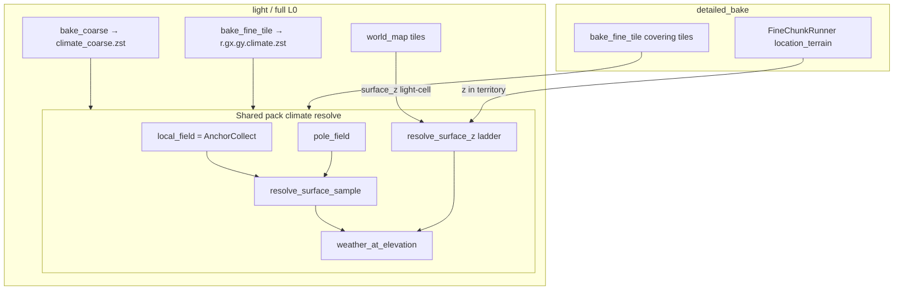

# Plan: корректный climate resolve для light_bake / full_bake / detailed_bake ✅ DONE

> **Статус имплементации (2026-07-16):** Phase 1–5 ✅ — shared `climatePackSample`, `local_field` в surface ctx, light/full fine policy (`spawn_player` / `none` / `all_baked_tiles`), detailed fine + L2 z.  
> **Defaults:** light → `spawn_player`; full → `none`; detailed → `detailed_include_climate_fine=True`.

---

## 0. Целевое состояние

### Инвариант sample (единый для coarse и fine)

```
для каждой sample-точки (gx,gy) или (x_m,y_m):
  1. zone_sample = resolve_surface_sample(pole_field, local_field, mgx, mgy)
       # zone + optional base_temperature_override (volcanic local рядом с горой)
  2. z = resolve_surface_z(...)   # см. лестницу ниже — НЕ typical_elevation_z как «факт»
  3. (temp, rain) = weather_at_elevation(zone, z, base_temperature_override?)
```

**Кейс «высокое место у вулкана»:**

| Вход | Источник |
|---|---|
| Горячая база / volcanic zone | pole blend **+ local anchor** (вулкан), elevation **не** выбирает zone |
| Охлаждение | `z` колонки / light-cell / L2 surface → lapse |

### Лестница `z` (best available)

| Приоритет | Источник | Когда доступен |
|---|---|---|
| 1 | L2 / location_terrain surface_z (meter/chunk) | **detailed** после refine; runtime entry refine |
| 2 | Parent light `surface_z` (light-cell) | после L0 `world_map.zst` на tile |
| 3 | `meter_z_overrides` (declared hydro carve) | surface_ctx уже есть |
| 4 | `coarse_surface_z[(mgx,mgy)]` | всегда на pack bake |
| 5 | `pole.typical_elevation_z` | fallback only |

### По режимам

| Mode | Coarse | Fine (`r.*.climate.zst`) | z для fine |
|---|---|---|---|
| **light_bake** | ✅ весь bbox / world scope bake | optional: tile спавна (`spawn_player`) **или** policy | parent light после write tile **или** coarse+overrides |
| **full_bake** | ✅ тот же | policy: enqueue covering location tiles **или** defer to detailed | то же, что light (L2 ещё нет) |
| **detailed_bake** | не переписывает coarse | ✅ covering tiles territory | **L2 z** внутри volume; вне volume на shared tile — light/coarse |



### Антипаттерны

| Запрещено | Почему |
|---|---|
| Дублировать `weather_at_elevation` / zone literals в pack | `dataModel` + generator SoT |
| Fine только `pole_field.sample` без local | ломает volcanic / oasis anchors |
| Считать zone из elevation | запрещено ТЗ |
| C (location climate blob) в этом плане | optional; read path WP-18 = tile fine |
| Inline mid-pipeline climate без orchestrator | CL-PACK: coarse/fine через `ClimatePackBakeOrchestrator` |
| Менять DAG nodes | gate |

---

## 1. Контракты (dataModel / types) — сначала

### 1.1 Pack climate context (application type, не обязательно POJO)

Расширить то, что несёт bake (предпочтительно `SurfaceTerrainContext` **или** тонкий `PackClimateContext`):

| Поле | Смысл |
|---|---|
| `pole_field` | уже есть |
| `local_field: ClimateAnchorField` | **новое** — из `build_merged_field` / AnchorCollect |
| `coarse_surface_z` | уже есть |
| `meter_z_overrides` | уже есть — использовать в ladder |

Не класть LLM/UX в context.

### 1.2 `PackBakeDefaults` (уже есть флаг)

| Поле | Default | Смысл |
|---|---|---|
| `detailed_include_climate_fine` | `True` | detailed вызывает fine после L2 |
| (optional) `light_fine_tile_policy` | `spawn_player` \| `none` \| `all_baked_tiles` | когда писать fine на L0; **не** хардкод в orchestrator |

Новые builtin-значения — только в POJO.

### 1.3 TZ wording (после кода или вместе с Phase 0)

В `tz_climate.md` § Pack bake modes уточнить одной строкой:

> detailed / light fine: denser samples на covering **macro-tiles**; sample = pole+local + best-available z; unit = `r.{gx}.{gy}.climate.zst`. `l.{uid}.climate.zst` — optional v2.

---

## 2. Shared resolve layer (ядро)

**Модуль (предложение):** `pack/climate/climatePackSample.py` (pure)  
Или расширить `climateCoarseBake._sample_wire` → typed API, без дубля.

| Функция | Контракт |
|---|---|
| `resolve_pack_zone_sample(world, pole, local, mgx, mgy)` | тонкий wrap `ClimateGeneratorService.resolve_surface_sample` |
| `resolve_pack_surface_z(..., x_m, y_m, *, light_tile?, l2_z_lookup?)` | лестница §0 |
| `sample_pack_climate_at(...)` | zone + z → `ClimateSampleWire` |

**DoD:** unit-тест: volcanic local + high z → hot zone base, temp < base (lapse); без local при том же z — другая/холоднее база или другой zone.

Generators остаются pure; pack — тонкий consumer.

---

## 3. Light / full bake — корректный coarse + fine

### Phase L1 — local_field в surface / pack climate path

1. В `prepare_surface_terrain_context` (или соседний prepare): `AnchorCollect` → `local_field`.  
2. Пробросить в `ClimatePackBakeOrchestrator.bake_coarse` / `bake_fine_tile`.  
3. `_sample_wire` / coarse loop: `resolve_surface_sample`, не только `pole_field.sample`.

**DoD:** coarse samples рядом с volcanic local отличаются от «только pole» (fixture с local feature).

### Phase L2 — z ladder на light/full fine

1. После записи `world_map` tile: fine sample читает parent light `surface_z` по light-cell (если tile есть).  
2. Иначе coarse + `meter_z_overrides`.  
3. Не использовать L2 на light/full (его ещё нет).

**Порядок в L0 orchestrator:** world_map tiles → (optional) fine enqueue/drain с light z, не fine до light write.

**DoD:** high coarse/light z на tile → cooler fine sample при той же zone.

### Phase L3 — policy когда печь fine на L0

Сейчас: enqueue tile игрока (spawn) при `refine_scene_on_light`.  
Target: явная policy в `PackBakeDefaults` (не размазывать по entry).

| Policy (wire/код) | Смысл |
|---|---|
| `spawn_player` (default) | Fine только на tile **спавна игрока** (как сейчас) |
| `none` | На L0 fine не писать; только detailed / runtime |
| `all_baked_tiles` | Fine на **каждый** L0 tile этого bake (дольше offline) |

Full по умолчанию: `none` или `spawn_player` — **решение мастера**; knob в POJO + ТЗ.  
В коде **не** использовать имя `spawn_p0`.

---

## 4. Detailed bake — fine с L2 z

### Phase D1 — glue (после L2 terrain)

В `PackDetailedBakeOrchestrator.bake_location`:

1. Refine territory (как сейчас).  
2. Если `detailed_include_climate_fine`: для каждого covering tile → `bake_fine_tile` с **L2 z lookup** внутри volume.  
3. Вне volume на shared tile: light/coarse z (не выдумывать L2).

**Инъекция:** `ClimatePackBakeOrchestrator` в detailed (через facade / ctor), не new ClimateGeneratorService mid-route.

### Phase D2 — L2 z lookup

Источник z для точки в territory:

1. Из только что записанного `location_terrain` / chunk decode cache (предпочтительно уже в memory после refine), **или**  
2. Re-read pack fine terrain для rects volume.

Не invent z; нет cells → fallback light/coarse.

**DoD:** detailed на высокогорной локации у volcanic local → fine temp отражает lapse(L2 z) + volcanic-influenced zone.

### Phase D3 — classifier / progress (минимально)

- Case 3 «detailed complete» по terrain уже есть.  
- Optional: `locations_climate_fine` / tile `climate_status=fine` на covering tiles — **не блокирует** D1; backlog UX.

---

## 5. Порядок имплементации (слои)

| Step | Что | Зависит |
|---|---|---|
| **0** | Согласовать defaults: full → `none` / `spawn_player` / `all_baked_tiles`; TZ one-liner | мастер |
| **1** | Shared `sample_pack_climate_at` + unit tests (volcanic + high z) | — |
| **2** | `local_field` в surface/pack context | 1 |
| **3** | Coarse + fine_tile на light/full → shared sample (L1) | 2 |
| **4** | Fine z from parent light (L2) | 3 |
| **5** | Detailed: call fine after refine + L2 z (D1–D2) | 1–4 |
| **6** | Policy knob + TZ status sync | 5 |
| **7** | Smoke HTTP: light → detailed на fixture с volcanic + high relief | 5 |

Параллелить можно 1 с чтением parent light API; **не** начинать detailed glue до shared sample.

---

## 6. Тесты / smoke

| # | Проверка |
|---|---|
| U1 | unit: zone от local volcanic, temp падает с z |
| U2 | unit: elevation не меняет zone key |
| U3 | coarse bake with local ≠ pole-only (same coords) |
| S1 | light bake: coarse ok; spawn fine_ready; sample_meters prefer fine |
| S2 | detailed: covering tiles `climate_status=fine`; high L2 cooler than low neighbor light-cell |
| S3 | `generate-climate` всё ещё 422 на pack |

Не стартовать backend агентом — smoke через уже поднятый сервер / скрипт мастера.

---

## 7. Вне scope (явно)

- `l.{uid}.climate.zst` (location blob)  
- incremental skip L0 / batch detailed / auto-resume  
- per-chunk climate blob (WP backlog v2)  
- DAG `recalculate_climate` / season LOD C11  
- Indoor / volume climate (hive z-bands)

---

## 8. Критерий готовности

1. Light/full coarse и fine используют **pole+local** + z ladder.  
2. Detailed пишет tile fine на covering tiles с **L2 z** в territory.  
3. Кейс «высокая точка у вулкана» воспроизводится тестом U1/S2.  
4. ТЗ bake modes: статусы ✅; wording unit = tile fine, не обязательный location climate.

---

## Changelog плана

| Дата | |
|---|---|
| 2026-07-16 | Черновик: shared resolve, light/full L1–L3, detailed D1–D3, без location climate blob |
| 2026-07-16 | Policy rename: `spawn_p0` → `spawn_player`; `all_baked_tiles` / `none` без изменений |
