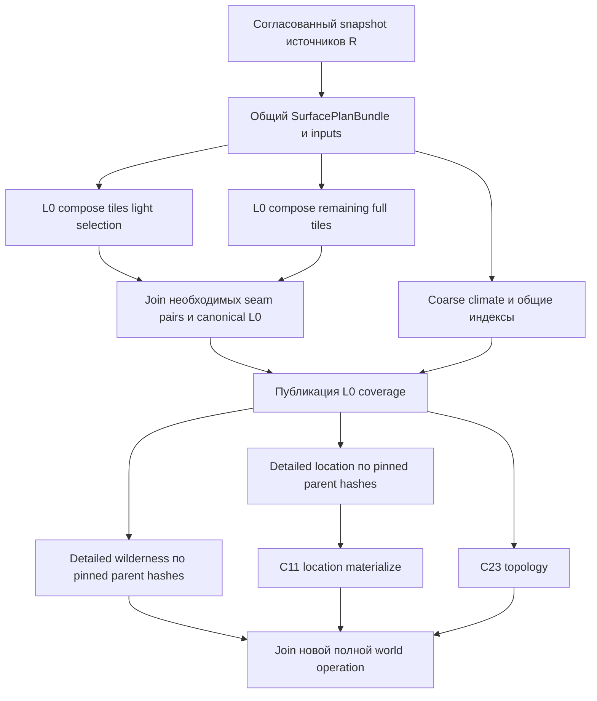

# Параллельные full / light / wilderness bake: исследование

Дата: 2026-11-02. Статус: ОТМЕНЕНО пользователем — «Отмена паралельных full bake light bake». Исследование и работы по этому направлению прекращены; материал ниже сохранён как исторический и не является действующим планом реализации. Отмена не относится к общей поддержке параллельных DAG invocation. Production code не изменялся. Проверен текущий checkout; пользовательские изменения других планов не изменялись. AGENTS.md в дереве не найден; учтены project-context и documentation-layout: backend не запускать, документы агента в .cursor/plans, без коммита.

## Вывод

Разделение возможно после выделения общих артефактов и безопасного publisher. Одновременные вызовы существующих full/light небезопасны и повторяют работу. При этом **light не означает wilderness**. Существующий full — L0 всей области плюс C23; light — L0 выбранных macro-tiles; wilderness — scope отдельного detailed L2. Full сейчас вообще не делает полный detailed wilderness. Поэтому требование «full без повторной wilderness» нужно реализовать как композицию явно названных работ, сохранив смысл существующих callers.

Рекомендация: оставить публичный full полным выполнением его текущего L0-контракта; выделить общие prerequisites и canonical L0-артефакты, переиспользуемые light/full. Для новой операции «весь мир включая L2» ввести отдельную композицию с явным coverage, где wilderness — самостоятельная child operation, на которую одновременно могут подписаться и отдельный запрос, и общий full-world caller. Не переименовывать текущий full в «всё, кроме light» без нового API и миграции.

## Фактические entry points и семантика

Ссылки ниже относительны этому файлу; номера обозначают проверенную точку входа, а не весь диапазон.

| Путь | Реальное поведение |
|---|---|
| [HTTP map.py:99](../../backend/app/api/routes/map.py#L99) | POST pack/bake: mode light/full/detailed; scope wilderness допустим для detailed; writer получается до запуска работы. RequestPlanWait.unbounded передаётся в facade. |
| [facade:84](../../backend/app/application/worldData/materialize/surface/worldSurfaceMaterializationOrchestrator.py#L84) | light/full направляются в общий L0 orchestrator. Full после него вызывает outdoor.plan_topology (C23). Detailed: L2; C11 только для подходящей location. |
| [L0 orchestrator:174](../../backend/app/application/worldData/pack/bake/l0/packMaterializationOrchestrator.py#L174) | Capture → prepare bundle/working maps → region state snapshot → plan tiles → optional drain persisted refine → coarse climate → locations index → compose/write L0 → persist relief grades → fine climate policy → publisher. Это не две независимые runtime ветки. |
| [tile collectors:94](../../backend/app/application/worldData/pack/bake/plan/packTileCollect.py#L94) | light = anchor tiles locations ∪ endpoints declared hydro (не сплошная область гидрологии). full = все macro tiles resolved bbox. Light cap применяется после сортировки в PackTilePlanner. Нельзя без проверки данных предполагать, что любой light tile находится внутри full bounds. |
| [L0 bake:99](../../backend/app/application/worldData/pack/bake/l0/worldMapBakeOrchestrator.py#L99) | Compose всех contributors: relief/climate/landcover/mountain/ravine/hydro/settlement/road; replace region index; только full применяет seam; пишет все запланированные L0 tiles, даже уже существующие; ставит manifest.bake_mode. |
| [detailed scope:125](../../backend/app/application/worldData/pack/bake/detailed/detailedBakeScope.py#L125) | Wilderness выбирает L0-baked tiles manifest без status complete, либо явно один tile. Location — территория location, проверка pack index. Wilderness передаёт location volumes в refine, это не независимое от locations пространство. |
| [detailed refine:68](../../backend/app/application/worldData/pack/bake/detailed/detailedBakeRefine.py#L68) | Сначала require_parent_light для всех tiles, затем последовательный проход macro-tiles, внутри chunk runner; wilderness status recalculation; grades persist. |
| [detailed orchestrator:240](../../backend/app/application/worldData/pack/bake/detailed/packDetailedBakeOrchestrator.py#L240) | L2 refine → optional fine climate только location scope → persist grades. Facade сохраняет manifest после freshness check, затем C11. |

[light_and_full_bake.py](../../backend/scripts/light_and_full_bake.py) — последовательный smoke light → full, не доказательство безопасного параллелизма; скрипт удаляет pack/patches, для исследования не запускался. CLI [bake_world_pack.py](../../backend/scripts/bake_world_pack.py) и [detailed_bake.py](../../backend/scripts/detailed_bake.py) следует сохранить в миграционной матрице вместе с HTTP и entry/refine.

## Зависимости и предлагаемый граф

AS-IS planning [assembler:54](../../backend/app/application/worldData/planning/composition/surfacePlanningAssembler.py#L54): climate_base → terrain_base → water_placement → relief → hydrology_routes → river_relief → final hydrology → climate_local (у этапов есть дополнительные прямые зависимости). [SurfacePlanningEntry:65](../../backend/app/application/worldData/planning/composition/surfacePlanningEntry.py#L65) проецирует планы в working maps на запрос. Landcover observations/rasterization нельзя автоматически считать отдельным frozen planning artifact.

Это целевой граф, не существующий runtime. Минимально безопасный первый срез — весь L0 как один shared prerequisite; затем разрешать независимые scopes detailed после него. Более мелкий L0 pipeline — отдельная оптимизация, требующая equivalence tests. Light completion можно выдавать раньше всего full лишь когда все его артефакты уже окончательны. Seams создают cross-partition dependencies: [worldSeam.py:27](../../backend/app/application/worldData/pack/bake/lightGrid/worldSeam.py#L27) копирует surface_z/system_terrain и пропускает пары вне tile set; full и light для одинакового tile не гарантированно эквивалентны. Нужно согласовать canonical seam semantics для standalone light или различать raw/final tile identity. Нельзя просто сделать full = F минус уже записанные light tiles.

После canonical L0 возможен pipeline: завершившие seam join tiles идут в wilderness, остальные L0 tiles продолжают вычисляться. Это требует pinned parents и публикации coverage; текущий reader/manifest такого контракта не предоставляет. C23 сейчас выполняется после L0; запуск его раньше требует отдельного доказательства read set. C11 остаётся после L2 location. Пересекающиеся location/wilderness chunks и grade slots требуют ресурсного согласования, даже если области называются по-разному.

## Reads/writes и причины гонок

[WorldPackWriter:56](../../backend/app/application/worldData/pack/io/worldPackWriter.py#L56) загружает manifest в изменяемый экземпляр. Каждый отдельный writer сохраняет свой снимок целиком: два независимых tile scope могут потерять записи друг друга. Общий writer вместо двух тоже не даёт межпроцессной синхронизации.

[Writer:104](../../backend/app/application/worldData/pack/io/worldPackWriter.py#L104): blob пишется по фиксированному target.tmp, затем os.replace. Конкуренты одного target делят tmp; atomic replace одного файла не равен транзакции pack. L0 обновляет parent-light cache; chunks, climate refs, counters, grade slots, wilderness status меняют общий manifest. L0 replacement сохраняет существующие chunk refs через model_copy: это не доказательство валидности старого L2 после изменения parent. replace_region_index заменяет общий индекс; locations_index, climate_coarse, metadata/hash — мировые ресурсы.

[Publisher:38](../../backend/app/application/worldData/pack/bake/finalize/packBakePublisher.py#L38) проверяет source freshness в коротком DB UOW, пересчитывает counters; [finalize:22](../../backend/app/application/worldData/pack/bake/finalize/packBakeFinalize.py#L22) сохраняет manifest, затем world terrain_pack_path/hash, invalidates pack read context даже при SQL failure. Blob writes уже произошли до freshness check. DB transaction не откатывает файлы и не делает их невидимыми reader. [SourcePublicationGuard:25](../../backend/app/application/worldData/planning/guards/sourcePublication.py#L25) перечитывает world/locations; это не заменяет lease fencing и не доказывает актуальность отдельно загруженных region states/templates/connection graph.

[PlanningService:181](../../backend/app/application/planning/service/planningService.py#L181) имеет cache и in-process flights/lock; это reuse планов, не общий durable реестр bake effects между executions/processes. Изменяемое last_relief_grade_instances на WorldMapBakeOrchestrator также нельзя разделять между invocation. Background drain в L0 может незаметно добавить L2 writes вне заявленного scope: его следует вынести в отдельную operation либо включить реальные job resources до claim.

## Контракт операций, конфликтов и публикации — предложение

1. Разделить invocation identity, operation identity и artifact identity. Два full invocation могут ждать одну coordinator operation. Разные full/light coordinator могут ссылаться на одну canonical tile operation; ключ только `(world, mode)` такого reuse не обеспечивает.
2. Перед claim согласованно зафиксировать R: авторские world/location inputs, ordered graph, template content revisions, region-state revision/fingerprints, seed, topology/bounds/grid, policies, algorithm/codec versions. Не использовать terrain_pack_hash как единственную исходную ревизию: это результат публикации. Уточнить coverage capture guard отдельно; единый atomic snapshot всех этих inputs пока не доказан существующим кодом.
3. Ключ работы = world + R + artifact kind + canonical scope + output-affecting options + algorithm version + parent hashes. Caps/anchor/grade/climate policy учитываются по фактически resolved scope и семантике. Worker count не входит, только если доказан детерминизм. У wilderness scope=all должен фиксировать список tiles из pinned coverage, а не читать меняющийся manifest на каждом retry.
4. Equivalent overlapping child work присоединяется к одной operation. Для subset/superset разбить на стабильные tile/chunk keys; непокрытые части регистрируются отдельно. Завершённый результат reuse только после проверки hashes, completeness, R, parents и наличия blobs. Один status complete недостаточен.
5. Read immutable pinned artifacts совместим с compute. Disjoint L0/chunk writes совместимы только в staging и при доказанной локальности алгоритма; seam pairs, cross-tile grades и global index aggregation имеют общий join. Неэквивалентная запись того же chunk/tile/climate/grade slot — BakeConflict. Разный R для одного published head — конфликт или отдельная явно изолированная generation, не merge. Название режима не является lock scope.
6. Индексы, counters, manifest и world pack head публикует один coordinator короткой атомарной процедурой: immutable operation/attempt-specific blobs → проверка ownership/fencing + R + parent hashes → merge проверенных refs в актуальный head через CAS → переключение publication pointer. Disjoint results одной R можно rebase/merge при проверке ресурсов; CAS failure не должен терять ранее принятые refs. Повторный publish идемпотентен по operation result. Exact filesystem/DB publication protocol требует отдельного проектирования; lock только на save_manifest недостаточен при старых live blob paths.
7. Fence token проверяется в момент принятия refs/head в той же защищённой процедуре, где выполняется изменение. Старый worker может оставить только недоступный staging мусор. Нельзя позволять ему перезаписывать live blobs после lease expiry. Reader/cache keys привязать к generation/hash, а не одному world/tile; invalidation выполняется после успешной публикации, с recovery SQL/FS boundary.
8. Retry сохраняет logical operation/invocation, меняет attempt/lease epoch и staging namespace; проверенные checkpoints переиспользуются. Restart восстанавливает persisted claims, dependency edges, waiters, join results и publication state. Unique constraints/atomic claim исключают duplicate dispatch. Crash после pointer switch до acknowledgement возвращает прежний result при retry; GC не удаляет referenced или in-flight blobs.
9. Принятые пользователем уточнения: группа CALL ждёт все результаты, включая ошибки, затем решает исход; ожидание не занимает worker slot. Отмена waiter лишь отсоединяет его; даже при нуле waiters bake продолжает работу. Ошибка одной child не отменяет остальные; полная operation не получает success до выполнения всей заявленной coverage. Эти уточнения в прочитанном §§4.3.1–4.3.2 ещё обозначены OPEN; исходный план не редактировался.

## Full как композиция и full без light

Сохранить текущий full=L0 full coverage+C23: callers, PackBakeResult.pack_mode, manifest bake_mode и completeness ожидают именно это. Внутри он может join shared light-selection и remaining tiles; это не две независимые генерации. Даже после отдельного light full обязан получить остальные tiles, seam-consistent overlap, full climate policy и C23.

Новая полная operation с wilderness/location branches может гарантировать более широкую coverage, но не должна молча менять старый full. Вариант «остальное без light» полезен как внутренний dependency-aware remainder: требует accepted L0 ref и возвращает ограниченную coverage; при отсутствии prerequisites либо типизированная ошибка, либо явный ensure prerequisite. Возвращать mode=full для неполного результата нельзя. При standalone wilderness + новой полной operation одинаковый wilderness child key даёт ровно один compute и два независимых RETURN; полный caller ждёт тот же child. Если пользователь под wilderness подразумевает L0 landcover, а не detailed scope, это отдельная будущая декомпозиция contributors; текущий light такой единицей не является.

## Производительность: установлено и что измерять

Генерация и synthetic CPU benchmark не запускались: замеры искусственного цикла не оценят стоимость этого bake. Миры/DB не изменялись, backend не запускался. Числовой выигрыш не установлен.

Установлено чтением кода: L0 compose contributors и tile writes последовательны; синхронный compose вызывается внутри async entry. Climate делит строки через [ChunkComputePool](../../backend/app/application/worldData/materialize/shared/chunkComputePool.py), реально ThreadPoolExecutor. FineChunkRunner: chunks параллельно через тот же pool, persist callbacks сериализованы локальным lock; этот lock не защищает другую operation/process. Macro-tiles detailed идут последовательно. Async CALL сам по себе не распараллелит синхронный Python compute.

Гипотезы: на CPython с включённым GIL чистые Python участки не получат CPU ускорения от двух thread pipelines; native codec/numerical участки и IO могут перекрываться, доля неизвестна. Нужно проверить фактический Python build/GIL, профилировать. Процессы могут ускорить CPU, но Windows spawn требует serializable inputs: текущие closures/lambda/working maps нельзя считать готовыми ProcessPool inputs. Копии bundle/working/compose, L2 buffers и codec увеличат RSS; два независимых pool умножат workers и IO. Нужны общий budget scheduler, backpressure и ограничение in-flight bytes.

Модель оценки: последовательное shared исполнение P+A+B+J; идеальный параллельный вариант P+max(A,B)+J, затем прибавляются serialization/IO/contention. Экономия от удаления дублей отдельно от ускорения параллелизмом; одновременный light+full сейчас дублирует P/coarse/index/overlap, поэтому baseline должен включать и один full.

Воспроизводимый benchmark после изоляции staging: одноразовая копия fixture в отдельной временной DB/pack root, фиксированные seed/options/versions; запрет доступа writer к пользовательским roots. Три размера, edge/seam и interior tiles, location overlap; cold/warm cache раздельно. Сравнить single full; последовательные light→full; shared sequential; shared two-branch threads; shared process compute. Сначала один worker, затем одинаковый суммарный budget 2/4/доступные cores, минимум 5 повторов после warmup. Собирать wall и CPU seconds по фазам, p50/p95, RSS peak всего дерева процессов, IO bytes, cache hits, queue wait, duplicate compute counts, publish duration; профили отдельно от timing runs. Проверять artifact hashes/coverage против эталона, seam/parent equivalence. Разрешение на тяжёлые прогоны и запуск backend требуется отдельно; исследование их не выполняет.

## Этапы реализации и приёмка

1. Согласовать словарь coverage, старый full и новый aggregate; canonical seam light/full, captured revision и parent invalidation. Gate: таблица callers (HTTP/CLI/start/entry), ожидаемые результаты и ошибки приняты; production DAG wiring отдельно согласуется по правилам проекта.
2. Durable bake registry, unique child keys, resources, lease/fence и waiters. Gate: два процесса создают одну эквивалентную работу; overlap different-options получает BakeConflict, disjoint resources разрешены; все waiters могут уйти без остановки работы.
3. Изолированные immutable artifacts и publisher/CAS, versioned caches, region/index/grade join; вынести скрытый drain. Gate: stale worker, crash до/после head switch, duplicate RETURN/publish, restart и SQL failure не портят accepted publication.
4. Общий L0 prerequisite и reuse, затем remainder/seam pair decomposition. Gate: один compute каждого artifact; light→full и concurrent light/full дают согласованную full coverage, без потери refs, пересчёт только недействительных parents; tests для light tiles вне full bounds и разных climate policies.
5. Новая aggregate operation с standalone wilderness child; затем chunk-level независимость location/wilderness. Gate: parent hashes pinned, shared child запускается один раз, join ALL сохраняет все ошибки, cancellation/retry/restart устойчивы; старые full callers не начинают неожиданно L2.
6. Benchmark и выбор thread/process budget. Gate: измеренный выигрыш на целевых fixtures при ограниченном RSS, отсутствии oversubscription и идентичности результата. Без такого измерения обещать ускорение нельзя.

Основные риски: разная seam семантика; неполный revision capture; mutable manifest lost update; ранняя видимость файлов; stale parent cache; shared indices/grades; world-sized memory и oversubscription. Они устраняются до разрешения live parallel writers, а не blanket запретом любых параллельных bake одного мира.

