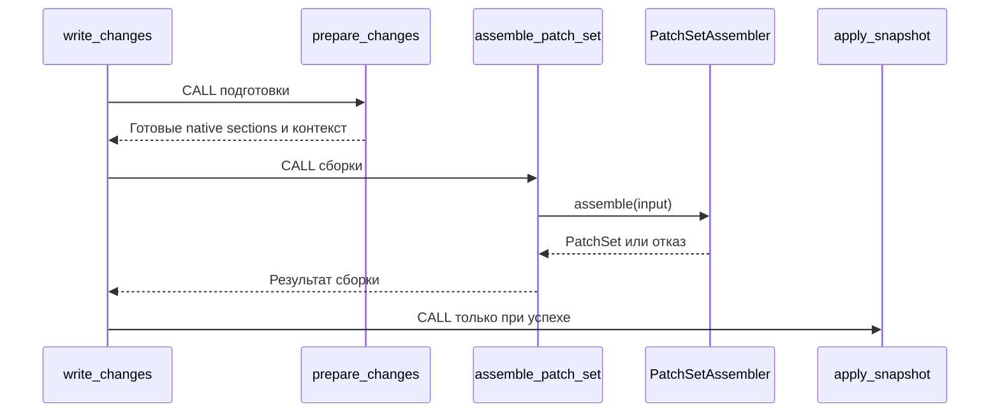

# PatchSet: архитектура самостоятельного домена

Дата: 2026-11-18. Статус: **PS-ARCH-0 — архитектурная проверка ядра PASS после фиксации PS-R3 и PS-R5 по поручению пользователя. Код и production-интеграция не приняты; граница — §8**.

Это первый этап выделения PatchSet. Код, DAG, canonical format и ТЗ этим документом не изменены. Основание: решение пользователя о самостоятельном домене и CRUD только по необходимости; консультация `Between domain operations`; [owning-план](world-domain-patches-snapshots.md), раздел «PatchSet как самостоятельный домен»; [ТЗ Patch System](../../docs/tz_patch_system.md); [правило архитектурной приёмки](../rules/dag-generator-interface.mdc).

## 1. Область и публичная операция

PatchSet конструирует неизменяемый набор уже подготовленных секций. Он не производит доменные изменения, не исполняет их и не публикует состояние. Нужна одна синхронная операция `assemble`; IO и async ей не требуются. Отдельные CRUD, repository, cache, настройки и публичная validate не вводятся без сценария.

Предлагаемые объявления application-контракта (решение о наследовании POJO принято отдельно в §3.1):

```python
class IPatchSetAssembly[S: DomainSection](Protocol):
    def assemble(self, request: PatchSetAssemblyInput[S]) -> PatchSetAssemblyResult[S]: ...

class PatchSetAssembler[S: DomainSection]:
    def __init__(self, request_model: type[PatchSetAssemblyInput[S]],
                 result_model: type[PatchSet[S]]) -> None: ...
    def assemble(self, request: PatchSetAssemblyInput[S]) -> PatchSetAssemblyResult[S]: ...

type PatchSetAssemblyResult[S: DomainSection] = PatchSet[S] | PatchSetAssemblyRefused
```

Конкретный публичный класс — PatchSetAssembler. Protocol не заменяет его в критерии приёмки. Именованные concrete специализации входа и PatchSet задаются composition root для одного и того же закрытого union native sections; неподставленные generics и произвольный BaseModel не допускаются. Это construction binding, не публичный запрос DAG и не пользовательская настройка.

Публичный OpenPipeline не нужен для единственной чистой операции. Нода вызывает assemble напрямую через контракт. Отдельный фасад, executor, callback или worker между нодой и операцией не вводится. Конкретный состав union и его владелец пока OPEN: нельзя объявить production composition готовой без этих сведений.

## 2. Пакеты и классы application

Предлагается использовать существующий пакет `application/patch`, выделив в нём подответственность сборки. Самостоятельность домена определяется контрактом и зависимостями; массовое переименование всех patch импортов в patchSet не требуется. Эта схема размещения подлежит приёмке.

Все пути таблицы относительно `backend/app/`.

| Класс / модуль | Роль, зависимости и эффекты | Проверка и основание отказа |
|---|---|---|
| Новый `IPatchSetAssembly` — `application/patch/contracts/assembly.py` | Только приведённая сигнатура; импорт owning input/result/section types; без алгоритма | Отказ при scope, connection, registry, callback или storage в public input |
| Новый `PatchSetAssembler` — `application/patch/assembly/patchSetAssembler.py` | Публичная реализация assemble: повторная строгая валидация input, вызов одного внутреннего validator, создание результата. Зависимости: validator, owning модели и существующий Pydantic; только память вызова | Все успешные результаты валидны и сохраняют порядок; отказ при IO, обращении к другому domain service или выборе следующей публичной операции |
| Новый `PatchSetAssemblyValidator` — `application/patch/assembly/patchSetAssemblyValidator.py` | Внутренний алгоритм общих отношений, `validate[S: DomainSection](request: PatchSetAssemblyInput[S]) -> tuple[PatchSetAssemblyRelationIssue, ...]`; не создаёт PatchSet | Отказ при интерпретации payload patches, сортировке или чтении published state |
| Existing `ValidatorAggregationHelper` — `dataModel/validation/diagnostics/validatorAggregationHelper.py` | Локальный сборщик разрешённых concrete issue types; экземпляр на вызов; используется validator | Все независимые ошибки собраны стабильно; отказ при общем mutable collector между вызовами или early exit независимых проверок |
| Existing `PatchSetCodec` — `application/patch/encoding/patchSetCodec.py` | encode/decode/fingerprint/fingerprint_bytes; остаётся механизмом представления, assemble его не вызывает | Неизменность canonical bytes и hash для existing inputs; отказ при вызове semantic handler из сборки |
| Existing `SectionContract` — `application/patch/contracts/sectionHandler.py` | Связь key/model/version/schema для codec/handler; не дополнительный request assembly | Не создавать параллельный registry в assembler; отказ при независимых несовместимых declarations |
| Existing `SectionRegistry`, `BoundSectionHandler` — `application/patch/registry/sectionRegistry.py` | Текущие registration/dispatch и representation bindings; не dependencies новой assemble | Отказ при использовании их semantic validate/apply из assembler |
| Existing `DomainSectionHandler` — `application/patch/contracts/sectionHandler.py` | Семантика owning секции в Snapshot context; вне операции сборки | Refusal/receipt handler не использовать как результат сборки |
| Existing `WorldSnapshotService` — `application/worldSnapshot/service/worldSnapshotService.py` | Существующая реализация механизмов применения; не вызывается assembler | Не добавлять обратный вызов assemble или подготовку секций внутри apply |
| Existing `IWorldSnapshotApply` — `application/worldSnapshot/contracts/applyPort.py` | Потребитель результата через DAG: `async apply[S: DomainSection](patch_set: PatchSet[S]) -> SnapshotApplyResult` | Передаётся existing PatchSet без adapter DTO; реализация public lifecycle остаётся owning gate Snapshot |

Split SectionCodec/BoundSectionCodec, предложенный в Snapshot ARCH-0 DEC-2, остаётся отдельным proposed изменением. PS-ARCH-0 не переносит эти классы, не принимает DEC-2 за пользователя и не создаёт конкурирующую схему registry. Причина исключения codec из assemble: сборка не обязана подтверждать canonical fingerprint зависимости или возможность её применения.

## 3. POJO: состав, владельцы и размещение

### 3.1. Принято: общий родитель и два дочерних POJO

**Решение пользователя 2026-11-18:** «мы можем иметь один pojo родитель с этими полями и двух детей, и использовать детей», затем «Делай». Принято одно объявление всех девяти полей в `PatchSetData[S]` и два дочерних типа `PatchSetAssemblyInput[S]` и `PatchSet[S]`. Это заменяет предложение отдельного PatchSetContext и вложенного поля context; такой класс и поле не создаются. Общая структура наследуется, а роли и гарантии детей различаются. Вопрос выбора этой формы входа закрыт; корректность реализации и canonical compatibility ещё предстоит проверить.

```text
PatchSetData[S] — единая схема полей и структурных ограничений
├── PatchSetAssemblyInput[S] — запрос до проверки отношений набора
└── PatchSet[S] — результат с обязательными инвариантами оболочки
```

Публичные операции используют детей, не родитель как универсальный вход/выход. Родитель не является третьим состоянием процесса или новым wire-форматом. Дети не переобъявляют поля и не меняют их типы, порядок или defaults. Участие одинаковых унаследованных полей в двух явно разрешённых ролях не является основанием повторно отклонять эту схему как дублирование. Это решение не разрешает независимые копии owning POJO или произвольное пересечение других типов.

| Тип / путь относительно backend/app | Поля и ответственность | Отсутствие дублирования / критерий отказа |
|---|---|---|
| Новый `PatchSetData[S]` — `dataModel/patch/request/patchSetData.py` | Единственное объявление полей в existing порядке: `format_version: FormatVersion`, `operation_id: EntityUid`, `preparation_fingerprint: RevisionHex`, `world_uid: EntityUid`, `timeline_id: EntityUid`, `turn_id: Annotated[StrictInt, Field(ge=1)]`, `expected_world: WorldPublicationRef`, `expected_players: tuple[PlayerHeadExpectation, ...]`, `sections: tuple[S, ...]`. Общая строгая структура; без проверок отношений целого набора | Поля извлекаются из PatchSet один раз. Отказ при повторном объявлении в детях, foreign service dependency или использовании родителя вместо concrete public child |
| Новый `PatchSetAssemblyInput[S]` — `dataModel/patch/request/assembly.py` | Наследует `PatchSetData[S]`, новых полей нет. Запрос с валидными типами и вложенными POJO, но ещё не проверенными отношениями набора | Допускает несовпадение мира, отсутствие pack и повторные player/section keys для возврата полной диагностики assemble. Не допускает невалидные типы или обход инвариантов вложенных POJO |
| Existing `PatchSet[S]` — `dataModel/patch/request/patchSet.py` | Наследует `PatchSetData[S]`, новых полей нет. Сохраняет existing проверки мира, pack, unique players/sections; остаётся успешным результатом и входом Snapshot | Прямое создание и decode не должны обходить existing инварианты. Не создавать AssembledPatchSet, receipt или второй envelope; успех не доказывает CAS/доменную допустимость публикации |
| Новый `PatchSetAssemblyRefused` — `dataModel/patch/results/assembly.py` | `diagnostics: tuple[PatchSetAssemblyRelationIssue, ...]`, непустой tuple; отказ только конструирования | Нет committed/conflict/retry flags, request copy, lease и snapshot refs. Не дублирует SectionRefused: другой этап и владелец |
| Новый alias `PatchSetAssemblyResult[S]` — тот же модуль | `PatchSet[S] | PatchSetAssemblyRefused` | Не сериализуемая обёртка с optional success/error; невозможен одновременный успех и отказ |

Все новые records frozen/strict/extra-forbid/revalidate-always; общая конфигурация объявляется родителем и наследуется детьми. Коллекции immutable. Отдельной default format version и автоматического назначения identity нет. Generic связывается с concrete named models; no Any/dict payload. Родитель и input не добавляются в canonical manifest автоматически: canonical request по-прежнему PatchSet. Путь existing PatchSet, flat-поля, их порядок, type IDs и поддержанные bytes/hash должны сохраниться; совместимость подтверждается проверками, не предполагается из факта наследования.

Проверки отношений целого набора не переносятся в родитель: иначе input невозможно создать для возврата diagnostics. Existing coherent_request остаётся гарантией дочернего PatchSet при прямом создании и decode; assembler отдельно агрегирует причины до создания результата. Проверка зависимостей по §4 остаётся гарантией assemble; этот рефакторинг не усиливает молча existing constructor contract. Нельзя выдавать любой созданный PatchSet за свидетельство прохождения всех проверок assemble или Snapshot.

При будущей реализации рядом с объявлениями родителя/детей требуется явно описать принятое разделение ролей; то же решение синхронизировать в owning ТЗ до приёмки кода по правилу POJO. Текущий проход меняет планы, а не ТЗ или модели.

### 3.2. Existing POJO, используемые без новых копий

| Тип / модуль | Владелец, состав и использование |
|---|---|
| `DomainSection[P]`, `SectionHeader` — `dataModel/patch/sections/section.py` | Patch core: section имеет header и непустой tuple patches; header — key, format_version, depends_on. Concrete payload принадлежит производителю. Assembler читает только header |
| `PreparedSectionDependency`, `PublishedSectionDependency` — `dataModel/patch/sections/dependency.py` | Patch core: первая содержит kind/key/fingerprint, вторая kind/SectionStateRef. Не заменять общей строкой dependency |
| `PatchRef`, `PatchHeader` — `dataModel/patch/changes/header.py` | Patch core: ref содержит operation_id/section_key/ordinal; header — ref/version/depends_on/artifacts. Вложенная семантика не обходится assembler; новых универсальных patch моделей нет |
| `PatchSectionMetadata`, `PatchSectionRegistry`, `SectionKey` — `dataModel/patch/registry/sectionMetadata.py` | Patch core: key/supported_versions, entries и nominal RegistryKey. Общая сборка использует ключи, не проверяет runtime membership через dispatch |
| `WorldPublicationRef`, `PlayerHeadExpectation` — `dataModel/worldSnapshot/identity/publication.py` | Snapshot: world/publication/pack/head/active timeline/gameplay flag; player UID/expected head соответственно. Передаются готовыми; их конструкторы не читают состояние |
| `WorldSnapshotRef`, `PlayerSnapshotRef` — `dataModel/worldSnapshot/identity/refs.py` | Snapshot identity; вложенные ссылки existing expectations. Не вводить PatchSetHead или вторую publication identity |
| `FormatVersion`, `PatchOrdinal` — `dataModel/patch/values.py`; `EntityUid` — `dataModel/identity/uid.py`; `RevisionHex` — `dataModel/validation/diagnostics/runtimeIssueContext.py` | Existing value types; переиспользуются без новых строковых aliases с той же семантикой |
| `SectionRefused`, `SectionApplyReceipt` — `dataModel/patch/results/sectionResult.py`; `SnapshotApplyResult` — `dataModel/worldSnapshot/results/apply.py` | Результаты других стадий; assembler их не создаёт и не вкладывает в свой отказ |

### 3.3. Типизированные ошибки полей и отношений

**PS-R1: контракт закреплён по поручению пользователя «Делай первый пункт», 2026-11-18.** Доменные отказы представлены одним concrete relation issue. Ошибки типов/формы при построении входа принадлежат existing model validation; новый field-error POJO для assemble не вводится. Размещение новых enum/issue — `dataModel/patch/results/assemblyIssues.py`. Код не реализован; это фиксация архитектурного контракта.

| Тип | Поля / категории | Граница |
|---|---|---|
| `PatchSetAssemblyRelationCode` (StrEnum) | `WORLD_MISMATCH`, `MISSING_PACK`, `DUPLICATE_PLAYER`, `DUPLICATE_SECTION`, `MISSING_PREPARED_DEPENDENCY`, `PREPARED_DEPENDENCY_ORDER`; wire значения с префиксом `patch_set.assembly.` и lowercase имени | Закрытый набор общих отношений, без Snapshot CAS/recovery причин |
| `PatchSetAssemblyRelationIssue` | `code: PatchSetAssemblyRelationCode`, `path: ValidatedFieldPath`, `related_path: ValidatedFieldPath | None`, `message: StrictStr` | Два адреса отношений внутри input; не копирует world/player/section payload. Для missing dependency related_path=None |

Existing ValidatedFieldPath остаётся в `dataModel/fields/validatedFieldPath.py`; пути строятся checked selectors от concrete input. Exact неверный Python type отклоняется TypeError до чтения полей. Strict revalidation unchecked/повреждённого input сохраняет Pydantic ValidationError. Ни тот, ни другой случай не получает фиктивный field path и не превращается в PatchSetAssemblyRefused. Для корректно типизированного input validator возвращает все независимые relation diagnostics; точная таблица адресов — §7.1. Existing FieldPathError не изменяется и не оборачивается новым бессодержательным типом.

Ошибки конфигурации concrete models — ошибки composition root, не domain refusal и не результат пользовательской операции. Не ловить все Exception и не превращать programming fault в диагностику. Отдельный публичный exception framework без нужды не создаётся.

## 4. Алгоритм одной операции и границы проверок

Зафиксированный внутренний порядок (полная детализация — §7.5):

1. Проверить exact concrete request (иначе TypeError), затем strict revalidation (при нарушении — Pydantic ValidationError). При structural failure relation validator не запускается: валидность входных POJO не доказана. Structural diagnostics не смешиваются с доменными отказами; все независимые relation checks выполняются только после успешной revalidation по §3.3.
2. Validator проверяет context: мир expected_world соответствует world_uid; pack задан; нет повторных player UID. Не вводить новую проверку равенства timeline/head: branch semantics принадлежит Snapshot.
3. Проверить unique section keys. По tuple и header.depends_on проверить наличие каждого PREPARED key и что его позиция раньше зависимой секции. Ошибки выдавать в порядке context checks, затем индексов секций/зависимостей. При неоднозначном duplicate key не вычислять основанный на нём порядок; продолжить независимые проверки.
4. При непустом наборе ошибок вернуть PatchSetAssemblyRefused. Иначе построить existing PatchSet с исходными значениями и порядком и вернуть его. Не возвращать частичный PatchSet.

Порядок headers и patches никогда не исправляется автоматически. Сортировка expected_players, уже выполняемая codec для canonical bytes, не переносится в возвращаемый объект assemble. Пустой tuple sections пока разрешён existing моделью; новое запрещение no-op не вводится без решения владельца. Self-dependency уже запрещена SectionHeader; input boundary повторно валидирует модель, а не дублирует правило в loop.

Проверки prepared fingerprints, published dependency existence, ancestry, current heads/CAS, storage readiness/holds, registry model/version admission и предметные конфликты не входят в эту операцию. Они остаются owning acceptance перед применением. Сборка подтверждает структуру и локальный порядок, не безопасность публикации. Ни один caller не вправе пропускать Snapshot checks по факту успешной assemble.

## 5. Междоменные связи и DAG

Источник внешнего порядка — [зафиксированная схема](dag-multidomain-patch-publication-draft.md). Родство нод и engine CALL не меняются.



Диаграмма конкретизирует принятую границу вызова, не вводит новые ноды или production bindings. PS-R3 закрыт: DAG организует и вызывает сборку; чистое конструирование принадлежит PatchSet. Норматив синхронизирован в docs/tz_patch_system.md и docs/tz_world_snapshot.md.

| Требуемые данные | Owning API / состояние контракта | Передача и незакрытая связь |
|---|---|---|
| Готовые native sections | Producers Time/Lifecycle/других доменов — конкретные методы ещё не подтверждены для закрытого union | Owning node → DAG → input.sections. Assembler не вызывает производителя и не конвертирует proposed prepared result |
| WorldPublicationRef и player expectations | Snapshot existing refs; конкретный источник coherent capture для этой операции OPEN | Результат чтения/подготовки → DAG → context; implicit latest внутри assemble запрещён |
| operation_id/preparation_fingerprint/timeline/turn | Identity/preparation ownership должен быть подтверждён процессом подготовки; точный public method OPEN | DAG передаёт готовые значения. Assembler не вычисляет отсутствующие значения и не claim-ит ledger |
| Собранный PatchSet | Existing `IWorldSnapshotApply.apply` с полной сигнатурой из §2 | Assembly result → DAG → apply_snapshot → Snapshot. No direct assembler → Snapshot |

Неустановленный upstream API не заменяется придуманным методом или NodeId. Доменные части можно обсуждать отдельно, но production маршрут не принимается до замыкания всех этих связей.

## 6. Приёмка по AGENTS.md и очередность реализации

Актуальный реестр замечаний и результаты их последовательной проработки — §7. Таблица ниже отражает критерии; уточнения §7 имеют приоритет над первоначальными OPEN/formulations §3.3–4. Разработанная конкретизация не равна пользовательской приёмке.

| Обязательный критерий | Место и результат текущей проверки |
|---|---|
| Нет pipeline, выбирающего следующий маршрут | §1, §4: только вычисление одного результата; выбор продолжения остаётся DAG. Соответствует предложенной схеме |
| Нет скрытой оркестрации | §2, §5: прямой вызов assemble, нет callback/executor; exact binding ещё OPEN |
| Нет прямых междоменных вызовов | §2, §5: зависимости на типы, не foreign services; upstream contracts OPEN |
| Ответственность каждого класса | §2–3: указаны расположение/роль/dependencies/effects/отказ; concrete section classes пока не перечислены, полный inventory OPEN |
| Public контракт отделён от реализации | §1–4: input/result не содержат algorithm, registry или storage; PS-R1 фиксирует structural boundary exceptions отдельно от relation refusal |
| Порядок сохранён | §5 сохраняет четыре согласованных шага; внутренний порядок §4 — proposal, требует приёмки |
| CRUD данных и настроек | §1: только необходимая assemble по явному решению пользователя; ненужные CRUD и settings не добавляются |
| Междоменные CRUD-контракты | §5 показывает известный consumer и неизвестные producers; **не пройдено** до exact методов/POJO |
| POJO и field/logic ошибки без дублирования | §3.1: пользователь принял одного родителя и двух детей с различными ролями; PS-R1 закрывает форму diagnostics и mapping путей. Полный критерий ещё **не пройден**: остаются concrete bindings, синхронизация ТЗ и проверка canonical compatibility |

**Актуальный результат приёмки ядра — PASS, §8.** POJO и PS-R1/PS-R3/PS-R5 закреплены. Внешние producers/union не блокируют ядро; совместимость проверяется при реализации.

После закрытия архитектуры предлагается порядок поставки, который также должен быть принят: (1) POJO и совместимость existing PatchSet; (2) публичный контракт, validator и assembler одним работоспособным срезом; (3) адресные тесты; (4) отдельно согласованный DAG binding и приёмка фактических callers. Нельзя переносить codec/handler migration в эти шаги без отдельного согласования.

Проверки будущего кода: несколько независимых diagnostics за один вызов; duplicate keys и ambiguous deps; missing/forward deps без сортировки; одинаковый результат повторной сборки без IO; сохранение section/player/patch порядка; no partial success; отсутствие semantic handler calls; exact child type admission (родитель и другой ребёнок не заменяют input); одинаковые унаследованные поля и отсутствие их переобъявлений; input допускает нарушения отношений, которые existing PatchSet отвергает при прямом создании/decode; unchanged golden bytes/hash/round-trip existing PatchSet при выделении PatchSetData. До реализации это требования, не выполненное evidence.

## 7. Реестр ревью и последовательная проработка — 2026-11-18

Основание: проверка по AGENTS.md и поручение пользователя «Зафиксируй все пункты и пройдись по нему». Сохранены пять замечаний и положительные результаты проверки. После уточнения scope PS-R2 и producer-specific часть PS-R4 являются исключительно интеграционными зависимостями, не блокерами ядра. **OPEN owner** означает ожидание внешнего контракта для интеграции; **implementation evidence** — будущую проверку кода, не пробел архитектуры сам по себе.

| ID | Замечание | Результат прохода | Статус |
|---|---|---|---|
| PS-R1 | Не завершён контракт field/logic errors и адресов | §3.3/§7.1 синхронизированы: boundary exceptions отдельно от relation refusal; точные code/path/related_path и порядок diagnostics | Закрыт в архитектурном плане по поручению «Делай первый пункт»; implementation evidence ещё нет |
| PS-R2 | Нет exact upstream методов и Output → Input | §7.2: повторная сверка actual Time и консультация Between domain operations; составлена карта всех девяти полей и условия отдельной приёмки ядра | Проход выполнен; OPEN owner для production-маршрута, не закрыт консультацией |
| PS-R3 | Граница DAG/PatchSet | §7.3 и ТЗ синхронизированы по пункту 1 пользователя | Закрыт для архитектуры ядра |
| PS-R4 | Неполная карта existing классов/POJO и concrete union | §7.4: дополнены immediate input types, зависимости и индивидуальные критерии; production union отделён от generic ядра | Ядро дополнено; concrete bindings OPEN owner |
| PS-R5 | Внутренний порядок | §7.5 закреплён после PS-R3 по пункту 2 пользователя | Закрыт для архитектуры ядра |

### 7.1. PS-R1 — контракт отказа и ошибочного вызова

Обнаруженное ограничение existing `ValidatedFieldPath`: обязательны хотя бы один segment и первый FieldSegment своего root. Следовательно, причина «весь переданный Python object другого типа» не может честно иметь field path. Не создавать фиктивное поле request или путь к sections для такой ошибки.

**Зафиксированный контракт:** публичный метод принимает уже построенный exact typed input. Неверный Python-класс (включая родитель или другой ребёнок) — `TypeError` boundary misuse. Повторная строгая model validation повреждённого/unchecked экземпляра — existing Pydantic `ValidationError`. Они не являются `PatchSetAssemblyRefused` и не перехватываются blanket catch. Ошибки decode/transport до получения typed input принадлежат своему владельцу; не добавлять raw dict API в assemble.

Прежние предложенные `PatchSetAssemblyFieldCode` и `PatchSetAssemblyFieldIssue` исключены из поставки. Это замена первоначального proposal, не отмена требования typed POJO для настоящих доменных отказов. Публичные structural exceptions и их граница документированы; новые прикладные ошибки не маскируются под Pydantic.

Для корректно типизированного input все отказы assemble — отношения набора. `PatchSetAssemblyRefused.diagnostics: tuple[PatchSetAssemblyRelationIssue, ...]` непустой; промежуточный union alias PatchSetAssemblyIssue больше не нужен. Сигнатура внутреннего validator соответственно возвращает tuple[PatchSetAssemblyRelationIssue, ...]. Класс relation issue и code enum остаются в `dataModel/patch/results/assemblyIssues.py`; поля code/path/related_path/message сохраняются.

В таблице ниже показана человекочитаемая проекция пути; в POJO хранится existing ValidatedFieldPath, построенный checked selectors относительно именованного concrete input, не строка. `i` — текущий индекс, `j` — индекс зависимости, `first` — первый индекс совпавшего UID/key, `target` — единственный индекс зависимости.

| Code | path | related_path | Когда выдаётся |
|---|---|---|---|
| WORLD_MISMATCH | expected_world.world_uid | world_uid | Значения различаются |
| MISSING_PACK | expected_world.pack_hash | None | pack_hash отсутствует |
| DUPLICATE_PLAYER | expected_players[i].player_uid | expected_players[first].player_uid | Для каждого повторного UID после первого |
| DUPLICATE_SECTION | sections[i].header.key | sections[first].header.key | Для каждого повторного key после первого |
| MISSING_PREPARED_DEPENDENCY | sections[i].header.depends_on[j].section_key | None | PREPARED key отсутствует во всём входе |
| PREPARED_DEPENDENCY_ORDER | sections[i].header.depends_on[j].section_key | sections[target].header.key | Единственная секция target находится после зависимой |

Для union dependency checked path содержит branch PREPARED через existing VariantSegment; projection его опускает. Нельзя обращаться к section_key у PUBLISHED. Self PREPARED dependency отклоняется existing SectionHeader при structural validation; не порождать второй relation code за ту же причину. message фиксирует причину для человека и не участвует в выборе исхода. related_path всегда адресует тот же concrete input.

Все независимые relation ошибки собираются existing ValidatorAggregationHelper. Никаких foreign SectionRefused/SnapshotApplyResult в этом отказе. После успешного validator ошибка конструктора результата не превращается в бизнес-отказ: это нарушение согласованности реализации/моделей, которое должно быть выявлено тестом.

Стабильный порядок diagnostics закреплён для PS-R1: WORLD_MISMATCH → MISSING_PACK → повторные player UID по индексу → повторные section keys по индексу → dependency ошибки по паре (section index, dependency index). Повторения адресуются к первому совпадению. Неоднозначный target key уже диагностирован как duplicate: order check этой связи пропускается, остальные независимые связи продолжаются. Это контракт наблюдаемого отказа, не разрешение общего implementation порядка PS-R5.

Точные значения enum: `patch_set.assembly.world_mismatch`, `patch_set.assembly.missing_pack`, `patch_set.assembly.duplicate_player`, `patch_set.assembly.duplicate_section`, `patch_set.assembly.missing_prepared_dependency`, `patch_set.assembly.prepared_dependency_order`. Relation issue — frozen strict BaseModel, extra=forbid, revalidate_instances=always. Поля code/path/related_path/message обязательны; отсутствие второй стороны явно задаётся None. Message не является стабильным машинным кодом. Refusal требует min_length=1; пустая диагностика не является отказом.

DoD будущей реализации PS-R1: invalid child type даёт TypeError без вызова validator; unchecked structurally invalid input даёт ValidationError без relation checks; корректно типизированный input с несколькими независимыми нарушениями возвращает все точные codes/paths/related_paths в указанном порядке без создания результата. Для inherited fields checked path root должен быть concrete input, не PatchSetData; union PREPARED branch проверяется отдельно. Внешний malformed transport не входит в данный метод. Это требования проверки, не выполненные тесты.

### 7.2. PS-R2 — внешние контракты, вне приёмки ядра

Подробная карта вынесена в [отдельный реестр внешних контрактов](patch-set-external-contracts.md). По явному решению пользователя все его OPEN относятся только к конкретным интеграциям и **не блокируют архитектурную приёмку ядра PatchSet**. Это также относится к production union и producer-specific части PS-R4. Ядро принимает готовые типизированные данные; его локальные критерии проверяются по §8.

### 7.3. PS-R3 — зафиксированная нормативная граница


По поручению пользователя пункт 1 выполнен первым: следующая граница подробно закреплена в разделе «Граница DAG и домена PatchSet — уточнение 2026-11-18» ТЗ Patch System, синхронизирована с ТЗ Snapshot и планом DAG:

> Только DAG организует подготовку и сборку общего набора: вызывает owning операции, получает готовые типизированные секции и контекст, затем напрямую вызывает публичную assemble домена PatchSet. PatchSet конструирует и проверяет общую оболочку переданного набора без IO, междоменных вызовов, изменения состава и порядка. Результат возвращается DAG; только DAG передаёт его Snapshot. PatchSet не применяет изменения, Snapshot не собирает набор. API/debug/import callers используют тот же DAG-путь.

Это сохраняет write_changes → prepare_changes → assemble_patch_set → apply_snapshot, родство нод и отсутствие второго входа. Норматив: [Patch System](../../docs/tz_patch_system.md#граница-dag-и-домена-patchset--уточнение-2026-11-18), [Snapshot](../../docs/tz_world_snapshot.md), [DAG](dag-multidomain-patch-publication-draft.md). Прямой вызов domain assemble не означает, что нода знает алгоритм validator или управляет его стадиями. PS-R3 закрыт для ядра; это не runtime evidence.

### 7.4. PS-R4 — дополнение карты immediate типов и class boundaries

Все пути относительно backend/app. Таблица уточняет §3.2; перечисленные records immutable и не выполняют IO. Payload concrete patches остаётся у владельцев, не анализируется общим assembler.

| Тип / модуль | Точный состав / допустимая зависимость | Индивидуальный критерий и отказ |
|---|---|---|
| WorldPublicationRef — dataModel/worldSnapshot/identity/publication.py | world_uid:EntityUid, publication_id:EntityUid, pack_hash:RevisionHex\|None, snapshot_head:WorldSnapshotRef\|None, active_timeline_id:EntityUid\|None, gameplay_started:bool | Existing coherence валидируется при input creation; отказ при копии publication полей в новом PatchSet-owned ref или IO lookup |
| PlayerHeadExpectation — тот же модуль | player_uid:EntityUid, expected_head:PlayerSnapshotRef\|None | Head принадлежит указанному игроку; отказ при выключении existing nested validation |
| WorldSnapshotRef — dataModel/worldSnapshot/identity/refs.py | kind:Literal[WORLD], world_uid/timeline_id/snapshot_id:EntityUid | World chain identity; отказ при смешении с player ref |
| PlayerSnapshotRef — тот же модуль | kind:Literal[PLAYER], player_uid/snapshot_id:EntityUid | Player chain identity; отказ при добавлении world/timeline fields ради унификации |
| SectionStateRef — dataModel/worldSnapshot/sections/refs.py | snapshot:SnapshotRef, section_key:SectionKey, format_version:FormatVersion | Ссылка опубликованной зависимости; refusal при трактовке её наличия как доказательства существования записи |
| PreparedSectionDependency — dataModel/patch/sections/dependency.py | kind:Literal[PREPARED], section_key:SectionKey, section_fingerprint:RevisionHex | Assembler проверяет только наличие/порядок key; отказ при заявлении о проверенном fingerprint без owning проверки |
| PublishedSectionDependency — тот же модуль | kind:Literal[PUBLISHED], section_ref:SectionStateRef | Не ищется во входных sections; отказ при требовании prior tuple position для published ссылки |
| SectionHeader — dataModel/patch/sections/section.py | key:SectionKey, format_version:FormatVersion, depends_on:tuple[SectionDependency,...] | Existing unique/self checks сохраняются; отказ при повторной реализации этих checks в assembler |
| DomainSection[P] — тот же модуль | header:SectionHeader, patches:tuple[P,...], min_length=1 | Сохраняется concrete payload type и порядок; отказ при преобразовании в dict/BaseModel payload |
| PatchSectionMetadata — dataModel/patch/registry/sectionMetadata.py | key:SectionKey, supported_versions:frozenset[FormatVersion], непустое множество | Это declaration, не runtime acceptance; отказ при переносе handler в POJO |
| PatchSectionRegistry — тот же модуль | entries:tuple[PatchSectionMetadata,...], unique keys | Nominal owner SectionKey; отказ при создании отдельного несовместимого ключевого реестра сборки |
| FormatVersion / PatchOrdinal — dataModel/patch/values.py | StrictInt > 0 / StrictInt >= 0 | Bool и coercion не допускаются; новые aliases с тем же смыслом не вводятся |
| ValidatedFieldPath — dataModel/fields/validatedFieldPath.py | root:ModelIdentity, segments:непустой tuple[PathSegment,...]; первый field принадлежит root | Только schema-checked пути concrete input; отказ при fabricated root path для неверного Python object |

Application boundaries: assembler владеет проверкой exact input type, revalidation и созданием результата; validator — только отношениями в уже структурно валидном input; collector — только накоплением diagnostics. Следовательно, validator не ловит Pydantic decode errors, assembler не вызывает handler, collector не решает policy. Для ctor PatchSetAssembler проверяется одинаковый concrete section union request_model/result_model до первого вызова; mismatch — configuration TypeError. Exact comparison механизма generic metadata должен быть определён при implementation design, не помещается в public input.

SectionContract/Registry/BoundSectionHandler/Codec и SnapshotService перечислены в §2 как существующие соседние механизмы, а не объекты рефакторинга PS-ARCH-0. Их полная миграция не требуется для чистой assemble; если scope расширится, нужна отдельная class-by-class карта. Concrete production patches/sections пока нельзя перечислить достоверно — PS-R2 остаётся зависимостью интеграции.

### 7.5. PS-R5 — зафиксированный внутренний порядок

1. На construction boundary сверить пару именованных request/result models и section union. Ошибка binding не запускает обработку запросов.
2. На входе assemble проверить exact child type, затем strict revalidation. При structural failure — исход по §7.1; relation validator не запускается. Это зависимый ранний отказ, поскольку валидность дочерних моделей ещё не доказана.
3. Создать отдельный collector. Проверить WORLD_MISMATCH, затем MISSING_PACK, затем повторные player UID по возрастанию индекса. Независимые проверки не прекращать после первой причины.
4. Построить индекс **всех** section keys, сохраняя все позиции; выдать DUPLICATE_SECTION для каждого повторения после первого в порядке tuple. Ни один duplicate не исправлять и не выбирать last-wins.
5. По возрастанию section index, затем dependency index проверить PREPARED связи. Отсутствующий key → MISSING_PREPARED_DEPENDENCY. Несколько позиций target key → не проверять порядок этой связи, поскольку duplicate уже диагностирован. Единственная target position после source → PREPARED_DEPENDENCY_ORDER. Для source с повторяющимся собственным key порядок его tuple position всё ещё известен; проверки однозначных чужих targets продолжаются. PUBLISHED пропустить без IO.
6. Если collector непустой — вернуть один refusal со всеми причинами в указанном порядке. Иначе построить result_model из исходных типизированных значений без dict/JSON round-trip payload; вернуть PatchSet. Поля и последовательности не сортировать и не нормализовать. Существующие проверки ребёнка-результата остаются обязательными.
7. Возврат результата завершает операцию; запуск Snapshot или решение retry принадлежат DAG. Никаких последующих скрытых стадий.

Порядок закреплён по поручению пользователя выполнить пункт 2 после пункта 1: сначала синхронизирована граница PS-R3, затем зафиксированы эти семь шагов. PS-R5 закрыт на уровне архитектуры ядра. Внешние четыре шага не изменены. Проверка cyclic prepared deps сводится к наличию forward edge при фиксированном порядке; отдельный topological sort/graph scheduler не вводится.

### 7.6. Сводный результат повторного прохода

Подтверждены на уровне проекта: отсутствие выбора следующей публичной операции внутри assembler; прямой вызов от DAG без фасада; отсутствие foreign service calls; отсутствие storage в public input; принятая схема одного родителя и двух детей; CRUD только по необходимости; сохранение внешнего порядка. Canonical compatibility остаётся обязательным evidence реализации, а не основанием заранее объявлять несовместимость.

Все пять замечаний проработаны. PS-R1/PS-R3/PS-R5 закрыты; ядро PS-R4 описано. Внешние PS-R2/bindings остаются в отдельном реестре и не блокируют ядро. Архитектурный результат — PASS (§8). Код не менялся; ТЗ и документация DAG синхронизированы.

## 8. Отдельная архитектурная приёмка ядра — 2026-11-18

**Поручение пользователя:** принимать архитектуру ядра сейчас, дальнейшие контракты могут уточняться. Этот раздел заменяет прежнюю трактовку PS-R2/production union как блокера всего PS-ARCH-0. Разрешение провести проверку не считается автоматическим PASS или приёмкой ещё предложенных решений.

### 8.1. Граница проверяемого среза

В срез входят IPatchSetAssembly, PatchSetAssembler, PatchSetAssemblyValidator; PatchSetData, PatchSetAssemblyInput, existing PatchSet; PatchSetAssemblyRefused, PatchSetAssemblyRelationCode/Issue, result alias; переиспользование existing immutable section/ref/value/path моделей и локального collector. Публичный вход уже содержит готовые typed sections и весь контекст. Публичный выход — PatchSet или отказ. Внутренние вызовы ограничены structural validation → relation validator/collector → result construction; никаких foreign services.

За пределами среза: producers конкретных секций, coherent capture протокол конкретного сценария, назначение operation/turn/preparation identity, production closed union и composition root конкретного приложения, wiring/реализация нод, Snapshot apply lifecycle, split codec/handler registry, persistence, cache. Их отсутствие не является дефектом generic ядра и не требует заполнять его чужой логикой. Existing Codec входит только как потребитель, чью совместимость нужно сохранить, не как dependency assemble.

### 8.2. Результат по каждому обязательному критерию

PASS ниже означает соответствие описанной архитектуры данному критерию, не реализацию и не выполненные тесты.

| Критерий AGENTS.md | Результат для ядра | Основание |
|---|---|---|
| Запрет pipeline, выбирающего маршрут | PASS | §1, §4, §7.5: одна операция, локальные проверки и конечный результат; следующий публичный вызов не выбирается |
| Запрет скрытой оркестрации | PASS по целевой цепочке | §2, §5: DAG напрямую вызывает assemble; нет facade/worker/callback; фактическое wiring вне среза |
| Запрет прямых междоменных вызовов | PASS | §2, §7.4: используются готовые immutable данные, не foreign application services; Snapshot вызывается только после возврата в DAG |
| Каждый класс: ответственность, зависимости, эффекты, критерий отказа | PASS в ограниченном scope | §2, §3.1, §3.3, §7.1, §7.4 и §8.1 выделяют собственные классы и соседние механизмы; concrete producer classes не входят в ядро |
| Граница public/interface/implementation | PASS | §1 фиксирует конкретный класс, полную assemble сигнатуру и Input/Result; §2 скрывает validator/collector от request; нет scope/registry/storage в данных |
| POJO и типизированные field/logic ошибки | PASS как контракт ядра | §3.1: разрешённый родитель и два ребёнка; §3.3/§7.1: конкретный relation issue, structural exceptions отдельно, точные адреса и порядок. Будущие пометки в моделях/ТЗ и compatibility checks обязательны при реализации |
| CRUD данных/настроек | PASS | Явное решение пользователя: только необходимые операции. Собственных stored данных/settings нет; assemble достаточна |
| Междоменные контракты | Не блокирует ядро; интеграция OPEN | §8.1: ядро получает данные, не вызывает владельцев. PS-R2 сохраняется исключительно для конкретного producer → DAG → consumer маршрута |
| Согласованность с ТЗ | PASS | §5/§7.3 и ТЗ Patch System/Snapshot синхронизированы: DAG организует, PatchSet конструирует, результат возвращается DAG |
| Неизменность утверждённого порядка | PASS | §5 сохраняет четыре внешних шага; §7.5 закреплён после PS-R3 по прямому поручению пользователя, порядок diagnostics PS-R1 сохранён |

**Вывод: PASS архитектурной проверки общего ядра.** PS-R1, PS-R3 и PS-R5 закрыты в документах; карта классов/POJO ядра определена, внешние контракты приёмку не блокируют. Это результат проверки проекта по AGENTS.md в ограниченном scope §8.1, не приёмка реализации, production-интеграции или Snapshot ARCH-0 целиком.

### 8.3. Последовательность закрытия и последующие проверки

1. По пункту 1 пользователя подробно закреплена граница DAG/PatchSet в ТЗ Patch System, дана ссылка из ТЗ Snapshot и уточнён прямой вызов assemble в owning DAG-плане. Совместное использование полей двумя детьми отражено в ТЗ.
2. После этого по пункту 2 закреплены семь шагов §7.5, исходы structural failure, стабильная агрегация независимых ошибок и отсутствие частичного результата. Повторная проверка не выявила противоречий с внешним порядком и PS-R1.

Следующий этап — реализация по принятой архитектуре и применимым repository gates; текущая задача код не меняет. Canonical bytes/hash, exact child validation, typed paths для inherited fields и negative/aggregation cases проверяются при реализации. Производители секций, production union и сценарии capture остаются в отдельном реестре без влияния на этот архитектурный PASS.
