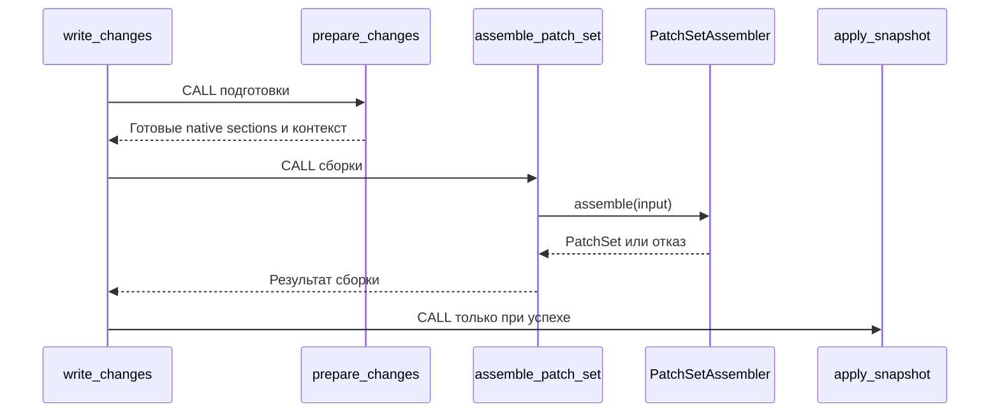

# PatchSet: архитектура самостоятельного домена

Дата: 2026-11-18. Статус: **PS-ARCH-0 — архитектурное предложение, до реализации и пользовательской приёмки**.

Это первый этап выделения PatchSet. Код, DAG, canonical format и ТЗ этим документом не изменены. Основание: решение пользователя о самостоятельном домене и CRUD только по необходимости; консультация `Between domain operations`; [owning-план](world-domain-patches-snapshots.md), раздел «PatchSet как самостоятельный домен»; [ТЗ Patch System](../../docs/tz_patch_system.md); [правило архитектурной приёмки](../rules/dag-generator-interface.mdc).

## 1. Область и публичная операция

PatchSet конструирует неизменяемый набор уже подготовленных секций. Он не производит доменные изменения, не исполняет их и не публикует состояние. Нужна одна синхронная операция `assemble`; IO и async ей не требуются. Отдельные CRUD, repository, cache, настройки и публичная validate не вводятся без сценария.

Предлагаемые объявления (все новые имена в этом документе — proposed):

```python
class IPatchSetAssembly[S: DomainSection](Protocol):
    def assemble(self, request: PatchSetAssemblyInput[S]) -> PatchSetAssemblyResult[S]: ...

class PatchSetAssembler[S: DomainSection]:
    def __init__(self, request_model: type[PatchSetAssemblyInput[S]],
                 result_model: type[PatchSet[S]]) -> None: ...
    def assemble(self, request: PatchSetAssemblyInput[S]) -> PatchSetAssemblyResult[S]: ...

type PatchSetAssemblyResult[S: DomainSection] = PatchSet[S] | PatchSetAssemblyRefused
```

Конкретный публичный класс — PatchSetAssembler. Protocol не заменяет его в критерии приёмки. Именованные concrete специализации входа и PatchSet задаются composition root для одного и того же закрытого union native sections; неподставленные generics и произвольный BaseModel не допускаются. Это construction binding, не публичный запрос DAG и не пользовательская настройка.

Публичный OpenPipeline не нужен для единственной чистой операции. Нода вызывает assemble напрямую через контракт. Отдельный фасад, executor, callback или worker между нодой и операцией не вводится. Конкретный состав union и его владелец пока OPEN: нельзя объявить production composition готовой без этих сведений.

## 2. Пакеты и классы application

Предлагается использовать существующий пакет `application/patch`, выделив в нём подответственность сборки. Самостоятельность домена определяется контрактом и зависимостями; массовое переименование всех patch импортов в patchSet не требуется. Эта схема размещения подлежит приёмке.

Все пути таблицы относительно `backend/app/`.

| Класс / модуль | Роль, зависимости и эффекты | Проверка и основание отказа |
|---|---|---|
| Новый `IPatchSetAssembly` — `application/patch/contracts/assembly.py` | Только приведённая сигнатура; импорт owning input/result/section types; без алгоритма | Отказ при scope, connection, registry, callback или storage в public input |
| Новый `PatchSetAssembler` — `application/patch/assembly/patchSetAssembler.py` | Публичная реализация assemble: повторная строгая валидация input, вызов одного внутреннего validator, создание результата. Зависимости: validator, owning модели и существующий Pydantic; только память вызова | Все успешные результаты валидны и сохраняют порядок; отказ при IO, обращении к другому domain service или выборе следующей публичной операции |
| Новый `PatchSetAssemblyValidator` — `application/patch/assembly/patchSetAssemblyValidator.py` | Внутренний алгоритм общих отношений, `validate[S: DomainSection](request: PatchSetAssemblyInput[S]) -> tuple[PatchSetAssemblyIssue, ...]`; не создаёт PatchSet | Отказ при интерпретации payload patches, сортировке или чтении published state |
| Existing `ValidatorAggregationHelper` — `dataModel/validation/diagnostics/validatorAggregationHelper.py` | Локальный сборщик разрешённых concrete issue types; экземпляр на вызов; используется validator | Все независимые ошибки собраны стабильно; отказ при общем mutable collector между вызовами или early exit независимых проверок |
| Existing `PatchSetCodec` — `application/patch/encoding/patchSetCodec.py` | encode/decode/fingerprint/fingerprint_bytes; остаётся механизмом представления, assemble его не вызывает | Неизменность canonical bytes и hash для existing inputs; отказ при вызове semantic handler из сборки |
| Existing `SectionContract` — `application/patch/contracts/sectionHandler.py` | Связь key/model/version/schema для codec/handler; не дополнительный request assembly | Не создавать параллельный registry в assembler; отказ при независимых несовместимых declarations |
| Existing `SectionRegistry`, `BoundSectionHandler` — `application/patch/registry/sectionRegistry.py` | Текущие registration/dispatch и representation bindings; не dependencies новой assemble | Отказ при использовании их semantic validate/apply из assembler |
| Existing `DomainSectionHandler` — `application/patch/contracts/sectionHandler.py` | Семантика owning секции в Snapshot context; вне операции сборки | Refusal/receipt handler не использовать как результат сборки |
| Existing `WorldSnapshotService` — `application/worldSnapshot/service/worldSnapshotService.py` | Существующая реализация механизмов применения; не вызывается assembler | Не добавлять обратный вызов assemble или подготовку секций внутри apply |
| Existing `IWorldSnapshotApply` — `application/worldSnapshot/contracts/applyPort.py` | Потребитель результата через DAG: `async apply[S: DomainSection](patch_set: PatchSet[S]) -> SnapshotApplyResult` | Передаётся existing PatchSet без adapter DTO; реализация public lifecycle остаётся owning gate Snapshot |

Split SectionCodec/BoundSectionCodec, предложенный в Snapshot ARCH-0 DEC-2, остаётся отдельным proposed изменением. PS-ARCH-0 не переносит эти классы, не принимает DEC-2 за пользователя и не создаёт конкурирующую схему registry. Причина исключения codec из assemble: сборка не обязана подтверждать canonical fingerprint зависимости или возможность её применения.

## 3. POJO: состав, владельцы и размещение

### 3.1. Предложение входа без второй независимой схемы оболочки

Нельзя просто скопировать девять полей PatchSet в новый input. Предлагается выделить общий **PatchSetContext** как единственное объявление восьми полей контекста, использовать его в input по ссылке, а existing PatchSet наследовать от него. Flat-поля и порядок existing PatchSet должны сохраниться. Это изменение структуры модели требует отдельной проверки Pydantic/canonical manifest; совместимость здесь не утверждается заранее.

| Тип / путь относительно backend/app | Поля и ответственность | Отсутствие дублирования / критерий отказа |
|---|---|---|
| Новый `PatchSetContext` — `dataModel/patch/request/patchSetContext.py` | `format_version: FormatVersion`, `operation_id: EntityUid`, `preparation_fingerprint: RevisionHex`, `world_uid: EntityUid`, `timeline_id: EntityUid`, `turn_id: Annotated[StrictInt, Field(ge=1)]`, `expected_world: WorldPublicationRef`, `expected_players: tuple[PlayerHeadExpectation, ...]`. Типизированные данные для сборки; межполевые отношения проверяются assemble | Поля извлекаются из PatchSet, не объявляются второй раз. Не заменяет WorldPublicationRef и не хранит копию его полей |
| Новый `PatchSetAssemblyInput[S]` — `dataModel/patch/request/assembly.py` | `context: PatchSetContext`, `sections: tuple[S, ...]`. Предложение набора до общей проверки отношений | Ссылается на existing секции, не копирует payload. Отличие от результата — не доказана общая согласованность. Возможное пересечение семантики input/result требует явной POJO-приёмки, не считается автоматически закрытым наследованием |
| Existing `PatchSet[S]` — `dataModel/patch/request/patchSet.py` | Предлагаемый base PatchSetContext; собственное поле `sections: tuple[S, ...]`; existing межполевые инварианты сохраняются | Это единственный успешный результат и единственный вход Snapshot; не создавать AssembledPatchSet, receipt или второй envelope |
| Новый `PatchSetAssemblyRefused` — `dataModel/patch/results/assembly.py` | `diagnostics: tuple[PatchSetAssemblyIssue, ...]`, непустой tuple; отказ только конструирования | Нет committed/conflict/retry flags, request copy, lease и snapshot refs. Не дублирует SectionRefused: другой этап и владелец |
| Новый alias `PatchSetAssemblyResult[S]` — тот же модуль | `PatchSet[S] | PatchSetAssemblyRefused` | Не сериализуемая обёртка с optional success/error; невозможен одновременный успех и отказ |

Все новые records frozen/strict/extra-forbid/revalidate-always. Коллекции immutable. Отдельной default format version, пустого default context и автоматического назначения identity нет. Generic связывается с concrete named models; no Any/dict payload. Новый context/input не добавляется в canonical manifest автоматически: canonical request по-прежнему PatchSet, а не input assembly.

### 3.2. Existing POJO, используемые без новых копий

| Тип / модуль | Владелец, состав и использование |
|---|---|
| `DomainSection[P]`, `SectionHeader` — `dataModel/patch/sections/section.py` | Patch core: section имеет header и непустой tuple patches; header — key, format_version, depends_on. Concrete payload принадлежит производителю. Assembler читает только header |
| `PreparedSectionDependency`, `PublishedSectionDependency` — `dataModel/patch/sections/dependency.py` | Patch core: первая содержит kind/key/fingerprint, вторая kind/SectionStateRef. Не заменять общей строкой dependency |
| `PatchRef`, `PatchHeader` — `dataModel/patch/changes/header.py` | Patch core: ref содержит operation_id/section_key/ordinal; header — ref/version/depends_on/artifacts. Вложенная семантика не обходится assembler; новых универсальных patch моделей нет |
| `PatchSectionMetadata`, `PatchSectionRegistry`, `SectionKey` — `dataModel/patch/registry/sectionMetadata.py` | Patch core: key/supported_versions, entries и nominal RegistryKey. Общая сборка использует ключи, не проверяет runtime membership через dispatch |
| `WorldPublicationRef`, `PlayerHeadExpectation` — `dataModel/worldSnapshot/identity/publication.py` | Snapshot: world/publication/pack/head/active timeline/gameplay flag; player UID/expected head соответственно. Передаются готовыми; их конструкторы не читают состояние |
| `WorldSnapshotRef`, `PlayerSnapshotRef` — `dataModel/worldSnapshot/identity/refs.py` | Snapshot identity; вложенные ссылки existing expectations. Не вводить PatchSetHead или вторую publication identity |
| `FormatVersion`, `PatchOrdinal` — `dataModel/patch/values.py`; `EntityUid` — `dataModel/identity/uid.py`; `RevisionHex` — `dataModel/validation/diagnostics/runtimeIssueContext.py` | Existing value types; переиспользуются без новых строковых aliases с той же семантикой |
| `SectionRefused`, `SectionApplyReceipt` — `dataModel/patch/results/sectionResult.py`; `SnapshotApplyResult` — `dataModel/worldSnapshot/results/apply.py` | Результаты других стадий; assembler их не создаёт и не вкладывает в свой отказ |

### 3.3. Типизированные ошибки полей и отношений

Все новые issue types принадлежат PatchSet, размещение — `dataModel/patch/results/assemblyIssues.py`.

| Тип | Поля / категории | Граница |
|---|---|---|
| `PatchSetAssemblyFieldCode` (StrEnum) | Предлагаемые `INVALID_INPUT_TYPE`, `INVALID_FIELD_VALUE`; значения `patch_set.assembly.invalid_input_type`, `patch_set.assembly.invalid_field_value` | Только structural/revalidation ошибки; exact mapping Pydantic failures и valid path должен быть заморожен до кода |
| `PatchSetAssemblyFieldIssue` | Concrete `FieldPathError[PatchSetAssemblyFieldCode]`: inherited code, path: ValidatedFieldPath, message | Не новый механизм путей; не помещать сюда межполевые отказы |
| `PatchSetAssemblyRelationCode` (StrEnum) | `WORLD_MISMATCH`, `MISSING_PACK`, `DUPLICATE_PLAYER`, `DUPLICATE_SECTION`, `MISSING_PREPARED_DEPENDENCY`, `PREPARED_DEPENDENCY_ORDER`; wire значения с префиксом `patch_set.assembly.` и lowercase имени | Закрытый набор общих отношений, без Snapshot CAS/recovery причин |
| `PatchSetAssemblyRelationIssue` | `code: PatchSetAssemblyRelationCode`, `path: ValidatedFieldPath`, `related_path: ValidatedFieldPath | None`, `message: StrictStr` | Два адреса отношений внутри input; не копирует world/player/section payload. Для missing dependency related_path=None |
| `PatchSetAssemblyIssue` | Union двух concrete issue classes | Field/logic причины не пересекаются по code. Поле message — для человека, не dispatch |

Existing FieldPathError/ValidatedFieldPath остаются в `dataModel/validation/diagnostics/fieldPathError.py` и `dataModel/fields/validatedFieldPath.py`. Они задают форму и проверку адреса; assembler не вводит свой dot-string path. Paths строятся через existing typed field selectors. Exact root-type/path mapping для отвергнутого типа input остаётся OPEN: нельзя выдать неподтверждённый путь за ValidatedFieldPath. До решения этот public field-error контракт не принят.

Ошибки конфигурации concrete models — ошибки composition root, не domain refusal и не результат пользовательской операции. Не ловить все Exception и не превращать programming fault в диагностику. Отдельный публичный exception framework без нужды не создаётся.

## 4. Алгоритм одной операции и границы проверок

Предлагаемый внутренний порядок, ещё подлежащий приёмке:

1. Проверить и повторно валидировать exact concrete request. При структурной невозможности читать поле зависимые проверки пропускаются; прочие независимые ошибки этого этапа собираются. Точный transport malformed Python input закрывается по §3.3.
2. Validator проверяет context: мир expected_world соответствует world_uid; pack задан; нет повторных player UID. Не вводить новую проверку равенства timeline/head: branch semantics принадлежит Snapshot.
3. Проверить unique section keys. По tuple и header.depends_on проверить наличие каждого PREPARED key и что его позиция раньше зависимой секции. Ошибки выдавать в порядке context checks, затем индексов секций/зависимостей. При неоднозначном duplicate key не вычислять основанный на нём порядок; продолжить независимые проверки.
4. При непустом наборе ошибок вернуть PatchSetAssemblyRefused. Иначе построить existing PatchSet с исходными значениями и порядком и вернуть его. Не возвращать частичный PatchSet.

Порядок headers и patches никогда не исправляется автоматически. Сортировка expected_players, уже выполняемая codec для canonical bytes, не переносится в возвращаемый объект assemble. Пустой tuple sections пока разрешён existing моделью; новое запрещение no-op не вводится без решения владельца. Self-dependency уже запрещена SectionHeader; input boundary повторно валидирует модель, а не дублирует правило в loop.

Проверки prepared fingerprints, published dependency existence, ancestry, current heads/CAS, storage readiness/holds, registry model/version admission и предметные конфликты не входят в эту операцию. Они остаются owning acceptance перед применением. Сборка подтверждает структуру и локальный порядок, не безопасность публикации. Ни один caller не вправе пропускать Snapshot checks по факту успешной assemble.

## 5. Междоменные связи и DAG

Источник внешнего порядка — [зафиксированная схема](dag-multidomain-patch-publication-draft.md). Родство нод и engine CALL не меняются.



Диаграмма — proposal конкретизации публичного вызова, не новая нода и не приёмка новых bindings. Формулировка ТЗ «формирование набора разрешено только DAG» требует согласования: DAG организует и вызывает сборку; чистое конструирование принадлежит PatchSet. До синхронизации это блокер, а не подразумеваемое исключение.

| Требуемые данные | Owning API / состояние контракта | Передача и незакрытая связь |
|---|---|---|
| Готовые native sections | Producers Time/Lifecycle/других доменов — конкретные методы ещё не подтверждены для закрытого union | Owning node → DAG → input.sections. Assembler не вызывает производителя и не конвертирует proposed prepared result |
| WorldPublicationRef и player expectations | Snapshot existing refs; конкретный источник coherent capture для этой операции OPEN | Результат чтения/подготовки → DAG → context; implicit latest внутри assemble запрещён |
| operation_id/preparation_fingerprint/timeline/turn | Identity/preparation ownership должен быть подтверждён процессом подготовки; точный public method OPEN | DAG передаёт готовые значения. Assembler не вычисляет отсутствующие значения и не claim-ит ledger |
| Собранный PatchSet | Existing `IWorldSnapshotApply.apply` с полной сигнатурой из §2 | Assembly result → DAG → apply_snapshot → Snapshot. No direct assembler → Snapshot |

Неустановленный upstream API не заменяется придуманным методом или NodeId. Доменные части можно обсуждать отдельно, но production маршрут не принимается до замыкания всех этих связей.

## 6. Приёмка по AGENTS.md и очередность реализации

| Обязательный критерий | Место и результат текущей проверки |
|---|---|
| Нет pipeline, выбирающего следующий маршрут | §1, §4: только вычисление одного результата; выбор продолжения остаётся DAG. Соответствует предложенной схеме |
| Нет скрытой оркестрации | §2, §5: прямой вызов assemble, нет callback/executor; exact binding ещё OPEN |
| Нет прямых междоменных вызовов | §2, §5: зависимости на типы, не foreign services; upstream contracts OPEN |
| Ответственность каждого класса | §2–3: указаны расположение/роль/dependencies/effects/отказ; concrete section classes пока не перечислены, полный inventory OPEN |
| Public контракт отделён от реализации | §1–4: input/result не содержат algorithm, registry или storage; typed malformed-input mapping OPEN |
| Порядок сохранён | §5 сохраняет четыре согласованных шага; внутренний порядок §4 — proposal, требует приёмки |
| CRUD данных и настроек | §1: только необходимая assemble по явному решению пользователя; ненужные CRUD и settings не добавляются |
| Междоменные CRUD-контракты | §5 показывает известный consumer и неизвестные producers; **не пройдено** до exact методов/POJO |
| POJO и field/logic ошибки без дублирования | §3: предложено общее объявление context, existing success и раздельные причины; требуется проверка отсутствия семантического дублирования input/result и canonical compatibility. **Не пройдено** до проверки |

**Итог PS-ARCH-0: полная приёмка не пройдена.** Это конкретная архитектурная карта для обсуждения, а не разрешение кода. Вопросы для следующего согласования: форма context/input без дублирования; трактовка доменной сборки под управлением DAG; точный closed union/producers; typed error transport. Эти пробелы не объявляются закрытыми тестами или общей договорённостью о самостоятельности домена.

После закрытия архитектуры предлагается порядок поставки, который также должен быть принят: (1) POJO и совместимость existing PatchSet; (2) публичный контракт, validator и assembler одним работоспособным срезом; (3) адресные тесты; (4) отдельно согласованный DAG binding и приёмка фактических callers. Нельзя переносить codec/handler migration в эти шаги без отдельного согласования.

Проверки будущего кода: несколько независимых diagnostics за один вызов; duplicate keys и ambiguous deps; missing/forward deps без сортировки; одинаковый результат повторной сборки без IO; сохранение section/player/patch порядка; no partial success; отсутствие semantic handler calls; exact type admission; unchanged golden bytes/hash/round-trip existing PatchSet при выделении base context. До реализации это требования, не выполненное evidence.
