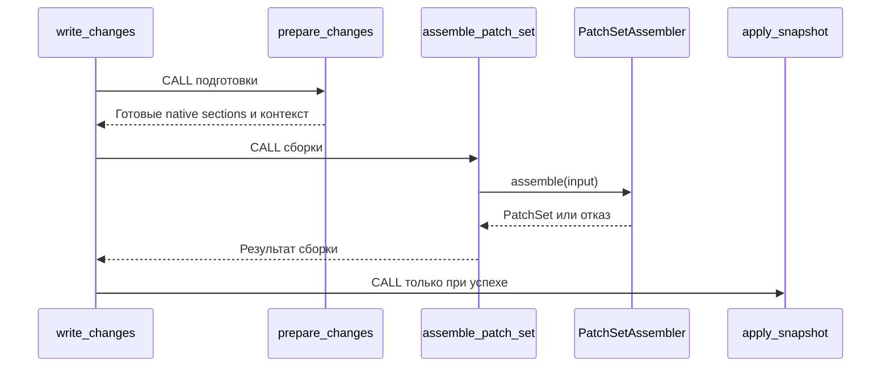

# PatchSet: архитектура самостоятельного домена

Дата: 2026-11-19. Статус: **архитектура ядра принята (§10); реализация PS-I1 → PS-I2 принята в согласованном scope по итоговому результату, переданному пользователем; P2 закрыт. Evidence — план реализации §6 и patch-set-core-review.md. Production-интеграция не реализована**.

Это первый этап выделения PatchSet. Код, DAG, canonical format и ТЗ этим документом не изменены. Основание: решение пользователя о самостоятельном домене и CRUD только по необходимости; консультация `Between domain operations`; [owning-план](world-domain-patches-snapshots.md), раздел «PatchSet как самостоятельный домен»; [ТЗ Patch System](../../docs/tz_patch_system.md); [правило архитектурной приёмки](../rules/dag-generator-interface.mdc).

## 1. Область и публичная операция

PatchSet конструирует неизменяемый набор уже подготовленных секций. Он не производит доменные изменения, не исполняет их и не публикует состояние. Нужна одна синхронная операция `assemble`; IO и async ей не требуются. Отдельные CRUD, repository, cache, настройки и публичная validate не вводятся без сценария.

Предлагаемые объявления application-контракта (решение о наследовании POJO принято отдельно в §3.1):

```python
class IPatchSetAssembly[S: DomainSection](Protocol):
    def assemble(self, request: PatchSetAssemblyInput[S]) -> PatchSetAssemblyResult[S]: ...

class PatchSetAssembler[S: DomainSection]:
    def __init__(self, request_model: type[PatchSetAssemblyInput[S]],
                 result_model: type[PatchSet[S]]) -> None: ...
    def assemble(self, request: PatchSetAssemblyInput[S]) -> PatchSetAssemblyResult[S]: ...

type PatchSetAssemblyResult[S: DomainSection] = PatchSet[S] | PatchSetAssemblyRefused
```

Конкретный публичный класс — PatchSetAssembler. Protocol не заменяет его в критерии приёмки. Именованные concrete специализации входа и PatchSet задаются composition root для одного и того же закрытого union native sections; неподставленные generics и произвольный BaseModel не допускаются. Это construction binding, не публичный запрос DAG и не пользовательская настройка.

Публичный OpenPipeline не нужен для единственной чистой операции. Нода вызывает assemble напрямую через контракт. Отдельный фасад, executor, callback или worker между нодой и операцией не вводится. Конкретный состав union и его владелец пока OPEN: нельзя объявить production composition готовой без этих сведений.

## 2. Пакеты и классы application

Предлагается использовать существующий пакет `application/patch`, выделив в нём подответственность сборки. Самостоятельность домена определяется контрактом и зависимостями; массовое переименование всех patch импортов в patchSet не требуется. Эта схема размещения подлежит приёмке.

Все пути таблицы относительно `backend/app/`.

| Класс / модуль | Роль, зависимости и эффекты | Проверка и основание отказа |
|---|---|---|
| Новый `IPatchSetAssembly` — `application/patch/contracts/assembly.py` | Только приведённая сигнатура; импорт owning input/result/section types; без алгоритма | Отказ при scope, connection, registry, callback или storage в public input |
| Новый `PatchSetAssembler` — `application/patch/assembly/patchSetAssembler.py` | Публичная реализация assemble: повторная строгая валидация input, вызов одного внутреннего validator, создание результата. Зависимости: validator, owning модели и существующий Pydantic; только память вызова | Все успешные результаты валидны и сохраняют порядок; отказ при IO, обращении к другому domain service или выборе следующей публичной операции |
| Новый `PatchSetAssemblyValidator` — `application/patch/assembly/patchSetAssemblyValidator.py` | `validate[S: DomainSection](request: PatchSetAssemblyInput[S]) -> tuple[PatchSetAssemblyRelationIssue, ...]`: вызывает PatchSetInvariants.check_core/check_prepared_order, преобразует facts в checked paths и diagnostics, агрегирует | Отказ при повторении predicates, интерпретации payload или IO; правила принадлежат общему helper (§9.2) |
| Existing `ValidatorAggregationHelper` — `dataModel/validation/diagnostics/validatorAggregationHelper.py` | Локальный сборщик разрешённых concrete issue types; экземпляр на вызов; используется validator | Все независимые ошибки собраны стабильно; отказ при общем mutable collector между вызовами или early exit независимых проверок |
| Existing `PatchSetCodec` — `application/patch/encoding/patchSetCodec.py` | encode/decode/fingerprint/fingerprint_bytes; остаётся механизмом представления, assemble его не вызывает | Неизменность canonical bytes и hash для existing inputs; отказ при вызове semantic handler из сборки |
| Existing `SectionContract` — `application/patch/contracts/sectionHandler.py` | Связь key/model/version/schema для codec/handler; не дополнительный request assembly | Не создавать параллельный registry в assembler; отказ при независимых несовместимых declarations |
| Existing `SectionRegistry`, `BoundSectionHandler` — `application/patch/registry/sectionRegistry.py` | Текущие registration/dispatch и representation bindings; не dependencies новой assemble | Отказ при использовании их semantic validate/apply из assembler |
| Existing `DomainSectionHandler` — `application/patch/contracts/sectionHandler.py` | Семантика owning секции в Snapshot context; вне операции сборки | Refusal/receipt handler не использовать как результат сборки |
| Existing `WorldSnapshotService` — `application/worldSnapshot/service/worldSnapshotService.py` | Существующая реализация механизмов применения; не вызывается assembler | Не добавлять обратный вызов assemble или подготовку секций внутри apply |
| Existing `IWorldSnapshotApply` — `application/worldSnapshot/contracts/applyPort.py` | Потребитель результата через DAG: `async apply[S: DomainSection](patch_set: PatchSet[S]) -> SnapshotApplyResult` | Передаётся existing PatchSet без adapter DTO; реализация public lifecycle остаётся owning gate Snapshot |

Split SectionCodec/BoundSectionCodec, предложенный в Snapshot ARCH-0 DEC-2, остаётся отдельным proposed изменением. PS-ARCH-0 не переносит эти классы, не принимает DEC-2 за пользователя и не создаёт конкурирующую схему registry. Причина исключения codec из assemble: сборка не обязана подтверждать canonical fingerprint зависимости или возможность её применения.

## 3. POJO: состав, владельцы и размещение

### 3.1. Принято: общий родитель и два дочерних POJO

**Решение пользователя 2026-11-18:** «мы можем иметь один pojo родитель с этими полями и двух детей, и использовать детей», затем «Делай». Принято одно объявление всех девяти полей в `PatchSetData[S]` и два дочерних типа `PatchSetAssemblyInput[S]` и `PatchSet[S]`. Это заменяет предложение отдельного PatchSetContext и вложенного поля context; такой класс и поле не создаются. Общая структура наследуется, а роли и гарантии детей различаются. Вопрос выбора этой формы входа закрыт; корректность реализации и canonical compatibility ещё предстоит проверить.

```text
PatchSetData[S] — единая схема полей и структурных ограничений
├── PatchSetAssemblyInput[S] — запрос до проверки отношений набора
└── PatchSet[S] — результат с обязательными инвариантами оболочки
```

Публичные операции используют детей, не родитель как универсальный вход/выход. Родитель не является третьим состоянием процесса или новым wire-форматом. Дети не переобъявляют поля и не меняют их типы, порядок или defaults. Участие одинаковых унаследованных полей в двух явно разрешённых ролях не является основанием повторно отклонять эту схему как дублирование. Это решение не разрешает независимые копии owning POJO или произвольное пересечение других типов.

| Тип / путь относительно backend/app | Поля и ответственность | Отсутствие дублирования / критерий отказа |
|---|---|---|
| Новый `PatchSetData[S]` — `dataModel/patch/request/patchSetData.py` | Единственное объявление полей в existing порядке: `format_version: FormatVersion`, `operation_id: EntityUid`, `preparation_fingerprint: RevisionHex`, `world_uid: EntityUid`, `timeline_id: EntityUid`, `turn_id: Annotated[StrictInt, Field(ge=1)]`, `expected_world: WorldPublicationRef`, `expected_players: tuple[PlayerHeadExpectation, ...]`, `sections: tuple[S, ...]`. Общая строгая структура; без проверок отношений целого набора | Поля извлекаются из PatchSet один раз. Отказ при повторном объявлении в детях, foreign service dependency или использовании родителя вместо concrete public child |
| Новый `PatchSetAssemblyInput[S]` — `dataModel/patch/request/assembly.py` | Наследует `PatchSetData[S]`, новых полей нет. Запрос с валидными типами и вложенными POJO, но ещё не проверенными отношениями набора | Допускает несовпадение мира, отсутствие pack и повторные player/section keys для возврата полной диагностики assemble. Не допускает невалидные типы или обход инвариантов вложенных POJO |
| Existing `PatchSet[S]` — `dataModel/patch/request/patchSet.py` | Наследует `PatchSetData[S]`, новых полей нет. Сохраняет existing проверки мира, pack, unique players/sections; остаётся успешным результатом и входом Snapshot | Прямое создание и decode не должны обходить existing инварианты. Не создавать AssembledPatchSet, receipt или второй envelope; успех не доказывает CAS/доменную допустимость публикации |
| Новый `PatchSetAssemblyRefused` — `dataModel/patch/results/assembly.py` | `diagnostics: tuple[PatchSetAssemblyRelationIssue, ...]`, непустой tuple; отказ только конструирования | Нет committed/conflict/retry flags, request copy, lease и snapshot refs. Не дублирует SectionRefused: другой этап и владелец |
| Новый alias `PatchSetAssemblyResult[S]` — тот же модуль | `PatchSet[S] | PatchSetAssemblyRefused` | Не сериализуемая обёртка с optional success/error; невозможен одновременный успех и отказ |

Все новые records frozen/strict/extra-forbid/revalidate-always; общая конфигурация объявляется родителем и наследуется детьми. Коллекции immutable. Отдельной default format version и автоматического назначения identity нет. Generic связывается с concrete named models; no Any/dict payload. Родитель и input не добавляются в canonical manifest автоматически: canonical request по-прежнему PatchSet. Путь existing PatchSet, flat-поля, их порядок, type IDs и поддержанные bytes/hash должны сохраниться; совместимость подтверждается проверками, не предполагается из факта наследования.

Проверки отношений не выполняются в родителе PatchSetData: input должен допускать нарушения для diagnostics. PatchSet.coherent_request делегирует check_core единому PatchSetInvariants; прежние четыре predicates удаляются из модели. Assembly validator использует тот же check_core и дополнительно check_prepared_order. Конструирование результата намеренно усиливается PatchRef identity/ordinal guarantees (§9.1), но не проверкой prepared order. Успех не подтверждает Snapshot admission.

При будущей реализации рядом с объявлениями родителя/детей требуется явно описать принятое разделение ролей по правилу POJO. Решение уже отражено в owning ТЗ Patch System, разделе «Граница DAG и домена PatchSet — уточнение 2026-11-18»; при приёмке кода проверить соответствие этой пометке. Модели ещё не реализованы.

### 3.2. Existing POJO, используемые без новых копий

| Тип / модуль | Владелец, состав и использование |
|---|---|
| `DomainSection[P: PatchData]`, `SectionHeader` — `dataModel/patch/sections/section.py` | Общая секция содержит header и непустой tuple native patches; PatchData даёт typed PatchHeader. Ядро читает section header и patch header.ref, но не owning payload |
| `PreparedSectionDependency`, `PublishedSectionDependency` — `dataModel/patch/sections/dependency.py` | Patch core: первая содержит kind/key/fingerprint, вторая kind/SectionStateRef. Не заменять общей строкой dependency |
| `PatchRef`, `PatchHeader` — `dataModel/patch/changes/header.py`; новый `PatchData` — `dataModel/patch/changes/patchData.py` | PatchData объявляет только header:PatchHeader; ref содержит operation_id/section_key/ordinal. Единый checker проверяет связь с набором/секцией и независимую unique ordinal; предметные поля не читает |
| `PatchSectionMetadata`, `PatchSectionRegistry`, `SectionKey` — `dataModel/patch/registry/sectionMetadata.py` | Patch core: key/supported_versions, entries и nominal RegistryKey. Общая сборка использует ключи, не проверяет runtime membership через dispatch |
| `WorldPublicationRef`, `PlayerHeadExpectation` — `dataModel/worldSnapshot/identity/publication.py` | Snapshot: world/publication/pack/head/active timeline/gameplay flag; player UID/expected head соответственно. Передаются готовыми; их конструкторы не читают состояние |
| `WorldSnapshotRef`, `PlayerSnapshotRef` — `dataModel/worldSnapshot/identity/refs.py` | Snapshot identity; вложенные ссылки existing expectations. Не вводить PatchSetHead или вторую publication identity |
| `FormatVersion`, `PatchOrdinal` — `dataModel/patch/values.py`; `EntityUid` — `dataModel/identity/uid.py`; `RevisionHex` — `dataModel/validation/diagnostics/runtimeIssueContext.py` | Existing value types; переиспользуются без новых строковых aliases с той же семантикой |
| `SectionRefused`, `SectionApplyReceipt` — `dataModel/patch/results/sectionResult.py`; `SnapshotApplyResult` — `dataModel/worldSnapshot/results/apply.py` | Результаты других стадий; assembler их не создаёт и не вкладывает в свой отказ |

### 3.3. Типизированные ошибки полей и отношений

**PS-R1: контракт закреплён по поручению пользователя «Делай первый пункт», 2026-11-18.** Доменные отказы представлены одним concrete relation issue. Ошибки типов/формы при построении входа принадлежат existing model validation; новый field-error POJO для assemble не вводится. `PatchSetAssemblyRelationIssue` размещается в `dataModel/patch/results/assemblyIssues.py`; `PatchSetInvariantCode`, concrete details и их union — в `dataModel/patch/validation/invariantDetails.py`. Код не реализован; это фиксация архитектурного контракта.

| Тип | Поля / категории | Граница |
|---|---|---|
| `PatchSetInvariantCode`, `PatchSetInvariantDetails` — `dataModel/patch/validation/invariantDetails.py` | Девять code-specific concrete records с Literal discriminator code, точные поля в §9.4 | Единственное объявление машинной причины; используется fact и issue по ссылке |
| `PatchSetAssemblyRelationIssue` — `dataModel/patch/results/assemblyIssues.py` | details:PatchSetInvariantDetails, path:ValidatedFieldPath, related_path:ValidatedFieldPath\|None, message:StrictStr | Code только в details; identities/ordinal доступны без request/message parsing |

Existing ValidatedFieldPath остаётся в `dataModel/fields/validatedFieldPath.py`; пути строятся checked selectors от concrete input. Exact неверный Python type отклоняется TypeError до чтения полей. Strict revalidation unchecked/повреждённого input сохраняет Pydantic ValidationError. Ни тот, ни другой случай не получает фиктивный field path и не превращается в PatchSetAssemblyRefused. Для корректно типизированного input validator возвращает все независимые relation diagnostics; точная таблица адресов — §7.1. Existing FieldPathError не изменяется и не оборачивается новым бессодержательным типом.

Ошибки конфигурации concrete models — ошибки composition root, не domain refusal и не результат пользовательской операции. Не ловить все Exception и не превращать programming fault в диагностику. Отдельный публичный exception framework без нужды не создаётся.

## 4. Алгоритм одной операции и границы проверок

**Единственный нормативный порядок — §7.5.** Разделы §9.1/§9.2 определяют predicates, §9.4 — данные diagnostics, но не вводят второго порядка исполнения. Проверки prepared fingerprints, published state, ancestry/CAS, holds и предметных конфликтов остаются вне assemble. Возвращаемые sections/players/patches не сортируются; пустой tuple sections разрешён existing моделью. Проверки собственных инвариантов вложенных POJO выполняются strict revalidation, без копии этих правил в assembler.

## 5. Междоменные связи и DAG

Источник внешнего порядка — [зафиксированная схема](dag-multidomain-patch-publication-draft.md). Родство нод и engine CALL не меняются.



Диаграмма конкретизирует принятую границу вызова, не вводит новые ноды или production bindings. PS-R3 закрыт: DAG организует и вызывает сборку; чистое конструирование принадлежит PatchSet. Норматив синхронизирован в docs/tz_patch_system.md и docs/tz_world_snapshot.md.

| Требуемые данные | Owning API / состояние контракта | Передача и незакрытая связь |
|---|---|---|
| Готовые native sections | Producers Time/Lifecycle/других доменов — конкретные методы ещё не подтверждены для закрытого union | Owning node → DAG → input.sections. Assembler не вызывает производителя и не конвертирует proposed prepared result |
| WorldPublicationRef и player expectations | Snapshot existing refs; конкретный источник coherent capture для этой операции OPEN | Результат чтения/подготовки → DAG → context; implicit latest внутри assemble запрещён |
| operation_id/preparation_fingerprint/timeline/turn | Identity/preparation ownership должен быть подтверждён процессом подготовки; точный public method OPEN | DAG передаёт готовые значения. Assembler не вычисляет отсутствующие значения и не claim-ит ledger |
| Собранный PatchSet | Existing `IWorldSnapshotApply.apply` с полной сигнатурой из §2 | Assembly result → DAG → apply_snapshot → Snapshot. No direct assembler → Snapshot |

Неустановленный upstream API не заменяется придуманным методом или NodeId. Доменные части можно обсуждать отдельно, но production маршрут не принимается до замыкания всех этих связей.

## 6. Текущий статус и план поставки

**Фактический статус на 2026-11-20:** ядро PS-I1 → PS-I2 реализовано и принято в согласованном scope, прежний P2 закрыт. По поручению пользователя статус кода, основание приёмки и граница с production-интеграцией явно закреплены в [плане реализации §1](patch-set-core-implementation.md#1-scope-порядок-и-gates); evidence проверок — в его §6. Исторические записи этого архитектурного документа «код не реализован» относятся к моменту проектирования, а не к текущему состоянию ядра.

**Единственная актуальная матрица архитектурной проверки — §10.** §§7–9 сохраняют решения и причины исправлений, а не отдельные конкурирующие результаты приёмки. Внешние producers, capture, production union и DAG bindings не блокируют ядро.

Этот файл является архитектурной картой. Исполнимые слайсы ядра, impact register, обязательные проверки и DoD вынесены в [план реализации ядра](patch-set-core-implementation.md). Порядок поставки: PS-I1 → PS-I2. Проверки входят в каждый слайс; отдельного завершающего слайса «тесты» и DAG integration в поставке ядра нет. Документальная готовность не означает разрешения обходить применимые implementation gates.

## 7. Реестр ревью и последовательная проработка — 2026-11-18

Основание: проверка по AGENTS.md и поручение пользователя «Зафиксируй все пункты и пройдись по нему». Сохранены пять замечаний и положительные результаты проверки. После уточнения scope PS-R2 и producer-specific часть PS-R4 являются исключительно интеграционными зависимостями, не блокерами ядра. **OPEN owner** означает ожидание внешнего контракта для интеграции; **implementation evidence** — будущую проверку кода, не пробел архитектуры сам по себе.

| ID | Замечание | Результат прохода | Статус |
|---|---|---|---|
| PS-R1 | Не завершён контракт field/logic errors и адресов | §3.3/§7.1 синхронизированы: boundary exceptions отдельно от relation refusal; точные code/path/related_path и порядок diagnostics | Закрыт в архитектурном плане по поручению «Делай первый пункт»; implementation evidence ещё нет |
| PS-R2 | Нет exact upstream методов и Output → Input | §7.2: повторная сверка actual Time и консультация Between domain operations; составлена карта всех девяти полей и условия отдельной приёмки ядра | Проход выполнен; OPEN owner для production-маршрута, не закрыт консультацией |
| PS-R3 | Граница DAG/PatchSet | §7.3 и ТЗ синхронизированы по пункту 1 пользователя | Закрыт для архитектуры ядра |
| PS-R4 | Неполная карта existing классов/POJO и concrete union | §7.4: дополнены immediate input types, зависимости и индивидуальные критерии; production union отделён от generic ядра | Ядро дополнено; concrete bindings OPEN owner |
| PS-R5 | Внутренний порядок | §7.5 закреплён после PS-R3 по пункту 2 пользователя | Закрыт для архитектуры ядра |

### 7.1. PS-R1 — контракт отказа и ошибочного вызова

Обнаруженное ограничение existing `ValidatedFieldPath`: обязательны хотя бы один segment и первый FieldSegment своего root. Следовательно, причина «весь переданный Python object другого типа» не может честно иметь field path. Не создавать фиктивное поле request или путь к sections для такой ошибки.

**Зафиксированный контракт:** публичный метод принимает уже построенный exact typed input. Неверный Python-класс (включая родитель или другой ребёнок) — `TypeError` boundary misuse. Повторная строгая model validation повреждённого/unchecked экземпляра — existing Pydantic `ValidationError`. Они не являются `PatchSetAssemblyRefused` и не перехватываются blanket catch. Ошибки decode/transport до получения typed input принадлежат своему владельцу; не добавлять raw dict API в assemble.

Прежние предложенные `PatchSetAssemblyFieldCode` и `PatchSetAssemblyFieldIssue` исключены из поставки. Это замена первоначального proposal, не отмена требования typed POJO для настоящих доменных отказов. Публичные structural exceptions и их граница документированы; новые прикладные ошибки не маскируются под Pydantic.

Для корректно типизированного input все отказы — отношения набора. PatchSetAssemblyRefused содержит непустой tuple[PatchSetAssemblyRelationIssue,...]. Issue остаётся в dataModel/patch/results/assemblyIssues.py, а code и concrete details — в dataModel/patch/validation/invariantDetails.py (§9.4). Старые PatchSetAssemblyRelationCode и общий alias PatchSetAssemblyIssue не вводятся.

В таблице ниже показана человекочитаемая проекция пути; в POJO хранится existing ValidatedFieldPath, построенный checked selectors относительно именованного concrete input, не строка. `i` — текущий индекс, `j` — индекс зависимости, `first` — первый индекс совпавшего UID/key, `target` — единственный индекс зависимости.

| Code | path | related_path | Когда выдаётся |
|---|---|---|---|
| WORLD_MISMATCH | expected_world.world_uid | world_uid | Значения различаются |
| MISSING_PACK | expected_world.pack_hash | None | pack_hash отсутствует |
| DUPLICATE_PLAYER | expected_players[i].player_uid | expected_players[first].player_uid | Для каждого повторного UID после первого |
| DUPLICATE_SECTION | sections[i].header.key | sections[first].header.key | Для каждого повторного key после первого |
| MISSING_PREPARED_DEPENDENCY | sections[i].header.depends_on[j].section_key | None | PREPARED key отсутствует во всём входе |
| PREPARED_DEPENDENCY_ORDER | sections[i].header.depends_on[j].section_key | sections[target].header.key | Единственная секция target находится после зависимой |

Для union dependency checked path содержит branch PREPARED через existing VariantSegment; projection его опускает. Нельзя обращаться к section_key у PUBLISHED. Self PREPARED dependency отклоняется existing SectionHeader при structural validation; не порождать второй relation code за ту же причину. message фиксирует причину для человека и не участвует в выборе исхода. related_path всегда адресует тот же concrete input.

Все независимые relation ошибки собираются existing ValidatorAggregationHelper. Никаких foreign SectionRefused/SnapshotApplyResult в этом отказе. После успешного validator ошибка конструктора результата не превращается в бизнес-отказ: это нарушение согласованности реализации/моделей, которое должно быть выявлено тестом.

Стабильный порядок diagnostics с поправкой 2026-11-19: WORLD_MISMATCH → MISSING_PACK → повторные player UID → повторные section keys → patch identity/ordinal checks по (section index, patch index), внутри operation mismatch → section mismatch → duplicate ordinal → prepared dependency ошибки по (section index, dependency index). Повторения адресуются к первому совпадению. Неоднозначный target key подавляет только зависимый order check; независимые проверки продолжаются.

Code enum PatchSetInvariantCode и девять concrete details определены в §9.4; значения используют префикс patch_set.assembly. Relation issue frozen strict extra-forbid revalidate-always. Details/path/related_path/message обязательны; None означает отсутствие второй стороны. Refusal diagnostics непустой. Message не используется для машинного dispatch.

DoD будущей реализации PS-R1: invalid child type даёт TypeError без вызова validator; unchecked structurally invalid input даёт ValidationError без relation checks; корректно типизированный input с несколькими независимыми нарушениями возвращает все точные codes/paths/related_paths в указанном порядке без создания результата. Для inherited fields checked path root должен быть concrete input, не PatchSetData; union PREPARED branch проверяется отдельно. Внешний malformed transport не входит в данный метод. Это требования проверки, не выполненные тесты.

### 7.2. PS-R2 — внешние контракты, вне приёмки ядра

Подробная карта вынесена в [отдельный реестр внешних контрактов](patch-set-external-contracts.md). По явному решению пользователя все его OPEN относятся только к конкретным интеграциям и **не блокируют архитектурную приёмку ядра PatchSet**. Это также относится к production union и producer-specific части PS-R4. Ядро принимает готовые типизированные данные; его локальные критерии проверяются по §8.

### 7.3. PS-R3 — зафиксированная нормативная граница


По поручению пользователя пункт 1 выполнен первым: следующая граница подробно закреплена в разделе «Граница DAG и домена PatchSet — уточнение 2026-11-18» ТЗ Patch System, синхронизирована с ТЗ Snapshot и планом DAG:

> Только DAG организует подготовку и сборку общего набора: вызывает owning операции, получает готовые типизированные секции и контекст, затем напрямую вызывает публичную assemble домена PatchSet. PatchSet конструирует и проверяет общую оболочку переданного набора без IO, междоменных вызовов, изменения состава и порядка. Результат возвращается DAG; только DAG передаёт его Snapshot. PatchSet не применяет изменения, Snapshot не собирает набор. API/debug/import callers используют тот же DAG-путь.

Это сохраняет write_changes → prepare_changes → assemble_patch_set → apply_snapshot, родство нод и отсутствие второго входа. Норматив: [Patch System](../../docs/tz_patch_system.md#граница-dag-и-домена-patchset--уточнение-2026-11-18), [Snapshot](../../docs/tz_world_snapshot.md), [DAG](dag-multidomain-patch-publication-draft.md). Прямой вызов domain assemble не означает, что нода знает алгоритм validator или управляет его стадиями. PS-R3 закрыт для ядра; это не runtime evidence.

### 7.4. PS-R4 — дополнение карты immediate типов и class boundaries

Все пути относительно backend/app. Таблица уточняет §3.2; перечисленные records immutable и не выполняют IO. Payload concrete patches остаётся у владельцев, не анализируется общим assembler.

| Тип / модуль | Точный состав / допустимая зависимость | Индивидуальный критерий и отказ |
|---|---|---|
| WorldPublicationRef — dataModel/worldSnapshot/identity/publication.py | world_uid:EntityUid, publication_id:EntityUid, pack_hash:RevisionHex\|None, snapshot_head:WorldSnapshotRef\|None, active_timeline_id:EntityUid\|None, gameplay_started:bool | Existing coherence валидируется при input creation; отказ при копии publication полей в новом PatchSet-owned ref или IO lookup |
| PlayerHeadExpectation — тот же модуль | player_uid:EntityUid, expected_head:PlayerSnapshotRef\|None | Head принадлежит указанному игроку; отказ при выключении existing nested validation |
| WorldSnapshotRef — dataModel/worldSnapshot/identity/refs.py | kind:Literal[WORLD], world_uid/timeline_id/snapshot_id:EntityUid | World chain identity; отказ при смешении с player ref |
| PlayerSnapshotRef — тот же модуль | kind:Literal[PLAYER], player_uid/snapshot_id:EntityUid | Player chain identity; отказ при добавлении world/timeline fields ради унификации |
| SectionStateRef — dataModel/worldSnapshot/sections/refs.py | snapshot:SnapshotRef, section_key:SectionKey, format_version:FormatVersion | Ссылка опубликованной зависимости; refusal при трактовке её наличия как доказательства существования записи |
| PreparedSectionDependency — dataModel/patch/sections/dependency.py | kind:Literal[PREPARED], section_key:SectionKey, section_fingerprint:RevisionHex | Assembler проверяет только наличие/порядок key; отказ при заявлении о проверенном fingerprint без owning проверки |
| PublishedSectionDependency — тот же модуль | kind:Literal[PUBLISHED], section_ref:SectionStateRef | Не ищется во входных sections; отказ при требовании prior tuple position для published ссылки |
| SectionHeader — dataModel/patch/sections/section.py | key:SectionKey, format_version:FormatVersion, depends_on:tuple[SectionDependency,...] | Existing unique/self checks сохраняются; отказ при повторной реализации этих checks в assembler |
| DomainSection[P] — тот же модуль | header:SectionHeader, patches:tuple[P,...], min_length=1 | Сохраняется concrete payload type и порядок; отказ при преобразовании в dict/BaseModel payload |
| PatchSectionMetadata — dataModel/patch/registry/sectionMetadata.py | key:SectionKey, supported_versions:frozenset[FormatVersion], непустое множество | Это declaration, не runtime acceptance; отказ при переносе handler в POJO |
| PatchSectionRegistry — тот же модуль | entries:tuple[PatchSectionMetadata,...], unique keys | Nominal owner SectionKey; отказ при создании отдельного несовместимого ключевого реестра сборки |
| FormatVersion / PatchOrdinal — dataModel/patch/values.py | StrictInt > 0 / StrictInt >= 0 | Bool и coercion не допускаются; новые aliases с тем же смыслом не вводятся |
| ValidatedFieldPath — dataModel/fields/validatedFieldPath.py | root:ModelIdentity, segments:непустой tuple[PathSegment,...]; первый field принадлежит root | Только schema-checked пути concrete input; отказ при fabricated root path для неверного Python object |

Application boundaries: assembler проверяет exact input/revalidation и создаёт результат; PatchSetInvariants вычисляет predicates; assembly validator форматирует те же facts в checked diagnostics; collector накапливает их. Модель не импортирует application. Constructor binding сверяет одинаковый concrete section union input/output до первого запроса; mismatch — TypeError. Механика проверки generic metadata — internal implementation, не public input.

SectionContract/Registry/BoundSectionHandler/Codec и SnapshotService перечислены в §2 как существующие соседние механизмы, а не объекты рефакторинга PS-ARCH-0. Их полная миграция не требуется для чистой assemble; если scope расширится, нужна отдельная class-by-class карта. Concrete production patches/sections пока нельзя перечислить достоверно — PS-R2 остаётся зависимостью интеграции.

### 7.5. PS-R5 — зафиксированный внутренний порядок

1. На construction boundary сверить пару именованных request/result models и section union. Ошибка binding не запускает обработку запросов.
2. На входе assemble проверить exact child type, затем strict revalidation. При structural failure — исход по §7.1; relation validator не запускается. Это зависимый ранний отказ, поскольку валидность дочерних моделей ещё не доказана.
3. Создать отдельный collector. Проверить WORLD_MISMATCH, затем MISSING_PACK, затем повторные player UID по возрастанию индекса. Независимые проверки не прекращать после первой причины.
4. Построить индекс **всех** section keys, сохраняя все позиции; выдать DUPLICATE_SECTION для каждого повторения после первого в порядке tuple. Ни один duplicate не исправлять и не выбирать last-wins.
5. После duplicate sections выполнить общий блок patch identity/ordinal по §9.1. Затем check_prepared_order обходит sections/dependencies: отсутствующий key даёт missing; неоднозначный target подавляет только order check; единственный target после source даёт order violation. PUBLISHED пропускается без IO.
6. Если collector непустой — вернуть один refusal со всеми причинами в указанном порядке. Иначе построить result_model из исходных типизированных значений без dict/JSON round-trip payload; вернуть PatchSet. Поля и последовательности не сортировать и не нормализовать. Существующие проверки ребёнка-результата остаются обязательными.
7. Возврат результата завершает операцию; запуск Snapshot или решение retry принадлежат DAG. Никаких последующих скрытых стадий.

Порядок закреплён по поручению пользователя выполнить пункт 2 после пункта 1: сначала синхронизирована граница PS-R3, затем зафиксированы эти семь шагов. PS-R5 закрыт на уровне архитектуры ядра. Внешние четыре шага не изменены. Проверка cyclic prepared deps сводится к наличию forward edge при фиксированном порядке; отдельный topological sort/graph scheduler не вводится.

### 7.6. Сводный результат повторного прохода

Подтверждены на уровне проекта: отсутствие выбора следующей публичной операции внутри assembler; прямой вызов от DAG без фасада; отсутствие foreign service calls; отсутствие storage в public input; принятая схема одного родителя и двух детей; CRUD только по необходимости; сохранение внешнего порядка. Canonical compatibility остаётся обязательным evidence реализации, а не основанием заранее объявлять несовместимость.

Все пять замечаний проработаны. PS-R1/PS-R3/PS-R5 закрыты; ядро PS-R4 описано. Внешние PS-R2/bindings остаются в отдельном реестре и не блокируют ядро. Архитектурный результат — PASS (§8). Код не менялся; ТЗ и документация DAG синхронизированы.

## 8. Отдельная архитектурная приёмка ядра — 2026-11-18

**Поручение пользователя:** принимать архитектуру ядра сейчас, дальнейшие контракты могут уточняться. Этот раздел заменяет прежнюю трактовку PS-R2/production union как блокера всего PS-ARCH-0. Разрешение провести проверку не считается автоматическим PASS или приёмкой ещё предложенных решений.

### 8.1. Граница проверяемого среза

В срез входят IPatchSetAssembly, PatchSetAssembler, PatchSetAssemblyValidator, PatchSetInvariants; PatchSetData/Input/Set, PatchData; PatchSetInvariantViolation, PatchSetInvariantCode, девять details и union, PatchSetAssemblyRelationIssue/Refused/result alias. Пути и поля — §§2–3, 9.1–9.4. Внутренний trace: strict input → общий checker → presentation/collector → result, чей validator использует тот же core checker. Foreign services отсутствуют.

За пределами среза: producers конкретных секций, coherent capture протокол конкретного сценария, назначение operation/turn/preparation identity, production closed union и composition root конкретного приложения, wiring/реализация нод, Snapshot apply lifecycle, split codec/handler registry, persistence, cache. Их отсутствие не является дефектом generic ядра и не требует заполнять его чужой логикой. Existing Codec входит только как потребитель, чью совместимость нужно сохранить, не как dependency assemble.

### 8.2. История первой проверки

Первый PASS был отозван после замечаний о PatchRef, дублировании predicates и аргументах diagnostics. Исправления описаны в §9. Этот раздел не является текущей матрицей и не назначает integration gaps блокерами ядра. Актуальная проверка только в §10.

### 8.3. Последовательность закрытия и последующие проверки

1. По пункту 1 пользователя подробно закреплена граница DAG/PatchSet в ТЗ Patch System, дана ссылка из ТЗ Snapshot и уточнён прямой вызов assemble в owning DAG-плане. Совместное использование полей двумя детьми отражено в ТЗ.
2. После этого по пункту 2 закреплены семь шагов §7.5, исходы structural failure, стабильная агрегация независимых ошибок и отсутствие частичного результата. Повторная проверка не выявила противоречий с внешним порядком и PS-R1.

Следующий этап — реализация по принятой архитектуре и применимым repository gates; текущая задача код не меняет. Canonical bytes/hash, exact child validation, typed paths для inherited fields и negative/aggregation cases проверяются при реализации. Производители секций, production union и сценарии capture остаются в отдельном реестре без влияния на этот архитектурный PASS.

## 9. Повторное ревью: исправление внутренних пробелов ядра

Основание — замечания пользователя и поручение «Приступай» после перечисления трёх изменений. Исправления §9 включены в основную карту и ТЗ 2026-11-19. Детали общего checker, headers и diagnostics здесь являются текущим контрактом, не альтернативой §2–4; код ещё не создан.

| ID | Приоритет / замечание | Статус после прохода |
|---|---|---|
| PS-REV-1 | Исправление повторного ревью | Сведено в контракт и ТЗ; подробности §9, повторная проверка §10. Код не реализован |
| PS-REV-2 | Исправление повторного ревью | Сведено в контракт и ТЗ; подробности §9, повторная проверка §10. Код не реализован |
| PS-REV-3 | P1: malformed root/extra не имеют честного field path | PS-R1 сохраняется; §9.3 явно покрывает unknown fields и unchecked construction |
| PS-REV-4 | Исправление повторного ревью | Сведено в контракт и ТЗ; подробности §9, повторная проверка §10. Код не реализован |
| PS-REV-5 | Исправление повторного ревью | Сведено в контракт и ТЗ; подробности §9, повторная проверка §10. Код не реализован |
| PS-REV-6 | P2: identity/model_fields/checked paths после наследования | §9.5 расширяет проверки; старый PatchSetContext не возвращается |

### 9.1. PS-REV-1: PatchRef — общий инвариант ядра

**Владелец — ядро PatchSet:** общий checker проверяет совпадение patch.header.ref.operation_id с набором, section_key с содержащей секцией и независимую unique ordinal внутри секции. Полный ref duplicate отдельно не выдаётся. Только общий header читается, не предметный payload.

Actual DomainSection[P: BaseModel] при реализации заменяется на DomainSection[P: PatchData]. Новый базовый POJO PatchData — dataModel/patch/changes/patchData.py, единственное поле header:PatchHeader, frozen/strict/extra-forbid/revalidate-always. Concrete native patches наследуют его. Не использовать getattr/dict/cast/header callbacks. Существующие PatchHeader/PatchRef не копируются; родитель не создаёт новую предметную операцию.

Это изменение общего контракта, **не молчаливый refactor**: перед кодом проверить существующие native fixtures/manifest declarations и доказать сохранение wire layout для уже имеющих header моделей. Произвольный prepared result без header больше не может быть direct patch. Ни один production домен не переводится в этом проходе; его binding остаётся отдельным, но новый общий header contract должен быть принят именно в ядре. Если модель нельзя связать с PatchData без изменения формата, не вводить legacy adapter или придумывать header — вернуть этот конкретный случай на контрактную приёмку.

Чистые checks проходят sections по индексу, затем patches по индексу. Для каждого patch: operation mismatch, section mismatch, duplicate ordinal с адресом первого patch с тем же ordinal в этой содержащей секции. Индекс первых ordinal пополняется для каждого patch независимо от identity mismatches. Независимые identity и ordinal нарушения агрегируются. Отдельный duplicate полного PatchRef не выдаётся: тот же повтор уже диагностирован по ordinal. Одинаковые ordinal в разных секциях допустимы. Требование ordinal == position или непрерывности ordinal не добавляется. Собственные unique/self checks PatchHeader не копируются; внешние depends_on PatchRef и предметная семантика дельт не интерпретируются.

### 9.2. PS-REV-2: один источник правил, два представления результата

Новый внутренний чистый класс `PatchSetInvariants` — `dataModel/patch/validation/patchSetInvariants.py` (владелец Patch core). Это helper проверки модели, не application pipeline; IO, application imports, registry, concrete domain types и вызовы публичных операций запрещены.

Методы:

```python
check_core[S: DomainSection](data: PatchSetData[S]) -> tuple[PatchSetInvariantViolation, ...]
check_prepared_order[S: DomainSection](data: PatchSetData[S]) -> tuple[PatchSetInvariantViolation, ...]
```

check_core — единственное место existing world/pack/player/section checks и новых PatchRef checks §9.1. check_prepared_order — наличие и порядок prepared section dependencies, без fingerprint computation. Helper импортирует PatchSetData, но не дочерний PatchSet; родитель не импортирует helper, что исключает цикл. Local алгоритм индексирования — private implementation этого класса, не отдельный public контракт.

`PatchSet.coherent_request` вызывает только check_core; при нарушениях поднимает ValueError как адаптацию к existing Pydantic validation boundary. Его прежние четыре самостоятельных проверки удаляются. Новый core также усиливает конструирование PatchSet тремя явно описанными гарантиями PatchRef; это осознанная контрактная дельта, а не утверждение сохранения old malformed acceptance.

`PatchSetAssemblyValidator` вызывает check_core и check_prepared_order, затем только строит checked paths и типизированные diagnostics по facts. Он **не повторяет predicates**, не сравнивает UID/key повторно и не пересчитывает причины. Модель и assembler используют одни и те же facts; различается их presentation. Direct constructor/decode не начинает проверять prepared-order автоматически: existing разделение гарантии assemble и constructor сохраняется.

Новый immutable внутренний record `PatchSetInvariantViolation` — `dataModel/patch/validation/invariantViolation.py`: `details: PatchSetInvariantDetails`; каждое из полей `section_index`, `patch_index`, `dependency_index`, `player_index`, `related_index` имеет точный тип `Annotated[StrictInt, Field(ge=0)] | None`. Импорты: Annotated из typing; StrictInt и Field из pydantic. Отдельный alias NonNegativeStrictInt не вводится. Индексы описывают место fact внутри data, не являются FieldPath. Допустимые комбинации проверяются по discriminator details: world/pack — все None; player duplicate — player/related; section duplicate — section/related; dependency — section/dependency и related target при order; patch identity mismatch — section/patch; duplicate ordinal — section/patch/related (первый patch с этим ordinal). Остальные индексы None. Bool и отрицательные индексы отклоняются. Это internal fact, не второй public issue или копия request.

Ответственность и DoD: helper вычисляет причины ровно в одном месте, model adapter обеспечивает constructor invariants, application adapter адресует facts конкретной input schema. Отказ при импорте application из dataModel, повторных predicates в adapters или изменении фактов при форматировании message. Тест должен подать одни данные через input/assemble и прямой result constructor: одинаковые нарушения check_core не могут давать успех на одной из границ. Message equality не требуется; semantics причины едина.

**Междоменное использование helper — принято 2026-11-19.** По [SN-Q1.1](world-domain-patches-snapshots.md#sn-q11--междоменная-гарантия-prepared-order-на-входе-apply) направление зависимости — Snapshot dependency admission → `dataModel/patch/validation/patchSetInvariants.py`, метод `PatchSetInvariants.check_prepared_order[S: DomainSection](data: PatchSetData[S]) -> tuple[PatchSetInvariantViolation, ...]`. Snapshot передаёт свой входной `PatchSet[S]`, наследующий PatchSetData; checker возвращает существующие immutable facts из `dataModel/patch/validation/invariantViolation.py`. Владельцем predicates и facts остаётся Patch core; Snapshot отвечает за их отображение в собственные diagnostics. Обратной зависимости Patch core → Snapshot application нет.

Это согласованное использование общего чистого helper модели, а не вызов application pipeline/assemble и не перенос проверки в DAG. Внутренний алгоритм индексирования остаётся private. Проверка выполняется в существующей dependency admission до immutable binding/terminal replay, без IO и чтения изменяемого состояния. Predicates не дублируются; constructor/decode гарантирует только check_core, успешный assemble — также check_prepared_order. Проверка не подтверждает fingerprints, PUBLISHED dependencies, актуальность базы или предметную допустимость изменений.

**Сверка с SN-Q1.1:** граница, направление зависимости, возвращаемые facts, гарантии и порядок совпадают. Его актуальные SN-Q1-I1…I4 — внутренняя детализация Snapshot: место вызова и классы, diagnostics, transport отказа до claim, recovery/retry trace. Они OPEN, не блокируют PS-ARCH-0 и PS-I1 → PS-I2 и не требуют повторной координации неизменной принятой границы. Только изменение публичных Input/Output/Error или разрешённых внешних callers проходит новое междоменное согласование. Новых публичных DTO/методов и разрешения реализации Snapshot это решение не вводит. Учёт зависимости — [внешний реестр, SN-Q1.1](patch-set-external-contracts.md#sn-q11--принятая-зависимость-snapshot-от-общего-checker).

Уточнение координатора 2026-11-19 к §9.2: место вызова закрыто (PASS): Snapshot structural revalidation/check_core → dependency admission с общим checker → canonical request fingerprint → immutable binding/claim/terminal replay. Поддержан TARGET `SnapshotRequestValidator.validate(request: PatchSet[S]) -> None`; внутренний wrapper необязателен. Diagnostics/transport и полнота внутренних Snapshot checks остаются отдельно OPEN. Подробности и источник — SN-Q1.1 внешнего реестра; реализация Snapshot не входит в PS-I1 → PS-I2.

### 9.3. PS-REV-3: malformed inputs без вымышленных путей

Неверный корневой Python object отклоняется exact type admission с TypeError. Raw mapping с extra не является input assemble: при штатном создании concrete input Pydantic extra=forbid даёт ValidationError владельцу construction/transport; assemble не вызывается. При unchecked exact instance повторная validation даёт ValidationError за сохранившееся нарушение. Если unchecked construction уже отбросил extra, восстановить утраченные поля невозможно; API не гарантирует forensic detection первоначального raw input и запрещает использовать unchecked construction как public decode.

Не создавать FieldRef неизвестного поля и не заменять boundary failure на INVALID_INPUT. Relation issue предназначен только для структурно валидного input. Regression cases: wrong root, extra при штатном создании, unchecked malformed известное поле, valid input с relation errors; проверить отсутствие relation validator calls для structural failures.

### 9.4. PS-REV-4: автономные машинные аргументы

Публичный issue имеет discriminated union details: PatchSetAssemblyRelationIssue(details:PatchSetInvariantDetails, path:ValidatedFieldPath, related_path:ValidatedFieldPath|None, message:StrictStr). Code живёт только в details. Union concrete records и PatchSetInvariantCode находятся в dataModel/patch/validation/invariantDetails.py; details переиспользуются internal fact и public issue без копирования полей. Все records frozen strict extra-forbid revalidate-always, discriminator code.

| Concrete record | Literal code (суффикс patch_set.assembly.) | Обязательные типизированные аргументы |
|---|---|---|
| WorldMismatchDetails | world_mismatch | expected_world_uid:EntityUid (поле набора), actual_world_uid:EntityUid (expected_world.world_uid) |
| MissingPackDetails | missing_pack | publication:WorldPublicationRef — existing ref, не копия его полей |
| DuplicatePlayerDetails | duplicate_player | player_uid:EntityUid |
| DuplicateSectionDetails | duplicate_section | section_key:SectionKey |
| MissingPreparedDependencyDetails | missing_prepared_dependency | source_section_key:SectionKey, missing_section_key:SectionKey |
| PreparedDependencyOrderDetails | prepared_dependency_order | source_section_key:SectionKey, dependency_section_key:SectionKey |
| PatchOperationMismatchDetails | patch_operation_mismatch | patch_ref:PatchRef, expected_operation_id:EntityUid |
| PatchSectionMismatchDetails | patch_section_mismatch | patch_ref:PatchRef, expected_section_key:SectionKey |
| DuplicatePatchOrdinalDetails | duplicate_patch_ordinal | section_key:SectionKey (ключ содержащей секции), ordinal:PatchOrdinal |

Здесь по одному concrete POJO на смысл причины, общий набор optional payload fields не вводится. Missing key и конфликтующие identities доступны без message parsing и исходного request. Paths остаются адресами, details — фактической причиной, а не конкурирующим адресным форматом. Индексы повторений не дублируются в details: public paths уже содержат их.

Для PatchOperationMismatch path = sections[i].patches[k].header.ref.operation_id, related_path = operation_id. Для PatchSectionMismatch path = sections[i].patches[k].header.ref.section_key, related_path = sections[i].header.key. Для DuplicatePatchOrdinal path = sections[i].patches[k].header.ref.ordinal, related_path = sections[i].patches[first].header.ref.ordinal. first — первый patch с таким ordinal в содержащей секции независимо от его identity. Полный code — patch_set.assembly.duplicate_patch_ordinal. Existing шесть правил paths из §7.1 сохраняются. Checked selectors строятся от concrete input/patch schema с учётом union branch, не от PatchData root.

Новый блок включён в §4/§7.5: world/pack → duplicate players → duplicate sections → PatchRef identity/ordinal → prepared dependencies → refusal/result. Это явная поправка 2026-11-19 по поручению пользователя; относительный порядок прежних независимых checks сохранён.

### 9.5. PS-REV-6 и повторная приёмка

**Дополнение ревью 2026-11-19 учтено:** ordinal независим от identity; индексы заданы явно; TIME-PATCH-1 вынесен отдельно. Итог повторной проверки — §10.

Дополнительные regression cases для §9.1: одна секция X, ожидаемая operation C, refs (A,X,0) и (B,X,0) → operation mismatch первого, operation mismatch второго, duplicate_patch_ordinal второго со ссылкой на первый. При ошибочных section_key повтор ordinal также диагностируется. Два полностью одинаковых ref → один ordinal duplicate, без второй дублирующей причины duplicate_patch_ref. Равные ordinal в разных секциях не конфликтуют; три одинаковых ordinal → две причины, обе адресуют первый patch. Добавить проверку каждого index-поля на bool, отрицательное значение и допустимый None по виду violation. Это требования будущих тестов, не выполненное evidence.

Дополнить regression matrix: точный tuple имён/порядка model_fields до/после наследования; те же concrete class/module identities у existing PatchSet specializations и schema bindings; golden bytes/hash/round-trip; CheckedPath/FieldRef inherited fields rooted в concrete child; root mismatch при selector родителя; exact type admission для двух разных S и двух siblings; равенство закрытого union input/output; отсутствие повторного объявления inherited fields. Новый PatchData отдельно проверяется на native patch wire/schema compatibility. Архитектурная проверка не заменяет PASS реализации по этим проверкам.

**Текущий итог — §10:** исправления включены в основной контракт и ТЗ. Production producers остаются вне приёмки ядра. Предыдущий PASS не используется как доказательство исправлений.


## 10. Единая актуальная матрица — 2026-11-19

| Критерий | Результат архитектурной проверки ядра / источник |
|---|---|
| Три запрета DAG | PASS: §1/§5/§7.5 — одна операция, прямой вызов, без foreign service calls |
| Ответственность и размещение классов | PASS: §§2–3/9; impact register локальных потребителей — план реализации §2 |
| Public/internal граница | PASS: input/result не содержат checker/registry/storage; checker общий, presentation отдельно |
| POJO и ошибки | PASS: один родитель/два ребёнка по решению пользователя; shared header/details, internal fact отдельно от public paths; §3/§9 |
| Порядок | PASS: только §7.5 нормативен; §4 ссылается на него без второй последовательности |
| CRUD | PASS: только необходимые операции по решению пользователя, правило синхронизировано |
| Междоменные контракты | PASS для принятой границы §9.2 / SN-Q1.1: Snapshot admission использует общий pure checker Patch core и его facts; application-вызов assemble остаётся через DAG. Внутренняя детализация Snapshot SN-Q1-I1…I4 и внешние producers/capture/production bindings учитываются отдельно, не блокируют ядро; их реализация не принята |
| Согласованность с ТЗ | PASS по целевому контракту ядра; миграция existing native fixtures и canonical compatibility — обязательный DoD PS-I1 |

**Результат архитектурной проверки: PASS.** Реализация PS-I1 → PS-I2 и её проверки зафиксированы отдельно в [плане реализации §6](patch-set-core-implementation.md#6-результаты-реализации-2026-11-19). Предшествующие записи «код не реализован» описывают момент архитектурной фиксации. Новое несовпадение existing schema/golden bytes нельзя закрыть заменой ожидаемых значений: оно требует возвращения конкретной дельты на контрактное рассмотрение.
