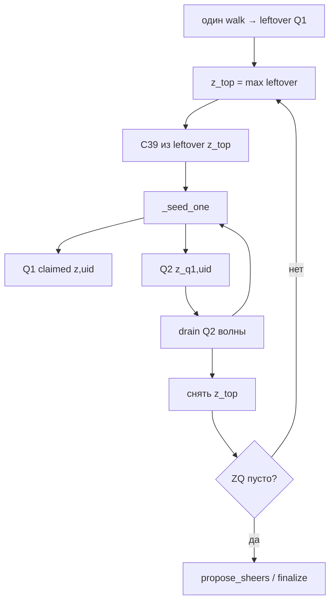

# Relief mill Q1/Q2 вёдра — план T-18 / T-19

**Статус:** план, код не начат.  
**SoT:** [`docs/tz_terrain_relief.md`](../../docs/tz_terrain_relief.md) § Две очереди seed + C39 (один walk).  
**IDs:** [`docs/tz_generator_technical_debt.md`](../../docs/tz_generator_technical_debt.md) **R41-T-18** (вёдра), **R41-T-19** (снос mill Q3).  
**Не этот план:** **R41-T-17** pack 8 слотов (P1 первым, отдельный PR). **Не** Volume / DAG / schema `0002`.  
**Не SoT:** этот файл. Расхождение с ТЗ — править ТЗ.

Один PR с двумя чеклистами (T-18 затем T-19 в том же diff — нормально). Не коммитить, пока мастер не скажет. Backend не поднимать. DAG-ноды не трогать.

---

## Команда следующему агенту (копировать в чат)

```text
Имплементируй mill Q1/Q2 по плану .cursor/plans/relief-mill-q1-q2.md.

SoT: docs/tz_terrain_relief.md § Две очереди seed (вёдра, z_top, луч до упора, один walk).
IDs: R41-T-18 вёдра, затем R41-T-19 снос is_q3_seed / q3_s / q3_parent.
Не трогать: R41-T-17 pack; бок-attach persist (только rename q3_* → side_*); schema 0001; DAG; Occupancy v1.

Не коммитить, пока не скажу. Backend не поднимать.
```

---

## Целевое состояние

```text
один walk rect+halo
        ↓
Q1 leftover (z, unset)     # все клетки по z; дальше сетку не читать
        ↓
пока ZQ не пусто:
  z_top = max leftover z
  C39 только из leftover[z_top] → mill (станок как сейчас)
  тело → Q1 claimed (z_top, uid)
  посадка / бок / сосед следа → Q2 (z_top, uid)   # события mill, не скан rect
  drain Q2 этой волны, пока не пусто
  снять z_top (leftover и Q2 волны пусты)
        ↓
propose_sheers / finalize / reconcile
бок-attach persist (side_parent_slot, не имя Q3)
```

Инварианты ТЗ: клетка ∈ одно ведро; обратный индекс; clear очереди ≠ сброс `at_grid`; **N** только stamp; луч до упора, не новая вершина на хвосте той же прямой; предикаты Q2 не `OR` в одном drain; третьей очереди seed нет.

Станок `_seed_one` (plugin → flood → propose → commit) **не** копировать на очередь.

---

## Data flow



Serial внутри чанка (как сейчас `discover_fronts`). Параллель чанков не менять (`FineChunkRunner`).

---

## Слои имплементации

Порядок слоёв, не «сначала только plains».

### 0. Типы вёдер

Новый модуль рядом с mill, например `discover/millBuckets.py` (не раздувать `types.py` persist-смыслом).

- Ключ Q1 leftover: `(z, 0)` / unset.
- Ключ claimed / Q2: `(z, uid)` и `(z_q1, uid)`; имя лога `f"{z}_{uid}"`.
- `cell_to_bucket: dict[Coord, key]`.
- API: `insert` (отказ если клетка уже в другом ведре), `move`, `leftover_z`, `max_leftover_z`, `q2_for(z_q1)`.

`ReliefVertices` не хранит ведра. `q3_parent` → слой 5.

### 1. Один walk

`RimStage.buckets_high_to_low()` сегодня **перестраивает** ведра на каждый `_drain` pass — это мёртвый контракт.

- Один вызов в начале `discover_fronts` → заполнить leftover Q1.
- Удалить повторные вызовы из drain. Не звать `buckets_high_to_low` в loop.

### 2. События mill → Q2

После `_seed_one` / `seam.commit`: клетки посадки SHEER, same-z бок коридора, непокрытый сосед следа — `move` в Q2 `(z_top, uid)` **без** прохода rect.

Предикаты оставить в `apron.py`, **раздельно**:

| Было | Станет |
|---|---|
| `seed_rim` / `rim.is_seed` | C39 на leftover Q1 |
| `is_q2_seed` | посадка SHEER → Q2 |
| `is_q3_seed` | бок коридора → Q2 (тот же предикат, другое имя: `is_side_seed` / `is_q2_side`) |
| `resolve_q3_parent` | `resolve_side_parent` (min\|Δz\|, tie = меньший slot) |

Не `OR` посадки и бока в одном списке без раздельного drain (волна Q2 может идти посадками, потом боками, или work list с типом записи).

### 3. Цикл `discover_fronts` (T-18)

Заменить три `_drain` (C39 все z → Q2 все z → Q3 loop все z) на цикл ТЗ.

`_drain(..., loop=True)` по всей сетке — **удалить**.

Timings: `q1_s` = mill leftover; `q2_s` = mill Q2; **`q3_s` не писать** (слой 5). Сумма mill без третьего ключа.

Docstring `core.py` / `apron.py`: не Q1→Q2→Q3.

### 4. Тесты T-18

`backend/tests/test_relief_discover.py`:

- Один walk: leftover построен раз; повторный `buckets_high_to_low` нет.
- Клетка не в двух вёдрах.
- `z_top` не сеет leftover нижней z до конца Q2 волны.
- Луч не порождает новую вершину на продолжении той же прямой.
- Бок коридора сеется из Q2, attach parent записан.
- Регресс: list-2 / terrace / pit 1×1 / `is_q2_seed` посадка.

Не гонять `detailed_bake` тайла в этом плане, пока мастер не попросит smoke.

### 5. T-19 — снос имён Q3

После того как бок живёт в Q2:

**Удалить**

- `is_q3_seed`
- drain `_q3` / `on_seeded=_record_q3` как третья очередь
- `q3_s` в `timings.py`, `detailedGradeDiscover.py`, `detailed_bake.py`, тесты timings
- тесты `test_q3_*` как третья очередь (переписать на Q2 side + `side_parent`)

**Переименовать (поведение то же)**

| Было | Станет |
|---|---|
| `ReliefVertices.q3_parent` | `side_parent` |
| `VertexSlotSeam.q3_parent_slot` | `side_parent_slot` |
| `resolve_q3_parent` | `resolve_side_parent` |
| `WHY_Q3_ATTACH` | `WHY_SIDE_ATTACH` (`"side_attach"`) |

Файлы rename: `fineTileContext.py`, `detailedGradeDiscover.py`, `gradeVertexSystem.py`, `gradeInstanceFactory.py`, `test_relief_grade_system_t3c.py`, `test_relief_grade_persist.py`.

**Не удалять:** union бока с parent в `gradeVertexSystem.py`; исключение «1 фронт → нет System».

Grep на стоп: `is_q3_seed`, `q3_s`, `q3_parent`, `WHY_Q3`, `Q3 SLOPE` в `discover/` и тестах mill.

Schema `0001` не трогать (поля bake-only).

---

## Мёртвый код / контракт старой очереди

| Что | Файл | Действие |
|---|---|---|
| Три `_drain` все z + Q3 loop | `discover/core.py` | заменить циклом T-18 |
| `buckets_high_to_low` каждый pass | `discover/rim.py` + `core.py` | один walk |
| `is_q3_seed` | `apron.py` | удалить после переноса в Q2 |
| Docstring Q1/Q2/Q3 | `core.py`, `apron.py` | Q1/Q2 |
| `q3_s` | timings, discover facade, `detailed_bake.py` | удалить |
| `q3_parent` dict | `types.py` | `side_parent` |
| `q3_parent_slot` | `fineTileContext.py` | `side_parent_slot` |
| `WHY_Q3_ATTACH` | `gradeInstanceFactory.py` | `WHY_SIDE_ATTACH` |
| Тесты третьей очереди | `test_relief_discover.py` | Q2 side |
| Комментарий «unless Q3» | `fineTileContext.py` | бок Q2 |

Не считать мёртвым: `is_q2_seed` (посадка); `seed_rim` (C39); `_seed_one`; `propose_sheers` после ZQ.

---

## Не делать

- R41-T-17 pack / COUPLE в этом PR (если мастер не сказал иначе).
- Снять бок-attach.
- `0002_*.sql`; Occupancy v1; склеивать Rim/Front/Seam в `core.py`.
- Второй пул; fill∥relief; Priority-Flood; `OR` C39∨посадка∨бок в одном `is_seed`.
- Класть несколько различных z в leftover Q1 из‑за N.
- Сеять продолжение того же луча новой вершиной.
- Clear work list обнулением `at_grid`.
- Backend / commit / DAG.

---

## Готово

- [ ] `discover_fronts` = цикл ТЗ; один walk leftover.
- [ ] Q2 только из mill; ключ `(z_q1, uid)`.
- [ ] Индекс клетки без дубля.
- [ ] Нет `is_q3_seed` / `q3_s` / `q3_parent*`.
- [ ] Attach бока: `side_parent_slot` → тот же UF в `gradeVertexSystem`.
- [ ] `test_relief_discover` + T-3c persist тесты зелёные.
- [ ] Registry T-18 / T-19 → resolved (когда мастер примет).
