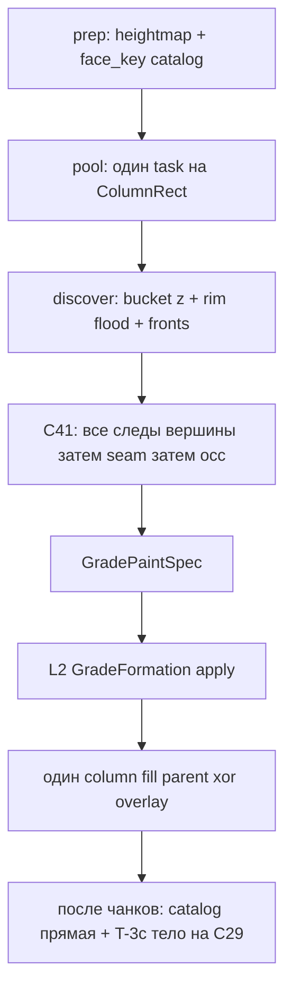

# Relief pipeline v2 — план реализации ✅ DONE

**Статус:** слои 0–7 в коде · **T-3c ✅** · **слой 7 срез v1 ✅** · **R41-T-9…T-12 ✅** · очередь v2 закрыта · SoT = [`docs/tz_terrain_relief.md`](../../docs/tz_terrain_relief.md) **R41 / R42 / C38–C41** · § T-3c на шве чанков  
**Очередь SoT:** [`docs/tz_terrain_relief.md`](../../docs/tz_terrain_relief.md) § Осталось — v2 vs L2 volume (volume закрыт; **T-5…T-12** ✅; слой 5 ravine + ShorePlugin ✅; **T-3c слой 6 ✅**; **слой 7 ✅**).  
**Не SoT:** этот файл. Расхождение с ТЗ — править ТЗ, не «как удобнее в плане».  
**Post-impl smells:** [`docs/tz_generator_technical_debt.md`](../../docs/tz_generator_technical_debt.md) **R41-T-2…T-12** ✅; **T-3c ✅**.  
**Указатель волн:** [`relief-dev-plan-done.md`](./relief-dev-plan-done.md) (исторические Wave A–D / Post-R36w).  
**Код:** блок «Команда следующему агенту» ниже. DAG-ноды не трогать.

---

## Команда следующему агенту (копировать в чат)

Очередь **pipeline v2** закрыта (слои 0–7 + **R41-T-9…T-12**). Не стартовать Wave E / BAR-1 / DAG / `|dz|=1` чашу без явной команды мастера.

```text
Очередь relief pipeline v2 закрыта. Не открывай продукт.

SoT: docs/tz_terrain_relief.md § Осталось — v2 vs L2 volume (все строки 1–5 ✅).
План: .cursor/plans/relief-pipeline-v2-done.md.
ID: docs/tz_generator_technical_debt.md § R41-T-1…T-12 resolved.

Вне очереди (только по команде мастера): BAR-1; Wave E; DAG; чаша |dz|=1.
Schema: только 0001_initial.sql; файлы 0002_*.sql запрещены (не «later»).

Не делать: форк Volume/GradeFormation; второй пул; fill∥relief; occupancy v1; склеивать Rim/Front/Seam в core.py; stamp uid на тело; uid System на клетке; второй C39.

Не коммитить, пока не скажу. Backend не поднимать. DAG-ноды не трогать.
```

---

## Инструкции агенту-исполнителю

Ты реализуешь **relief pipeline v2**. Архитектура уже зафиксирована в ТЗ; не предлагай v1 «на переход» и не открывай продукт заново.

**Полномочие:** писать код, тесты, правки плана/ТЗ при расхождении факта с SoT. **Не** коммитить, пока мастер не скажет. **Не** поднимать backend (`python start.py`, uvicorn). **Не** трогать `application/engine/nodes/`.

### Читать в этом порядке

1. Этот файл целиком + блок «Команда следующему агенту» (очередь v2 закрыта).
2. [`docs/tz_terrain_relief.md`](../../docs/tz_terrain_relief.md) — **R41**. Occupancy v1 срезан (слой 7). T-3c уже в коде (`emit_relief_grade_systems`).
3. Живой writer: `fineChunkRunner.py` → `compute_rect` → `discover_and_paint` → один fill. `FineChunkPersist.finish` → `merge_grade_instances` → `emit_relief_grade_systems` → persist `instances`+`systems`.
4. Живой L2 (не переписывать): `plan_ribbon_volume` / `GradeFormation` / `DetailedGradeResult` (Post-R36w).

Правила репо: `architecture-first.mdc` (скелет типов **до** наполнения `open_land`); `layer-boundaries.mdc`; `dataModel-no-hardcode.mdc`; schema только [`0001_initial.sql`](../../backend/app/db/migrations/0001_initial.sql) + sync моделей, без `0002_`.

### Делать

Слои **0 → 3** обязательны в одном каркасе (типы + facade + discover core + paint adapter + `compute_rect` без pre-pool `planned`). Plugin `road_shoulder` (слой 4) — та же конструкция, не второй ribbon; можно следом, не отдельным пайплайном. Слои 5–7 — после 0–3, если мастер не сузил.

- `ReliefVertices` / `GradePaintSpec` — application dataclass, **не** persist-POJO, **не** поля на `ReliefGradeInstance`.
- Шов лучей **C41**: все следы вершины, затем `seam`, затем `occ`. Не первый-занял. Дырка 1×1 → skip.
- Plains `|dz|=1` — **нет stamp** (R37). Чаша на единице — **вне scope**.
- Halo = `max(L_tpl, envelope floor)`.
- 1 фронт = 1 Instance; 1 фронт → строку `relief_grade_systems` не писать.

### Не делать

Полный same-z CC тайла; Priority-Flood ямы; пики × 4; fill∥relief; два column fill; второй пул; stamp uid на тело вершины; uid System на клетке; возвращать occupancy v1; DAG; mountain SideFill Q4; R36r / R36o; BAR-1; файлы `0002_*.sql` (schema только `0001_initial.sql`); класть building JSON в `relief_templates/`.

Расхождение плана с R41 — побеждает **ТЗ**, план поправить. Вопрос мастеру — только если ТЗ молчит (не «как удобнее в коде»).

Live bake — **v2 discover + T-3c** в `compute_rect` / `FineChunkPersist.finish` (слои 0–7). Occupancy v1 срезан.

---

## Целевое состояние

Одна конструкция на все outdoor-контексты. Не «plains v2 + дорога v1».

```text
prep heightmap + каталог face_key     # уже есть; каталог НЕ deprecated
        ↓
worker compute_rect
  ReliefVertices (at_grid, occ, seam)
  bucket[z] → кромка (C39) → тело 8-связное
  фронты lockstep (R42) + шов лучей (C41)
  GradePaintSpec → существующий L2 paint (не переписывать volume)
  один column fill (parent ⊕ overlay)
        ↓
после чанков: (1) catalog uid = одна прямая
              (2) T-3c: slot intra-chunk; тело на C29; UF этого refine
                  ≥2 Instance одной вершины → System
```

| Слой | Ответственность | Не делает |
|---|---|---|
| `ReliefVertices` | bake-индекс слотов / `occ` / `seam` | persist, Instance в `members` |
| discover (plugin тела) | кромка, фронты, шов, `GradePaintSpec` | LLM, fill колонок, SQL |
| L2 apply | `plan_ribbon_volume` / `GradeFormation` / write-set | sample пиков, union-find семян |
| `FineChunkRunner` | каталог до пула; task = `ColumnRect` | pre-pool occupancy |
| persist | Instance + System ≥2 | mint uid в воркере |

**Инварианты:** клетка ≤ 1 вершины; коридор ≤ 1 фронта; шов лучей ничей; якоря R36t; 1 фронт = 1 Instance; 1 фронт → нет строки System; stamp `|dz|=1` plains нет (R37); не Priority-Flood; не fill∥relief; не второй пул.

---

## Контракты (скелет до наполнения одного контекста)

Application (не `dataModel`):

```text
ReliefVertices
  at_grid, occ, seam: array[int]     # локальные lx,ly; rect+halo
  members: list[dict[(x,y), z]]
  uids:    list[str]                 # System uid, пусто пока нет row

GradePaintSpec                       # C40 — единственный вход в L2
  grade_uid, outward, front_w
  anchor_top, anchor_bottom          # шов может быть общим bottom
  decision: RibbonGradeDecision      # knobs/envelope из POJO
  corridor: уникальные клетки (не seam, не тело)
```

Facade воркера (имя при impl):

```text
discover_and_paint(...)
  → write-set (DetailedGradeResult) + VertexSlotSeam (T-3c fingerprint)
```

Контекст = plugin тела вершины (таблица R41): `open_land` | `road_shoulder` | `shore` | `ravine`. Сигнатура plugin общая **до** первого pass. Не проектировать отдельный ribbon для прямой дороги.

Persist-POJO / SQL: **не** расширять полями `occ` / slot / фронт. `ReliefGradeSystem` emit — T-3c ✅.

---

## Data flow



Serial: каталог uid. Parallel: разные `ColumnRect`. На одном rect: discover+paint **затем** fill. Чужой `occ` с более высокой z — упор, не шов этой вершины.

---

## Порядок имплементации (слои, не «сначала только plains»)

Типы и facade — **до** наполнения `open_land`. Plugin дороги описан в тех же типах; код plugin можно вторым PR, не вторым пайплайном.

| # | Слой | Что | Готово когда |
|---|---|---|---|
| **0** | Типы | `ReliefVertices`, `GradePaintSpec`, facade `discover_and_paint` | ✅ импорт без пиков; не persist |
| **1** | Discover core | C39 предикат, bucket[z], 8-flood, R42 фронт, C41 шов | ✅ юнит на чаше / 1×1 skip / террасу под `occ` |
| **2** | Paint adapter | spec → `apply_grade_paint_spec` / Formation | ✅ z/uid как Post-R36w; volume не форк |
| **3** | Worker A | `compute_rect`: discover+paint → один fill; runner **без** pre-pool occupancy | ✅ dump чанка без `planned` |
| **4** | Plugin `road_shoulder` | полотно = тело; 2 орто + поворот 8-way + шов | ✅ прямая = 2 фронта; угол не двоит клетку |
| **5** | Plugin `shore` / `ravine` | ravine ✅; онтология shore_* + hydro paint ✅; **ShorePlugin тело ✅** | не хардкод L/θ в plugin |
| **6** | T-3c | ≥2 Instance одной вершины → `ReliefGradeSystem`. Intra-chunk = `slot`; через чанки = тело на C29 + UF этого refine | ✅ 1 фронт → FK NULL; не `face_key` = вершина; макро-шов двух bake — не этот слой |
| **7** | Срез v1 | удалить sample/stitch/`planned` | ✅ тесты только v2 |

Halo = `max(L_tpl, envelope floor)` (уже в knobs; не JSON-2).

**Не в этом плане:** `|dz|=1` чаша (открытый продукт); R36r thick diag; R36o; BAR-1; DAG; mountain SideFill Q4; schema 0002.

---

## Что остаётся

| Контракт | Почему живой |
|---|---|
| `TileFaceCatalog` / `face_key` / R36w | identity шва чанков (C29), не discover семян |
| `prepare_fine_tile` без sample | prep heightmap + catalog |
| `plan_ribbon_volume` / `GradeFormation` / `DetailedGradeResult` | L2 apply |
| `grade_constrained` / `grade_from_template` / `classify` | knobs + envelope |
| `ReliefGradeInstance` / `ReliefGradeSystem` POJO + SQL | persist |
| column fill после paint | расписание A |
| patch helper тот же discover | caller B |

---

## Occupancy v1 — срезан слой 7 ✅

Было помечено deprecated до среза. **Не** возвращать. Каталог `face_key` и L2 apply **живые**.

| Удалено | Замена v2 |
|---|---|
| `sample_peak_land_sites` | кромка C39, не hunt max |
| `sample_downhill_land_sites` | остаток кромок + `occ` |
| `sample_landward_of_refs` | plugin тела |
| `sample_open_land_meter` / `sample_shore_meter` / `sample_road_shoulder_meter` / `sample_ravine_meter` | discover plugin |
| `sample_detailed_grade_rect` | `discover_and_paint` в worker |
| `plan_grade_for_rects` / `plan_rect_grade` | discover в `compute_rect` |
| `stitch_planned_segments` (+ UF семян) | стык **после** чанков по catalog uid + T-3c |
| `PlannedGradeSegment` / `FineTileContext.planned` | `GradePaintSpec` в worker |
| `materialize_planned_for_rect` | `apply_grade_paint_spec` |

---

## Тесты / приёмка

Переписать `test_detailed_grade_generate` с `plan_grade_for_rects` на worker-discover — **слой 7 ✅**. Юниты слоя 1: меса 8-связная (gy 901); фронт W×L; шов чаши; 1×1 → skip; нижняя терраса не сеет под `occ`. Слой 6 ✅: `tests/test_relief_grade_system_t3c.py`. **R41-T-9…T-12 ✅:** оркестратор / identity / envelope walk cap / PackJobUid site / owner omit. Smoke pack — по команде мастера (агент backend не поднимает).

**Запрещено при impl:** второй пул; fill∥relief; два column fill; полный same-z CC тайла; Priority-Flood; Instance на ступень; uid System на клетке; stamp uid на тело; пики × 4 «на переход»; первый-занял внутри вершины.
