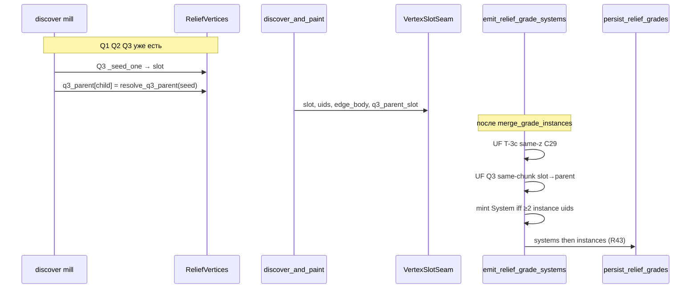

# Q3-attach — план реализации

**Статус:** контракты locked · код attach **не** начат  
**SoT:** [`docs/tz_terrain_relief.md`](../../docs/tz_terrain_relief.md) R41 очереди + persist; [`docs/tz_terrain_relief_consume.md`](../../docs/tz_terrain_relief_consume.md)  
**Не SoT:** этот файл. Расхождение с ТЗ — править ТЗ, не «как удобнее в плане».  
**Уже в коде (не переоткрывать):** mill Q1→Q2→Q3 (свой слот); SQL catalog Instance/System; `load_grade_membership`; emit **только** T-3c.  
**Это задача:** membership Q3 → System ближайшего склона. Не новый mill, не новая schema.

DAG-ноды не трогать. Backend не поднимать. Не коммитить, пока мастер не скажет.

---

## Что это не есть

| Не делать | Почему |
|---|---|
| Менять предикаты Q1/Q2/Q3 / один `is_seed` OR | Mill уже SoT; attach — после станка |
| Колонка SQL / `0002` / поле на persist-POJO | C38; persist locked |
| Stamp uid System на клетку | Клетка → Instance |
| Mint System в discover / воркере | mint в emit, как T-3c |
| Второй caller persist / второй пайплайн | тот же `emit_relief_grade_systems` → `persist_relief_grades` |
| Cross-chunk parent по телу / same-z | Q3 union **только** `(chunk, parent_slot)` того же чанка |
| Клетки Q3 в `members` родителя | разная z |

---

## 1. Контракты (зафиксировано до кода)

Слои хранения **не** меняются. Attach — правило membership на уже существующем пути.

```text
discover (slot→slot)     VertexSlotSeam          emit UF              SQL catalog
child → parent      →    q3_parent_slot     →    T-3c затем Q3   →   systems + Instance.FK
bake-only                bake fingerprint        mint System uid      клетка = Instance
```

### 1.1 Идентичность (бой / LLM) — уже SoT, операционно

- Q3 = **новый слот**, тот же станок (тело на своей z, свои фронты). Не orphan.
- Кандидаты parent: вершины, чей **закоммиченный SLOPE-коридор** 8-соседствует с seed (не тело — это Q2).
- Выбор: min `|z_тела − z_seed|`; ничья — **меньший slot**.
- Клетка → Instance (`system_grade_uid`). System — только `Instance.grade_system_uid`.
- Исключение R36l: 1 фронт родителя **плюс** Q3 → строка System. Не T-3c (разные z, не шов чанка).
- Пустой pack-слот без соседа **в этом** `ColumnRect` — OK (FOREIGN / нет parent в rect).

### 1.2 Discover / bake — `child_slot → parent_slot`

**Где:** `ReliefVertices`, не POJO, не pack.

| Поле | Тип | Инвариант |
|---|---|---|
| `q3_parent` | `dict[int, int]` | ключ = slot ребёнка (1-based), значение = slot родителя (1-based) |
| запись | только успешный Q3 mill | `_seed_one` вернул слот и тело непустое |
| parent | уже существующий slot этого `ReliefVertices` | `parent != child`; slot ≥ 1 |
| нет ключа | Q1, Q2, Q3 без резолва | не писать `0`, не писать self |

**Резолв parent** — отдельная функция, не предикат seed:

```text
resolve_q3_parent(xy, surface, vertices, in_slope_corridor) -> int | None
```

Тот же коридор, что `is_q3_seed` / `is_slope_corridor_cell` (`occ` ≠ 0 и ≠ `FOREIGN_MARK`, иначе live SLOPE-trace).

| Шаг | Правило |
|---|---|
| Соседи | 8-клеток seed; сосед — SLOPE-коридор **той же z**, что seed |
| Slot кандидата | `occ[nb]` если это локальный slot; иначе `FrontGeometry.slot` live-trace, которому принадлежит `nb` |
| FOREIGN | не кандидат |
| `z_тела` | целое z тела слота: любое значение `vertices.members[slot-1]` (тело same-z). Пустые members — кандидат drop |
| `z_seed` | `cell_z(surface, xy)` |
| Выбор | min `abs(z_тела − z_seed)`, ничья → меньший slot |
| Пусто | `None` — в `q3_parent` не писать |

`is_q3_seed` остаётся `bool`. Резолв вызывается **после** успешного Q3 `_seed_one` в Q3-`_drain` (не в Q1/Q2).

Q3-от-Q3: parent может быть слотом предыдущего Q3 (коридор уже закоммичен). Цепочка пишется по одному ребру за mill; циклов нет (parent старше).

### 1.3 След воркера — `VertexSlotSeam`

Сигнатура **расширяется одним полем**. Остальное как T-3c. Persist-POJO / SQL не трогать.

```text
VertexSlotSeam
  slot: int                         # 1-based, локальный чанк
  grade_uids: tuple[str, ...]       # Instance фронтов этого слота (после paint)
  edge_body: tuple[(x,y,z), ...]    # тело на rim owned rect (T-3c)
  q3_parent_slot: int | None = None # только Q3; иначе None
```

| Правило | |
|---|---|
| `None` | Q1/Q2; Q3 без записи в `vertices.q3_parent`; слот без paint (шва нет) |
| `int` | копия `vertices.q3_parent[slot]`; тот же (cx, cy) |
| `0` | запрещён |
| Кто копирует | `build_vertex_slot_seams` — единственный writer поля на seam |
| Cross-chunk | **нет** parent из другого `(cx, cy)` на этом поле |

Тесты, которые собирают `VertexSlotSeam(...)` без поля, остаются валидны (`None` default).

`ChunkComputeResult.vertex_seams` / `FineChunkPersist._seam_acc` / вызов emit — **без** новых аргументов: parent едет внутри seam.

### 1.4 Emit — один post-pass, два union

Сигнатура **не** меняется:

```text
emit_relief_grade_systems(instances, traces, catalog)
  -> (instances' with grade_system_uid, systems)
```

`SlotKey = (cx, cy, slot)` — как сейчас.

Порядок (обязательный):

1. Собрать `slot_uids` / `edge_of` **как сейчас** (слот без painted uid в UF не входит).
2. **T-3c:** UF по same-z телу на внутренних C29 — **без изменений**.
3. **Q3-attach:** для каждого seam с `q3_parent_slot is not None`:
   - `child = (cx, cy, seam.slot)`
   - `parent = (cx, cy, seam.q3_parent_slot)`  ← тот же чанк, не матч тела
   - union **только если** оба ключа уже в `slot_uids`
   - иначе skip (TZ: нет следа parent → Q3 остаётся 1 фронт без System, пока у него самого нет ≥2 uid)
4. Компоненты UF → mint System при `len(unique uids) ≥ 2`.
5. `site_id = "|".join(sorted uids)` → `make_grade_system_uid` — **тот же** hash, что T-3c. Не mint в discover.
6. Проставить `Instance.grade_system_uid` всем членам компоненты.
7. `persist_relief_grades` без изменений (systems, затем instances, одна txn).

Транзитивность: parent уже в T-3c-компоненте (меса на нескольких чанках) → Q3 входит в **ту же** System.

Q3-от-Q3: несколько рёбер `child→parent` в одном проходе; UF склеивает цепочку.

**Запрещено в emit:** union по z; union parent из соседнего `(cx, cy)`; вторая функция emit; менять порог «≥2 uid» (исключение 1 фронт + Q3 получается само: два uid).

Debug `why` в `build_relief_grade_system` (не поле POJO): `"q3_attach"`, если в компоненте есть хотя бы одно Q3-ребро; иначе `"t3c_same_vertex"`. На uid System не влияет.

### 1.5 SQL / клетка / pack / catalog read — без контрактных правок

| Уже есть | Не добавлять |
|---|---|
| `relief_grade_systems` + `Instance.grade_system_uid` | `q3_parent`, slot, флаг «это Q3» |
| клетка `system_grade_uid` = Instance | uid System на клетке |
| `persist_relief_grades` / `load_grade_membership` | второй reader, dual-write сетки |

После attach `load_grade_membership(instance_uid Q3)` возвращает тот же System, что у Instance родителя.

### 1.6 Границы caller

| Модуль | Делает | Не делает |
|---|---|---|
| `apron.py` | `resolve_q3_parent` | mill, emit, persist |
| `core.py` | после Q3 seed пишет `vertices.q3_parent` | UF, uid System |
| `types.py` / `ReliefVertices` | словарь bake | поля на Instance |
| `fineTileContext.VertexSlotSeam` | поле fingerprint | SQL |
| `detailedGradeDiscover.build_vertex_slot_seams` | копирует parent на seam | emit |
| `gradeVertexSystem.emit_*` | T-3c затем Q3 union | discover, persist SQL |
| `fineChunkPersist` | как сейчас вызывает emit | отдельный Q3-pass |
| `persistReliefGrades` / `gradeCatalog` | без смены контракта | знать, что член — Q3 |

---

## 2. Поток данных



---

## 3. Порядок имплементации (слои, не слайсы продукта)

Код — только после явной команды мастера. Скелет типов **до** наполнения emit.

0. **Типы:** `ReliefVertices.q3_parent`; `VertexSlotSeam.q3_parent_slot: int | None = None`.
1. **Резолв:** `resolve_q3_parent` в `apron.py` + unit-тесты выбора (Δz, ничья slot, FOREIGN, live-trace).
2. **Mill:** Q3-`_drain` пишет словарь; Q1/Q2 не трогать; `_seed_one` возвращает `int | None`.
3. **Fingerprint:** `build_vertex_slot_seams` копирует поле.
4. **Emit:** второй union; регресс T-3c; кейсы attach / skip без следа parent / T-3c+Q3 транзитивность / цепочка Q3.
5. **Persist-тест:** emit → `persist_relief_grades` → `load_grade_membership` (Q3 и parent — один System). Schema / R43 / DAG не трогать.
6. Докстринг `gradeCatalog`: System = T-3c **или** Q3-attach (не новая логика).

ТЗ не править, пока код не разойдётся с SoT.

---

## 4. Приёмка

- Discover: Q3 слот ≠ mesa; `q3_parent[q3] == mesa_slot` на фикстуре `test_q3_same_z_side_of_slope_corridor_is_new_vertex`.
- Два бока одного коридора (`test_q3_loop_drains_disconnected_sides`): оба → тот же parent slot.
- Ничья |Δz|: меньший slot.
- `VertexSlotSeam` Q1 без поля / `None`; Q3 с parent, если слот painted.
- Emit: 1 фронт родителя + 1 фронт Q3 → одна System, оба FK; lone Q3 без parent-шва → System нет.
- T-3c двух фронтов одной вершины без Q3 — как сейчас.
- Меса на двух чанках (T-3c) + Q3 в одном чанке → один System uid на всех Instance.
- Persist membership round-trip; клетка по-прежнему Instance.
- Grep: нет `q3_parent` в `dataModel/`, SQL, `ReliefGradeInstance`.

---

## 5. Команда исполнителю (когда мастер скажет «делай»)

SoT R41 persist / идентичность не переоткрывать. Контракты — §1 этого файла.

Не делать: schema, POJO, stamp System на клетку, mint в worker, OR предикатов, union Q3 через C29.

Не коммитить, пока не скажу. Backend не поднимать. DAG-ноды не трогать.
