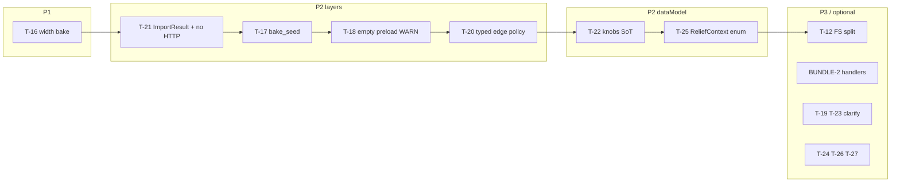

# Plan: Relief tech-debt fixes (RELIEF-T-16… + leftovers) ✅ DONE

**SoT smells:** [`docs/tz_generator_technical_debt.md`](../../docs/tz_generator_technical_debt.md) § Relief templates (RELIEF-T)  
**Product:** [`docs/tz_terrain_relief.md`](../../docs/tz_terrain_relief.md) R20–R22, R28, R31, R35  
**Gate:** DAG nodes не трогать · schema только `0001_initial.sql` + models (если понадобится seed field) · backend не стартовать агенту  
**Вне scope этого плана:** **RELIEF-BAR-1** (barrier materialize), UI R30, climb, full open_land/shore consumers (только clarify/stub)

---

## Целевое состояние

```text
road_shoulder bake: sample → grade → expand by decision.width → stamp facing
bundle: domain errors + ImportResult в application (не api.schemas / не HTTP в service)
seed: bake_seed(world) один helper
edge.relief_pick_policy: typed на границе import/repo
knobs defaults: SoT ReliefGradeKnobs → RoleCase / Template / Interval
pick paths: ReliefContext enum, не str literals
```



---

## Шаги имплементации

### Step 1 — RELIEF-T-16 (P1): `shoulder_width` на bake

**Done when:** unit: template `shoulder_width_cells=3` (или case override) → stamp/facing затрагивает кольцо ширины 3; width=1 поведение как сейчас.

| Действие | Где |
|---|---|
| Helper `expand_shoulder_ring(seed_cells, road_cells, width)` | `roadShoulderApply` или pure `relief/` |
| Двухпроходный apply: sample ortho → grade per segment → expand coords by `decision.width` (clamp ≥1) → stamp | `roadShoulderApply.py` |
| Не materialize barrier | граница BAR-1 |

**Антипаттерн:** читать width только в логах; hardcode dilate=1.

---

### Step 2 — RELIEF-T-21 (P2): bundle layers

**Done when:** `bundle/reliefSection` и `WorldBundleService` не импортируют `fastapi` / `api.schemas` для relief path; route мапит domain errors.

| Действие | Где |
|---|---|
| Перенести `ImportResult` (или тонкий alias) в `application/` / shared (не ломая другие importers) | `api/schemas/imports.py` → application + re-export из api если нужно |
| `import_relief_templates_section` бросает `ReliefValidationError`; facade не ловит в HTTP | `bundle/reliefSection.py`, `worldBundleService.py` |
| HTTP map в `api/routes/worlds.py` (bundle import) | thin route |

**Связь:** BUNDLE-2 остаётся partial; этот шаг только снимает layer smell с relief.

---

### Step 3 — RELIEF-T-17 / T-18 / T-20 (P2): контракты bake + edge

**Done when:** один `bake_seed(world)`; empty preload → WARNING; edge policy typed до generator.

| ID | Действие |
|---|---|
| T-17 | `bake_seed(world) -> str` (сейчас `world_uid`); materializer + roadShoulderApply зовут helper. Поле seed на World — **опционально** (schema), иначе document helper как SoT |
| T-18 | В `load_relief_templates_for_world` / bake start: если registry non-empty и bodies empty → WARNING; если library unbound в pack orchestrator → WARNING |
| T-20 | Parse `ObjectReliefPickPolicy` при чтении edge (JV/repo helper); `RoadContributor` передаёт typed policy, не raw dict |

---

### Step 4 — RELIEF-T-22 / T-25 (P2): dataModel SoT

**Done when:** нет параллельных `= 1` knobs defaults вне POJO; pick/stamp используют `ReliefContext`.

| ID | Действие |
|---|---|
| T-22 | Defaults ширины/weights: читать `ReliefGradeKnobs` / field defaults; `ReliefDeltaInterval` строить из knobs без литерала `1` |
| T-25 | `context=ReliefContext.MOUNTAIN` / `.ROAD_SHOULDER` в stamp, materialize, road_shoulder, templatePick internals |

---

### Step 5 — RELIEF-T-12 + BUNDLE-2 remainder (P2, optional slice)

| ID | Действие |
|---|---|
| T-12 | `ReliefTemplateFsImport` (path/pack/R29) → library service только upsert/CRUD |
| BUNDLE-2 | Следующая секция (connections) → `IBundleSectionHandler`; не блокирует Steps 1–4 |

---

### Step 6 — TZ clarify + low polish (P3)

| ID | Действие |
|---|---|
| T-19 | В `tz_terrain_relief.md`: v1 bake consumers = mountain + road_shoulder; open_land/shore = H later. Опционально DEBUG log «context unsupported» если pick попадёт в bake без consumer |
| T-23 | TZ: range laterals = declare-only **или** stamp left/right из mountain template (выбрать одно) |
| T-24 | Neutral `RoadShoulderIntent` в bake/dataModel; убрать profiles из `sideFill.__all__` |
| T-26 | Sentinel вместо `10**9`; enum values → `weights\|pattern\|fixed\|empty` (breaking wire letters — только если letters нигде не persist) |
| T-27 | `relief_dz(ref_z, adjacent_z)` рядом с classify; sampler зовёт helper |

---

## Порядок / критерии готовности

| Step | Done when |
|---|---|
| 1 | Unit width=3 expands; width=1 unchanged; existing road_shoulder tests green |
| 2 | Grep: no `fastapi` / `api.schemas.imports` in `bundle/reliefSection` + relief path of WorldBundleService |
| 3 | Unit/assert WARN on empty bodies with non-empty registry; edge policy typed round-trip |
| 4 | Grep: no `shoulder_width_cells=1` literals outside POJO SoT; no `context="mountain"` str in generators |
| 5–6 | Optional; update RELIEF-T statuses in tech-debt TZ |

После каждого step: `python -m unittest tests.test_relief_*` из `backend/`.

---

## Антипаттерны

- Materialize barrier в T-16 (→ BAR-1)
- Толстый route с grade/generate
- Новые литералы defaults рядом с POJO
- Schema `0002_*.sql` без явного снятия policy
- DAG node edits
