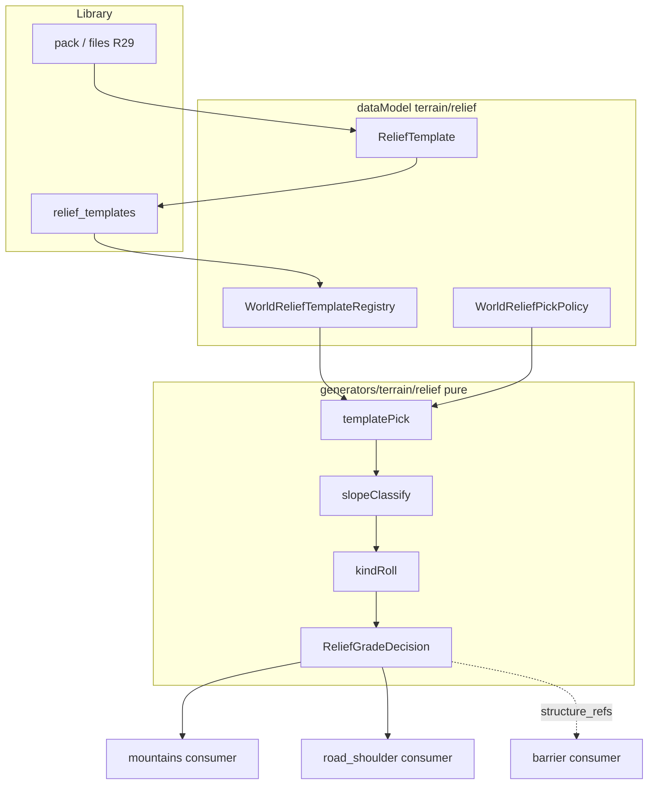

# Plan: Relief templates — clean architecture + dataModel contracts

> **SoT product:** [`docs/tz_terrain_relief.md`](../../docs/tz_terrain_relief.md) R1–R31  
> **Статус:** plan only · **не** impl · UI presets — out of scope (R30)  
> **Gate:** DAG nodes не трогать; schema только `0001_initial.sql` + models

---

## 1. Целевое состояние

```text
dataModel/terrain/relief/          ← единственный wire/SoT контракт
        │
        ├─ validate (library upload / pack / bundle / world import)
        │
db: relief_templates               ← global library (1:1 building_templates)
worlds.relief_template_registry    ← pointers (+ context)
worlds.relief_pick_policy          ← world-domain defaults per ReliefContext
object.relief_pick_policy?         ← override (гора / дорога / …); object wins (R31)
        │
generators/terrain/relief/         ← pure: merge policy → classify, pick, kind roll, grade
        │
consumers (тонкие):
  mountains SideFill / sides from template
  road_shoulder segments + earthen_canal stamp
  structure_refs → barrier consumer (не relief materialize)
```

**Инварианты**

| # | Инвариант |
|---|---|
| I1 | Все defaults/enums/поля — в POJO; generator не дублирует литералы (`dataModel-no-hardcode`) |
| I2 | Generators pure: нет HTTP, нет LLM, нет persist |
| I3 | Persist library/registry — service/repo; routes thin |
| I4 | `structure_refs` = `system_type` stub (R28); materialize → **RELIEF-BAR-1** tech debt, не в relief generator |
| I5 | Filename stem == `system_name` (R29); pack folder name == pack_name; weights sum==1 (R27) |
| I6 | Pick merge: **side > object > world** (R31) |
| I7 | Conditions mode A **XOR** B (R32); не смешивать `delta_z` и `bands` |
| I8 | Runtime classify — **одна абстракция**; A/B только на wire/normalize, не два расходящихся path в consumers |

---

## 2. Контракты dataModel (слой 0 — первым)

### Enums (`enums.py` — расширить shipped)

| Enum | Values |
|---|---|
| `ReliefSideKind` | `slope` \| `sheer` ✅ |
| `ReliefContext` | `mountain` \| `open_land` \| `shore` \| `road_shoulder` |
| `ReliefConditionTerrain` | `mountain` \| `plains` \| `forest` \| `ravine` \| `shore` |
| `ReliefSlopePolicy` | `slope_down` \| `slope_up` \| `slope_none` |
| `ReliefPickMode` | `fixed` \| `random` \| `round_robin` |

### POJO дерево

```text
ReliefDeltaBand
  delta_z_min: StrictOnWire[int]                # >= 1 (R32)
  delta_z_max: DefaultOnWire[int | None] = None # None = unbounded
  shoulder_width_cells: DefaultOnWire[int] = 1
  slope_weight: StrictOnWire[float]
  sheer_weight: StrictOnWire[float]             # sum==1 (R27)
  earthen_canal: DefaultOnWire[bool] = False
  structure_refs: DefaultOnWire[list[str]] = []

ReliefRoleCase
  policy: StrictOnWire[ReliefSlopePolicy]
  bands: StrictOnWire[list[ReliefDeltaBand]]    # down/up: len>=1; none: empty

ReliefTerrainCondition
  terrain: StrictOnWire[ReliefConditionTerrain]
  cases: StrictOnWire[list[ReliefRoleCase]]     # len==3; unique policy; full set

ReliefTemplate                                  # library blob / outline
  system_name, display_name
  context: StrictOnWire[ReliefContext]
  conditions: DefaultOnWire[list[ReliefTerrainCondition]] = []
  shoulder_width_cells, …  # root defaults
  # validators: unique terrain; bands R32; R27 weights

ReliefTemplateRegistryEntry                     # world pointer
  system_template_uid: StrictOnWire[str]
  display_template_name: DefaultOnWire[str | None]
  context: StrictOnWire[ReliefContext]          # denorm for filter/UI
  imported_at: …

WorldReliefTemplateRegistry = RootModel[list[ReliefTemplateRegistryEntry]]

ReliefContextPickPolicy
  mode: StrictOnWire[ReliefPickMode]
  default_template_uid: DefaultOnWire[str | None]  # required if fixed (validator)

WorldReliefPickPolicy                    # worlds.relief_pick_policy
  mountain / open_land / shore / road_shoulder: ReliefContextPickPolicy

ObjectReliefPickPolicy                   # partial; на MountainSpec / ConnectionEdge / …
  mountain: DefaultOnWire[ReliefContextPickPolicy | None] = None
  open_land: …
  shore: …
  road_shoulder: …
  # merge: non-null object field wins over world for that context (R31)
```

**Validate helpers** (на модели или `reliefTemplateValidate.py` рядом в dataModel/jsonValidation — не в generator):

- unique `terrain` in `conditions`
- each condition: exactly `{slope_down, slope_up, slope_none}`
- weights sum == 1; non-negative; `delta_z >= 0`
- `context != road_shoulder` ⇒ `conditions` empty (v1 reject if not)
- filename stem == `system_name` (на границе import service, не в pure POJO parse без path)
- object pick policy: same shape validators when present; merge in pure `templatePick`
- mode A XOR B detect; **normalize → common internal bands/intervals** (см. § Abstraction)

### Abstraction classify (I8) — не два path в consumers

Wire остаётся XOR A|B. В runtime **один** контракт:

```text
# после parse/validate ReliefTerrainCondition:
normalize(condition) → ReliefDeltaSchedule
  # упорядоченный список интервалов по направлению:
  #   none_max_abs: int          # mode A: none.delta_z; mode B: 0 (abs<1)
  #   down: list[ReliefDeltaInterval]   # min/max + knobs
  #   up:   list[ReliefDeltaInterval]

ReliefDeltaInterval
  value_min, value_max | None, knobs (weights, width, earthen_canal, structure_refs, …)

classify(dz, schedule) → (policy, knobs) | none
# единственная функция; ModeA/ModeB = только factory normalize()
```

| Слой | Знает A/B? |
|---|---|
| POJO wire + validate | да (XOR detect) |
| `normalize_condition()` | да → строит `ReliefDeltaSchedule` |
| `slopeClassify` / `gradePass` / mountains|road consumers | **нет** — только schedule |

Mode A normalize example: `delta_z=1` down → один interval `[1, +∞)` с knobs case.  
Mode B: bands уже intervals.

**Запрещено:** `if mode==A` в consumer SideFill / road_shoulder.

---

## 3. Storage / schema (слой 1)

### SQL (`0001_initial.sql` + `db/models/`)

```sql
CREATE TABLE relief_templates (
  template_uid TEXT PRIMARY KEY,
  system_name  TEXT NOT NULL UNIQUE,
  display_name TEXT NOT NULL,
  context      TEXT NOT NULL,
  version      TEXT NOT NULL DEFAULT '1.0',
  data         TEXT NOT NULL,   -- ReliefTemplate JSON
  source_file  TEXT
);
```

`worlds`:

- `relief_template_registry` TEXT JSON — `WorldReliefTemplateRegistry`
- `relief_pick_policy` TEXT JSON — `WorldReliefPickPolicy` (world-domain default)

Object override: поле `relief_pick_policy` (`ObjectReliefPickPolicy`) на declare/Spec объекта:

| Объект | Где (target) |
|---|---|
| Конкретная гора | `MountainSpec` / range declare entry |
| Конкретная дорога | `ConnectionEdge` metadata / edge policy wire |
| Later shore / open_land feature | соответствующий Spec |

Не отдельная SQL-таблица override — живёт на объекте.

Sync dataclass `World` + `validate_schema`.

### Repo / service

Зеркало buildings:

| Компонент | Ответственность |
|---|---|
| `IReliefTemplateRepository` | CRUD library |
| `ReliefTemplateLibraryService` | upload file/pack, R29 check, upsert, delete RESTRICT |
| world import path | registry pointers + optional body upsert; `structure_refs` ∈ barrier registry мира |

---

## 4. Generator pure API (слой 2)

```text
generators/terrain/relief/
  profiles.py, facing.py, sideGradeDecision.py     ✅
  slopeClassify.py      # dz + cases → ReliefSlopePolicy (order: none→down→up)
  conditionMatch.py     # template has terrain condition?
  templatePick.py       # registry + WorldReliefPickPolicy → template_uid (R21 fallback)
  kindRoll.py           # seeded SLOPE|SHEER from weights (уже sum==1)
  gradePass.py          # orchestration pure: sites → GradeResult
  earthenCanal.py       # optional landform stamp spec (data only)
```

**Typed results (dataclass в generators или dataModel — предпочтение thin dataclass рядом с pass, wire через POJO knobs):**

```text
ReliefPickSite
  context, terrain?, site_id, dz?, coords/edge_uid/side…

ReliefGradeDecision
  template_uid, policy?, kind: ReliefSideKind, facing, width, earthen_canal
  structure_refs: list[str]   # pass-through; materialize вне relief
```

Seed: `hash(world_seed, context, template_uid, site_id)` — без глобального `Random()`.

---

## 5. Consumers (слой 3 — после каркаса)

| Consumer | Поведение |
|---|---|
| **Mountains** | R33: `side_recipe` A\|B\|C\|**D seeded random**; declare `sides[]` wins; `MountainKind` ≠ preset |
| **road_shoulder** | segmentize edge by corridor terrain; classify dz; stamp grade + `earthen_canal`; emit `structure_refs` intent |
| **open_land / shore** | later: same pick/classify; R34 map + skip unknown terrain (no fake SLOPE) |
| **Barrier/structure** | отдельный шаг: по `structure_refs` → barrier templates (не в relief generator) |

---

## 6. HTTP / bundle (слой 4 — thin)

| API (эскиз) | |
|---|---|
| `POST …/relief-templates` | file or pack upload |
| `POST …/worlds/{uid}/relief-templates/import` | library → world registry |
| bundle section | registry + template bodies (R18) |

Routes: validate POJO → service. **Нет** generate в route.

Debug HTTP для grade — только после smoke library/persist (как terrain debug).

---

## 7. Data flow



---

## 8. Порядок имплементации (по слоям архитектуры)

| Step | Что | Done when |
|---|---|---|
| **A** | Enums + `ReliefRoleCase` / `ReliefTerrainCondition` / `ReliefTemplate` + validators R26–R27 | unit: parse example JSON; reject bad weights/dup terrain |
| **B** | `WorldReliefTemplateRegistry` + `WorldReliefPickPolicy` + wire на `World` | JV/worldRow sync; canonical defaults |
| **C** | SQL `relief_templates` + model + repo + library service (file + pack, R29) | upload/reject filename; RESTRICT delete |
| **D** | Pure: `slopeClassify`, `templatePick` (R21), `kindRoll` | unit: classify order; empty registry fallback |
| **E** | World import / bundle **R35** (`relief_templates` bodies + registry in `world`); `structure_refs` vs barrier | import smoke |
| **F** | Mountains: template → sides; declare wins | unit + manual smoke |
| **G** | `road_shoulder` segment + grade + `earthen_canal` data out | unit; barrier materialize — отдельный follow-up |
| **H** | open_land / shore consumers | later |

**Не в этом плане:** UI presets (R30); DAG nodes; climb gameplay; edge-grade persist.

---

## 9. Антипаттерны

- ❌ Defaults весов/`delta_z` литералами в `gradePass`
- ❌ Materialize fence в `generators/terrain/relief`
- ❌ Один orchestrator «заодно» mountains+roads+hydro
- ❌ Normalize weights при sum≠1
- ❌ Slice «только mountains без POJO library»

---

## 10. Критерий готовности каркаса

1. Example `intercity_shoulder_pack.json` проходит validate; `0.9+0.4` — reject  
2. Pack upload: два файла → две library rows; bad filename — reject  
3. World registry + pick `fixed`/`random`/`round_robin` unit green  
4. Classify none→down→up unit green  
5. Mountains declare override documented + tested  

После A–E — можно подключать consumers (F–G) без перелома контрактов.
