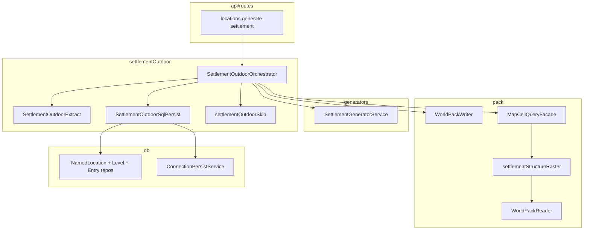
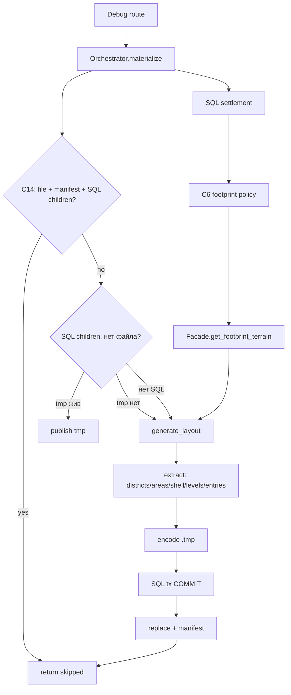

# План: Outdoor settlement на Pack ✅ DONE

> **Статус:** к согласованию · **Код не писать**, пока мастер не скажет «делай»  
> **SoT:** [`docs/tz_settlement_outdoor.md`](../../docs/tz_settlement_outdoor.md) C1–C20  
> **Не трогать:** DAG-ноды, interiors, growth, LLM-имена, mill/grade, радиус событий (C18 — только не разъехаться)

Schema: только [`0001_initial.sql`](../../backend/app/db/migrations/0001_initial.sql) + sync `db/models/`. Не `0002_*.sql`.

---

## 1. Целевое состояние

Master-путь (debug HTTP сейчас, DAG позже тем же методом): на **уже запечённый** pack посадить outdoor-город как **эталон**, не как патч хода.

```
Route (thin)
  → SettlementOutdoorOrchestrator
       materialize(world_uid, location_uid)          # ядро C11
       materialize_all / descendants / by_state      # селекторы C16, цикл ядра
  → SQL NamedLocation (policy C6)
  → MapCellQueryFacade.get_footprint_terrain(rect)   # surface columns, не get_all, не 3D flood
  → SettlementGeneratorService.generate_layout       # pure, без SQL/pack
  → SettlementOutdoorExtract                         # layout → SQL rows + SettlementStructureWire
  → persist C19: Writer.encode_tmp → SqlPersist.tx → Writer.publish
```

| Компонент | Делает | Не делает |
|---|---|---|
| Route | HTTP → orchestrator | generate, persist, `get_all` |
| Orchestrator | порядок, C14 skip, C16 цикл, отчёт failed uids | алгоритм улиц/зданий |
| Generator / assembler | `SettlementLayout` | SQL, pack I/O |
| Extract | детерминированные uid, фильтр C8, map дверей → entry | generate |
| Persist | SQL дерево/граф/levels/entry + pack graph | патчи эталона, LLM |
| `WorldPackWriter` | `.tmp` → `os.replace`, manifest, invalidate | SQL |
| `MapCellQueryFacade` | merge WP-20 **включая** rasterize city; footprint terrain | generate, encode blob |

**Инварианты**

- Generators pure (WP-1). Один layout в RAM — канон и для SQL, и для blob (C19).
- Земля (`location_terrain` / wilderness / L0) этим job **не** переписывается (C1).
- Участок не `location_type` (C3). SQL: settlement → district → building. Area uid только в pack.
- Occupancy-flood (`plan_footprint_occupancy_cells` → патчи) **не** в persist path (C7). Функцию можно оставить для debug-скриптов, HTTP default её не зовёт.
- DAG `lazy_settlement` **не** правим (C13 / P12). После merge route должен звать тот же orchestrator, что когда-то позовёт нода.

`materialize` — **master/debug**, не spawn игрока. Pack TZ «не eager layout всего города на вход в сцену» остаётся: play-read = bbox/`get_scene_volume` (уже есть `SceneVolumePolicy`), не полный dump. Generate пишет **полный** граф в pack (C18).

---

## 1.1 Классы и пакеты (чтобы не плодить костыли)

Один контур. Не второй merge, не второй generator, не persist в route, не FineTerrain для стен.

### Пакеты

| Пакет | Роль | Классы / модули |
|---|---|---|
| `dataModel/worldPack/` | wire + merge enum | `settlementStructureWire.py` (`SettlementStructureWire`, nested district/area/building/shell cell); `SettlementStructureEntry` в `worldPackManifest.py`; `MapLayerKind.CITY_STRUCTURE` в `layerPriority.py` |
| `dataModel/locations/enums/` | роль двери | `entryRole.py` — `EntryRole.FRONT` / `SERVICE`. SQL, extract, repo читают enum, не литералы |
| `db/models/` + `0001` | OLTP | `locationEntryPoint.py`; колонка `entry_role`; `locationLevel.py` как есть |
| `db/repositories/` | SQL only | `iLocationEntryPointRepository` / sqlite; `iLocationLevelRepository` / sqlite (сейчас нет); `INamedLocationRepository`: `list_settlement_like`, `list_descendants`, `list_by_state_uids` — CTE/фильтр **в repo**, не в route |
| `application/worldData/settlementOutdoor/` | **новый** application-пакет: оркестрация + extract + SQL persist | см. ниже. Сюда **не** класть pack codec и не класть assembler |
| `application/worldData/pack/io/` | диск pack | path, encode tmp, publish, blob parse — методы на **существующих** `WorldPackPaths` / `Writer` / `Reader` / `packBlobWire` / `tileCodec` |
| `application/worldData/pack/read/` | raster на read | `settlementStructureRaster.py` + кэш на `PackReadContext` (как fine terrain cache). Вызов из **существующего** `MapCellQueryFacade` |
| `application/worldData/generators/…` | generate only | `SettlementGeneratorService` / assembler **без** правок DAG; probe uid здания можно оставить, rebind в extract |
| `api/routes/locations.py` | HTTP | 5–15 строк: validate world/uid → orchestrator. Никакого generate/persist |

`IPendingRepository` / `session_pending` — **не** использовать (другой домен). C19 pending = файл `.tmp` на диске.

### Новый пакет `settlementOutdoor/`

```
application/worldData/settlementOutdoor/
  settlementOutdoorOrchestrator.py  # materialize + C16 циклы; единственный caller generate+persist
  settlementOutdoorExtract.py       # SettlementLayout → ExtractedSettlement (pure)
  settlementOutdoorUids.py          # uuid5 district/area/building/entry
  settlementOutdoorShell.py         # C8 filter MapCell → shell wire cells
  settlementOutdoorSqlPersist.py    # одна SQL tx; зовёт ConnectionPersistService
  settlementOutdoorSkip.py          # предикат C14 (file+manifest+SQL children)
```

Dataclass extract (не POJO pack, не SQL model):

```
ExtractedSettlement
  districts: list[NamedLocation]
  buildings: list[NamedLocation]
  levels: list[LocationLevel]
  entry_points: list[LocationEntryPoint]   # db model
  nodes / edges: как сейчас collect_connection_graph
  wire: SettlementStructureWire            # канон blob
```

`SettlementPersistService` **не** расширять occupancy/patches. Outdoor path из него **убрать**; класс удалить или оставить deprecated, когда orchestrator закроет все callers. Два persist path = костыль.

`settlementLayoutExtract.py` в assembler: persist-маппинг **переехать** в `settlementOutdoorExtract`. В generators не оставлять parent=district / entry_role.

`SettlementPersistScope` occupancy / map_cells_* — не в HTTP default. Не тащить scopes в orchestrator.

### Pack I/O — методы на существующих классах, не новый Writer

`WorldPackPaths.settlement_structure_path(uid)` → `locations/l.{uid}.settlement.zst`  
tmp = тот же path + `.tmp` (как `_atomic_write`, но **без** replace на шаге encode).

`WorldPackWriter` (не открывает SQL):

| Метод | Когда |
|---|---|
| `encode_settlement_structure_tmp(uid, wire) -> TmpRef(hash, nbytes)` | шаг 1 C19; **не** трогает manifest |
| `publish_settlement_structure(uid, tmp, volume) -> hash` | replace + `settlement_structure_entries` + `save_manifest` |
| `has_published_settlement(uid) -> bool` | файл + строка manifest |

`WorldPackReader.read_settlement_structure(uid) -> SettlementStructureWire`

`tileCodec.PAYLOAD_KIND_SETTLEMENT_STRUCTURE` (новый int, не FINE_TERRAIN).

`write_location_terrain` **не** вызывать для стен.

Encode и publish **разнести**: нынешний `_atomic_write` сразу replace — для city нельзя одним методом «как location_terrain» (между ними SQL).

### Read / merge

```
get_cell:
  patch → scene chunk → path chunk → CITY_STRUCTURE raster → location_terrain → wilderness → L0
```

`settlementStructureRaster.contribution(world, x, y, z) -> CellContribution | None`  
Индекс: manifest entries, чей footprint пересекает точку; кэш decoded wire в `PackReadContext`.

`MapCellQueryFacade.get_footprint_terrain(world, rect) -> list[MapCell]`  
**Только поверхность** (колонка xy → surface z), для assembler `terrain_cells`. Не полный z-столб на весь город (это тот же flood, что occupancy).  
Слои: patch + location + wilderness + L0. **Без** `CITY_STRUCTURE` (не кормить generate своими стенами).

`get_scene_volume` уже есть — после вставки слоя сам подхватит стены в радиусе. Новый «scene facade» не нужен.

### SQL persist

`SettlementOutdoorSqlPersist.persist(world, extracted) -> None`  
Одна транзакция: upsert districts, buildings, levels, entry_points, `ConnectionPersistService.persist_graph`. Bulk через `bulkSql` / существующий `upsert_bulk` на connections.

Не пишет pack. Не зовёт `MapCellService.save_settlement_surface`.

### Orchestrator — единственный порядок C19

```
SettlementOutdoorOrchestrator.materialize(world_uid, location_uid)
  location_repo.get_by_id + C6 policy
  skip.py (C14)
  recovery: SQL дети, нет файла, tmp жив → только publish
  get_footprint_terrain
  SettlementGeneratorService.generate_layout   # существующий
  extract.to_extracted(layout, settlement)
  writer.encode_tmp
  sql_persist.persist          # COMMIT
  writer.publish
  pack_read_context.invalidate
```

Селекторы — методы того же класса, uid из **repo**, цикл `materialize`. Не `SettlementBatchOrchestrator`.

Container: `settlement_outdoor_orchestrator()`. Route и (позже) DAG — только он.

### Кто кого зовёт



### Куда не класть (анти-костыли)

| Запрет | Почему |
|---|---|
| Raster / encode в generator | WP-1; generator отдаёт `SettlementLayout` |
| `collect_geometry_fine_cells` → патчи / location_terrain | C1, C8, P2–P4 |
| Адаптер `FineTerrainZRun` + `system_building_element` на земле | C12, P10 |
| Второй `MapCellQueryFacade` / `CityMergeService` | один merge WP-20 |
| `entry_role` литералами в route/persist | enum в `dataModel` |
| Extract в `api/routes` или в assembler после переезда | layer-boundaries |
| C16 SQL в orchestrator строкой | repo CTE |
| Parallel ThreadPool в orchestrator в этом плане | скорость после C19 |
| Расширять `SettlementPersistService` «ещё одним scope» | два эталона |
| `session_pending` как журнал pack | другой домен |
| Area / plot как `named_locations` | C3 |
| Править `lazy_settlement` node | C13 |

### Uid (один модуль `settlementOutdoorUids.py`)

| Объект | `uuid5` |
|---|---|
| district | `(settlement_uid, district\|{system_name}\|index)` |
| area | `(district_uid, area\|{min_xy}\|facing)` pack only |
| building | `(area_uid, building\|template\|xy)` + parent=district |
| entry | `(building_uid, entry\|{front\|service}\|passage_uid)` |

Assembler `_place_building` может оставить probe uid для cache шаблона; extract **rebind** (уже есть `rebind_layout_to_building`). Assembler **не** ходит в SQL (C5).

---

## 2. Контракты

### 2.1 Pack wire (POJO, `dataModel/worldPack/`)

Один файл на поселение: `locations/l.{settlement_uid}.settlement.zst` (C15).

Новый payload kind в `TileCodec` (не `FINE_TERRAIN`). Не `FineTerrainZRun` (C12).

Черновик графа (имена полей — в POJO, не дублировать литералами в writer):

```
SettlementStructureWire
  schema_id, settlement_uid
  districts[]:
    location_uid, area_uids / areas[]
      area_uid, slot (cells xy, ground_z, facing), barrier/yard/small_layouts (как есть, часто [])
      buildings[]:
        location_uid
        outdoor shell cells  # C8: wall/roof/door/window/archway/foundation
```

Клетки — **поле объекта**, не SoT города (C2). Interior `StructureLayout.cells` / rooms / interior passages — **не** в blob (C8).

Manifest: `settlement_structure_entries[]` (uid, path, hash, bytes, footprint/volume для отбора по bbox). **Не** смешивать с `location_terrain_entries`.

### 2.2 Слой merge (WP-20)

Вставить `MapLayerKind.CITY_STRUCTURE` **выше** `LOCATION`, **ниже** `PATCH`. `PLAYER_SCENE` / `PLAYER_PATH` не переставлять.

Целевой порядок:

```
PATCH → PLAYER_SCENE → PLAYER_PATH → CITY_STRUCTURE → LOCATION → WILDERNESS → WORLD_MAP
```

IntEnum: вставить значение и сдвинуть LOCATION/WILDERNESS/WORLD_MAP (сейчас 3/4/5). Все switch/тесты merge поправить одним слоем.

Rasterize при `get_cell` / volume: если `(x,y,z)` попадает в shell участка/здания пересекающего query — `CellContribution` с `system_terrain` / `system_building_element` / `location_uid` здания. Не column-runs земли.

Play-bbox: существующий `get_scene_volume` + `SceneVolumePolicy` (xy radius уже наружу). Это **карта**. Спека событийного радиуса — другое ТЗ (C18); здесь только не кодировать «сцена = leaf».

### 2.3 Facade

`get_footprint_terrain(world, meter_rect) →` поверхностные колонки для assembler (`terrain_cells`). Merge без `CITY_STRUCTURE`. Не `get_all` мира и не 3D flood всех z (P8 / P1). Play-read по-прежнему `get_cell` / `get_scene_volume`.

### 2.4 SQL

`0001` + модели одним изменением:

| Что | Зачем |
|---|---|
| `location_entry_points.entry_role` `TEXT NOT NULL` (`front` \| `service`) | C20 |
| dataclass + repo `LocationEntryPoint` | P9 |
| persist `location_levels` зданий (модель уже есть) | C9 |
| опционально: строка pending publish (uid, content_hash, tmp name) | C19 crash после COMMIT |

Не писать `location_passages` (C20).

Uid:

| Объект | Правило |
|---|---|
| district `NamedLocation` | `uuid5(settlement_uid, district\|{system_name}\|index)` + `display_name` шаблона |
| area | `uuid5(district_uid, area\|{min_xy}\|facing)` — только pack |
| building | заменить черновой `{world}-{template}-{x}-{y}` (P7) на `uuid5(area_uid, building\|template\|xy)`; `parent_location_uid=district` |
| entry | `uuid5(building_uid, entry\|front\|…)` из наружного `LocationPassage` (`from_level_uid is null`) |

`entry_role`: `main_entrance` → `front`, `service_entrance` → `service`. Здание без ≥1 `front` → ошибка persist, не писать (C20). `service` ≥0.

Generate-authored двери: `is_accessible=true`, difficulty/guard 0. `is_discovered`: **true** (дверь видна как архитектура). Ad-hoc окно/стена не нумеровать.

Дороги: как сейчас `ConnectionPersistService` city+district (C10). `collect_edge_cells` пустой — не invent.

### 2.5 Orchestrator

```python
async def materialize(world_uid, location_uid, *, skip_if_initialized=True) -> MaterializeResult
```

Skip (C14) iff **все**: файл на диске, строка manifest, SQL-дети (district и/или building).

Селекторы (тот же класс, не второй generate), uid ASC, continue + `failed_uids`:

1. `materialize_all(world_uid)` — все `named_location_uses_settlement_fine_footprint`
2. `materialize_under(world_uid, ancestor_uid)` — CTE потомки, из них settlement-like
3. `materialize_state(world_uid, state_uid, *, include_child_states=True)`

v1 селекторы **serial**. Parallel — после того как C19 зелёный (скорость не вместо протокола).

### 2.6 C19 persist protocol

RNG assembler уже `Random(f"{world_uid}_{location_uid}")` — повторный generate после потери tmp **детерминирован**. Всё равно: **не** generate, если tmp жив.

```
1. extract + encode bytes → write `l.{uid}.settlement.zst.tmp` (+ pending hash)
2. SQL transaction: districts, buildings, connections, levels, entry_points (idempotent upsert)
3. COMMIT
4. os.replace tmp → final; upsert manifest entry; invalidate reader; drop pending
```

Шаги 1 и 4 **вне** SQL write-lock.

| Сбой | Действие |
|---|---|
| до COMMIT | стереть tmp/pending; полный materialize |
| после COMMIT, tmp есть | publish без generate |
| после COMMIT, tmp нет | не skip; generate с тем же seed → encode → publish (SQL upsert no-op) |

Запрещено: финальный pack до SQL; skip только по файлу; encode внутри открытой SQL tx.

---

## 3. Data flow



Generate path **serial**. C16 — цикл снаружи. Не parallel в этом плане.

---

## 4. Порядок имплементации (слои, не слайсы)

Каркас типов и writer API **до** наполнения extract. Не «сначала только SQL зданий, pack потом».

### Слой A — types / schema / wire

- POJO `SettlementStructureWire` + manifest `settlement_structure_entries`
- `MapLayerKind.CITY_STRUCTURE` + `LAYER_PRIORITY_ORDER`
- `PAYLOAD_KIND` city structure
- `0001`: `entry_role`; модель `LocationEntryPoint`; pending если берём таблицу
- `AreaLayout` / `DistrictLayout`: поля для `area_uid` / district `NamedLocation` **на extract**, assembler по-прежнему без SQL (C5). Можно не тащить SQL в assembler — extract читает slot+index.

Закрывает заготовки P6, P9, P10 (enum).

### Слой B — pack I/O + merge + bbox

- `WorldPackWriter.encode_settlement_structure_tmp` / `publish_settlement_structure`
- Reader + raster `settlementStructureRaster` в `get_cell`
- `get_footprint_terrain` на facade (поверхность, без city layer)
- Не писать стены в `location_terrain`

Закрывает P8, P10, C12.

### Слой C — extract

- Синтез district NL + area uid
- `collect_building_locations`: parent=district, стабильный uid (P5, P7)
- Shell filter C8 (не `collect_geometry_fine_cells` flatten interiors — P4)
- Levels из `StructureLayout.levels`
- Наружные passages → entry_points + `entry_role`; validate ≥1 front
- **Убрать** occupancy и geometry из persist path (P2, P3). `needs_settlement_outdoor_persist` больше не смотрит `map_cell_patches`

Assembler: не вызывать Structure вне stack. `_place_building` черновые uid — чинить на extract **или** сразу в `_place_building` детерминированным uuid5 **без** SQL. Предпочтение: uuid5 в extract, assembler может оставить probe uid как сейчас для cache шаблона (assembler §7.7), extract rebind (уже есть `rebind_layout_to_building`).

### Слой D — persist SQL + pack graph

- Переписать `SettlementPersistService`: эталон ≠ `save_settlement_surface` / patches
- Одна SQL tx: locations + connections + levels + entries
- Затем publish (C19). Orchestrator владеет порядком encode-до-SQL, чтобы не держать lock на encode: **encode в orchestrator**, persist SQL, writer.publish. Либо persist-сервис принимает уже готовые bytes. Не дублировать протокол в route.

Закрывает P2.

### Слой E — orchestrator

- `SettlementOutdoorOrchestrator.materialize` + три селектора
- Container: не плодить второй generator
- Skip / recovery как §2.6

Закрывает C11, C14, C16, C19.

### Слой F — route + docs

- `POST …/generate-settlement` — thin: policy C6, не `== settlement`, не `get_all`, не occupancy-by-default
- Селекторы: query `all=1` / `under=` / `state_uid=` **или** отдельные debug POST — один orchestrator
- Docs: pack WP-3 уточнить (gameplay = patches; authored city = pack city layer); city §11.5 occupancy/map_cells как эталон — уже superseded, добить формулировки (P11)
- ASCII dump только читает merge (уже так)

Закрывает P1, P11.

**Не в этом плане:** P12 (`lazy_settlement` node).

---

## 5. Приёмка (smoke, backend не стартует агент)

Мир с pack + settlement skeleton. Мастер поднимает сервер.

1. `POST generate-settlement` на uid → SQL: ≥1 district, здания с parent=district, ≥1 `front` на здание, connections city/district, `location_levels`
2. На диске `l.{uid}.settlement.zst` + manifest entry; **нет** flood в `map_cell_patches` на footprint
3. Повтор → skip (C14)
4. Удалить только файл, SQL оставить → повтор **не** skip, pack появляется, дерево не дублируется как новые uid
5. Merge bbox/ASCII: стены/двери **над** `location_terrain`, патч если есть — выше города
6. Селектор `all` / `under` / `state`: continue + failed uids, порядок uid ASC
7. Здание без front (если удастся на фикстуре) → ошибка, pack не publish

---

## 6. Вне слоя (не делать)

Интерьеры и `location_passages`; DAG; growth; LLM-имена; mill/grade; новые города на wilderness; телепорт/SceneInit volume; нумеровать окна как entry; FineTerrain для города; parallel C16; менять `SceneVolumePolicy` «под события».

---

## Changelog плана

| Дата | |
|---|---|
| 2026-08-30 | §1.1 классы/пакеты; `get_footprint_terrain`; не расширять SettlementPersistService |
| 2026-08-30 | v1 по C1–C20, слои A–F |
