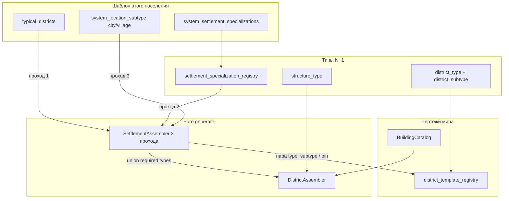
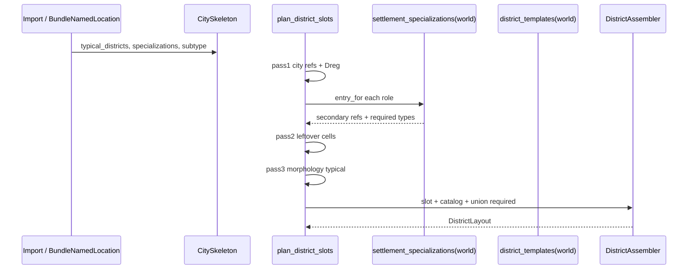

# План: специализация поселения и приоритет районов

**Статус:** контракт имплементации (код 2d в основном есть). **SoT продукта:** [`docs/tz_city_generation.md`](../../docs/tz_city_generation.md) **§1.1–§1.2**, §4.1, §9.2, §9.6. Долг рецепта: **CITY-T-2d** `partial`. Полир планировщика: **[CITY-T-4](./city-t-4-planner-debt-done.md)** → `/impl-city-t-4` (не этот файл).  
**Команда новому агенту (этот план):** `/.cursor/commands/impl-settlement-specialization.md` → `/impl-settlement-specialization`.  
**Уже сделано (не повторять):** [city-three-axes-transition](./city-three-axes-transition-done.md) слои A–F — рецепт морфологии `city`/`village`, `BuildingCatalog`, seed клетки, 2a fill.  
**Не в этом плане:** Gate: DAG; CITY-T-1b persist harness vs игрок; CITY-T-3 parallel; organic footprint; полные интерьеры шахты/театра; **CITY-T-4** смешение/хардкоды. Subjects роли (руда/культура/изделие/домен) — **в этом плане**, не отдельный слой.

Цель: generate читает **шаблон этого поселения**. Список районов на городе первичен, специализация вторична, морфология — добивка. Тип ≠ чертёж (`tavern_1` на город не класть).

Пока слой не стоит — generate с текущим fallback (морфология ∩ зона / legacy), без пустого города.

---

## 1. Целевое состояние



### Слои и ответственность

| Слой | Делает | Не делает |
|---|---|---|
| **dataModel** | `TypicalDistrictRef`; specialization registry + канон ролей; `district_subtype` на чертеже района; канон specialized drawings; stub layout с верным `structure_type`; district subtypes в `location_type_registry`; match type+subtype | SQL packing, HTTP |
| **jsonValidation / worldRow** | Slice реестра ролей; import полей на NL; merge канон⊕мир | Выбор клетки, rng |
| **0001 + db models** | Колонка мира + JSON на `named_locations`; sync dataclass | Incremental `0002` |
| **SettlementAssembler** | Три прохода слотов §9.6; pin `system_name`; union required морфология ∪ роли ∪ район | SQL; pick здания |
| **DistrictAssembler** | Как сейчас: токен по `structure_type` из catalog | Рецепт поселения |
| **settlementOutdoorExtract** | NL района: `system_location_subtype` = `district_subtype` чертежа (null если omit) | Не писать `district_type` в subtype |
| **API / DAG** | без изменений | |

Инварианты:

- Генераторы pure sync, без SQL/`await`.
- `city`/`village` — морфология, не роль. Роли только `system_settlement_specializations`.
- Несколько ролей = **union** районов и `required_structure_types`.
- Проход 1 не вытесняется 2 и 3. Нет клетки под запись города — `warning`, тип не подменять.
- Нет пересечения зона ∩ пул прохода — skip клетки, не «military с пола».
- Omit `district_subtype` на чертеже матчится только с ref без subtype. `extract` не берёт голый `industrial_quarter`.
- Seed чертежа здания — как CITY-T-2c (не трогать). Ничья чертежа **района** — `settlement_cell_rng(..., DISTRICTS)`.
- `village` size ≠ `village` subtype.
- `structure_type` builtin layout = ключ в `required_structure_types` / catalog (`town_hall` не `"building"`).

---

## 2. Контракты

### 2.1 `TypicalDistrictRef`

Один элемент списка на городе и в реестре ролей.

```text
TypicalDistrictRef
  district_type: str              # civic, industrial, agricultural, …
  district_subtype: str | None    # extract, process, …; omit = неспециализированная ткань
  system_name: str | None         # pin чертежа района; только проход 1 на городе
```

Не имя здания. Validator: если `system_name` задан, generate проверяет, что чертёж мира имеет ту же пару type+subtype; иначе warning и pick из пула пары.

### 2.2 Реестр ролей — `worlds.settlement_specialization_registry`

POJO: `SettlementSpecializationEntry` + `WorldSettlementSpecializationRegistry` (`RootModel[list]`).

```text
SCHEMA_ID = "SCH-WORLD-SETTLEMENT-SPEC"
RUNTIME_MERGE_ID_FIELD = "system_specialization"
```

Канон (TZ §4.1) — единственный литерал ролей; assembler читает `settlement_specializations(world).entry_for(key)`, не копирует таблицу.

Инстанс: `system_settlement_specializations` = список объектов `{ system_specialization, subjects[] }` или строка роли. `subjects` — N+1 (iron_ore, wheat, religion, knowledge, …). Реестр: `subject_kind` N+1 (`resource`/`crop`/`product`/`domain`/…), `subjects_to_structure_types` optional. Layout: `subjects[]` — prefer tagged drawing.

| system_specialization | typical_districts | required_structure_types | subjects_to_structure_types |

| system_specialization | typical_districts | required_structure_types |
|---|---|---|
| `extract` | industrial + extract | `mine` |
| `process` | industrial + process | `mill`, `smelter` |
| `manufacture` | industrial + manufacture | `workshop` |
| `culture` | civic + culture | `temple`, `theater` |
| `farm` | agricultural + farm | `farm` |

Неизвестный ключ на поселении — warning, роль пропуск. Пустой typical у роли — районы не тянет, required всё равно в union.

WorldSlice `_registry_slice` + `worldRow.settlement_specializations(world)` (canonical ⊕ world). **Колонка SQL есть** (не копировать дыру `district_template_registry` без колонки).

### 2.3 Поля шаблона поселения

На `SettlementSkeleton` / `CitySkeleton` / `BundleNamedLocation` / `NamedLocation`:

```text
system_settlement_specializations: list[str] | None   # omit / [] = нет прохода 2
typical_districts: list[TypicalDistrictRef] | None    # omit / [] = нет прохода 1
```

SQL `named_locations`: оба JSON TEXT (`json_nullable_col`). Import extra больше не режет поля (`BundleNamedLocation` сейчас `extra=ignore`).

`city_skeleton_from_settlement` копирует оба поля (как `structure_counts`).

### 2.4 Чертёж района

`DistrictTemplateEntry.district_subtype: DefaultOnWire[str | None] = None`.

Канон **добавить** (не ломать существующие без subtype):

| system_name | district_type | district_subtype |
|---|---|---|
| `mining_quarter` | industrial | extract |
| `processing_quarter` | industrial | process |
| `manufacture_quarter` | industrial | manufacture |
| `cultural_quarter` | civic | culture |
| `farm_quarter` | agricultural | farm |

`allowed_structure_types` — как TZ §9.2 таблица. `placement_conditions`: extract/process/manufacture — `min_city_size` town **не** ставить на `farm_quarter` (село). Industrial specialized — как `industrial_quarter` (`min_city_size` town) **кроме** farm. Культурный civic — без min town, чтобы деревня+culture могла посадить, если мастер повесил роль (клетка center).

`location_type_registry` тип `district`: subtypes `extract`, `process`, `manufacture`, `culture`, `farm` в `canonical_engine()`.

### 2.5 Здания-заглушки catalog

Чтобы packing не терял required роли, builtin `BuildingLayoutTemplate` с `structure_type` = ключ роли (минимальный `levels` как у `town_hall`):

`mine`, `mill`, `smelter`, `workshop`, `temple`, `theater`, `farm`.

Заодно выровнять канон: `town_hall.structure_type="town_hall"`, `inn_small.structure_type="tavern"` — иначе `required_structure_types=["town_hall"]` пустой `of_structure_type`. Тесты, завязанные на `"building"`, поправить.

Материал (железо vs пшеница) **не** фильтрует пул в этом плане: один `mine` на все extract.

### 2.6 Три прохода (`plan_district_slots`)

Зона клетки — существующий `_cell_zone`. Предпочтение ткани (TZ §9.6):

```text
CENTER: civic, commercial, residential
EDGE:   port, agricultural, commercial, residential, industrial
INNER:  residential, commercial, industrial, agricultural
```

**Проход 1** — по порядку `typical_districts` города. Для каждой записи: среди **свободных** клеток выбрать с лучшим индексом `district_type` в предпочтении её зоны (стабильный tie-break: row-major). Подобрать чертёж (pin или пул пары). `placement_conditions` не прошли — следующая клетка; все провалились — warning, запись не посажена.

**Проход 2** — оставшиеся клетки в текущем порядке сетки. Пул = union `typical_districts` всех резолвнутых ролей. Алгоритм как нынешний recipe ∩ зона, но ключ = `(district_type, district_subtype)`, не голый type. Нет пересечения — клетка остаётся свободной (не skip навсегда до прохода 3).

**Проход 3** — ещё свободные: typical морфологии (`LocationTypeSubtypeEntry.typical_district_types`) ∩ зона, чертежи **без** `district_subtype` (нынешний `civic_center` и т.д.). Нет рецепта морфологии и пустые 1–2 — **legacy** `select_district_template` только на оставшихся клетках (как сейчас без subtype).

Union required на слот: `required_structure_types` морфологии ∪ всех ролей поселения ∪ resolve района. Не дублировать литералы.

### 2.7 Extract NL района

Сейчас: `system_location_subtype=template.district_type` (`civic`).  
Цель: `template.district_subtype` (nullable). `district_type` остаётся на шаблоне / `system_template_uid`. Тесты outdoor extract и pin overlay — обновить.

---

## 3. Data flow



Path 3: setattr/поля на in-memory NL достаточно, если скелет их читает. Path 2: колонки SQL, иначе после restart роли пропадут.

---

## 4. Сейчас vs цель

| Место | Сейчас | Цель |
|---|---|---|
| Ось 1 | только морфология typical на subtype | город → роли → морфология |
| Поля NL | нет specializations / typical_districts | JSON колонки + skeleton |
| Реестр ролей | нет | канон ⊕ мир |
| Район | только `district_type` | + `district_subtype` |
| Specialized drawings | нет | пять канон-строк |
| Catalog | `town_hall`/`inn_small` с `structure_type=building` | типы = ключи required |
| Extract subtype | `district_type` | `district_subtype` |
| Зона | нет `agricultural` | TZ §9.6 |

---

## 5. Порядок имплементации (слои целиком)

Каждый слой с fallback. Не включать 2a-style «все specialized в каждый слот» до трёх проходов.

| Слой | Что сделать | Готово когда |
|---|---|---|
| **A** dataModel | `TypicalDistrictRef`; specialization POJO+канон; `district_subtype`; 5 чертежей района; stub buildings; district subtypes в engine registry; match helper; `SettlementSkeleton` поля; поправить `structure_type` town_hall/inn | Unit: entry_for, match omit vs extract, канон ролей. Assembler не менять |
| **B** jsonValidation | WorldSlice + `settlement_specializations(world)`; `BundleNamedLocation` поля; geographic extra ignore без 422 | Import мира с реестром и полями NL не 422; runtime merge overlay |
| **C** schema | `0001`: `worlds.settlement_specialization_registry`; `named_locations.typical_districts`, `system_settlement_specializations`; sync `World` / `NamedLocation`; `city_skeleton_from_settlement` | `validate_schema`; recreate DB у мастера |
| **D** SettlementAssembler | Три прохода; preference + agricultural; pin; union required; legacy только на хвосте | Unit path 3: город с port+civic и extract+process; село+farm; пустой шаблон+city subtype = как сейчас морфология |
| **E** extract + tokens | NL subtype = `district_subtype`; cache/required под новые structure_type (уже общий путь E трёх осей) | `test_settlement_outdoor_extract` зелёный |
| **F** | Добить `test_city_three_axes` + узкие тесты 1/2/3 проходов, unknown role, pin mismatch warning. Чеклист path 2 для мастера | Не закрывать без прогона мастером |

Слой материал/ресурс и DAG — **не делать**.

---

## 6. Тесты (узкие)

- Канон registry: `extract` → industrial+extract + `mine`.
- Match: `industrial_quarter` (subtype none) ∉ пул extract; `mining_quarter` ∈.
- Проход 1 забирает CENTER под civic до extract.
- Две роли → оба industrial subtype на разных оставшихся клетках (если сетка позволяет).
- Нет subtype на NL + нет typical_districts + нет ролей → legacy / морфология, не пустая сетка.
- Extract persist: район `mining_quarter` → NL subtype `extract`, не `industrial`.

Не раздувать `debug_settlement.py`.

---

## 7. Path 2 чеклист мастера

После recreate DB (правка `0001`):

1. Мир: канон ролей (пустое поле = merge engine).
2. Поселение `type=settlement`, `subtype=city`, без authored-детей.
3. На NL: `system_settlement_specializations=["extract"]`, `typical_districts=[{district_type: civic}]`.
4. `POST generate-settlement?skip_if_initialized=false` дважды — те же слоты/типы.
5. Среди районов: civic (проход 1) и `mining_quarter` (проход 2), не случайный military.

Агент backend не стартует.

---

## 8. Жёсткие запреты

- Не трогать `application/engine/nodes/`.
- Не стартовать backend. Не коммитить без просьбы.
- Не `0002_*.sql`.
- Не класть `tavern_1` / список зданий на город.
- Не делать subtype поселения = `extract` (это роль, не морфология).
- Не дублировать канон ролей литералом в assembler.
- Не параллелить слоты (CITY-T-3).
- Не подключать `allowed` null на новые районы иначе, чем на канон трёх осей (явный список типов на specialized drawings).
