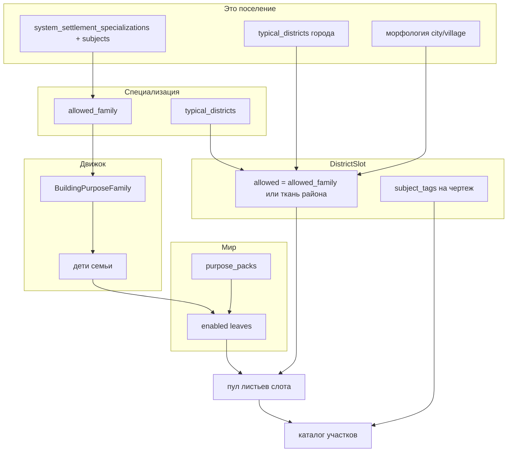

# План: специализация → семья, мир → листья ✅ DONE

**Статус:** сделано в коде (2026-09-13). Тесты city/purpose/registry/packing — OK.  
**SoT после имплементации:** [`docs/tz_city_generation.md`](../../docs/tz_city_generation.md) §1.2 / §4.1 / §9.4; [`docs/tz_building_generator.md`](../../docs/tz_building_generator.md) §2.1; [`docs/tz_pojo_city_typing.md`](../../docs/tz_pojo_city_typing.md).  
**Не в этом плане:** Gate DAG (`engine/nodes/`); CITY-T-2b SQL library; 72 `{leaf}_default` чертежа; pin `civic_center` → `town_hall` (морфология, не `system_specialization`); rename leftover packing stems; **`connections[].role` / `DistrictStreetRole` / §9.5.1** — другой контракт, не трогать.

Цель: **один** контракт «специализация знает семью, мир знает листья». Старый контракт (листья на `SettlementSpecializationEntry` / `subjects_to_structure_types` / omit-allowed = весь каталог как хост специализации) **удаляется**, не живёт рядом как alias.

Термин **специализация** — только `system_specialization` / `system_settlement_specializations` / `settlement_specialization_registry`.

---

## 0. Что зафиксировано (не reopen)

- `BuildingPurpose` / чертёж **не** знают `system_specialization`. Нет такого поля на листе и на JSON участка.
- Мир объявляет живые листья уже существующим `worlds.purpose_packs` → `enabled_building_purposes`. Второй allowlist листьев на мире **не** заводим.
- Запись специализации указывает **ровно одну** семью (`allowed_family`). Не список листьев.
- «Required» в разговоре = **дети семьи**, не must-place. Полей `required_structure_types` / `subjects_to_structure_types` на `SettlementSpecializationEntry` **нет** в целевом POJO.
- Subjects инстанса (руда / культура / скот) режут **чертёж**, не ключ purpose.
- `DistrictAssembler` не читает `settlement_specialization_registry`. На слоте уже штамп фильтра.
- Имя семьи **не** может совпасть с листом (`farm` / `livestock` — листья; семья так называться не может).

Не трогать (другой слой, то же слово `required`):

| Оставить | Почему |
|---|---|
| `LocationTypeSubtypeEntry.required_structure_types` | морфология `city` → `town_hall`, не `system_specialization` |
| `DistrictTemplateEntry.required_structures[]` | pin **чертежа** (`town_hall` на `civic_center`) |
| `RequiredStructure.structure_type` | как сейчас для union морфологии; не поле `SettlementSpecializationEntry` |
| `connections[].role` / `DistrictStreetRole` | класс улицы района (§9.5.1). Не `system_specialization`. Код и ТЗ не менять |

---

## 1. Целевое состояние



### Слои

| Слой | Делает | Не делает |
|---|---|---|
| `BuildingPurpose` дерево | семья → листья; паки | `system_specialization`, районы |
| `SettlementSpecializationEntry` | `allowed_family` + `typical_districts` + `subject_kind` | листья, must-place, mapping subject→лист |
| `SettlementAssembler` | три прохода районов; штамп `slot.allowed`; subjects на слот | pick чертежа |
| `DistrictAssembler` / tokens | fill = `slot.allowed` ∩ catalog ∩ enabled | `settlement_specialization_registry` |
| Морфология | `town_hall` + ткань commercial/residential/port | `allowed_family` записи `extract` |

Инварианты:

- Несколько `system_settlement_specializations` = union **районов** (и штампов на своих слотах), не «одна специализация победила».
- Слот принадлежит специализации, если `district_type`+`district_subtype` совпали с `typical_districts` этой записи — в том числе если район поставил **проход 1**.
- Слот специализации: фильтр = `allowed_family`. `allowed` чертежа района на этих шаблонах **omit**; список листьев на `mining_quarter` удалить.
- Слот без специализации: фильтр = `allowed` чертежа района (ткань = семьи, не omit=весь каталог).
- Пустой пул листьев (пак вырезал всю семью) → leftover + warning, **не** `house`.
- Нет чертежа у живого листа → warning packing (`NO_CACHE` / cache без кандидатов), не молчание и не подмена листа.

---

## 2. Контракты

### 2.1 Семьи 1:1 с каноном `system_specialization`

Сейчас `public` и `agrarian` шире канона специализаций. Оставлять как есть = leftover-смешение (ратуша в `culture`, стойла в `farm`).

Новые семьи (имена **не** совпадают с листьями):

| Семья | Листья (переезд) | `system_specialization` |
|---|---|---|
| `extract` | как сейчас: `mine`, `quarry`, `lumber_camp` | `extract` |
| `process` | как сейчас | `process` |
| `craft` | как сейчас | `manufacture` |
| `culture` **новая** | из `public`: `temple`, `shrine`, `church`, `theater`, `library` | `culture` |
| `cultivation` **новая** | из `agrarian`: `farm`, `orchard`, `vineyard`, `apiary`, `fishery` | `farm` |
| `husbandry` **новая** | из `agrarian`: `livestock`, `stable` | `livestock` |

`public` после переезда: `town_hall`, `plaza`, `school`, `hospital`, `bathhouse`, `courthouse`.  
Семью `agrarian` **удалить** (не alias на cultivation).  
`factory` **не** вешать на `manufacture`. Steampunk-заводы — ткань голого `industrial_quarter` (см. 2.3), не запись специализации.

Канон `settlement_specialization_registry`:

```text
extract      allowed_family=extract       typical industrial+extract
process      allowed_family=process       typical industrial+process
manufacture  allowed_family=craft         typical industrial+manufacture
culture      allowed_family=culture       typical civic+culture
farm         allowed_family=cultivation   typical agricultural+farm
livestock    allowed_family=husbandry     typical agricultural+livestock
```

`PACK_PURPOSES`: `_family_set(AGRARIAN)` → cultivation ∪ husbandry; `_FANTASY_PUBLIC` без переехавших в `culture` листьев + `_family_set(CULTURE)` (фентези: без `church`).

### 2.2 `SettlementSpecializationEntry`

```text
system_specialization
display_specialization
subject_kind
typical_districts
allowed_family: BuildingPurposeFamily   # обязателен, ровно один
```

Удалить поля и метод:

- `required_structure_types`
- `subjects_to_structure_types`
- `resolved_structure_types(subjects)`

Резолв листьев — не метод записи с subjects, а:

```text
leaves_for_family(family, enabled) -> tuple[BuildingPurpose, ...]
# = children_of(family) ∩ enabled
```

Живёт в `dataModel` рядом с деревом purpose (потребители тонкие). Мир в `SettlementSpecializationEntry` не импортировать.

**Запрет legacy wire (не ignore):** в `model_validator` — если в payload есть `required_structure_types` или `subjects_to_structure_types` → `ValidationError`. Не AliasChoices, не silent drop (`extra=ignore` сейчас проглотит старый JSON и запись останется без семьи). Overlay мира со старым реестром должен **упасть на import**, не сгенерировать шахту из leftover.

Лист в `allowed_family` (`"mine"`) → ValidationError. Семья неизвестна → ValidationError.

### 2.3 Чертежи районов

Шаблоны с `district_subtype` специализации: **omit** `allowed_structure_types` (фильтр придёт со штампа `allowed_family`). Сейчас удалить листья:

| `system_name` | Удалить |
|---|---|
| `mining_quarter` | `["mine"]` |
| `processing_quarter` | `["mill", "smelter"]` |
| `manufacture` quarter | `["workshop"]` |
| `cultural_quarter` | `["temple", "theater", "library"]` |
| `farm` quarter | `["farm", "mill"]` — `mill` чужая семья, не переносить |
| livestock quarter | `["livestock"]` |

Ткань **без** `district_subtype` (иначе omit=весь каталог останется дырой хоста):

| Шаблон | `allowed_structure_types` |
|---|---|
| `civic_center` | оставить `["town_hall"]` + pin чертежа (морфология, узкий civic) |
| `commercial_quarter` | `["trade"]` |
| `residential_quarter` | `["dwelling"]` |
| `port_district` | `["harbor", "trade"]` |
| `industrial_quarter` (без subtype) | `["extract", "process", "craft", "factory"]` |

ТЗ-пример port с голым списком листьев (`warehouse`, `tavern`, …) заменить на семьи. Не держать второй канон.

### 2.4 `DistrictSlot`

Поле `allowed_structure_types` — **эффективный** фильтр слота (семьи и/или листья). Packing и host читают **только его**, не `slot.district_template.allowed_structure_types`.

Штамп при materialize:

1. Найти записи `settlement_specialization_registry`, чей `typical_districts` совпал с type+subtype шаблона.
2. Есть совпадение → `[entry.allowed_family]` каждой совпавшей записи (канон: одна).
3. Нет → как на чертеже района.

`subject_tags`: все subjects `SettlementSpecializationBind` вешаются на **все** resolved-листья семьи этой записи (не mapping knowledge→library). Packing по-прежнему tagged → kind → untagged на чертеже.

### 2.5 Settlement-required / host

`SettlementSpecializationEntry` **больше не** добавляет листья в `settlement_required`.

`union_required_structures` / `unhosted_settlement_types` остаются **только** для морфологии (`town_hall`) и district pins. Хост: membership по **штампу слота**, не по шаблону; omit на штампе не бывает для ткани из 2.3.

`specialization_extras()` сейчас возвращает `(required_types, subject_tags)`. Целевое: **один** resolve (refs + subject tags + family per ref). Outdoor `load_topology_slots` зовёт тот же helper, не дублирует чтение bind. Поле «required types с `SettlementSpecializationEntry`» из extras **удалить** (это CITY-T-5l, закрыть в том же PR, не оставлять второй путь).

Must-place «обязательно шахта»: нет. Fill слота специализации идёт по всему пулу `leaves_for_family ∩ catalog`. Нет ни одного живого листа / чертежа → warning.

### 2.6 Generate / packing

`tokens.py`: `allowed = slot.allowed_structure_types` (штамп). Строку с `district_template.allowed` убрать.

`allowed_fill_structure_types` / like/strict / packs — без второго параллельного словаря.

---

## 3. Поток данных

```
system_settlement_specializations + settlement_specialization_registry
  → typical_districts записи (проход 2) ∪ штамп на слотах, совпавших и в проходе 1
  → slot.allowed = allowed_family
       → expand ∩ purpose_packs ∩ catalog.structure_types
            → fill C22
  subjects bind → slot.subject_tags на листьях пула → фильтр чертежа
морфология city
  → required town_hall → host civic_center (штамп allowed содержит town_hall)
  → проход 3: commercial/residential/… со своими семьями ткани
```

SQL `0001`: колонка `settlement_specialization_registry` уже JSON. **Не** менять схему, если overlay тот же blob. После смены формы канона — recreate локальной БД как обычно (не `0002`).

---

## 4. Порядок имплементации (слои, не слайсы фич)

Один PR / одна поставка контракта. Не оставлять «пока `required_structure_types` ещё пишет `mine`, а `allowed_family` уже есть».

1. **Дерево purpose** — семьи `culture` / `cultivation` / `husbandry`; удалить `agrarian`; переезд листьев; `PACK_PURPOSES`; тесты `test_building_purpose` (FAMILY_OF church → culture).
2. **`SettlementSpecializationEntry`** — `allowed_family`; канон `_CANONICAL_ENTRIES`; reject старых ключей; удалить метод `resolved_structure_types`.
3. **Resolve helper** в dataModel (`leaves_for_family`); тонкий shim worldRow уже даёт enabled.
4. **DistrictSlot + planner** — штамп allowed; `_resolve_specialization` без leaf-union с записи; один helper для generate и outdoor.
5. **Канон районов** — omit на шаблонах с `district_subtype`; семьи на ткани; убрать `mill` с farm.
6. **`tokens.py`** — только штамп слота.
7. **ТЗ** — §1.2, §4.1 JSON `settlement_specialization_registry`, §9.2/§9.4 хост, таблица семей в building §2.1, pojo-city-typing, changelog. Строки «union `required_structure_types` специализаций» заменить на `allowed_family`. §9.5.1 не входит.
8. **Тесты** — `test_city_three_axes` (extract больше не `["mine"]`; culture+knowledge не подменяет пул на `library`); host: `mine` не садится в commercial; fantasy extract-слот fill ∩ {mine, quarry, lumber_camp}; modern-only мир без extract-листьев → warning; ValidationError на старом JSON `SettlementSpecializationEntry`.
9. **Grep-приёмка** (должно быть 0 вне морфологии / changelog-истории):

```
subjects_to_structure_types
resolved_structure_types
agrarian
SettlementSpecializationEntry.*required_structure_types
district_template.allowed_structure_types   # в tokens.py / outdoor host
```

`required_structure_types` на `LocationTypeSubtypeEntry` / `worldLocationTypeRegistry` — **оставить**.

Не в этом PR: DAG; 72 default-чертежа; `building` wire alias (уже запрещён); `connections[].role`.

---

## 5. Явно не делать (иначе leftover)

- Alias `required_structure_types` → expand семьи.
- `extra=ignore` без reject мёртвых ключей.
- Intersection «allowed района ∩ `allowed_family`» на слоте специализации (два источника правды).
- Писать `system_specialization` на `BuildingPurpose`.
- Подставлять `house` / `town_hall`, если пул семьи пуст.
- Держать `specialization_extras` с листовым required «на потом».
- Семья `farm` / `livestock` (коллизия с листом).
- `manufacture` → две семьи craft+factory в каноне `SettlementSpecializationEntry`.
- Трогать `connections[].role`, `DistrictStreetRole`, `districtConnection.py`, ТЗ §9.5.1.

---

## 6. Зависимости снаружи

Полный `{leaf}_default` каталог **не** блокирует этот переход: пул листьев станет шире, чем чертежи — это уже warning каталога, отдельная очередь. После этого плана дыра «специализация не связана с типами» закрыта; дыра «нет JSON участка» остаётся видимой, не замаскированной 11 тегами.

---

## Changelog ТЗ (когда будут править docs)

- `SettlementSpecializationEntry`: `allowed_family`, не `required_structure_types`.
- Subjects не меняют набор purpose.
- Хост специализации = слот со штампом `allowed_family`, не omit commercial.
- Семьи `culture` / `cultivation` / `husbandry`; `agrarian` удалён.
