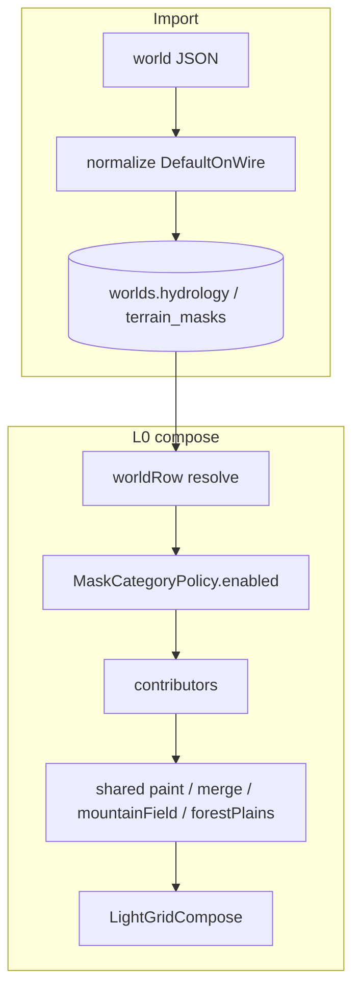

# Plan: Surface mask domains — архитектурно чистый rewrite ✅ DONE

> **Статус:** domains A–F done · **open:** [mountain-engine-kind-form-sides-done.md](./mountain-engine-kind-form-sides-done.md)  
> **SoT ТЗ:** [`docs/tz_map_light_bake.md`](../../docs/tz_map_light_bake.md) § **Mountain (engine)**

---

## Open fix: mountain engine

**Актуально:** [`mountain-engine-kind-form-sides-done.md`](./mountain-engine-kind-form-sides-done.md)  
ТЗ: § **Mountain (engine)** — Kind / Form / Sides (не плоский тип, не N+1).

---

## Done (A–F)

- `MaskCategoryPolicy` + `WorldTerrainMasks` + SQL/`World.terrain_masks` + worldSlices/worldRow
- Hydro categories extend shared base
- Shared `resolveForestPlains` / `mountainField` / `terrainMerge`; paint in `lightGrid/paintTerrain`
- Pipeline: relief→climate→landcover→mountain→ravine→hydro→settlement→road
- Deleted `Light*Policy`, `surfaceLandcover`, z-band / mountain-in-landcover interim

See acceptance SM-* in tests: `test_terrain_masks`, `test_light_grid_compose`.

---

## 1. Целевое состояние

### 1.1 Принципы

| # | Принцип |
|---|---|
| P1 | Один паттерн policy на все mask-домены (hydro уже близок; terrain_masks — тот же) |
| P2 | Один shared base POJO `enabled`/`autoresolve` — **не** копировать поля в каждый category |
| P3 | Generators/contributors **тонкие**: читают world row → domain policy → paint helper |
| P4 | Один merge SoT для `system_terrain` (приоритет в одном месте) |
| P5 | **Delete, don’t deprecate:** interim файлы/API удаляются в том же PR-слое, что вводит target |
| P6 | Normalize → DB; runtime не подставляет POJO `canonical_defaults()` мимо строки мира (кроме пустого мира до import — через worldRow, уже как climate/hydro) |

### 1.2 Корни данных

```text
world.hydrology          # без второго дерева флагов
world.terrain_masks      # NEW: WorldTerrainMasks (колонка worlds + POJO)
connection graph         # geometry roads; enable — в terrain_masks.default_roads
```

```text
WorldTerrainMasks
  enabled: DefaultOnWire[bool] = True          # global opt-out всех terrain masks
  default_mountains: MountainsCategoryPolicy
  default_forests:   ForestsCategoryPolicy
  default_plains:    PlainsCategoryPolicy
  default_ravines:   RavinesCategoryPolicy
  default_roads:     RoadsCategoryPolicy
  # declared_* later (mountains geometry) — можно v1 через geographic locations only
```

Каждый `*CategoryPolicy` **наследует / встраивает** shared:

```text
MaskCategoryPolicy          # NEW shared (dataModel/common или dataModel/masks/)
  enabled: DefaultOnWire[bool] = True
  autoresolve: DefaultOnWire[bool] = True
  # optional IgnoreOnWire overlays — per-field as needed

HydrologyCategoryPolicy     # REFACTOR: extends / embeds MaskCategoryPolicy
  # + bands (hydro-specific)

MountainsCategoryPolicy     # MaskCategoryPolicy + mountain knobs (density, min_massif, …)
ForestsCategoryPolicy       # MaskCategoryPolicy + rainfall knobs (из нынешнего LightLandcover без mountain)
…
```

**Не** держать `LightLandcoverPolicy` / `LightRavinePolicy` / `LightRoadPaintPolicy` рядом с `WorldTerrainMasks` — knobs **переезжают** в category policies; interim POJO **удаляются**.

### 1.3 Shared application infra (один раз)

| Модуль | Ответственность |
|---|---|
| `dataModel/masks/maskCategoryPolicy.py` | shared `enabled`/`autoresolve` |
| `dataModel/terrainMasks/worldTerrainMasks.py` | root + categories |
| `application/.../masks/terrainMerge.py` | приоритет `road > ravine > mountain > forest > plains` + hydro preserve |
| `application/.../masks/paintTerrain.py` | paint `system_terrain` на light cell / set of light indices (dilate optional) — **один** helper для mountain/ravine/road |
| `application/.../masks/resolveForestPlains.py` | climate → forest/plains/tundra (**без** mountain) |
| `application/.../masks/mountainField.py` | autoresolve mountain field (seed+climate) — pure generator |
| `pack/bake/lightGrid/contributors/*` | thin: `if not policy.enabled: return` → call shared |

Hydro raster (`paint_role`) остаётся hydro-only; terrain paint — отдельный helper, **не** copy-paste dilate/bresenham (reuse `light_polyline_from_meters` / `dilate` из hydro/raster как shared geom).

### 1.4 Pipeline (target, без legacy order)

```text
relief → climate → plains/forest (landcover) → mountain → ravine → hydro → settlement → road
```

| Contributor | Читает | Пишет |
|---|---|---|
| landcover | `default_forests` / `default_plains` + climate_zone | forest/plains/tundra |
| mountain | `default_mountains` + declare geographic + mountainField | mountain |
| ravine | `default_ravines` | ravine |
| hydro | `world.hydrology` | hydrology_* |
| road | `default_roads` + edges | road |

### 1.5 Data flow



---

## 2. Что удалить (zero legacy)

В том же rewrite-слое, **без** `deprecated` aliases «на потом»:

| Удалить | Почему |
|---|---|
| `LightLandcoverPolicy` (+ mountain-from-z knobs) | knobs → `Forests`/`Plains`/`Mountains` categories |
| `LightRavinePolicy` / `LightRoadPaintPolicy` как отдельные bake-only POJO | fold into `WorldTerrainMasks` |
| mountain branch в `resolve_surface_landcover` | гора ≠ landcover |
| `surface_terrain_at_z` как public API, если только wrapper | callers → `resolveForestPlains` / column path явно |
| Дубль `generators/climate/terrainZ.py` re-export, если не нужен одному caller | один import path |
| Тесты на mountain-via-landcover z | заменить на mountain domain tests |
| Любой «interim» комментарий + второй код path | один path |

**Допустимо оставить** только то, что target: `subsurface_terrain_at_z` / magma (не mask domain).

Registry keys `ravine`/`road` в `WorldTerrainRegistry` — **оставить** (каталог ключей, не policy).

---

## 3. Контракты (до кода)

### 3.1 POJO

- [ ] `MaskCategoryPolicy` — shared base  
- [ ] `WorldTerrainMasks` + 5 category models + `SCHEMA_ID`  
- [ ] Refactor `HydrologyCategoryPolicy` → использовать shared base (**без** дубля `enabled`/`autoresolve` литералами)  
- [ ] `canonical_defaults()` / fixture sync `world_template.json` + `world_terrain_test.json`  
- [ ] worldRow + facade normalize + **колонка** `worlds.terrain_masks` в `0001_initial.sql` + dataclass `World` (один PR schema+model)

### 3.2 Shared algo

- [ ] `TerrainMaskRank` / merge helper — единственный приоритет  
- [ ] `paint_system_terrain(compose, cells, key, *, preserve_hydro)`  
- [ ] `resolve_forest_plains(...)` — только biome  
- [ ] `autoresolve_mountains(...)` → set of light cells or per-cell decision (pure; seed+climate+policy)

### 3.3 Contributors

- [ ] Каждый: early exit на `not enabled`  
- [ ] Mountain contributor **новый**; landcover **без** mountain  
- [ ] Road/ravine зовут `paint_system_terrain`, не локальный copy  
- [ ] Hydro: уже читает `WorldHydrology`; проверить global+subtype enabled единообразно (без нового параллельного gate)

### 3.4 Column / heightmap

- [ ] Surface biome для column/heightmap — тот же `resolve_forest_plains` + чтение `terrain_masks` с мира  
- [ ] **Не** звать mountain autoresolve на каждую column cell в обход L0 (L2 читает parent light; coarse heightmap — plains/forest или parent mask later)

---

## 4. Порядок имплементации (слои, не «сначала только лес»)

| Шаг | Слой | Результат | Удаление legacy в этом шаге |
|---|---|---|---|
| **A** | dataModel shared + `WorldTerrainMasks` + SQL/World + normalize/worldRow | SoT в БД | — |
| **B** | Refactor `HydrologyCategoryPolicy` → shared base | один enabled/autoresolve | дубли полей hydro category |
| **C** | Shared `paint` + `merge` + `resolve_forest_plains` + `mountainField` | algo once | — |
| **D** | Rewrite contributors + bake order + gates | pipeline target | удалить Light*Policy, mountain-in-landcover, старые resolve API |
| **E** | heightmap/column на shared forest/plains | нет второго biome path | wrappers `surface_terrain_at_z` если ещё живы |
| **F** | Tests + fixtures + TZ MLB-9/10 sync | приёмка | interim tests |

**Запрещено:** шаг «оставить LightLandcoverPolicy как alias на ForestsCategory». Либо fold+delete, либо не мержить шаг D.

Stub на границе caller (например denseness knobs = defaults) — только если POJO field уже есть; не второй dict в contributor.

---

## 5. Антидубли (чеклист ревью)

- [ ] Нет двух POJO с одними knobs  
- [ ] Нет `_PRESERVE_HYDRO` скопированного в 3 файла → одна константа/helper рядом с paint  
- [ ] Нет `enabled: bool = True` литералом вне `MaskCategoryPolicy`  
- [ ] Нет mountain decision вне `mountainField` / mountain contributor  
- [ ] Нет forest decision вне `resolve_forest_plains`  
- [ ] Hydro flags только из `world.hydrology`  
- [ ] Grep после D: `LightLandcoverPolicy`, `mountain_above_typical`, `resolve_surface_landcover` → **0 hits** (кроме git history)

---

## 6. Приёмка

| ID | Критерий |
|---|---|
| SM-1 | Нет ключа `terrain_masks` в JSON → normalize → DB `enabled=true` на categories; bake рисует домены |
| SM-2 | `default_mountains.enabled: false` → 0 mountain cells; forests могут остаться |
| SM-3 | Empty declare + mountains enabled → mountain cells > 0 (autoresolve) |
| SM-4 | `default_roads.enabled: false` + edges → 0 road paint |
| SM-5 | Merge order: road побеждает ravine/mountain на той же cell |
| SM-6 | Grep interim names = 0; один import path biome |
| SM-7 | Hydrology category всё ещё работает; shared base не ломает HY tests |

---

## 7. Вне scope (этого плана)

- DAG nodes  
- Полный `declared_mountains[]` geometry wire (v1: geographic location bias + autoresolve field)  
- L2 перекраска biome независимо от parent light  
- UI редактора миров  

---

## 8. Решение по текущему преждевременному коду

**Не оставлять как legacy.** При старте шага D — удалить interim в том же изменении, что подключает `WorldTerrainMasks`.  
До команды на код: дерево может содержать interim; план считает его **к удалению**, не к «поддержке».

---

## 9. Команда на старт

После согласования этого плана пользователем: явная фраза «делай / имплементируй план» → шаг A→F без промежуточного dual-path.
